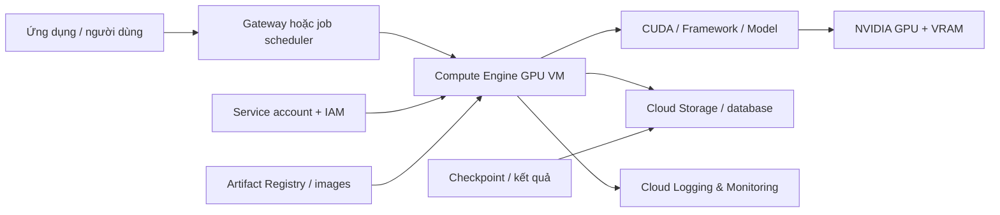
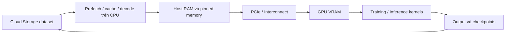

# GPU trên Compute Engine và lựa chọn cấu hình tăng tốc

GPU (Graphics Processing Unit) có hàng nghìn lõi tính toán song song và băng thông bộ nhớ chuyên dụng, phù hợp với AI inference, training, xử lý ảnh/video, đồ họa 3D và một số bài toán HPC. Trên Google Cloud, **Compute Engine** cho phép chạy VM có GPU bằng các machine series tăng tốc chuyên dụng hoặc bằng cách gắn GPU được hỗ trợ vào VM N1.

Chọn GPU không chỉ là chọn card có số TFLOPS lớn nhất. Một workload có thể bị giới hạn bởi **VRAM**, kích thước model, memory bandwidth, CPU/RAM, network, disk throughput, khả năng cấp phát trong zone, driver/CUDA và ngân sách. Một GPU mạnh nhưng bị chờ dữ liệu từ Cloud Storage hoặc bị thiếu bộ nhớ có thể cho hiệu năng/chi phí thấp hơn cấu hình nhỏ, được tối ưu đúng.

Bài học nằm trong chương **Hạ tầng chuyên biệt** của module **CLOUD_PROVIDERS_GCP**. Kiến thức xây trên nền tảng tổ chức project, IAM, VPC, Compute Engine, GKE, Cloud Run, lưu trữ/dữ liệu và giám sát độ tin cậy cùng chi phí. Các ví dụ chỉ tạo hoặc cài tài nguyên khi bạn chủ động thực thi trong **project sandbox được phê duyệt**; VM GPU có thể phát sinh chi phí lớn ngay sau khi cấp phát.

## 1. Mục tiêu học tập

Sau bài học, bạn có thể:

- Giải thích GPU, VRAM, tensor cores, memory bandwidth và cách chúng tác động workload.
- Phân biệt Compute Engine N1 gắn GPU với accelerator-optimized machine series G2, G4, A2, A3, A4 và các thế hệ cao hơn.
- Chọn GPU dựa trên inference, fine-tuning, training phân tán, video/visualization hoặc HPC.
- Kiểm tra region/zone, quota, capacity, reservation và giới hạn machine type trước khi tạo VM.
- Tạo VM GPU thử nghiệm bằng Google Cloud CLI và hiểu các tham số scheduling, boot disk, IAM.
- Cài/kiểm tra NVIDIA driver, CUDA runtime và khả năng dùng GPU từ container.
- Benchmark utilization, throughput, latency và chi phí theo đơn vị công việc.
- Áp dụng Spot, reservations, checkpointing, autoscaling và các biện pháp FinOps phù hợp.
- Chẩn đoán lỗi `nvidia-smi`, driver mismatch, OOM, quota/capacity và bottleneck dữ liệu.
- Thiết kế vận hành an toàn, bảo mật và có thể tái lập.

## 2. GPU nằm ở đâu trong kiến trúc GCP?



Một VM GPU vẫn có vCPU, RAM, NIC, boot disk, hệ điều hành, firewall và service account. GPU là thành phần tăng tốc chứ không thay thế CPU. Nếu pipeline dữ liệu giải mã ảnh hoặc tokenize text trên CPU quá chậm, GPU có thể nhàn rỗi.

### 2.1. Khi nào GPU thực sự có lợi?

| Workload | Lợi ích GPU | Điểm cần đo |
|---|---|---|
| Inference LLM, embedding, computer vision | Song song hóa tensor/matrix operations | Tokens/s, requests/s, p95 latency, VRAM |
| Fine-tuning model | Backpropagation và tensor math | Samples/s, thời gian/epoch, GPU utilization |
| Training phân tán | Nhiều GPU xử lý batch/model | Step time, all-reduce, interconnect, checkpoint time |
| Video transcode | Hardware encoder/decoder hỗ trợ | Frames/s, codec, latency, stream count |
| Rendering / virtual workstation | Graphics pipeline/RTX, display | Frame rate, resolution, vWS license |
| HPC/Scientific computing | Đẩy phép toán sang GPU khi library hỗ trợ | Precision FP64/FP32, memory bandwidth, scaling |
| CRUD web API thông thường | Thường không có lợi | Benchmark CPU trước khi mua GPU |

**Đừng chọn GPU chỉ vì workload “liên quan AI”.** Một API gọi mô hình qua dịch vụ managed có thể không cần VM GPU riêng. Cần đánh giá cả vận hành driver, patching, khả năng scale-to-zero, độ sẵn sàng và ngân sách.

## 3. GPU khác CPU như thế nào?

- **CPU:** tối ưu điều khiển, luồng tuần tự, latency thấp và tác vụ đa dạng.
- **GPU:** nhiều đơn vị xử lý song song, hiệu quả khi khối lượng phép toán lớn và có thể chia batch.
- **VRAM:** bộ nhớ trực tiếp trên GPU để chứa weights, activations, KV cache, intermediate tensors.
- **Host RAM:** bộ nhớ VM, không đồng nghĩa với VRAM. Copy qua PCIe/NVLink/NVSwitch có chi phí truyền.
- **Memory bandwidth:** tốc độ chuyển dữ liệu giữa GPU cores và VRAM, quan trọng với memory-bound workloads.
- **Tensor cores:** phần cứng tăng tốc matrix operations ở precision cụ thể (FP16/BF16/FP8/INT8 tùy GPU/framework).
- **Interconnect:** đường trao đổi dữ liệu giữa GPU cùng host hoặc giữa host; có thể quyết định khả năng training phân tán.

GPU có tổng VRAM 8 × 80 GB không có nghĩa một process bất kỳ có thể dùng nguyên khối 640 GB như một GPU đơn. Model parallelism và framework phải phân phối tensor, communication và memory cho từng device.

### 3.1. Memory budget khi inference

Một ước lượng đơn giản cho trọng số model chưa tính overhead:

```text
weights_bytes ≈ parameter_count × bytes_per_parameter

Ví dụ model 7 tỷ tham số:
  FP16: 7e9 × 2 bytes ≈ 14 GB cho weights
  INT8: 7e9 × 1 byte  ≈ 7 GB cho weights
  INT4: 7e9 × 0.5 byte ≈ 3.5 GB cho weights
```

Đó **chỉ là weights**, chưa bao gồm activation buffers, KV cache, tokenizer, runtime, CUDA kernels, temporary workspace, fragmentation, quantization metadata, batching và model architecture. Vì vậy, không nên kết luận “model FP16 14 GB sẽ chạy ổn trên GPU 16 GB” khi chưa đo thực tế.

### 3.2. Chọn batch và context length

- Batch lớn có thể tăng throughput nhưng làm tăng VRAM và đôi khi latency từng request.
- Context length dài làm KV cache tăng.
- Dynamic batching giúp tận dụng GPU khi traffic biến động.
- Quantization có thể giảm VRAM và chi phí nhưng phải kiểm tra sai lệch độ chính xác.
- CPU offload hoặc model sharding có thể cho phép model lớn hơn nhưng tăng latency và complexity.
- Training cần VRAM cho gradients, optimizer states và activations ngoài weights, thường lớn hơn inference.

## 4. Các cách dùng GPU trên Compute Engine

Có hai nhóm cấu hình chính:

1. **Accelerator-optimized VM:** GPU được gắn sẵn theo machine type; gồm G và A series.
2. **N1 general-purpose VM gắn GPU:** chọn machine type N1 được hỗ trợ rồi thêm GPU theo loại/số lượng hợp lệ.

Không phải mọi GPU đều có thể gắn thêm vào N1, và không phải mọi GPU đều có sẵn trong mọi vùng. Với accelerator-optimized series, thông số vCPU/RAM/network thường đi cùng machine type và có những giới hạn không thể tự thay đổi.

### 4.1. Tổng quan các nhóm GPU

| Machine family | GPU điển hình | Hướng workload |
|---|---|---|
| N1 + GPU được hỗ trợ | T4, P4, V100 | Inference cũ, đồ họa và workload duy trì legacy |
| G2 | NVIDIA L4 | Inference tối ưu chi phí, media, đồ họa, fine-tuning nhỏ |
| G4 | NVIDIA RTX PRO 6000 Blackwell | Inference, visualization, rendering, video, training nhỏ |
| A2 Standard / Ultra | NVIDIA A100 40 GB / 80 GB | Training, fine-tuning, HPC và inference cần HBM |
| A3 High/Mega/Edge | NVIDIA H100 | Training/serving cỡ lớn, network-intensive |
| A3 Ultra | NVIDIA H200 | Model lớn, throughput và HBM dung lượng cao |
| A4 | NVIDIA B200 | Training/serving foundation models quy mô lớn |
| A4X / A4X Max | NVIDIA GB200/GB300 superchips | Supercomputer-class AI workloads |
| A5X | NVIDIA Vera Rubin superchips | Workload AI phân tán thế hệ mới, yêu cầu hạ tầng đặc biệt |

Danh mục trên phản ánh họ GPU trong tài liệu Compute Engine hiện hành; tính thương mại, machine type cụ thể, zone, quota và phương thức cấp phát có thể thay đổi. **Không dùng bảng này làm cam kết có sẵn capacity hoặc giá tại một region.** Kiểm tra trang GPU machine types, accelerator-optimized machine family và GPU locations trước khi thiết kế.

### 4.2. G2: NVIDIA L4

G2 có GPU L4 gắn sẵn, phù hợp inference, graphics/video và workload cần cân bằng giá/hiệu năng. Ví dụ:

| Machine type | vCPU | RAM mặc định | GPU | Tổng VRAM |
|---|---:|---:|---:|---:|
| `g2-standard-4` | 4 | 16 GB | 1 × L4 | 24 GB |
| `g2-standard-24` | 24 | 96 GB | 2 × L4 | 48 GB |
| `g2-standard-48` | 48 | 192 GB | 4 × L4 | 96 GB |
| `g2-standard-96` | 96 | 384 GB | 8 × L4 | 192 GB |

Các thông số là cấu hình mặc định/giới hạn trong tài liệu Compute Engine; G2 có tùy chọn RAM tùy machine type. Tăng số GPU không tạo một VRAM thống nhất, và throughput không tăng tuyến tính nếu CPU, mạng hoặc batch quá nhỏ.

### 4.3. G4: NVIDIA RTX PRO 6000

G4 sử dụng NVIDIA RTX PRO 6000 Blackwell Server Edition, phù hợp visualization/RTX, transcoding, inference và một số kiểu training. Một số machine type nhỏ dùng **fractional GPU**:

| Machine type | Đặc tính | VRAM hiển thị |
|---|---|---:|
| `g4-standard-6` | 1/8 GPU | 12 GB |
| `g4-standard-12` | 1/4 GPU | 24 GB |
| `g4-standard-24` | 1/2 GPU | 48 GB |
| `g4-standard-48` | 1 GPU | 96 GB |
| `g4-standard-96` | 2 GPU | 192 GB |

**Lưu ý:** G4 fractional GPU có hạn chế zone/availability rất cụ thể; theo trang GPU locations hiện hành, những loại nhỏ hơn một GPU chỉ có ở một số zone nhất định. Không chọn fractional GPU rồi giả định có thể đặt trong mọi zone G4.

Với ứng dụng graphics/remote workstation, kiểm tra thêm hỗ trợ và chi phí giấy phép NVIDIA RTX Virtual Workstation (vWS). License là một thành phần sizing và cost model riêng khi tính năng đó được sử dụng.

### 4.4. A2: NVIDIA A100

A2 phù hợp fine-tuning/training model lớn hơn hoặc inference cần memory bandwidth/HBM:

- A2 Standard: A100 40 GB mỗi GPU; các machine type có một hoặc nhiều GPU.
- A2 Ultra: A100 80 GB mỗi GPU, các cấu hình lớn có Local SSD gắn sẵn.
- Một số machine type multi-GPU hỗ trợ interconnect tốc độ cao; cần kiểm tra topology của chính machine type.

Nếu model inference đã chạy hiệu quả trên L4 và đạt latency/SLO, A100 đắt hơn không tự tạo cost efficiency tốt hơn. Hãy benchmark tokens/s hoặc samples/s trên từng loại.

### 4.5. A3/A4 và thế hệ cao hơn

A3 có H100 (các biến thể High, Mega, Edge) và H200 (Ultra); A4 có B200. Các series mới hơn có GPU/memory/network quy mô rất lớn, hướng đến training và serving foundation models.

Những cấu hình cao cấp thường có:

- Số GPU cố định theo machine type.
- Interconnect GPU/host tốc độ cao và hạ tầng network được quy định.
- Yêu cầu Local SSD, network interfaces hoặc giới hạn thiết kế cụ thể.
- Capacity hạn chế hoặc cần reservation, Spot/Flex-start hay phương thức cấp phát đặc biệt.
- Sự phụ thuộc vào launcher, framework distributed và các thư viện truyền thông như NCCL.

Ví dụ A4 và A3 Ultra trong tài liệu Compute Engine yêu cầu chọn một hình thức cấp phát thích hợp như reservation, Spot, Flex-start hoặc resize request; không nên giả định lệnh tạo VM on-demand thông thường sẽ thành công với tất cả machine type.

## 5. Bảng quyết định theo workload

| Bài toán | Điểm xuất phát để benchmark | Tiêu chí quyết định |
|---|---|---|
| Inference vision/embedding vừa | G2 L4 hoặc G4 | QPS, p95, GPU memory, cost/request |
| LLM nhỏ được quantize | G2/G4, tùy model/context | Tokens/s, VRAM, TTFT, batch |
| LLM lớn single-host | A2/A3/G4 theo memory và precision | Model fit, tokens/s, p95, cost/output-token |
| Fine-tuning medium model | A2 A100, A3 H100/H200 | Samples/s, time-to-train, VRAM |
| Foundation model distributed training | A3/A4/A4X/A5X theo availability | Interconnect, scaling efficiency, cost-to-target-loss |
| Transcoding/video | G2/G4 | Frames/s, codec support, cost/video-minute |
| CAD, RTX workstation | G-series và vWS hợp lệ | Frame rate, latency, license, region |
| HPC FP64 | GPU có FP64 throughput phù hợp, thường ưu tiên nhóm datacenter | FP64 benchmark, bandwidth, CPU/GPU ratio |
| Ít traffic và nhiều idle | Managed API hoặc CPU có thể tốt hơn | Total cost, scale-to-zero, SLO |

**Chọn bằng workload đo được**, không chọn chỉ từ marketing benchmark hoặc TFLOPS đỉnh. Phần mềm cần thực sự dùng kernel/hàm hỗ trợ phần cứng, và cấu hình inference có thể khác hoàn toàn training.

## 6. Quy trình sizing có thể tái lập

### Bước 1 — Định nghĩa mục tiêu

Với inference:

- Requests/second hoặc tokens/second tại peak.
- Time to first token (TTFT), time per output token, p95 latency.
- Input/output context length; số user đồng thời.
- Độ chính xác và precision/quantization chấp nhận.
- SLA/availability và khả năng dừng khi idle.

Với training:

- Tổng kích thước dataset, tokens/samples và batch.
- Optimizer, mixed precision, sequence length.
- Mục tiêu loss/accuracy và thời hạn hoàn thành.
- Checkpoint interval, restartability và multi-node constraints.
- Network all-reduce, storage throughput và total budget.

### Bước 2 — Xác định memory budget

Tính VRAM cần cho weights, activations, optimizer và cache. Giữ headroom có đo lường cho runtime, fragmentation và batch bursts. Không chỉ xem “nvidia-smi còn 1 GB trống” rồi kết luận an toàn với traffic cao hơn.

### Bước 3 — Chọn 2–3 cấu hình ứng viên

Ví dụ inference model nhỏ:

- G2 L4, một GPU.
- G4 fractional hoặc full GPU nếu zone và framework hỗ trợ.
- A2 A100 nếu model/throughput đòi hỏi HBM.

Benchmark cùng batch, context, precision, dataset, runtime và metric. Không so model FP16 trên một loại với INT4 trên loại khác rồi cho rằng kết luận chỉ phản ánh GPU.

### Bước 4 — Kiểm tra GPU utilization và bottleneck

Nếu GPU < 30% utilization trong khi CPU cao hoặc disk/network chậm, việc nâng GPU có thể không giúp gì. Nếu VRAM gần đầy, cần giảm batch, quantize hoặc chọn GPU có VRAM lớn hơn. Nếu multi-GPU scaling kém, kiểm tra interconnect/NCCL và phân phối dữ liệu.

### Bước 5 — Đánh giá unit economics

Tính chi phí mỗi đơn vị kết quả: request, 1 triệu tokens, video-minute, training epoch hoặc model checkpoint đạt chất lượng mục tiêu. Đánh giá cả idle time, disk, network, license, support và chi phí vận hành.

## 7. Region, zone, quota và capacity

GPU là tài nguyên có vị trí và capacity đặc thù. Một machine type có trong danh mục sản phẩm không đảm bảo có thể cấp phát ngay ở region/zone bạn chọn.

### 7.1. Kiểm tra vị trí GPU

Tài liệu chính thức:

- [GPU locations](https://docs.cloud.google.com/compute/docs/regions-zones/gpu-regions-zones)
- [GPU machine types](https://docs.cloud.google.com/compute/docs/gpus/)

Lệnh tra cứu:

```bash
gcloud compute accelerator-types list \
  --filter="zone:us-central1-a"

gcloud compute machine-types list \
  --filter="name~'^(g2-|g4-|a2-|a3-)'" \
  --format="table(name,zone,guestCpus,memoryMb)"
```

Lệnh chỉ giúp xem catalog được liệt kê; **không đảm bảo capacity trống**. Các thế hệ series accelerator-optimized có thể không hiện như GPU có thể gắn vào N1 bằng `accelerator-types list`; phải kiểm tra cả machine type và GPU locations.

### 7.2. Quota không phải reservation

- **Quota:** giới hạn số resource/GPU/project/region được phép dùng.
- **Capacity:** số lượng máy có sẵn để cấp phát thực tế.
- **Reservation:** cơ chế giữ trước capacity theo điều kiện của Compute Engine.
- **Spot/Flex-start:** hình thức cấp phát có đặc tính gián đoạn và độ sẵn sàng riêng.

Có đủ quota vẫn có thể gặp lỗi không đủ capacity. Có capacity ở zone khác vẫn không đồng nghĩa cùng network/data locality/SLO. Một số machine type yêu cầu chính sách provisioning đặc biệt.

### 7.3. Kiểm tra quotas

Trong Console, xem **IAM & Admin > Quotas & System Limits** và lọc service Compute Engine, quota GPU theo họ tương ứng, region và project. Có thể đọc tổng quota region qua CLI:

```bash
gcloud compute regions describe REGION \
  --project=PROJECT_ID \
  --format="yaml(quotas)"
```

Tên quota cụ thể và cách tổ chức theo accelerator family thay đổi theo loại GPU. Không gửi yêu cầu tăng quota không có sizing, budget, region và justification. Trước training lớn, hỏi về reservation/capacity planning với Google Cloud team.

### 7.4. Vị trí dữ liệu và network

Nếu dataset ở Cloud Storage region khác với GPU VM, việc chuyển dữ liệu thường xuyên có thể tăng latency và chi phí network. Chọn region cân bằng:

- GPU availability.
- Data residency và quy định pháp lý.
- Vị trí bucket/Cloud SQL/Artifact Registry.
- Độ trễ đến người dùng hoặc upstream source.
- Egress/cross-region charges.
- Yêu cầu HA, quota dự phòng hoặc multi-zone training.

Một GPU rẻ hơn ở region xa chưa chắc có tổng chi phí công việc thấp hơn nếu mỗi epoch tải hàng terabyte từ nơi khác.

## 8. Tạo thử một VM GPU trên Compute Engine

Ví dụ dưới đây dành cho sandbox đã có quota/capacity. Các tên `PROJECT_ID`, `ZONE`, `VM_NAME` cần thay bằng tài nguyên thật được phê duyệt.

### 8.1. Ví dụ N1 + NVIDIA T4

```bash
gcloud compute instances create gpu-lab-n1 \
  --project=PROJECT_ID \
  --zone=ZONE \
  --machine-type=n1-standard-8 \
  --accelerator=type=nvidia-tesla-t4,count=1 \
  --maintenance-policy=TERMINATE \
  --restart-on-failure \
  --image-family=debian-12 \
  --image-project=debian-cloud \
  --boot-disk-size=100GB
```

Điều kiện: zone hỗ trợ T4, quota còn đủ, project có Compute Engine API và IAM cho phép tạo VM. Lệnh tạo VM có thể gây chi phí ngay; N1/T4 là lựa chọn minh họa về cú pháp gắn accelerator, không phải lời khuyên chọn GPU cũ cho dự án mới.

### 8.2. Ví dụ G2 gắn sẵn NVIDIA L4

```bash
gcloud compute instances create gpu-lab-g2 \
  --project=PROJECT_ID \
  --zone=ZONE \
  --machine-type=g2-standard-4 \
  --maintenance-policy=TERMINATE \
  --restart-on-failure \
  --image-family=debian-12 \
  --image-project=debian-cloud \
  --boot-disk-size=100GB
```

Với G2, GPU L4 đã được định nghĩa bởi machine type; **không thêm `--accelerator` kiểu N1**. Một số machine type/vùng có giới hạn về số disk, loại disk, hình thức capacity và scheduling; kiểm tra tài liệu trước khi dùng trong production.

### 8.3. Kiểm tra VM vừa tạo

```bash
gcloud compute instances describe gpu-lab-g2 \
  --project=PROJECT_ID \
  --zone=ZONE \
  --format="yaml(name,machineType,guestAccelerators,scheduling,status)"

gcloud compute ssh gpu-lab-g2 \
  --project=PROJECT_ID \
  --zone=ZONE
```

Việc đăng nhập SSH phụ thuộc OS Login/IAM và cấu hình mạng; một VM không có external IP có thể yêu cầu IAP TCP forwarding hoặc đường truy cập riêng được tổ chức thiết kế. Không mở SSH cho toàn Internet chỉ để thử GPU.

## 9. Cài NVIDIA driver và CUDA đúng cách

Một VM có GPU hardware **không đồng nghĩa** hệ điều hành đã có NVIDIA driver. Driver kernel, CUDA runtime, CUDA toolkit và các thư viện framework là những lớp khác nhau.

### 9.1. Lựa chọn hệ điều hành

- **Image đã cài NVIDIA driver hoặc deep learning image được hỗ trợ:** giảm thao tác chuẩn bị; vẫn phải kiểm tra patch, CUDA và driver.
- **Linux image tiêu chuẩn:** tự cài driver theo hướng dẫn Compute Engine.
- **Container image CUDA:** cung cấp user-space runtime/framework, nhưng host vẫn cần driver tương thích và NVIDIA Container Toolkit nếu chạy Docker GPU.
- **NVIDIA RTX Virtual Workstation:** dùng driver/license phù hợp vWS khi cần graphics acceleration.

Chọn boot disk có đủ dung lượng cho OS, driver, CUDA, framework và cache model; Google Cloud khuyến nghị tối thiểu khoảng 40 GB khi cài GPU driver. Với training/model lớn cần thêm disk/data layer phù hợp, không đưa toàn bộ dataset vào boot disk.

### 9.2. Cài driver bằng công cụ chính thức

Theo tài liệu Google Cloud, công cụ cài đặt NVIDIA trên Linux có thể tải bằng:

```bash
curl -fSsL \
  https://storage.googleapis.com/compute-gpu-installation-us/installer/latest/cuda_installer.pyz \
  --output cuda_installer.pyz

# Kiểm tra script/nguồn và các tùy chọn trước khi thực thi.
python3 cuda_installer.pyz list_driver_versions

# Chỉ chạy trên VM sandbox được phép và theo runbook OS:
sudo python3 cuda_installer.pyz install_driver \
  --installation-mode=repo \
  --installation-branch=prod
```

Chế độ `repo` phù hợp khi dùng patch management và DKMS để rebuild module theo kernel update. Nếu dùng `binary`, cơ chế kernel hold và tính tương thích phải được quản lý cẩn thận. Công cụ cài có thể yêu cầu reboot hoặc tiếp tục sau reboot.

**Secure Boot:** script thông thường không áp dụng cho Linux VM bật Secure Boot trong những cấu hình được tài liệu nêu. Dùng quy trình driver ký số dành riêng cho Secure Boot; không tắt Secure Boot trong production chỉ để lệnh cài nhanh hơn.

**Driver branch:** các thế hệ GPU mới có yêu cầu driver/CUDA tối thiểu cao hơn. Tra bảng tương thích trên trang Compute Engine tại thời điểm triển khai, không hard-code một driver branch cho mọi GPU/vOS.

### 9.3. Xác minh driver

```bash
nvidia-smi

# Nếu có CUDA Toolkit:
nvcc --version

# Xem phiên bản driver kernel đang tải:
cat /proc/driver/nvidia/version
```

- `nvidia-smi` thấy GPU và phiên bản driver: host driver đã nhận thiết bị.
- `nvcc --version` thấy CUDA compiler: chỉ chứng minh toolkit được cài, không chứng minh framework dùng được GPU.
- `nvidia-smi` hiển thị một giá trị CUDA Version là **mức CUDA API driver hỗ trợ**, không nhất thiết là phiên bản toolkit hiện có.
- Kiểm thử cuối phải chạy kernel thực trong PyTorch/TensorFlow hoặc phần mềm được chọn.

### 9.4. Ví dụ PyTorch validation

```bash
python3 - <<'PY'
import torch

print("PyTorch:", torch.__version__)
print("CUDA available:", torch.cuda.is_available())

if not torch.cuda.is_available():
    raise SystemExit("GPU runtime unavailable")

print("Device:", torch.cuda.get_device_name(0))
a = torch.randn((2048, 2048), device="cuda")
b = torch.randn((2048, 2048), device="cuda")
c = a @ b
torch.cuda.synchronize()
print("Result shape:", tuple(c.shape))
PY
```

Lệnh này cần PyTorch bản hỗ trợ CUDA đã được cài vào môi trường Python. Đừng dùng kết quả benchmark nhân ma trận nhỏ này để kết luận hiệu năng training/inference thực tế; nó chỉ là smoke test GPU framework.

## 10. GPU trong Docker containers

Khi ứng dụng đóng gói Docker trên GPU VM:

1. Host phải nhận NVIDIA driver.
2. Có NVIDIA Container Toolkit/runtime được cấu hình.
3. Image chứa CUDA/framework tương thích.
4. Container được cấp quyền truy cập GPU.
5. Đã kiểm tra chính sách bảo mật khi chạy container.

Ví dụ **chỉ sau khi** cấu hình NVIDIA Container Toolkit:

```bash
docker run --rm --gpus all \
  nvidia/cuda:12.4.1-base-ubuntu22.04 \
  nvidia-smi
```

Image tag CUDA trong ví dụ là minh họa về cú pháp, không phải bản image bảo đảm thích hợp với mọi GPU thế hệ mới. Hãy pin image digest/driver được hỗ trợ và kiểm tra ở registry chính thức. Không cài driver kernel trùng bên trong container ứng dụng như một cách thay thế host driver.

### 10.1. Tương thích driver, runtime và framework

Một sự cố điển hình:

- Host có driver quá cũ.
- Container dùng CUDA runtime mới hơn mức driver hỗ trợ.
- PyTorch/TensorFlow wheel được build cho CUDA khác phiên bản thực.
- `nvidia-smi` ở host chạy nhưng `torch.cuda.is_available()` trong container trả `False`.

Cách xử lý: lập ma trận version **GPU model → OS/kernel → NVIDIA driver → CUDA runtime → cuDNN/NCCL → framework/container**. Pin những thành phần quan trọng trong image build và kiểm thử sau patch.

## 11. Dữ liệu: tránh GPU chờ CPU và I/O

Một VM có GPU mạnh vẫn chậm nếu pipeline dữ liệu không đủ nhanh.

### 11.1. Data pipeline



Các biện pháp:

- Prefetch và batch dữ liệu đủ lớn.
- Song song hóa decode/tokenization theo CPU capacity.
- Sử dụng pinned memory nếu framework/driver phù hợp.
- Cân nhắc local scratch disk/Local SSD khi nhiều lần đọc dữ liệu.
- Ghi checkpoint và artifact bền vững về Cloud Storage.
- Giữ dataset gần GPU về region khi có thể.
- Kiểm tra storage API rate, object size, shard distribution và network egress.

**Local SSD là ephemeral** và có thể mất dữ liệu khi VM bị dừng/xóa hoặc một số sự kiện phần cứng; không lưu checkpoint duy nhất trên Local SSD. Với training dài, đẩy checkpoint đã hoàn chỉnh đến Cloud Storage hoặc hệ lưu trữ bền vững trước khi chấp nhận VM interruption.

### 11.2. Phân biệt bound

| Hiện tượng | Khả năng nguyên nhân | Hành động |
|---|---|---|
| GPU util thấp, CPU cao | Preprocessing/tokenization nghẽn | Thêm CPU workers, vectorize, cache |
| GPU util thấp, network/disk bão hòa | Data loading | Prefetch, regional data, shard |
| GPU util cao, VRAM còn nhiều | Compute-bound | Benchmark kernel/precision hoặc GPU mạnh hơn |
| VRAM sát trần, OOM | Model/batch/context quá lớn | Quantize, giảm batch, chọn VRAM lớn |
| Multi-GPU scale kém | Communication/all-reduce | Kiểm tra topology/NCCL và batch |
| p95 cao nhưng GPU util thấp | Queue, synchronization hoặc batch policy | Tối ưu scheduler và latency path |

## 12. Multi-GPU và phân tán

Chạy nhiều GPU có hai dạng:

- **Data parallelism:** mỗi GPU xử lý một phần batch; đồng bộ gradient.
- **Model/tensor/pipeline parallelism:** chia model hoặc layers trên nhiều GPU; cần truyền tensor qua interconnect.

Trong training phân tán, throughput phụ thuộc tốc độ interconnect, topology, network bandwidth, latency và phần mềm như NCCL. Chỉ nhìn số GPU không cho biết scaling efficiency.

### 12.1. Ước lượng hiệu quả scale

```text
speedup = throughput_N_GPUs / throughput_1_GPU
parallel_efficiency = speedup / N

Ví dụ:
  1 GPU: 100 samples/s
  4 GPUs: 320 samples/s
  speedup = 3.2×
  efficiency = 3.2 / 4 = 80%
```

Bốn GPU tạo 3,2 lần throughput không tự nghĩa là lãng phí: một bài training đạt deadline có thể vẫn cần cấu hình đó. Nhưng khi tính cost efficiency, hãy so cost/sample và thời gian hoàn thành.

### 12.2. Chọn một VM nhiều GPU hay nhiều VM?

- Một VM nhiều GPU đơn giản hơn về networking và phù hợp nhiều workload nhỏ/vừa.
- Multi-node training cần high-performance network, placement, distributed launcher và restart.
- Những series A cao cấp có networking và interconnect đặc thù; xem limitation docs theo từng machine type.
- Trên cluster lớn, GKE hoặc Slurm scheduler có thể quản lý resource, priority, jobs và checkpoints tốt hơn một nhóm VM thao tác thủ công.

Không xây custom multi-node VM orchestration khi nhu cầu đã được GKE/Slurm hoặc managed AI service đáp ứng, trừ khi có yêu cầu vận hành rõ.

## 13. Benchmark đúng cách

### 13.1. Tránh benchmark không đại diện

Một bài matmul 2048 × 2048 có thể cho thấy GPU chạy được nhưng không phản ánh:

- Model load time.
- Tokenization và preprocessing.
- Context length distribution.
- Dynamic batching và queueing.
- Cache warm/cold.
- Network/storage I/O.
- Retry, out-of-memory và restart behavior.

Với inference LLM, đo **TTFT, output tokens/s, end-to-end p50/p95/p99, requests/s, error ratio, VRAM, GPU utilization**. Với training, đo **samples/tokens per second, step duration, GPU memory, convergence, checkpoint overhead**.

### 13.2. Bộ benchmark tối thiểu

1. Pin model revision, framework, container digest, driver và precision.
2. Cố định workload input distribution và concurrency.
3. Warm-up đủ để loại chi phí JIT hoặc load đầu.
4. Chạy nhiều vòng ở steady state.
5. Ghi GPU/CPU/RAM, disk/network và ứng dụng metrics đồng thời.
6. Thử batch/context hoặc size khác nhau.
7. Thu p95/p99 thay vì chỉ trung bình.
8. Đo cả load/unload và thời gian idle giữa jobs.
9. So tổng chi phí công việc của ít nhất 2 cấu hình ứng viên.
10. Giữ script benchmark và kết quả có thể tái lập.

### 13.3. Theo dõi GPU

```bash
# Thông tin GPU và driver:
nvidia-smi

# Chụp trạng thái định kỳ khi benchmark:
nvidia-smi --query-gpu=timestamp,name,index,utilization.gpu,\
memory.used,memory.total,power.draw,temperature.gpu \
  --format=csv -l 5
```

Các field/metric GPU có thể khác theo model hoặc driver; một số GPU/vGPU không cung cấp đầy đủ power/temperature counter. Cloud Monitoring/Ops Agent có thể thu các tín hiệu GPU được hỗ trợ; kiểm tra phiên bản Ops Agent, cấu hình và cardinality trước khi mở rộng.

Một dashboard inference nên có:

- GPU compute utilization và memory utilization.
- VRAM used/free, GPU power/temperature nếu có.
- CPU utilization, host RAM, disk read throughput.
- Requests/s, tokens/s, TTFT, p95 latency.
- Error/OOM rate và queue depth.
- Cost per million output tokens hoặc cost/request.

## 14. Tối ưu chi phí GPU

GPU pricing thay đổi theo loại GPU, machine series, region, hình thức cấp phát và cam kết hợp đồng. **Không hard-code đơn giá** vào bài học; cần đối chiếu [Compute Engine GPU pricing](https://cloud.google.com/compute/gpus-pricing) hoặc trang pricing tương ứng trước khi tạo môi trường.

### 14.1. Tổng chi phí công việc

```text
total_job_cost
  = VM/GPU runtime cost
  + boot and data disk cost
  + data transfer/egress cost
  + image, logging, metrics, storage cost
  + licenses if required
  + operations and failed/restarted work
```

Ví dụ giả định:

| Cấu hình | Tổng chi phí/giờ giả định | Throughput giả định | Cost per 1M outputs |
|---|---:|---:|---:|
| Cấu hình A | $2/giờ | 100 outputs/s | $5,56 |
| Cấu hình B | $5/giờ | 350 outputs/s | $3,97 |

Cách tính: outputs/giờ = outputs/s × 3600; cost/1M = hourly cost ÷ outputs/giờ × 1.000.000. **Những con số hoàn toàn giả định**, không phải giá sản phẩm Google Cloud. GPU B có chi phí/giờ cao hơn nhưng đơn vị kết quả rẻ hơn trong ví dụ; phải xét cả p95 latency và tỉ lệ lỗi.

### 14.2. On-demand

Phù hợp workloads cần capacity linh hoạt, độ sẵn sàng và chạy không đều. Tuy nhiên có thể không cấp phát được loại GPU/zone mong muốn trong giờ cao điểm. Đối với workload production quan trọng, cần kế hoạch capacity và fallback.

### 14.3. Spot VMs

Spot phù hợp batch processing, training có checkpoint, rendering có thể replay, hoặc workload có khả năng scale nhiều worker. Spot có thể bị Google Cloud preempt bất kỳ lúc nào theo chính sách, vì vậy:

- Thiết kế task idempotent.
- Checkpoint thường xuyên và lưu ra storage bền vững.
- Quản lý job restart, retry/backoff và data integrity.
- Không dùng Spot làm tầng phục vụ duy nhất khi SLO không cho phép gián đoạn.
- Xem lại availability/quota của loại GPU được hỗ trợ.

Tính **effective cost per completed job**, không chỉ giá/giờ, vì preemption có thể khiến công việc phải làm lại.

### 14.4. Reservation và capacity planning

Với training lớn hoặc inference bắt buộc có GPU cụ thể tại thời điểm cố định, có thể cần reservation và các hình thức provisioning được Compute Engine hỗ trợ. Reservation giúp xử lý capacity nhưng có quy định về phạm vi, tiêu chí match và billing; không coi reservation là miễn phí. Với A4/A3 Ultra và series tương tự, đọc hướng dẫn provisioning riêng.

### 14.5. Tắt hoặc xóa VM đúng lúc

GPU VM idle vẫn có thể phát sinh phí compute trong khi chạy. Sau experiment:

- Lưu checkpoint và artifact.
- Ghi log cấu hình và benchmark.
- Dừng hoặc xóa VM tùy chính sách.
- Dọn disk, static IP và reservations không còn cần.
- Đánh giá chi phí boot disk và Local SSD theo lifecycle.
- Gắn label cost center/owner/expiration để tránh tài nguyên mồ côi.

Dừng VM thường dừng billing cho phần compute nhưng disk, địa chỉ IP và resource liên quan vẫn có thể tính phí. Với một số machine series, stop/restart hoặc Local SSD có hạn chế; kiểm tra trước khi thiết kế workflow dừng máy.

## 15. Bảo mật và IAM GPU workload

GPU VM có thể đọc dataset, model weights và chứa dữ liệu nhạy cảm trong RAM/VRAM. Áp dụng:

- Dùng service account riêng, IAM tối thiểu cho Cloud Storage, Artifact Registry và APIs cần thiết.
- Ưu tiên OS Login, IAP hoặc private networking thay vì SSH public.
- Không đặt credential/service account JSON key trong startup script, image hay container.
- Tắt public IP nếu không cần; dùng NAT hoặc các endpoint phù hợp để tải package/model.
- Xác thực nguồn driver/CUDA và container images, pin digest khi phù hợp.
- Mã hóa boot/data disk; xem xét CMEK khi chính sách yêu cầu.
- Log truy cập quản trị, cấu hình firewall và hoạt động workload.
- Bảo vệ model weights/licensed artifacts và thực thi data residency.
- Dọn scratch disk và artifacts chứa dữ liệu nhạy cảm theo chính sách.

**Không nên tắt Secure Boot hoặc cấp quyền Owner chỉ để cài driver.** Nếu driver yêu cầu ký số module, dùng quy trình Secure Boot được nhà cung cấp hỗ trợ.

### 15.1. IaC và cấu hình có thể tái lập

Tài nguyên production nên được quản lý bằng Terraform hoặc công cụ IaC phù hợp. Ghi rõ:

- Machine type, zone/region, boot image version.
- Scheduling, restart policy và capacity provisioning.
- VPC/subnet, firewall, service account.
- Disk type/size, encryption và retention.
- Driver installation/machine image và container digest.
- Monitoring, labels, budget và cleanup policy.

VM thủ công chỉ nên dùng cho lab hoặc thí nghiệm ngắn; khi benchmark ổn định, chuyển cấu hình vào pipeline tạo VM có review.

## 16. Độ tin cậy và vòng đời GPU VM

### 16.1. Maintenance và preemption

GPU VM thường không có cùng khả năng live migration như VM không GPU. Với GPU configurations, Compute Engine có thể phải dừng/terminate instance khi host maintenance; tùy machine type còn có quy tắc maintenance riêng. Vì vậy:

- Xác minh `on-host-maintenance` và restart policy của loại máy.
- Thiết kế recovery từ checkpoint.
- Giữ nguồn model/data và startup setup tái lập được.
- Dùng health checks và restart policy khi phù hợp.
- Với phục vụ production, có nhiều replica/zone hoặc mô hình fallback khi capacity cho phép.

### 16.2. GPU inference availability

Một VM một GPU là single point of failure. Nếu p95 latency hoặc availability quan trọng:

- Dùng load balancer và nhiều serving replicas/instances nếu capacity/budget cho phép.
- Chuẩn bị CPU fallback hoặc managed endpoint cho một phần requests nếu chấp nhận được.
- Có deploy/canary, startup probe, readiness và model warm-up.
- Kiểm tra cold-start và artifact download.
- Giữ capacity dự phòng hoặc reservation theo SLA.
- Tính chi phí trạng thái standby trong tổng FinOps.

### 16.3. Checkpoints cho training

Một checkpoint tốt cần lưu:

- Model weights và optimizer state.
- Scheduler state và global step.
- RNG state và data loader position khi cần tái lập.
- Dataset/config/model revision.
- Checksum/manifest và metadata môi trường.
- Vị trí Cloud Storage bền vững với chính sách IAM/retention.

Nếu VM bị preempt sau 6 giờ nhưng checkpoint gần nhất cách 5 giờ, phần lớn năng lực GPU đã trả tiền có thể bị mất. Cân bằng checkpoint overhead với thời gian công việc có thể bị mất.

## 17. Troubleshooting GPU trên Compute Engine

| Hiện tượng | Khả năng nguyên nhân | Kiểm tra/Hướng xử lý |
|---|---|---|
| Tạo VM báo quota exceeded | Thiếu quota GPU/CPU theo region/project | Quotas & System Limits, project, zone |
| Tạo VM báo resource unavailable | Zone không có capacity | Thử zone được hỗ trợ, reservation, Spot/Flex-start nếu hợp lệ |
| Machine type không tồn tại | Sai zone, API hoặc machine family | GPU locations và machine-types list |
| `nvidia-smi` không thấy GPU | Chưa cài driver, module không load, mismatch OS/kernel | Driver install logs, `dmesg`, Secure Boot |
| `nvidia-smi` báo driver/library mismatch | Driver userspace/kernel không cùng version | Kiểm tra package, reboot đúng quy trình |
| `nvcc` không có nhưng `nvidia-smi` có | Chưa cài CUDA Toolkit | Chỉ cài toolkit khi phần mềm cần |
| PyTorch không dùng GPU | Wheel/runtime không có CUDA, container toolkit thiếu | `torch.cuda.is_available()` và version matrix |
| CUDA out of memory | Model/batch/context vượt VRAM | Giảm batch, quantize, chọn VRAM cao |
| Utilization thấp | CPU preprocessing hoặc network/storage bottleneck | Profiling và đo data pipeline |
| GPU nhiều nhưng speedup kém | Communication/parallel strategy sai | Kiểm tra NCCL, interconnect, batch |
| Container không thấy GPU | NVIDIA Container Toolkit/runtime chưa cấu hình | Docker runtime `--gpus all` và host driver |
| Chi phí tăng dù job rảnh | VM không dừng, idle replicas, storage dư | Billing labels, lifecycle và cleanup |
| VM restart, training mất tiến độ | Không checkpoint hoặc lưu trên ephemeral disk | Checkpoint bền vững trên Cloud Storage |

### 17.1. Quy trình điều tra

1. Kiểm tra VM `RUNNING`, zone và machine type.
2. Xác minh GPU model được gắn theo mô tả instance.
3. Đọc `nvidia-smi` và driver logs.
4. Kiểm tra CUDA runtime/framework, không chỉ driver.
5. Chạy smoke test CUDA nhỏ.
6. Chạy benchmark workload thật.
7. Phân tích GPU/CPU/VRAM/network/storage metrics.
8. Kiểm tra quotas/capacity nếu có failure khi scale hoặc restart.
9. Ghi root cause và version matrix để tránh lặp sự cố.

## 18. Bài thực hành: chọn cấu hình GPU cho inference

**Bối cảnh:** nhóm muốn chạy dịch vụ embedding hoặc inference vision trên Compute Engine với dữ liệu trong Cloud Storage và model container lưu Artifact Registry. Đội cần quyết định giữa G2 L4 và một lựa chọn GPU khác có sẵn trong sandbox.

### 18.1. Tiêu chí đề bài

Giả định:

- 100 requests/s ở peak.
- p95 latency cần dưới 300 ms.
- Model phù hợp VRAM cấu hình ứng viên.
- Không lưu nội dung người dùng nhạy cảm trong log.
- Có tổng ngân sách GPU cho thử nghiệm.
- Mọi resource được xóa hoặc dừng sau bài lab.

Các số là ví dụ; người học phải thay bằng yêu cầu thật trong dự án.

### 18.2. Thực hiện

1. Xác định model revision, precision, batch và kích thước input.
2. Dự toán VRAM (weights + cache + overhead) và CPU RAM.
3. Kiểm tra machine types/regions/quota, chọn zone sandbox có capacity.
4. Ước lượng chi phí/giờ và đặt budget alert trước khi tạo máy.
5. Tạo G2 VM có L4 bằng CLI hoặc Terraform.
6. Cài driver phù hợp hoặc dùng image có driver được hỗ trợ; xác nhận `nvidia-smi`.
7. Chạy framework smoke test bằng model thật hoặc kernel test.
8. Chạy workload cố định theo concurrency và traffic mix.
9. Đo QPS, p95, error ratio, GPU util, VRAM, CPU và network.
10. Lặp lại cùng điều kiện trên GPU cấu hình thứ hai nếu quota/capacity cho phép.
11. Tính cost/request, warm-up, idle cost và khả năng dự phòng.
12. Lưu report và xóa/dừng resource theo plan.

### 18.3. Báo cáo kết quả mẫu

```yaml
workload: embedding-inference
model_revision: MODEL_REVISION
precision: fp16
input_profile: fixed-representative-distribution
candidate:
  machine_type: g2-standard-4
  gpu_model: NVIDIA_L4
  zone: ZONE
  driver_branch: VERIFIED_BRANCH
observations:
  requests_per_second: MEASURED_VALUE
  p95_latency_ms: MEASURED_VALUE
  gpu_utilization_percent: MEASURED_VALUE
  peak_vram_gb: MEASURED_VALUE
  error_ratio: MEASURED_VALUE
finops:
  hourly_cost: VERIFIED_BILLING_RATE
  cost_per_million_requests: COMPUTED_VALUE
conclusion: ACCEPT_OR_REJECT_WITH_EVIDENCE
```

Không ghi “sử dụng L4 vì rẻ nhất” nếu chưa so sánh performance, capacity, latency và billable costs. Một cấu hình mạnh hơn đôi khi rẻ hơn mỗi kết quả dù giá/giờ cao hơn.

## 19. Checklist quyết định và vận hành

- [ ] Đã biết workload cần GPU hay CPU/managed service đủ đáp ứng.
- [ ] Có baseline inference/training/HPC và target SLO.
- [ ] Đã ước lượng VRAM theo weights, batch, context, optimizer và overhead.
- [ ] Biết GPU memory không tự cộng thành một memory pool liên tục.
- [ ] Đã kiểm tra GPU machine types và availability theo region/zone.
- [ ] Có GPU quota và phương án capacity/reservation phù hợp.
- [ ] Đã tính giá VM/GPU, disk, network, license, idle và restart cost.
- [ ] Machine type và chính sách scheduling/maintenance hợp lệ.
- [ ] Driver/CUDA/framework tương thích; có version matrix đã thử.
- [ ] Secure Boot và kernel patching có runbook đúng.
- [ ] Docker GPU runtime được cấu hình khi dùng containers.
- [ ] Dataset gần workload và data pipeline không nghẽn CPU/I/O.
- [ ] Benchmark có throughput, p95/p99, GPU/VRAM và unit cost.
- [ ] Có checkpoint trên storage bền vững cho training dài.
- [ ] Spot chỉ dùng khi công việc chịu được interruption.
- [ ] IAM, VPC, SSH/IAP và secrets tuân thủ least privilege.
- [ ] Artifact, image và model weights được pin version/kiểm soát truy cập.
- [ ] Monitoring, alert và budget đang hoạt động.
- [ ] Có cleanup/expiration policy cho VM và disk sandbox.
- [ ] Quyết định lựa chọn GPU có bằng chứng benchmark, không chỉ TFLOPS lý thuyết.

## Kết luận

GPU trên Compute Engine mở ra lựa chọn tính toán tăng tốc cho inference, training, graphics và HPC. Nhưng quyết định đúng bắt đầu từ **workload, VRAM, throughput, latency, data locality và chi phí trên mỗi kết quả**, không bắt đầu từ tên GPU mới nhất.

G2/L4 và G4/RTX PRO 6000 là các ứng viên đáng benchmark cho inference/graphics; A2/A3/A4 và thế hệ cao hơn phù hợp bài toán cần HBM, interconnect hoặc training phân tán; N1 gắn GPU cho phép các lựa chọn legacy được hỗ trợ. Trước khi tạo máy phải kiểm tra quota, capacity và availability; khi triển khai phải xác minh driver/CUDA/container; khi vận hành phải theo dõi utilization, checkpoint và chi phí idle. Với những yêu cầu này, tổ chức có thể dùng GPU đúng nơi, bảo vệ dữ liệu và giữ độ tin cậy theo ngân sách đã phê duyệt.

## Tài liệu tham khảo

- [Google Cloud Compute Engine — GPU machine types](https://docs.cloud.google.com/compute/docs/gpus/)
- [Google Cloud Compute Engine — Accelerator-optimized machine family](https://docs.cloud.google.com/compute/docs/accelerator-optimized-machines)
- [Google Cloud Compute Engine — GPU regions and zones](https://docs.cloud.google.com/compute/docs/regions-zones/gpu-regions-zones)
- [Google Cloud Compute Engine — About GPUs](https://docs.cloud.google.com/compute/docs/gpus/about-gpus)
- [Google Cloud Compute Engine — Install NVIDIA GPU drivers](https://docs.cloud.google.com/compute/docs/gpus/install-drivers-gpu)
- [Google Cloud Compute Engine — Create an N1 VM with attached GPU](https://docs.cloud.google.com/compute/docs/gpus/create-gpu-vm-general-purpose)
- [Google Cloud Compute Engine — Create a G2 instance](https://docs.cloud.google.com/compute/docs/gpus/create-gpu-vm-accelerator-optimized)
- [Google Cloud Compute Engine — GPU pricing](https://cloud.google.com/compute/gpus-pricing)
- [Google Cloud Compute Engine — Spot VMs](https://docs.cloud.google.com/compute/docs/instances/spot)
- [Google Cloud Compute Engine — Reservations](https://docs.cloud.google.com/compute/docs/instances/reservations-overview)
- [Google Cloud — Monitor GPU usage](https://docs.cloud.google.com/compute/docs/gpus/monitor-gpus)
- [NVIDIA — CUDA compatibility documentation](https://docs.nvidia.com/deploy/cuda-compatibility/)

