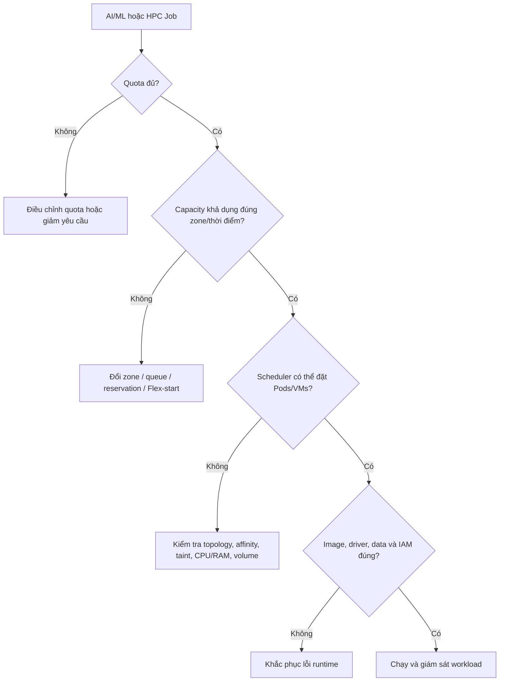
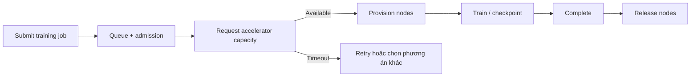
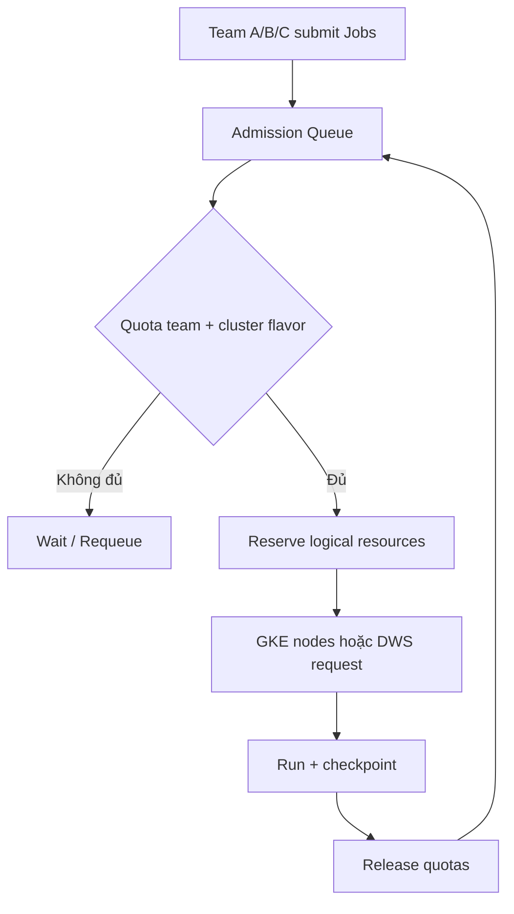

# Quota, capacity và lập lịch tài nguyên tăng tốc

Tài nguyên tăng tốc như **GPU** và **TPU** rất hữu ích cho huấn luyện mô hình, suy luận AI, xử lý ảnh, mô phỏng khoa học và các tác vụ tính toán song song. Tuy nhiên, việc “có quyền tạo máy” chưa đồng nghĩa “có phần cứng để chạy ngay”. Khi triển khai trên Google Cloud, một workload cần đi qua nhiều lớp kiểm soát: **quota**, **capacity còn sẵn**, **mô hình cung cấp tài nguyên**, **khả năng sắp lịch** và **ngân sách**.

Trong module `CLOUD_PROVIDERS_GCP`, người học khám phá Google Cloud từ tổ chức project, IAM và VPC đến Compute Engine, GKE, Cloud Run, dịch vụ lưu trữ và cơ sở dữ liệu. Qua những tình huống triển khai, người học biết lựa chọn dịch vụ, bảo vệ tài nguyên, tự động hóa phát hành và theo dõi độ tin cậy cùng chi phí. Bài này tập trung vào hạ tầng chuyên biệt: dự báo nhu cầu accelerator, phân biệt lỗi quota với hết capacity, chọn reservation hay Dynamic Workload Scheduler (DWS), rồi quản lý hàng đợi job trên GKE hoặc Compute Engine.

**Phạm vi:** các nguyên tắc áp dụng chủ yếu cho Compute Engine, GKE và một phần workload AI/ML khác. GPU, TPU, H4D/HPC và các dịch vụ như Vertex AI có những quota, mô hình pricing, vùng và hạn chế riêng. Ví dụ dùng `PROJECT_ID`, `REGION`, `ZONE`, `CLUSTER_NAME` và `GPU_TYPE` làm placeholder. Chỉ tạo tài nguyên có chi phí sau khi đã kiểm tra quota, location, IAM, định giá và chính sách dự án.

## Mục tiêu học tập

Sau bài học, người học có thể:

- Phân biệt **quota**, **capacity**, **reservation**, **placement**, **scheduling/admission** và **cost budget**.
- Khảo sát nhu cầu GPU/TPU theo model, số lượng, bộ nhớ, topology, thời lượng và deadline của workload.
- Xác minh global/regional GPU quota, quota VM/CPU/disk và GPU availability theo zone.
- Chọn on-demand, Spot, on-demand reservation, future reservation hoặc Flex-start phù hợp.
- Giải thích cơ chế Dynamic Workload Scheduler, queued provisioning và yêu cầu all-at-once của distributed training.
- Thiết kế GKE GPU node pool, `nvidia.com/gpu`, node selectors, taints/tolerations và autoscaling.
- Phân tích TPU slice topology, multi-host scheduling và resource requests trên GKE.
- Dùng queue, priority, checkpoint, retry, fairness và cost guardrails để vận hành workload nhiều team.
- Xây dashboard về pending jobs, accelerator utilization, reserved/used capacity, latency và ngân sách.

## 1. Quota không phải capacity

### Bốn lớp trước khi job có thể chạy



| Khái niệm | Câu hỏi thực tế | Điều không được suy diễn |
|---|---|---|
| **Quota** | Project được phép cấp phát tối đa bao nhiêu resource? | Còn quota **không** đảm bảo GPU vật lý còn trong zone. |
| **Capacity** | Hạ tầng thật có thể cấp phần cứng đã chọn đúng lúc không? | Bảng giá liệt kê model không đảm bảo zone hiện có hàng. |
| **Reservation** | Có năng lực được dành riêng cho project/workload trong một khoảng thời gian? | Reservation không tự triển khai Pod hay xử lý lỗi image/driver. |
| **Scheduling** | Kubernetes, GKE, Compute Engine hoặc batch scheduler đặt công việc vào nodes/VMs nào? | Pod `Pending` không phải lúc nào cũng là quota thiếu. |
| **Budget** | Có thể chi bao nhiêu để hoàn tất job trước deadline? | Budget alert không mặc định chặn tạo GPU mới. |

**Ví dụ:** Project được quota 16 GPU L4 trong `REGION` nhưng zone `ZONE_A` đang không còn G2 capacity. Tạo thêm VM có thể thất bại với lỗi thiếu resource dù dashboard quota vẫn hiển thị 16. Cần kiểm tra model, region, **zone**, provisioning mode và thời điểm, không chỉ yêu cầu tăng quota.

### Đơn vị cần phân biệt

- GPU quota có thể được theo dõi theo **GPU model và region**, kèm **GPUs (all regions)** global quota; một số model/machine series/provisioning modes sử dụng loại quota khác.
- TPU capacity thường được mô tả theo **TPU chip, slice topology, phiên bản TPU, zone** hoặc VM configuration; không quy đổi máy móc từ “GPU count” sang “TPU count”.
- VM cần vCPU, RAM, disk, IP và tài nguyên mạng; quota GPU đủ vẫn có thể bị giới hạn bởi quota phụ.
- Reservation tiêu thụ/giữ năng lực theo cấu hình và có chi phí dù chưa dùng hết (tùy loại).
- Số `nvidia.com/gpu` trong Pod là **resource request của Kubernetes**, không phải quota cấp cho cả Google Cloud project.

## 2. Phân loại workload trước khi xin tài nguyên

### Các loại công việc

| Workload | Nhu cầu thường gặp | Chiến lược gợi ý |
|---|---|---|
| Training phân tán nhiều node | GPU/TPU đồng thời, RDMA/interconnect, placement gần nhau, checkpoint. | All-at-once capacity, reservation hoặc queued provisioning. |
| Fine-tuning 1–8 GPU | Có thể đợi và khởi động lại, deadline linh hoạt. | Spot hoặc Flex-start khi hỗ trợ; checkpoint thường xuyên. |
| Batch inference | Nhiều request không cần realtime, throughput theo lô. | Queue, Spot/Flex-start, autoscale theo backlog. |
| Realtime inference có SLO | Latency ổn định, năng lực sẵn ngay, HA và warm-up. | Capacity ổn định, redundancy, có thể reservation. |
| Notebook/experimentation | GPU dùng không đều, dễ idle. | Quota theo team, auto-stop, GPU sharing nếu phù hợp. |
| HPC simulation | Nhiều node liên lạc chặt, đòi hỏi cùng lúc và băng thông. | Đánh giá H4D, placement, future reservations và job scheduler. |

### Bản mô tả nhu cầu chuẩn

Một yêu cầu accelerator nên có:

1. **Business deadline:** có cần chạy ngay, trong vài giờ hay một cửa sổ tuần tới?
2. **Hardware:** GPU/TPU version, VRAM/HBM, số chip, CPU/RAM, local SSD, disk IOPS.
3. **Topology:** 1 node hay multi-host, số chip mỗi host, network fabric, locality.
4. **Duration:** thời gian chạy một lần, phân phối thời lượng và khả năng kết thúc sớm.
5. **Interruptibility:** chịu được preemption không, checkpoint mất bao lâu?
6. **Data:** volume dataset, location, egress, permission, cache và data locality.
7. **SLO/cost:** thời gian queue tối đa, runtime tối đa, ngân sách và owner.
8. **Portability:** có thể thay model GPU, batch size, zone hay region không?

Không cấp A-series GPU cao cấp cho mọi notebook nếu một model nhỏ hoặc GPU sharing đáp ứng yêu cầu. Ngược lại, tránh chọn GPU quá ít VRAM làm training liên tục out-of-memory dù giá giờ thấp.

### Ma trận lựa chọn năng lực

| Đặc tính | Tùy chọn ưu tiên |
|---|---|
| Phải khởi động ngay, lượng tải đều | On-demand nếu capacity sẵn; reservation cho nhu cầu cần bảo đảm cao. |
| Có thể đợi, chạy tối đa vài ngày | Flex-start/DWS hoặc queue. |
| Chịu preemption và có checkpoint | Spot VM/Spot GKE node pools nếu model được hỗ trợ. |
| Training multi-host phải đủ tất cả nodes | Queued provisioning/gang scheduling và reservation/topology phù hợp. |
| Deadline cố định trong tương lai | Future reservation hoặc calendar-mode request khi đủ điều kiện. |
| Inference nhẹ, nhiều user | GPU MIG/time-sharing/MPS sau khi đo isolation và latency. |

## 3. Kiểm tra GPU quota và quota liên quan

### Global và regional quotas

Compute Engine sử dụng các **allocation quotas** để bảo vệ dự án và nguồn lực. Với nhiều loại GPU, cần kiểm tra:

- **GPUs (all regions)**: tổng lượng accelerator được phép sử dụng trên các vùng, đặc biệt với project mới.
- **Quota theo GPU model và region**: ví dụ tài nguyên theo model thuộc N1/G2/A-series/G-series.
- **Quota theo provisioning type**: regular, Spot/preemptible, reservation/commitment tùy sản phẩm.
- **Quota CPU/vCPU, disks, external IPs**, và giới hạn operation đồng thời.
- Với GKE: node count, cluster resource limits và quotas liên quan; riêng Flex-start/DWS có quota về số pending resize requests.

Tài liệu Compute Engine nêu rằng running VMs và reservations có thể tiêu thụ GPU quota. Đồng thời, cơ chế future reservation **calendar mode** có quy tắc riêng: khi đặt GPU/TPU reservation loại đó, GPU/TPU quota thường không được yêu cầu ở bước đặt chỗ; vẫn phải có quota cho tài nguyên ngoài reservation như disk/IP khi tạo VM. Không áp dụng ngoại lệ đó cho mọi reservation.

### Xem bằng Google Cloud Console

Vào **IAM & Admin → Quotas & System Limits**, chọn service liên quan (Compute Engine API, GKE hoặc TPU API tùy workload), filter quota metric và region. Ghi nhận:

```text
project:       PROJECT_ID
gpu model:     GPU_TYPE
region:        REGION
quota limit:   ...
current usage: ...
free headroom: ...
target demand: ...
provisioning:  standard / Spot / reservation / Flex-start
```

**Headroom = quota limit − current usage** là một dấu hiệu cần thiết nhưng chưa đủ: phải kiểm tra thêm quota toàn cục, giới hạn phụ và zonal capacity. Nếu đang dùng nhiều projects chia sẻ reservation, theo dõi owner project và consumer projects riêng.

### Lệnh kiểm tra quota

```bash
# Quota cấp project, gồm các quota toàn cục liên quan.
gcloud compute project-info describe \
  --project=PROJECT_ID

# Quota trong một region cụ thể.
gcloud compute regions describe REGION \
  --project=PROJECT_ID

# Kiểm tra GPU types được công bố theo zone.
gcloud compute accelerator-types list \
  --project=PROJECT_ID
```

Output `accelerator-types list` cho biết loại accelerator được hỗ trợ tại vùng/zone; **không** chứng minh tài nguyên còn capacity để cấp ngay. Cần kiểm tra GPU availability chính thức hoặc thử provisioning trong project staging phù hợp. Đừng dùng probe VM tạo liên tục ở production gây chi phí và quota pressure.

### Xin tăng quota

Một quota adjustment request tốt gồm: project ID, GPU model, region, số lượng cần thêm, workload, deadline, dự báo duration và thông tin sử dụng trước đây. Quota request có thể cần xem xét và không nhất thiết được duyệt. Ngay cả khi tăng thành công vẫn phải có capacity thực tế. Với Free Trial/new accounts, chính sách cấp GPU quota hoặc khả năng xin tăng có giới hạn riêng; chuẩn bị billing và quyền hợp lệ.

**Không yêu cầu GPU quota ở vùng chưa hỗ trợ model bạn cần** chỉ vì vùng đó gần người dùng. Kiểm tra danh sách GPU locations và model availability trước khi thiết kế.

## 4. Capacity thực tế: model, zone và thời điểm

### Capacity là vấn đề theo zone

Quotas chủ yếu theo project/region nhưng GPU/TPU được cấp phát ở **zone** cụ thể. Một region có nhiều zone nhưng model chỉ hiện diện ở một số zone; một zone hỗ trợ model cũng có thể hết hàng tại thời điểm tạo VM. Với multi-node training, cần đủ toàn bộ máy/nodes cùng lúc và có topology mạng phù hợp, không chỉ đủ tổng GPU rải rác.

Ví dụ muốn 4 VM, mỗi VM có 8 GPU:

```text
Target GPU VMs      = 4
GPUs per VM         = 8
Requested GPUs      = 4 × 8 = 32 GPUs
Required zone       = một zone có model tương thích
Quota constraints   = global + regional + related limits
Capacity constraint = 4 VM phù hợp, cùng thời điểm và placement
```

Không có nghĩa 32 GPU quota ở 3 zones cộng lại sẽ giúp chạy một job phân tán bắt buộc cùng zone. Cần kiểm tra placement policy, khả năng mạng, storage throughput và accelerator topology.

### Tránh hardcode region khi chưa kiểm tra

Với batch có thể di chuyển vùng, chuẩn bị danh sách region/zone thay thế phù hợp dữ liệu và chính sách residency. Chỉ thử sang region khác khi cost of egress, data replication, compliance và latency được đánh giá. Nếu workload ở GKE, một regional control plane không có nghĩa GPU node pools có capacity ở mọi zone của region.

## 5. Chọn provisioning model

| Mô hình | Đặc điểm | Workload phù hợp | Rủi ro/chi phí |
|---|---|---|---|
| **Standard on-demand** | Xin VM khi cần; không giữ trước capacity. | Interactive, workload linh hoạt, có thể retry. | Quota đủ nhưng vẫn stockout. |
| **Spot VM** | Giá thấp hơn, resource có thể bị preempt bất kỳ lúc nào. | Checkpointable batch/training/inference. | Không có bảo đảm chạy liên tục, có thể bị thu hồi. |
| **On-demand reservation** | Giữ capacity VM với cấu hình nhất định trong zone. | Nhu cầu thường xuyên hoặc cutover phải có sẵn máy. | Trả phí cho capacity dự trữ kể cả khi idle. |
| **Future reservation** | Đề nghị năng lực cho mốc thời gian tương lai, có approval. | Kế hoạch có deadline trước nhiều ngày/tuần. | Không phải tất cả machine series đều hỗ trợ. |
| **Calendar-mode future reservation** | Chọn cửa sổ capacity được đề xuất và xin dành trong tối đa 90 ngày khi đủ điều kiện. | GPU/TPU/H4D training/HPC có lịch rõ. | Eligibility, giới hạn model, thời hạn và điều khoản riêng. |
| **Flex-start / DWS** | Chấp nhận đợi, scheduler cấp khi có tài nguyên, thời hạn chạy tối đa 7 ngày trong mode liên quan. | Fine-tuning, batch, HPC ngắn có khả năng chờ. | Không có start time cố định, có giới hạn runtime. |

Không gộp mọi loại reservation thành một cơ chế duy nhất. **Regular on-demand reservations** và **calendar-mode** khác nhau về quota, thời điểm capacity được cung cấp, khả năng sửa/xóa, model hỗ trợ và pricing.

### On-demand reservations

Compute Engine chỉ tạo reservation thành công khi tài nguyên cấu hình yêu cầu sẵn có trong zone tại thời điểm tạo. Khi tồn tại, reservation giữ tài nguyên và được tính phí theo các quy tắc của resource đã đặt, **kể cả chưa có VM tiêu thụ**. VM tiêu thụ reservation không bị thu hai lần cho cùng compute resource đã được reservation thanh toán.

Reservation có thể **automatically consumed** bởi VMs phù hợp hoặc **specifically targeted**. Với specific reservation, VM phải có machine properties tương thích và chỉ rõ reservation affinity/target. Các yêu cầu về zone, GPU model/count, machine type và local SSD cần khớp.

```bash
# Kiểm tra reservation đã có; lệnh chỉ đọc.
gcloud compute reservations list \
  --project=PROJECT_ID

# Xem một reservation theo zone, không tạo hoặc thay đổi tài nguyên.
gcloud compute reservations describe RESERVATION_NAME \
  --zone=ZONE \
  --project=PROJECT_ID
```

Nếu reservation trống nhiều giờ, vẫn có chi phí; nên theo dõi số reserved instances, consumed instances và time idle.

### Future reservations ở chế độ calendar

Với cấu hình phù hợp, Google Cloud cho phép xem **future availability** rồi tạo request reservation cho **GPU, TPU hoặc H4D**. Sau khi request được phê duyệt, capacity chỉ được provision vào **start time** đã chọn, không phải ngay lúc request được ghi nhận. Thời hạn thường từ **24 giờ đến 90 ngày**. Loại machine/TPU, mức số lượng, lead time, giới hạn region/zone và phương án kết thúc VM phải tuân theo tài liệu hiện hành.

Ví dụ GPU/H4D future availability có thể được tra cứu trước tối đa khoảng 60 ngày; TPU có cửa sổ khác. Tài liệu hiện hành quy định mức bắt đầu tối thiểu cho một số loại request (ví dụ GPU/H4D trước nhiều ngày), nhưng đây là điều kiện thay đổi theo model và tính năng. Đừng đưa ra cam kết cho người dùng trước khi request đạt trạng thái **APPROVED/FULFILLED** tương ứng.

**Điểm cần lưu ý:** calendar-mode request có thể yêu cầu VMs tiêu thụ bằng **reservation-bound provisioning model** và phải dừng/xóa tại reservation end time. Nó không tương đương standard VMs có thể chạy vô thời hạn.

## 6. Flex-start và Dynamic Workload Scheduler (DWS)

### Ý tưởng

Dynamic Workload Scheduler (DWS) quản lý nguồn capacity khan hiếm. Thay vì bắt buộc có GPU ngay, công việc có thể **chờ** đến khi capacity phù hợp được cấp. Với **Flex-start VMs**, Compute Engine thử cấp phát trong khoảng wait time cấu hình. Khi cấp được, VM chạy trong **tối đa 7 ngày**, sau đó bị stop/delete tùy termination action. Nếu hết wait time mà không có capacity, yêu cầu có thể thất bại.

Phù hợp:

- Fine-tuning hoặc small-to-medium training có deadline linh hoạt.
- Batch inference có hàng đợi và throughput target.
- HPC run có thể chờ nhưng cần gần đủ máy đồng thời.
- Workload chịu được lifecycle hữu hạn và có checkpoint.

Không phù hợp làm nền tảng mặc định cho service inference phải sẵn sàng 24/7 và có SLO realtime, trừ khi ứng dụng có kiến trúc phục vụ khác che phủ downtime.

### Flex-start trên GKE

GKE hỗ trợ Flex-start và **Flex-start with queued provisioning** cho các accelerator/machine series được hỗ trợ. Với queued provisioning, scheduler đợi đủ capacity cần thiết trong một zone rồi cấp các nodes để toàn bộ workload chạy đồng thời. Các thành phần có thể gồm:

- Node pool được cấu hình chế độ Flex-start/queued provisioning.
- `ProvisioningRequest` để xin capacity đồng thời.
- **Kueue** hoặc job controller điều phối admission trước khi bắt đầu job.
- GKE cluster autoscaler/node auto-provisioning theo cấu hình hỗ trợ.

Không tự thêm cờ Flex-start vào một pool đã dùng Spot hoặc reservation khi combination đó không được hỗ trợ. Tài liệu GKE liệt kê những hạn chế riêng: không kết hợp Spot VMs với DWS trên cùng mô hình, cách dùng reservations, auto repair, resource locality, phiên bản GKE tối thiểu và quotas cho active resize requests.

### Cấu hình và giới hạn

| Vấn đề | Điều cần quyết định |
|---|---|
| Wait time | Job chịu chờ tối đa bao lâu trước khi coi thất bại? |
| Maximum run duration | Job thực tế + startup + checkpoint có nằm trong tối đa 7 ngày? |
| All-at-once | Cần đủ tất cả nodes/replicas hay có thể chạy từng phần? |
| Retrying | Nếu không có capacity, retry bao nhiêu lần và dời region được không? |
| Storage | Checkpoint ở Cloud Storage/Persistent Disk, không phụ thuộc local ephemeral data. |
| Monitoring | Theo dõi queued time, provisioning attempts và job start-to-finish latency. |

Ví dụ lifecycle:



**Flex-start không phải bảo đảm nhận resource trong một thời gian cụ thể.** Nếu workload không chịu được chờ lâu hoặc cần chạy đúng lịch, cân nhắc reservation/future reservation hoặc thiết kế capacity đa vùng.

## 7. GKE GPU scheduling: resources, node selectors và taints

### Kubernetes nhìn GPU thế nào?

GPU được khai báo là **extended resource**, thường với tên `nvidia.com/gpu`. Thông thường scheduler cấp **số nguyên** GPU cho container. Nếu một container yêu cầu 1 GPU, Kubernetes coi đó là 1 resource unit; nó không tự chia 0.3 GPU giống CPU request. Muốn chia sẻ GPU phải dùng tính năng GKE GPU sharing được hỗ trợ.

GKE Standard thường quản lý GPU bằng **GPU node pools**; GKE Autopilot có mô hình yêu cầu accelerator qua workload. Các yếu tố scheduling:

- **GPU requests/limits:** số lượng accelerator container cần.
- **Node selector/affinity:** chỉ định model/labels, zone hoặc pool phù hợp.
- **Taints/tolerations:** không cho Pod thường chiếm GPU nodes.
- **Cluster autoscaler:** tạo node mới khi có Pod `Pending`, trong giới hạn pool/quota/capacity.
- **Pod priority/preemption:** ưu tiên công việc quan trọng trong cluster, nhưng không tạo được capacity vật lý nếu stockout.

### Tạo GKE Standard GPU pool (ví dụ)

Kiểm tra vùng hỗ trợ model, machine type và quotas trước. Ví dụ dùng 1 NVIDIA L4 trên mỗi G2 node:

```bash
gcloud container node-pools create gpu-l4 \
  --project=PROJECT_ID \
  --cluster=CLUSTER_NAME \
  --location=CLUSTER_REGION \
  --node-locations=COMPUTE_ZONE \
  --machine-type=g2-standard-12 \
  --accelerator=type=nvidia-l4,count=1,gpu-driver-version=default \
  --enable-autoscaling \
  --min-nodes=0 \
  --max-nodes=4
```

Lệnh là thao tác tạo tài nguyên có chi phí. Chọn `COMPUTE_ZONE` nằm trong `CLUSTER_REGION` và hỗ trợ G2/L4. Một số machine series có GPU gắn cố định và số GPU phải khớp machine type. GPU driver version phải tương thích CUDA/runtime trong container; GKE có thể hỗ trợ tự cài driver tùy version/node OS.

### Pod GPU inference hoặc training

```yaml
apiVersion: batch/v1
kind: Job
metadata:
  name: gpu-batch-demo
spec:
  backoffLimit: 2
  template:
    spec:
      restartPolicy: Never
      containers:
        - name: worker
          image: REGION-docker.pkg.dev/PROJECT_ID/ml/train:RELEASE_TAG
          command: ["python", "train.py"]
          resources:
            requests:
              cpu: "2"
              memory: 8Gi
              nvidia.com/gpu: "1"
            limits:
              memory: 8Gi
              nvidia.com/gpu: "1"
      nodeSelector:
        cloud.google.com/gke-accelerator: nvidia-l4
```

Đây là Job template; image, dataset, runtime libraries, CUDA/driver và service account phải được chuẩn bị riêng. GKE thường áp dụng GPU taints/tolerations hoặc admission controller phù hợp cho Pod yêu cầu GPU; nếu node pool có custom taints, thêm toleration tương ứng. Không bỏ `resources.limits.nvidia.com/gpu` rồi kỳ vọng scheduler vẫn cấp GPU; trên nhiều cấu hình GPU resource phải được biểu diễn rõ ở limits.

### Taints, tolerations và affinity

Ví dụ một GPU node có taint:

```text
nvidia.com/gpu=present:NoSchedule
```

Với Pod được phép chạy trên GPU nodes có taint này, có thể cần toleration:

```yaml
tolerations:
  - key: nvidia.com/gpu
    operator: Equal
    value: present
    effect: NoSchedule
```

Một số cấu hình GKE tự thêm toleration cho Pod request GPU; xác nhận tình trạng thực tế trước khi thêm. **Toleration không thay thế GPU resource request**: Pod chỉ khai toleration vẫn có thể chiếm CPU/RAM trên GPU node mà không dùng GPU. Dùng taints, affinity và admission policy để bảo vệ nguồn lực đắt đỏ.

### Autoscaling không đảm bảo capacity

Khi GKE cluster autoscaler thấy Pod chờ, nó cân nhắc tăng node pool trong giới hạn `min-nodes`/`max-nodes`. Nếu zone không có GPU hoặc project thiếu quota, Pod vẫn `Pending`. Nếu Pod đòi cả 1 GPU, 200 GiB RAM và node pool không đủ RAM, nâng GPU quota không giúp gì.

Đọc `kubectl describe pod`, GKE events, cluster autoscaler logs và `kubectl describe node` để tách **scheduling mismatch** khỏi **capacity stockout**.

## 8. TPU scheduling: slice topology và multi-host

### TPU không chỉ là “số chips”

TPU trong GKE được tổ chức theo **slices** với topology và chip count phù hợp phiên bản TPU. Một số workload có thể chạy trên single-host slice; training phân tán yêu cầu multi-host slice với layout nhất quán và network interconnect phù hợp. Model parallelism/data parallelism quyết định số chip, memory, HBM, băng thông và topology.

Điều cần kiểm tra:

1. TPU generation/version đang được hỗ trợ tại region/zone nào?
2. Slice topology nào hợp lệ cho phiên bản đó?
3. Mỗi node có bao nhiêu chip; Pod request `google.com/tpu` ra sao?
4. GKE Standard hay Autopilot? Node selectors/taints/machine type khác nhau thế nào?
5. Môi trường framework XLA/JAX/PyTorch hoặc TensorFlow có tương thích không?
6. Distributed job cần tất cả workers khởi chạy đồng bộ không?

### Ví dụ manifest mang tính sơ đồ

```yaml
# Phần container trong Pod TPU; KHÔNG phải manifest deploy hoàn chỉnh.
containers:
  - name: trainer
    image: REGION-docker.pkg.dev/PROJECT_ID/ml/tpu-train:RELEASE_TAG
    resources:
      requests:
        cpu: "4"
        memory: 16Gi
        google.com/tpu: "4"
      limits:
        google.com/tpu: "4"
```

`google.com/tpu: "4"` **chỉ là minh họa**; số TPU chips, số Pod/node và topology phải khớp machine type/slice đã chọn, không được mặc định mọi TPU node cung cấp bốn chips. TPU slice nodes thường có taint `google.com/tpu`; node selectors của GKE (như accelerator/topology) thay đổi theo generation và mode. Tham khảo GKE *Plan TPUs* trước khi đưa YAML vào production.

### Gang scheduling và quota

Với training đa host, nếu 7/8 replicas chạy mà replica cuối thiếu TPU, toàn job có thể chiếm capacity nhưng không tiến triển. Dùng **all-or-nothing admission**, Kueue/JobSet hoặc controller phù hợp; phân bổ TPU slice theo topology, tránh xếp một phần workload lên nodes không thể ghép cùng nhau.

Quy tắc quota/capacity đối với TPU không giống GPU VM thông thường: model TPU, loại slice, provisioning mode và dịch vụ (Cloud TPU VM/GKE/Vertex AI) có giới hạn riêng. Không áp quota “GPUs (all regions)” cho TPU.

## 9. Hàng đợi job, priority và fairness

### Tại sao cần queue?

Nếu 10 teams cùng gửi 100 GPU jobs nhưng platform chỉ có 8 GPUs, để tất cả tự tạo node có thể dẫn tới quota errors, retry storm và chi phí orchestration. Nên có **admission control** trước khi cấp GPU:



**Kueue** là hệ thống Kubernetes-native để quyết định khi nào workloads đủ điều kiện vào cluster, có khái niệm `LocalQueue`, `ClusterQueue`, `ResourceFlavor`, nominal quota, cohort và borrowing. Nó **không tự cung cấp GPU vật lý**; vẫn phải có node, autoscaler, Compute Engine capacity và IAM. Khi kết hợp DWS queued provisioning, Kueue có thể điều phối admission, `ProvisioningRequest` lifecycle và resource claims.

### Chính sách fairness

- Chia quota theo team/project để tránh một nhóm chiếm hết accelerator.
- Cho phép **borrow capacity** khi team khác idle, có hạn mức và preemption policy rõ.
- Phân loại batch (chịu chờ) với production inference (SLO chặt).
- Gắn priority và thời hạn job; không để job thử nghiệm không có TTL chạy nhiều ngày.
- Khi preempt low-priority work, luôn có checkpoint và cơ chế retry có giới hạn.
- Đo queued time và start latency, không chỉ GPU utilization.

Kubernetes PriorityClass hoặc Kueue preemption cần được quản trị kỹ. Priority cao không khắc phục thiếu zonal capacity, quota global hoặc topology mismatch; áp dụng thiếu kiểm soát có thể làm starvation cho team khác.

### JobSet/MPI/Slurm

Với distributed training hoặc HPC, các framework như **JobSet**, MPI operators hoặc Slurm có thể quản lý nhóm workers, gang scheduling và recovery. Chọn một job controller phù hợp framework và topology; tránh trộn các scheduler gây hai lớp quyết định đồng thời mà không có chính sách ownership rõ ràng.

## 10. Spot, preemption và checkpoint

### Trade-off của Spot

Spot VMs có giá thấp hơn standard instances khi được hỗ trợ nhưng có thể bị thu hồi bất kỳ lúc nào, không có SLA khả dụng như năng lực được bảo đảm. GPU gắn với Spot VM cũng biến mất khi VM bị preempt. Không dùng Spot cho workload không thể khởi động lại hoặc inference production thiếu redundancy.

### Thiết kế checkpoint

Một training worker phải:

- Lưu model weights, optimizer state, epoch/step, random seed và data cursor theo interval.
- Ghi checkpoint ra storage bền vững, ví dụ Cloud Storage; dùng định danh run/step và file atomic/manifest khi cần.
- Có cơ chế resume idempotent sau restart và kiểm tra checkpoint hợp lệ.
- Bắt SIGTERM/termination event khi có thể, nhưng **không** phụ thuộc vào graceful shutdown để chắc chắn ghi xong checkpoint.
- Dọn tài nguyên tạm và giữ metadata run phục vụ audit/FinOps.

**Chi phí checkpoint:** quá thường xuyên làm tăng I/O và latency; quá thưa khiến mất nhiều GPU-hours khi bị preempt. Đo thời gian ghi/restore và phân phối thời gian gián đoạn thực tế để chọn interval.

### Công thức ước tính hiệu quả

```text
useful_gpu_hours = completed_training_compute
wasted_gpu_hours = lost_work_after_interruptions + restart_overhead
effective_cost_per_useful_gpu_hour
  = total_spend / useful_gpu_hours
```

Spot có thể rẻ hơn theo đơn giá giờ nhưng đắt hơn về **chi phí hoàn tất một job** nếu bị preempt nhiều lần, model khởi tạo lâu hoặc dữ liệu không được cache. So sánh giá dựa trên completed checkpoints và deadline, không chỉ đơn giá GPU VM.

## 11. GPU sharing: MIG, time-sharing và NVIDIA MPS

### Vì sao cần sharing?

Kubernetes thông thường cấp GPU theo đơn vị nguyên; một notebook dùng 5% GPU vẫn có thể giữ toàn bộ accelerator. GKE cung cấp các tính năng chia sẻ cho những loại GPU/mode được hỗ trợ:

| Phương án | Cơ chế | Phù hợp | Hạn chế |
|---|---|---|---|
| **Multi-instance GPU (MIG)** | Tách một GPU được hỗ trợ thành nhiều instance với phần tài nguyên cô lập phần cứng. | Small inference, nhiều tenant cần QoS ổn định. | Chỉ hỗ trợ model/MIG profiles nhất định; cần chọn đúng partition size. |
| **GPU time-sharing** | Nhiều container luân phiên dùng một GPU. | Notebook và workload bursty. | Isolation hiệu năng/bộ nhớ thấp hơn MIG; contention ảnh hưởng latency. |
| **NVIDIA MPS** | Cho nhiều CUDA processes hợp tác sử dụng GPU. | Batch jobs nhỏ, nhiều kernels. | Isolation, memory và lỗi cần được đánh giá; không thay thế trust boundary. |

Khi dùng sharing, trường `nvidia.com/gpu: "1"` có thể đại diện cho một **GPU share** hoặc MIG instance theo cấu hình node pool, không phải một GPU vật lý độc quyền. Dashboard quota, utilization và chargeback phải phân biệt **physical GPU count** với số logical requests. Không sử dụng sharing như cơ chế cô lập bảo mật tuyệt đối cho tenants không tin cậy.

### Khi không nên share

- Training cần toàn bộ VRAM hoặc GPU memory bandwidth.
- Multi-GPU collective communication đòi GPU exclusivity.
- Latency inference cực nhạy hoặc isolation quy định nghiêm ngặt.
- Framework/driver không hỗ trợ chế độ sharing được chọn.

## 12. Capacity planning bằng số liệu

### Ví dụ 4 nodes, mỗi node 8 GPUs

Giả sử một nhóm cần huấn luyện trong 18 giờ, bắt đầu trong khoảng 3 ngày tới:

```text
nodes_requested           = 4
gpus_per_node             = 8
gpu_count                 = 4 × 8 = 32
target_runtime            = 18 hours
nominal_gpu_hours         = 32 × 18 = 576 GPU-hours
checkpoint + warmup       = 2 hours (ví dụ)
capacity_window           = 20 hours
headroom cho retry        = do team xác định
```

`576 GPU-hours` chỉ là **đơn vị usage**, không phải hóa đơn: VM có CPU/RAM/SSD/network, reservation có thể tính phí idle và đơn giá thay đổi theo model, region, provisioning type. Nếu cần **all-at-once** trong một zone, phải có 4 VM tương thích cùng lúc. Không thể chỉ tổng hợp 32 GPU rải rác qua nhiều zones rồi kỳ vọng distributed training tự ghép được.

### Đặt capacity target

1. Xác định số job chạy đồng thời và phân phối runtime/queue delay.
2. Tính GPU-hours/TPU chip-hours và peak simultaneous nodes.
3. Tính vCPU/RAM/disk/IOPS/network và image/data startup.
4. Chọn on-demand/Spot/Flex-start/reservation theo deadline và interruptibility.
5. Thêm headroom vận hành vừa đủ cho retry/maintenance, không over-reserve vô hạn.
6. Đánh giá chi phí reservation idle, autoscaling, storage, egress và data movement.
7. Định nghĩa các thresholds để chuyển mô hình khi capacity không đáp ứng.

### So sánh “mua capacity trước” và “chờ capacity”

| Kịch bản | Quyết định có thể hợp lý |
|---|---|
| Train mỗi ngày, inference liên tục | Reservation hoặc capacity ổn định để giảm stockout. |
| Fine-tune mỗi tháng, deadline thoải mái | Flex-start/queued provisioning thay vì giữ GPU idle nhiều tuần. |
| Batch cho phép preempt và checkpoint nhanh | Spot nếu tỷ lệ hoàn thành/giá tổng thể tốt. |
| Multi-node distributed job có deadline cứng | Future/calendar reservation khi feature/model hỗ trợ và được phê duyệt. |

Khi mô hình hóa, dùng **cost per completed job**, **queue wait p95** và **failure rate** làm KPI, không chỉ GPU utilization.

## 13. Giám sát quota, capacity và scheduler

### Metrics nên theo dõi

| Nhóm | Metric | Dùng để làm gì? |
|---|---|---|
| Quota | quota limit, usage, utilization, denied requests | Phát hiện sớm hết global/regional quota. |
| Capacity | allocation failures theo model/zone, pending provisioning requests | Tách stockout khỏi quota failures. |
| Scheduling | Pending Pods, unschedulable reasons, queued time p50/p95 | Phát hiện node selector/affinity/taint/queue blockers. |
| GPU/TPU | accelerator utilization, memory used, HBM pressure, power/thermal nếu hỗ trợ | Tối ưu request và sharing. |
| Node | NodeReady, GPU driver/device plugin health, CPU/RAM/disk pressure | Phát hiện thiếu driver và node không sẵn. |
| Training | steps/s, epoch time, checkpoint latency, retries, loss progression | Đánh giá hiệu suất thực và lãng phí. |
| FinOps | running GPU-hours, reserved idle hours, cost per job/team, storage/egress | Tránh trả phí năng lực không dùng. |

Cloud Monitoring có metrics cho GPU utilization trong các môi trường được hỗ trợ; cách thu thập phụ thuộc GKE/Compute Engine, driver, Ops Agent/DCGM và loại accelerator. GPU idle nhìn bằng Kubernetes requests chưa chắc đúng: Pod yêu cầu một GPU nhưng GPU utilization có thể 0%.

### Tracing một job chưa chạy

```bash
# Xem Pod Pending và lý do scheduling trong một namespace.
kubectl get pods -n ML_NAMESPACE
kubectl describe pod POD_NAME -n ML_NAMESPACE

# Xem nodes và allocatable GPU resources.
kubectl get nodes
kubectl describe node NODE_NAME

# Xem Kubernetes events gần đây (lệnh chỉ đọc).
kubectl get events -n ML_NAMESPACE --sort-by=.lastTimestamp
```

Khi Pod Pending:

- Event `Insufficient nvidia.com/gpu` → thiếu GPU allocatable trên nodes; kiểm tra autoscaling và quota/capacity.
- `node(s) didn't match Pod's node affinity/selector` → sai model/zone/node labels.
- `had untolerated taint` → thiếu toleration hoặc pool dành cho workload khác.
- Lỗi volume/CSI/topology → PVC không attach được ở zone đúng.
- Node không Ready → driver, device plugin, runtime hoặc node bootstrap lỗi.
- `ProvisioningRequest` chờ → DWS chưa cấp đủ capacity theo time window.

Phân biệt **scheduler pending** với **application failed after scheduling**: nếu container đã vào `CrashLoopBackOff`, kiểm tra image, CUDA runtime, permissions, OOM và logs thay vì tiếp tục xin GPU quota.

## 14. IAM, bảo mật và giới hạn quyền

### Tách các vai trò vận hành

| Principal | Trách nhiệm | Quyền cần thiết |
|---|---|---|
| Platform admin | Quản lý quotas, zones, reservations, node pools, policies. | Quyền Compute/GKE/Quota theo scope dự án. |
| Job submitter | Gửi Job/Pod theo namespace/queue, đọc kết quả của mình. | Kubernetes RBAC và IAM workload tối thiểu. |
| Runtime identity | Đọc dataset/model, ghi checkpoint, truy cập Artifact Registry. | Workload Identity Federation for GKE/Compute SA theo bucket/repo. |
| FinOps/auditor | Xem usage, billing export, dashboards và reservations. | Read-only roles ở scope quản trị. |

Không cấp project Owner để xử lý lỗi quota/capacity. Quota adjustment có quyền quản trị riêng; scheduler trên GKE dùng Kubernetes RBAC, service accounts và admission policy, khác với IAM cấp phát VM. **Taints/tolerations** là công cụ lập lịch, không phải tường bảo mật chống người dùng không tin cậy.

### Dữ liệu AI/ML

- Dataset nhạy cảm phải ở location được cho phép; data egress cross-region có phí và rủi ro residency.
- Service account phải chỉ đọc/ghi Cloud Storage buckets cần thiết.
- Không đặt access key, model credentials hoặc private tokens trong image/manifest.
- Checkpoint chứa model weights có thể là intellectual property hoặc dữ liệu nhạy cảm; mã hóa, IAM và retention phù hợp.
- Hạn chế ai có thể truy cập nodes, debug containers, GPU memory và logs.

## 15. FinOps: quản lý chi phí và tránh accelerator idle

### Chi phí không chỉ là GPU-hours

Ngoài giá GPU/TPU có thể phát sinh:

- vCPU, memory, Local SSD, Persistent Disk và node/VM overhead.
- Reservation chưa được tiêu thụ, thời gian chờ/khởi động, termination và những điều khoản billing.
- Cloud Storage checkpoints, image pulls, network egress/cross-zone/cross-region.
- DWS/Flex-start pricing, Spot pricing và chi phí retries.
- Logging, Monitoring, orchestration, checkpoint/restore và vận hành.

### Mô hình showback

```text
allocated_gpu_hours = physical_GPU_count × VM_hours
productive_gpu_hours = GPU_count × useful_compute_hours
idle_gpu_hours = allocated_gpu_hours − productive_gpu_hours
cost_per_completed_job = full_job_cost / successful_jobs
```

Các phép tính trên là mô hình nội bộ; `physical_GPU_count` không giống logical `nvidia.com/gpu` khi chia sẻ GPU. Với reservation, có thể phân bổ idle cost cho team đặt chỗ, team tiêu thụ hoặc shared platform theo chính sách chargeback. Dùng Cloud Billing export làm nguồn số tiền thực tế, metrics job làm nguồn phân bổ usage.

### Guardrails

- Đặt labels cho VM/node pool, jobs, cost center, environment, accelerator type và owner.
- Thiết lập project budgets + alerts, kết hợp quota/resource limits/approval để tránh chi phí ngoài kiểm soát.
- Scale GPU node pools về 0 khi phù hợp; auto-stop notebook/dev VMs.
- Dùng TTL/time limit cho batch jobs và cảnh báo khi GPU utilization thấp kéo dài.
- Rà soát unused reservations định kỳ; cân nhắc xóa/điều chỉnh khi không còn nhu cầu.
- Chỉ dùng GPU sharing nếu mức QoS, isolation và utilization thực chứng minh hiệu quả.
- Đo cost per trained epoch / inference request / completed job thay vì nhìn đơn giá GPU.

**Budget alert không phải hard stop:** Google Cloud budgets thường thông báo ngưỡng, không tự động hủy tất cả VM. Cần automation/approval riêng nếu tổ chức muốn chặn vượt ngưỡng.

## 16. Quy trình lập lịch mẫu cho đội ML nhiều dự án

### Bài toán

Ba nhóm chia sẻ nguồn GPU:

- Team A: training phân tán 4 nodes × 8 GPU, cần đồng bộ.
- Team B: fine-tuning 1 GPU mỗi job, chấp nhận đợi tới 12 giờ.
- Team C: inference realtime phục vụ khách hàng, không được dừng dài.

### Thiết kế

1. **Đánh giá availability:** xác định model GPU, zones được hỗ trợ, quota global/regional, network/data locality.
2. **Tách pool theo SLO:** inference production dùng capacity ổn định và rollout/HA; training batch dùng queue.
3. **Team A:** ưu tiên future/calendar reservation hoặc queued provisioning all-at-once; checkpoint và placement policy.
4. **Team B:** dùng Flex-start hoặc Spot theo nhu cầu, job-level retry, checkpoint và data staging.
5. **Team C:** dùng on-demand/reserved capacity, alert theo p95 latency, GPU utilization và khả năng scale.
6. **Hàng đợi:** Kueue phân phối quota team, priority class và borrowing có giới hạn.
7. **FinOps:** dashboard GPU-hours, idle reservation, job wait p95, success rate và cost per completed run.

### Ví dụ chính sách admission

| Queue | Nominal capacity (minh họa) | Borrowing | Priority |
|---|---|---|---|
| `production-inference` | Capacity riêng có HA | Không phụ thuộc quota batch | Cao nhất theo SLO |
| `distributed-train` | 32 GPUs đồng thời khi có đủ capacity | Có thể chờ future reservation | Trung bình |
| `fine-tuning` | 4 GPU từ node pools linh hoạt | Mượn capacity idle theo policy | Thấp |

Bảng chỉ diễn đạt **chính sách vận hành**, không phải một cấu hình Kueue manifest hoàn chỉnh. Số quota logic trong Kueue cần tương ứng với resource flavors thật và khả năng node provisioning; không thể cấu hình 32 GPUs logic rồi suy ra có 32 GPUs vật lý.

### Điều kiện nghiệm thu

- Không có production inference interruption vượt SLO khi batch chạy.
- Queue wait p95 của batch trong giới hạn đã thỏa thuận.
- Training hoàn tất với đúng model topology; checkpoint/restore hoạt động.
- GPU quota và capacity plan đủ cho peak yêu cầu; có phương án fallback khi stockout.
- Cost per completed job và idle reservation hours được theo dõi hằng tuần.
- Đội vận hành có runbook, owner, IAM/labels và lịch rà soát capacity.

## 17. Troubleshooting: quota, capacity và Pod Pending

| Triệu chứng | Nguyên nhân có thể | Hướng xử lý |
|---|---|---|
| `QUOTA_EXCEEDED` khi tạo GPU VM | Quota theo model/region, global GPUs hoặc CPU/disk liên quan đã hết. | Xem project/region quota; giảm resource hoặc xin adjustment. |
| `ZONE_RESOURCE_POOL_EXHAUSTED` | GPU/machine type không còn capacity ở zone dù quota còn. | Đổi zone được hỗ trợ, đợi capacity, Flex-start hoặc reservation. |
| GKE autoscaler không tăng node | Quota/stockout, node pool max, affinity/taint mismatch, incompatible machine type. | Xem cluster autoscaler logs, Pod events, pool config. |
| Pod `Pending: Insufficient nvidia.com/gpu` | Nodes thiếu GPU allocatable hoặc Pod yêu cầu quá nhiều. | Kiểm tra node capacity, driver, requests và autoscale. |
| Pod `Pending: node affinity mismatch` | Node selector GPU model/zone không tồn tại. | Kiểm tra labels, zones và yêu cầu topology. |
| TPU job chạy một phần, không tiến triển | Thiếu slice topology hoặc gang scheduling. | Dùng all-at-once admission, đủ nodes cùng một topology. |
| DWS request chờ quá lâu | Không có capacity đủ trong wait window hoặc request topology quá lớn. | Theo dõi queue; giảm size/chọn khác zone/time, retry có giới hạn. |
| Flex-start node bị dừng sau nhiều ngày | Runtime hết giới hạn thời gian provisioning mode. | Checkpoint trước giới hạn, chia job thành các đợt. |
| Training OOM trên GPU | VRAM không đủ, batch size lớn, framework có memory leak. | Giảm batch size, precision, model size; chọn GPU VRAM phù hợp. |
| GPU utilization thấp | Data loader/CPU/storage bottleneck, small batch hoặc GPU bị idle. | Profile data pipeline, batch, I/O và framework; cân nhắc sharing. |
| Reservation vẫn tính tiền khi không có job | Dành capacity nhưng chưa tiêu thụ. | Kiểm tra reservation utilization, lịch và phương án release. |
| `nvidia-smi`/CUDA lỗi | Driver/CUDA image không tương thích hoặc device plugin chưa sẵn. | Kiểm tra GKE driver, container CUDA, node GPU health. |
| Spot job chạy lại liên tục | Preemption, checkpoint lỗi hoặc không có retry budget. | Checkpoint/restore và phân tích total cost per completed job. |

Không giải quyết mọi lỗi bằng cách tăng quota. **Quota failure**, **capacity stockout**, **scheduler mismatch** và **runtime failure** là bốn nhóm vấn đề khác nhau, phải tìm bằng chứng trước khi hành động.

## 18. Bài thực hành có kiểm soát

### Mục tiêu

Thiết kế kế hoạch chạy hai workload: inference nhỏ 1 GPU và batch training 4 GPU, với deadline và giới hạn ngân sách khác nhau. Phần khảo sát quota là read-only; phần tạo node pool/VM cần project test và phê duyệt chi phí.

**Bước 1 — Khảo sát:** kiểm tra GPU model locations, `gcloud compute project-info describe`, `gcloud compute regions describe`, quotas global/regional, các giới hạn CPU/disk và chính sách IAM.

**Bước 2 — Lập kế hoạch:** tính peak GPUs, GPU-hours, CPU/RAM, storage, batch checkpoint duration và tối đa queue wait.

**Bước 3 — Chọn provisioning:** inference chọn capacity ổn định; batch chọn on-demand/Spot/Flex-start hoặc reservation tùy deadline. Nêu rõ vì sao không thể chọn chỉ theo GPU price.

**Bước 4 — Triển khai staging:** sau khi được phê duyệt, tạo GPU node pool trong zone hỗ trợ; chạy một Job request `nvidia.com/gpu: "1"` và xác minh driver/model.

**Bước 5 — Test lỗi:** mô phỏng Pod request nhiều GPU hơn pool cấp, node selector sai và quota logic team vượt giới hạn. Quan sát `kubectl describe pod` và sự khác biệt thông báo lỗi.

**Bước 6 — Đo:** ghi queue wait, GPU utilization, job runtime, retry count, image pull, checkpoint duration và usage cost.

**Bước 7 — Dọn tài nguyên:** xóa test jobs/node pools/VMs/reservations không còn cần, kiểm tra persistent disks/buckets/logs có retention phù hợp. Dọn compute không đồng nghĩa mọi disk hay image đã được xóa.

### Bảng kết quả

| Nội dung | Giá trị ghi nhận |
|---|---|
| Project / region / zone | `PROJECT_ID`, `REGION`, `ZONE` |
| Accelerator model | Ví dụ L4 hoặc loại đã được phê duyệt |
| Global + regional quota/headroom | Đo thực tế |
| Peak requested GPU / TPU chips | Đo theo workload |
| Provisioning model | Standard / Spot / Reservation / Flex-start |
| Max queue wait / observed wait | Theo SLO và test |
| Successful GPU-hours / wasted GPU-hours | Theo run metadata |
| Total cost per completed job | Từ Billing export và job usage |
| Failure & recovery path | Runbook đã diễn tập |

## 19. Checklist quản trị hạ tầng tăng tốc

- [ ] Mô tả workload gồm model, VRAM/HBM, topology, số nodes, deadline, runtime, SLO và data location.
- [ ] Xác minh GPU/TPU availability theo zone và machine series thực sự hỗ trợ.
- [ ] Kiểm tra global GPU quota, regional model quota và quota phụ CPU/disk/IP khi áp dụng.
- [ ] Đã phân biệt quota còn lại với zonal capacity có thể cấp ngay.
- [ ] Chọn đúng standard, Spot, reservation, future/calendar reservation hoặc Flex-start/DWS.
- [ ] Với reservation, đã đánh giá phí idle, billing owner, lifecycle và điều kiện tiêu thụ.
- [ ] Với Flex-start, đã tính thời gian đợi, giới hạn chạy 7 ngày và retry/checkpoint.
- [ ] GKE node pools đặt ở zones phù hợp, GPU driver và container CUDA tương thích.
- [ ] Pod requests/limits GPU/TPU đúng, node affinity, taints/tolerations và CPU/RAM phù hợp.
- [ ] TPU jobs có slice topology và all-at-once scheduling nếu cần multi-host.
- [ ] Cluster autoscaler/node auto-provisioning không vượt quota/capacity/budget guardrails.
- [ ] Queue có policies về admission, priority, fairness, borrowing và job TTL.
- [ ] Workload Spot hoặc preemptible có checkpoint/restore và retry budget.
- [ ] GPU sharing/MIG/MPS được chọn theo QoS và độ tin cậy, không chỉ để tăng số Pods.
- [ ] IAM cho admin, job submitter, runtime, auditor và dữ liệu/model được tách đúng phạm vi.
- [ ] Có dashboard quota usage, Pending Pods, queue wait, GPU utilization và reservation idle.
- [ ] Cost per completed job và idle GPU-hours được đối chiếu Cloud Billing export.
- [ ] Có kế hoạch fallback zones/regions và runbook phân biệt quota, capacity, scheduling, runtime.
- [ ] Có bước cleanup VM/node pools/disks/reservations và review ngân sách định kỳ.

## 20. Kết luận

Quản trị GPU/TPU trên Google Cloud là một bài toán nhiều lớp: **quota** xác định mức tối đa được phép tạo, **capacity** xác định phần cứng có sẵn ở đúng nơi và thời điểm, **provisioning model** quyết định cách giữ hoặc chờ tài nguyên, còn **scheduler** quyết định khi nào workload thực sự được chạy. Không nên đồng nhất GPU quota còn nhiều với bảo đảm có GPU, cũng không nên nhầm Kubernetes Pod Pending với mọi trường hợp hết quota.

Với batch/fine-tuning có thể chịu chờ, Spot hoặc Flex-start/DWS giúp tối ưu chi phí và khả năng tiếp cận phần cứng nếu có checkpoint tốt. Với distributed training cần đồng thời đủ máy, queued provisioning, topology-aware scheduling và reservations quan trọng hơn. Với realtime inference có SLO chặt, năng lực ổn định, HA và giám sát phải được ưu tiên.

Một hạ tầng tăng tốc vận hành tốt cần đặt **admission policy, quota/capacity plan, runtime compatibility, checkpoint, metrics và FinOps** cạnh nhau. Thước đo cuối cùng là số job hoàn tất đúng hạn, hiệu năng và chất lượng đầu ra, mức độ gián đoạn và **chi phí trên mỗi kết quả hữu ích**.

## Tài liệu tham khảo

- [Compute Engine — Allocation quotas](https://docs.cloud.google.com/compute/resource-usage)
- [Compute Engine — Quotas and limits](https://docs.cloud.google.com/compute/quotas-limits)
- [Compute Engine — About GPU instances](https://docs.cloud.google.com/compute/docs/gpus/about-gpus)
- [Compute Engine — GPU locations and availability](https://docs.cloud.google.com/compute/docs/gpus/gpu-regions-zones)
- [Compute Engine — Choose a reservation type](https://docs.cloud.google.com/compute/docs/instances/choose-reservation-type)
- [Compute Engine — Reservations overview](https://docs.cloud.google.com/compute/docs/instances/reservations-overview)
- [Compute Engine — Future reservation requests in calendar mode](https://docs.cloud.google.com/compute/docs/instances/future-reservations-calendar-mode-overview)
- [Compute Engine — Flex-start VMs](https://docs.cloud.google.com/compute/docs/instances/about-flex-start-vms)
- [Compute Engine — Spot VMs](https://docs.cloud.google.com/compute/docs/instances/spot)
- [GKE — About GPUs](https://docs.cloud.google.com/kubernetes-engine/docs/concepts/gpus)
- [GKE — Run GPUs in GKE Standard node pools](https://docs.cloud.google.com/kubernetes-engine/docs/how-to/gpus)
- [GKE — GPU sharing strategies](https://docs.cloud.google.com/kubernetes-engine/docs/concepts/timesharing-gpus)
- [GKE — Plan TPUs](https://docs.cloud.google.com/kubernetes-engine/docs/concepts/plan-tpus)
- [GKE — About TPUs](https://docs.cloud.google.com/kubernetes-engine/docs/concepts/tpus)
- [GKE — Accelerator consumption options](https://docs.cloud.google.com/kubernetes-engine/docs/concepts/consumption-option)
- [GKE — Flex-start and Dynamic Workload Scheduler](https://docs.cloud.google.com/kubernetes-engine/docs/concepts/dws)
- [GKE — Queued provisioning](https://docs.cloud.google.com/kubernetes-engine/docs/how-to/provisioningrequest)
- [GKE — Consume reservations](https://docs.cloud.google.com/kubernetes-engine/docs/how-to/consuming-reservations)
- [GKE — Cluster autoscaler](https://docs.cloud.google.com/kubernetes-engine/docs/concepts/cluster-autoscaler)
- [Kueue — Concepts](https://kueue.sigs.k8s.io/docs/concepts/)
