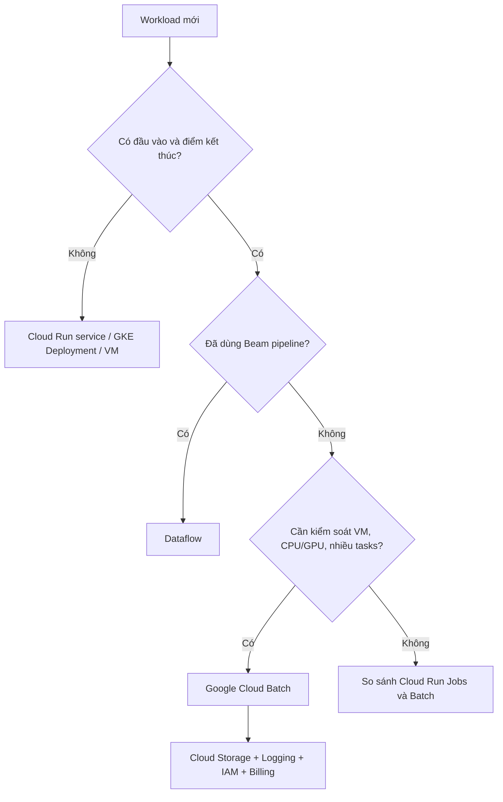
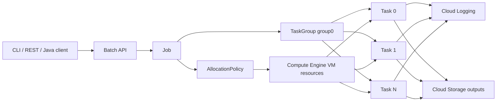
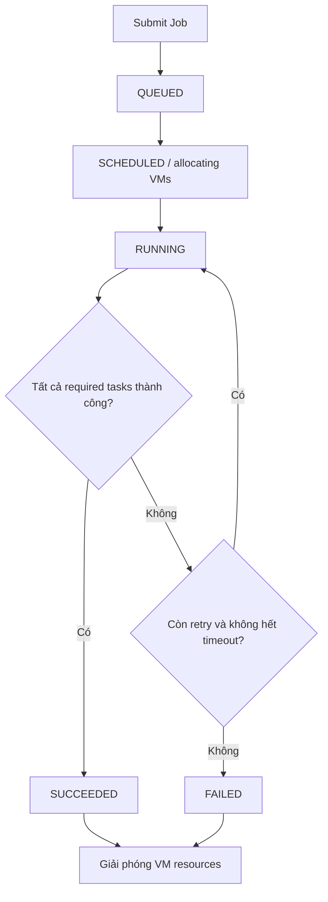
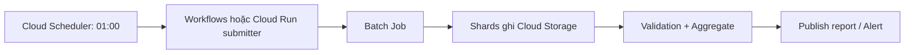

# Google Cloud Batch cho tác vụ hàng loạt

**Google Cloud Batch** là dịch vụ điều phối tác vụ hàng loạt (batch computing) trên Google Cloud. Thay vì duy trì một cụm máy ảo chạy liên tục để xử lý dữ liệu định kỳ, nhóm phát triển gửi **job** mô tả tác vụ, tài nguyên CPU/RAM/GPU/TPU, cấu hình mạng, quyền truy cập và cách xử lý lỗi. Batch lập lịch, cấp phát Compute Engine VMs, chạy các **tasks**, ghi nhận trạng thái rồi giải phóng tài nguyên khi job kết thúc.

Trong module `CLOUD_PROVIDERS_GCP`, người học khám phá Google Cloud từ tổ chức project, IAM và VPC đến Compute Engine, GKE, Cloud Run, dịch vụ lưu trữ và cơ sở dữ liệu. Qua các tình huống triển khai, người học biết lựa chọn dịch vụ, bảo vệ tài nguyên, tự động hóa phát hành và theo dõi độ tin cậy cùng chi phí. Batch kết nối các kiến thức này thành một workflow: tạo container image bằng CI/CD, lưu trong Artifact Registry, đọc/ghi Cloud Storage, dùng service account phù hợp, theo dõi Cloud Logging và quản trị quota/chi phí Compute Engine.

Ví dụ trong bài giả định project `PROJECT_ID`, region `REGION`, VM machine type `e2-standard-4`, bucket `BUCKET_NAME` và image Java `REGION-docker.pkg.dev/PROJECT_ID/batch-images/report-worker:RELEASE_TAG`. Đây là placeholder. Không chạy lệnh tạo job trên project production nếu chưa có phê duyệt chi phí và quyền, và kiểm tra lại region/machine type được Batch hỗ trợ.

## Mục tiêu học tập

Sau bài học, người học có thể:

- Nhận biết workload phù hợp Batch và phân biệt Batch với Cloud Run Jobs, GKE Jobs, Dataflow, Cloud Composer và Compute Engine VMs tự quản.
- Mô tả `Job`, `TaskGroup`, `TaskSpec`, `Runnable`, `AllocationPolicy`, `LogsPolicy` và vòng đời job.
- Tạo một Batch script job bằng JSON và `gcloud batch jobs submit`, xem trạng thái, tasks và logs.
- Containerize tác vụ Java và chia dữ liệu thành nhiều task bằng `BATCH_TASK_INDEX`/`BATCH_TASK_COUNT`.
- Cấu hình CPU/RAM, parallelism, retry, timeout, Spot/Flex-start và điều kiện sắp lịch.
- Dùng IAM tối thiểu, service account riêng, Secret Manager, Artifact Registry, Cloud Storage và VPC.
- Thiết kế tác vụ có tính idempotent, checkpoint, xử lý partial failure và lưu kết quả bền vững.
- Giám sát throughput, thời gian chờ, lỗi, quota và chi phí trên mỗi job hoàn thành.

## 1. Khi nào nên dùng Google Cloud Batch?

### Đặc trưng của batch computing

Tác vụ hàng loạt thường có **đầu vào hữu hạn**, có thể chia nhỏ, không cần phản hồi HTTP trong vài giây và kết thúc sau khi xử lý xong. Nhu cầu tài nguyên có thể tăng mạnh trong một khung giờ rồi về 0.

Ví dụ:

- Chạy Java CLI để tổng hợp giao dịch cuối ngày, tạo báo cáo hoặc kết xuất hóa đơn.
- Dùng Python/Java xử lý hàng nghìn ảnh, file CSV/Parquet, video frames hoặc dữ liệu khoa học.
- Chạy simulation, tối ưu tham số, rendering hoặc bộ kiểm thử tính toán lớn.
- Training/fine-tuning hoặc batch inference sử dụng GPU khi phần cứng và provisioning mode được hỗ trợ.
- Migration dữ liệu một lần với nhiều shards độc lập và yêu cầu lưu tiến độ.

### So sánh với các dịch vụ liên quan

| Dịch vụ | Đơn vị chạy | Khi nên cân nhắc |
|---|---|---|
| **Cloud Batch** | Job gồm task(s) trên VMs do Batch cấp và thu hồi. | Batch/HTC/HPC với quyền chọn Compute Engine VM, CPU/GPU, resource và task parallelism. |
| **Cloud Run Jobs** | Tasks trong môi trường serverless container. | Container jobs ít vận hành VM; nhu cầu tài nguyên/phần cứng được Cloud Run hỗ trợ. |
| **GKE Jobs / CronJobs** | Kubernetes Pods chạy đến khi hoàn tất. | Đã có GKE, cần Kubernetes scheduling, operators, custom cluster policy. |
| **Dataflow** | Pipeline Beam được managed runtime xử lý. | ETL streaming/batch theo mô hình Apache Beam, window, joins. |
| **Cloud Composer / Workflows** | Orchestrate nhiều công việc và dependency. | Điều phối DAG/phê duyệt/chuỗi dịch vụ, có thể **gọi Batch** ở từng bước. |
| **Compute Engine tự quản** | VM hoặc MIG do nhóm tự tạo/duy trì. | OS/kernel control đặc thù, process 24/7 hoặc workload chưa tương thích Batch. |

Batch **không phải database, message broker, cron scheduler hoặc API service**. Nó xử lý công việc sau khi nhận yêu cầu tạo job. Nếu muốn chạy mỗi ngày lúc 01:00, cần một hệ thống phát lệnh theo lịch như Cloud Scheduler + Workflows/Cloud Run, thay vì giả định Batch tự có cron tương tự Linux.

### Khung quyết định



## 2. Kiến trúc và các thành phần Batch

### Từ job đến VM



| Thành phần | Vai trò | Ví dụ field |
|---|---|---|
| **Job** | Đơn vị yêu cầu Batch lập lịch, quản lý trạng thái và hoàn tất. | `taskGroups`, `allocationPolicy`, `logsPolicy`, `labels`. |
| **TaskGroup** | Nhóm nhiều tasks cùng cấu hình. Batch hiện hỗ trợ **một** task group cho mỗi job, tên thường là `group0`. | `taskCount`, `parallelism`, `taskSpec`, `taskCountPerNode`. |
| **Task** | Một lần chạy công việc theo index, có thể retry. | `BATCH_TASK_INDEX`, trạng thái và exit code. |
| **TaskSpec** | Mô tả cần chạy gì, tài nguyên cần bao nhiêu và policy retry/timeouts. | `runnables`, `computeResource`, `maxRetryCount`, `maxRunDuration`. |
| **Runnable** | Lệnh script hoặc container image thực thi bên trong task. | `script.text` hoặc `container.imageUri`. |
| **AllocationPolicy** | Quy định VM instance, machine type, provisioning model, network, service account. | `instances[].policy.machineType`, `serviceAccount.email`, `network`. |
| **LogsPolicy** | Nơi Batch ghi logs theo cấu hình. | `destination: CLOUD_LOGGING`. |

Batch sử dụng Compute Engine VM resources để chạy job và tự thu hồi khi job hoàn tất. Việc tạo VM nào, bao nhiêu và đặt ở zone nào phụ thuộc task resource requests, `parallelism`, VM type, quota/capacity và scheduling constraints.

### Một task có thể gồm nhiều runnables

Ví dụ task chạy ba bước:

1. Stage dữ liệu đầu vào.
2. Chạy container Java để tính toán.
3. Ghi kết quả và metadata.

Các runnables được thực thi theo thứ tự trong task (trừ cấu hình đặc biệt như background runnable). Nếu muốn các bước bắt buộc tuần tự, cần bảo đảm runnable trước trả về exit status phù hợp. Không coi runnable là một microservice chạy liên tục; task nên kết thúc với status rõ ràng.

### Chỉ có một task group mỗi Batch job

Đây là khác biệt quan trọng so với một số hệ thống workflow/DAG: một Batch job thông thường có một `TaskGroup` tên `group0`. Nếu ETL cần ingest → transform → aggregate → notify với dependencies giữa **nhiều job**, hãy dùng Workflows, Cloud Composer, dsub hoặc workflow orchestrator hỗ trợ API thay vì thêm nhiều `taskGroups` kỳ vọng chúng chạy tuần tự.

## 3. Chuẩn bị project, API và IAM

### Điều kiện đầu vào

Cần có project Google Cloud bật billing, Batch API, Compute Engine API và Cloud Logging API. Với container riêng cần Artifact Registry API; với dữ liệu cần Cloud Storage API/permissions thích hợp.

```bash
gcloud config set project PROJECT_ID

gcloud services enable \
  batch.googleapis.com \
  compute.googleapis.com \
  logging.googleapis.com \
  --project=PROJECT_ID
```

Lệnh bật API làm thay đổi cấu hình project, chỉ chạy khi có quyền và được phê duyệt. Batch service agent thường tự được tạo khi project sử dụng Batch lần đầu:

```text
service-PROJECT_NUMBER@gcp-sa-cloudbatch.iam.gserviceaccount.com
```

Service agent này được gắn vai trò `roles/batch.serviceAgent`; **không thu hồi** role vì Batch dùng nó để điều phối tài nguyên. Không nhầm service agent với **job runtime service account** được gắn lên các VM chạy tasks.

### Tách ba danh tính

| Principal | Nhiệm vụ | Quyền tham khảo |
|---|---|---|
| **Job submitter** | Tạo/xem/hủy Batch job. | `roles/batch.jobsEditor` trên project và `roles/iam.serviceAccountUser` trên job SA cần sử dụng. |
| **Batch service agent** | Batch tạo/quản lý VMs và tài nguyên cho job. | `roles/batch.serviceAgent` do Google quản lý; một số Shared VPC scenario cần cấu hình bổ sung. |
| **Job runtime service account** | Container/script truy cập Cloud Storage, Secret Manager, Artifact Registry, Cloud Logging. | `roles/batch.agentReporter`, `roles/logging.logWriter` cùng roles tài nguyên hẹp khác. |

IAM submitter không tự truyền thành IAM runtime; runtime job chỉ có những quyền service account được cấp. Khi không khai báo `allocationPolicy.serviceAccount`, Batch dùng Compute Engine default service account; **không nên mặc định dựa vào quyền Editor** (nếu có) trong production.

### Tạo service account riêng cho Batch

```bash
gcloud iam service-accounts create batch-report-runtime \
  --project=PROJECT_ID \
  --display-name="Batch report task runtime"

gcloud projects add-iam-policy-binding PROJECT_ID \
  --member="serviceAccount:batch-report-runtime@PROJECT_ID.iam.gserviceaccount.com" \
  --role="roles/batch.agentReporter"

gcloud projects add-iam-policy-binding PROJECT_ID \
  --member="serviceAccount:batch-report-runtime@PROJECT_ID.iam.gserviceaccount.com" \
  --role="roles/logging.logWriter"
```

Hai quyền cấp trên chỉ hỗ trợ Batch agent reporting và Cloud Logging. Nếu task đọc dữ liệu từ bucket và ghi kết quả, phải cấp thêm Cloud Storage IAM trên **bucket cụ thể**, không cấp `roles/storage.admin` cho toàn project. Người submit job còn cần `iam.serviceAccounts.actAs` trên service account này, có thể cấp bằng `roles/iam.serviceAccountUser` theo scope hẹp.

## 4. Tạo Batch script job đầu tiên

### File `batch-hello.json`

Ví dụ dưới đây gồm 6 tasks, tối đa 3 task chạy song song, mỗi task yêu cầu 1 vCPU và 512 MiB RAM:

```json
{
  "taskGroups": [
    {
      "taskCount": 6,
      "parallelism": 3,
      "taskSpec": {
        "runnables": [
          {
            "script": {
              "text": "echo \"Task ${BATCH_TASK_INDEX}/${BATCH_TASK_COUNT} started\"; sleep 2; echo finished"
            }
          }
        ],
        "computeResource": {
          "cpuMilli": 1000,
          "memoryMib": 512
        },
        "maxRetryCount": 1,
        "maxRunDuration": "600s"
      }
    }
  ],
  "allocationPolicy": {
    "instances": [
      {
        "policy": {
          "machineType": "e2-standard-4",
          "provisioningModel": "STANDARD"
        }
      }
    ],
    "serviceAccount": {
      "email": "batch-report-runtime@PROJECT_ID.iam.gserviceaccount.com"
    }
  },
  "logsPolicy": {
    "destination": "CLOUD_LOGGING"
  },
  "labels": {
    "team": "training",
    "env": "dev"
  }
}
```

`cpuMilli=1000` nghĩa là một task yêu cầu tương đương 1 vCPU; `memoryMib=512` nghĩa là 512 MiB. Machine type phải đủ tài nguyên cho các tasks được đặt cùng một VM. `taskCount` là tổng số công việc logic; `parallelism` là **giới hạn đồng thời của job**, không phải số VM chắc chắn sẽ được tạo.

`maxRetryCount=1` cho phép tối đa một lần retry tự động sau lần chạy ban đầu theo chính sách tương ứng. `maxRunDuration=600s` đặt timeout cho mỗi task; giới hạn toàn job vẫn phụ thuộc Batch quota/limit và provisioning mode.

### Gửi job

```bash
gcloud batch jobs submit batch-hello-001 \
  --project=PROJECT_ID \
  --location=REGION \
  --config=batch-hello.json
```

**Lệnh này tạo tài nguyên có tính phí.** Trong ví dụ, `REGION` phải được Batch hỗ trợ, và project phải có Compute Engine quota/capacity. Job ID cần duy nhất trong region tại thời điểm tạo; quy trình CI nên tạo ID bằng run ID hoặc timestamp từ nguồn đáng tin cậy.

Batch CLI cũng hỗ trợ JSON hoặc YAML config. Với production, lưu cấu hình trong Git, review changes và dùng pipeline để tạo job thay vì gõ lại nhiều flags không được kiểm soát.

### Xem trạng thái và tasks

```bash
gcloud batch jobs describe batch-hello-001 \
  --project=PROJECT_ID \
  --location=REGION

gcloud batch tasks list \
  --job=batch-hello-001 \
  --location=REGION \
  --project=PROJECT_ID
```

Giao diện Google Cloud Console của Batch cũng hiển thị job details và các task theo trạng thái. Khi cần đọc rõ từng task:

```bash
gcloud batch tasks describe 0 \
  --job=batch-hello-001 \
  --task_group=group0 \
  --location=REGION \
  --project=PROJECT_ID
```

Kết quả mong đợi là 6 tasks hoàn tất, mỗi task in index 0–5. Cần kiểm tra cả **job status** và số task thành công: một job có thể kết thúc thất bại do một phần tasks không hoàn tất trong chính sách retry.

## 5. Task count, parallelism và phân bổ VM

### Không nhầm 100 tasks với 100 VMs

Giả sử `taskCount=100`, `parallelism=20`, mỗi task yêu cầu 1 vCPU, máy `e2-standard-4` có 4 vCPUs. Về mặt CPU, một VM có thể chứa nhiều tasks cùng lúc. Batch quyết định số VMs phù hợp với `computeResource`, `taskCountPerNode`, giới hạn số task/VM và khả năng cấp phát.

| Tham số | Điều gì được giới hạn? |
|---|---|
| `taskCount` | Tổng số tasks logic của task group. |
| `parallelism` | Số tasks tối đa cùng thực thi trong job. |
| `taskCountPerNode` | Số tasks tối đa có thể đặt đồng thời trên một VM nếu chỉ định. |
| `computeResource.cpuMilli` | CPU tương đương cần cấp cho một task. |
| `computeResource.memoryMib` | Bộ nhớ yêu cầu cho một task. |
| `instances[].policy.machineType` | Tài nguyên CPU/RAM/accelerator của VM. |

Đặt `parallelism=1000` không có nghĩa 1.000 tasks sẽ chạy ngay. Compute quota, capacity, location, số VM tối đa, VM startup và limits đều có thể thấp hơn.

### Tính sizing minh họa

Giả sử có 240 file cần xử lý, mỗi file mất khoảng 2 phút CPU và cần 1 GiB RAM; muốn chạy tối đa 12 tasks song song.

```text
tasks                      = 240
estimated task CPU time    = 2 phút
parallelism                = 12
ideal processing waves     = 240 / 12 = 20
ideal processing time      = 20 × 2 = 40 phút
total logical CPU time     = 240 × 2 = 480 CPU-phút
```

40 phút là **ước lượng lý tưởng**, chưa tính VM startup, image pull, dữ liệu tải về, retries, contention, disk I/O và các task có thời gian dài bất thường. Phải thử tải bằng dataset đại diện trước khi chọn CPU/memory và parallelism cho production.

### Task skew

Nếu 10% input files lớn gấp 100 lần file còn lại, các task cuối có thể chạy rất lâu dù 90% tasks hoàn tất sớm. Nên:

- Chia input thành shards có khối lượng tương đối cân bằng.
- Dùng manifest chứa file size/record count để định cỡ trước.
- Tránh quá ít tasks khiến VMs idle trong khi một task còn chạy.
- Tránh quá nhiều tasks nhỏ làm overhead scheduling và khởi tạo dữ liệu vượt compute hữu ích.
- Theo dõi p50/p95 task duration và chênh lệch thời gian giữa tasks.

## 6. Đóng gói một Java batch worker thành container

### Vì sao Java CLI phù hợp Batch?

Một Spring Boot REST service thường tồn tại để nghe HTTP. Một Batch Java worker nên là **chương trình có điểm bắt đầu và kết thúc**, ví dụ `public static void main(...)` đọc input, xử lý và kết thúc với exit code xác định. Có thể dùng Spring Boot `CommandLineRunner`, nhưng không nên khởi động embedded web server không cần thiết.

Một thư mục ứng dụng đơn giản:

```text
report-worker/
├── pom.xml
├── src/main/java/com/example/batch/ReportWorker.java
├── src/test/
├── Dockerfile
└── batch-java-job.json
```

### Worker đọc task index

Ví dụ chia input manifest thành `BATCH_TASK_COUNT` shards. Code dưới đây minh họa phần lựa chọn shard và kiểm tra đầu vào, **chưa thực hiện Cloud Storage I/O**:

```java
package com.example.batch;

public final class ReportWorker {
    public static void main(String[] args) {
        int index = Integer.parseInt(
            System.getenv().getOrDefault("BATCH_TASK_INDEX", "0"));
        int count = Integer.parseInt(
            System.getenv().getOrDefault("BATCH_TASK_COUNT", "1"));

        if (count <= 0 || index < 0 || index >= count) {
            throw new IllegalArgumentException("Invalid Batch shard context");
        }

        String inputBucket = System.getenv("INPUT_BUCKET");
        String outputBucket = System.getenv("OUTPUT_BUCKET");
        if (inputBucket == null || outputBucket == null) {
            throw new IllegalStateException("Missing input/output bucket");
        }

        System.out.printf("Processing shard %d of %d%n", index, count);
        // 1. Tải manifest đã định phiên bản từ Cloud Storage.
        // 2. Chọn records r với (stableHash(r.id) mod count) == index.
        // 3. Xử lý, ghi object kết quả có định danh cố định theo run + shard.
        // 4. Chỉ kết thúc thành công sau khi output được xác nhận tồn tại.
    }
}
```

Để tạo image chạy được cần bổ sung logic xử lý thực tế, dependencies phù hợp và unit/integration tests. Trong production, manifest cần **cố định** giữa retries; nếu số lượng tasks hoặc đầu vào thay đổi khi chạy lại, mapping shard theo `count` có thể thay đổi gây mất/trùng dữ liệu.

### Dockerfile đơn giản cho Java 21

```dockerfile
FROM maven:3.9-eclipse-temurin-21 AS build
WORKDIR /workspace
COPY pom.xml ./
COPY src ./src
RUN mvn -B package

FROM eclipse-temurin:21-jre-jammy
WORKDIR /app
COPY --from=build /workspace/target/report-worker.jar /app/worker.jar
USER 10001:10001
ENTRYPOINT ["java", "-jar", "/app/worker.jar"]
```

Ví dụ giả định `pom.xml` được cấu hình tạo executable JAR đúng tên `report-worker.jar` và có Main-Class. Trong dự án Maven thực tế cần khai báo plugin đóng gói thích hợp. Pin base image digest, quét CVE, tránh root và không đưa credential JSON hoặc `.env` vào image.

### Build và push Artifact Registry

```bash
gcloud services enable artifactregistry.googleapis.com \
  --project=PROJECT_ID

gcloud artifacts repositories create batch-images \
  --repository-format=docker \
  --location=REGION \
  --project=PROJECT_ID

gcloud auth configure-docker REGION-docker.pkg.dev

docker build \
  -t REGION-docker.pkg.dev/PROJECT_ID/batch-images/report-worker:RELEASE_TAG .

docker push \
  REGION-docker.pkg.dev/PROJECT_ID/batch-images/report-worker:RELEASE_TAG
```

Các lệnh này phải chạy trong project test được phép; repository chỉ cần tạo một lần. Build identity cần quyền `roles/artifactregistry.writer`, còn runtime cần quyền đọc image theo phương thức pull và mô hình project/repository. Dùng image digest cho bản phát hành production để tránh tag thay đổi giữa lúc review và submit.

## 7. Chạy Java container bằng Google Cloud Batch

### JSON cấu hình container job

```json
{
  "taskGroups": [
    {
      "taskCount": 24,
      "parallelism": 6,
      "taskSpec": {
        "runnables": [
          {
            "container": {
              "imageUri": "REGION-docker.pkg.dev/PROJECT_ID/batch-images/report-worker:RELEASE_TAG"
            }
          }
        ],
        "computeResource": {
          "cpuMilli": 2000,
          "memoryMib": 2048
        },
        "environment": {
          "variables": {
            "INPUT_BUCKET": "INPUT_BUCKET_NAME",
            "OUTPUT_BUCKET": "OUTPUT_BUCKET_NAME",
            "RUN_ID": "report-20261119"
          }
        },
        "maxRetryCount": 2,
        "maxRunDuration": "3600s"
      }
    }
  ],
  "allocationPolicy": {
    "instances": [
      {
        "policy": {
          "machineType": "e2-standard-4",
          "provisioningModel": "STANDARD"
        }
      }
    ],
    "serviceAccount": {
      "email": "batch-report-runtime@PROJECT_ID.iam.gserviceaccount.com"
    }
  },
  "logsPolicy": {
    "destination": "CLOUD_LOGGING"
  },
  "labels": {
    "app": "report-worker",
    "env": "staging",
    "team": "data"
  }
}
```

Nếu image đã định nghĩa `ENTRYPOINT` như Dockerfile ở phần trước, runnable container không bắt buộc khai báo lại `entrypoint`/`commands`. Nếu image chỉ định `CMD` hoặc cần tham số CLI bổ sung, kiểm tra cách Batch `container.commands` thay thế arguments. `RUN_ID` phải là định danh ổn định của lần xử lý để retry cùng shard không tạo bản ghi trùng.

Submit:

```bash
gcloud batch jobs submit report-20261119 \
  --project=PROJECT_ID \
  --location=REGION \
  --config=batch-java-job.json
```

Quy trình Java production nên dùng image digest, ghi nhận Batch job ID, release version, manifest checksum, dữ liệu đầu vào và thời điểm bắt đầu vào một bảng audit/metadata ngoài job.

### Biến môi trường Batch hữu ích

| Biến | Ý nghĩa |
|---|---|
| `BATCH_TASK_INDEX` | Index từ 0 của task trong nhóm. |
| `BATCH_TASK_COUNT` | Tổng task count của task group. |
| `BATCH_TASK_RETRY_ATTEMPT` | Số lần task đã được thử lại (0 ở lần đầu). |
| `BATCH_HOSTS_FILE` | File chứa danh sách hosts khi `requireHostsFile` được bật; hữu ích với multi-node workload. |

Không chia shard chỉ bằng `retry_attempt`: khi task retry, index vẫn là shard ban đầu; `retry_attempt` chỉ hỗ trợ logging/telemetry và retry policy.

## 8. Vòng đời job, retry và timeout

### Các trạng thái

Batch job có thể đi qua các trạng thái như `QUEUED`, `SCHEDULED`, `RUNNING`, `SUCCEEDED`, `FAILED`, hoặc trạng thái liên quan tới xóa theo API. Tên và timeline chi tiết có trong status event logs; không giả định mọi job đều xuất hiện từng trạng thái trong thời gian đủ dài để người dùng nhìn thấy.



### Giới hạn cần chú ý

Tài liệu Google Cloud hiện hành nêu những giới hạn tiêu biểu, cần đối chiếu lại khi triển khai:

| Giới hạn | Giá trị tham khảo |
|---|---|
| Tasks trong một task group | Tối đa 100.000 |
| Tasks song song của một job | Tối đa 5.000 |
| Job definition size | 1 MB |
| Thời gian `QUEUED` trước tự động thất bại | 2 ngày |
| Thời gian `RUNNING` trước tự động thất bại | 14 ngày, có ngoại lệ |
| Flex-start provisioning model | Tối đa 7 ngày chạy job |

Các giới hạn theo máy/zone, machine series và request rate còn phụ thuộc quota riêng. Không thiết kế một job duy nhất chạy vô thời hạn; nên chia thành các giai đoạn độc lập hoặc checkpoints và sử dụng orchestration ở cấp cao hơn.

### Retry không thay thế idempotency

`maxRetryCount` quyết định số lần thử lại tự động. `lifecyclePolicies` có thể chỉ định retry/fail theo exit code trong các cấu hình được hỗ trợ. Tuy nhiên:

- Một task có thể đã ghi một phần output trước khi fail.
- Retry có thể chạy lại trên VM khác hoặc sau một khoảng chờ.
- Nếu output đã được commit, task retry không được ghi đè sai hoặc tính phí hai lần.
- Mạng/S3-like object storage API failure có thể xảy ra sau khi remote side đã nhận request.

Thiết kế output theo key có tính xác định, ví dụ `runs/RUN_ID/shards/000017/result.parquet`. Khi ghi lên Cloud Storage, dùng object generation preconditions hoặc cơ chế commit/manifest để bảo đảm một shard chỉ có một kết quả được xem là hợp lệ.

### Partial failures

Một job có 99 tasks thành công và 1 task thất bại **không** phải là báo cáo hoàn chỉnh. Không kích hoạt bước aggregate khi job chưa đạt trạng thái thành công và các expected output objects chưa đủ. Một downstream workflow phải biết phân biệt `job succeeded`, `all shards exist`, `checksums valid` và `data committed`.

## 9. Spot, Flex-start và tối ưu chi phí

### Standard VMs

`provisioningModel: STANDARD` là lựa chọn phù hợp khi muốn capacity thông thường và job cần thời gian chạy ít biến động hơn. Dù quota còn, VM vẫn có thể không được cấp nếu zone thiếu capacity hoặc machine type không phù hợp.

### Spot VMs

Spot VMs thường rẻ hơn nhưng có thể bị preempt bất cứ lúc nào và không đảm bảo availability. Batch hỗ trợ chỉ định:

```json
{
  "allocationPolicy": {
    "instances": [
      {
        "policy": {
          "machineType": "e2-standard-4",
          "provisioningModel": "SPOT"
        }
      }
    ]
  }
}
```

Đoạn JSON trên chỉ minh họa **một phần** của `allocationPolicy`, không phải một Batch job đủ field để submit. Spot thích hợp khi:

- Tác vụ ngắn, retry rẻ và không có deadline cứng.
- Đầu vào bất biến, output idempotent.
- Có checkpoint định kỳ cho training/simulation dài.
- Chấp nhận retry hoặc chuyển machine type/zone khi hết capacity.

Không chọn Spot chỉ dựa vào giá mỗi VM-hour; đo **chi phí mỗi job hoàn tất thành công**, gồm thời gian preempted, khởi động lại, checkpoint và deadline penalties.

### Flex-start

Với hardware/machine series được hỗ trợ, `FLEX_START` cho phép Batch chờ Compute Engine capacity thay vì yêu cầu cấp phát tức thì. Workload phải chịu một khoảng chờ không xác định trong giới hạn cấu hình, và job thường bị giới hạn chạy tối đa **7 ngày**. Không kết luận Flex-start có thể đảm bảo bắt đầu trong một giờ cụ thể. Các ràng buộc về reservation và machine type khác STANDARD/SPOT.

Đối với GPU training dài hoặc deadline cứng, cân nhắc reservation/future reservation, data placement, giảm kích thước job hoặc chia checkpoints. Không dùng Flex-start mặc định cho dịch vụ inference realtime.

### Capacity và quota

GPU/TPU và VM resources bị chi phối bởi quota theo global/region/model, disk/CPU/IP quotas và **zonal physical capacity**. Batch có thể queue/retry provisioning nếu quota/capacity tạm thiếu, nhưng không tự bảo đảm sẽ có hàng trong zone được chọn. Kiểm tra từng loại lỗi qua job status events và Compute Engine quota/capacity metrics.

## 10. Batch với GPU và TPU

### GPU Batch

GPU cần model được hỗ trợ ở đúng location và machine type. Với accelerator-optimized machine series, GPU thường gắn với machine type (ví dụ G2/L4) và phải chọn cấu hình phù hợp. Trong Batch có thể chỉ định driver installation:

```json
{
  "allocationPolicy": {
    "instances": [
      {
        "installGpuDrivers": true,
        "policy": {
          "machineType": "g2-standard-12",
          "provisioningModel": "STANDARD"
        }
      }
    ]
  }
}
```

Đoạn JSON là **trích đoạn cấu hình**, cần bổ sung task group/runnables/region trước khi submit. Image phải có CUDA/framework tương thích driver và GPU architecture. Lỗi CUDA out-of-memory không được sửa bằng cách chỉ tăng `cpuMilli`; cần xem VRAM, batch size, model size và GPU topology.

### TPU Batch

Batch cũng hỗ trợ một số TPU configurations, chủ yếu **single-host TPU slices** trong phạm vi danh sách machine types/tính năng hiện hành. TPU topology, chip count, zone và provisioning model phải được kiểm tra theo tài liệu; không suy ra từ GPU quota hoặc yêu cầu nhiều hosts tự do như một GKE TPU multi-slice deployment.

Với distributed multi-host TPU training yêu cầu topology lớn, cần đánh giá Cloud TPU, GKE/JobSet/Kueue hoặc nền tảng huấn luyện phù hợp thay vì mặc định Batch xử lý đầy đủ mô hình này.

### Accelerator placement

GPU/TPU job cần cùng lúc đáp ứng CPU/RAM, GPU/TPU model, zone và storage/network. Có thể dùng compact placement policy cho các VM cần gần nhau khi feature hỗ trợ, nhưng placement preference có thể làm provisioning khó hơn ở vùng thiếu capacity. Cần đo job queue wait và khả năng chạy thực tế trước khi tăng resource requests.

## 11. Cloud Storage, working directory và dữ liệu bền vững

### Tách input, output và scratch

Đề xuất tổ chức:

```text
gs://INPUT_BUCKET_NAME/
  manifests/run-20261119.json
  datasets/2026-11-19/...

gs://OUTPUT_BUCKET_NAME/
  runs/report-20261119/
    shards/000000/result.parquet
    shards/000001/result.parquet
    ...
    manifest.json
```

- **Input**: read-only, versioned/immutable trong vòng đời một job.
- **Scratch**: file tạm trên VM local disk hoặc attached disk, có thể mất sau failure.
- **Output**: Cloud Storage objects được ghi bền vững với names/metadata xác định.
- **Manifest kết quả**: ghi sau khi kiểm tra đủ shards và checksum, nhằm công bố snapshot hoàn chỉnh.

Compute Engine boot disk và file local của job VM **không** được xem là nơi lưu dữ liệu bền vững khi Batch giải phóng máy. Nếu workload cần shared scratch, Persistent Disk, Filestore hoặc Cloud Storage mount, phải thiết kế volumes và I/O semantics phù hợp; mount object storage không giống POSIX filesystem về mọi hành vi.

### Data locality và chi phí

Đặt data buckets và Batch region gần nhau nếu đáp ứng residency và nghiệp vụ. Đọc nhiều TiB dữ liệu cross-region có thể phát sinh network egress và tăng runtime. Nếu object processing dùng random reads hoặc hàng nghìn file rất nhỏ, cân nhắc tổng hợp shards, caching hoặc chuyển định dạng hiệu quả hơn.

### Commit idempotent

Pseudo workflow:

```text
load immutable manifest(RUN_ID)
choose shard using BATCH_TASK_INDEX
download or stream input
process records
write temporary object path (RUN_ID, shard, attempt)
validate count/checksum
publish committed shard with precondition: destination must not exist
exit 0 only after commit has been confirmed
```

Không tạo output path chỉ bằng timestamp hiện tại: khi task retry, dữ liệu có thể bị ghi vào nhiều nơi và downstream aggregate nhân đôi.

## 12. Mạng: private subnets và outbound access

### Khi không cần external IP

Trong production, job xử lý dữ liệu nội bộ thường không cần public IP cho mỗi VM. Có thể cấu hình `allocationPolicy.network.networkInterfaces`:

```json
{
  "allocationPolicy": {
    "network": {
      "networkInterfaces": [
        {
          "network": "projects/PROJECT_ID/global/networks/batch-vpc",
          "subnetwork": "projects/PROJECT_ID/regions/REGION/subnetworks/batch-subnet",
          "noExternalIpAddress": true
        }
      ]
    }
  }
}
```

Ví dụ chỉ là **trích đoạn**, không phải job config hoàn chỉnh. `noExternalIpAddress: true` khiến VM không có public IP. Để kéo image hoặc gọi Google APIs, cần thiết lập **Private Google Access** và/hoặc Cloud NAT/egress route tùy loại endpoint, Artifact Registry domain và VPC policy; chỉ bật `noExternalIpAddress` mà không chuẩn bị route có thể làm task không khởi động được.

### Shared VPC

Nếu subnet thuộc Shared VPC host project còn Batch job nằm trong service project, cần cấp quyền network/subnet và cấu hình Batch service agent đúng scope. Không dùng default network của một project khác rồi giả định mọi máy đều truy cập được database private. Xem firewall, DNS, service account, VPC Service Controls và NAT quotas.

### Public endpoint hạn chế

Nếu job phải gọi API nhà cung cấp có IP allowlist, cần thiết kế Cloud NAT static outbound addresses hoặc cơ chế egress được kiểm soát; Batch tự tạo VM với external IP động không phải nền tảng tốt cho allowlist cố định.

## 13. Secret Manager và dữ liệu nhạy cảm

### Không đặt secret literal trong job JSON

File job config có thể được lưu trong Git, CI logs, change reviews và Batch metadata. Tránh:

```json
{
  "environment": {
    "variables": {
      "DATABASE_PASSWORD": "literal-production-password"
    }
  }
}
```

Thay vào đó Batch hỗ trợ `secretVariables` trỏ tới Secret Manager version:

```json
{
  "taskSpec": {
    "environment": {
      "secretVariables": {
        "DATABASE_PASSWORD": "projects/PROJECT_ID/secrets/report-db-password/versions/3"
      }
    }
  }
}
```

Đây là trích đoạn **bên trong** `taskGroups[].taskSpec`, không phải job JSON hoàn chỉnh. Job runtime service account cần `roles/secretmanager.secretAccessor` trên secret tương ứng. Secret được đưa vào môi trường runnable ở scope đã khai báo; không in `env`, `printenv`, `set -x` hoặc log toàn bộ Spring Environment.

### IAM data plane

Ví dụ runtime service account có thể cần:

| Tác vụ | Quyền gợi ý | Scope |
|---|---|---|
| Đọc input objects | `roles/storage.objectViewer` | Input bucket. |
| Tạo output mới | `roles/storage.objectCreator` | Output bucket, nếu không ghi đè. |
| Truy cập secret | `roles/secretmanager.secretAccessor` | Secret cụ thể. |
| Ghi logs | `roles/logging.logWriter` | Project chạy Batch. |
| Gửi report/metadata | Vai trò API phù hợp | Topic/dataset/resource đích. |

Giới hạn quyền runtime service account khác với Batch service agent. Nếu một user có quyền tạo Batch jobs và có quyền `actAs` một service account đặc quyền, họ có thể tạo job chạy dưới danh tính đó. Vì vậy, hạn chế ai được tạo job với runtime identity production.

## 14. Logs, metrics và khắc phục sự cố

### Cloud Logging

`logsPolicy.destination=CLOUD_LOGGING` cho phép theo dõi stdout/stderr của tasks theo job. Nên ghi logs có cấu trúc:

```json
{
  "severity": "INFO",
  "job": "report-20261119",
  "task_index": 17,
  "attempt": 1,
  "event": "shard_committed",
  "rows_processed": 125000,
  "duration_ms": 40211
}
```

Tránh log passwords, tokens, signed URLs, dữ liệu khách hàng và file payload. Tăng log volume cho hàng chục nghìn tasks có thể phát sinh chi phí ingest/retention. Giữ thông tin hữu ích: job ID, task index, retry attempt, input shard, output URI, error code và process duration.

### Những metrics nên có

| Nhóm | Chỉ số |
|---|---|
| Job | Submitted/queued/running/succeeded/failed, time-to-start, wall time. |
| Task | Success/failure/retry count, p50/p95 duration, throughput. |
| Infrastructure | VM CPU/RAM, disk IO, GPU utilization, node startup/image pull. |
| Capacity | Compute Engine quota usage, resource unavailability, allocation retries. |
| Data | Input bytes, output objects, row counts, duplicate shard detection. |
| FinOps | Compute VM-hours, accelerator-hours, storage/egress, cost per completed job. |

Batch job status là một phần quan trọng, nhưng ứng dụng nên ghi thêm **business completion marker** trong Cloud Storage/Firestore/BigQuery khi dữ liệu đã được commit. Một job thành công không bảo đảm kết quả hợp lệ nếu code bỏ qua exception, hoặc data validation chưa được chạy.

### Đọc lỗi theo lớp

1. **Submission API**: `PERMISSION_DENIED`, invalid JSON, quota API hoặc invalid region.
2. **Provisioning**: thiếu vCPU/GPU quota, machine type unsupported, zone resource pool exhausted.
3. **Startup**: image pull `403`, không có Private Google Access/NAT, boot disk thiếu, driver không khởi tạo.
4. **Runtime**: Java `OutOfMemoryError`, exit code khác 0, lỗi kết nối DB, secret không truy xuất được.
5. **Data correctness**: output thiếu shard, transaction retry tạo trùng, manifest mismatch.
6. **Operations**: job quá timeout, bị hủy, logs quá hạn hoặc IAM thay đổi giữa run.

Không điều chỉnh mọi lỗi bằng tăng quota hay gán Editor cho runtime. Cần xác định lỗi xảy ra ở giai đoạn nào.

## 15. Lập lịch định kỳ và orchestrate nhiều Batch jobs

### Chạy hằng đêm

Batch API xử lý yêu cầu tạo job. Để job chạy định kỳ, ví dụ 01:00 mỗi ngày:



Cloud Scheduler kích hoạt Workflows/Cloud Run bằng identity được cấp phép. Orchestrator tạo job ID từ logical run date, submit lên Batch API, theo dõi terminal status và chỉ chạy aggregation khi toàn bộ outputs hợp lệ. Nếu Scheduler retry event, submitter phải xử lý **duplicate submission** bằng idempotency key/job ID và xem job hiện có trước khi tạo mới.

### Không dùng `sleep` trong container làm cron

Container Batch job không được thiết kế chạy vô hạn chờ đến giờ kế tiếp. Nếu job chờ cả ngày, VMs có thể vẫn bị tính phí hoặc chạm giới hạn thời lượng; quản lý lịch ở Cloud Scheduler hoặc workflow layer.

### Dependencies giữa nhiều jobs

Một pipeline như ETL → scoring → generate report có thể được điều phối bởi Workflows/Cloud Composer hoặc Batch dependent jobs API phù hợp với giới hạn/tình trạng phát hành hiện hành. Tại thời điểm biên soạn, hỗ trợ dependent Batch jobs có tính năng ở **Preview/alpha** trong tài liệu chính thức; đừng thiết kế quy trình production dựa vào API preview mà chưa kiểm tra feature, quotas và SLA.

## 16. FinOps: hiểu chi phí Batch

### Batch không có phí dịch vụ bổ sung

Google Cloud Batch không thu thêm phí riêng cho lớp điều phối trong mô hình cơ bản; người dùng trả cho các tài nguyên bên dưới mà job sử dụng, như Compute Engine VMs, GPU/TPU, disk, Cloud Storage, network egress và Cloud Logging. Vì vậy, **job queued chưa tạo VM** khác với **job running trên nhiều VMs** về chi phí, nhưng workload có thể vẫn phát sinh storage/other service costs.

Một ước tính chi phí:

```text
compute_cost ≈ Σ(VM_running_hours × VM_price_per_hour)
accelerator_cost ≈ Σ(GPU/TPU_hours × applicable_price)
total_job_cost = compute + accelerator + disks + storage + network + logs + other services
cost_per_succeeded_task = total_job_cost / number_of_successful_unique_tasks
```

Không nhân `taskCount × VM hourly rate`: một VM có thể chứa nhiều tasks, hoặc một task có thể dùng VM lâu hơn processing time do startup/IO/retry. Số tiền thực tế lấy từ Cloud Billing export; labels giúp phân bổ theo team, env và workflow.

### Tối ưu có kiểm chứng

- Chọn VM machine type theo CPU/RAM thực tế, không mặc định VM lớn nhất.
- Tăng task granularity/parallelism khi giúp giảm wall time mà không tạo overhead quá mức.
- Chọn Spot cho job có checkpoint/idempotency tốt; so sánh theo **cost per completed run**.
- Dùng Flex-start khi job chịu chờ và hardware mode hỗ trợ.
- Đưa dữ liệu gần region chạy Batch, giảm cross-region egress.
- Cắt giảm image size và startup time; cân nhắc image streaming nếu phù hợp.
- Gắn labels `team`, `env`, `workflow`, `cost_center`, `run_id` theo quy ước.
- Đặt `maxRunDuration`, retry caps và schedule window để tránh runaway jobs.
- Sau run, kiểm tra resource cleanup, output retention và orphaned disks.

### Budget guardrails

Cloud Billing Budget Alerts chỉ thông báo theo ngưỡng, không tự động tắt Batch jobs/VMs. Nếu tổ chức cần hard limits, kết hợp quota, IAM, approval, admission logic ở submitter và automation có kiểm soát. Một job đang chạy có thể tiếp tục phát sinh chi phí sau khi alert được gửi.

## 17. Case study: tạo báo cáo Java hằng đêm

### Bài toán

Mỗi đêm, một hệ thống thương mại điện tử cần xử lý 480 file CSV, kết xuất báo cáo bán hàng theo tenant và lưu ra Cloud Storage. Mỗi file mất khoảng 1–4 phút CPU, một số file lớn gấp nhiều lần số còn lại. Yêu cầu:

- Hoàn tất trước 06:00.
- Không tạo báo cáo trùng nếu Batch tự retry.
- Chỉ service account `batch-report-runtime` được đọc input và tạo output.
- Có dấu vết ai chạy, phiên bản image và số lượng records đã xử lý.

### Thiết kế

1. **Ingestion** ghi manifest bất biến gồm 480 file, size, checksum và run ID.
2. **Cloud Scheduler** kích hoạt Workflows lúc 01:00.
3. **Workflows** tạo Batch job với `taskCount` dựa trên số shards có khối lượng tương đương; `parallelism` giới hạn theo CPU quota và SLO.
4. **Task Java** dùng `BATCH_TASK_INDEX` để chọn shard và đọc từ Cloud Storage.
5. **Output** ghi `gs://OUTPUT_BUCKET/runs/RUN_ID/shards/N/` bằng generation preconditions.
6. **Validation job** xác nhận tất cả expected shards có data, checksum/row counts đúng.
7. **Publisher** ghi manifest hoàn chỉnh rồi cập nhật bảng kết quả BigQuery hoặc gửi Pub/Sub notification.
8. **Observability** lưu labels, Batch job ID, task statuses và Cloud Billing data.

### Vì sao không đặt `taskCount=480`, `parallelism=480`?

480 tasks đồng thời có thể gây:

- Tăng mạnh CPU/VM quota và thời gian cấp phát.
- Nhiều file download và DB connections cùng lúc.
- Tăng phí networking/IO và áp lực lên downstream.
- Độ lệch thời gian khi một số file quá lớn.

Chia manifest thành 40–80 shards cân bằng hoặc 480 tasks với `parallelism` phù hợp đều có thể hợp lý; thử nghiệm trên dữ liệu thực để chọn. Thước đo là **thời gian hoàn tất, tỷ lệ lỗi, cost per run và data correctness**, không đơn thuần số tasks cao nhất.

### Acceptance criteria

| Nhóm | Điều kiện |
|---|---|
| Chức năng | Tất cả input shards được tính đúng, không thiếu/nhân đôi. |
| Thời gian | Hoàn tất trước deadline, có alert nếu queue/startup quá lâu. |
| Độ tin cậy | Task retry/resume không tạo duplicate outputs. |
| Bảo mật | Runtime SA có IAM hẹp, secrets không xuất hiện trong log/image. |
| Vận hành | Cloud Logging/Job status, runbook và owner rõ ràng. |
| Chi phí | Có billing allocation theo `run_id`/team; giới hạn parallelism/timeouts. |

## 18. Troubleshooting

| Triệu chứng | Nguyên nhân có thể | Kiểm tra |
|---|---|---|
| Submit trả `PERMISSION_DENIED` | Submitter thiếu Batch Job Editor hoặc `iam.serviceAccounts.actAs`. | Kiểm tra caller IAM và job runtime SA. |
| Job kẹt `QUEUED` | Quota/capacity, config không phù hợp, resource stockout. | Batch status events, Compute Engine quotas, zone/machine type. |
| `INVALID_ARGUMENT` khi tạo job | JSON field sai, task resources không hợp machine type, location sai. | So sánh Batch REST schema và gcloud validation. |
| Task không kéo được image | Artifact Registry thiếu reader hoặc VM không có outbound access. | Image URL/digest, IAM, NAT/Private Google Access. |
| Secret không đọc được | Job SA thiếu Secret Accessor, sai secret version. | `allocationPolicy.serviceAccount`, IAM Secret Manager, audit logs. |
| Task `FAILED` nhưng job vẫn retry | `maxRetryCount` hoặc lifecyclePolicies cho phép retry. | Task exit code, retry attempt, timeout và log. |
| Output CSV/Parquet bị trùng | Task ghi output không idempotent qua retry. | Cố định RUN_ID/shard key và dùng preconditions/manifest. |
| Batch job thành công nhưng dữ liệu thiếu | App bắt exception mà vẫn exit 0 hoặc thiếu validation. | Business completion marker, shard count/checksum. |
| Java `OutOfMemoryError` | `memoryMib`, JVM heap và native buffers không phù hợp. | JVM heap/RSS, `-XX:MaxRAMPercentage`, task size. |
| GPU job không có capacity | Thiếu quota theo model/region hoặc zone hết GPU. | Quota, accelerator locations, reservation/Spot/Flex-start. |
| Private VM không truy cập dịch vụ | VPC route, DNS, Private Google Access hoặc NAT thiếu. | NetworkInterfaces, subnet, firewall, Cloud NAT. |
| Chi phí cao ngoài dự kiến | Parallelism/VM size lớn, retries nhiều, IO chậm, log ingestion. | Billing export, task throughput, resource metrics. |
| Không thấy job đã hoàn tất từ lâu | Job metadata có thời hạn lưu và tự xóa. | Xuất metadata/Cloud Logging/billing trước khi hết retention. |

Không giải quyết lỗi thiếu quota bằng cách chỉ cấp Owner/Editor hoặc tăng VM size. Phải phân biệt **API permission**, **quota**, **capacity**, **scheduling** và **runtime/data failure**.

## 19. Bài thực hành có kiểm soát

### Mục tiêu

Triển khai script job nhỏ gồm sáu tasks, quan sát index, thử một task thất bại có retry và đo chi phí/latency. Chỉ tạo trên project dev có ngân sách.

**Bước 1 — Chuẩn bị:** xác nhận billing, bật Batch/Compute/Logging APIs, tạo runtime SA có Batch Agent Reporter/Logs Writer, kiểm tra quyền submitter.

**Bước 2 — Submit:** tạo `batch-hello.json` như mục 4, dùng `gcloud batch jobs submit` ở region hỗ trợ.

**Bước 3 — Theo dõi:** kiểm tra `gcloud batch jobs describe`, `gcloud batch tasks list`, Cloud Logging; ghi nhận queued time và task durations.

**Bước 4 — Retry:** thay script test cho một task trả exit code khác 0 trong lần đầu, rồi thành công ở lần retry (`BATCH_TASK_RETRY_ATTEMPT`). Xác minh tác động lên job status và logs. Không tạo code production chỉ thất bại giả mà không có cảnh báo.

**Bước 5 — Resource tuning:** thay `parallelism` từ 1 lên 3 bằng **job mới**, so sánh thời gian và số VMs. Không giả định giá VM giảm khi chạy song song; đối chiếu Billing.

**Bước 6 — Data correctness:** viết output theo shard ID, chạy lại job để chắc chắn không nhân đôi kết quả. Dùng manifest và Cloud Storage generation preconditions theo thiết kế.

**Bước 7 — Cleanup:** xóa jobs/resource không cần và rà soát disks, logs, Cloud Storage outputs, Artifact Registry images còn tồn tại. Việc xóa Batch job không đồng nghĩa toàn bộ output ngoài Batch được xóa.

### Bảng kết quả thực hành

| Đại lượng | Giá trị cần ghi |
|---|---|
| Job ID / region | Giá trị thực |
| Task count / parallelism | 6 / 1, rồi 6 / 3 |
| Machine type / service account | Giá trị đã deploy |
| Task success/retry/failed | Theo từng task |
| Queue wait / VM startup / run time | Đo bằng job events/logs |
| CPU/RAM utilization | Theo Monitoring/guest metrics nếu bật |
| Cost per completed run | Theo Cloud Billing |
| Dọn tài nguyên | Đã xác nhận hay chưa |

## 20. Checklist Batch production

- [ ] Workload phù hợp mô hình hữu hạn, có input/output và exit status xác định.
- [ ] Đã chọn Batch hay Cloud Run Jobs/GKE/Dataflow dựa trên nhu cầu VM, accelerator và vận hành.
- [ ] Project/region hỗ trợ Batch; quota, capacity và billing được kiểm tra.
- [ ] APIs Batch, Compute Engine, Logging và các dịch vụ cần dùng đã bật.
- [ ] Submitter có `roles/batch.jobsEditor` và quyền `actAs` đúng service account.
- [ ] Batch service agent giữ quyền được Google quản lý; runtime SA tách khỏi service agent.
- [ ] Runtime SA có `roles/batch.agentReporter`, Logs Writer và IAM bucket/secret phù hợp.
- [ ] Job JSON được review, lưu version và kiểm tra `taskGroups`/`taskSpec`/`allocationPolicy`.
- [ ] Image Artifact Registry được scan, pin digest và không chứa secrets.
- [ ] Task indices/manifest bất biến; không có cross-task shared mutable state thiếu đồng bộ.
- [ ] `parallelism`, `computeResource`, `taskCountPerNode`, VM size được thử tải.
- [ ] Retry/timeouts có giới hạn; business logic idempotent và kiểm tra output completeness.
- [ ] Data được lưu ở Cloud Storage/database bền vững; scratch có thể bị mất sau VM release.
- [ ] Private networking, DNS, NAT/Private Google Access/Artifact Registry access được thử.
- [ ] Spot/Flex-start chỉ dùng khi job chịu interrupt/wait, có checkpoint và retry budget.
- [ ] GPU/TPU job có model/zone/driver/framework tương thích, quota và capacity đủ.
- [ ] Workflow theo lịch có idempotent job ID và không tạo job trùng khi Scheduler retry.
- [ ] Có logs/metrics/alerts về queued/running/failed/retries/throughput/SLO.
- [ ] Labels/cost centers/Cloud Billing export phục vụ FinOps và incident audit.
- [ ] Đã có runbook xử lý `PERMISSION_DENIED`, quota, image pull, OOM và data correctness.
- [ ] Có cleanup policy và retention cho outputs, image, metadata/logs.

## 21. Kết luận

Google Cloud Batch giúp biến công việc tính toán hữu hạn thành những **jobs có thể lập lịch, retry, giám sát và tự thu hồi tài nguyên**. Người dùng mô tả task groups, runnables, CPU/RAM, VM allocation và IAM; Batch điều phối Compute Engine VMs để thực thi. Nó đặc biệt hữu ích với ETL, rendering, batch inference, tính toán khoa học và Java command-line workloads không cần HTTP service hoạt động liên tục.

Để chạy Batch ổn định, không nên chỉ dừng ở `gcloud batch jobs submit`. Cần xử lý đúng IAM submitter/service agent/runtime, dữ liệu bất biến và output idempotent, quota và zonal capacity, chính sách retry/timeouts, private networking, logging, alert và cost per completed job. Khi có nhiều bước phụ thuộc, kết hợp Cloud Scheduler, Workflows/Composer hoặc orchestration phù hợp, không ép Batch thành một cron/DAG engine.

Một Batch job được coi là thành công về mặt vận hành khi **hoàn tất đúng dữ liệu, trước deadline, có thể chạy lại an toàn, bảo vệ thông tin nhạy cảm và có chi phí dự đoán được**.

## Tài liệu tham khảo

- [Google Cloud Batch — Get started](https://docs.cloud.google.com/batch/docs/get-started)
- [Google Cloud Batch — Job creation and execution overview](https://docs.cloud.google.com/batch/docs/create-run-job)
- [Google Cloud Batch — Create and run a basic job](https://docs.cloud.google.com/batch/docs/create-run-basic-job)
- [Google Cloud Batch — Create and run container jobs](https://docs.cloud.google.com/batch/docs/create-run-job-container)
- [Google Cloud Batch — REST Job resource reference](https://docs.cloud.google.com/batch/docs/reference/rest/v1/projects.locations.jobs)
- [Google Cloud Batch — Quotas and limits](https://docs.cloud.google.com/batch/quotas)
- [Google Cloud Batch — View jobs and tasks](https://docs.cloud.google.com/batch/docs/view-jobs-tasks)
- [Google Cloud Batch — Retry tasks](https://docs.cloud.google.com/batch/docs/automate-task-retries)
- [Google Cloud Batch — Custom service account](https://docs.cloud.google.com/batch/docs/create-run-job-custom-service-account)
- [Google Cloud Batch — Use Secret Manager](https://docs.cloud.google.com/batch/docs/create-run-job-secret-manager)
- [Google Cloud Batch — Specify a job network](https://docs.cloud.google.com/batch/docs/specify-job-network)
- [Google Cloud Batch — GPU jobs](https://docs.cloud.google.com/batch/docs/create-run-job-gpus)
- [Google Cloud Batch — TPU jobs](https://docs.cloud.google.com/batch/docs/create-run-job-tpus)
- [Google Cloud Batch — Spot VMs](https://docs.cloud.google.com/batch/docs/create-run-job-spot-vms)
- [Google Cloud Batch — Instance flexibility](https://docs.cloud.google.com/batch/docs/create-run-job-instance-flexibility)
- [Google Cloud Batch — Use image streaming](https://docs.cloud.google.com/batch/docs/use-image-streaming)
- [Google Cloud Batch — Organize resources with labels](https://docs.cloud.google.com/batch/docs/organize-resources-using-labels)
- [Google Cloud — Batch IAM roles](https://docs.cloud.google.com/iam/docs/roles-permissions/batch)
