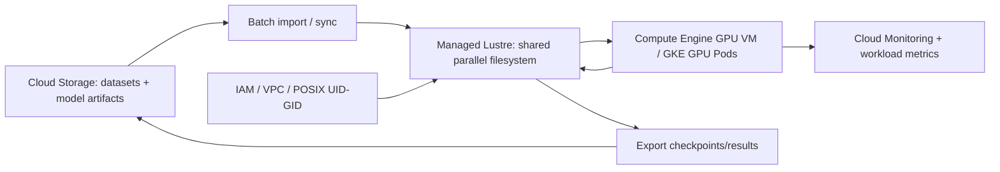
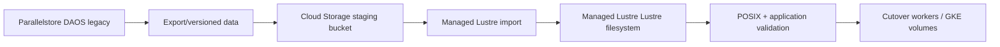

# Parallelstore và dữ liệu cho tính toán hiệu năng cao

Các hệ thống tính toán hiệu năng cao (High Performance Computing – HPC) và huấn luyện AI cần đọc, ghi lượng dữ liệu lớn từ hàng trăm đến hàng nghìn tiến trình song song. Một GPU có thể xử lý tensor rất nhanh nhưng vẫn phải chờ khi dữ liệu đến chậm từ ổ đĩa, network hoặc object storage. Khi nhiều nút cùng chia sẻ checkpoint, model, ảnh, dữ liệu mô phỏng hoặc kết quả phân tích, kiến trúc lưu trữ trở thành một thành phần trực tiếp quyết định tốc độ và chi phí của toàn cụm.

**Parallelstore** là tên dịch vụ hệ thống tệp song song Google Cloud từng cung cấp trên nền kiến trúc **DAOS (Distributed Asynchronous Object Storage)**. Tài liệu hiện hành của Google Cloud đã chuyển hướng từ Parallelstore sang **Google Cloud Managed Lustre**, dịch vụ tệp song song được quản lý sử dụng công nghệ Lustre/DDN EXAScaler. **Hai sản phẩm không phải chỉ khác tên**: chúng có kiến trúc, client, API, driver và phương pháp triển khai khác nhau.

> **Lưu ý vòng đời sản phẩm (tháng 11/2026):** Google Cloud từng công bố Parallelstore cũ có mốc deprecation ngày **31/10/2026**; đường dẫn tài liệu Parallelstore hiện chuyển sang Managed Lustre. Với hệ thống mới, hãy đánh giá **Managed Lustre** theo tài liệu chính thức. Nếu đang vận hành Parallelstore cũ, xác nhận trạng thái hỗ trợ, thời hạn di chuyển và khả năng truy cập instance với Google Cloud Support; không diễn giải “deprecated” đồng nghĩa mọi instance tự động đã bị xóa hoặc ngừng hoạt động.

Bài học thuộc chương **Hạ tầng chuyên biệt**, module **CLOUD_PROVIDERS_GCP**. Phạm vi nối kiến thức Compute Engine, GKE, IAM, VPC, Cloud Storage, GPU/TPU, quan sát độ tin cậy và FinOps để thiết kế luồng dữ liệu HPC/AI có hiệu năng và khả năng khôi phục.

## 1. Mục tiêu học tập

Sau bài học, bạn có thể:

- Giải thích vì sao HPC và AI cần hệ thống tệp song song (parallel file system).
- Phân biệt Parallelstore DAOS lịch sử với Google Cloud Managed Lustre hiện hành.
- So sánh hệ thống tệp song song, Cloud Storage object store, Filestore và Local SSD.
- Lựa chọn bố trí dữ liệu qua Cloud Storage, vùng làm việc tốc độ cao và hệ lưu bền vững.
- Thiết kế topology Compute Engine, GKE, GPU/TPU, VPC và filesystem client.
- Hiểu POSIX, metadata operations, IOPS, throughput, latency và vấn đề nhiều file nhỏ.
- Sizing capacity và performance tier của Managed Lustre theo workload thực.
- Kiểm tra quota, region/zone, IAM, service agent và quyền truy cập file.
- Thực hiện luồng import/export giữa Cloud Storage và Managed Lustre an toàn.
- Thiết kế CSI PersistentVolume/PersistentVolumeClaim trên GKE và mount trên VM.
- Đo hiệu năng bằng IOR, mdtest và benchmark ứng dụng thật.
- Lập kế hoạch bảo vệ dữ liệu, khôi phục, cutover từ Parallelstore cũ và tối ưu chi phí.

## 2. Vì sao HPC cần parallel file system?

Một ứng dụng thông thường có thể xử lý vài tệp cùng lúc. Với HPC, các mô hình khác biệt:

- 1.000 tiến trình MPI cùng đọc các shard đầu vào.
- Hàng trăm GPU đọc dữ liệu huấn luyện tại tốc độ cao.
- Hàng nghìn worker tạo file kết quả mô phỏng.
- Một job tạo checkpoint model cỡ terabyte trong cửa sổ ngắn.
- Các nút cần nhìn thấy cùng một namespace và quyền truy cập file.
- Nhiều tiến trình tạo, đổi tên và kiểm tra sự tồn tại của tệp cùng lúc.

Một máy chủ NFS truyền thống có thể trở thành nút nghẽn metadata hoặc băng thông, nhất là khi số client lớn. Hệ thống tệp song song phân tán dữ liệu và/hoặc xử lý metadata qua nhiều thành phần để cung cấp tổng throughput/IOPS tốt hơn.

### 2.1. Các khái niệm hiệu năng

| Khái niệm | Ý nghĩa | Ví dụ |
|---|---|---|
| Sequential throughput | Số GiB/s đọc hoặc ghi liên tục | Nạp shard lớn cho AI training |
| IOPS | Số thao tác I/O mỗi giây | Đọc block nhỏ ngẫu nhiên |
| Metadata operations | Tạo, mở, `stat`, liệt kê, đổi tên file | Dữ liệu gồm hàng triệu ảnh nhỏ |
| Latency | Thời gian đáp ứng một thao tác | Mở file và đọc dữ liệu |
| Concurrency | Số process/client cùng dùng filesystem | Hàng nghìn GPU workers |
| Data locality | Độ gần về mạng/vị trí giữa compute và storage | GPU VM cùng zone với filesystem |
| Cache hit ratio | Phần dữ liệu đáp ứng từ cache | Epoch huấn luyện lặp lại |
| Effective goodput | Phần tốc độ đem lại công việc hữu ích | Samples/giây thay vì chỉ GiB/giây |

Throughput công bố của một filesystem là **mức tổng hợp có điều kiện**, không phải tốc độ chắc chắn đạt từ một VM. Băng thông NIC, số client, kích thước I/O, khả năng song song hóa và pattern dữ liệu có thể giới hạn kết quả.

### 2.2. POSIX và namespace chia sẻ

Ứng dụng khoa học thường dùng:

```python
from pathlib import Path

dataset = Path("/mnt/hpc/datasets/train")
for sample in dataset.glob("*.bin"):
    with sample.open("rb") as handle:
        payload = handle.read()
        process(payload)
```

Đây là trải nghiệm filesystem thông thường với thư mục và đường dẫn. Dịch vụ lưu trữ đối tượng như Cloud Storage thường được truy cập qua object API; dấu `/` trong object name không biến bucket thành một filesystem POSIX. FUSE có thể cung cấp interface dạng file nhưng semantics, cache, throughput và giới hạn khác hệ thống tệp song song chuyên dụng.

Hệ thống parallel file system phù hợp khi code, framework hoặc workflow cần truy cập file qua các máy và tận dụng nhiều tác vụ đọc/ghi đồng thời. Tuy nhiên, POSIX compliance của từng sản phẩm và phiên bản vẫn phải được kiểm chứng với các syscall ứng dụng cần.

## 3. Phân biệt Parallelstore cũ và Managed Lustre hiện nay

| Đặc điểm | Parallelstore lịch sử | Google Cloud Managed Lustre |
|---|---|---|
| Công nghệ lõi | DAOS | Lustre / DDN EXAScaler |
| Tài liệu | Đường dẫn Parallelstore cũ đã chuyển hướng | `/managed-lustre/docs` |
| Control plane/API | `parallelstore.googleapis.com` | `lustre.googleapis.com` |
| CLI | `gcloud parallelstore` (legacy) | `gcloud lustre` |
| Client | Cơ chế DAOS/dfuse và môi trường được hỗ trợ | Lustre client và `mount -t lustre` |
| GKE CSI | Driver Parallelstore cũ, hiện bị đánh dấu deprecated | `lustre.csi.storage.gke.io` |
| Dữ liệu | Phải kiểm chứng định dạng và cách export | POSIX file system và Cloud Storage transfers |
| Lựa chọn kiến trúc mới | Không nên chọn cho triển khai mới | Sản phẩm hiện hành để đánh giá |

**Không đổi đơn thuần tên API, resource Terraform hay StorageClass** rồi kỳ vọng migrate thành công. Cần chuẩn bị Managed Lustre instance, VPC, client, mount, dữ liệu và quyền, sau đó chạy thử ứng dụng trên filesystem mới.

Google Cloud Cluster Toolkit đã phát hành thông báo deprecation cho module Parallelstore vào tháng 1/2026; GKE API cũng đánh dấu `ParallelstoreCsiDriverConfig` không còn được hỗ trợ. Với môi trường cũ, phải kiểm tra chính xác bản đang chạy và kế hoạch hỗ trợ theo tài khoản.

### 3.1. Giới thiệu Parallelstore theo bối cảnh lịch sử

Parallelstore được công bố GA năm 2024 để hỗ trợ AI/HPC có throughput, IOPS và metadata access cao. Công nghệ DAOS tập trung vào hệ thống metadata phân tán và key-value architecture, dùng NVMe và giải pháp quản lý tính nhất quán dữ liệu.

Parallelstore có các khái niệm quan trọng:

- **Instance:** filesystem parallel được cấp phát trong project/location.
- **Client:** compute node truy cập namespace và dữ liệu qua công cụ/client tương thích.
- **Access point/network:** địa chỉ kết nối cần khả dụng trong VPC.
- **Cloud Storage import/export:** chuyển tập dữ liệu vào vùng compute rồi xuất kết quả.
- **Capacity/throughput:** mức tài nguyên cấp phát và giới hạn theo cấu hình.
- **Lifecycle:** tạo, truy cập, import/export, backup/export và hủy instance.

Những khái niệm này vẫn giúp người học hiểu nguyên lý parallel storage, nhưng **ví dụ triển khai mới trong bài sử dụng Managed Lustre** để không hướng dẫn cấp mới sản phẩm đã deprecated.

## 4. Khi nào chọn hệ thống tệp song song?

| Nhu cầu | Giải pháp thường cân nhắc | Điều cần kiểm tra |
|---|---|---|
| Lưu dữ liệu thô bền vững, archive, data lake | Cloud Storage | Class, lifecycle, throughput, API |
| Nhiều compute nodes cần POSIX, throughput/IOPS cao | Managed Lustre | Capacity/tier, VPC, same-zone clients |
| File share NFS thông thường, khối lượng vừa | Filestore | NFS semantics, tier, network, price |
| Scratch rất nhanh trên một VM | Local SSD | Ephemeral, instance lifecycle, backup |
| Database giao dịch | Cloud SQL, AlloyDB, Spanner | Transaction, queries, HA, RPO/RTO |
| Model inference ít dùng file chia sẻ | Local cache hoặc Cloud Storage trực tiếp | Cold start, local disk, object reads |

Không phải cứ có GPU là cần Managed Lustre. Một GPU VM đọc vài model weights lúc khởi động có thể hoạt động tốt với Cloud Storage và bộ đệm cục bộ. Hệ thống parallel file mới có lợi khi **nhiều nút cùng đọc/ghi**, cần POSIX hoặc dữ liệu trở thành bottleneck rõ ràng.

### 4.1. Pattern dữ liệu thường gặp

- **Large sequential files:** tập shard hoặc checkpoint lớn; throughput quan trọng.
- **Many small files:** hàng triệu ảnh và labels; metadata/IOPS quan trọng.
- **Random I/O:** index, genomics, HPC checkpoints; latency và IOPS.
- **Read-heavy repeated epochs:** cache và prefetch có thể giảm I/O.
- **Write-heavy checkpoints:** cần throughput ghi, độ bền và quy trình export.
- **Mixed workloads:** tránh một job metadata-heavy làm suy giảm throughput của job khác.

Một chiến lược tốt thường gồm ba lớp: **Cloud Storage bền vững → Parallel filesystem tốc độ cao trong lúc tính toán → Cloud Storage lưu kết quả/archives**.

## 5. Kiến trúc tham khảo cho AI training



Luồng:

1. Dữ liệu training đã được kiểm tra và lưu ở Cloud Storage.
2. Workflow import một snapshot hoặc version dữ liệu sang filesystem.
3. Nhiều worker đọc cùng namespace, được scheduler phân phối.
4. Pipeline CPU decode/tokenize và GPU/TPU tính toán.
5. Checkpoint được ghi thành file, validate, rồi xuất sang Cloud Storage.
6. Sau khi job hoàn tất và data owner xác nhận, xóa instance khi không còn cần.

**Lưu ý nhất quán:** import/export theo batch không phải tự động là bidirectional live synchronization. Nếu ứng dụng sửa file ở filesystem trong lúc export, kết quả có thể không nhất quán nếu không có checkpoint barrier hoặc freeze. Phải xác định nguồn sự thật của từng tập dữ liệu.

### 5.1. Ba lớp dữ liệu

| Lớp | Vai trò | Yêu cầu |
|---|---|---|
| Cloud Storage | Source of truth, archive, backup, lifecycle | IAM, version/retention, checksum |
| Managed Lustre | Working set hiệu năng cao cho job | POSIX, throughput/IOPS, đồng vị trí compute |
| Local RAM/SSD cache | Cache nóng hoặc scratch tạm | Không coi là bản duy nhất, có thể mất |

Đừng dùng hệ thống tệp hiệu năng cao làm bản lưu duy nhất của checkpoint quan trọng nếu quy trình khôi phục chưa được xác nhận.

## 6. Sizing Managed Lustre: capacity và tier

Managed Lustre cung cấp các throughput tier theo dung lượng:

- 125 MB/s cho mỗi TiB.
- 250 MB/s cho mỗi TiB.
- 500 MB/s cho mỗi TiB.
- 1.000 MB/s cho mỗi TiB.
- **Dynamic tier:** một lựa chọn khác tập trung dữ liệu hot/cold và cache, không có cùng semantics/định mức với các numbered tiers; cần đánh giá theo tài liệu riêng.

Dung lượng hợp lệ, step size, min/max và quota phụ thuộc tier. Tài liệu cập nhật năm 2026 mô tả capacity từ **9.000 GiB** tới hàng chục PiB với giới hạn thay đổi theo tier. Không mặc định có thể cấp đúng mọi số GiB tùy ý.

### 6.1. Ước tính theoretical throughput

Với numbered tier:

```text
theoretical_MBps = (capacity_GiB / 1024) × tier_MBps_per_TiB

Ví dụ:
capacity = 18,000 GiB
tier = 500 MB/s/TiB

theoretical_MBps ≈ 18,000 / 1024 × 500
                 ≈ 8,789 MB/s
```

Số trên là **giới hạn lý thuyết theo tier**, không phải cam kết một client đạt 8,789 MB/s. Băng thông VM/NIC, overhead TCP, kích thước block, số processes, I/O pattern, cache và server load quyết định tốc độ thực tế.

### 6.2. Chọn tier theo workload

| Workload | Hướng chọn | Metric quyết định |
|---|---|---|
| HPC đọc tuần tự lớn | Numbered tier theo aggregate GB/s cần đạt | Read throughput, cost/TiB |
| Nhiều ảnh nhỏ và metadata | Chọn cấu hình có đủ IOPS/metadata capacity | Open/stat/s, files/s, GPU stalls |
| Training lặp lại nhiều epoch | Cân nhắc Dynamic nếu cache/workset phù hợp | Cache hit, training step time |
| Checkpoint ghi theo đợt | Throughput ghi và thời gian checkpoint | GiB/s, time to durable export |
| Workload hiếm khi chạy | So với Cloud Storage trực tiếp/local cache | Total cost/job, thời gian idle |

**Performance tier được chọn lúc tạo và không thể đổi tùy ý sau đó**; Managed Lustre hỗ trợ tăng capacity cho những tier/trường hợp được tài liệu cho phép, nhưng không phải mọi kiểu thay đổi đều hợp lệ. Cần thiết kế capacity headroom và có runbook chuyển sang instance khác nếu muốn đổi tier.

### 6.3. Sizing từ nhu cầu công việc

Ví dụ một cụm 64 GPU workers, mỗi worker cần đọc hiệu dụng 120 MiB/s:

```text
estimated_aggregate_demand = 64 × 120 MiB/s
                            = 7,680 MiB/s
                            ≈ 7.5 GiB/s
```

Cần cộng overhead, bursts và checkpoint write. Sau đó chọn tier/capacity có throughput lý thuyết đủ, kiểm tra băng thông toàn bộ client và chạy benchmark. GPU worker không phải lúc nào cũng đạt/đòi tốc độ cố định; mô hình tốt dựa vào số liệu profiling.

## 7. Quota, region, zone và VPC

### 7.1. Đồng vị trí compute và storage

Với Managed Lustre, nên đặt VM/GKE client **cùng zone** với filesystem để có latency và throughput tốt. Cloud Storage bucket nên ở vị trí phù hợp data residency và chi phí. Cross-region data movement có thể chậm và phát sinh phí egress.

Bố trí minh họa:

```text
Project: hpc-sandbox
Region: us-central1
Zone: us-central1-a
VPC: hpc-vpc

Compute Engine GPU VMs / GKE nodes: us-central1-a
Managed Lustre instance:          us-central1-a
Cloud Storage data lake:          compatible regional location
```

Đừng giả định mọi machine type GPU và Managed Lustre đều khả dụng ở một zone. Kiểm tra cùng lúc **GPU quota/capacity, Lustre quota và subnet/network** trước khi chọn địa điểm.

### 7.2. Quota theo throughput/capacity

Đến năm 2026, Managed Lustre đã thay quota per-tier cũ bằng quota **capacity và throughput** dùng chung cho numbered tiers; quota Dynamic tier có quy tắc riêng. Tài liệu mô tả quota theo VPC và vùng/zone với pool ở cấp region: khi dùng ở một zone có thể làm giảm phần còn lại vùng đó.

Đối với thao tác tạo instance cần kiểm tra:

- Project và API đã bật.
- Quota capacity GiB còn lại.
- Quota throughput GB/s tương ứng.
- Quota GPU/VM của client.
- Zone hỗ trợ Managed Lustre.
- VPC network và địa chỉ IP có thể dùng.
- Capacity thực tế, yêu cầu maintenance/availability.

Quota **không đồng nghĩa** đã có đủ capacity để cấp phát ngay.

### 7.3. Networking

Managed Lustre cần network được cấu hình đúng; client VM/GKE phải kết nối được qua VPC và firewall/routes phù hợp. Cấu hình Shared VPC, VPC Service Controls, peering và dải IP cần kiểm tra theo hướng dẫn hiện hành.

Không mở tất cả inbound từ Internet để “sửa mount”. Parallel filesystem là tài nguyên nội bộ phục vụ compute workload. Thiết kế least privilege ở cả lớp IAM quản lý instance lẫn lớp POSIX permissions khi truy cập file.

## 8. Tạo Managed Lustre instance trong sandbox

> **Chú ý chi phí:** Tạo một instance với capacity hàng nghìn GiB có thể tính phí đáng kể ngay khi cấp phát. Chỉ thực thi trong project thử nghiệm đã có budget, quota, owner và lịch xóa tài nguyên. Ví dụ dưới đây được ghi để học cú pháp, không tự chạy trong quy trình viết tài liệu.

### 8.1. Điều kiện tiên quyết

- Bật Managed Lustre API `lustre.googleapis.com`.
- Có quyền quản lý instance, chẳng hạn `roles/lustre.admin` ở phạm vi phù hợp.
- Đã cấu hình VPC/network và quota.
- Biết location là **zone** được hỗ trợ.
- Chọn tier và capacity theo bộ tính dung lượng của dịch vụ.
- Có kế hoạch import/export và cleanup.

### 8.2. Ví dụ tạo instance

```bash
gcloud services enable lustre.googleapis.com \
  --project=PROJECT_ID

gcloud lustre instances create hpc-lustre-lab \
  --project=PROJECT_ID \
  --location=us-central1-a \
  --network=projects/PROJECT_ID/global/networks/hpc-vpc \
  --filesystem=hpcdata \
  --capacity-gib=18000 \
  --per-unit-storage-throughput=1000
```

`hpcdata` là tên filesystem Lustre phía client (không quá 8 ký tự chữ/số). Kích thước 18.000 GiB là ví dụ hợp lệ được dùng trong tài liệu CLI cho tier 1000, không phải kích thước nên áp dụng cho mọi nhu cầu.

Đọc thông tin instance:

```bash
gcloud lustre instances describe hpc-lustre-lab \
  --project=PROJECT_ID \
  --location=us-central1-a \
  --format="yaml(name,state,capacityGib,filesystem,mountPoint,network)"
```

Tạo instance là long-running operation; chỉ tiến hành mount khi `state` đã sẵn sàng/`ACTIVE`. Nếu lệnh trả operation ID, theo dõi đến khi hoàn tất thay vì coi tạo tài nguyên xong ngay.

### 8.3. Mô hình IaC

Với môi trường cần tái lập, dùng Cluster Toolkit hoặc Terraform provider chính thức hỗ trợ Managed Lustre, quản lý:

- Instance name, capacity, throughput tier và zone.
- VPC, subnetwork, IP ranges, routes và firewall.
- Service account, IAM và Cloud Storage bucket permissions.
- GKE CSI add-on hoặc VM image/client setup.
- Logging/Monitoring, labels, budgets.
- Lifecycle, maintenance và decommission plan.

Không copy module Terraform `parallelstore` cũ sang dự án mới. Resource/API `google_lustre_instance` và `lustre.googleapis.com` dùng mô hình khác resource legacy.

## 9. Mount trên Compute Engine

### 9.1. Client hỗ trợ

Compute Engine cần OS/kernel/client tương thích Lustre. Hướng dẫn Managed Lustre hiện hành cung cấp danh sách image cụ thể (ví dụ các bản Rocky Linux, RHEL hoặc Ubuntu được hỗ trợ). Không tự dùng một kernel khác rồi kỳ vọng module Lustre nạp được.

Tài liệu kết nối VM cũng nêu **Managed Lustre không thể mount trên Shielded VMs** trong phạm vi hỗ trợ được ghi lại. Xác nhận chính sách bảo mật tổ chức trước khi chọn VM image/boot options; không thay đổi bảo vệ hạ tầng production thiếu đánh giá.

### 9.2. Kiểm tra mount point

```bash
gcloud lustre instances describe hpc-lustre-lab \
  --project=PROJECT_ID \
  --location=us-central1-a \
  --format="value(mountPoint)"
```

Kết quả chứa thông tin endpoint và filesystem, ví dụ `10.115.0.3@tcp:/hpcdata`. Dùng giá trị **thực** của instance; không hard-code IP mẫu.

### 9.3. Mount từ VM có client Lustre

Ví dụ trên VM đã được cài client được hỗ trợ, kết nối đúng VPC:

```bash
sudo mkdir -p /mnt/hpc

# Thay IP_ADDRESS và FILESYSTEM_NAME bằng mountPoint thực:
sudo mount -t lustre IP_ADDRESS@tcp:/FILESYSTEM_NAME /mnt/hpc

mount | grep /mnt/hpc
df -h /mnt/hpc
```

Định dạng mount point chi tiết và tham số mạng cần theo output `mountPoint`. Có thể dùng `/etc/fstab` với tùy chọn `_netdev` để mount sau khi network sẵn sàng, nhưng cần runbook khi filesystem bị mất kết nối để tránh làm boot phụ thuộc storage không mong muốn.

### 9.4. Kiểm chứng POSIX và quyền

```bash
# Chạy trên mount trong môi trường lab.
mkdir -p /mnt/hpc/labs/input

printf 'hpc-ready\n' > /mnt/hpc/labs/input/hello.txt

ls -l /mnt/hpc/labs/input
cat /mnt/hpc/labs/input/hello.txt

# Sau khi xong bài lab:
rm -f /mnt/hpc/labs/input/hello.txt
```

Nếu file create/write thất bại:

- Kiểm tra mount, connectivity, POSIX UID/GID, mode.
- Kiểm tra quotas filesystem và free space/inodes.
- Kiểm tra lỗi client/kernel và trạng thái server.
- Không tự động chạy lệnh xóa dữ liệu khác để “giải phóng chỗ”.

Các client trong cluster nên có mapping UID/GID nhất quán; nếu cùng user trên hai VM có UID khác nhau, quyền file có thể hoạt động khác mong đợi.

## 10. Managed Lustre trên GKE với CSI

Managed Lustre cung cấp CSI driver riêng cho GKE: `lustre.csi.storage.gke.io`. Driver này **khác** Parallelstore CSI driver trước đây. Nó có thể tạo volume mới hoặc mount filesystem có sẵn tùy cấu hình.

### 10.1. Dynamic provisioning

Khi Managed Lustre CSI add-on được bật, GKE có thể tạo các StorageClass mặc định theo numbered performance tiers:

- `lustre-rwx-125mbps-per-tib`
- `lustre-rwx-250mbps-per-tib`
- `lustre-rwx-500mbps-per-tib`
- `lustre-rwx-1000mbps-per-tib`

Đây là loại ReadWriteMany (RWX) phù hợp nhiều workload/pod cùng dùng file. Việc cấp PVC có thể tạo **Managed Lustre instance thật**, do đó có ảnh hưởng tài nguyên và chi phí; cần policy chống tạo vô hạn và reclaim policy phù hợp.

### 10.2. Ví dụ PVC cho StorageClass có sẵn

```yaml
apiVersion: v1
kind: PersistentVolumeClaim
metadata:
  name: hpc-datasets-pvc
spec:
  accessModes:
    - ReadWriteMany
  storageClassName: lustre-rwx-500mbps-per-tib
  resources:
    requests:
      storage: 18Ti
```

Yêu cầu `18Ti` là minh họa; capacity thực tế phải thỏa min/step của tier, quota và cấu hình cụm. Kubernetes storage request không thay thế việc kiểm tra Billing và Managed Lustre instance được tạo.

### 10.3. Mount PVC trong Pod

```yaml
apiVersion: v1
kind: Pod
metadata:
  name: hpc-data-reader
spec:
  restartPolicy: Never
  containers:
    - name: worker
      image: ubuntu:22.04
      command: ["/bin/sh", "-c"]
      args:
        - "ls -lah /mnt/hpc && sleep 60"
      volumeMounts:
        - name: shared-datasets
          mountPath: /mnt/hpc
  volumes:
    - name: shared-datasets
      persistentVolumeClaim:
        claimName: hpc-datasets-pvc
```

Đây là ví dụ cấu trúc Kubernetes; image không chứa ứng dụng workload thật. Tạo Pod/PVC này trong môi trường GKE có CSI driver, service account, quota và zone phù hợp.

### 10.4. Reclaim policy và dữ liệu

Nếu StorageClass có `reclaimPolicy: Delete`, việc xóa PVC/PV có thể xóa tài nguyên backend theo lifecycle. Với data quan trọng, dùng pre-provisioned PV và `Retain` khi phù hợp, có kế hoạch export/backup trước xóa. Không thay đổi reclaim policy khi chưa hiểu nó tác động tài nguyên nào.

Với regional GKE cluster, filesystem vẫn ở zone và scheduler cần đảm bảo workload được đặt ở vị trí có thể truy cập. Kiểm tra node affinity, GPU capacity và topology của CSI driver.

## 11. Tích hợp dữ liệu Cloud Storage

### 11.1. Import theo batch

Managed Lustre hỗ trợ import dữ liệu từ Cloud Storage:

```bash
gcloud lustre instances import-data hpc-lustre-lab \
  --project=PROJECT_ID \
  --location=us-central1-a \
  --gcs-path-uri=gs://DATA_BUCKET/training/ \
  --lustre-path=/datasets/
```

Đây là thao tác sao chép dữ liệu **theo yêu cầu**, không phải liên kết live hai chiều. Theo tài liệu, destination path khác `/` cần tồn tại trước trên filesystem. Quy trình chuyển dữ liệu có thể là incremental: chỉ copy file còn thiếu hoặc đã thay đổi theo logic dịch vụ. Cần xem operation và xác minh manifest sau import.

### 11.2. Export kết quả

```bash
gcloud lustre instances export-data hpc-lustre-lab \
  --project=PROJECT_ID \
  --location=us-central1-a \
  --gcs-path-uri=gs://RESULT_BUCKET/checkpoints/ \
  --lustre-path=/checkpoints/
```

Chỉ export checkpoint đã hoàn chỉnh, ví dụ khi training process đã đóng file và ghi manifest. Với checkpoint có nhiều shard, dùng commit marker hoặc checkpoint barrier để không xuất một tập dữ liệu nửa vời.

### 11.3. IAM cho transfer

Quyền có hai lớp:

1. **Danh tính gọi import/export API** phải có permission `lustre.instances.importData` hoặc `lustre.instances.exportData` tương ứng.
2. **Managed Lustre service agent** cần quyền phù hợp trên Cloud Storage bucket. Theo tài liệu, service agent có dạng `service-PROJECT_NUMBER@gcp-sa-lustre.iam.gserviceaccount.com`; import chỉ đọc có thể dùng `roles/storage.objectViewer`, import/export hai chiều có thể cần `roles/storage.objectUser`.

Tránh cấp `roles/storage.admin` toàn project khi chỉ cần truy cập một bucket. Với cross-project bucket, IAM phải cấp ở project/bucket chứa dữ liệu, không chỉ ở project chứa filesystem.

### 11.4. Đồng bộ metadata và giới hạn

Khi chuyển từ object storage sang POSIX:

- UID, GID, mode và mtime cần có quy tắc ánh xạ.
- Dữ liệu từ Cloud Storage có thể không mang đủ POSIX attributes.
- Symlink, empty directories và striping layout cụ thể có thể không giữ nguyên khi export.
- Không coi Cloud Storage object name/metadata là thay thế hoàn hảo cho filesystem metadata.
- So manifest sau transfer bằng key/path, file size, checksum và lỗi operation.
- Không để import/exports ghi đè đồng thời các file đang được workload sử dụng nếu chưa có quy trình nhất quán.

### 11.5. Cloud Storage mirror

Từ 2026, Managed Lustre hỗ trợ **Cloud Storage mirror** theo hình thức availability giới hạn/allowlisted GA trong tài liệu release notes. Đây là cơ chế event-driven để đưa thay đổi từ bucket/prefix sang filesystem theo điều kiện của sản phẩm.

Mirror **không tương đương sync hai chiều** và không nên được kỳ vọng thay thế checkpoint/export hoặc logic conflict resolution. Trước khi thiết kế mirror phải xác nhận account được allowlist, giới hạn operation, freshness, quota và tình huống lỗi.

## 12. Dữ liệu nhỏ, metadata và tối ưu layout

### 12.1. Bài toán nhiều file nhỏ

Một tập 50 triệu ảnh kích thước 5–50 KiB có thể khiến metadata operations chiếm phần lớn thời gian:

- `open()`, `stat()`, `close()` cho từng file.
- Directory enumeration trên các thư mục lớn.
- Tranh chấp metadata khi nhiều worker cùng truy cập.
- CPU overhead decode và context switching.
- Network chậm khi mỗi request chỉ lấy một lượng rất nhỏ.

Một filesystem song song tốt có thể xử lý metadata hiệu quả hơn, nhưng layout của ứng dụng vẫn quyết định performance.

### 12.2. Chiến lược shard dữ liệu

- Chia file thành shard/container phù hợp framework như tar shard, TFRecord hoặc Parquet.
- Tránh để hàng triệu file vào một thư mục duy nhất.
- Đặt tên file/partition có quy tắc để phân phối work.
- Chia read-only datasets và output/checkpoint theo thư mục riêng.
- Prefetch, asynchronous data loaders và pinned memory theo tính năng framework.
- Lưu manifest mô tả shard, file count, checksum, version.
- Benchmark cả cách file-per-sample lẫn sharded format.

**Không gộp file chỉ vì số file lớn** nếu tính random access, update granularity hoặc format mới gây overhead khác. Cần benchmark mẫu thật và đo training goodput.

### 12.3. Viết file an toàn với nhiều worker

- Mỗi worker ghi output vào namespace/path riêng hoặc dùng naming có partition.
- Ghi file tạm, flush/close, rồi publish bằng rename khi semantics được hỗ trợ và đã test.
- Không để hai writer đồng thời cập nhật một file không có lock protocol.
- Với checkpoint nhiều shard, ghi manifest/commit marker sau cùng.
- Không dùng `ls` trên file đang mở để suy ra dữ liệu đã hoàn tất.
- Kiểm tra consistency semantics trước khi dựa vào mmap/file locking.

## 13. Benchmark hiệu năng filesystem

Không thể đánh giá chỉ bằng `dd` trên một VM. HPC cần đo aggregate throughput, random IOPS, metadata performance và hiệu năng ứng dụng thật.

### 13.1. Công cụ

- **IOR:** benchmark throughput/IOPS song song, thường chạy qua MPI.
- **mdtest:** benchmark metadata như create, stat, remove.
- **fio:** mô hình I/O low-level khi phù hợp.
- **Ứng dụng thật:** samples/s, model load time, checkpoint time và GPU stalls.

Google Cloud cung cấp hướng dẫn performance testing cho Managed Lustre trên Compute Engine/GKE. Các lệnh benchmark có thể ghi rất nhiều dữ liệu và gây phí; chỉ chạy trong môi trường đã duyệt.

### 13.2. Kế hoạch benchmark

1. Chốt filesystem instance capacity, tier, zone.
2. Chốt số client nodes, vCPU, GPU, NIC bandwidth.
3. Dùng cùng dữ liệu, batch size và I/O pattern giữa các phương án.
4. Warm-up phù hợp hoặc đo riêng cold/hot cache.
5. Đo sequential read và write throughput.
6. Đo random small-block IOPS.
7. Đo create/stat/delete per second theo thư mục.
8. Đo GPU utilization, samples/s và checkpoint time.
9. Ghi p95/p99 file-open latency khi quan trọng.
10. Xác minh free space, inodes, network và client CPU không nghẽn.
11. Chạy nhiều vòng để phân biệt biến thiên và bottleneck.
12. Lưu report và clean test files an toàn.

### 13.3. Ước tính network-bound

```text
max_observed_throughput
  <= min(filesystem_provisioned_throughput,
         combined_client_network_capacity,
         application_I/O_demand)
```

Ví dụ filesystem có theoretical 8.8 GB/s nhưng nhóm client chỉ đạt aggregate 4 GB/s do giới hạn NIC hoặc thread, thì nâng tier chưa chắc cải thiện. Phải xác định bottleneck bằng telemetry.

### 13.4. Mẫu báo cáo

```yaml
benchmark:
  workload: multi-gpu-training
  filesystem: managed-lustre
  zone: us-central1-a
  tier_mbps_per_tib: 500
  capacity_gib: 36000
  clients: 16
  data_pattern: random-read-small-files
results:
  aggregate_read_gib_per_s: MEASURED
  random_read_iops: MEASURED
  metadata_stats_per_s: MEASURED
  gpu_utilization_percent: MEASURED
  training_samples_per_s: MEASURED
  checkpoint_time_seconds: MEASURED
cost:
  storage_cost_per_job: CALCULATED
  compute_cost_per_job: CALCULATED
conclusion: ACCEPT_OR_REJECT
```

Tất cả giá trị `MEASURED` phải lấy từ benchmark thật, không điền theo datasheet.

## 14. Monitoring và SLO cho dữ liệu HPC

### 14.1. Chỉ số cần theo dõi

| Lớp | Metrics |
|---|---|
| File system | Capacity used/free, throughput read/write, IOPS |
| Metadata | Inode usage, create/stat/remove rate, metadata latency |
| Clients | Mount health, connection errors, timeouts, retransmits |
| Compute | GPU utilization, GPU idle time, CPU, host RAM, NIC |
| Data transfer | Bytes transferred, operation duration, failures, backlog |
| Jobs | Samples/s, training step time, checkpoint latency, retries |
| Cost | Cost/GPU-hour, cost/job, filesystem provisioned-vs-used |

Nếu Cloud Monitoring không có một metric mong muốn, thêm application/client instrumentation. Không suy ra throughput thực tế từ CPU utilization.

### 14.2. Ví dụ alert có giá trị

- Filesystem free space thấp hơn headroom đã duyệt.
- Inodes gần hết dù còn nhiều capacity.
- Import/export operation fail hoặc kéo dài quá ngưỡng.
- Client mount errors hoặc I/O timeout tăng.
- Training throughput giảm mạnh cùng GPU utilization thấp.
- Checkpoint lâu hoặc không export kịp RPO của job.
- Budget burn rate cao khi filesystem không có active workload.

SLO cho AI/HPC nên gắn với hiệu quả công việc: thời gian một epoch, tốc độ xử lý samples và thời gian ghi checkpoint; không chỉ SLO “instance ACTIVE”.

## 15. Bảo mật và phân quyền

### 15.1. Quản trị API vs quyền file

**IAM** quản lý quyền tạo/sửa/xóa instance, chạy transfer và truy cập Cloud Storage. **POSIX UID/GID/mode và cơ chế file system** quản lý ai đọc/ghi file sau khi mount.

Một service account có quyền `lustre.instances.get` không tự động có quyền đọc mọi file trong namespace. Ngược lại, một tiến trình có quyền POSIX trên mount vẫn cần network/client hợp lệ, và có thể tạo tác động vượt quá IAM API operation của nó.

### 15.2. Least privilege

- Phân tách admin tạo filesystem với job runner sử dụng filesystem.
- Cấp đúng `lustre.instances.importData`/`exportData` cho workflow cần transfer.
- Cấp bucket IAM riêng cho Managed Lustre service agent.
- Dùng service account riêng cho job training, ưu tiên Workload Identity Federation for GKE.
- Đồng bộ UID/GID cho nhiều client, tránh process chạy root khi không cần.
- Áp dụng network segmentation, firewall và VPC rules.
- Hạn chế SSH qua OS Login/IAP và không dùng static JSON keys.
- Ghi Cloud Audit Logs cho các operation quản trị.

### 15.3. Mã hóa và dữ liệu nhạy cảm

Managed Lustre mã hóa dữ liệu khi lưu, có hỗ trợ CMEK theo điều kiện sản phẩm. Với CMEK, cần đảm bảo Cloud KMS key, service agent permissions và vòng đời key phù hợp; vô hiệu hóa khóa có thể làm dữ liệu không truy cập được.

Không đưa PII, secret hoặc model key vào log và file name. Khi dùng dữ liệu regulated, kiểm tra data residency, retention, network, backup và các yêu cầu bảo mật của tổ chức trước khi chuyển dữ liệu vào vùng HPC.

## 16. Độ tin cậy và khả năng phục hồi

### 16.1. Đặt kỳ vọng về durability

Một filesystem chia sẻ hiệu năng cao là nơi chạy job nhanh, nhưng không tự thay thế backup/offsite copy. Ngay cả khi nhà cung cấp quản lý nền tảng, ứng dụng vẫn có trách nhiệm xác định:

- Checkpoint frequency và RPO của training.
- Nơi lưu checkpoint đã hoàn tất.
- Cơ chế export sang Cloud Storage.
- Quy trình khôi phục khi filesystem hoặc network gặp sự cố.
- Quy trình recreate instance và restore dữ liệu.
- Điều kiện data consistency trong lúc import/export.

Nếu checkpoint quan trọng nhất chỉ nằm trên filesystem và bị xóa cùng instance, không có cơ sở đảm bảo tiếp tục training tại bước gần nhất.

### 16.2. Checkpoint bất biến

Một thiết kế checkpoint an toàn:

1. Mỗi worker ghi shard vào thư mục staging của checkpoint ID.
2. Tất cả worker báo hoàn tất, flush/close.
3. Leader kiểm tra manifest, file count và checksums.
4. Xuất tập checkpoint sang Cloud Storage.
5. Xác nhận transfer operation hoàn tất và đối soát objects.
6. Ghi dấu `READY` hoặc manifest final ở nơi bền vững.
7. Chỉ xóa checkpoint cũ sau khi version mới đã được xác nhận.

Nếu export fail, không đánh dấu checkpoint `READY`. Nếu cần khôi phục, import checkpoint đã hoàn chỉnh và load lại state/optimizer.

### 16.3. Maintenance và planned downtime

Managed Lustre có maintenance policies và những bản cập nhật dịch vụ. Workload dài có thể cần cơ chế pause, retry, remount, checkpoint và thông báo sự cố. Không mặc định mount không bao giờ gián đoạn chỉ vì là managed service.

Đối với AI inference phục vụ người dùng, có thể cần nhiều replica, capacity dự phòng, caching hoặc fallback khi filesystem không khả dụng. Đối với training batch, scheduling/restartability có thể quan trọng hơn 100% availability mỗi node.

## 17. FinOps và hiệu quả sử dụng GPU

### 17.1. Cost model

```text
total_hpc_job_cost
  = filesystem_provisioned_capacity_cost
  + Cloud Storage transfer/import/export cost
  + Cloud Storage storage/operations cost
  + GPU/CPU VM runtime cost
  + network costs
  + monitoring/logging and operations cost
```

Với parallel filesystem tính phí theo dung lượng **cấp phát**, việc chỉ dùng 2 TiB của instance 18 TiB không tự giảm phần storage provisioned cost. Đồng thời, một cấu hình lưu trữ nhanh hơn có thể làm giảm thời gian GPU chờ và giúp **tổng chi phí mỗi job** thấp hơn.

### 17.2. Ví dụ kinh tế học công việc

Giả định hai thiết kế cùng hoàn thành một epoch:

| Phương án | GPU + compute | File storage | Tổng/job | Thời gian |
|---|---:|---:|---:|---:|
| A: Dữ liệu tải chậm | 100 đơn vị chi phí | 5 | 105 | 10 giờ |
| B: Parallel filesystem nhanh | 70 đơn vị chi phí | 20 | 90 | 7 giờ |

Đây là số minh họa, **không phải bảng giá Google Cloud**. B tốt hơn do giảm thời gian GPU chờ, nhưng chỉ khi benchmark chứng minh throughput và checkpoint time phù hợp.

### 17.3. Các đòn bẩy tối ưu

- Tính cost/job thay vì chỉ cost/GiB.
- Right-size capacity và tier theo measured I/O.
- Giữ dataset dài hạn trong Cloud Storage, nạp working set cho job.
- Export checkpoint/kết quả trước khi xóa filesystem.
- Dọn instance sandbox hoặc cluster sau thời gian sử dụng.
- Dùng job scheduling để tăng tỷ lệ GPU utilization.
- Gắn labels/owner/cost center, đặt budget alert.
- Giảm chi phí transfer ngoài region và số lần import không cần.
- Dùng Cloud Storage lifecycle cho dữ liệu cũ phù hợp chính sách.
- Kiểm tra billing SKU và giá ở region cụ thể trước triển khai.

### 17.4. Không dùng giá cũ của Parallelstore

Trang pricing Parallelstore lịch sử có model phí theo capacity và import/export. **Không dùng bảng giá cũ đó để định giá Managed Lustre**. Managed Lustre có throughput tiers, pricing và điều khoản khác; truy cập [Managed Lustre pricing](https://cloud.google.com/products/managed-lustre) để lấy thông tin hiện hành.

## 18. Kế hoạch chuyển đổi từ Parallelstore cũ sang Managed Lustre

Với đội đang vận hành Parallelstore DAOS, cần xem đây là **migration giữa hai filesystem**, không phải rename API.

### 18.1. Preflight

1. Xác minh instance legacy còn được hỗ trợ/truy cập và liên hệ Google Cloud Support.
2. Liệt kê dataset, dung lượng, số file, POSIX permissions, symlinks, hard links nếu có.
3. Ghi các client đang mount, ứng dụng, job scheduler, CSI volumes.
4. Thu baseline throughput, IOPS, metadata latency, GPU utilization.
5. Chọn Managed Lustre tier/zone/network và thiết kế quota.
6. Lập source of truth và điểm đóng ghi.
7. Xác minh cơ chế export từ legacy Parallelstore còn khả dụng.
8. Thiết kế data validation và rollback trước cutover.

### 18.2. Di chuyển dữ liệu

Một pattern thường dùng khi tính năng legacy export còn khả dụng:



Cần đảm bảo dữ liệu được export trong trạng thái nhất quán. Dữ liệu vẫn đang thay đổi trong legacy instance có thể cần delta transfer và một write freeze trước cutover.

Đối soát:

- Total files và total bytes theo partition.
- Checksum nội dung.
- File type, ownership, mode và timestamp theo mapping đã định.
- Symlinks/empty directories mà Cloud Storage export có thể không bảo toàn.
- Application-level invariants và checkpoint readability.
- Kết quả IOR/mdtest so với baseline.
- Mọi client đã chuyển sang mount/CSI driver mới.

### 18.3. Quyết định go/no-go

**GO** chỉ khi dữ liệu đúng, quota/network/mount đạt, benchmark đáp ứng SLA, và mọi job quan trọng chạy được trên Lustre. **NO-GO** nếu có missing critical files, permissions sai, performance regression nghiêm trọng hoặc không có plan khôi phục.

Nếu chuyển job sang filesystem mới và đã có dữ liệu ghi mới, quay lại legacy instance mà không đồng bộ ngược sẽ gây dữ liệu phân kỳ. Cần giữ đường đi một chiều và có checkpoint/export có kiểm chứng, hoặc phương án failforward rõ ràng.

### 18.4. Decommission

Sau thời gian ổn định:

1. Xác nhận kết quả export/checkpoint đã nằm trên Cloud Storage.
2. Kiểm tra không còn client mount legacy.
3. Cập nhật Terraform/Cluster Toolkit và GKE StorageClasses.
4. Dọn service account và quyền không còn dùng.
5. Xác nhận billing và retention.
6. Xóa tài nguyên cũ theo lịch được phê duyệt.
7. Lưu migration report/audit trail.

Không xóa legacy filesystem ngay sau lần mount thành công đầu tiên.

## 19. Lỗi thường gặp và chẩn đoán

| Triệu chứng | Nguyên nhân có thể | Cách xử lý |
|---|---|---|
| Dùng `gcloud parallelstore` để tạo mới | API legacy/deprecated | Dùng tài liệu Managed Lustre và `gcloud lustre` |
| GKE không nhận driver cũ | Parallelstore CSI deprecated | Chuyển sang `lustre.csi.storage.gke.io` |
| Create báo thiếu quota | Quota capacity/throughput/VPC | Kiểm tra quotas và đề nghị tăng hợp lệ |
| Create được nhưng mount fail | Sai VPC/route/firewall/client OS | Kiểm tra mountPoint, network và Lustre client |
| POSIX permission denied | UID/GID/mode khác giữa nodes | Đồng bộ identity, dùng ACL/mode hợp lý |
| Không thấy file sau import | Transfer chưa hoàn tất, prefix sai | Xem operation, path, IAM và manifest |
| Transfer permission denied | Service agent thiếu bucket permissions | Cấp đúng IAM vào bucket |
| I/O chậm trên một VM | NIC/client throughput giới hạn | Benchmark multi-client và profiling |
| Nhiều file nhỏ chậm | Metadata bottleneck | Shard dataset, mdtest và layout |
| GPU utilization thấp | Data loader, preprocessing hoặc I/O chậm | Prefetch, tune worker, cải thiện cache |
| No space left on device | Capacity, inode, OST imbalance hoặc grants | Kiểm tra free space, inodes, target metrics |
| Import/export không xếp hàng | Có operation cùng loại đang chạy | Đợi hoàn tất rồi chạy tiếp |
| PVC bị xóa làm mất dữ liệu | ReclaimPolicy Delete | Kiểm tra lifecycle/Retain trước khi tạo |
| Chi phí cao khi cluster nghỉ | Filesystem còn provisioned | Export, xóa khi đã an toàn, budgets |
| Dữ liệu thiếu sau cutover | Ghi song song/không chốt checkpoint | Freeze, reconcile và delta transfer |
| Chọn tier từ datasheet | Pattern I/O thực tế khác | Benchmark throughput và metadata workloads |

### 19.1. Quy trình điều tra lỗi

1. Xác minh loại dịch vụ và API: Parallelstore legacy hay Managed Lustre.
2. Kiểm tra status instance và zone.
3. Kiểm tra VPC, subnet, routes, client network và filesystem mount.
4. Kiểm tra kernel/driver/client tương thích.
5. Xem Cloud Monitoring, client logs, I/O errors.
6. Xem quota, free capacity, inode usage và permissions.
7. Đối soát dữ liệu Cloud Storage import/export.
8. Profile CPU/GPU, data-loader workers và aggregate NIC throughput.
9. Xác định IOPS/metadata bottleneck hay application bottleneck.
10. Ghi root cause, hành động và regression test.

## 20. Bài thực hành: dữ liệu GPU training trên Managed Lustre

**Bối cảnh:** cụm Compute Engine GPU hoặc GKE GPU cần đọc 5 TiB ảnh và tạo checkpoint theo epoch. Nhóm cần chọn filesystem, đánh giá chi phí/hiệu năng và bảo đảm checkpoint không mất khi job kết thúc.

### 20.1. Chuẩn bị

- Project sandbox, budget và IAM được phê duyệt.
- Cloud Storage bucket chứa dataset đã được ẩn danh.
- Zone hỗ trợ cả GPU và Managed Lustre.
- Capacity/quota phù hợp performance tier.
- Image client Lustre hoặc GKE CSI driver được hỗ trợ.
- Bộ benchmark IOR/mdtest và workload AI nhỏ.
- Kế hoạch export, cleanup, không chứa dữ liệu khách hàng thật.

### 20.2. Các bước

1. Đo training throughput khi đọc trực tiếp từ Cloud Storage.
2. Tính aggregate read demand của GPU workers.
3. Chọn hai phương án capacity/tier và ước tính cost/job.
4. Tạo Managed Lustre instance thử nghiệm trong sandbox được phép.
5. Mount trên VM hoặc PVC/PV trên GKE.
6. Import dataset từ Cloud Storage, theo dõi operation đến khi thành công.
7. Đối soát file count, kích thước và checksum theo manifest.
8. Dùng IOR đo throughput multi-client và mdtest đo metadata.
9. Chạy một epoch training, đo GPU utilization, samples/s và CPU bottleneck.
10. Tạo checkpoint nhiều shard, xác minh hoàn tất.
11. Export checkpoint đến Cloud Storage và đối soát.
12. Thử restore checkpoint vào namespace mới.
13. So cost/job trước/sau khi dùng parallel filesystem.
14. Dọn compute và filesystem đúng policy sau khi lưu kết quả.

### 20.3. Kết quả cần nộp

```yaml
experiment_id: hpc-storage-lab-01
project: PROJECT_ID
zone: ZONE
filesystem:
  product: managed-lustre
  tier_mbps_per_tib: SELECTED
  provisioned_capacity_gib: SELECTED
  access_method: compute-engine-or-gke
dataset:
  source: gs://DATA_BUCKET/training/
  files_expected: MEASURED
  bytes_expected: MEASURED
verification:
  import_operation: SUCCESS_OR_FAILURE
  file_count_match: true_or_false
  checksum_match: true_or_false
performance:
  aggregate_gib_per_s: MEASURED
  metadata_ops_per_s: MEASURED
  gpu_utilization_pct: MEASURED
  samples_per_second: MEASURED
recovery:
  checkpoint_exported: true_or_false
  restore_validated: true_or_false
finops:
  cost_per_epoch: CALCULATED
decision: GO_OR_NO_GO
```

Người học không được chỉ điền throughput lý thuyết hoặc số liệu quảng cáo vào trường `MEASURED`. Một kết luận hợp lệ phải dựa trên dữ liệu thực và so sánh tổng chi phí.

## 21. Checklist trước khi đưa vào Production

- [ ] Đã nhận biết Parallelstore DAOS legacy và Managed Lustre hiện hành là hai sản phẩm khác nhau.
- [ ] Không dùng API, CSI driver hoặc Terraform module Parallelstore cũ cho dự án mới.
- [ ] Workload thật cần POSIX, nhiều client và high-performance shared storage.
- [ ] Đã có baseline throughput/IOPS, file count, metadata operations và GPU utilization.
- [ ] Tier/capacity dựa trên performance target và data working set.
- [ ] Kiểm tra zone hỗ trợ đồng thời filesystem và GPU/TPU.
- [ ] Quota capacity/throughput và network VPC đã xác nhận.
- [ ] Compute/GKE nodes đặt đúng zone và có NIC/client bandwidth phù hợp.
- [ ] OS/kernel và Lustre client/CSI driver tương thích.
- [ ] IAM admin/transfer được tách khỏi quyền runtime.
- [ ] Managed Lustre service agent có đúng quyền bucket Cloud Storage.
- [ ] POSIX UID/GID/mode được đồng bộ giữa các client.
- [ ] Không để secret, PII hoặc model key lộ trong log/file name.
- [ ] Có manifest và checksum cho Cloud Storage import/export.
- [ ] Symlink, empty directory và metadata khác biệt được xử lý.
- [ ] Checkpoint được đóng/đối soát rồi export đến storage bền vững.
- [ ] Có test restore, runbook lỗi mount/timeout và quy trình maintenance.
- [ ] Inode, free capacity, throughput, IOPS và job goodput có dashboard/alert.
- [ ] Benchmark IOR/mdtest và ứng dụng thực đã vượt tiêu chí.
- [ ] Có cost/job, GPU idle-time, transfer cost và deletion policy.
- [ ] CSI reclaim policy đã review trước khi cho ứng dụng tạo PVC.
- [ ] Nếu chuyển từ Parallelstore cũ, đã diễn tập cutover, rollback và decommission.
- [ ] Chỉ xóa filesystem sau khi xác nhận tất cả dữ liệu critical đã có bản bền vững.

## Kết luận

Parallelstore là một bước phát triển quan trọng của lưu trữ song song trên Google Cloud, sử dụng DAOS để cung cấp I/O và metadata throughput cao cho AI/HPC. Nhưng tại thời điểm bài học này, dịch vụ Parallelstore legacy đã đi theo lộ trình deprecation và tài liệu chính thức chuyển sang **Google Cloud Managed Lustre**, một dịch vụ khác sử dụng hệ thống tệp Lustre.

Đối với thiết kế mới, người học nên tập trung vào **Managed Lustre**, đặt cùng zone với Compute Engine/GKE, chọn capacity và performance tier theo benchmark, quản lý VPC/IAM/POSIX permissions, dùng Cloud Storage làm vùng lưu bền vững và import/export theo checkpoint có kiểm chứng. Một hệ thống tệp song song chỉ thật sự mang lại giá trị khi tăng **goodput của GPU/CPU, giảm thời gian hoàn thành và tối ưu tổng chi phí công việc**, chứ không chỉ đạt con số GB/s trên datasheet.

## Tài liệu tham khảo

- [Google Cloud — Managed Lustre overview](https://docs.cloud.google.com/managed-lustre/docs/overview)
- [Google Cloud — Create Managed Lustre instance](https://docs.cloud.google.com/managed-lustre/docs/create-instance)
- [Google Cloud — Connect from Compute Engine](https://docs.cloud.google.com/managed-lustre/docs/connect-from-compute-engine)
- [Google Cloud — Transfer data to or from Cloud Storage](https://docs.cloud.google.com/managed-lustre/docs/transfer-data)
- [Google Cloud — Managed Lustre quotas and limits](https://docs.cloud.google.com/managed-lustre/docs/quotas)
- [Google Cloud — GKE Managed Lustre CSI driver](https://docs.cloud.google.com/kubernetes-engine/docs/how-to/persistent-volumes/lustre-csi-driver-new-volume)
- [Google Cloud — Managed Lustre CSI reference](https://docs.cloud.google.com/managed-lustre/docs/lustre-csi-driver-reference)
- [Google Cloud — Monitor Managed Lustre](https://docs.cloud.google.com/managed-lustre/docs/monitoring)
- [Google Cloud — Performance testing on GKE](https://docs.cloud.google.com/managed-lustre/docs/performance-testing-gke)
- [Google Cloud — File system quotas](https://docs.cloud.google.com/managed-lustre/docs/file-system-quotas)
- [Google Cloud — Managed Lustre release notes](https://docs.cloud.google.com/managed-lustre/docs/release-notes)
- [Google Cloud — Managed Lustre pricing](https://cloud.google.com/products/managed-lustre)
- [Google Cloud — Parallelstore 2024 announcement (historical)](https://cloud.google.com/blog/products/storage-data-transfer/parallelstore-high-performance-file-service-for-hpc-and-ai-is-ga)
- [Google Cloud — Cluster Toolkit release notes (Parallelstore deprecation notice)](https://docs.cloud.google.com/cluster-toolkit/docs/release-notes)
- [Google Cloud — GKE REST API (deprecated Parallelstore CSI config)](https://docs.cloud.google.com/kubernetes-engine/docs/reference/rest/v1/projects.locations.clusters)

