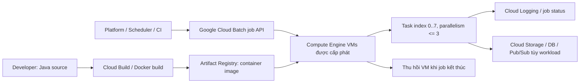
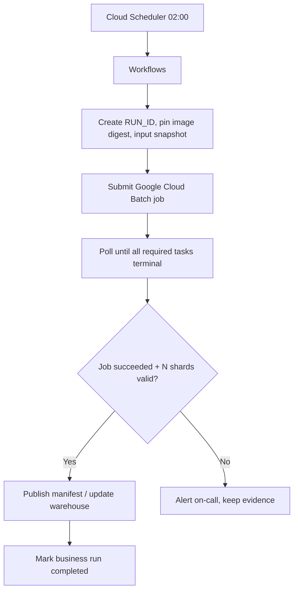
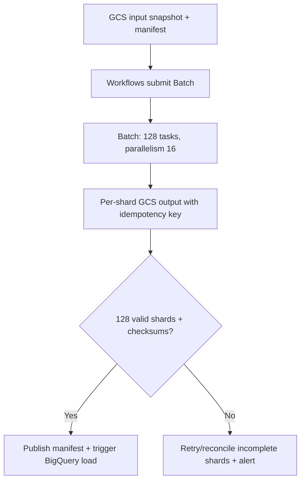

# Thực hành chạy batch job Java trên tài nguyên co giãn

> **Chương:** Hạ tầng chuyên biệt  
> **Mô-đun:** `CLOUD_PROVIDERS_GCP` — Khám phá Google Cloud từ tổ chức project, IAM và VPC đến Compute Engine, GKE, Cloud Run, dịch vụ lưu trữ và cơ sở dữ liệu. Qua các tình huống triển khai, người học biết lựa chọn dịch vụ, bảo vệ tài nguyên, tự động hóa phát hành và theo dõi độ tin cậy cùng chi phí.  
> **Mục tiêu thực hành:** Đóng gói một chương trình **Java 21** thành container, chia dữ liệu thành nhiều tác vụ độc lập, đưa lên **Google Cloud Batch** để Compute Engine được cấp phát theo nhu cầu rồi thu hồi sau khi chạy; quan sát trạng thái, lỗi, mức song song, quyền IAM và chi phí.  
> **Lưu ý:** Các project, service account, tên registry và tên job bên dưới là ví dụ. Chỉ thực thi trên sandbox có billing/quota và quyền được phê duyệt; bài học không tự triển khai hạ tầng.

## 1. Kết quả cần đạt

Sau khi hoàn thành, người học có thể:

1. Phân biệt **batch processing** với HTTP request/response, background task và streaming.
2. Chọn dịch vụ phù hợp giữa **Cloud Batch**, **Cloud Run Jobs**, **GKE Jobs/CronJobs**, **Dataflow** và Compute Engine tự quản.
3. Viết Java task **deterministic**, chia shard không trùng lặp, trả exit code rõ ràng và an toàn khi retry.
4. Build container Java, đẩy lên **Artifact Registry** và khai báo một Batch job bằng JSON.
5. Cấu hình `taskCount`, `parallelism`, `computeResource`, `allocationPolicy`, retry, timeout, logging và runtime service account.
6. Theo dõi job/task/logs, thử lỗi có chủ đích, lý giải trường hợp quota hoặc Spot VM bị preempt.
7. Thiết kế đầu ra bền vững, checkpoint, phân quyền tối thiểu và runbook xử lý lỗi.
8. Ước lượng quan hệ giữa thời gian chạy, chi phí Compute Engine, độ song song và sức chịu tải của downstream.

**Tiêu chí nghiệm thu lab:** Java chương trình chạy local; image build thành công; Batch nhận job có 8 task và song song tối đa 3; tất cả task thành công; tổng số record đã xử lý bằng `TOTAL_ITEMS`; log chứa `taskIndex` và `taskCount`; VM không còn duy trì để tính tiền sau khi job hoàn tất; không sử dụng service account JSON key.

## 2. Batch job là gì và vì sao cần tài nguyên co giãn?

**Batch job** là một lần xử lý tập hữu hạn công việc, thường không đợi người dùng giữ kết nối HTTP. Ví dụ:

- Cuối ngày tổng hợp 100 triệu giao dịch Java thành dữ liệu báo cáo.
- Tạo PDF hàng loạt hoặc xuất file hóa đơn.
- Chạy Java ETL/validation cho nhiều partition dữ liệu.
- Chấm điểm mô hình hoặc chạy hàng nghìn mô phỏng độc lập.
- Xử lý ảnh/video theo lô, có thể cần GPU.
- Kiểm tra tính toàn vẹn của một tập file Cloud Storage.

Một batch job thường có **điểm bắt đầu và kết thúc**; tài nguyên CPU, RAM, disk và đôi khi GPU chỉ cần trong thời gian xử lý. Nếu dùng VM luôn bật, chi phí idle tăng và nhóm vận hành phải tự provision, scale và cleanup.

Google Cloud Batch là dịch vụ **điều phối**: khi nộp job, Batch quản lý việc cấp phát các Compute Engine VM phù hợp với cấu hình và lịch task; khi công việc hoàn tất, tài nguyên VM do job tạo được dọn theo vòng đời dịch vụ. Batch không phải một máy chủ chạy Java liên tục, cũng không tự biến code tuần tự thành xử lý song song: **chính ứng dụng phải phân mảnh dữ liệu hoặc nhận đầu vào của từng task**.

### 2.1. Độ co giãn không có nghĩa vô hạn tài nguyên

Số task chạy đồng thời phụ thuộc đồng thời vào:

- `taskCount`: tổng số task logic.
- `parallelism`: trần task đang chạy cùng lúc.
- `computeResource`: CPU/RAM cần cho từng task.
- Machine type, khả năng đặt task trên VM và tài nguyên hiện có.
- Quota vCPU/instance, khả năng cung cấp máy ở region/zone và networking.
- Chính sách Spot/Standard, image pull, quyền IAM và readiness.

Vì thế `parallelism=100` chỉ là **giới hạn trên**; không bảo đảm 100 task chạy ngay. Một VM có thể chứa nhiều task nếu cấu hình và tài nguyên phù hợp, vì vậy **task count không bằng VM count**.

### 2.2. Sơ đồ triển khai



Trong bài thực hành cơ bản, kết quả được in vào **Cloud Logging** để dễ kiểm chứng mà không cần tạo bucket dữ liệu. Phần mở rộng sẽ trình bày cách ghi output lâu dài vào Cloud Storage; **không** dùng log làm hệ thống lưu dữ liệu nghiệp vụ.

## 3. Chọn công cụ thực thi Java batch

| Lựa chọn | Mô hình thực thi | Điểm mạnh | Giới hạn cần tính |
|---|---|---|---|
| **Google Cloud Batch** | Task chạy trên Compute Engine VMs do Batch quản lý | Chọn machine series, disk, Spot, GPU/TPU phù hợp; task groups; tốt cho workload VM-centric/HPC | Cần hiểu VM quota, networking, image, lifecycle và sự khác biệt task/VM |
| **Cloud Run Jobs** | Chạy container task đến khi kết thúc, không phục vụ HTTP | Ít quản trị hạ tầng, dễ dùng container, tasks/parallelism/retry | CPU/RAM/GPU/timeouts và networking theo giới hạn Cloud Run |
| **GKE Job/CronJob** | Kubernetes pods với completions/parallelism | Tận dụng cluster, RBAC và scheduling policy hiện hữu | Phải quản lý cluster, quotas, node pools và pod lifecycle |
| **Dataflow (Apache Beam Java)** | Distributed data processing engine | Mạnh về ETL, shuffle, windowing, batch/streaming | Cần mô hình Beam, không phải lựa chọn mặc định cho Java CLI tùy ý |
| **Compute Engine tự quản** | Chạy process Java trên VM tự cấp | Tùy chỉnh cao, kiểm soát OS và runtime | Tự xử lý auto provisioning, retry, cleanup, locking và logs |

**Quy tắc nhanh:**

- Java CLI cần tách N phần độc lập, muốn cấu hình VM/Spot/GPU → **Batch**.
- Java container xử lý ngắn/vừa, muốn tối giản hạ tầng → **Cloud Run Jobs**.
- Đã có Kubernetes và cần CronJob/PVC/admission policy → **GKE Jobs**.
- Xử lý dữ liệu lớn kiểu map/groupBy/window với Java Beam → **Dataflow**.

Không chọn GPU chỉ vì “hạ tầng chuyên biệt”: đa số Java ETL, kiểm toán file hoặc tạo báo cáo CPU-bound/I/O-bound chạy CPU hiệu quả hơn.

## 4. Bài toán lab: chia một tập record thành tám shard

Ta mô phỏng tổng hợp một tập `TOTAL_ITEMS=100000` record, ID từ `0` tới `99999`. Mỗi task đọc biến môi trường do Batch cung cấp:

- `BATCH_TASK_INDEX`: chỉ số task hiện tại, từ `0` đến `taskCount - 1`.
- `BATCH_TASK_COUNT`: tổng số task trong cùng task group.
- `TOTAL_ITEMS`: input nghiệp vụ do người triển khai cấu hình.

Task có chỉ số `i` chỉ xử lý record `r` thỏa:

```text
r % BATCH_TASK_COUNT == BATCH_TASK_INDEX

Ví dụ 8 task:
task 0: 0, 8, 16, ...
task 1: 1, 9, 17, ...
...
task 7: 7, 15, 23, ...

Mỗi record thuộc đúng một shard nếu cùng dùng taskCount=8.
```

Ứng dụng tính `count` và `checksum` xác định, in một dòng JSON phục vụ đối soát. Giá trị checksum **không phải hash bảo mật** mà là ví dụ minh họa tính lặp lại: nếu task retry với cùng input và task index, kết quả phải giống nhau.

Tách shard bằng modulo dễ hiểu và không cần coordinator, nhưng có thể gây **data skew** khi khối lượng xử lý mỗi record khác nhau. Sản xuất nên phân vùng theo partition ID/time range/file manifest, hoặc phân bổ dynamic work queue có lease/visibility timeout và cơ chế idempotency.

## 5. Cấu trúc project mẫu

Các đường dẫn sau là **cấu trúc minh họa**, không phải yêu cầu tạo file ngoài hai file bài học được giao:

```text
java-batch-lab/
├── src/
│   └── ShardWorker.java
├── Dockerfile
└── job.template.json
```

Bản thực hành dùng Java 21 và chỉ dựa vào Java standard library, nên không cần Maven/Gradle để thử đầu tiên. Khi tích hợp Google Cloud Storage, Pub/Sub hoặc database, dùng Maven/Gradle, Google Cloud libraries BOM và dependency versions được kiểm thử theo CI.

## 6. Viết chương trình Java có thể chạy lặp lại

File mẫu `src/ShardWorker.java`:

```java
import java.time.Instant;
import java.util.Locale;

public final class ShardWorker {
    private static final long MOD = 1_000_000_007L;
    private static final long MAX_ITEMS = 100_000_000L;

    public static void main(String[] args) {
        try {
            int index = intEnv("BATCH_TASK_INDEX", "CLOUD_RUN_TASK_INDEX", 0);
            int count = intEnv("BATCH_TASK_COUNT", "CLOUD_RUN_TASK_COUNT", 1);
            long total = longEnv("TOTAL_ITEMS", 100_000L);

            if (count < 1 || index < 0 || index >= count) {
                throw new IllegalArgumentException("Invalid task index/count");
            }
            if (total < 0 || total > MAX_ITEMS) {
                throw new IllegalArgumentException("TOTAL_ITEMS out of lab range");
            }

            long started = System.nanoTime();
            long records = 0;
            long checksum = 0;

            // Partition theo ID modulo taskCount.
            for (long recordId = index; recordId < total; recordId += count) {
                long contribution = ((recordId + 1) * 31) % 1_000_003L;
                checksum = (checksum + contribution) % MOD;
                records++;
            }

            long elapsedMs = (System.nanoTime() - started) / 1_000_000L;

            // Một dòng JSON / task. Không log token, credential, PII.
            System.out.printf(Locale.ROOT,
                "{\"event\":\"task_succeeded\",\"taskIndex\":%d,"
                + "\"taskCount\":%d,\"totalItems\":%d,"
                + "\"processed\":%d,\"checksum\":%d,"
                + "\"elapsedMs\":%d,\"time\":\"%s\"}%n",
                index, count, total, records, checksum, elapsedMs, Instant.now());
        } catch (Exception ex) {
            System.err.println("Task failed: " + ex.getMessage());
            System.exit(2); // Batch nhận diện task thất bại và có thể retry.
        }
    }

    private static int intEnv(String primary, String fallback, int defaultVal) {
        String value = System.getenv(primary);
        if (value == null || value.isBlank()) value = System.getenv(fallback);
        return value == null || value.isBlank()
            ? defaultVal : Integer.parseInt(value);
    }

    private static long longEnv(String name, long defaultVal) {
        String value = System.getenv(name);
        return value == null || value.isBlank()
            ? defaultVal : Long.parseLong(value);
    }
}
```

**Lý do chọn thiết kế này:**

1. **Deterministic:** một task chạy lại tạo cùng `processed` và `checksum`, ngoại trừ `elapsedMs`/`time`.
2. **Partition rõ ràng:** index hợp lệ từ 0 đến count-1; mỗi record được xử lý đúng một lần **về mặt phân hoạch logic**.
3. **Không phụ thuộc state cục bộ:** VM có thể bị thay hoặc task khởi động lại mà không mất progress đã commit tới nơi lưu trữ ngoài VM (trong lab chỉ có log, chưa có commit dữ liệu nghiệp vụ).
4. **Failure signaling:** input sai tạo exit code khác 0 thay vì in “success” giả.
5. **Cloud Run-compatible:** hàm `intEnv` hỗ trợ cả biến `BATCH_*` lẫn `CLOUD_RUN_*` để so sánh hai nền tảng ở phần sau.

Chương trình **không** tự giới hạn tiêu thụ CPU nếu đổi `TOTAL_ITEMS` rất lớn; `MAX_ITEMS` bảo vệ lab, không phải giới hạn sản phẩm Batch.

### 6.1. Biên dịch và thử local

```bash
mkdir -p out
javac --release 21 -d out src/ShardWorker.java

# Mô phỏng shard 0 trong 8 task
BATCH_TASK_INDEX=0 \
BATCH_TASK_COUNT=8 \
TOTAL_ITEMS=100000 \
java -cp out ShardWorker

# Mô phỏng shard 7: dự kiến processed=12500
BATCH_TASK_INDEX=7 \
BATCH_TASK_COUNT=8 \
TOTAL_ITEMS=100000 \
java -cp out ShardWorker
```

Kỳ vọng mỗi shard xử lý **12.500 records**; tổng tám shard bằng 100.000. Nếu thay `TOTAL_ITEMS` không chia hết cho 8, số lượng mỗi shard có thể lệch tối đa 1 trong bài toán đồng đều này.

Một thử nghiệm phủ định:

```bash
BATCH_TASK_INDEX=9 BATCH_TASK_COUNT=8 \
  java -cp out ShardWorker

# Kỳ vọng: exit code 2, không phát task_succeeded.
```

Không copy log chứa ID/PII thật vào ticket khi dùng dữ liệu production.

## 7. Đóng gói Java vào container

File mẫu `Dockerfile`:

```dockerfile
# Builder image nên pin digest trong CI production.
FROM eclipse-temurin:21-jdk AS build
WORKDIR /build
COPY src/ShardWorker.java .
RUN javac --release 21 -encoding UTF-8 ShardWorker.java

FROM eclipse-temurin:21-jre
WORKDIR /app
COPY --from=build /build/ShardWorker.class /app/
USER 65532
ENTRYPOINT ["java", "-XX:MaxRAMPercentage=70.0", "-cp", "/app", "ShardWorker"]
```

**Giải thích:**

- **Multi-stage build**: image runtime không chứa JDK/compiler hoặc source.
- **Java 21**: dùng Java LTS với phiên bản image được tổ chức cho phép; production pin digest, quét CVE và SBOM.
- **Non-root**: hạn chế ảnh hưởng khi runtime bị chiếm quyền; kiểm tra quyền đọc file/mount.
- **MaxRAMPercentage**: để lại RAM cho metaspace, native memory và agent; không đặt `-Xmx` bằng toàn bộ memory limit.
- **ENTRYPOINT**: Batch chỉ cần chỉ định `imageUri`, không cần tự viết `java -jar` trong JSON.

Build thử trên máy có Docker:

```bash
docker build -t java-shard-worker:local .
docker run --rm \
  -e BATCH_TASK_INDEX=1 \
  -e BATCH_TASK_COUNT=8 \
  -e TOTAL_ITEMS=100000 \
  java-shard-worker:local
```

Để kiểm chứng architecture, scan image và chạy trên cùng Linux/CPU architecture hỗ trợ. Java image không “tự scale”; sự co giãn thuộc về Batch scheduler và Compute Engine.

## 8. Chuẩn bị Google Cloud sandbox và API

Giả sử:

| Thành phần | Giá trị ví dụ |
|---|---|
| Project | `java-batch-sandbox` |
| Batch location | `asia-southeast1`, **nếu** Batch và loại VM đang hỗ trợ |
| Registry location | `asia-southeast1` |
| Artifact Registry repository | `java-batch` |
| Container image | `java-shard-worker:v1` |
| Execution service account | `batch-worker@java-batch-sandbox.iam.gserviceaccount.com` |
| Machine type | `e2-standard-4` |
| Tổng task | 8 |
| Tối đa chạy đồng thời | 3 |

**Quy trình chỉ là ví dụ:** nên kiểm tra Batch location, E2 capacity, billing, Compute Engine quota và quyền của tổ chức trước khi thực thi.

### 8.1. Đặt biến và bật dịch vụ

```bash
export PROJECT_ID="java-batch-sandbox"
export REGION="asia-southeast1"
export REPO="java-batch"
export IMAGE_NAME="java-shard-worker"
export TAG="v1"
export SA_NAME="batch-worker"
export SA_EMAIL="$SA_NAME@$PROJECT_ID.iam.gserviceaccount.com"

gcloud config set project "$PROJECT_ID"

# Yêu cầu billing đã bật và quyền Service Usage Admin thích hợp.
gcloud services enable \
  batch.googleapis.com \
  compute.googleapis.com \
  logging.googleapis.com \
  artifactregistry.googleapis.com \
  cloudbuild.googleapis.com \
  --project="$PROJECT_ID"
```

Cloud Batch tự quản lý VM nhưng cần **Compute Engine API** và tài khoản thực thi có quyền phù hợp. Cloud Build chỉ dùng để build image; nếu build trên máy riêng rồi push, có thể không dùng Cloud Build API.

### 8.2. Tạo Artifact Registry Docker repository

```bash
gcloud artifacts repositories create "$REPO" \
  --project="$PROJECT_ID" \
  --location="$REGION" \
  --repository-format=docker \
  --description="Container images for Java batch lab"

export IMAGE_URI="$REGION-docker.pkg.dev/$PROJECT_ID/$REPO/$IMAGE_NAME:$TAG"
```

Tạo repository trước khi push image. Repo production nên có vulnerability scanning, retention policy, hạn chế publisher và cơ chế pin digest/immutable tag.

### 8.3. Build và đẩy container image

**Cách A — Cloud Build:** build từ thư mục chứa `Dockerfile`, cần build service account có quyền **Artifact Registry Writer** trên repository.

```bash
gcloud builds submit \
  --project="$PROJECT_ID" \
  --tag="$IMAGE_URI" \
  .
```

**Cách B — Docker local:** nếu môi trường cho phép và đã thiết lập xác thực registry:

```bash
gcloud auth configure-docker "$REGION-docker.pkg.dev"

docker build -t "$IMAGE_URI" .
docker push "$IMAGE_URI"
```

**Chọn một trong hai cách**, không cần thực hiện cả hai. Người build và người chạy Batch có role khác nhau: quyền **push** không đồng nghĩa runtime được đọc image hoặc truy cập dữ liệu.

## 9. Thiết kế IAM theo nguyên tắc tối thiểu

### 9.1. Ba danh tính cần phân biệt

| Danh tính | Chức năng | Quyền cần xem xét |
|---|---|---|
| Người dùng hoặc CI nộp job | Gọi Batch API tạo/xem job | `roles/batch.jobsEditor` trên project; `roles/iam.serviceAccountUser` trên execution SA |
| Execution SA của job | Gắn vào VMs, chạy chương trình, gửi task logs | `roles/batch.agentReporter` và `roles/logging.logWriter` trên project; `roles/artifactregistry.reader` trên repo nếu cần đọc image |
| **Batch service agent** | Dịch vụ Google cấp phát/điều khiển hạ tầng Batch | `roles/batch.serviceAgent` được Google cấp mặc định; không gỡ tùy tiện |

Tạo service account riêng:

```bash
gcloud iam service-accounts create "$SA_NAME" \
  --project="$PROJECT_ID" \
  --display-name="Java Batch lab execution identity"

gcloud projects add-iam-policy-binding "$PROJECT_ID" \
  --member="serviceAccount:$SA_EMAIL" \
  --role="roles/batch.agentReporter"

gcloud projects add-iam-policy-binding "$PROJECT_ID" \
  --member="serviceAccount:$SA_EMAIL" \
  --role="roles/logging.logWriter"

gcloud artifacts repositories add-iam-policy-binding "$REPO" \
  --project="$PROJECT_ID" \
  --location="$REGION" \
  --member="serviceAccount:$SA_EMAIL" \
  --role="roles/artifactregistry.reader"
```

Quản trị viên IAM cần cấp cho người/CI vận hành job các quyền theo bảng trên. Không cấp `roles/editor`/`roles/owner` cho execution SA chỉ để giải quyết lỗi `PERMISSION_DENIED`. Không tạo/download service account key JSON cho Batch.

### 9.2. Quyền nâng cao tùy workload

Khi Java cần gọi Cloud Storage, BigQuery, Pub/Sub hoặc Secret Manager, execution SA phải có **role trên resource cụ thể**, ví dụ Storage Object Creator trên output bucket hoặc Secret Accessor trên secret. Không cấp project-wide Storage Admin nếu chỉ cần ghi output vào một bucket.

Với Shared VPC/không có default network, Batch service agent và VM còn cần quyền network, subnet, routing, firewall/NAT phù hợp. Image pull từ registry private, dependency fetch và Google APIs cũng cần connectivity. Đây là lớp **network/IAM riêng**, không chỉ có Batch Job Editor.

## 10. Định nghĩa Batch job bằng JSON

File mẫu `job.template.json` sau dùng image và SA giả định. **Trước khi nộp, thay toàn bộ** `PROJECT_ID`, `REGION` bằng giá trị thật; trong JSON không có shell variable interpolation mặc định.

```json
{
  "taskGroups": [
    {
      "taskSpec": {
        "runnables": [
          {
            "container": {
              "imageUri": "REGION-docker.pkg.dev/PROJECT_ID/java-batch/java-shard-worker:v1"
            },
            "environment": {
              "variables": {
                "TOTAL_ITEMS": "100000"
              }
            }
          }
        ],
        "computeResource": {
          "cpuMilli": 1000,
          "memoryMib": 1024
        },
        "maxRetryCount": 2,
        "maxRunDuration": "1800s"
      },
      "taskCount": 8,
      "parallelism": 3
    }
  ],
  "allocationPolicy": {
    "instances": [
      {
        "policy": {
          "machineType": "e2-standard-4",
          "provisioningModel": "STANDARD"
        }
      }
    ],
    "serviceAccount": {
      "email": "batch-worker@PROJECT_ID.iam.gserviceaccount.com"
    }
  },
  "labels": {
    "app": "java-shard",
    "env": "sandbox"
  },
  "logsPolicy": {
    "destination": "CLOUD_LOGGING"
  }
}
```

### 10.1. Diễn giải từng cấu hình

| Thuộc tính | Ví dụ | Ý nghĩa |
|---|---|---|
| `taskGroups[0]` | Một nhóm | Batch v1 hiện hỗ trợ một task group `group0` cho mỗi job |
| `taskSpec.runnables` | Một container | Mỗi task chạy cùng image và logic Java |
| `container.imageUri` | Artifact Registry URI | Runtime pull image đã build/push |
| `environment.variables` | `TOTAL_ITEMS=100000` | Input chung, không lưu secret plaintext vào job spec |
| `computeResource.cpuMilli` | 1000 | Mỗi task yêu cầu khoảng 1 vCPU |
| `computeResource.memoryMib` | 1024 | Bộ nhớ cần cho một task, phải tương thích machine |
| `maxRetryCount` | 2 | Một task được retry tối đa 2 lần sau lỗi, ngoài lần chạy đầu |
| `maxRunDuration` | `1800s` | Thời hạn của một lần thực thi task |
| `taskCount` | 8 | Tổng 8 phần công việc logic |
| `parallelism` | 3 | Tối đa 3 task chạy đồng thời; không bảo đảm 3 VM |
| `allocationPolicy.instances` | E2 Standard | VM backing được Batch cấp phát |
| `allocationPolicy.serviceAccount` | user-managed SA | Credential ngắn hạn từ runtime VM, không dùng JSON key |
| `logsPolicy` | Cloud Logging | Thu stdout/stderr của container thành task logs |

**Đừng đánh đồng** `cpuMilli=1000` và `machineType=e2-standard-4`. CPU per task là nhu cầu lập lịch; một VM có thể chứa nhiều task tùy resource và cách Batch đặt task. Một job có 8 task, parallelism 3 có thể chạy theo nhiều đợt mà không liên quan trực tiếp tới số lần tạo VM.

### 10.2. Sinh file cấu hình thật từ template

Ví dụ Bash (thay placeholder an toàn trong sandbox):

```bash
sed \
  -e "s/REGION/$REGION/g" \
  -e "s/PROJECT_ID/$PROJECT_ID/g" \
  job.template.json > job.json

# Chỉ để kiểm tra nội dung sau thay thế; không in secret thật.
cat job.json
```

Với production, dùng templating/IaC được kiểm thử và **pin image theo digest** thay vì mutable tag, kiểm tra JSON schema trước khi nộp. Không commit secret hoặc token vào job spec.

## 11. Nộp job và theo dõi vòng đời

### 11.1. Submit

```bash
export JOB_ID="java-shard-lab-001"

gcloud batch jobs submit "$JOB_ID" \
  --project="$PROJECT_ID" \
  --location="$REGION" \
  --config=job.json
```

Sau lệnh submit, Batch nhận một **job resource** và xếp lịch thực thi. Một job không tự khởi chạy lại mỗi ngày; mỗi lần chạy mới cần job ID mới hoặc một workflow/scheduler gọi API tạo job với ID duy nhất.

### 11.2. Quan sát trạng thái

```bash
gcloud batch jobs describe "$JOB_ID" \
  --project="$PROJECT_ID" \
  --location="$REGION"

gcloud batch jobs list \
  --project="$PROJECT_ID" \
  --location="$REGION"

gcloud batch tasks list \
  --project="$PROJECT_ID" \
  --job="$JOB_ID" \
  --location="$REGION"
```

Một số trạng thái thường gặp: **QUEUED**, **SCHEDULED**, **RUNNING**, **SUCCEEDED** và **FAILED**, kèm events giải thích trường hợp chưa cấp được VM, task lỗi hoặc bị preempt.

**Bài học quan trọng:** một job chỉ được coi là hoàn thành khi tất cả task bắt buộc đã đạt trạng thái thành công theo chính sách job. Nếu task bị retry, log có thể chứa nhiều dòng từ các attempt khác nhau; không lấy tổng số log lines làm số lượng record duy nhất.

### 11.3. Đọc Cloud Logging

Giao diện Google Cloud: **Batch → Jobs → chọn job → Logs**. Hoặc Logs Explorer, lọc theo job resource và labels thực tế. Với `logsPolicy.destination=CLOUD_LOGGING`, output `System.out` và `System.err` được ghi thành task logs.

```text
# Mẫu lọc ý tưởng trong Logs Explorer; kiểm tra đúng label thực tế:
resource.type="batch_job"
labels."batch.googleapis.com/job_id"="java-shard-lab-001"
```

Tên resource/label có thể thay đổi theo loại log và môi trường, nên cách đáng tin nhất là mở job trong Batch console rồi chọn Logs. Một lời gọi `System.out.printf` chỉ nên log dữ liệu vận hành không nhạy cảm.

### 11.4. Đối soát kết quả

Với `TOTAL_ITEMS=100000` và `taskCount=8`:

- Có **8 task** logic, chỉ số 0..7.
- Mỗi task xử lý **12.500** record, bởi 100.000 chia hết cho 8.
- Tổng `processed` trên **8 task thành công cuối cùng** bằng **100.000**.
- Mỗi task có `checksum` riêng, dùng đối chiếu các lần chạy.
- `taskCount` phải giữ ổn định nếu dùng key theo task index để lưu output; nếu đổi số shard, cần tạo một phiên run/result mới.

Để kiểm tra nghiệm thu, lọc **thành công cuối cùng của từng task**, không cộng dòng log của các lần retry. Với đầu ra bền vững, dùng manifest chứa danh sách shard và trạng thái commit.

## 12. Tài nguyên co giãn: đo thời gian và kiểm soát số VM

### 12.1. Ba lần chạy so sánh

| Thử nghiệm | taskCount | parallelism | cpuMilli/task | Mục đích |
|---|---:|---:|---:|---|
| A | 8 | 1 | 1000 | Đường chuẩn tuần tự theo task |
| B | 8 | 3 | 1000 | Kiểm tra lợi ích song song vừa phải |
| C | 8 | 8 | 1000 | Kiểm tra hiệu quả và quota khi mở rộng |

**Không sửa job đã chạy bằng cách ghi đè ID**; Batch job là một lần thực thi với ID riêng. Nộp job khác, ví dụ `java-shard-lab-002`/`003`, với cấu hình đã sửa.

Kỳ vọng B có thể nhanh hơn A nhưng **không phải chắc chắn gấp ba**: thời gian cấp VM, pull image, khởi động JVM, tải input và contention có thể chiếm phần lớn tổng thời gian.

### 12.2. Tổng thời gian chạy

```text
Elapsed time = queue time
             + VM provisioning / image pull
             + task waves execution
             + output commit / verification
             + cleanup / orchestration overhead

Số đợt lý tưởng xấp xỉ ceil(taskCount / effective parallelism).

Không lấy taskCount / parallelism là số VM.
```

Nếu Java task chỉ chạy vài millisecond như lab, overhead cấp VM có thể áp đảo toàn bộ thời gian. Workload thực tế thường có mỗi task dài hơn hoặc gộp nhiều record mỗi task để tăng hiệu suất.

### 12.3. Quota/capacity

Kiểm tra:

- vCPU quota cho machine series/region.
- VM instances, disk và IP quota.
- Artifact Registry image pull/network bandwidth.
- Giới hạn Batch concurrent jobs/tasks và giới hạn job per project.
- Quota Cloud Storage/BigQuery/database/Pub/Sub phía downstream.
- Quota Logging và ngân sách log ingestion.

Khi thiếu capacity, tăng `parallelism` có thể làm **queue dài hơn hoặc job fail**, chứ không tự tạo tài nguyên vượt quota.

## 13. Tối ưu chi phí với Standard và Spot VMs

`allocationPolicy.instances[0].policy.provisioningModel` có thể dùng `STANDARD` hoặc `SPOT` theo loại máy/region được hỗ trợ.

**Standard VM:** phù hợp job quan trọng có ít khả năng chịu gián đoạn; vẫn phải có retry cho lỗi mạng, host hoặc ứng dụng.

**Spot VM:** có thể rẻ hơn nhưng **có thể bị preempt bất kỳ lúc nào**, không bảo đảm có capacity. Phù hợp tính toán độc lập, ngắn, có checkpoint và idempotent.

Biến thể chỉ thay phần policy:

```json
"allocationPolicy": {
  "instances": [
    {
      "policy": {
        "machineType": "e2-standard-4",
        "provisioningModel": "SPOT"
      }
    }
  ],
  "serviceAccount": {
    "email": "batch-worker@PROJECT_ID.iam.gserviceaccount.com"
  }
}
```

Trong job hợp lệ, khối này nằm cùng cấp với `taskGroups` và `logsPolicy`, **không** dán đè lên toàn file JSON. Giữ `maxRetryCount` hợp lý, nhưng nhớ rằng retry quá nhiều khi lỗi cấu hình/permission cố định chỉ làm tăng phí.

**Công thức dự toán khái niệm:**

```text
Tổng chi phí batch ≈
    Compute Engine VM vCPU + RAM theo thời gian sử dụng
  + boot/data disk và snapshot nếu có
  + Artifact Registry storage + image transfer liên quan
  + Cloud Logging / Monitoring
  + Cloud Storage / BigQuery / database API và data transfer
  + chi phí chờ/khởi tạo VM và thời gian retry
```

Theo tài liệu chính thức, **Google Cloud Batch không có phí dịch vụ cộng thêm**, nhưng tài nguyên nền tảng như VM, disk, network và log vẫn tính phí. Không suy ra “Batch miễn phí” nghĩa là chạy job không tốn tiền.

### 13.1. Khi nào parallelism cao làm tăng chi phí?

Ví dụ 8 task mỗi task dùng CPU 100% trong 10 phút:

- Song song 1: thời gian dài nhưng số VM hoạt động đồng thời ít.
- Song song 8: có thể giảm latency nếu đủ capacity; cùng tổng CPU-time lý tưởng, nhưng chi phí có thể khác do VM minimum billing, startup, resource packing, Spot pricing, data egress và retries.
- Nếu downstream DB chỉ chịu 2 connection đồng thời, parallelism 8 có thể gây timeout và retry, vừa chậm vừa tốn hơn.

Điều chỉnh concurrency theo **bottleneck của toàn hệ thống**, không chỉ theo quota CPU.

## 14. Từ stdout sang output bền vững trên Cloud Storage

Log phù hợp quan sát, không phải nơi lưu trữ kết quả cuối. Trong ứng dụng thật, mỗi task nên ghi kết quả tới object riêng:

```text
gs://reports-batch-output/
  job-runs/
    RUN_ID/
      part-0000.json
      part-0001.json
      ...
      part-0007.json
      manifest.json
```

### 14.1. Quy tắc đặt tên và commit

- `RUN_ID` duy nhất cho mỗi lần chạy; không dùng tên chung như `latest` để tránh race.
- `part-i` là kết quả của task index `i`, không dùng VM hostname vì VM có thể bị thay khi retry.
- Chỉ đánh dấu run **COMPLETED** sau khi có đủ N shards và kiểm tra checksum/count.
- Nếu task retry, cùng shard có thể được viết lại; output phải idempotent hoặc phát hiện version tồn tại.
- GCS là object storage, không phải filesystem chia sẻ có giao dịch atomic nhiều object. Cần manifest/commit marker do coordinator tạo sau khi kiểm tra.

### 14.2. Mở rộng Java bằng Google Cloud Storage client

Ứng dụng production có thể dùng `com.google.cloud:google-cloud-storage` với **Application Default Credentials (ADC)** từ execution service account của Batch VM:

```java
// Trích đoạn MỞ RỘNG, không nằm trong bản Java standard-library lab.
// Cần khai báo Google Cloud Storage client trong Maven/Gradle.
import com.google.cloud.storage.BlobId;
import com.google.cloud.storage.BlobInfo;
import com.google.cloud.storage.Storage;
import com.google.cloud.storage.StorageOptions;
import java.nio.charset.StandardCharsets;

Storage storage = StorageOptions.getDefaultInstance().getService();
String bucket = "reports-batch-output";
String runId = "approved-run-id"; // Truyền bằng config, không hard-code prod.
String name = "job-runs/" + runId + "/part-" + taskIndex + ".json";

byte[] data = resultJson.getBytes(StandardCharsets.UTF_8);
BlobInfo blob = BlobInfo.newBuilder(BlobId.of(bucket, name))
    .setContentType("application/json")
    .build();

// Precondition: chỉ tạo nếu object chưa tồn tại.
// Nếu retry nhận lỗi đã tồn tại: phải so nội dung/hash/manifest
// trước khi xem task là hoàn tất, KHÔNG lặng lẽ bỏ qua.
storage.create(blob, data, Storage.BlobTargetOption.doesNotExist());
```

Trích đoạn cần được đặt trong method có biến `taskIndex` và `resultJson` được xác định từ chương trình; đây là **thiết kế mở rộng**, không phải một file Java hoàn chỉnh để biên dịch độc lập.

IAM trên output bucket: cấp cho Batch execution SA quyền ghi tối thiểu như `roles/storage.objectCreator` trên bucket. Nếu cần đọc lại/checksum hoặc list manifest, cấp quyền đọc tương ứng có phạm vi hẹp. Không cấp toàn project Storage Admin cho một task chỉ ghi output.

**Lưu ý:** `doesNotExist()` giúp tránh ghi đè một object đã commit nhưng không tự giải quyết exactly-once trên database hoặc nhiều object. Tính đúng phụ thuộc quy trình transaction/manifest, khóa idempotency và cách xử lý retry.

## 15. Retry, checkpoint và at-least-once execution

Batch hỗ trợ retry task thất bại; **một task có thể chạy nhiều lần**. Vì vậy side effect không được phụ thuộc giả định “chỉ một lần”.

### 15.1. Phân loại lỗi

| Lỗi | Có nên retry? | Hành động |
|---|---|---|
| Timeout mạng tạm thời | Thường có, với backoff | Retry giới hạn, không duplicate output |
| Spot VM preemption | Có nếu task restart-safe | Dùng checkpoint hoặc partition nhỏ |
| Permission denied cố định | Không, nếu policy không đổi | Sửa IAM/Org Policy |
| Image not found / image pull denied | Không cho tới khi sửa image/role | Kiểm tra Artifact Registry và network |
| OOM | Không retry vô hạn | Điều chỉnh memory, heap, batch size |
| Dữ liệu đầu vào sai schema | Tùy quy trình | Quarantine record, báo nghiệp vụ, tránh che lỗi |
| DB connection limit | Retry có kiểm soát | Giảm parallelism hoặc dùng pool/throttle |

### 15.2. Checkpoint và idempotency

- **Checkpoint** là mốc tiến độ bền vững ngoài VM; không để chỉ ở local `/tmp`.
- **Idempotency key** nên gắn với `runId + shardId + business key` để nhận diện hành động lặp.
- **Transactional writes** nếu hỗ trợ: commit đầu ra sau khi hoàn tất shard; tránh “nửa file đã ghi” hoặc partial DB updates.
- **At-least-once**: scheduler có thể retry, application cần đảm bảo nghiệp vụ không tạo giao dịch kép.
- **Job cancellation** không phải rollback của các side effect đã commit.

Với input lớn, có thể chia nhiều shard hơn so với parallelism để mỗi task ngắn, dễ retry; nhưng task quá nhỏ sẽ tăng overhead provisioning/logging/scheduling. Chọn shard size dựa trên benchmark thực tế.

## 16. Lập lịch và orchestration nhiều bước

Batch job tạo mới thường chạy ngay khi được submit, không tự động chạy định kỳ. Để làm “báo cáo mỗi đêm”, có thể dùng:

- **Cloud Scheduler** gọi một HTTP endpoint/Cloud Run service/Workflows được bảo vệ để tạo Batch job.
- **Workflows** điều phối job, đợi kết quả, gọi bước kiểm tra dữ liệu rồi publish manifest.
- **Cloud Build/CI** khi job phụ thuộc release hoặc thay đổi dữ liệu phiên bản.
- **Pub/Sub** khi việc nộp job phát sinh từ một sự kiện; consumer phải chống nộp trùng.

Ví dụ workflow khái niệm:



Đặt `job ID` duy nhất theo ngày và nguồn dữ liệu, không dùng một ID cố định khi job cũ đã tồn tại. Scheduler có thể gọi lại do timeout; hệ thống nộp job phải dùng idempotency để tránh hai job cùng ghi vào một output prefix.

## 17. Cloud Run Jobs: lựa chọn thay thế nhanh

Nếu yêu cầu không cần chọn VM type/Spot/phụ thuộc OS đặc biệt, Cloud Run Jobs có thể đơn giản hơn. Cùng image Java đã build ở trên có thể dùng khi code đọc biến môi trường `CLOUD_RUN_TASK_INDEX` và `CLOUD_RUN_TASK_COUNT`.

```bash
gcloud run jobs create java-shard-cloud-run \
  --project="$PROJECT_ID" \
  --region="$REGION" \
  --image="$IMAGE_URI" \
  --tasks=8 \
  --parallelism=3 \
  --task-timeout=30m \
  --max-retries=2 \
  --service-account="$SA_EMAIL"

# Cloud Run Job chỉ chạy khi được execute.
gcloud run jobs execute java-shard-cloud-run \
  --project="$PROJECT_ID" \
  --region="$REGION" \
  --wait
```

Cloud Run Jobs có số lượng task/parallelism và thời gian tối đa theo **giới hạn Cloud Run**, không giống hoàn toàn Batch. Theo tài liệu, job có thể có tối đa **10.000 tasks**, mỗi task nhận biến `CLOUD_RUN_TASK_INDEX`; task timeout tối đa đến **168 giờ** cho job không dùng GPU (giới hạn riêng cho GPU). Kiểm tra quota và giá hiện hành trước khi chuyển đổi.

**Quan trọng:** Batch và Cloud Run Jobs đều có retry, nhưng mô hình billing, quota, networking, CPU/memory, GPU và startup overhead khác. Không tuyên bố một bên luôn rẻ hơn nếu chưa benchmark với workload thật.

## 18. Tài nguyên chuyên biệt: memory-intensive, GPU và HPC

Java batch có thể là:

1. **CPU-bound:** transform dữ liệu, tạo PDF, serialize, nén; ưu tiên general/compute-optimized VM.
2. **Memory-bound:** join dữ liệu lớn, xử lý in-memory graph; cân nhắc memory-optimized VM và cấu hình heap/GC.
3. **I/O-bound:** đọc Cloud Storage, ghi database; cần điều chỉnh batch size, TCP connections, network egress và concurrency.
4. **GPU-accelerated:** chỉ khi ứng dụng Java gọi native libraries/cuDNN/ML backend hoặc thư viện GPU có lợi ích được benchmark; không tự động tăng tốc JVM.
5. **HPC:** nhiều VM/CPU/GPU, network và data locality, có thể dùng Batch kết hợp scheduler/model phù hợp.

### 18.1. Ví dụ thay đổi machine type

Trong job.json, sửa:

```json
"allocationPolicy": {
  "instances": [
    {
      "policy": {
        "machineType": "n2-standard-8",
        "provisioningModel": "STANDARD"
      }
    }
  ],
  "serviceAccount": {
    "email": "batch-worker@PROJECT_ID.iam.gserviceaccount.com"
  }
}
```

Máy lớn hơn có thể chạy nhiều task trên mỗi VM, nhưng không mặc nhiên tăng tốc task đã bị giới hạn bởi database hoặc Cloud Storage I/O. Với GPU, cần cấu hình accelerator/image/driver được Batch hỗ trợ; không chỉ đổi machine type và mong Java dùng GPU.

### 18.2. JVM sizing

- Tách **CPU per task** khỏi số vCPU của VM.
- Theo dõi heap, GC pauses, metaspace, native memory, disk spill và container OOM.
- Chọn `-XX:MaxRAMPercentage` hợp lý; cân nhắc `-XX:ActiveProcessorCount` khi container CPU limit hoặc library nhận CPU không đúng kỳ vọng.
- Cấu hình connection pool theo `parallelism` tổng, không theo một task riêng lẻ.
- Dùng JFR, metrics hoặc sampling profiler trong thử nghiệm, tránh bật full debug logging production.
- Với workload ngắn, startup JVM/large image có thể là tỷ trọng thời gian lớn; tối ưu image layers và warm-up.

## 19. Security: network, IAM, secrets và supply chain

### 19.1. Nguyên tắc tối thiểu

- **Không** dùng service account key JSON trong Docker image, Git hoặc environment variables.
- Dùng user-managed execution SA với `roles/batch.agentReporter`, `roles/logging.logWriter` và resource-specific permissions.
- Nhân sự/CI nộp job được `roles/batch.jobsEditor` và `roles/iam.serviceAccountUser` chỉ trên SA phù hợp.
- Pin container image digest trong production, bật vulnerability scanning/SBOM và provenance.
- Không ghi API key/password vào JSON `runnables.environment.variables`; dùng Secret Manager và cơ chế tích hợp được hỗ trợ.
- Nếu project không có default VPC, khai báo network/subnet/Private Google Access hoặc Cloud NAT phù hợp; VM cần lấy image và gọi dịch vụ đúng đường mạng.
- Giới hạn network egress tới hệ thống cần thiết, không cấp public ingress cho batch VM.
- Dùng Cloud Audit Logs và org policies, tách project/môi trường production khỏi sandbox.

### 19.2. Cảnh báo về shared service account

Nếu hai job khác nghiệp vụ dùng cùng một SA có quyền ghi cả hai bucket, job bị xâm nhập có thể sửa dữ liệu của job kia. Tách SA theo **ứng dụng + môi trường + tài nguyên**, và rà soát ai có quyền `actAs` để tránh một người được tạo job dưới danh tính có quyền cao hơn ý định.

### 19.3. Input không đáng tin

Batch task có thể nhận file CSV, payload Pub/Sub, JSON hoặc object Cloud Storage do bên ngoài cung cấp. Cần validate schema, size, encoding, checksum, path traversal, zip bomb và limit memory/time. Không dùng giá trị input để ghép shell command tùy ý.

## 20. Kiểm thử, đo đạc và nghiệm thu

### 20.1. Test case bắt buộc

| Test | Thiết lập | Kỳ vọng |
|---|---|---|
| Happy path | 8 tasks, parallelism 3, TOTAL_ITEMS 100000 | 8 task SUCCEEDED, tổng processed = 100000 |
| Invalid index | INDEX 9, COUNT 8 local | Exit code 2, không có event success |
| Small data | TOTAL_ITEMS 3, COUNT 8 | 3 tasks xử lý 1 record, 5 tasks xử lý 0 |
| Nondivisible | TOTAL_ITEMS 100003, COUNT 8 | Tổng count đúng 100003, phân bổ lệch tối đa 1 |
| Retry | Cố ý lỗi tạm ở một shard | Retry giới hạn, không tạo output trùng |
| Permission denied | Gỡ role Artifact Registry Reader từ SA test | Job thất bại rõ ràng; không nâng Owner để “sửa nhanh” |
| Insufficient quota | Giảm quota trong sandbox hoặc cấu hình quá lớn | Ghi nhận queue/allocate failure và hành vi retry |
| Spot interruption | Dùng Spot trong sandbox | Kiểm tra task retry/checkpoint, không mất dữ liệu đã commit |
| Cancellation | Cancel job sandbox | Không còn task mới, side effect cũ được xử lý/đối soát |
| Cleanup | Xóa job sau khi đã lưu evidence | Không còn VM/disk tạm ngoài dự kiến |

**Test retry cần an toàn:** đừng phá production hoặc cố tình gây lỗi mạng hệ thống đang chia sẻ. Hãy dùng feature flag chỉ trên sandbox và dữ liệu giả.

### 20.2. Đo lường KPI

| KPI | Ý nghĩa |
|---|---|
| Queue latency | Thời gian chờ cấp tài nguyên |
| Provisioning latency | Thời gian cấp VM/pull image/bootstrap |
| Wall-clock duration | Thời gian bắt đầu tới job terminal |
| Task CPU/memory utilization | Hiệu quả chọn VM, heap và số task/VM |
| Effective parallelism | Số task chạy đồng thời đo được, không chỉ cấu hình |
| Successful records/sec | Throughput nghiệp vụ thực |
| Retry rate | Khả năng chịu lỗi và chi phí chạy lại |
| Cost per million records | Ước lượng tối ưu giá theo dữ liệu thực |
| Duplicate output attempts | Chỉ báo nguy cơ không idempotent |
| Data correctness | Tổng count/checksum và kiểm tra nghiệp vụ |

### 20.3. Checklist đánh giá production readiness

- [ ] Input manifest/partition ổn định, có version và checksum.
- [ ] Java code idempotent và exit non-zero khi lỗi, không nuốt exception.
- [ ] Output bền vững ngoài VM, có manifest/commit marker và cách xử lý retry.
- [ ] Không có service account key; execution SA quyền tối thiểu.
- [ ] Pin image digest, scan CVE, có SBOM và artifact lifecycle.
- [ ] Task CPU/RAM phù hợp; parallelism dựa theo benchmark/quota/downstream.
- [ ] Retry/timeout/checkpoint đã được thử với lỗi thật trong sandbox.
- [ ] Logs/metrics và alert rõ ràng, không log PII/credentials.
- [ ] Có budget/quota/labels và runbook cho job fail/queue lâu/Spot preemption.
- [ ] Có phương án cancel, replay một shard, xử lý partial output và cleanup.
- [ ] Quy trình điều phối tạo job ID duy nhất và tránh double submit.
- [ ] Thử tính đúng nghiệp vụ sau hoàn tất, không chỉ job state `SUCCEEDED`.

## 21. Xử lý sự cố thường gặp

| Triệu chứng | Tầng | Chẩn đoán |
|---|---|---|
| `PERMISSION_DENIED` lúc submit | Caller IAM | `roles/batch.jobsEditor` và `roles/iam.serviceAccountUser` trên đúng SA |
| Job chờ lâu | Scheduling/quota | Quota, region, machine type, Spot availability, concurrency |
| Không kéo được image | Artifact Registry/network | Image URI, digest/tag, `artifactregistry.reader`, subnet egress |
| VM lên rồi task fail | Java/runtime | Classpath, ENTRYPOINT, JDK/JRE, env vars, memory, exit code |
| OOM / exit code 137 | Memory | Heap + native memory, `memoryMib`, worker memory leak |
| Task retry liên tục | Failure classification | Quyền, data schema, timeout, checkpoint, preemption |
| Job SUCCEEDED nhưng dữ liệu thiếu | Business logic | Partition boundaries, manifest/count, output commit |
| DB bị quá tải | Downstream | Giảm parallelism/connection pool, throttle, batching |
| Cost tăng bất thường | Resources/limits | Boot disk, retries, overprovisioning, logging, Spot vs Standard |
| Log trống | Observability/IAM | `logsPolicy`, `logging.logWriter`, đúng project/job |
| Kết quả trùng sau retry | Idempotency | Output key, generation precondition, transaction/manifest |
| VM không vào được private API | Networking | Route, firewall, Cloud NAT/Private Google Access, DNS |

**Quy trình phân tích:** ghi lại project, location, job ID, task index, attempt, thời gian, image digest và input version; kiểm tra job status → task status/events → Cloud Logging → Compute Engine quota/network → resource IAM → business output. Không đổi mọi quyền/VM type đồng thời vì sẽ mất khả năng tìm nguyên nhân gốc.

## 22. Dọn dẹp sandbox an toàn

Batch quản lý VM do job cấp phát, nhưng **Artifact Registry image, repository, Cloud Logging và những resource mở rộng** có vòng đời/chi phí riêng.

```bash
# Xem trạng thái trước khi quyết định xóa.
gcloud batch jobs describe "$JOB_ID" \
  --project="$PROJECT_ID" \
  --location="$REGION"

# Chỉ xóa job đã hoàn tất và có evidence.
gcloud batch jobs delete "$JOB_ID" \
  --project="$PROJECT_ID" \
  --location="$REGION"
```

Sau khi xác nhận không dự án khác dùng chung:

- Dọn image/tag không cần thiết theo Artifact Registry retention policy.
- Xem các bản ghi và thời hạn Cloud Logging/Monitoring.
- Xóa SA/role lab nếu không còn workload phụ thuộc.
- Nếu đã tạo bucket, xóa dữ liệu **chỉ khi** biết rõ retention/backup/legal hold và đã được phép.
- Không xóa project hoặc repo dùng chung chỉ để hoàn tất bài tập.
- Đối chiếu Billing và danh sách VM/disk để xác minh cleanup, không chỉ nhìn trạng thái Batch job.

Tài liệu Batch cho biết metadata job có thể được tự xóa sau **60 ngày kể từ khi hoàn tất**. Vì vậy cần xuất bằng chứng cần thiết về hệ thống observability của doanh nghiệp, không coi Batch job listing là archive lâu dài.

## 23. Tình huống tổng hợp: Java invoice processing cuối ngày

Một doanh nghiệp muốn chạy Java batch mỗi 01:00:

- Kho Cloud Storage nhận 2 triệu invoice records/ngày.
- Java program xử lý theo 128 partition, có 16 task chạy đồng thời.
- Output là 128 object độc lập, mỗi object có checksum và mã lần chạy.
- Workflows submit một Batch job với image digest từ CI được phê duyệt.
- Nếu một task Spot bị preempt, task retry và chỉ commit output theo precondition.
- Sau khi đủ 128 shard, Workflows chạy bước validation và publish manifest.
- BigQuery ingestion chỉ diễn ra khi manifest báo dữ liệu đầy đủ.



**Câu hỏi thảo luận:**

1. Nếu một shard chậm gấp 10 lần, có nên tăng `parallelism` hay cần phân vùng lại?
2. Nếu Cloud Storage giới hạn throughput ở dataset hiện tại, thêm CPU có đem lại lợi ích?
3. Nếu kết quả của task 37 tồn tại sau retry, điều kiện nào để chấp nhận thay vì ghi đè?
4. Nên dùng Spot cho tất cả shard hay tách luồng deadline-critical và best-effort?
5. Nếu một job được submit hai lần trong cùng ngày, làm sao ngăn hai run cùng publish manifest?
6. Nếu yêu cầu giảm RTO của báo cáo, thay batch hoàn toàn bằng streaming có phù hợp không?

## 24. Kết luận và tài liệu tham khảo

**Kết luận:** Chạy Java batch trên tài nguyên co giãn không chỉ là đóng gói `java -jar` vào VM. Thiết kế tốt phải có **phân vùng dữ liệu, quyền runtime tối thiểu, giới hạn concurrency theo downstream, retry/checkpoint/idempotency, theo dõi từng task và đầu ra có thể kiểm chứng**. Google Cloud Batch phù hợp khi cần kiểm soát loại VM, tính toán phân tán trên VM hoặc dùng Spot/accelerator; Cloud Run Jobs tiện lợi hơn cho nhiều container workload gọn nhẹ. Tài nguyên co giãn giúp tránh VM idle, nhưng throughput và chi phí chỉ tối ưu khi xác thực bằng benchmark và dữ liệu thực.

### Tài liệu Google Cloud chính thức

1. [Get started with Batch](https://docs.cloud.google.com/batch/docs/get-started) — APIs, service accounts, locations, chi phí và quota.
2. [Create and run a basic job](https://docs.cloud.google.com/batch/docs/create-run-basic-job) — `taskGroups`, `runnables`, `taskCount`, `parallelism`, job JSON.
3. [Control access for a job using a custom service account](https://docs.cloud.google.com/batch/docs/create-run-job-custom-service-account) — `allocationPolicy.serviceAccount` và IAM.
4. [View jobs and tasks](https://docs.cloud.google.com/batch/docs/view-jobs-tasks) — `gcloud batch jobs` và `gcloud batch tasks`.
5. [Analyze a job using logs](https://docs.cloud.google.com/batch/docs/analyze-job-using-logs) — Cloud Logging và task logs.
6. [Automate task retries](https://docs.cloud.google.com/batch/docs/automate-task-retries) — retry policy theo task.
7. [Improve resource obtainability](https://docs.cloud.google.com/batch/docs/improve-obtainability-overview) — Spot và VM capacity.
8. [Batch troubleshooting](https://docs.cloud.google.com/batch/docs/troubleshooting) — trạng thái, preemption, error codes.
9. [Batch REST Job resource](https://docs.cloud.google.com/batch/docs/reference/rest/v1/projects.locations.jobs) — schema JSON.
10. [Create Cloud Run jobs](https://docs.cloud.google.com/run/docs/create-jobs) — cấu hình task, parallelism và limits.
11. [Cloud Run jobs retries best practices](https://docs.cloud.google.com/run/docs/jobs-retries) — idempotency và checkpoint.
12. [Compute Engine Spot VMs](https://docs.cloud.google.com/compute/docs/instances/spot) — preemption và chi phí.

> Các thông số quota, location hỗ trợ, giá và giới hạn nền tảng có thể thay đổi. Khi áp dụng vào môi trường thật, kiểm tra tài liệu chính thức và chính sách tổ chức tại thời điểm triển khai.
