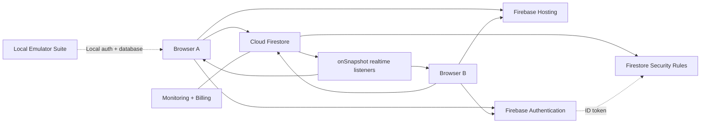
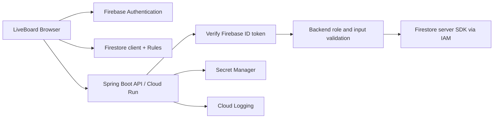

# Dự án ứng dụng realtime dùng Firestore và Firebase

Trong dự án thực hành này, chúng ta xây dựng **LiveBoard** — một ứng dụng bảng công việc để hai hoặc nhiều thành viên có thể cùng xem và cập nhật nhiệm vụ theo thời gian thực. Chủ bảng tạo board, mời thành viên bằng Firebase Authentication UID; thành viên thêm và đánh dấu hoàn thành công việc. Các trình duyệt nhận thay đổi qua **Cloud Firestore realtime listeners**, không cần tự triển khai WebSocket server.

Bài thực hành thuộc module `CLOUD_PROVIDERS_GCP`: người học khám phá Google Cloud từ tổ chức project, IAM và VPC đến Compute Engine, GKE, Cloud Run, dịch vụ lưu trữ và cơ sở dữ liệu. Qua các tình huống triển khai, người học biết lựa chọn dịch vụ, bảo vệ tài nguyên, tự động hóa phát hành và theo dõi độ tin cậy cùng chi phí. LiveBoard kết hợp Firebase Authentication, Cloud Firestore, Security Rules, Local Emulator Suite, Firebase Hosting, kiểm thử quyền truy cập và FinOps thành một ứng dụng có thể trình diễn và mở rộng.

Phiên bản MVP sử dụng **JavaScript modular Firebase SDK, Vite, Firebase Authentication Email/Password, Firestore và Firebase Hosting**. Không cần backend Java để cung cấp realtime, nhưng cuối bài giải thích cách mở rộng bằng Java/Spring Boot trên Cloud Run. Mọi mã và đường dẫn đều là ví dụ để người học tạo trong project riêng, không phải thay đổi thêm các file của module bài học này.

**Lưu ý an toàn:** Hãy bắt đầu với emulator project `demo-liveboard`. Chỉ tạo project thật, bật billing, deploy Hosting/Rules sau khi có quyền. Firebase Web config là thông tin client công khai; tuyệt đối không đặt service account key hoặc secret server trong JavaScript frontend.

## Mục tiêu học tập

Sau bài học, người học có thể:

- Thiết kế kiến trúc realtime client → Firebase Authentication → Cloud Firestore → Hosting.
- Phân biệt collections, documents, subcollections, listeners và Security Rules.
- Thiết lập Vite, Firebase CLI, Firebase Emulator Suite và Firebase SDK modular.
- Viết giao diện đăng ký/đăng nhập, tạo board, mời thành viên, tạo và cập nhật task.
- Dùng `onSnapshot()`, `unsubscribe()` và callback xử lý lỗi để đồng bộ UI.
- Đặt Firestore Security Rules theo ranh giới owner/member, validate field và từ chối truy cập trái phép.
- Kiểm thử Rules bằng `@firebase/rules-unit-testing` và chạy trong CI.
- Triển khai staging Firebase Hosting và quan sát index, offline state, chi phí realtime listeners.
- Giải thích khi nào cần Cloud Functions, Pub/Sub hoặc Java/Spring Boot backend riêng.

## 1. Bài toán và tiêu chí nghiệm thu

### Tính năng MVP

| Vai trò | Hành động được phép | Hạn chế |
|---|---|---|
| Chưa đăng nhập | Xem form đăng nhập/đăng ký. | Không đọc hoặc ghi boards/tasks. |
| Thành viên board | Xem task realtime, tạo task và toggle `done`. | Không tự mời thành viên khác. |
| Chủ sở hữu board | Mọi quyền thành viên, thêm UID người dùng vào `memberUids`. | Không thay đổi `ownerUid`; MVP chưa hỗ trợ xóa board. |
| Không thuộc board | Không được đọc board/task kể cả biết document ID. | Không được ghi hoặc mời chính mình. |

**Điều kiện hoàn thành:** A tạo `Sprint Demo`; B đăng nhập ở trình duyệt khác và đưa UID cho A; A mời B; B thấy board mới mà không refresh; B tạo task, A thấy task xuất hiện; A đổi trạng thái task, B thấy đồng bộ. User C ngoài board bị Firestore trả `permission-denied`. Rules tests pass và build staging hoạt động.

MVP **không** có invitation qua email, file attachments, xóa board, presence/typing, workflow nhiều vai trò hoặc audit log chi tiết. Với production, cần một luồng mời–chấp nhận có xác minh người nhận thay vì chủ board nhập UID thủ công.

## 2. Kiến trúc tổng thể



Luồng runtime: Hosting phát static bundle; user đăng nhập qua Auth; Firebase Client SDK gửi request tới Firestore bằng danh tính người dùng; Firestore kiểm tra Rules và trả document/query snapshots; listener phát sự kiện đầu tiên cùng cập nhật tiếp theo; UI render lại. Khi chuyển board hoặc đăng xuất phải hủy listeners.

**Firestore không phải message queue:** listener theo dõi trạng thái document/query, không phải kênh exactly-once event delivery cho nghiệp vụ thanh toán. Mỗi read/write/reconnect có thể gây usage và phí theo edition, vì vậy nên giữ query hẹp và listener lifecycle rõ ràng.

### Firestore hay Realtime Database?

| Khía cạnh | Firestore | Realtime Database |
|---|---|---|
| Mô hình | Collections và documents, subcollections. | JSON tree. |
| Truy vấn | Field filters, sorting và indexes. | Query theo cấu trúc JSON tree. |
| Realtime | `onSnapshot()` trên document/query. | Listeners trên path. |
| Rules | Firestore Security Rules. | Realtime Database Rules, cú pháp khác. |
| Phù hợp | Task board, document metadata, feed. | Presence, trạng thái online, app JSON tree. |

Chọn Firestore vì LiveBoard cần query boards theo membership và tasks theo subcollection. Nếu thêm reliable presence, cân nhắc Realtime Database `onDisconnect` cùng Cloud Functions đồng bộ trạng thái khi cần.

## 3. Thiết kế dữ liệu và quy tắc truy vấn

### Data model

```text
boards/
  {boardId}/
    name: "Sprint Demo"
    ownerUid: "alice-uid"
    memberUids: ["alice-uid", "bob-uid"]
    createdAt: timestamp
    updatedAt: timestamp
    tasks/
      {taskId}/
        title: "Review pull request"
        done: false
        createdBy: "bob-uid"
        createdAt: timestamp
        updatedAt: timestamp
```

`boards` chứa các documents của workspace; mỗi board có subcollection `tasks`. Các task IDs được Firestore tự tạo. Firebase Security Rules cho document cha **không tự động** áp dụng cho subcollection, nên phải khai báo `match /tasks/{taskId}` riêng.

| Field | Type | Validation |
|---|---|---|
| `name` | string | 1–80 ký tự. |
| `ownerUid` | string | Bằng UID khi tạo board và bất biến. |
| `memberUids` | list | Có owner; tối đa 20 phần tử cho demo. |
| `createdAt`, `updatedAt` | timestamp | Lấy từ `serverTimestamp()`; createdAt bất biến. |
| Task `title` | string | 1–120 ký tự. |
| Task `done` | bool | `false` khi tạo; thành viên được cập nhật. |
| Task `createdBy` | string | Bằng UID khi tạo và bất biến. |

Mảng `memberUids` hợp lý với nhóm nhỏ. Với hàng nghìn thành viên, phải thiết kế membership subcollection hoặc index riêng để tránh một document quá lớn, update contention và Rules access cost. Không dùng email làm khóa quyền truy cập vì email có thể thay đổi.

### Hai query chính

```javascript
// Chỉ trả boards mà user là member.
query(collection(db, 'boards'), where('memberUids', 'array-contains', uid));

// Lấy 50 tasks gần nhất của board đang mở.
query(
  collection(db, 'boards', boardId, 'tasks'),
  orderBy('createdAt', 'desc'),
  limit(50)
);
```

Các query này thường được hỗ trợ bằng single-field indexes của Firestore Standard edition. Nếu sau này thêm filter `done == false` cùng `orderBy(createdAt)`, có thể cần composite index. **Security Rules không phải bộ lọc dữ liệu**: query lấy toàn bộ `boards` sẽ bị từ chối nếu không thể chứng minh mọi kết quả đều thuộc user.

## 4. Công cụ và cấu trúc project

### Chuẩn bị

Cần Node.js phiên bản tương thích Vite/Firebase SDK, npm, Firebase CLI và trình duyệt. Firestore emulator hiện có lộ trình yêu cầu Java 21 ở phiên bản CLI mới, nên kiểm tra tài liệu emulator và `java -version` nếu gặp lỗi Java runtime.

Tạo source frontend ở thư mục thực hành riêng:

```bash
npm create vite@latest liveboard -- --template vanilla
cd liveboard
npm install
npm install firebase
npm install --save-dev firebase-tools @firebase/rules-unit-testing
```

Giữ `package-lock.json` trong repository và dùng `npm ci` trong CI để bảo đảm bộ dependency nhất quán.

```text
liveboard/
├── index.html
├── package.json
├── package-lock.json
├── .env.example
├── .env.local
├── firebase.json
├── firestore.rules
├── src/
│   ├── firebase.js
│   └── main.js
├── tests/
│   └── firestore.rules.test.mjs
└── dist/                   # Vite sinh khi build
```

### Project demo và project thật

- **Local:** dùng `demo-liveboard`, Auth emulator và Firestore emulator. Demo project không có tài nguyên production để vô tình sửa.
- **Staging:** tạo Firebase project thật, đăng ký Web app, bật Email/Password provider và Firestore ở region phù hợp; dùng data giả.
- **Production:** project riêng, có budget, IAM, backup/retention, rules/index deployment approvals và monitoring.

Không cấu hình project production trong `.env.local` của bài demo. Khi deploy dùng `--project STAGING_PROJECT_ID` rõ ràng, không phụ thuộc CLI default project không kiểm soát.

## 5. Cấu hình Emulator Suite và Firebase SDK

### `firebase.json`

```json
{
  "firestore": {
    "rules": "firestore.rules"
  },
  "hosting": {
    "public": "dist",
    "ignore": ["firebase.json"],
    "rewrites": [
      { "source": "**", "destination": "/index.html" }
    ]
  },
  "emulators": {
    "auth": { "host": "127.0.0.1", "port": 9099 },
    "firestore": { "host": "127.0.0.1", "port": 8080 },
    "ui": { "enabled": true, "port": 4000 }
  }
}
```

**Quan trọng:** file `firestore.rules` phải được nạp thật. Emulator có thể dùng rules mở khi cấu hình Rules chưa đầy đủ, khiến những test cho phép truy cập pass giả. Khi dự án cần composite indexes, bổ sung `firestore.indexes.json` vào phần `firestore` của cấu hình.

Chạy Firebase Emulator Suite:

```bash
npx firebase emulators:start --only auth,firestore --project demo-liveboard
```

Emulator UI thường chạy tại `http://127.0.0.1:4000`. Trên Windows PowerShell, dùng lệnh trên một dòng; dấu `\` nối dòng trong ví dụ POSIX không hoạt động như trong Bash.

### `.env.example` cho local demo

```dotenv
VITE_USE_EMULATORS=true
VITE_FIREBASE_API_KEY=demo-api-key
VITE_FIREBASE_AUTH_DOMAIN=demo-liveboard.firebaseapp.com
VITE_FIREBASE_PROJECT_ID=demo-liveboard
VITE_FIREBASE_APP_ID=demo-web-app
```

Sao chép sang `.env.local` và chạy Vite. Với project thật, lấy Firebase Web App config trong Console, dùng `VITE_USE_EMULATORS=false` khi build staging/production. Các biến `VITE_` được đưa vào client bundle, **không được chứa private keys, token hay service account JSON**. Web App API key/config là public client metadata; bảo vệ dữ liệu phải nhờ Auth, Rules và biện pháp như App Check.

### `src/firebase.js`

```javascript
import { initializeApp } from 'firebase/app';
import { getAuth, connectAuthEmulator } from 'firebase/auth';
import { getFirestore, connectFirestoreEmulator } from 'firebase/firestore';

const app = initializeApp({
  apiKey: import.meta.env.VITE_FIREBASE_API_KEY,
  authDomain: import.meta.env.VITE_FIREBASE_AUTH_DOMAIN,
  projectId: import.meta.env.VITE_FIREBASE_PROJECT_ID,
  appId: import.meta.env.VITE_FIREBASE_APP_ID
});

export const auth = getAuth(app);
export const db = getFirestore(app);

if (import.meta.env.DEV && import.meta.env.VITE_USE_EMULATORS === 'true') {
  connectAuthEmulator(auth, 'http://127.0.0.1:9099');
  connectFirestoreEmulator(db, '127.0.0.1', 8080);
}
```

Gọi `connectAuthEmulator`/`connectFirestoreEmulator` **trước khi** gửi Firebase requests. Với app chạy trên máy khác, Android emulator hay container, `127.0.0.1` cần đổi thành địa chỉ/DNS hợp lý cho môi trường test. Tuyệt đối không bật emulator cho bản phát hành production.

## 6. Giao diện HTML

Để tập trung vào realtime và Rules, MVP dùng DOM thuần. Tạo `index.html`:

```html
<!doctype html>
<html lang="vi">
  <head>
    <meta charset="UTF-8" />
    <meta name="viewport" content="width=device-width, initial-scale=1.0" />
    <title>LiveBoard — Firestore Realtime</title>
    <style>
      body { font: 16px system-ui; max-width: 860px; margin: 2rem auto; padding: 1rem; }
      form, section { margin: 1rem 0; padding: 1rem; border: 1px solid #ddd; }
      input, button { padding: .6rem; margin: .25rem; }
      li { margin: .6rem 0; }
      #message { min-height: 1.5em; }
      [hidden] { display: none !important; }
    </style>
  </head>
  <body>
    <h1>LiveBoard</h1>
    <p id="message" role="status" aria-live="polite"></p>

    <section id="auth-panel">
      <h2>Đăng nhập / đăng ký</h2>
      <form id="auth-form">
        <input id="auth-email" type="email" placeholder="Email" required />
        <input id="auth-password" type="password" placeholder="Password" minlength="6" required />
        <button type="submit">Đăng nhập</button>
        <button id="signup" type="button">Tạo tài khoản</button>
      </form>
    </section>

    <section id="app-panel" hidden>
      <p>UID của bạn: <code id="my-uid"></code></p>
      <button id="logout" type="button">Đăng xuất</button>
      <form id="board-form">
        <h2>Tạo board</h2>
        <input id="board-name" maxlength="80" placeholder="Tên board" required />
        <button type="submit">Tạo</button>
      </form>
      <h2>Board của tôi</h2>
      <ul id="board-list"></ul>
      <section id="active-board" hidden>
        <h2 id="board-title"></h2>
        <form id="invite-form" hidden>
          <input id="invite-uid" placeholder="UID người được mời" required />
          <button type="submit">Mời</button>
        </form>
        <form id="task-form">
          <input id="task-title" maxlength="120" placeholder="Nội dung task" required />
          <button type="submit">Thêm task</button>
        </form>
        <ul id="task-list"></ul>
      </section>
    </section>
    <script type="module" src="/src/main.js"></script>
  </body>
</html>
```

MVP chưa có loading skeleton/accessible input labels chi tiết; bản production cần bổ sung UX, accessibility, responsive và validation đầy đủ. Luôn dùng DOM `textContent` thay vì render raw `innerHTML` từ task titles để hạn chế DOM-based XSS.

## 7. Realtime frontend với Firestore

### `src/main.js`

```javascript
import { auth, db } from './firebase.js';
import {
  createUserWithEmailAndPassword, signInWithEmailAndPassword,
  signOut, onAuthStateChanged
} from 'firebase/auth';
import {
  addDoc, arrayUnion, collection, doc, limit, onSnapshot,
  orderBy, query, serverTimestamp, updateDoc, where
} from 'firebase/firestore';

const $ = (id) => document.getElementById(id);
const message = (text) => { $('message').textContent = text; };

let user = null;
let boardId = null;
let stopBoards = () => {};
let stopBoard = () => {};
let stopTasks = () => {};

function clearSelection() {
  stopBoard();
  stopTasks();
  stopBoard = () => {};
  stopTasks = () => {};
  boardId = null;
  $('active-board').hidden = true;
  $('board-title').textContent = '';
  $('task-list').replaceChildren();
}

function clearAllListeners() {
  stopBoards();
  stopBoards = () => {};
  clearSelection();
  $('board-list').replaceChildren();
}

async function run(action) {
  try {
    await action();
    message('');
  } catch (error) {
    message(`Thao tác thất bại: ${error.message}`);
  }
}

$('auth-form').addEventListener('submit', (event) => {
  event.preventDefault();
  run(() => signInWithEmailAndPassword(
    auth, $('auth-email').value.trim(), $('auth-password').value
  ));
});

$('signup').addEventListener('click', () => run(() =>
  createUserWithEmailAndPassword(
    auth, $('auth-email').value.trim(), $('auth-password').value
  )
));

$('logout').addEventListener('click', () => run(() => signOut(auth)));

function watchBoards(uid) {
  const boardsQuery = query(
    collection(db, 'boards'),
    where('memberUids', 'array-contains', uid)
  );
  stopBoards = onSnapshot(boardsQuery, (snapshot) => {
    const list = $('board-list');
    list.replaceChildren();
    for (const board of snapshot.docs) {
      const item = document.createElement('li');
      const button = document.createElement('button');
      button.type = 'button';
      button.textContent = board.data().name;
      button.addEventListener('click', () => selectBoard(board.id));
      item.append(button);
      list.append(item);
    }
  }, (error) => message(`Không nghe được boards: ${error.message}`));
}

function selectBoard(id) {
  clearSelection();
  boardId = id;
  $('active-board').hidden = false;

  stopBoard = onSnapshot(doc(db, 'boards', id), (snapshot) => {
    if (!snapshot.exists()) {
      message('Board không còn tồn tại hoặc không truy cập được.');
      clearSelection();
      return;
    }
    const board = snapshot.data();
    $('board-title').textContent = board.name;
    $('invite-form').hidden = board.ownerUid !== user?.uid;
  }, (error) => {
    message(`Không nghe được board: ${error.message}`);
    clearSelection();
  });

  const tasksQuery = query(
    collection(db, 'boards', id, 'tasks'),
    orderBy('createdAt', 'desc'),
    limit(50)
  );
  stopTasks = onSnapshot(tasksQuery, (snapshot) => {
    const list = $('task-list');
    list.replaceChildren();
    for (const taskSnap of snapshot.docs) {
      const task = taskSnap.data();
      const item = document.createElement('li');
      const button = document.createElement('button');
      button.type = 'button';
      button.textContent = task.done ? 'Đã xong ✓' : 'Chưa xong';
      button.addEventListener('click', () => run(() =>
        updateDoc(doc(db, 'boards', id, 'tasks', taskSnap.id), {
          done: !task.done,
          updatedAt: serverTimestamp()
        })
      ));
      const title = document.createElement('span');
      title.textContent = ` ${task.title}`;
      item.append(button, title);
      list.append(item);
    }
  }, (error) => message(`Không nghe được tasks: ${error.message}`));
}

$('board-form').addEventListener('submit', (event) => {
  event.preventDefault();
  if (!user) return;
  const name = $('board-name').value.trim();
  if (!name) return;
  run(async () => {
    const result = await addDoc(collection(db, 'boards'), {
      name,
      ownerUid: user.uid,
      memberUids: [user.uid],
      createdAt: serverTimestamp(),
      updatedAt: serverTimestamp()
    });
    $('board-name').value = '';
    selectBoard(result.id);
  });
});

$('invite-form').addEventListener('submit', (event) => {
  event.preventDefault();
  if (!boardId) return;
  const inviteUid = $('invite-uid').value.trim();
  if (!inviteUid) return;
  run(async () => {
    await updateDoc(doc(db, 'boards', boardId), {
      memberUids: arrayUnion(inviteUid),
      updatedAt: serverTimestamp()
    });
    $('invite-uid').value = '';
  });
});

$('task-form').addEventListener('submit', (event) => {
  event.preventDefault();
  if (!boardId || !user) return;
  const title = $('task-title').value.trim();
  if (!title) return;
  run(async () => {
    await addDoc(collection(db, 'boards', boardId, 'tasks'), {
      title,
      done: false,
      createdBy: user.uid,
      createdAt: serverTimestamp(),
      updatedAt: serverTimestamp()
    });
    $('task-title').value = '';
  });
});

onAuthStateChanged(auth, (nextUser) => {
  clearAllListeners();
  user = nextUser;
  $('auth-panel').hidden = Boolean(user);
  $('app-panel').hidden = !user;
  $('my-uid').textContent = user?.uid ?? '';
  if (user) watchBoards(user.uid);
});
```

Mã trên dùng `textContent`, có try/catch cho Promise writes và error callback của listeners. Đối với app production, thêm loading/disabled buttons, debounce, pagination, cancel pending work và kiểm thử race khi đổi board trong lúc query chưa trả về.

### Tại sao cần unsubscribe?

`onSnapshot()` trả về một hàm **unsubscribe**. Khi user chuyển board, nếu listeners cũ không được hủy, UI có thể nhận cập nhật của board trước, giữ tài nguyên, tăng document reads và memory usage. Khi user đăng xuất, phải cleanup tất cả listener có quyền đọc dữ liệu. Với React, đăng ký trong `useEffect` và trả unsubscribe trong cleanup function.

### Event local so với server

Firestore hỗ trợ latency compensation: UI có thể nhận snapshot ngay khi local write được bắt đầu, trước lúc server xác nhận. `snapshot.metadata.hasPendingWrites` cho biết dữ liệu có local mutations; listener có `{ includeMetadataChanges: true }` có thể báo khi metadata chuyển từ pending sang confirmed. Nếu Rules từ chối, Promise ghi thất bại và client cần hiển thị lỗi phù hợp, không coi local snapshot là commit cuối cùng.

## 8. Security Rules cho owner và member

### Mục đích

Client JavaScript có thể bị người dùng sửa bằng DevTools hoặc gọi SDK ngoài giao diện. **Ẩn nút “Mời” không phải bảo mật**; server phải kiểm tra rules để ngăn user mạo danh owner. Chính sách LiveBoard:

1. Anonymous không được đọc/ghi.
2. Chỉ user trong `memberUids` đọc board/tasks.
3. Chỉ owner được thêm/bớt UID members.
4. Khi tạo board, `ownerUid=request.auth.uid` và member ban đầu chỉ là owner.
5. Khi tạo task, `createdBy=request.auth.uid`; không được đổi `createdBy`, `createdAt`.
6. Fields và kiểu dữ liệu phải hợp lệ; paths khác mặc định deny.

### File `firestore.rules`

```javascript
rules_version = '2';
service cloud.firestore {
  match /databases/{database}/documents {
    function signedIn() {
      return request.auth != null;
    }
    function boardPath(boardId) {
      return /databases/$(database)/documents/boards/$(boardId);
    }
    function isMember(boardId) {
      return signedIn()
        && exists(boardPath(boardId))
        && request.auth.uid in get(boardPath(boardId)).data.memberUids;
    }
    function isOwner(boardId) {
      return signedIn()
        && exists(boardPath(boardId))
        && get(boardPath(boardId)).data.ownerUid == request.auth.uid;
    }
    function validBoard() {
      return request.resource.data.keys().hasAll([
          'name', 'ownerUid', 'memberUids', 'createdAt', 'updatedAt'
        ])
        && request.resource.data.keys().hasOnly([
          'name', 'ownerUid', 'memberUids', 'createdAt', 'updatedAt'
        ])
        && request.resource.data.name is string
        && request.resource.data.name.size() > 0
        && request.resource.data.name.size() <= 80
        && request.resource.data.ownerUid is string
        && request.resource.data.memberUids is list
        && request.resource.data.memberUids.size() > 0
        && request.resource.data.memberUids.size() <= 20
        && request.resource.data.ownerUid in request.resource.data.memberUids
        && request.resource.data.createdAt is timestamp
        && request.resource.data.updatedAt is timestamp;
    }
    function validTask() {
      return request.resource.data.keys().hasAll([
          'title', 'done', 'createdBy', 'createdAt', 'updatedAt'
        ])
        && request.resource.data.keys().hasOnly([
          'title', 'done', 'createdBy', 'createdAt', 'updatedAt'
        ])
        && request.resource.data.title is string
        && request.resource.data.title.size() > 0
        && request.resource.data.title.size() <= 120
        && request.resource.data.done is bool
        && request.resource.data.createdBy is string
        && request.resource.data.createdAt is timestamp
        && request.resource.data.updatedAt is timestamp;
    }

    match /boards/{boardId} {
      allow get, list: if signedIn()
        && request.auth.uid in resource.data.memberUids;

      allow create: if signedIn()
        && validBoard()
        && request.resource.data.ownerUid == request.auth.uid
        && request.resource.data.memberUids.size() == 1
        && request.resource.data.memberUids[0] == request.auth.uid
        && request.resource.data.createdAt == request.time
        && request.resource.data.updatedAt == request.time;

      allow update: if signedIn()
        && resource.data.ownerUid == request.auth.uid
        && validBoard()
        && request.resource.data.ownerUid == resource.data.ownerUid
        && request.resource.data.createdAt == resource.data.createdAt
        && request.resource.data.updatedAt == request.time;

      allow delete: if false;

      match /tasks/{taskId} {
        allow get, list: if isMember(boardId);
        allow create: if isMember(boardId)
          && validTask()
          && request.resource.data.createdBy == request.auth.uid
          && request.resource.data.createdAt == request.time
          && request.resource.data.updatedAt == request.time;
        allow update: if isMember(boardId)
          && validTask()
          && request.resource.data.createdBy == resource.data.createdBy
          && request.resource.data.createdAt == resource.data.createdAt
          && request.resource.data.updatedAt == request.time;
        allow delete: if isOwner(boardId);
      }
    }
  }
}
```

Với `serverTimestamp()` Firestore Rules nhìn giá trị timestamp biến đổi tương ứng `request.time`, nên những điều kiện tạo/cập nhật ở trên có thể dùng timestamp do server quyết định.

### Quyền và truy vấn

| Thao tác | Quyền |
|---|---|
| Đọc boards | UID phải nằm trong `resource.data.memberUids`. |
| Tạo board | Signed-in, ownerUid hợp lệ, member đầu tiên là owner. |
| Cập nhật board | Chỉ owner; không đổi ownerUid và createdAt; schema hợp lệ. |
| Đọc tasks | UID phải là thành viên của parent board. |
| Tạo task | Member; `createdBy` bằng UID; schema hợp lệ. |
| Sửa task | Member; không thay đổi tác giả/createdAt. |
| Xóa task | Chỉ owner; UI demo chưa cung cấp nút. |
| Xóa board | Không cho phép từ client trong MVP. |

**Rules không tự lọc dữ liệu:** query `getDocs(collection(db,'boards'))` có thể bị từ chối vì có khả năng trả board của người khác. Query có `array-contains` như trong frontend giúp Firestore xác minh tập kết quả hợp lệ.

### Giới hạn và chi phí Rules

`isMember()` dùng `exists()`/`get()` đọc parent board. Các document access calls này có giới hạn theo request và có thể bị tính phí, kể cả một số trường hợp request bị từ chối. Không nên nhân mô hình này lên hàng triệu board/task mà không đánh giá query pattern và read cost.

Rules của MVP chưa kiểm tra UID người được mời đã chấp nhận, chưa có role viewer/editor, chưa có audit/history và chưa hỗ trợ xoá dữ liệu. Trong production, dùng backend tin cậy cho invitation workflow và test đầy đủ negative cases. Không giải quyết lỗi thiếu quyền bằng rule `allow read, write: if true`.

## 9. Unit test Security Rules bằng Emulator Suite

### Vì sao test hai chiều?

Một test “owner đọc được board” sẽ pass ngay cả khi Rules mở toàn bộ dữ liệu. Một test “anonymous bị chặn” cũng có thể pass khi Rules cấm tất cả. Cần test cả **được phép** lẫn **bị từ chối** theo actor và thao tác.

Package `@firebase/rules-unit-testing` tạo Firebase Auth contexts giả để kiểm thử mà không phải đăng nhập thực, cho phép seed dữ liệu bằng `withSecurityRulesDisabled`. Tuy nhiên, assertion phải gọi SDK bằng context bình thường để Rules được thực thi.

### `tests/firestore.rules.test.mjs`

```javascript
import { readFileSync } from 'node:fs';
import { before, after, beforeEach, test } from 'node:test';
import {
  initializeTestEnvironment, assertSucceeds, assertFails
} from '@firebase/rules-unit-testing';
import {
  Timestamp, doc, collection, getDoc, setDoc, addDoc,
  updateDoc, arrayUnion, serverTimestamp
} from 'firebase/firestore';

let env;

before(async () => {
  env = await initializeTestEnvironment({
    projectId: 'demo-liveboard',
    firestore: {
      host: '127.0.0.1',
      port: 8080,
      rules: readFileSync('firestore.rules', 'utf8')
    }
  });
});

beforeEach(async () => {
  await env.clearFirestore();
});

after(async () => {
  if (env) await env.cleanup();
});

async function seedBoard(memberUids = ['alice', 'bob']) {
  const now = Timestamp.now();
  await env.withSecurityRulesDisabled(async (ctx) => {
    await setDoc(doc(ctx.firestore(), 'boards', 'board-test'), {
      name: 'Sprint Demo',
      ownerUid: 'alice',
      memberUids,
      createdAt: now,
      updatedAt: now
    });
  });
}

test('alice đọc board được, carol không', async () => {
  await seedBoard();
  const alice = env.authenticatedContext('alice').firestore();
  const carol = env.authenticatedContext('carol').firestore();
  await assertSucceeds(getDoc(doc(alice, 'boards', 'board-test')));
  await assertFails(getDoc(doc(carol, 'boards', 'board-test')));
});

test('bob tạo task được, carol không', async () => {
  await seedBoard();
  const bob = env.authenticatedContext('bob').firestore();
  const carol = env.authenticatedContext('carol').firestore();
  const task = (uid) => ({
    title: 'Task demo',
    done: false,
    createdBy: uid,
    createdAt: serverTimestamp(),
    updatedAt: serverTimestamp()
  });

  await assertSucceeds(addDoc(
    collection(bob, 'boards', 'board-test', 'tasks'),
    task('bob')
  ));
  await assertFails(addDoc(
    collection(carol, 'boards', 'board-test', 'tasks'),
    task('carol')
  ));
});

test('chỉ owner thêm được thành viên', async () => {
  await seedBoard();
  const alice = env.authenticatedContext('alice').firestore();
  const bob = env.authenticatedContext('bob').firestore();
  await assertSucceeds(updateDoc(doc(alice, 'boards', 'board-test'), {
    memberUids: arrayUnion('charlie'),
    updatedAt: serverTimestamp()
  }));
  await assertFails(updateDoc(doc(bob, 'boards', 'board-test'), {
    memberUids: arrayUnion('mallory'),
    updatedAt: serverTimestamp()
  }));
});

test('anonymous không được đọc board', async () => {
  await seedBoard();
  const guest = env.unauthenticatedContext().firestore();
  await assertFails(getDoc(doc(guest, 'boards', 'board-test')));
});
```

**Giới hạn bộ test minh họa:** cần bổ sung các case update `ownerUid`, update `createdAt`, tạo board với UID giả, title rỗng hoặc quá dài, đổi `createdBy`, query boards không lọc membership, gỡ member rồi thử đọc và user bị khóa. Test fixtures dùng `withSecurityRulesDisabled` chỉ trong bước chuẩn bị, tuyệt đối không bọc thao tác assert trong callback bỏ qua Rules.

### `package.json` scripts

Thêm hoặc hợp nhất các scripts sau trong `package.json` của Vite:

```json
{
  "scripts": {
    "dev": "vite",
    "build": "vite build",
    "preview": "vite preview",
    "test:rules": "node --test tests/*.test.mjs",
    "test:rules:emulator": "firebase emulators:exec --only auth,firestore --project demo-liveboard \"npm run test:rules\""
  }
}
```

Các lệnh trên mô tả phần `scripts`, không thay thế nguyên `package.json` đã có dependencies và metadata. Trong CI:

```bash
npm ci
npm run test:rules:emulator
npm run build
```

`emulators:exec` bật emulator, chạy test, rồi tắt emulators. Nếu một terminal khác đã giữ các cổng 8080/9099, dừng tiến trình cũ trước khi chạy.

### Xem rule coverage

Khi Firestore emulator còn chạy:

```text
http://127.0.0.1:8080/emulator/v1/projects/demo-liveboard:ruleCoverage.html
```

Rule coverage cho biết expressions nào đã được đánh giá và kết quả, nhưng **coverage cao không đồng nghĩa Rules an toàn**. Test cases phải xuất phát từ ranh giới quyền và hành vi lạm dụng được dự báo.

## 10. Chạy LiveBoard và kiểm chứng realtime

### Khởi động

Terminal 1:

```bash
npx firebase emulators:start --only auth,firestore --project demo-liveboard
```

Terminal 2:

```bash
npm run dev
```

Mở URL Vite cung cấp, thường là `http://localhost:5173`, bằng hai profile trình duyệt độc lập hoặc hai cửa sổ incognito có phiên đăng nhập khác nhau. Đăng ký User A và User B với email/password chỉ dùng cho môi trường test.

### Kịch bản hai người dùng

| Bước | User A | User B | Kết quả |
|---|---|---|---|
| 1 | Đăng ký A. | Đăng ký B. | Hai Firebase Auth UID riêng. |
| 2 | Tạo `Sprint Demo`. | Quan sát danh sách boards. | Board chỉ hiện ở A. |
| 3 | Nhập UID B để mời. | Giữ trang mở. | B thấy board mới qua realtime listener. |
| 4 | Mở board. | Mở board rồi thêm task. | Task hiện ở A mà không refresh. |
| 5 | Toggle `done`. | Quan sát task list. | B thấy trạng thái thay đổi. |
| 6 | Đăng xuất. | Tiếp tục thao tác. | Listener ở A được hủy, B vẫn dùng được. |
| 7 | User C đoán `boardId`. | — | Request Firestore của C bị `permission-denied`. |

Dùng Emulator Suite UI để xem dữ liệu và đánh giá Rules. Nếu có lỗi `permission-denied`, kiểm tra payload, user UID, trạng thái Auth, đường dẫn document và truy vấn. Không sửa lỗi bằng cách mở Rules cho tất cả user.

### Realtime listener events

`onSnapshot(query, onNext, onError)` nhận snapshot đầu tiên và các bản cập nhật khi dữ liệu thay đổi. `snapshot.docs` dễ dùng để render danh sách nhỏ; `snapshot.docChanges()` hữu ích khi cần cập nhật DOM có chọn lọc. `snapshot.metadata.hasPendingWrites` giúp phân biệt local write chưa được server xác nhận; nếu cần listener phát thêm metadata-only event, dùng `{ includeMetadataChanges: true }`.

Nếu listener trả lỗi (chẳng hạn không đủ quyền hoặc query cần index), callback lỗi chạy; sau lỗi terminal, listener đó không tiếp tục nhận sự kiện. Hãy thông báo UX và chỉ retry/đăng ký lại theo chính sách phù hợp. Không tạo vô hạn listeners trong vòng lặp retry.

## 11. Offline, xung đột ghi và tính nhất quán

### Offline trên Web

Firestore SDK hỗ trợ offline cache và có thể giữ bản sao những documents ứng dụng đã dùng. Trên Web, persistent cache cần được bật theo cấu hình phù hợp; bộ nhớ đệm mặc định không đồng nghĩa lưu bền dữ liệu trên thiết bị. Trên máy dùng chung, offline persistence có thể làm dữ liệu người dùng còn nằm trên disk sau khi đăng xuất; cân nhắc privacy và UX.

Một write có thể được phản ánh lên UI từ local cache trước khi server chấp nhận. Nếu user mất quyền giữa lúc offline, write có thể bị từ chối khi kết nối lại. Không cho rằng trạng thái local pending đã là giao dịch thành công.

### Hai user cập nhật cùng task

Nếu A và B cùng toggle `done` dựa trên snapshots khác nhau, request đến server cuối cùng có thể quyết định giá trị cuối (**last write wins** cho các cập nhật thông thường). Đối với nghiệp vụ có bất biến nghiêm ngặt, như trừ tồn kho hoặc giữ chỗ, dùng Firestore transaction hoặc backend có quy tắc kiểm tra và idempotency.

| Tình huống | Phương án |
|---|---|
| Toggle trạng thái task đơn giản | `updateDoc`, chấp nhận last-write-wins. |
| Tăng/giảm counter | `increment()` khi phù hợp, hoặc aggregate phía server. |
| Update dựa trên giá trị hiện tại | Transaction có retry và kiểm tra điều kiện. |
| Thanh toán hoặc phân quyền | Backend tin cậy với audit/idempotency và authorization. |

Firestore listener là mô hình theo dõi **trạng thái**, không phải hàng đợi sự kiện đảm bảo exactly-once cho nghiệp vụ. Nếu cần xử lý background, dùng Cloud Functions, Cloud Tasks hoặc Pub/Sub theo mô hình phù hợp.

## 12. Indexing và query planning

Firestore tạo single-field indexes mặc định. Khi kết hợp nhiều filter/sort fields, Firestore có thể yêu cầu composite index.

```javascript
query(
  collection(db, 'boards', boardId, 'tasks'),
  where('done', '==', false),
  orderBy('createdAt', 'desc'),
  limit(50)
);
```

Query này có thể cần composite index cho `done` và `createdAt`. Nếu Console/SDK báo link tạo index, hãy review, lưu định nghĩa vào `firestore.indexes.json` rồi version-control. File `firebase.json` khi đó cần trường:

```json
{
  "firestore": {
    "rules": "firestore.rules",
    "indexes": "firestore.indexes.json"
  }
}
```

Đây là phần cấu hình Firestore, **không phải** toàn bộ file thay thế `firebase.json` ở mục 5. Index xây dựng mất thời gian và có storage/write overhead. Trên staging cần kiểm tra index ở trạng thái Ready trước khi phát hành code gọi query mới.

## 13. Firebase Authentication, App Check và quyền truy cập

### Authentication xác minh danh tính

Trong project thật, bật Firebase Authentication Email/Password provider, cấu hình chính sách tài khoản, password reset và email verification theo nhu cầu. `request.auth.uid` trong Rules là định danh Firebase Auth, không được thay bằng UID mà browser tự gửi trong một field không đáng tin cậy.

### App Check hỗ trợ giảm lạm dụng

Firebase App Check xác minh request xuất phát từ app/client môi trường được chấp nhận khi đã cấu hình. App Check **không** thay thế Authentication, Firestore Security Rules hay rate limiting. Nếu bật enforcement cho production, phải kiểm thử staging để tránh vô tình chặn client hợp lệ.

### Client SDK và server SDK không giống nhau

| Kiểu truy cập | Cơ chế bảo mật |
|---|---|
| Firebase Web/Android/iOS client | Auth + Firestore Security Rules. |
| Firebase Admin SDK trên server | Google Cloud IAM và business authorization do backend thực hiện. |
| Google Cloud Firestore Java server client | Application Default Credentials/IAM, bỏ qua Firestore Security Rules. |
| Firebase Console/CLI admin | IAM của quản trị viên hoặc deployment service account. |

Nếu sau này Java backend ghi trực tiếp Firestore, phải thực thi lại logic phân quyền ở REST/API layer. Chỉ kiểm thử Security Rules của browser là **chưa đủ** để bảo vệ những endpoint có server credentials.

## 14. Mở rộng bằng Java/Spring Boot trên Cloud Run

### Khi nào cần backend?

MVP không cần Java server. Bổ sung Spring Boot khi cần:

- Xác minh lời mời bằng email và có invitation workflow.
- Phân quyền `viewer/editor/owner` với audit và approval.
- Tổng hợp báo cáo định kỳ hoặc đồng bộ với hệ thống ERP/Jira.
- Gửi thông báo bằng Pub/Sub/Cloud Tasks hoặc kết nối API đối tác có secret.
- Enforce business invariants và transaction nhiều documents.

### Kiến trúc gợi ý



Pseudo-code cho request có token:

```java
// Pseudo-code: phải bổ sung controller, error handling và auth middleware.
String token = extractBearerToken(request);
FirebaseToken decoded = FirebaseAuth.getInstance().verifyIdToken(token);
String requesterUid = decoded.getUid();

// Server đọc board qua ADC của Cloud Run runtime service account.
// Xác minh board.ownerUid.equals(requesterUid).
// Kiểm tra invitee, input, rate limits, audit và idempotency.
// Chỉ sau khi pass mới cập nhật Firestore qua server SDK.
```

Không sử dụng UID được browser gửi trong JSON làm bằng chứng danh tính. Runtime Cloud Run dùng service identity/ADC, IAM tối thiểu cho Firestore/Secret Manager; không đưa JSON service account key vào source hay image. Thiết kế API cần kiểm soát CORS, ingress, authentication, rate limits, logging và lỗi dữ liệu.

## 15. Build và deploy Firebase Hosting có kiểm soát

### Kiểm tra trước deploy

```bash
npm ci
npm run test:rules:emulator
npm run build
```

Vite tạo `dist/`. Kiểm tra frontend build không chứa `.env.local` secrets, service account JSON hay URL emulator. Các biến `VITE_FIREBASE_*` được đóng gói vào client theo thiết kế và được xem là public metadata.

### Chuẩn bị staging project thật

1. Tạo Firebase project staging, đăng ký Web app và lấy web config.
2. Bật Email/Password provider trong Authentication.
3. Tạo Firestore database ở location đáp ứng data residency và latency.
4. Chọn hosting site/region theo khả năng và plan.
5. Cấu hình build staging với `VITE_USE_EMULATORS=false`.
6. Review `firebase.json`, `firestore.rules` và indexes (nếu có).
7. Cấp quyền deployer tối thiểu, xác định người phê duyệt thay đổi Rules.

### Deploy staging

```bash
# Đây là lệnh thay đổi cloud resources, chỉ chạy trong project được phê duyệt.
npm run build
npx firebase deploy \
  --only hosting,firestore:rules \
  --project STAGING_PROJECT_ID
```

Với PowerShell, viết lệnh deploy trên một dòng hoặc sử dụng ký tự tiếp dòng của PowerShell. Sau deploy, thử lại E2E với hai tài khoản khác nhau và một user không có quyền. Hosting release history và Firestore Rules deployment history **khác nhau**; rollback Hosting không tự rollback Rules hoặc data.

### Quy trình production

Pull request → Security Rules tests → build → deploy staging → smoke/security tests → approval → deploy production → theo dõi logs/usage → rollback theo runbook nếu cần. Không tự động deploy production từ một commit chưa review hoặc test.

## 16. Realtime usage và FinOps

### Document reads/writes

Firestore Standard edition thường tính phí theo document reads/writes/deletes và các loại index reads, storage, network theo chính sách tương ứng. Listener có thể bị tính reads khi:

- Query nhận tập kết quả ban đầu.
- Document được thêm/cập nhật trong tập kết quả.
- Document rời tập kết quả vì field thay đổi, khác với trường hợp document bị xóa.
- Listener reconnect theo thời gian mất kết nối và chính sách offline persistence.

Firestore Enterprise edition có đơn vị pricing khác; không dùng mô hình Standard cho tất cả database.

### Ví dụ minh họa chi phí

Nếu 100 người cùng mở board với 40 tasks, lần load đầu trả 40 documents mỗi người:

```text
100 active users × 40 task documents = 4.000 initial document reads
```

Số trên **chỉ minh họa** một lượt load, chưa tính board listeners, rules `get()`, updates, reconnect, index reads và free usage tier. Không coi số task đang hiển thị là một hóa đơn chính xác.

### Cách giảm chi phí

- Chỉ listen board đang mở; không listen mọi board/task cùng lúc.
- Dùng `limit(50)` và pagination cho lịch sử.
- Unsubscribe khi đổi route, đăng xuất hoặc component unmount.
- Không cập nhật `updatedAt` bằng timer mỗi giây.
- `docChanges()` giảm DOM work nhưng không tự giảm phí reads của một query.
- Kiểm soát Security Rules access calls tới parent board.
- Dùng aggregate document hoặc backend summary khi dashboard không cần toàn bộ tasks.
- Thiết lập budget alerts, dashboard usage, owner/chargeback, theo dõi reads/user.

Cloud Billing Budget Alert chỉ là **thông báo**, không tự động dừng mọi chi tiêu; nếu cần hard limits, xây policy/quota/rate control thích hợp.

## 17. Giám sát và troubleshooting

| Triệu chứng | Nguyên nhân có thể | Cách xử lý |
|---|---|---|
| `auth/invalid-credential` | Sai mật khẩu hoặc provider chưa bật ở project thật. | Kiểm tra Authentication config, login flow. |
| `permission-denied` khi đọc board | User không phải member hoặc query không dùng `array-contains`. | So sánh UID, Rules và query. |
| `permission-denied` khi tạo task | `createdBy` sai UID, title/schema lỗi, member bị gỡ. | Kiểm tra payload và Rules trace. |
| A/B không thấy realtime updates | Hai tab khác project/emulator, khác boardId hoặc listeners không hoạt động. | Kiểm tra config, state và callback errors. |
| Query thiếu index | Filter + sort cần composite index. | Tạo index trên staging, chờ Ready. |
| Listener phát nhiều callbacks | Local updates, metadata changes hoặc duplicate subscriptions. | Kiểm tra `hasPendingWrites`, unsubscribe. |
| Offline đồng bộ sai | Last-write-wins hoặc write bị từ chối sau reconnect. | Thiết kế conflict UX/transaction. |
| Rules test pass nhưng production sai | Test dùng file Rules khác file deploy hoặc thiếu provider/index. | Đồng bộ `firebase.json`, staging smoke tests. |
| Chi phí tăng mạnh | Listeners rộng, nhiều reconnects, write loop. | Usage dashboard, Billing export và audit listeners. |
| Spring backend đọc dữ liệu bị Rules cấm | Admin/server SDK bypass client Rules. | Kiểm tra IAM và authorization ở backend. |

### Chỉ số nên giám sát

- Độ trễ từ A ghi task thành công tới B thấy thay đổi (p50/p95).
- Tỷ lệ thành công create/update và mã lỗi `permission-denied`.
- Frontend sign-in success rate, listener errors và reconnects.
- Document reads/writes per active user/day và network egress.
- Query/index efficiency và Firestore usage theo ngày.
- Billing alerts, security incidents và số lời mời bất thường.

Không ghi Firebase ID token, mật khẩu hoặc nội dung task nhạy cảm vào analytics/logging. Monitor theo SLO người dùng, không chỉ lượng read.

## 18. Lộ trình nâng cấp

### Invitation có xác minh

1. Owner gọi backend Spring/Cloud Functions tạo lời mời có TTL.
2. Backend xác minh ID token và owner membership.
3. Gửi email/link cho người nhận.
4. Người nhận đăng nhập, chấp nhận invitation.
5. Backend ghi membership có audit, idempotency và validation.

### Notifications và event processing

Cloud Functions trigger trên task create có thể gửi notification hoặc publish Pub/Sub. Thiết kế consumers idempotent vì event có thể được deliver lại. Không dựa vào client snapshot listener để thực thi nghiệp vụ bắt buộc nếu client có thể offline.

### Pagination

Board lớn nên chỉ listen các task mới nhất và tải task cũ qua query cursor (`startAfter`, `limit`). Đừng tạo một listener lấy hàng chục nghìn tasks chỉ để hiển thị vài dòng trên màn hình.

### Attachments và presence

Nếu thêm file, dùng Cloud Storage for Firebase cùng Storage Rules kiểm tra ownership, path, size, metadata; `contentType` do client gửi không chứng minh file thật an toàn, nên có thể cần backend scanning. Với presence, cân nhắc Realtime Database `onDisconnect` + Cloud Functions sync thay vì ghi heartbeat mỗi giây vào Firestore.

## 19. Ma trận kiểm thử nghiệm thu

| ID | Bài kiểm thử | Kỳ vọng |
|---|---|---|
| A01 | A đăng ký Email/Password. | Có UID, vào danh sách boards. |
| A02 | A tạo board. | Owner và member duy nhất là A. |
| A03 | B đăng nhập. | B chưa thấy board của A. |
| A04 | A mời B bằng UID. | Board xuất hiện ở B realtime. |
| A05 | B tạo task. | A thấy task mới không refresh. |
| A06 | A toggle done. | B thấy trạng thái mới. |
| S01 | Anonymous đọc board. | Deny. |
| S02 | C đăng nhập nhưng không thuộc board. | Deny. |
| S03 | B tự thêm C vào members. | Deny. |
| S04 | A đổi ownerUid thành B. | Deny. |
| S05 | B tạo task với createdBy=A. | Deny. |
| S06 | B sửa task createdAt. | Deny. |
| R01 | Chuyển board liên tục. | Không giữ listeners thừa. |
| R02 | Đăng xuất. | UI ẩn dữ liệu, listeners cleanup. |
| R03 | Ngắt mạng rồi kết nối lại. | Pending state/failed write xử lý rõ. |
| F01 | `test:rules:emulator`. | Positive/negative cases pass. |
| F02 | Deploy staging Hosting/Rules. | Hai users staging hoạt động. |
| F03 | Kiểm tra usage. | Không có query toàn collection hoặc write loop bất thường. |

Người học nên ghi chép kết quả và các lỗi phát hiện. Không upload dữ liệu cá nhân thật vào repo bài tập hoặc public demo project.

## 20. Checklist trước production

- [ ] Có project staging/production độc lập, region và Auth providers đúng.
- [ ] Source, Rules và index definitions nằm trong version control.
- [ ] Realtime listeners chỉ áp dụng trên queries hẹp, có unsubscribe/error handling.
- [ ] UI xử lý pending writes, offline/reconnect và conflicts phù hợp.
- [ ] Rules deny-by-default, kiểm tra owner/member và schema/data type.
- [ ] Security Rules unit tests có positive và negative scenarios.
- [ ] Không dùng Admin SDK để test client Rules hoặc để bỏ qua authorization backend.
- [ ] Invitation flow production có xác minh người nhận và audit.
- [ ] Firebase client config công khai không chứa private keys/tokens.
- [ ] App Check được đánh giá nhưng không thay thế Auth/Rules.
- [ ] Firebase Hosting build production không trỏ local emulator.
- [ ] Có chiến lược tránh XSS, không render raw user HTML.
- [ ] Indexes cho queries phức tạp đã tạo trên staging.
- [ ] IAM triển khai và service identity backend ở scope tối thiểu.
- [ ] Có backup/export/retention và quy trình xóa dữ liệu.
- [ ] Có billing alerts, usage dashboard và người chịu trách nhiệm chi phí.
- [ ] Có kế hoạch rollback Hosting và Security Rules **riêng biệt**.
- [ ] E2E hai browsers và các trường hợp permission-denied đạt trên staging.

## 21. Kết luận

LiveBoard chứng minh Firebase Authentication, Cloud Firestore và `onSnapshot()` có thể xây dựng ứng dụng realtime đa người dùng mà không cần tự quản lý WebSocket server. Firestore cung cấp cập nhật document/query liên tục, còn Security Rules kiểm soát ranh giới owner/member và giới hạn dữ liệu được thao tác.

Điểm quan trọng không chỉ là UI đồng bộ: cần truy vấn đúng quyền, unsubscribe hợp lý, Rules tests chặn người lạ, xử lý pending offline writes, quản lý indexes và hiểu mô hình reads/FinOps. Với nghiệp vụ nhiều vai trò hoặc yêu cầu giao dịch tin cậy, có thể thêm Java/Spring Boot trên Cloud Run, song backend phải kiểm tra Firebase ID token, authorization và IAM của riêng nó vì server SDK không chịu Firestore client Rules.

Dự án đạt yêu cầu khi **A và B cùng thấy cập nhật realtime, C bị từ chối, kiểm thử Rules pass, build staging hoạt động và usage/cost được giám sát**.

## Tài liệu tham khảo

- [Firebase — Add Firebase to a web app](https://firebase.google.com/docs/web/setup)
- [Firebase Authentication — Password-based accounts](https://firebase.google.com/docs/auth/web/password-auth)
- [Cloud Firestore — Get started](https://firebase.google.com/docs/firestore/quickstart)
- [Cloud Firestore — Get realtime updates](https://firebase.google.com/docs/firestore/query-data/listen)
- [Cloud Firestore — Add data](https://firebase.google.com/docs/firestore/manage-data/add-data)
- [Cloud Firestore — Data model](https://firebase.google.com/docs/firestore/data-model)
- [Cloud Firestore — Security Rules](https://firebase.google.com/docs/firestore/security/get-started)
- [Cloud Firestore — Security Rule conditions](https://firebase.google.com/docs/firestore/security/rules-conditions)
- [Cloud Firestore — Secure queries](https://firebase.google.com/docs/firestore/security/rules-query)
- [Firebase — Local Emulator Suite](https://firebase.google.com/docs/emulator-suite)
- [Firebase — Connect to Firestore Emulator](https://firebase.google.com/docs/emulator-suite/connect_firestore)
- [Firebase — Test Security Rules](https://firebase.google.com/docs/firestore/security/test-rules-emulator)
- [Firebase — Rules unit testing API](https://firebase.google.com/docs/reference/emulator-suite/rules-unit-testing/rules-unit-testing)
- [Cloud Firestore — Indexing](https://firebase.google.com/docs/firestore/query-data/indexing)
- [Cloud Firestore — Offline data](https://firebase.google.com/docs/firestore/manage-data/enable-offline)
- [Cloud Firestore — Billing and realtime listeners](https://firebase.google.com/docs/firestore/pricing)
- [Firebase Hosting — Quickstart](https://firebase.google.com/docs/hosting/quickstart)
- [Firebase App Check — Overview](https://firebase.google.com/docs/app-check)
- [Google Cloud — IAM overview](https://docs.cloud.google.com/iam/docs/overview)
