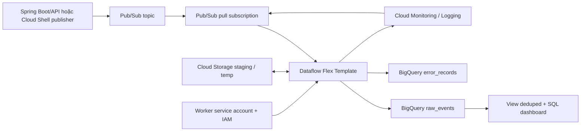

# Dự án thu thập sự kiện bằng Pub/Sub, Dataflow và BigQuery

Một ứng dụng Java/Spring trên Google Cloud có thể tạo hàng nghìn sự kiện mỗi giây: người dùng xem sản phẩm, tạo đơn hàng, thanh toán, hủy giao dịch hay xử lý một tác vụ. Nếu mỗi request HTTP vừa ghi database giao dịch vừa ghi đồng bộ sang kho phân tích, độ trễ và lỗi của hệ thống phân tích có thể ảnh hưởng trực tiếp đến người dùng.

Kiến trúc **Pub/Sub → Dataflow → BigQuery** giải quyết bài toán bằng cách tách khâu phát sự kiện khỏi khâu xử lý dữ liệu. **Cloud Pub/Sub** nhận và phân phối message; **Dataflow** chạy pipeline streaming, chuyển JSON thành bản ghi có schema và ghi các lỗi vào dead-letter; **BigQuery** lưu dữ liệu để đối soát và phân tích. Cloud Storage hỗ trợ staging/temporary files cho Dataflow, trong khi Cloud Monitoring và Logging cung cấp telemetry.

Bài học thuộc chương **Dự án thực hành GCP**, module **CLOUD_PROVIDERS_GCP**. Nội dung kết hợp quản trị project, IAM/VPC, dịch vụ lưu trữ và dữ liệu, tự động hóa phát hành, khả năng quan sát độ tin cậy và kiểm soát chi phí. Dự án dùng **Google-provided Dataflow Flex Template**, có thể hoàn thành từ Cloud Shell mà chưa cần viết Apache Beam riêng; phần mở rộng cung cấp ví dụ publisher Java và gợi ý Beam.

> **Chi phí và quyền truy cập:** Các lệnh thực hành có thể tạo tài nguyên tính phí, nhất là **Dataflow streaming job chạy liên tục**. Chỉ thực thi trong project sandbox được phê duyệt, có billing, budget alert và owner. Đây là tài liệu hướng dẫn, không phải thao tác triển khai thực tế được worker tự chạy.

## 1. Mục tiêu học tập và đầu ra

Sau bài học, bạn có thể:

- Thiết kế event contract gồm `event_id`, `event_type`, `event_ts`, `source` và `schema_version`.
- Tạo Pub/Sub topic và pull subscription phục vụ Dataflow.
- Tạo BigQuery dataset, bảng raw event có schema, time partition và clustering.
- Cấp quyền IAM cho Dataflow launcher và worker service account theo vai trò.
- Dùng **Pub/Sub to BigQuery Flex Template** và subscription cố định.
- Publish thử message JSON và kiểm tra dữ liệu đã ghi vào BigQuery.
- Gây lỗi schema để kiểm tra dead-letter table, phân tích và replay.
- Phân biệt duplicate Pub/Sub message với duplicate business event.
- Dùng SQL để làm sạch, phân tích và đối soát sự kiện.
- Đo backlog, latency/freshness, write errors và tình trạng worker.
- Hiểu khi nào nên dùng BigQuery subscription thay vì Dataflow.
- Dừng Dataflow job, dọn tài nguyên và kiểm tra không còn phí kéo dài.

**Bằng chứng cần nộp:** sơ đồ kiến trúc, danh sách tài nguyên, bảng schema, ít nhất ba events hợp lệ, một event lỗi, truy vấn BigQuery, kết quả duplicate test, báo cáo giám sát và checklist cleanup.

## 2. Kịch bản nghiệp vụ

Giả sử hệ thống thương mại điện tử phát các sự kiện:

| Event | Producer | Mục đích phân tích |
|---|---|---|
| `order_created` | Spring Boot checkout API | Số đơn mới, đơn theo giờ |
| `payment_authorized` | Payment worker | Giá trị thanh toán được ủy quyền |
| `order_cancelled` | Checkout API | Tỷ lệ hủy và phân tích hành vi |
| `product_viewed` | Web/app tracking service | Hoạt động xem sản phẩm |

BigQuery **không phải** database giao dịch xử lý đơn hàng; Cloud SQL, AlloyDB hoặc Spanner vẫn có thể là nguồn sự thật cho transaction. Event pipeline phục vụ phân tích bất đồng bộ nên chấp nhận độ trễ ingestion theo SLO đã định.

### 2.1. Kiến trúc tham chiếu



| Thành phần | Vai trò | Rủi ro cần kiểm soát |
|---|---|---|
| Publisher | Tạo event có ID ổn định và publish | Retry tạo sự kiện trùng |
| Topic | Nhận message và fan-out | Thiếu quyền publish; schema sai |
| Subscription | Trạng thái nhận/ack, backlog, retention | Bị consumer khác tranh message |
| Dataflow | Chuyển message thành BigQuery row | IAM, quota, lỗi transform |
| BigQuery raw | Truy vấn và lưu event đầu vào | Schema drift, duplicate, scan cost |
| BigQuery error | Ghi event thất bại | Lỗi không được xử lý/replay |
| Cloud Storage | Staging/temp và UDF nếu dùng | Chi phí, IAM, retention |
| Monitoring | Theo dõi freshness, backlog và errors | Job chạy nhưng dữ liệu không đến đích |

### 2.2. Vì sao dùng subscription cố định?

Dataflow Pub/Sub connector có thể đọc từ **topic** hoặc **subscription**. Nếu chỉ đưa topic, connector có thể tạo subscription riêng. Trong dự án, ta tạo **pull subscription trước khi publish** vì:

1. Có thể gửi message trước khi Dataflow job chạy mà vẫn có subscription giữ backlog.
2. Có tài nguyên cố định để cấu hình retention, IAM và monitoring.
3. Dễ kiểm tra một logical consumer và dọn tài nguyên cuối bài.
4. Tránh hiểu lầm rằng tạo topic là đủ để lưu message vô thời hạn cho mọi consumer.

Không cho hai Dataflow pipelines cùng đọc một subscription: chúng có thể chia nhau message không dự đoán được. Không dùng lệnh `subscriptions pull` để “xem message” khi pipeline đang chạy; lệnh đó cũng là một consumer.

## 3. Event contract và thời gian sự kiện

Mẫu JSON:

```json
{
  "event_id": "evt-001",
  "event_type": "order_created",
  "event_ts": "2026-11-19T08:00:00Z",
  "source": "checkout-api",
  "actor_id": "demo-user-01",
  "amount_minor_units": 129900,
  "currency": "VND",
  "trace_id": "trace-demo-001",
  "schema_version": 1
}
```

| Field | BigQuery type | Quy tắc |
|---|---|---|
| `event_id` | STRING | Business event ID ổn định giữa các lần retry |
| `event_type` | STRING | Tên event chuẩn hóa và có danh mục |
| `event_ts` | TIMESTAMP | Thời gian event xảy ra, ISO 8601 với timezone |
| `source` | STRING | Tên dịch vụ phát event |
| `actor_id` | STRING | ID synthetic/pseudonymous, không ghi email/PII |
| `amount_minor_units` | INTEGER | Tiền theo đơn vị nhỏ nhất, không dùng float |
| `currency` | STRING | Mã tiền tệ, không cộng khác currency |
| `trace_id` | STRING | Liên kết sự kiện với log/traces |
| `schema_version` | INTEGER | Thể hiện version của event contract |

**Ba loại timestamp cần phân biệt:**

- **Event time:** `event_ts` do ứng dụng phát; có thể cũ nếu thiết bị offline.
- **Publish time:** thời điểm Pub/Sub nhận message.
- **Processing/ingestion time:** thời điểm Dataflow xử lý và BigQuery nhận dữ liệu.

Ví dụ thiết bị offline tạo event lúc 08:00, publish 08:10, Dataflow xử lý 08:11. Báo cáo nghiệp vụ theo event time nhóm vào 08:00; đo data freshness vận hành nên dựa vào publish/ingest timestamps khi có instrumentation tương ứng.

### 3.1. Quy tắc version và validation

Publisher nên kiểm tra:

- `event_id` không rỗng, không thay đổi giữa các lần retry cùng nghiệp vụ.
- `event_type` thuộc tập giá trị được công bố.
- `event_ts` hợp lệ và có timezone.
- Số tiền không bị chuyển thành floating-point.
- Optional fields có thể không hiện diện, nhưng field có giá trị phải đúng kiểu.
- Payload không chứa credential, payment token, raw card number hoặc email cá nhân.
- `schema_version` được nâng khi có thay đổi không tương thích.

Dataflow template đọc JSON và ghi BigQuery theo schema; nó không thay thế data contract validation của producer và curated data layer.

## 4. Chọn Dataflow thay vì BigQuery subscription

| Phương án | Phù hợp khi | Đánh đổi |
|---|---|---|
| Pub/Sub BigQuery subscription | Ghi trực tiếp với biến đổi đơn giản | Ít worker phải quản lý; at-least-once |
| Dataflow Pub/Sub → BigQuery Flex Template | Cần streaming pipeline managed, UDF và xử lý lỗi | Có worker runtime, IAM và lifecycle |
| Apache Beam custom Dataflow pipeline | Join, enrichment, event-time window, stateful dedup, nhiều sink | Phải phát triển và test code riêng |

**Lab này chọn Dataflow** để thực hành pipeline streaming. Khi thiết kế production chỉ copy JSON sang BigQuery, hãy cân nhắc BigQuery subscription trước vì đơn giản hơn. Pub/Sub BigQuery subscription hỗ trợ at-least-once delivery, vì vậy vẫn cần xử lý duplicate nghiệp vụ.

### 4.1. Flex Template

Template Google cung cấp:

```text
gs://dataflow-templates/latest/flex/PubSub_to_BigQuery_Flex
```

Tham số chủ yếu:

- `inputTopic` **hoặc** `inputSubscription` (chỉ một).
- `outputTableSpec` theo format `PROJECT_ID:DATASET.TABLE`.
- `outputDeadletterTable` để lưu các record lỗi.
- `javascriptTextTransformGcsPath` và `javascriptTextTransformFunctionName` khi có UDF.
- Các tùy chọn Storage Write API/streaming mode khi cần.

`latest` thuận tiện trong **sandbox**, nhưng có thể thay đổi. Khi triển khai production, pin template build theo một phiên bản/date cụ thể đã được kiểm thử.

## 5. Điều kiện tiên quyết và ngân sách

Bạn cần project GCP có billing, gcloud/bq (Cloud Shell), quyền sử dụng Pub/Sub, Dataflow, Cloud Storage, BigQuery, IAM và một region tương thích. Nên tạo một budget alert trên project trước khi chạy.

### 5.1. Biến môi trường Bash

```bash
export PROJECT_ID="YOUR_SANDBOX_PROJECT_ID"
export REGION="us-central1"
export TOPIC="orders-events-lab"
export SUBSCRIPTION="orders-events-sub-lab"
export DATASET="events_lab"
export TABLE="raw_events"

# Bucket phải duy nhất toàn cầu và chỉ dùng cho bài lab này.
export STAGING_BUCKET="$PROJECT_ID-events-df-lab"
export WORKER_SA_NAME="df-events-worker"
export WORKER_SA="$WORKER_SA_NAME@$PROJECT_ID.iam.gserviceaccount.com"

gcloud config set project "$PROJECT_ID"
gcloud config get-value project
```

Nếu bucket/topic/dataset trùng tài nguyên người khác, chọn tên khác, **không ghi đè hoặc xóa tài nguyên đang có**. Các ví dụ giả định các tên này chỉ thuộc lab của bạn.

### 5.2. Bật APIs

```bash
gcloud services enable \
  compute.googleapis.com \
  dataflow.googleapis.com \
  pubsub.googleapis.com \
  bigquery.googleapis.com \
  storage.googleapis.com \
  iam.googleapis.com \
  logging.googleapis.com \
  monitoring.googleapis.com \
  --project="$PROJECT_ID"
```

Lệnh cần quyền `serviceusage.services.enable`. Trong tổ chức có chính sách quản lý API, hãy xin quyền qua quy trình đã được duyệt thay vì tự tăng quyền.

### 5.3. Dataflow identities

Có ít nhất hai danh tính:

1. **Dataflow service agent** (Google-managed): điều phối tài nguyên dịch vụ.
2. **Worker service account**: chạy pipeline trên VM, đọc subscription, ghi BigQuery và dùng bucket staging.

Người khởi chạy job cần quyền Dataflow phù hợp và quyền `iam.serviceAccounts.actAs` trên worker SA. Không nhúng service account JSON key trong container hoặc file YAML.

### 5.4. Tạo worker SA

```bash
gcloud iam service-accounts create "$WORKER_SA_NAME" \
  --display-name="Dataflow event lab worker" \
  --project="$PROJECT_ID"
```

Quyền ví dụ **cho project sandbox**:

```bash
for ROLE in \
  roles/dataflow.worker \
  roles/pubsub.subscriber \
  roles/bigquery.dataEditor \
  roles/logging.logWriter
do
  gcloud projects add-iam-policy-binding "$PROJECT_ID" \
    --member="serviceAccount:$WORKER_SA" \
    --role="$ROLE"
done
```

Các binding project-level dành cho lab là khá rộng. Trong production, thu hẹp `pubsub.subscriber` đến subscription và `bigquery.dataEditor` đến dataset phù hợp; đảm bảo role/permission Dataflow service agent, launcher và worker đều đúng. Người tạo job cũng cần quyền actAs trên SA; không cấp Owner/Editor chỉ để giải quyết lỗi 403.

## 6. Tạo bucket Cloud Storage staging

Dataflow Flex Template cần đường dẫn staging/temp có thể ghi:

```bash
gcloud storage buckets create "gs://$STAGING_BUCKET" \
  --location="$REGION" \
  --uniform-bucket-level-access \
  --project="$PROJECT_ID"

gcloud storage buckets add-iam-policy-binding "gs://$STAGING_BUCKET" \
  --member="serviceAccount:$WORKER_SA" \
  --role="roles/storage.objectAdmin"
```

Bucket name phải duy nhất toàn cầu. Không cần tạo filesystem directory `staging/` trước khi Dataflow ghi object. Bucket chỉ thuộc lab; không dùng bucket production có dữ liệu người dùng. Khi dùng CMEK/org policies/private networking cần cấp quyền và cấu hình tương ứng.

## 7. Tạo Pub/Sub topic và subscription

### 7.1. Topic

```bash
gcloud pubsub topics create "$TOPIC" \
  --project="$PROJECT_ID"

gcloud pubsub topics describe "$TOPIC" \
  --project="$PROJECT_ID"
```

Topic là điểm phát message, không phải BigQuery table. Publisher thực tế cần permission `pubsub.topics.publish`, thường thông qua role `roles/pubsub.publisher`.

### 7.2. Subscription cố định

```bash
gcloud pubsub subscriptions create "$SUBSCRIPTION" \
  --topic="$TOPIC" \
  --message-retention-duration=1d \
  --project="$PROJECT_ID"

gcloud pubsub subscriptions describe "$SUBSCRIPTION" \
  --project="$PROJECT_ID"
```

Tạo subscription **trước** khi gửi message. Retention một ngày là ví dụ cho sandbox; production cần đặt theo thời gian downtime/recovery và RPO. Không coi subscription là kho lưu trữ lịch sử vĩnh viễn.

**Hai loại dead-letter:** Pub/Sub dead-letter topic dùng cho quá trình delivery/ack; **Dataflow BigQuery dead-letter table** lưu lỗi chuyển đổi JSON hoặc ghi dữ liệu. Chúng không phải cùng một thành phần.

## 8. Tạo BigQuery dataset và raw table

### 8.1. Dataset

```bash
bq --location="$REGION" mk \
  --dataset "$PROJECT_ID:$DATASET"

bq show "$PROJECT_ID:$DATASET"
```

Chọn location dataset tương thích với Dataflow region và yêu cầu data residency. Không tự giả định job ở một vùng có thể ghi mọi dataset ở mọi vùng mà không có hạn chế.

### 8.2. Table schema, partition, cluster

```bash
bq mk \
  --table \
  --time_partitioning_type=DAY \
  --time_partitioning_field=event_ts \
  --clustering_fields=event_type,source \
  "$PROJECT_ID:$DATASET.$TABLE" \
  "event_id:STRING,event_type:STRING,event_ts:TIMESTAMP,source:STRING,actor_id:STRING,amount_minor_units:INTEGER,currency:STRING,trace_id:STRING,schema_version:INTEGER"
```

`event_ts` là partition field kiểu TIMESTAMP; truy vấn theo ngày nên có điều kiện lọc để tránh quét toàn bộ dữ liệu. Clustering theo `event_type`, `source` hỗ trợ truy vấn phù hợp, nhưng hiệu quả tùy volume và phân bố.

Các field mặc định NULLABLE trong schema CLI mẫu. Production nên có validation và lựa chọn REQUIRED hợp lý, đặc biệt với `event_id` và `event_ts`, đồng thời thiết kế schema evolution.

### 8.3. Xem schema

```bash
bq show --schema "$PROJECT_ID:$DATASET.$TABLE"
bq show "$PROJECT_ID:$DATASET.$TABLE"
```

Bảng đích phải tồn tại trước khi chạy template. JSON được publish phải khớp schema; nếu có field ngoài schema, type sai hoặc JSON malformed, template có thể đưa record vào dead-letter.

## 9. Publish trước khi Dataflow khởi động

Khi subscription đã được tạo, gửi message:

```bash
gcloud pubsub topics publish "$TOPIC" \
  --project="$PROJECT_ID" \
  --message='{"event_id":"evt-001","event_type":"order_created","event_ts":"2026-11-19T08:00:00Z","source":"checkout-api","actor_id":"demo-user-01","amount_minor_units":129900,"currency":"VND","trace_id":"trace-demo-001","schema_version":1}'
```

Pub/Sub trả một **message ID** khi nhận. `message_id` của Pub/Sub không phải `event_id` nghiệp vụ. Nếu publisher retry bằng một lần publish mới, hai message có thể có message ID khác nhau dù chứa cùng `event_id`.

Không dùng `gcloud pubsub subscriptions pull` để xem thử message trong khi pipeline đã nhận quyền đọc; lệnh pull cũng là một consumer, có thể nhận message lẽ ra dành cho Dataflow. Dùng metrics backlog và BigQuery result để kiểm chứng.

## 10. Chạy Dataflow Flex Template

### 10.1. Định danh

- Input subscription: `projects/PROJECT_ID/subscriptions/orders-events-sub-lab`
- Output table: `PROJECT_ID:events_lab.raw_events`
- Dead-letter table: `PROJECT_ID:events_lab.raw_events_error_records`

### 10.2. Lệnh launch

```bash
export JOB_NAME="events-to-bq-$(date +%Y%m%d-%H%M%S)"

gcloud dataflow flex-template run "$JOB_NAME" \
  --project="$PROJECT_ID" \
  --region="$REGION" \
  --template-file-gcs-location="gs://dataflow-templates/latest/flex/PubSub_to_BigQuery_Flex" \
  --staging-location="gs://$STAGING_BUCKET/staging" \
  --temp-location="gs://$STAGING_BUCKET/temp" \
  --service-account-email="$WORKER_SA" \
  --num-workers=1 \
  --max-workers=3 \
  --parameters="inputSubscription=projects/$PROJECT_ID/subscriptions/$SUBSCRIPTION,outputTableSpec=$PROJECT_ID:$DATASET.$TABLE,outputDeadletterTable=$PROJECT_ID:$DATASET.raw_events_error_records"
```

**Lưu ý quan trọng:**

- Chỉ truyền `inputSubscription`, **không** kèm `inputTopic`.
- `latest` để học; production phải pin phiên bản template có ngày phát hành.
- Job streaming **không tự dừng** khi đã xử lý xong events.
- Quyền khởi chạy, worker SA và Dataflow service agent phải đầy đủ; nếu thiếu, xem lỗi IAM thay vì cấp Owner.
- Zone, quota CPU/IP, org policy hoặc network có thể khiến worker không khởi chạy.
- Khi dùng private workers, cấu hình VPC/subnetwork, Private Google Access và egress phù hợp.
- Số workers nhỏ minh họa sandbox, không phải sizing cho production.

### 10.3. Theo dõi trạng thái

```bash
gcloud dataflow jobs list \
  --project="$PROJECT_ID" \
  --region="$REGION"

# Thay JOB_ID bằng ID thực của job vừa tạo.
gcloud dataflow jobs describe JOB_ID \
  --project="$PROJECT_ID" \
  --region="$REGION"
```

Các trạng thái có thể là `JOB_STATE_PENDING`, `JOB_STATE_RUNNING`, `JOB_STATE_DRAINING`, `JOB_STATE_DONE` hoặc `JOB_STATE_FAILED`. Chỉ bắt đầu đánh giá dữ liệu khi pipeline chạy và có bằng chứng tiêu thụ message.

## 11. Publish thêm events

```bash
gcloud pubsub topics publish "$TOPIC" \
  --project="$PROJECT_ID" \
  --message='{"event_id":"evt-002","event_type":"payment_authorized","event_ts":"2026-11-19T08:01:00Z","source":"payment-worker","actor_id":"demo-user-01","amount_minor_units":129900,"currency":"VND","trace_id":"trace-demo-002","schema_version":1}'

gcloud pubsub topics publish "$TOPIC" \
  --project="$PROJECT_ID" \
  --message='{"event_id":"evt-003","event_type":"order_cancelled","event_ts":"2026-11-19T08:02:00Z","source":"checkout-api","actor_id":"demo-user-02","amount_minor_units":69000,"currency":"VND","trace_id":"trace-demo-003","schema_version":1}'
```

Dataflow có startup, checkpoint, write và autoscaling latency. Không mặc định dữ liệu có ngay khi gcloud publish trả response; kiểm tra pipeline trạng thái/metrics và truy vấn BigQuery sau khi đợi điều kiện có timeout hợp lý.

### 11.1. Query BigQuery

```bash
bq query --use_legacy_sql=false "
SELECT
  event_id, event_type, event_ts, source, amount_minor_units
FROM \`$PROJECT_ID.$DATASET.$TABLE\`
WHERE event_ts >= TIMESTAMP('2026-11-19T00:00:00Z')
  AND event_ts < TIMESTAMP('2026-11-20T00:00:00Z')
ORDER BY event_ts, event_id
LIMIT 100
"
```

Kết quả mong đợi khi chỉ phát ba event hợp lệ và bảng trống từ đầu:

| event_id | event_type | source | amount_minor_units |
|---|---|---|---:|
| evt-001 | order_created | checkout-api | 129900 |
| evt-002 | payment_authorized | payment-worker | 129900 |
| evt-003 | order_cancelled | checkout-api | 69000 |

### 11.2. Đếm số hàng

```bash
bq query --use_legacy_sql=false "
SELECT
  COUNT(*) AS raw_rows,
  COUNT(DISTINCT event_id) AS unique_event_ids
FROM \`$PROJECT_ID.$DATASET.$TABLE\`
WHERE event_ts >= TIMESTAMP('2026-11-19T00:00:00Z')
  AND event_ts < TIMESTAMP('2026-11-20T00:00:00Z')
"
```

Nếu chưa phát duplicate và lab chỉ chứa events ở trên, mong đợi `raw_rows = 3`, `unique_event_ids = 3`. Một bảng hoặc subscription tái sử dụng có thể chứa dữ liệu cũ; cần cô lập theo lab ID nếu dùng project chia sẻ.

## 12. Đối soát đầu vào/đầu ra

Đối soát không chỉ là thấy ba row:

1. Kiểm tra đúng `event_id`, `event_type` và nguồn.
2. Kiểm tra `event_ts` ở partition mong đợi.
3. Kiểm tra amount là integer và currency hợp lệ.
4. Kiểm tra schema version và optional fields.
5. Kiểm tra Dataflow processed count tương ứng số Pub/Sub messages.
6. Kiểm tra dead-letter không chứa event hợp lệ.
7. Ghi thời gian publish và thời gian dữ liệu xuất hiện để đo độ trễ.

Với production, cân nhắc manifest hoặc counter ở publisher, đặc biệt nếu có publish retries, replay, duplicate events và Pub/Sub retention. Một pipeline “Running” không chứng minh tính đúng đắn của dữ liệu.

## 13. Kiểm tra lỗi với dead-letter BigQuery table

### 13.1. Gửi message sai type

```bash
gcloud pubsub topics publish "$TOPIC" \
  --project="$PROJECT_ID" \
  --message='{"event_id":"evt-bad-001","event_type":"order_created","event_ts":"not-a-timestamp","source":"checkout-api","actor_id":"demo-user-03","amount_minor_units":12000,"currency":"VND","trace_id":"trace-demo-bad","schema_version":1}'
```

Trường `event_ts` không thể parse thành TIMESTAMP; Dataflow template có thể đưa record vào dead-letter table thay vì bảng raw.

### 13.2. Kiểm tra dead-letter

```bash
bq ls "$PROJECT_ID:$DATASET"

bq show --schema "$PROJECT_ID:$DATASET.raw_events_error_records"
```

Template có thể tự tạo dead-letter table theo schema riêng. **Không giả định bảng lỗi có cùng cột với `raw_events`**; xem schema thật rồi mới query. Error payload có thể chứa thông tin nhạy cảm và phải tuân thủ IAM/retention.

Nếu không có bảng lỗi:

- Job đã RUNNING và worker đọc được subscription chưa?
- Worker logs có lỗi parse/type hay lỗi BigQuery permission?
- `outputDeadletterTable` có đúng format `PROJECT_ID:DATASET.TABLE`?
- Worker có quyền tạo/ghi bảng lỗi không?
- Destination table schema có thực sự từ chối giá trị input không?
- Pipeline có bị kẹt vì một lỗi hệ thống thay vì lỗi một record?

### 13.3. Replay sau khi sửa

Đối với event lỗi:

1. Trích payload lỗi theo quyền được cấp.
2. Xác định nguyên nhân: JSON, type, extra field, schema version hay permission.
3. Sửa message/producer hoặc cập nhật schema đúng quy trình.
4. Giữ `event_id` nghiệp vụ, nhưng ghi lịch sử xử lý/replay.
5. Publish lại với kiểm soát rate và idempotency.
6. Đối soát BigQuery và đánh dấu ticket lỗi đã giải quyết.

Không xóa dead-letter table ngay khi message đã được publish lại; cần chắc chắn event đã đến đích đúng và không gây duplicate nghiệp vụ.

## 14. Exactly-once và duplicate business events

Dataflow streaming có chế độ **exactly-once processing** mặc định cho phần pipeline được hỗ trợ; **at-least-once** có thể giảm latency/chi phí nhưng cho phép duplicate. Tuy nhiên, một business event có thể được publisher gửi hai lần thành **hai Pub/Sub message IDs khác nhau**, nên pipeline không tự hiểu hai payload đó là cùng một nghiệp vụ.

### 14.1. Publish lại `evt-002`

```bash
gcloud pubsub topics publish "$TOPIC" \
  --project="$PROJECT_ID" \
  --message='{"event_id":"evt-002","event_type":"payment_authorized","event_ts":"2026-11-19T08:01:00Z","source":"payment-worker","actor_id":"demo-user-01","amount_minor_units":129900,"currency":"VND","trace_id":"trace-demo-002-retry","schema_version":1}'
```

Sau khi pipeline xử lý, chạy:

```bash
bq query --use_legacy_sql=false "
SELECT event_id, COUNT(*) AS copies
FROM \`$PROJECT_ID.$DATASET.$TABLE\`
WHERE event_id = 'evt-002'
GROUP BY event_id
"
```

Có thể thấy `copies = 2`. Đó là duplicate **theo business key**, không nhất thiết là vi phạm bảo đảm exactly-once cho **mỗi Pub/Sub message**.

### 14.2. View loại trùng minh họa

```bash
bq query --use_legacy_sql=false "
CREATE OR REPLACE VIEW \`$PROJECT_ID.$DATASET.events_deduped\` AS
SELECT *
FROM \`$PROJECT_ID.$DATASET.$TABLE\`
QUALIFY ROW_NUMBER() OVER (
  PARTITION BY event_id
  ORDER BY event_ts DESC, trace_id DESC
) = 1
"
```

Lưu ý: khi hai phiên bản cùng `event_id` nhưng khác nội dung, quy tắc `ORDER BY` cần dựa vào business version hoặc ingestion time có kiểm soát. Việc chọn ngẫu nhiên “bản mới nhất” không phù hợp với ledger/thanh toán. Với production, cân nhắc bảng curated `MERGE`, idempotency store hoặc stateful dedup trong Beam.

### 14.3. Tránh nhầm chế độ delivery

- Dataflow exactly-once không tự biến tất cả side effects ngoài pipeline thành exactly-once.
- Pub/Sub BigQuery subscription là at-least-once; business dedup vẫn cần.
- Không bật Pub/Sub exactly-once delivery riêng chỉ vì Dataflow job được cấu hình exactly-once; xem khuyến nghị từ tài liệu Dataflow.
- Nếu producer retry không dùng event ID cố định, dữ liệu raw có thể tăng trùng.
- Dữ liệu financial critical phải dựa vào transactional outbox, business key/uniqueness và reconciliation.

## 15. BigQuery SQL để tạo báo cáo

### 15.1. Sự kiện theo giờ

```bash
bq query --use_legacy_sql=false "
SELECT
  TIMESTAMP_TRUNC(event_ts, HOUR) AS event_hour,
  event_type,
  COUNT(*) AS event_count
FROM \`$PROJECT_ID.$DATASET.events_deduped\`
WHERE event_ts >= TIMESTAMP('2026-11-19T00:00:00Z')
  AND event_ts < TIMESTAMP('2026-11-20T00:00:00Z')
GROUP BY event_hour, event_type
ORDER BY event_hour, event_type
"
```

### 15.2. Tổng giá trị payment được ủy quyền

```bash
bq query --use_legacy_sql=false "
SELECT
  currency,
  COUNT(*) AS authorized_payments,
  SUM(amount_minor_units) AS total_minor_units
FROM \`$PROJECT_ID.$DATASET.events_deduped\`
WHERE event_type = 'payment_authorized'
  AND event_ts >= TIMESTAMP('2026-11-19T00:00:00Z')
  AND event_ts < TIMESTAMP('2026-11-20T00:00:00Z')
GROUP BY currency
ORDER BY currency
"
```

Không cộng các đồng tiền khác nhau khi chưa có quy tắc chuyển đổi. `payment_authorized` cũng không nhất thiết là doanh thu đã settle; báo cáo tài chính cần đối soát nguồn giao dịch.

### 15.3. Kiểm tra chất lượng dữ liệu

```bash
bq query --use_legacy_sql=false "
SELECT
  COUNTIF(event_id IS NULL OR event_id = '') AS missing_id,
  COUNTIF(schema_version IS NULL) AS missing_version,
  COUNTIF(event_type NOT IN (
    'order_created',
    'payment_authorized',
    'order_cancelled',
    'product_viewed'
  )) AS unknown_event_types
FROM \`$PROJECT_ID.$DATASET.$TABLE\`
WHERE event_ts >= TIMESTAMP('2026-11-19T00:00:00Z')
  AND event_ts < TIMESTAMP('2026-11-20T00:00:00Z')
"
```

Bảng được partition theo `event_ts`; record có `event_ts` sai type nằm ở dead-letter. Để kiểm tra tất cả missing timestamps, cần truy vấn riêng phù hợp partition/storage và cân nhắc chi phí quét.

## 16. Biến đổi dữ liệu bằng JavaScript UDF

Dataflow Flex Template hỗ trợ UDF JavaScript để kiểm tra/chuẩn hóa event trước khi ghi BigQuery. Ví dụ:

```javascript
function normalizeEvent(inJson) {
  const event = JSON.parse(inJson);

  if (!event.event_id || !event.event_type || !event.event_ts) {
    throw new Error("Required event fields are missing");
  }

  const eventType = String(event.event_type).toLowerCase();
  const supported = [
    "order_created",
    "payment_authorized",
    "order_cancelled",
    "product_viewed"
  ];

  if (!supported.includes(eventType)) {
    throw new Error("Unsupported event_type");
  }

  return JSON.stringify({
    event_id: String(event.event_id),
    event_type: eventType,
    event_ts: event.event_ts,
    source: String(event.source || "unknown"),
    actor_id: event.actor_id || null,
    amount_minor_units: event.amount_minor_units ?? null,
    currency: event.currency || null,
    trace_id: event.trace_id || null,
    schema_version: Number(event.schema_version || 1)
  });
}
```

Lưu thành `normalize.js` trong môi trường lab, rồi upload:

```bash
gcloud storage cp normalize.js \
  "gs://$STAGING_BUCKET/udf/normalize.js"
```

Khi chạy template, thêm hai parameters:

```text
javascriptTextTransformGcsPath=gs://YOUR_BUCKET/udf/normalize.js
javascriptTextTransformFunctionName=normalizeEvent
```

**Không chạy đồng thời một job khác trên cùng subscription.** Hãy drain/cancel job cũ trước khi tạo job mới, hoặc tạo subscription riêng. Với production, dùng quy trình cập nhật streaming pipeline được Dataflow hỗ trợ; thay đổi UDF, schema, input hoặc state có thể cần kiểm tra compatibility.

UDF phù hợp transform nhẹ. Với join nhiều nguồn, window, enrichment phức tạp và stateful dedup, viết custom Apache Beam pipeline có unit/integration tests.

## 17. Publisher Java/Spring Boot

Trong môi trường thật, Spring Boot service phát event khi nghiệp vụ cần phản ánh thay đổi đã commit. Dùng Google Cloud Pub/Sub Java client và Application Default Credentials (ADC) của workload; không đưa service account key JSON vào image hoặc repository.

### 17.1. Dependency Maven

```xml
<dependencyManagement>
  <dependencies>
    <dependency>
      <groupId>com.google.cloud</groupId>
      <artifactId>libraries-bom</artifactId>
      <version>REVIEWED_BOM_VERSION</version>
      <type>pom</type>
      <scope>import</scope>
    </dependency>
  </dependencies>
</dependencyManagement>

<dependencies>
  <dependency>
    <groupId>com.google.cloud</groupId>
    <artifactId>google-cloud-pubsub</artifactId>
  </dependency>
</dependencies>
```

Thay `REVIEWED_BOM_VERSION` bằng version thực đã được kiểm tra trong dự án. Đây là cấu trúc dependency minh họa, không phải POM hoàn chỉnh có thể build khi còn placeholder.

### 17.2. Ví dụ Java publisher

```java
import com.google.api.core.ApiFuture;
import com.google.cloud.pubsub.v1.Publisher;
import com.google.protobuf.ByteString;
import com.google.pubsub.v1.PubsubMessage;
import com.google.pubsub.v1.TopicName;

import java.nio.charset.StandardCharsets;
import java.util.concurrent.TimeUnit;

public final class EventPublisherExample {
    public static String publish(
            String projectId, String topicId, String json) throws Exception {

        Publisher publisher = Publisher.newBuilder(
            TopicName.of(projectId, topicId)).build();

        try {
            PubsubMessage message = PubsubMessage.newBuilder()
                .setData(ByteString.copyFrom(
                    json, StandardCharsets.UTF_8))
                .putAttributes("schema_version", "1")
                .build();

            ApiFuture<String> result = publisher.publish(message);
            return result.get(30, TimeUnit.SECONDS);
        } finally {
            publisher.shutdown();
            publisher.awaitTermination(30, TimeUnit.SECONDS);
        }
    }
}
```

Trong ứng dụng server, nên **tái sử dụng Publisher như singleton/bean**, không mở và đóng client mỗi HTTP request. Cần xử lý timeout, batching, backpressure, retries, graceful shutdown và validation JSON.

### 17.3. Transactional outbox

Nếu API ghi order vào Cloud SQL rồi publish event, hai thao tác không nằm trong một transaction chung:

- DB commit thành công nhưng Pub/Sub publish thất bại → thiếu event.
- Publish thành công nhưng client không nhận ack rồi retry → duplicate event.
- Service crash giữa hai thao tác → khó xác định trạng thái.

**Transactional outbox** ghi order và event outbox trong cùng DB transaction; worker đọc outbox và publish với `event_id` cố định, cập nhật trạng thái giao có retry. BigQuery curated layer vẫn phải thiết kế idempotency.

Không dùng “publish trước rồi commit DB” như một mẹo giải quyết bài toán nhất quán nếu business logic yêu cầu đảm bảo giao dịch.

## 18. Giám sát pipeline streaming

Một job `RUNNING` vẫn có thể không tạo dữ liệu do backlog, quota, permission hoặc lỗi sink. Theo dõi ít nhất:

| Thành phần | Metric / tín hiệu | Ý nghĩa |
|---|---|---|
| Pub/Sub subscription | Undelivered messages | Backlog chưa xử lý |
| Pub/Sub subscription | Oldest unacked message age | Message bị trễ quá lâu |
| Dataflow | Input/output element count | Số phần tử đi qua các bước |
| Dataflow | System lag / processing latency | Độ trễ pipeline |
| Dataflow | Worker CPU/memory, autoscaling | Capacity và bottleneck |
| Dataflow | Job state, exceptions | Job/step lỗi |
| BigQuery | Write errors, error table records | Data quality hoặc sink error |
| Billing | Dataflow, Pub/Sub, BigQuery, Storage | Chi phí chạy pipeline |

### 18.1. Cách kiểm tra

1. Mở Dataflow job graph và xác định step đọc Pub/Sub, write BigQuery.
2. Kiểm tra worker logs nếu input tăng nhưng output không tăng.
3. Xem backlog và age trong Pub/Sub Metrics Explorer.
4. Kiểm tra dead-letter table khi có error spike.
5. Thử một synthetic event có event ID riêng rồi đo thời gian đến BigQuery.
6. Theo dõi Dataflow workers và Pub/Sub retention, đặt alert có owner.
7. Kiểm tra error rate/duplicates theo schema version sau deployment.

Tên metric cụ thể và labels có thể khác theo runtime/collector. Cần xác nhận trong Cloud Monitoring của project thay vì sao chép một tên đo lường không tồn tại.

### 18.2. SLO minh họa

| Chỉ tiêu | Giá trị mẫu |
|---|---|
| Events hợp lệ đến được BigQuery | ≥ 99,9% theo cửa sổ đánh giá |
| p95 publish-to-query freshness | ≤ 120 giây |
| Dead-letter ratio | ≤ 0,1% khi producer đúng contract |
| Oldest unacked age | Không vượt 300 giây liên tục |
| Pipeline failures | Có cảnh báo khi job STOP/FAILED |

Đây là ví dụ, không phải SLO mặc định của dịch vụ. **Event time có thể cũ** nếu device offline; đo freshness vận hành nên có publish timestamp và ingestion timestamp riêng, thay vì chỉ lấy now - `event_ts`.

## 19. IAM, bảo mật và dữ liệu nhạy cảm

- Publisher chỉ có `roles/pubsub.publisher` ở topic cần gửi.
- Dataflow worker chỉ đọc subscription và ghi BigQuery dataset/staging bucket liên quan.
- Caller có quyền chạy job và `iam.serviceAccounts.actAs` trên worker SA.
- Analyst chỉ đọc bảng/view cần thiết, không thể thay đổi ingestion pipeline.
- Logs, error tables, attributes và BigQuery raw không chứa secret/PII không cần.
- Với dữ liệu nhạy cảm, dùng column-level access, policy tags và retention hợp lệ.
- Nếu có CMEK, VPC Service Controls hoặc private networking, cấp service-agent/key permissions theo tài liệu.
- Sử dụng IAM audit logs và phân tách quyền dev/staging/production.
- Không dùng một service account chung cho publisher, Dataflow, analyst và ứng dụng runtime.

**Data residency:** chọn region Dataflow, vị trí BigQuery dataset, Cloud Storage bucket và cấu hình Pub/Sub theo chính sách tổ chức. Khi worker không có public IP, cần Private Google Access hoặc egress được thiết kế, không tắt bảo vệ mạng chỉ để lab chạy.

## 20. Retry, schema evolution và replay

### 20.1. Retention và backlog

Khi Dataflow ngừng/không đủ công suất, subscription tích lũy backlog. Nếu downtime dài hơn retention và không có nguồn replay, dữ liệu có thể mất. Thiết kế retention theo RPO và thời gian khôi phục đã được diễn tập, không chỉ theo giá mặc định.

### 20.2. Những loại lỗi cần phân biệt

| Lỗi | Cách xử lý |
|---|---|
| JSON malformed hoặc type mismatch | Dead-letter + sửa producer/schema + replay |
| BigQuery IAM denied | Sửa quyền SA, kiểm tra dữ liệu chưa ghi |
| Quota hoặc throttling | Backoff, autoscale, tối ưu batch/rate |
| Job worker crash | Dataflow recovery, xem logs và backlog |
| Producer retry tạo duplicate | Business key/dedup |
| Schema version mới chưa hỗ trợ | Versioned rollout và compatibility test |

### 20.3. Thêm field mới

Ví dụ cần thêm `device_type`:

1. Đánh giá optional/required và các consumer liên quan.
2. Điều chỉnh BigQuery schema/view và UDF theo cách tương thích ngược.
3. Test dữ liệu version cũ và mới.
4. Deploy publisher canary.
5. Theo dõi dead-letter/unknown fields.
6. Chỉ xóa hỗ trợ cũ sau giai đoạn chuyển tiếp.

Đừng đổi schema production và publisher trong một bước không có rollback nếu pipeline phải tiếp nhận cả hai phiên bản.

### 20.4. Replay có kiểm soát

Nguồn replay có thể là Pub/Sub retained messages, dead-letter table hoặc archive Cloud Storage được thiết kế riêng. Khi replay:

- Chọn khoảng thời gian/ID cụ thể và owner duyệt.
- Đối soát số event dự kiến.
- Dùng business event ID ổn định.
- Giới hạn tốc độ replay để tránh overload.
- Dedupe ở curated layer và kiểm tra side effects.
- Lưu log lý do replay, số lỗi và kết quả.

Pub/Sub subscription không tự đảm bảo lưu message vô thời hạn; nếu cần archival dài hạn, lập hệ thống lưu bền vững độc lập.

## 21. Tối ưu chi phí (FinOps)

Pipeline có thể phát sinh chi phí từ Pub/Sub publish/delivery, Dataflow streaming worker runtime/Streaming Engine, Cloud Storage staging, BigQuery ingestion/storage/query và Cloud Logging/Monitoring.

### 21.1. Ước tính volume

Ví dụ 1.000 events/giây, payload trung bình 1 KiB:

```text
events/day = 1,000 × 86,400
           = 86,400,000 events

payload/day = 86,400,000 × 1 KiB
            ≈ 82.4 GiB/day
```

Đây là payload thô, không phải số byte được tính phí cho mọi SKU. Hóa đơn phụ thuộc overhead, delivery retries, number of workers, BigQuery ingest và query, storage retention, credits, hợp đồng, mạng và vị trí region.

### 21.2. Chiến lược

- Nếu chỉ copy dữ liệu, đánh giá BigQuery subscription.
- Đúng worker size, autoscaling và network config.
- Không nhân bản nhiều pipeline cùng dùng một dòng dữ liệu.
- Partition table, dùng partition filter trong query và hạn chế `SELECT *`.
- Quản lý duplicate/corrupt events để tránh tăng dữ liệu vô ích.
- Dùng log severity phù hợp, không in toàn bộ payload ở mỗi worker.
- Đặt budget alerts và labels owner/environment.
- Đặt retention cho dataset và error records.
- **Drain/cancel streaming job ngay khi kết thúc lab** để tránh phí tiếp tục.

## 22. Test matrix và nghiệm thu

| Test case | Hành động | Kết quả mong đợi |
|---|---|---|
| Resource setup | Tạo APIs, topic/sub, dataset/table | Đúng project, region, IAM |
| Valid event | Publish `evt-001`, `evt-002`, `evt-003` | Có đủ ba row ở BigQuery |
| Invalid event | Publish `evt-bad-001` | Có error row ở dead-letter |
| Business duplicate | Publish lại `evt-002` | Raw có thể trùng, curated dedup |
| Monitoring | Xem job, Pub/Sub backlog | Không backlog tăng kéo dài |
| Query/report | Query hourly, payment theo currency | Đúng grouping và không double-count |
| Failure mode | Thử lỗi permission/schema trong sandbox | Log/alert và runbook rõ |
| Cleanup | Drain/cancel, xóa resource lab | Không còn streaming job chạy |

### 22.1. Báo cáo lab minh họa

```yaml
lab_id: gcp-event-streaming-lab
project: YOUR_SANDBOX_PROJECT_ID
region: us-central1
topic: orders-events-lab
subscription: orders-events-sub-lab
dataflow_job: JOB_ID
bigquery_raw: events_lab.raw_events
bigquery_deadletter: events_lab.raw_events_error_records
valid_events_sent: [evt-001, evt-002, evt-003]
valid_events_seen: MEASURED
invalid_event_sent: evt-bad-001
deadletter_rows: MEASURED
duplicate_test: PASS_OR_FAIL
freshness_p95_seconds: MEASURED
cleanup_verified: true_or_false
```

Điền giá trị đo được, không coi publish thành công đồng nghĩa đích đã lưu. Khi đã thử duplicate, tổng rows và unique business IDs sẽ khác nhau.

## 23. Troubleshooting

| Triệu chứng | Nguyên nhân thường gặp | Cách xác minh |
|---|---|---|
| Dataflow launch trả 403 | Caller thiếu IAM/actAs hoặc worker SA không hợp lệ | IAM và service-agent logs |
| Worker không đọc message | Sai subscription, thiếu subscriber role | Input parameter, IAM, backlog |
| Job RUNNING nhưng bảng trống | Input không có dữ liệu hoặc step write lỗi | Dataflow graph, BigQuery errors |
| Event vào dead-letter | JSON sai, timestamp/type mismatch | Payload và table schema |
| Dead-letter không tạo | Thiếu quyền BigQuery create table | Dataset IAM, worker logs |
| Duplicate row | Publisher retry với message ID mới | Query business event_id |
| Latency cao | Backlog, autoscaling, quota | Oldest age, system lag, worker CPU |
| Dataset location error | Region/location không tương thích | Job region và BQ dataset |
| Worker start failure | IP/quota/org policy/VPC config | Compute Engine, Dataflow logs |
| Query tốn phí | Không lọc partition, scan full table | Partitioning, query plan |
| Chi phí còn tăng | Quên dừng streaming job | Dataflow state và Billing |
| Production khác lab | Dùng `latest`, IAM hoặc quota khác | Pin version và staging canary |

## 24. Dừng job và dọn tài nguyên

**Thứ tự:** dừng Dataflow job trước, đợi xác nhận đã dừng, rồi mới xóa Pub/Sub, BigQuery, staging bucket và service account. Xóa nguồn/đích trong khi worker còn chạy có thể làm job retry hoặc phát sinh lỗi liên tục.

### 24.1. Xác định Job ID

```bash
gcloud dataflow jobs list \
  --project="$PROJECT_ID" \
  --region="$REGION"
```

Lấy đúng JOB_ID của job lab, không dùng ID từ project khác.

### 24.2. Drain hoặc cancel

Ưu tiên **drain** cho streaming pipeline khi cần xử lý phần dữ liệu in-flight và job hỗ trợ:

```bash
gcloud dataflow jobs drain JOB_ID \
  --project="$PROJECT_ID" \
  --region="$REGION"
```

Theo dõi đến trạng thái cuối. Nếu drain không phù hợp, có thể **cancel** theo runbook và chấp nhận cần replay phần dữ liệu chưa hoàn tất:

```bash
gcloud dataflow jobs cancel JOB_ID \
  --project="$PROJECT_ID" \
  --region="$REGION"
```

Không dừng job bằng cách xóa VM worker Dataflow thủ công.

### 24.3. Xóa tài nguyên riêng của lab

Sau khi xác minh job đã dừng:

```bash
# Chỉ chạy khi các resource thuộc riêng bài lab này.
gcloud pubsub subscriptions delete "$SUBSCRIPTION" \
  --project="$PROJECT_ID"

gcloud pubsub topics delete "$TOPIC" \
  --project="$PROJECT_ID"

# Xóa dataset này có thể xóa toàn bộ tables/views bên trong.
# Chỉ thực hiện nếu đây là dataset riêng của lab:
bq rm -r -f -d "$PROJECT_ID:$DATASET"
```

Kiểm tra bucket chứa những object nào rồi xóa **riêng** object `staging/`, `temp/` và `udf/` do job tạo. Chỉ xóa bucket/service account sau khi bảo đảm không còn workload dùng chúng. Không xóa bucket có sẵn, project dùng chung hay tài nguyên của người khác.

### 24.4. Xác minh sau cleanup

- Không còn Dataflow streaming job `RUNNING` thuộc lab.
- Topic/subscription đã xóa hoặc chuyển giao đúng owner.
- Dataset và error table được xóa hoặc giữ theo retention được duyệt.
- Staging bucket không còn dữ liệu không cần thiết.
- Worker service account và quyền tạm được thu hồi khi không còn dùng.
- Billing không còn phát sinh worker runtime bị quên.
- Báo cáo lab lưu đủ bằng chứng, không chứa credential/PII.

## 25. Mở rộng lên production bằng IaC và Apache Beam

### 25.1. Custom Beam pipeline

Khi ứng dụng cần xử lý hơn việc copy JSON:

```text
Pub/Sub subscription
  -> parse + validate JSON/schema
  -> extract event-time and watermark
  -> deduplicate by stable business event_id
  -> optional join / window / aggregation
  -> BigQuery curated tables
  -> dead-letter sink for failures
```

Với Apache Beam, phải thiết kế allowed lateness, triggers, state/TTL và semantic khi replay. Viết unit/integration tests bằng runner phù hợp trước khi deploy lên Dataflow. **Không có guarantee business exactly-once chỉ vì code sử dụng Beam**.

### 25.2. Tách raw và curated

- `raw_events` giữ các events đã parse và metadata cần thiết.
- `events_deduped` là view hoặc bảng đã áp policy business ID.
- `event_metrics_hourly` là aggregate để dashboard query nhanh.
- `error_records` giữ sự kiện lỗi và trạng thái xử lý.
- `event_archive` nếu cần lưu/replay lâu dài trên Cloud Storage.

Data retention, IAM và owner khác nhau giữa các lớp. Raw có thể chứa thông tin nhạy cảm hơn curated.

### 25.3. CI/CD và hạ tầng bằng mã

- Dùng Terraform quản lý Pub/Sub, BQ datasets/tables, IAM và Cloud Storage.
- Version-control event schema, UDF/Beam code, template version.
- Tách Development, Staging và Production theo project/SA.
- Bật policy checks, security scan, unit/integration test và data quality tests.
- Promote cùng release/config đã được kiểm thử, có approval khi cần.
- Đặt SLO/alerts, budget và rollback plan trước khi nhận traffic thật.

## 26. Checklist cuối bài

- [ ] Dự án dùng đúng sandbox và budget đã phê duyệt.
- [ ] Pub/Sub topic và subscription đã tồn tại, không có consumer cạnh tranh.
- [ ] BigQuery dataset/table đúng schema, partition và clustering.
- [ ] Worker SA có IAM tối thiểu, không dùng key JSON.
- [ ] Staging bucket riêng với quyền và retention phù hợp.
- [ ] Dataflow Flex Template dùng `inputSubscription`, outputTableSpec và dead-letter table.
- [ ] Template `latest` chỉ dùng cho lab; production pin version.
- [ ] Ba sự kiện hợp lệ xuất hiện ở BigQuery sau khi worker chạy.
- [ ] Một sự kiện sai type xuất hiện ở dead-letter hoặc có log lỗi rõ.
- [ ] Duplicate event ID được phát hiện và giải thích đúng.
- [ ] SQL tổng hợp theo giờ và currency không double-count.
- [ ] Có metric backlog, system lag, Dataflow errors và freshness.
- [ ] Có retention/replay plan và data quality policy.
- [ ] Publisher có business event ID ổn định và transactional outbox khi cần.
- [ ] Không ghi token/PII vào payload/log không cần thiết.
- [ ] Đã tính chi phí Pub/Sub, Dataflow, BigQuery, Cloud Storage và Logging.
- [ ] Có kết quả kiểm thử và báo cáo đối soát.
- [ ] Dataflow streaming job đã được drain/cancel khi kết thúc.
- [ ] Chỉ xóa resources thuộc riêng lab và xác minh sau cleanup.

## Kết luận

Dự án **Pub/Sub → Dataflow → BigQuery** xây dựng một dòng thu thập dữ liệu bất đồng bộ, từ Java/Spring hoặc publisher thử nghiệm đến kho phân tích. Pub/Sub tách producer khỏi consumer; Dataflow xử lý streaming và quản lý lỗi; BigQuery cung cấp query và báo cáo theo partition. Những phần khó nhất của hệ thống không chỉ là tạo resource mà còn gồm **schema contract, idempotency, dead-letter, IAM, data quality, monitoring và cost control**.

Khi triển khai production, hãy so sánh Dataflow với BigQuery subscription cho use case đơn giản, dùng custom Beam khi cần window/stateful logic, áp dụng transactional outbox ở nguồn và lưu sự kiện raw/curated với retention hợp lý. Pipeline được xem là đáng tin cậy khi dữ liệu có thể đối soát, lỗi có thể replay, dashboard phản ánh đúng nghiệp vụ và tài nguyên được vận hành trong ngân sách.

## Tài liệu tham khảo

- [Google Cloud Dataflow — Pub/Sub to BigQuery Flex Template](https://docs.cloud.google.com/dataflow/docs/guides/templates/provided/pubsub-to-bigquery)
- [Google Cloud Dataflow — Stream from Pub/Sub to BigQuery](https://docs.cloud.google.com/dataflow/docs/tutorials/dataflow-stream-to-bigquery)
- [Google Cloud Dataflow — Streaming template quickstart](https://docs.cloud.google.com/dataflow/docs/quickstarts/create-streaming-pipeline-template)
- [Google Cloud Dataflow — Run Flex Templates](https://docs.cloud.google.com/dataflow/docs/guides/templates/run-flex-templates)
- [Google Cloud Dataflow — Read from Pub/Sub](https://docs.cloud.google.com/dataflow/docs/concepts/streaming-with-cloud-pubsub)
- [Google Cloud Dataflow — Streaming modes](https://docs.cloud.google.com/dataflow/docs/guides/streaming-modes)
- [Google Cloud Pub/Sub — BigQuery subscriptions](https://docs.cloud.google.com/pubsub/docs/bigquery)
- [Google Cloud Pub/Sub — Publish messages](https://docs.cloud.google.com/pubsub/docs/publisher)
- [Google Cloud Dataflow — Security and permissions](https://docs.cloud.google.com/dataflow/docs/concepts/security-and-permissions)
- [Google Cloud BigQuery — Partitioned tables](https://docs.cloud.google.com/bigquery/docs/partitioned-tables)
- [Google Cloud BigQuery — Clustered tables](https://docs.cloud.google.com/bigquery/docs/clustered-tables)
- [Google Cloud — Monitoring Dataflow pipelines](https://docs.cloud.google.com/dataflow/docs/guides/using-monitoring-intf)
- [Google Cloud Pub/Sub — Monitoring](https://docs.cloud.google.com/pubsub/docs/monitoring)
- [Google Cloud — Pricing calculator](https://cloud.google.com/products/calculator)

