# Dự án CI/CD có kiểm soát artifact và tự động triển khai

> **Chương:** Dự án thực hành GCP  
> **Mô-đun:** `CLOUD_PROVIDERS_GCP` — Khám phá Google Cloud từ tổ chức project, IAM và VPC đến Compute Engine, GKE, Cloud Run, dịch vụ lưu trữ và cơ sở dữ liệu. Qua các tình huống triển khai, người học biết lựa chọn dịch vụ, bảo vệ tài nguyên, tự động hóa phát hành và theo dõi độ tin cậy cùng chi phí.  
> **Sản phẩm cuối:** Một dịch vụ HTTP **Java 21** được kiểm thử tự động bằng **Cloud Build**, đóng gói container và lưu vào **Artifact Registry**, gắn **image digest SHA-256**, tạo **Cloud Deploy release**, triển khai tự động tới **Cloud Run staging**, rồi chuyển cùng artifact sang **production có phê duyệt**.  
> **Giới hạn:** Tài liệu là lab tham khảo; không tự tạo hoặc xóa tài nguyên thật. Mọi tên project, service account và lệnh cần thay bằng giá trị sandbox do người học sở hữu. Hướng dẫn không sử dụng service account key JSON dài hạn.

## 1. Mục tiêu và điều kiện nghiệm thu

Sau bài học, người học có thể:

1. Vẽ và hiện thực luồng **commit → test → build → scan/provenance → publish artifact → deploy staging → approve → deploy production → verify**.
2. Viết ứng dụng Java có test, health endpoint và container image chạy không cần quyền root.
3. Cấu hình Artifact Registry để quản lý image theo **digest bất biến**, quyền push/pull và chính sách vòng đời.
4. Tạo pipeline Cloud Build phản ứng với Git push đã review và tách luồng PR kiểm tra khỏi luồng phát hành.
5. Tạo Cloud Deploy delivery pipeline với hai target Cloud Run, sử dụng Skaffold profiles.
6. Chứng minh production sử dụng **cùng digest** đã chạy ở staging, không build lại.
7. Phân quyền người viết mã, Cloud Build executor, Cloud Deploy deployer, runtime service account và người phê duyệt.
8. Xử lý lỗi test/build/image pull/rollout, rollback, quan sát Cloud Logging/Monitoring và dự toán chi phí.

### Điều kiện PASS của dự án

| Kiểm tra | Bằng chứng cần lưu |
|---|---|
| Pull request chưa hợp lệ không được merge | CI PR fail, branch protection từ chối |
| Push lên nhánh `main` sau review kích hoạt build | Cloud Build history có commit SHA, build ID |
| Unit tests đạt | Maven/JUnit test report và build success |
| Image được xuất bản đúng registry | Artifact Registry hiện tag build ID và digest `sha256:...` |
| Release chỉ trỏ tới digest | Cloud Deploy release có image URI `@sha256:...` |
| Staging tự triển khai | Rollout staging `SUCCEEDED`, smoke test đạt |
| Production không tự bypass | Phải promote và có `requireApproval: true` |
| Production dùng đúng image | Digest ở Cloud Run prod trùng digest của release/staging |
| Không có key JSON hoặc quyền Owner/Editor mặc định | IAM review và kiểm tra secret scanning |
| Có đường hồi phục và quan sát | Rollback exercise, Cloud Audit Logs, latency/error metrics |

Một pipeline thành công **không đủ** để tuyên bố triển khai an toàn nếu image chưa được kiểm soát, quyền quá rộng, hoặc production được triển khai từ một bản build khác với bản đã thử nghiệm.

## 2. CI, CD, artifact và deployment khác nhau thế nào?

| Thuật ngữ | Vai trò | Đầu vào | Đầu ra |
|---|---|---|---|
| **CI — Continuous Integration** | Kiểm tra thay đổi mã liên tục | Pull request / commit | Test, scan, build report |
| **Artifact build** | Tạo đối tượng thực thi đóng gói | Source đã review + dependencies | Container image + metadata |
| **Artifact Registry** | Lưu và quản trị artifact | Image upload | Image theo tag/digest, scan/provenance |
| **CD — Continuous Delivery** | Chuẩn bị bản phát hành sẵn sàng đưa vào production | Artifact bất biến + release manifest | Staging rollout, promotion và approval |
| **Continuous Deployment** | Tự triển khai mà không cần phê duyệt thủ công mỗi lần | Policy tự động | Production rollout theo điều kiện |
| **Release** | Bản ghi đại diện artifact và cấu hình dự kiến phát hành | Digest + manifest + pipeline | Rollouts theo từng target |
| **Rollout** | Lần đưa release vào một môi trường cụ thể | Release + target | Cloud Run revision và trạng thái |
| **Promotion** | Đưa **cùng release** sang target kế tiếp | Release đã qua kiểm tra | Rollout ở môi trường tiếp |
| **Rollback** | Trở về phiên bản an toàn | Release/revision đã thành công | Rollout mới hoặc điều chỉnh traffic |

Ở bài lab, staging được **tự động triển khai** sau build; production áp dụng mô hình **continuous delivery có bước phê duyệt**. Đây là lựa chọn phù hợp để học kiểm soát artifact và separation of duties, không có nghĩa mọi production deployment phải thủ công mãi mãi.

### 2.1. Tại sao phải kiểm soát artifact?

Giả sử nhóm chạy test cho `invoice-api:latest` lúc 10:00 rồi xây lại `:latest` trước khi triển khai production lúc 13:00. Trong ba giờ đó, dependencies, base image hoặc source đã thay đổi. Dù tag giống nhau, **binary thực tế có thể khác**.

- **Tag** như `v1.2` hay `latest` là tên tham chiếu; tùy chính sách repo, nó có thể được cập nhật để trỏ sang digest khác.
- **Digest SHA-256** như `image@sha256:abc...` định danh nội dung OCI image manifest cụ thể.
- **Build provenance** giúp truy nguyên ai/bộ build nào tạo image, từ source revision nào.
- **SBOM** mô tả thành phần và dependencies; vulnerability analysis giúp đánh giá rủi ro.
- **Signature/attestation + admission policy** có thể yêu cầu bằng chứng hợp lệ trước khi chạy image trong môi trường được bảo vệ.

**Nguyên tắc bắt buộc:** *Build once, promote the same digest.* Không chạy `docker build` lần nữa khi chuyển từ staging sang production.

## 3. Kiến trúc end-to-end

```mermaid
flowchart LR
  Dev["Developer"] --> PR["Git pull request"]
  PR --> PRCI["PR CI: Maven tests, lint, secret checks"]
  PRCI --> Review{"Review + branch protection"}
  Review -->|Đạt| Main["main commit"]
  Review -->|Không| Dev
  Main --> Build["Cloud Build release trigger"]
  Build --> AR["Artifact Registry: image + digest"]
  AR --> Meta["Digest / scan / provenance"]
  Meta --> Release["Cloud Deploy release by digest"]
  Release --> Stage["Cloud Run staging auto rollout"]
  Stage --> Smoke{"Smoke test / error budget"}
  Smoke -->|PASS| Promote["Promote existing release"]
  Smoke -->|FAIL| Dev
  Promote --> Approve{"Production approval"}
  Approve -->|Approved| Prod["Cloud Run production"]
  Approve -->|Rejected| Stop["No production rollout"]
  Prod --> Obs["Logging / Monitoring / Rollback"]
```



**Thành phần sử dụng:**

- **Git host:** GitHub hoặc Git repository được Cloud Build hỗ trợ và đã kết nối.
- **Cloud Build:** thực thi CI có kiểm soát, build/push OCI image và tạo Cloud Deploy release.
- **Artifact Registry:** lưu image, digest, metadata, scanning và retention.
- **Cloud Deploy:** quản lý delivery pipeline, render manifest qua Skaffold, rollouts, promotion, approvals.
- **Cloud Run:** chạy container theo cấu hình môi trường và IAM riêng.
- **IAM / Cloud Audit Logs / Monitoring:** xác thực quyền, quan sát thay đổi, theo dõi sức khỏe.

**Tách quyền vận hành:** người có quyền sửa source không tự nhiên được quyền phê duyệt production; CI không cần quyền Cloud Run Admin; runtime service account không cần quyền phát hành hay đọc source repository.

## 4. Cấu trúc dự án và quy ước

Ví dụ cấu trúc **giả định để học**, không tạo các file này trong workspace hiện tại:

```text
invoice-ci-cd/
├── pom.xml
├── Dockerfile
├── .dockerignore
├── cloudbuild-pr.yaml
├── cloudbuild.yaml
├── src/
│   ├── main/java/com/example/InvoiceServer.java
│   └── test/java/com/example/InvoiceServerTest.java
└── deploy/
    ├── clouddeploy.yaml
    ├── skaffold.yaml
    ├── run-service-staging.yaml
    └── run-service-prod.yaml
```

Các tên lab:

| Biến | Giá trị minh họa |
|---|---|
| Project | `java-cicd-sandbox` |
| Region | `asia-southeast1` (kiểm tra dịch vụ hỗ trợ) |
| Artifact Registry repository | `java-apps` |
| Image | `invoice-api` |
| Delivery pipeline | `invoice-api` |
| Stage target | `staging` |
| Prod target | `production` |
| Cloud Run service staging | `invoice-staging` |
| Cloud Run service production | `invoice-prod` |
| CI build service account | `cloudbuild-ci@java-cicd-sandbox.iam.gserviceaccount.com` |
| Cloud Run runtime SAs | `invoice-runtime-staging` và `invoice-runtime-prod` |

Để dễ thực hành, hai Cloud Run services đặt cùng project sandbox nhưng tên khác nhau. **Thiết kế production thực tế thường tách project staging và production**, thiết lập org policies, service accounts, VPC và billing khác nhau; Cloud Deploy có thể trỏ target tới project khác.

## 5. Viết ứng dụng Java HTTP tối thiểu

Bài dùng **Java 21** và JDK `HttpServer` để tập trung vào pipeline, không cần framework web. Production Java có thể là Spring Boot/Quarkus/Micronaut; cách quản lý artifact và release vẫn tương tự.

### 5.1. `pom.xml`

```xml
<project xmlns="http://maven.apache.org/POM/4.0.0"
         xmlns:xsi="http://www.w3.org/2001/XMLSchema-instance"
         xsi:schemaLocation="http://maven.apache.org/POM/4.0.0
                             https://maven.apache.org/xsd/maven-4.0.0.xsd">
  <modelVersion>4.0.0</modelVersion>
  <groupId>com.example</groupId>
  <artifactId>invoice-api</artifactId>
  <version>1.0.0</version>
  <properties>
    <maven.compiler.release>21</maven.compiler.release>
    <project.build.sourceEncoding>UTF-8</project.build.sourceEncoding>
  </properties>
  <dependencies>
    <dependency>
      <groupId>org.junit.jupiter</groupId>
      <artifactId>junit-jupiter</artifactId>
      <version>5.11.4</version>
      <scope>test</scope>
    </dependency>
  </dependencies>
  <build>
    <plugins>
      <plugin>
        <groupId>org.apache.maven.plugins</groupId>
        <artifactId>maven-compiler-plugin</artifactId>
        <version>3.13.0</version>
      </plugin>
      <plugin>
        <groupId>org.apache.maven.plugins</groupId>
        <artifactId>maven-surefire-plugin</artifactId>
        <version>3.5.2</version>
      </plugin>
      <plugin>
        <groupId>org.apache.maven.plugins</groupId>
        <artifactId>maven-jar-plugin</artifactId>
        <version>3.4.2</version>
        <configuration>
          <archive>
            <manifest>
              <mainClass>com.example.InvoiceServer</mainClass>
            </manifest>
          </archive>
        </configuration>
      </plugin>
    </plugins>
  </build>
</project>
```

Phiên bản plugin/dependency ở đây là **ví dụ được chốt rõ**, không tự cập nhật khi triển khai. Trong dự án thật, dùng dependency management, kiểm tra CVE và áp policy cập nhật có review. Maven Central là dependency source; việc artifact đã qua CI không chứng minh dependency hoàn toàn an toàn.

### 5.2. `src/main/java/com/example/InvoiceServer.java`

```java
package com.example;

import com.sun.net.httpserver.HttpExchange;
import com.sun.net.httpserver.HttpServer;
import java.io.IOException;
import java.io.OutputStream;
import java.net.InetSocketAddress;
import java.nio.charset.StandardCharsets;
import java.util.concurrent.Executors;

public final class InvoiceServer {
    private InvoiceServer() {}

    static String responseBody(String rawEnvironment) {
        String environment = switch (rawEnvironment) {
            case "staging" -> "staging";
            case "production" -> "production";
            default -> "unknown";
        };
        return "{\"service\":\"invoice-api\","
            + "\"environment\":\"" + environment + "\","
            + "\"status\":\"ok\"}";
    }

    public static void main(String[] args) throws IOException {
        int port = Integer.parseInt(
            System.getenv().getOrDefault("PORT", "8080"));
        String environment =
            System.getenv().getOrDefault("APP_ENV", "unknown");

        HttpServer server = HttpServer.create(
            new InetSocketAddress("0.0.0.0", port), 0);
        server.createContext("/healthz",
            exchange -> respond(exchange, 200, "{\"status\":\"ok\"}"));
        server.createContext("/", exchange -> {
            if (!"GET".equals(exchange.getRequestMethod())) {
                respond(exchange, 405, "{\"error\":\"method_not_allowed\"}");
                return;
            }
            respond(exchange, 200, responseBody(environment));
        });
        server.setExecutor(Executors.newFixedThreadPool(4));
        server.start();
        System.out.println("invoice-api started on port " + port);
    }

    private static void respond(
        HttpExchange exchange, int status, String body) throws IOException {
        byte[] bytes = body.getBytes(StandardCharsets.UTF_8);
        exchange.getResponseHeaders().set(
            "Content-Type", "application/json; charset=utf-8");
        exchange.sendResponseHeaders(status, bytes.length);
        try (OutputStream output = exchange.getResponseBody()) {
            output.write(bytes);
        }
    }
}
```

**Lưu ý an toàn:** chương trình chỉ minh họa health/metadata không nhạy cảm. Trong dự án thật, xử lý shutdown, deadline, lỗi, thread pool, tracing, authentication/authorization và không để endpoint nghiệp vụ public chỉ vì service đã có URL.

### 5.3. Unit test `src/test/java/com/example/InvoiceServerTest.java`

```java
package com.example;

import org.junit.jupiter.api.Test;
import static org.junit.jupiter.api.Assertions.assertEquals;

final class InvoiceServerTest {
    @Test
    void stagingPayloadIsStable() {
        assertEquals(
            "{\"service\":\"invoice-api\","
                + "\"environment\":\"staging\",\"status\":\"ok\"}",
            InvoiceServer.responseBody("staging"));
    }

    @Test
    void unknownEnvironmentCannotInjectJson() {
        assertEquals(
            "{\"service\":\"invoice-api\","
                + "\"environment\":\"unknown\",\"status\":\"ok\"}",
            InvoiceServer.responseBody("bad\"value"));
    }
}
```

Chạy local trong thư mục dự án giả định:

```bash
mvn -B -ntp clean verify
java -jar target/invoice-api-1.0.0.jar
# Ở terminal khác:
curl -fsS http://127.0.0.1:8080/healthz
```

**Phân biệt:** unit tests của hàm xử lý payload không thay thế integration tests thực sự mở HTTP server. Production nên thêm HTTP smoke tests, test auth và test tương tác datastore.

## 6. Tạo container image tái lập được

### 6.1. `Dockerfile`

```dockerfile
# Môi trường build; production nên pin image digest đã duyệt.
FROM maven:3.9.9-eclipse-temurin-21 AS build
WORKDIR /src
COPY pom.xml .
COPY src ./src
RUN mvn -B -ntp clean verify

# Runtime nhỏ hơn, không chứa Maven/JDK compiler.
FROM eclipse-temurin:21-jre
WORKDIR /app
COPY --from=build /src/target/invoice-api-1.0.0.jar /app/app.jar
USER 10001
ENV PORT=8080
EXPOSE 8080
ENTRYPOINT ["java", "-XX:MaxRAMPercentage=70.0", "-jar", "/app/app.jar"]
```

### 6.2. `.dockerignore`

```text
.git
target
.idea
.vscode
*.log
*.env
.env*
**/credentials*.json
**/*-key.json
```

**Kiểm soát quan trọng:**

- Không copy `~/.config/gcloud`, `.m2/settings.xml` có token hoặc private key vào build context.
- Multi-stage tách build tool khỏi runtime; chạy dưới user không phải root.
- Docker base tag có thể thay đổi theo thời gian. Pipeline có yêu cầu reproducibility mạnh nên **pin digest của base images**.
- Cài dependency ở build stage; quản lý provenance, scan cả base OS packages và Java dependencies.
- Lệnh `mvn verify` chạy trong CI và Dockerfile giúp Docker build tự fail nếu test không đạt; có thể tối ưu cache sau khi đã xác định yêu cầu bảo mật.

Local smoke test:

```bash
docker build -t invoice-api:dev .
docker run --rm -p 8080:8080 \
  -e APP_ENV=staging invoice-api:dev

# Terminal khác:
curl -fsS http://127.0.0.1:8080/
```

Không dùng `docker run --privileged` hoặc mount Docker socket trong application runtime.

## 7. Artifact Registry: repository, tags và digest

### 7.1. Chuẩn bị project và API

```bash
export PROJECT_ID="java-cicd-sandbox"
export REGION="asia-southeast1"
export REPO="java-apps"
export IMAGE="invoice-api"
export PIPELINE="invoice-api"

gcloud config set project "$PROJECT_ID"

# Chạy một lần trong sandbox có billing và quyền enable APIs.
gcloud services enable \
  cloudbuild.googleapis.com \
  artifactregistry.googleapis.com \
  clouddeploy.googleapis.com \
  run.googleapis.com \
  iam.googleapis.com \
  logging.googleapis.com \
  --project="$PROJECT_ID"
```

Trước khi thực hiện cần xác minh quota/region, billing, quyền quản lý repository và Cloud Deploy. Đừng cấp `roles/owner` cho tất cả thành viên để làm nhanh lab.

### 7.2. Tạo Docker repository

```bash
gcloud artifacts repositories create "$REPO" \
  --project="$PROJECT_ID" \
  --location="$REGION" \
  --repository-format=docker \
  --description="Versioned images for Java CI/CD lab"

export IMAGE_BASE="$REGION-docker.pkg.dev/$PROJECT_ID/$REPO/$IMAGE"
```

Đối với production, xem xét bật **immutable tags** trên repository theo năng lực Artifact Registry, quy tắc cleanup, giới hạn người có quyền upload/delete và vulnerability scanning. **Không** xóa digest đang được Cloud Run revision/release sử dụng chỉ vì đã có image tag mới hơn.

### 7.3. Tag khác digest

```text
Tag (nhãn để tìm):
  asia-southeast1-docker.pkg.dev/PROJECT/java-apps/invoice-api:BUILD_ID

Digest (định danh nội dung):
  asia-southeast1-docker.pkg.dev/PROJECT/java-apps/invoice-api@sha256:<HASH>

Staging deploy image@sha256:<HASH>
Production deploy image@sha256:<CÙNG HASH>
```

`BUILD_ID` là định danh duy nhất của Cloud Build, thuận tiện tránh ghi đè tag. `COMMIT_SHA` gắn với source cần được ghi trong metadata, nhưng một commit có thể build nhiều lần với base image/dependency khác nhau. **Chỉ digest** mới chứng minh đúng image đã được đẩy.

Kiểm tra image:

```bash
gcloud artifacts docker images describe \
  "$IMAGE_BASE:BUILD_ID" \
  --format="value(image_summary.digest)"

# Khi đã có digest cụ thể:
gcloud artifacts docker images describe \
  "$IMAGE_BASE@sha256:FULL_DIGEST_HASH" \
  --show-provenance \
  --show-package-vulnerability
```

Các cờ provenance/vulnerability yêu cầu tính năng/phân quyền thích hợp. **Thiếu dữ liệu scan không đồng nghĩa image không có lỗ hổng**; nếu scan chưa xong, policy production phải từ chối hoặc đợi kết quả theo SLA.

## 8. IAM: tách người build, người deploy và ứng dụng chạy

### 8.1. Ma trận quyền tối thiểu

| Principal | Trách nhiệm | Role cần xem xét | Không nên có |
|---|---|---|---|
| Developer | PR và xem CI | Repo permissions, build viewer | Quyền Cloud Run prod deploy trực tiếp |
| Cloud Build CI SA | Test, push image, tạo Cloud Deploy release | `roles/artifactregistry.writer` trên repo, `roles/clouddeploy.releaser` trên pipeline/project; quyền log phù hợp | `roles/run.admin`, `roles/owner` |
| Cloud Deploy execution SA | Render/deploy Cloud Run manifests | `roles/clouddeploy.jobRunner`, `roles/run.developer` và `roles/iam.serviceAccountUser` trên đúng runtime SA | Quản trị IAM tổ chức |
| Runtime staging SA | Chạy ứng dụng staging | Role tài nguyên staging cần thiết | Quyền build/release, truy cập production data |
| Runtime production SA | Chạy ứng dụng production | Role resource production cụ thể | Quyền tạo/xóa pipeline hoặc artifact |
| Promoter | Đưa release đã duyệt tới target tiếp | `roles/clouddeploy.releaser` cùng `actAs` nếu cần | Tự phê duyệt nếu chính sách yêu cầu độc lập |
| Production approver | Phê duyệt rollout prod | `roles/clouddeploy.approver` | Quyền đẩy source hoặc sửa digest ngoài phê duyệt |
| Security auditor | Xem logs, policy, provenance | Quyền đọc thích hợp | Quyền cập nhật pipeline/giải policy gate |

Cần phân biệt **Cloud Deploy service agent** (Google-managed) với **execution service account** dùng để render/deploy; không cấp `roles/clouddeploy.serviceAgent` tùy tiện cho user-managed CI SA. Khi dùng execution SA tùy chỉnh, cần thiết lập đầy đủ quan hệ `actAs`/service agent theo tài liệu dịch vụ.

### 8.2. Tạo service accounts

```bash
gcloud iam service-accounts create cloudbuild-ci \
  --project="$PROJECT_ID" \
  --display-name="Cloud Build release creator"

gcloud iam service-accounts create invoice-runtime-staging \
  --project="$PROJECT_ID" \
  --display-name="Invoice API staging runtime"

gcloud iam service-accounts create invoice-runtime-prod \
  --project="$PROJECT_ID" \
  --display-name="Invoice API production runtime"

export CI_SA="cloudbuild-ci@$PROJECT_ID.iam.gserviceaccount.com"
export STAGING_SA="invoice-runtime-staging@$PROJECT_ID.iam.gserviceaccount.com"
export PROD_SA="invoice-runtime-prod@$PROJECT_ID.iam.gserviceaccount.com"
```

### 8.3. Ví dụ cấp quyền cho CI

```bash
gcloud artifacts repositories add-iam-policy-binding "$REPO" \
  --project="$PROJECT_ID" \
  --location="$REGION" \
  --member="serviceAccount:$CI_SA" \
  --role="roles/artifactregistry.writer"

gcloud projects add-iam-policy-binding "$PROJECT_ID" \
  --member="serviceAccount:$CI_SA" \
  --role="roles/clouddeploy.releaser"

gcloud projects add-iam-policy-binding "$PROJECT_ID" \
  --member="serviceAccount:$CI_SA" \
  --role="roles/logging.logWriter"
```

**Đây chỉ là quyền cơ sở.** Khi tạo release, caller còn cần quyền `iam.serviceAccounts.actAs` với execution SA dùng để render, và các quyền đọc nguồn/artifacts tương ứng. CI trigger phải được cấu hình chạy bằng `CI_SA`; tạo SA mà quên chọn trong trigger không làm pipeline dùng danh tính đó.

### 8.4. Quyền deployer và invoker

- Cloud Deploy execution identity cần quyền thao tác Cloud Run tại target (ví dụ `roles/run.developer`), quyền `roles/clouddeploy.jobRunner` và `iam.serviceAccountUser` trên **runtime service account** của target.
- Quyền `run.invoker` kiểm soát **ai gọi** Cloud Run service; không vì deploy thành công mà cấp `allUsers` truy cập.
- Production approver phải độc lập với CI và được quản lý bằng IAM; group duyệt có audit trail.
- Service account runtime không cần quyền đẩy image, tạo release hoặc quản trị registry.
- Cloud Deploy và Cloud Run có thể ở project khác; IAM phải cấp **trên project/tài nguyên đích** và thiết lập quyền cross-project đúng cách.

Trong lab cùng project, nhóm admin sẽ thực hiện cấp quyền có kiểm soát. Không đưa câu lệnh grant Owner vào tài liệu như cách sửa lỗi mặc định.

## 9. Thiết kế delivery pipeline Cloud Deploy

### 9.1. `deploy/clouddeploy.yaml`

Bản lab sử dụng hai target trong **cùng project** nhưng deploy hai Cloud Run service khác tên:

```yaml
apiVersion: deploy.cloud.google.com/v1
kind: DeliveryPipeline
metadata:
  name: invoice-api
description: Java invoice API, promote one immutable image digest
serialPipeline:
  stages:
    - targetId: staging
      profiles: [staging]
    - targetId: production
      profiles: [production]
---
apiVersion: deploy.cloud.google.com/v1
kind: Target
metadata:
  name: staging
description: Auto rollout after release creation
run:
  location: projects/PROJECT_ID/locations/REGION
---
apiVersion: deploy.cloud.google.com/v1
kind: Target
metadata:
  name: production
description: Promotion plus independent approval
requireApproval: true
run:
  location: projects/PROJECT_ID/locations/REGION
```

Thay `PROJECT_ID` và `REGION` **trước khi đăng ký**. `requireApproval: true` là thuộc tính **target**, không phải một bước shell giả. Khi tạo release, Cloud Deploy tự tạo rollout cho **target đầu tiên**; target production chỉ nhận rollout sau khi **promote**, và rollout đó cần phê duyệt.

### 9.2. Đăng ký pipeline

```bash
# Sau khi thay placeholder trong deploy/clouddeploy.yaml:
gcloud deploy apply \
  --file=deploy/clouddeploy.yaml \
  --region="$REGION" \
  --project="$PROJECT_ID"

gcloud deploy delivery-pipelines describe "$PIPELINE" \
  --region="$REGION" \
  --project="$PROJECT_ID"
```

Kiểm tra Cloud Deploy console đã hiện `staging` và `production`. Không áp một pipeline mới chưa review vào project production khi người vận hành chỉ có ý định demo.

### 9.3. Tại sao chọn Cloud Deploy thay vì gọi trực tiếp `gcloud run deploy`?

Cách deploy trực tiếp từ Cloud Build nhanh cho môi trường đơn giản, nhưng việc kiểm soát promotion nhiều môi trường, phê duyệt, lịch sử rollout và danh tính release sẽ phụ thuộc pipeline tự thiết kế.

Cloud Deploy bổ sung tài nguyên **delivery pipeline, target, release, rollout, approval**, và triển khai cùng digest sang những target được khai báo. Cần lưu ý dịch vụ này **không thay thế CI build/test**; chính Cloud Build hoặc công cụ CI khác tạo artifact.

## 10. Skaffold: manifest theo môi trường

Cloud Deploy dùng Skaffold để render/deploy cấu hình. Bài lab dùng Skaffold profiles để triển khai **hai Cloud Run service khác nhau trong cùng project**.

### 10.1. `deploy/skaffold.yaml`

```yaml
apiVersion: skaffold/v4beta7
kind: Config
metadata:
  name: invoice-api
profiles:
  - name: staging
    manifests:
      rawYaml:
        - run-service-staging.yaml
  - name: production
    manifests:
      rawYaml:
        - run-service-prod.yaml
deploy:
  cloudrun: {}
```

Kiểm tra phiên bản Skaffold được Cloud Deploy hỗ trợ tại thời điểm triển khai. Nếu trong cấu trúc khác project, vẫn nên dùng profiles khi cấu hình service account, scaling hoặc network khác nhau.

### 10.2. `deploy/run-service-staging.yaml`

```yaml
apiVersion: serving.knative.dev/v1
kind: Service
metadata:
  name: invoice-staging
spec:
  template:
    spec:
      serviceAccountName: invoice-runtime-staging@PROJECT_ID.iam.gserviceaccount.com
      containers:
        - image: invoice-api
          ports:
            - containerPort: 8080
          env:
            - name: APP_ENV
              value: staging
```

### 10.3. `deploy/run-service-prod.yaml`

```yaml
apiVersion: serving.knative.dev/v1
kind: Service
metadata:
  name: invoice-prod
spec:
  template:
    spec:
      serviceAccountName: invoice-runtime-prod@PROJECT_ID.iam.gserviceaccount.com
      containers:
        - image: invoice-api
          ports:
            - containerPort: 8080
          env:
            - name: APP_ENV
              value: production
```

Trong cả hai file, `image: invoice-api` là **placeholder** được Cloud Deploy thay bằng `--images=invoice-api=IMAGE@sha256:DIGEST` lúc tạo release. Không đặt `image: invoice-api:latest` để chạy “tự động lấy mới nhất”.

**Bảo mật:** mặc định Cloud Run service đòi xác thực nếu chưa cấp quyền cho `allUsers`. Lab không thêm policy public invoker. Nếu cần ingress nội bộ, điều chỉnh annotation/policy Cloud Run và mạng theo yêu cầu, nhưng thử nghiệm private invocation vẫn phải hoạt động.

## 11. Kiểm tra pull request trước khi cho phép merge

Đặt file `cloudbuild-pr.yaml` tại root của **repo minh họa**:

```yaml
steps:
  - id: unit-tests
    name: maven:3.9.9-eclipse-temurin-21
    entrypoint: mvn
    args: ["-B", "-ntp", "clean", "verify"]
timeout: 900s
```

Tạo **Cloud Build trigger riêng cho Pull Request**, trỏ tới `cloudbuild-pr.yaml`. Trigger này:

- Chỉ kiểm tra mã, không đẩy image lên Artifact Registry và không tạo release.
- Có thể mở rộng SAST, dependency audit, license scan, IaC policy scan, secret scanning.
- Phải được cấu hình an toàn với PR từ fork/untrusted contributors; không tiết lộ tokens/secrets hoặc dùng privileged service account trên untrusted code.
- Trả build status cho Git host để branch protection chặn merge khi fail.

**Không gắn trigger release (có quyền đẩy image và tạo release) cho PR không đáng tin.** Trigger release chỉ chạy trên nhánh được bảo vệ sau code review. Cần giới hạn người có quyền sửa Cloud Build trigger, `cloudbuild.yaml` và Cloud Deploy policy.

## 12. Cloud Build pipeline: test → build → push → release

### 12.1. `cloudbuild.yaml` — main branch trigger

Giả sử trigger Git push lên `main` có quyền chạy với service account `cloudbuild-ci`, và Cloud Deploy pipeline đã được đăng ký:

```yaml
substitutions:
  _REGION: asia-southeast1
  _REPO: java-apps
  _IMAGE: invoice-api
  _PIPELINE: invoice-api

steps:
  - id: unit-tests
    name: maven:3.9.9-eclipse-temurin-21
    entrypoint: mvn
    args: ["-B", "-ntp", "clean", "verify"]

  - id: build-image
    name: gcr.io/cloud-builders/docker
    args:
      - build
      - -t
      - "${_REGION}-docker.pkg.dev/${PROJECT_ID}/${_REPO}/${_IMAGE}:${BUILD_ID}"
      - "."

  - id: push-image
    name: gcr.io/cloud-builders/docker
    args:
      - push
      - "${_REGION}-docker.pkg.dev/${PROJECT_ID}/${_REPO}/${_IMAGE}:${BUILD_ID}"

  - id: release-to-staging
    name: gcr.io/google.com/cloudsdktool/google-cloud-cli:stable
    entrypoint: bash
    args:
      - -ceu
      - |
        IMAGE="${_REGION}-docker.pkg.dev/${PROJECT_ID}/${_REPO}/${_IMAGE}"
        DIGEST="$$(gcloud artifacts docker images describe \
          "$$IMAGE:${BUILD_ID}" \
          --format='value(image_summary.digest)')"

        case "$$DIGEST" in
          sha256:*) ;;
          *) echo "Image digest unavailable; block release" >&2; exit 1 ;;
        esac

        gcloud deploy releases create "rel-${BUILD_ID}" \
          --project="${PROJECT_ID}" \
          --region="${_REGION}" \
          --delivery-pipeline="${_PIPELINE}" \
          --images="invoice-api=$$IMAGE@$$DIGEST" \
          --source=deploy

images:
  - "${_REGION}-docker.pkg.dev/${PROJECT_ID}/${_REPO}/${_IMAGE}:${BUILD_ID}"

options:
  logging: CLOUD_LOGGING_ONLY

timeout: 1200s
```

**Quy ước substitution Cloud Build:** Khối `cloudbuild.yaml` phía trên đã có cú pháp hợp lệ: `${PROJECT_ID}` và `${BUILD_ID}` là **built-in substitutions**; `${_REGION}`, `${_REPO}`, `${_IMAGE}`, `${_PIPELINE}` là **user-defined substitutions**. Không thêm dấu `$` vào các biểu thức này khi sao chép. Chỉ trong script Bash của build step, `$$IMAGE` và `$$DIGEST` dùng hai dấu `$` để Cloud Build truyền lại **một dấu `$`** cho Bash; `$$(` tương tự giúp giữ biểu thức command substitution đến thời điểm shell chạy.

> **Lưu ý khi sao chép:** Giữ nguyên cấu trúc `cloudbuild.yaml` trên, chỉ điều chỉnh giá trị của `_REGION`, `_REPO`, `_IMAGE`, `_PIPELINE` cho sandbox. `PROJECT_ID` và `BUILD_ID` do Cloud Build cung cấp. Kiểm tra syntax và quyền của trigger trước khi chạy; không sửa `$$` thành `$` trong đoạn Bash vì sẽ khiến Cloud Build hiểu nhầm biến shell thành build substitution.

Giải thích:

1. `unit-tests` phải PASS trước khi build.
2. `build-image` gắn tag **theo Build ID**, mỗi lần build có ID riêng.
3. `push-image` đẩy image lên Artifact Registry.
4. `release-to-staging` truy xuất digest từ registry; nếu không có digest, **fail closed**.
5. `--images=invoice-api=...@sha256:...` tạo release theo digest bất biến.
6. Cloud Deploy tự tạo rollout tới **staging**, không bypass production approval.
7. `images` ghi thông tin image vào Cloud Build build results; dùng cùng image đã push.
8. `CLOUD_LOGGING_ONLY` yêu cầu build service account có quyền Logging Writer tương ứng.

**Quan trọng về production:** pipeline trên minh họa gate **unit test + digest**, chưa có gate kiểm tra lỗ hổng. Trước khi áp dụng production thật, thêm policy gate sau push và trước release: scanner hoàn tất, severity threshold, provenance, signature/attestation và allowlist dependencies; **không** tự động cho qua nếu kết quả scan chưa có.

### 12.2. Trigger và branch protection

Trong Cloud Build console, kết nối Git repository bằng cơ chế hỗ trợ và cấu hình:

1. **PR trigger** → `cloudbuild-pr.yaml`, quyền tối thiểu, không có secrets production.
2. **Push trigger** cho nhánh `^main$` → `cloudbuild.yaml`, dùng `CI_SA`.
3. **Git protection**: tối thiểu một reviewer, PR CI bắt buộc PASS, chỉ cho merge qua review, hạn chế force push và sửa pipeline.
4. **Cấu hình logging và artifacts**: log không chứa credentials; lưu metadata build ID, commit SHA, image digest.
5. **Kiểm soát source**: branch/ref filter phải đúng, không dùng regex quá rộng khiến PR branch được release.

Cloud Build trigger cần quyền truy cập Git host; việc kết nối repository có thể đòi người sở hữu tổ chức phê duyệt GitHub App/Developer Connect. Không yêu cầu cấp tài khoản cá nhân vĩnh viễn hoặc lưu private access token trong YAML.

### 12.3. Cách kiểm tra release đã được tạo

```bash
gcloud builds list --project="$PROJECT_ID" --limit=5

gcloud deploy releases list \
  --project="$PROJECT_ID" \
  --region="$REGION" \
  --delivery-pipeline="$PIPELINE"

gcloud deploy rollouts list \
  --project="$PROJECT_ID" \
  --region="$REGION" \
  --delivery-pipeline="$PIPELINE" \
  --release="rel-BUILD_ID"
```

Nếu image được push nhưng release không xuất hiện, **không build lại ngay**. Xem bước resolve digest, IAM release creator, Skaffold render, trạng thái pipeline và Cloud Deploy execution SA.

## 13. Artifact governance gate: không chỉ build thành công

### 13.1. Bốn lớp kiểm soát

| Lớp | Câu hỏi kiểm tra | Bằng chứng/gate |
|---|---|---|
| Source | Commit có được review? | PR approvals, branch protection, commit SHA |
| Build | Image được tạo bởi hệ thống tin cậy? | Cloud Build ID, build provenance, identity |
| Package | Image có vượt ngưỡng lỗ hổng/license? | Vulnerability report, SBOM, policy |
| Deploy | Target chạy đúng digest đã duyệt? | Cloud Deploy release, Cloud Run revision digest, audit |

**Image digest không tự chứng minh nguồn đáng tin.** Attacker vẫn có thể upload image độc hại tạo digest hợp lệ. Digest chỉ giúp cố định nội dung; provenance/attestation/signature và policy giúp xác nhận **nội dung đó có được phép chạy hay không**.

### 13.2. Cách dùng vulnerability report

Ví dụ xem metadata hiện có:

```bash
gcloud artifacts docker images describe \
  "$IMAGE_BASE@sha256:FULL_DIGEST_HASH" \
  --show-package-vulnerability \
  --show-provenance \
  --format=json
```

Trước khi tạo release production:

- Xác nhận scan đã hoàn tất cho **đúng digest**, không phải tag hiện tại.
- Có policy severity, ví dụ cấm Critical có bản vá sẵn và yêu cầu phê duyệt ngoại lệ.
- Đánh giá base OS packages và Java transitive dependencies.
- Chặn khi scan/service không trả kết quả theo chính sách “fail closed”.
- Lưu policy version và kết quả ở vị trí audit có kiểm soát.

Cloud Build có hỗ trợ provenance cho một số kiểu build/điều kiện; kiểm tra hình thức được tạo và validation path của tổ chức. Không tuyên bố mọi image đều có SLSA cấp cao hoặc chữ ký hợp lệ chỉ vì được đẩy lên Artifact Registry.

### 13.3. Chính sách giữ artifact

Cần có:

- **Immutable tag policy** hoặc pipeline cấm sửa tag đã phát hành.
- **Digest pinning** tại deployment, không dùng `latest`.
- **Retention** dài hơn thời gian rollback/audit yêu cầu; không xóa image còn được Cloud Run revision sử dụng.
- **Repository IAM** tách writer, reader và administrator.
- **SBOM/provenance/signatures** gắn với digest.
- **Break-glass** có audit nếu production cần rollback tới digest bị scanner đánh dấu sau sự cố.

## 14. Triển khai tự động vào staging

Khi tạo release thành công, Cloud Deploy:

1. Nhận source `deploy/` và image mapping.
2. Render `run-service-staging.yaml` qua profile `staging`.
3. Thay placeholder `invoice-api` bằng URI có digest.
4. Dùng execution identity triển khai một Cloud Run revision mới cho `invoice-staging`.
5. Ghi trạng thái rollout và event; cung cấp Cloud Logging cho việc chẩn đoán.

### 14.1. Xác minh

```bash
gcloud run services describe invoice-staging \
  --project="$PROJECT_ID" \
  --region="$REGION" \
  --format="value(status.url)"

gcloud run revisions list \
  --service=invoice-staging \
  --project="$PROJECT_ID" \
  --region="$REGION"
```

Để gọi private Cloud Run service mà không cấp `allUsers`, người có quyền invoker có thể dùng Cloud Run proxy qua gcloud:

```bash
gcloud run services proxy invoice-staging \
  --project="$PROJECT_ID" \
  --region="$REGION" \
  --port=8080

# Terminal khác:
curl -fsS http://127.0.0.1:8080/healthz
curl -fsS http://127.0.0.1:8080/
```

Nếu proxy không có quyền, khắc phục bằng `roles/run.invoker` trên **service staging** cho danh tính kiểm thử; không đặt IAM public để “sửa” kiểm tra.

### 14.2. Gate trước promote

Đảm bảo:

- Rollout staging đạt `SUCCEEDED`.
- Image digest được dùng đúng bản release.
- Health endpoint, contract/integration tests và luồng nghiệp vụ quan trọng PASS.
- Log không có error burst, latency và memory ở mức chấp nhận.
- Scan/provenance policy đạt và chưa bị phát hiện vulnerability mới.
- Migration database tương thích backward/forward; rollback được nếu rollout lỗi.
- Reviewer xác nhận window/impact sản xuất và thông báo các nhóm liên quan.

Một kiểm thử `/healthz` HTTP 200 **không chứng minh** ứng dụng đã kết nối cơ sở dữ liệu, lưu dữ liệu đúng hoặc đáp ứng security controls; phải có thêm integration và smoke tests phù hợp.

## 15. Promote cùng release sang production có phê duyệt

### 15.1. Promotion không build lại

```bash
gcloud deploy releases promote \
  --release="rel-BUILD_ID" \
  --delivery-pipeline="$PIPELINE" \
  --to-target=production \
  --region="$REGION" \
  --project="$PROJECT_ID"
```

Cloud Deploy tạo rollout mới tới production từ **release hiện có**. Vì release đã cố định `image@sha256:...`, promotion không tạo một Docker image khác. Đổi source/tag và rebuild trong bước này sẽ phá quy tắc build once.

### 15.2. Phê duyệt rollout

Do production target đã cấu hình:

```yaml
requireApproval: true
```

Rollout đi vào trạng thái chờ phê duyệt. Người có `roles/clouddeploy.approver` xem Cloud Deploy **Delivery pipelines → Releases → Rollouts → Approve/Reject** hoặc dùng lệnh `gcloud deploy rollouts approve` với release/rollout ID tương ứng.

**Nguyên tắc phân tách trách nhiệm:** CI/release creator không nên có quyền tự phê duyệt production nếu yêu cầu compliance đòi độc lập. Người có thể sửa pipeline target policy cũng là đối tượng nhạy cảm; kiểm soát Git review/IAM để không ai âm thầm bỏ `requireApproval`.

### 15.3. Kiểm chứng sau phê duyệt

```bash
gcloud run services describe invoice-prod \
  --project="$PROJECT_ID" \
  --region="$REGION"

gcloud run revisions list \
  --service=invoice-prod \
  --project="$PROJECT_ID" \
  --region="$REGION"
```

Bằng chứng đạt:

- Cloud Deploy production rollout `SUCCEEDED`.
- Cloud Run production revision sử dụng **đúng artifact digest** đã chạy staging.
- Runtime SA production là `invoice-runtime-prod@...`, không phải CI SA.
- Service chỉ cho principal được phép invoke.
- Metrics error/latency/CPU/memory không vượt ngưỡng; traffic phân phối đúng.
- Không có schema migration hoặc data loss không tương thích.

## 16. Quản lý môi trường và cấu hình nhạy cảm

### 16.1. Cái gì giống nhau và cái gì phải tách?

| Thành phần | Staging | Production |
|---|---|---|
| Container image digest | **Giống production** | **Giống staging** |
| Runtime service account | Staging SA | Production SA |
| Cloud Run service name | `invoice-staging` | `invoice-prod` |
| Database | Dữ liệu mô phỏng/ẩn danh | DB production |
| Secrets | Secret/version staging | Secret/version production |
| IAM access | Giới hạn staging | Giới hạn production |
| Scaling/traffic | Tối ưu thử nghiệm | Ràng buộc SLO/cost của production |
| Release approval | Auto sau CI gate | Promote + phê duyệt |

Không bake URL database, password, key hoặc environment-specific configuration vào container image nếu vẫn muốn dùng **cùng digest** giữa các môi trường. Dùng Cloud Run environment configuration/Secret Manager và IAM theo môi trường, khai báo qua manifests/IaC có kiểm soát.

### 16.2. Secrets

- Lưu secret trong **Secret Manager**, không đặt giá trị trực tiếp trong `cloudbuild.yaml`, Dockerfile hoặc `RUN curl -H Authorization`.
- Dùng Cloud Run runtime SA với `roles/secretmanager.secretAccessor` chỉ trên secret cần dùng.
- CI không nên có quyền đọc production secret nếu build không cần.
- Không in giá trị secret trong log Maven, Docker build, Cloud Build step hoặc crash dump.
- Secret rotation và rollback phải xét tương thích phiên bản; rollback image không mặc nhiên rollback secret.

### 16.3. Migrations

Nếu release mới thêm cột DB, nên sử dụng **expand-and-contract migration**; tránh xóa cột trước khi các phiên bản cũ ngừng xử lý. Một số lỗi data/schema không thể giải bằng rollback container image. Migrations cần pipeline/quyền riêng, snapshot/backup và kế hoạch khôi phục rõ ràng.

## 17. Rollback và ứng phó sự cố

### 17.1. Hai cách khôi phục

**Cloud Deploy rollback:** tạo rollout trở về một release đã triển khai thành công trước đó, giữ lịch sử/audit Cloud Deploy.

**Cloud Run traffic rollback:** chuyển traffic tới revision đã biết tốt khi cần phục hồi nhanh. Phải sau đó đối chiếu Cloud Deploy và source trạng thái mong muốn để tránh drift giữa revision thực và pipeline.

Cloud Run service có thể có nhiều revisions; revision cũ chưa chắc chạy được nếu image bị cleanup khỏi registry hoặc secret/schema đã thay đổi.

### 17.2. Kịch bản lỗi production

Giả sử version mới làm tỷ lệ HTTP 5xx tăng:

1. Monitoring cảnh báo `5xx rate > 2% trong 5 phút` (ngưỡng ví dụ).
2. Incident commander xác nhận thay đổi gần nhất theo Cloud Deploy rollout và Cloud Run revision.
3. Nếu đủ bằng chứng, rollback release/traffic theo runbook đã duyệt.
4. Xác nhận traffic vào revision tốt, error rate/latency trở lại ngưỡng.
5. Nếu có database migration, kiểm tra khả năng tương thích dữ liệu; không giả định rollback image khôi phục database.
6. Giữ build ID, digest, rollout ID, logs và timeline phục vụ postmortem.
7. Sửa bug bằng PR mới; xây artifact **mới** và phát hành lại qua quy trình chuẩn.

**Thực hành:** trong sandbox, tạo một commit trả về lỗi 500 có chủ đích sau review riêng, triển khai staging và chứng minh test/gate phát hiện; không đưa lỗi nhân tạo vào project production.

### 17.3. Canary và traffic splitting

Ở giai đoạn nâng cao, Cloud Deploy/Cloud Run hỗ trợ chiến lược rollout theo phần trăm traffic khi cấu hình tương thích. Ví dụ 5% → 25% → 100% có điều kiện. Lựa chọn canary không thay thế integration tests và alert; cần metric đáng tin, traffic đủ lớn và rollback threshold.

Bài lab tối thiểu không tự canary vì ưu tiên hiểu **digest + approval + audit** trước. Production có thể bổ sung deployment verification, canary và tự động dừng khi SLO xấu.

## 18. Quan sát và audit xuyên suốt pipeline

### 18.1. Correlation chain

```text
Git commit SHA
  └── Cloud Build ID / trigger ID
      └── Artifact Registry image digest
          └── Cloud Deploy release ID
              ├── Staging rollout ID
              │   └── Cloud Run staging revision ID
              └── Production rollout ID + approver
                  └── Cloud Run production revision ID
```

Có thể thêm commit/build metadata vào release annotations, image labels và service labels **sau khi kiểm tra giới hạn/định dạng**. Không chỉ lưu tag vì tag không chứng minh artifact bất biến.

### 18.2. Nguồn log

| Nguồn | Điều tra |
|---|---|
| Git host | Ai tạo PR, ai review, ai merge |
| Cloud Build | Bước test/build/push/release nào fail |
| Artifact Registry / Container Analysis | Digest, vulnerabilities, provenance, upload |
| Cloud Deploy | Pipeline version, release, rollout, approval, promotion |
| Cloud Run | Revision, request errors, startup/health failures |
| IAM / Audit Logs | Ai đổi quyền, trigger, pipeline, service |
| Cloud Monitoring | Error rate, latency, traffic, instance count, CPU/memory |

Cloud Build logs có thể được lưu vào Cloud Logging hoặc bucket đã cấu hình. Cloud Deploy cũng có log của render/deploy jobs. IAM Data Access logs có thể cần bật thêm theo nhu cầu và chính sách chi phí; **không thấy log không có nghĩa không có hành động**.

### 18.3. Các cảnh báo tối thiểu

- PR CI hoặc main release build liên tục thất bại.
- Image vulnerability có Critical theo policy.
- Release tạo nhưng staging rollout fail.
- Production rollout chờ approval quá lâu hoặc được approved bởi principal bất thường.
- Cloud Run 5xx/latency/instance startup errors vượt ngưỡng.
- Artifact Registry cleanup làm mất digest còn active.
- Cloud Run service đột nhiên có `allUsers` invoker hoặc runtime SA được cấp quyền mới.
- Cloud Deploy target `requireApproval` bị sửa hoặc bỏ.

## 19. Failure modes theo từng lớp

| Triệu chứng | Lớp | Kiểm tra |
|---|---|---|
| PR không kích hoạt test | Git ↔ Cloud Build | Git connection, trigger event, branch filter, permission |
| Maven test fail | Code/dependency | JDK 21, test reports, Maven Central access |
| Docker build fail | Build context | Dockerfile, jar path, base image, missing source |
| Push bị 403 | Artifact Registry IAM | CI SA có Writer trên repo/vùng đúng không |
| Digest trống | Registry/CLI | Image tag tồn tại, API enabled, format và permission |
| Cloud Deploy release fail | Release IAM/config | `roles/clouddeploy.releaser`, `actAs`, skaffold source |
| Render fail | Skaffold/manifest | Profile name, YAML syntax, placeholder image, source path |
| Deploy fail | Deploy execution SA | `roles/run.developer`, `clouddeploy.jobRunner`, `actAs` runtime SA |
| Staging chạy nhưng 503 | Cloud Run runtime | PORT, process listening, memory, startup logs |
| Production không triển khai | Promotion/approval | Chưa promote, pending approval, IAM Approver |
| Prod dùng sai image | Artifact promotion | Digest mapping, manifest thay thế, build lại không chủ đích |
| 5xx tăng sau deploy | Application/data | Correlate revision, logs, rollback, schema changes |
| Không gọi được service | Cloud Run IAM | `roles/run.invoker` trên service và ingress policy |
| Chi phí tăng | Scaling/logging | Min instances, CPU/memory, Cloud Build minutes, retention |

### 19.1. Debug có cấu trúc

1. Xác định **build ID** và commit SHA.
2. Xác định image đã có **digest** trong Artifact Registry chưa.
3. Xác định **release ID** trong Cloud Deploy chứa digest đó chưa.
4. Xác định staging rollout đang `PENDING`, `SUCCEEDED` hay `FAILED`.
5. Nếu lỗi deploy, kiểm tra render logs, deploy logs và execution SA.
6. Nếu lỗi runtime, kiểm tra Cloud Run revision/PORT/health, không tăng IAM vô tội vạ.
7. Nếu lỗi business, kiểm tra dependencies, schema, secrets và traffic.
8. Ghi nhận thay đổi sửa lỗi thành PR và replay trên môi trường thử.

Không dùng `roles/owner`, không bật `allUsers`, không đổi image sang `latest` hoặc tắt approval chỉ để sửa một lỗi chưa xác định.

## 20. Chi phí và quota

| Dịch vụ | Thành phần chi phí | Cách kiểm soát |
|---|---|---|
| Cloud Build | Thời gian và loại worker/build pool | Cache có kiểm soát, giới hạn builds, timeout, repo CI rules |
| Artifact Registry | Storage, egress và các tính năng bổ sung nếu áp dụng | Cleanup có ngoại lệ cho deployed digests, chọn location |
| Cloud Deploy | Phí theo mô hình dịch vụ, active targets/usage theo giá hiện hành | Chỉ tạo target cần thiết, quản lý release lifecycle |
| Cloud Run | CPU/RAM, requests, instance scaling, network | Giới hạn concurrency/min-max instances, budgets |
| Logging/Monitoring | Log ingestion/retention, metrics và alerts | Không log secrets, sampling và retention phù hợp |
| Network/Secrets | Egress, Secret Manager/KMS | Data locality, least privilege, request caching hợp lý |

Không có một “giá CI/CD” chung. Hãy xem pricing hiện hành, region, free allowances và điều kiện billing trước khi demo.

**Bẫy chi phí:** Cloud Run có thể tự co về 0 khi cấu hình cho phép, nhưng image storage, build logs, min instances, Cloud Deploy targets và network vẫn có thể phát sinh phí. Build bị trigger liên tục do PR bot cũng tiêu tốn minutes.

## 21. Lab theo từng bước

### Phase A — Chuẩn bị

- [ ] Chọn sandbox project và kiểm tra Billing/quota.
- [ ] Enable APIs liên quan.
- [ ] Tạo Artifact Registry repo, hai runtime SAs và CI SA.
- [ ] Gắn IAM theo ma trận, tránh Owner/Editor không cần.
- [ ] Kết nối Git repo; tạo branch protection và PR trigger.

### Phase B — Code và kiểm thử

- [ ] Viết Java `InvoiceServer` và JUnit tests.
- [ ] Chạy `mvn clean verify` local.
- [ ] Docker build local, test `/healthz` và JSON response.
- [ ] Kiểm tra non-root runtime, Docker context không chứa credentials.
- [ ] Thêm `cloudbuild-pr.yaml`; cố ý làm một test fail trong PR và xác nhận merge bị chặn.

### Phase C — Registry và pipeline

- [ ] Tạo `deploy/clouddeploy.yaml`, `skaffold.yaml` và hai Cloud Run manifests.
- [ ] Replace chính xác `PROJECT_ID`/`REGION` và runtime SA emails.
- [ ] Apply Cloud Deploy pipeline và xác minh targets.
- [ ] Tạo main branch Cloud Build trigger dùng CI SA.
- [ ] Merge PR đã approved, quan sát Cloud Build test/build/push/release.

### Phase D — Chứng minh artifact được kiểm soát

- [ ] Lấy digest từ Artifact Registry.
- [ ] Xác nhận image build ID gắn với commit SHA đúng.
- [ ] Kiểm tra metadata vulnerability/provenance (nếu đã được cấu hình).
- [ ] Kiểm tra release chứa `@sha256` chứ không chỉ `:tag`.
- [ ] Kiểm tra staging revision dùng cùng digest.

### Phase E — Promotion và rollback

- [ ] Smoke test staging bằng principal có `run.invoker`.
- [ ] Promote release sang production target.
- [ ] Chứng minh rollout đang chờ approval.
- [ ] Người phê duyệt khác CI approve, theo dõi production rollout.
- [ ] Xác minh digest production **bằng** staging/release digest.
- [ ] Diễn tập rollback trong sandbox và ghi nhận thời gian phục hồi.

### Phase F — Cleanup

- [ ] Lưu evidence và thống kê chi phí.
- [ ] Dọn Cloud Run services/unused revisions theo runbook được phép.
- [ ] Dọn release/pipeline/repo/image theo retention; không xóa digest còn được sử dụng.
- [ ] Thu hồi IAM lab, xóa build trigger/connection nếu không còn mục đích.
- [ ] Kiểm tra Billing và Audit Logs sau dọn dẹp.

## 22. Bài tập kiểm tra phủ định và tình huống sự cố

### 22.1. Thử nghiệm phủ định

| Thử nghiệm | Thay đổi tại sandbox | PASS khi |
|---|---|---|
| Unit test fail | Sửa expected JSON cố tình sai | PR/main pipeline dừng trước push/release |
| Image pull denied | Tước quyền cần thiết ở runtime/deployer test | Rollout fail và log chỉ rõ IAM, không tự cấp Owner |
| Incorrect digest | Trỏ tới sha256 không tồn tại | Release/render/deploy không thành công |
| Wrong Skaffold profile | Đặt tên profile không khớp stage | Render fail, không triển khai nhầm target |
| No production approval | Không bấm approve | Rollout prod không chạy |
| Unauthorized approver | Dùng account chỉ có Viewer | Không thể approve rollout |
| Runtime invoker denied | Gọi private service bằng principal không có `run.invoker` | HTTP 401/403 theo identity/ingress |
| Vulnerability policy fail | Giả lập scan report bị chặn tại gate | Không tạo release theo policy |
| Mutable tag moved | Cố thay tag đã phát hành | Digest production không bị thay do tag |
| Rollback exercise | Phát hành một bản lỗi chỉ trong sandbox | Khôi phục bản an toàn và đối chiếu log |

Không chạy thử nghiệm làm lộ endpoint public hay thay đổi quyền production thật.

### 22.2. Câu hỏi thảo luận

1. Nếu cùng commit SHA được build hai lần nhưng digest khác, artifact nào được phép đưa lên production? Bằng chứng nào quyết định?
2. Tại sao CI không nên vừa có quyền tạo release vừa có quyền approve production?
3. Nếu scanner phát hiện CVE Critical **sau** khi prod đã chạy, quy trình block/rollback/patch như thế nào?
4. Khi production đang giữ digest cũ để rollback, retention policy xóa digest cũ có hệ quả gì?
5. Vì sao health endpoint trả HTTP 200 chưa đủ để tuyên bố deployment thành công?
6. Khi Cloud Run rollback mà database migration không tương thích, bước nào cần làm trước?
7. Chiến lược nào tốt hơn cho ba môi trường: tách ba project hay dùng một project và ba service? Vì sao?
8. Nếu user sửa `clouddeploy.yaml` để bỏ approval trong PR, những chính sách nào phải ngăn hành động đó?

## 23. Ma trận nghiệm thu cuối cùng

| Yêu cầu | Cách chứng minh | Điều kiện |
|---|---|---|
| Reproducibility | Git commit + pinned dependencies/base image + build ID | Source và build inputs truy vết được |
| CI quality | Maven tests và PR branch checks | Fail test chặn merge/release |
| Artifact integrity | Digest từ registry và release | Một release dùng đúng một digest |
| Supply-chain control | Vulnerability/provenance/SBOM gate | Có policy và kết quả cho đúng digest |
| Automatic staging | Release → rollout staging | Không cần người click deploy sau build |
| Controlled production | Promotion + requireApproval + independent approver | Không có đường bypass theo quyền thông thường |
| IAM minimization | Bảng IAM và denial tests | Runtime/CI/deploy/approver được tách |
| Runtime health | Cloud Run logs/metrics, smoke tests | Không có lỗi startup/5xx bất thường |
| Rollback readiness | Rollback exercise | Khôi phục được release tốt, dữ liệu tương thích |
| Observability | Commit → build → digest → release → rollout → revision | Audit chain đầy đủ |
| Cost control | Billing estimate, budgets, retention | Không còn resources sandbox bị bỏ quên |

Người học nên bàn giao một **deployment evidence bundle** (không chứa secrets) gồm: commit ID, PR links, Cloud Build ID, image URI + digest, scan/provenance summary, release/rollout IDs, approval event, Cloud Run revision, smoke test results, IAM matrix và rollback runbook.

## 24. Checklist production readiness

**Nguồn và build**

- [ ] Branch protection yêu cầu PR review và mandatory CI.
- [ ] Release trigger chỉ dành cho trusted ref, không chạy từ untrusted PR.
- [ ] Build service account riêng, không có Owner/Editor.
- [ ] Build/test/toolchain được quản lý, dependency versions được pin/review.
- [ ] Container image không chạy root và không chứa credentials.
- [ ] Có vulnerability/secret/license scan, policy fail-closed và SBOM/provenance nếu tổ chức yêu cầu.

**Artifact và release**

- [ ] Artifact Registry dùng quyền push/pull hẹp và retention đúng.
- [ ] Tag không là nguồn sự thật; deploy theo image digest.
- [ ] Build once, promote same digest sang mọi môi trường.
- [ ] Digests phục vụ rollback không bị cleanup sớm.
- [ ] Cloud Deploy release và rollouts có traceable source/approval.

**Triển khai và vận hành**

- [ ] Staging smoke/integration tests đạt.
- [ ] Target production có `requireApproval: true` hoặc policy tương đương được kiểm chứng.
- [ ] Người approve độc lập với CI và có audit trail.
- [ ] Cloud Deploy execution identity và Cloud Run runtime SA phân biệt.
- [ ] Cloud Run production không vô tình public; IAM và ingress được kiểm tra.
- [ ] Secrets nằm ngoài image trong Secret Manager.
- [ ] Có chiến lược migration, canary/traffic splitting và rollback.
- [ ] Có 5xx/latency alerts, Cloud Logging, Monitoring và budget.
- [ ] Đã tập rollback thật trong staging/sandbox.

## 25. Kết luận và tài liệu tham khảo

**Kết luận:** Một dự án CI/CD tốt không chỉ “tự chạy `gcloud run deploy` sau mỗi commit”. Nó phải tạo **chuỗi chứng cứ xuyên suốt từ source tới runtime** và duy trì ranh giới quyền rõ ràng. Với Google Cloud, Cloud Build kiểm thử/build; Artifact Registry lưu image được định danh bằng digest; Cloud Deploy quản lý release/rollout/approval; Cloud Run cung cấp runtime; IAM, provenance, vulnerability scanning, Logging/Monitoring hoàn thiện kiểm soát. Kết quả quan trọng nhất của bài thực hành là **production chạy chính xác artifact đã kiểm thử ở staging và chỉ được phép nhận nó theo quy trình đã phê duyệt**.

### Tài liệu Google Cloud chính thức

1. [Build container images with Cloud Build](https://docs.cloud.google.com/build/docs/building/build-containers) — build, push, images metadata.
2. [Cloud Build triggers](https://docs.cloud.google.com/build/docs/automating-builds/create-manage-triggers) — Git integration và trigger policies.
3. [Configure user-specified Cloud Build service accounts](https://docs.cloud.google.com/build/docs/securing-builds/configure-user-specified-service-accounts) — execution identity và log permissions.
4. [Artifact Registry Docker image management](https://docs.cloud.google.com/artifact-registry/docs/docker/manage-images) — tags, digests, retention.
5. [Describe container images](https://docs.cloud.google.com/sdk/gcloud/reference/artifacts/docker/images/describe) — digest, provenance và vulnerability metadata.
6. [Build provenance](https://docs.cloud.google.com/build/docs/securing-builds/generate-validate-build-provenance) — cách phát sinh/kiểm chứng provenance.
7. [Cloud Deploy overview](https://docs.cloud.google.com/deploy/docs/overview) — pipeline, releases, rollouts, approval.
8. [Deploy Cloud Run using Cloud Deploy](https://docs.cloud.google.com/deploy/docs/deploy-app-run) — Skaffold profiles và service manifests.
9. [Create pipelines and targets](https://docs.cloud.google.com/deploy/docs/create-pipeline-targets) — `requireApproval` và target configuration.
10. [Cloud Deploy on Cloud Run targets](https://docs.cloud.google.com/deploy/docs/run-targets) — location, Cloud Run service/job support.
11. [Promote releases and manage approvals](https://docs.cloud.google.com/deploy/docs/promote-release) — promotion, approval và audit.
12. [Cloud Deploy IAM service accounts](https://docs.cloud.google.com/deploy/docs/cloud-deploy-service-account) — execution identity, job runner và `actAs`.
13. [Cloud Run revisions and traffic](https://docs.cloud.google.com/run/docs/rollouts-rollbacks-traffic-migration) — rollback, revision và traffic control.
14. [Cloud Run IAM](https://docs.cloud.google.com/run/docs/securing/managing-access) — quyền invoke và deploy.
15. [Cloud Deploy pricing](https://cloud.google.com/deploy/pricing), [Cloud Build pricing](https://cloud.google.com/build/pricing), [Artifact Registry pricing](https://cloud.google.com/artifact-registry/pricing), [Cloud Run pricing](https://cloud.google.com/run/pricing).

> Các giới hạn dịch vụ, phiên bản Skaffold, Cloud Build builders, IAM roles và pricing có thể thay đổi. Trước khi dùng với sản phẩm thật, đối chiếu tài liệu hiện hành, áp chính sách nội bộ và thử trên sandbox trước.
