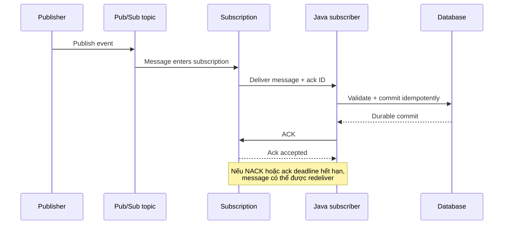
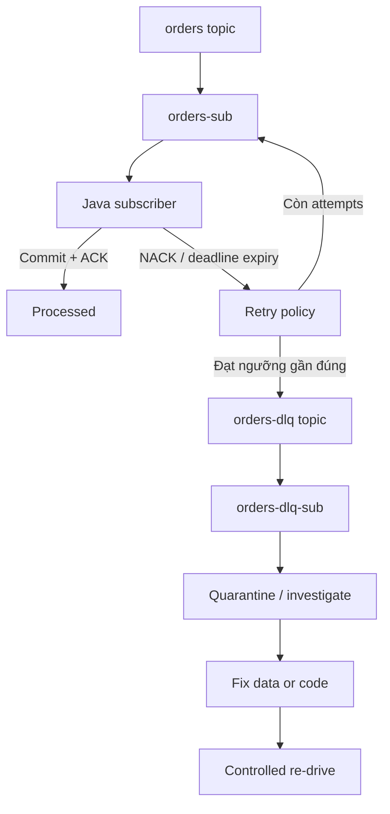
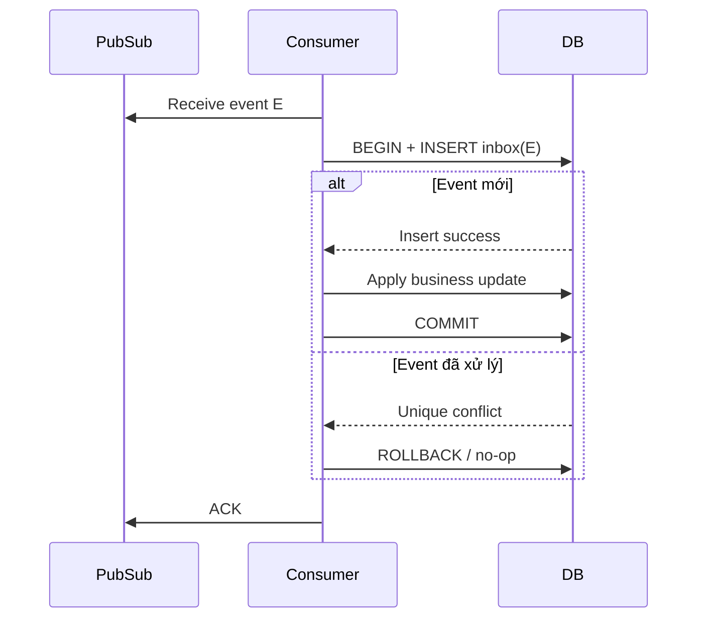
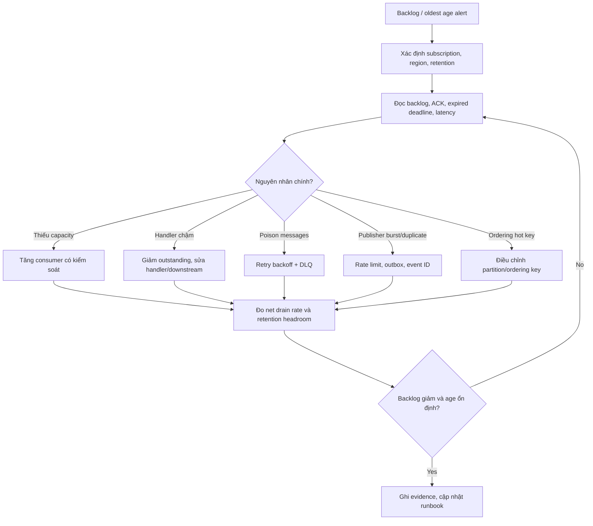

# Xử lý Pub/Sub backlog và thông điệp bị phân phối lặp

> **Chương:** Vận hành và xử lý sự cố  
> **Mô-đun:** `CLOUD_PROVIDERS_GCP` — Khám phá Google Cloud từ tổ chức project, IAM và VPC đến Compute Engine, GKE, Cloud Run, dịch vụ lưu trữ và cơ sở dữ liệu. Qua các tình huống triển khai, người học biết lựa chọn dịch vụ, bảo vệ tài nguyên, tự động hóa phát hành và theo dõi độ tin cậy cùng chi phí.  
> **Phạm vi:** Chẩn đoán backlog của Google Cloud Pub/Sub, phân biệt redelivery với duplicate, quản lý acknowledgment deadline, flow control, retry, dead-letter topic, exactly-once delivery và ordering key. Các lệnh chỉ dành cho sandbox; không dùng dữ liệu hoặc subscription production để thử lỗi.

## 1. Mục tiêu học tập

Sau bài học, người học có thể:

1. Giải thích trạng thái message **outstanding**, **acknowledged**, **NACK** và nguyên nhân Pub/Sub phân phối lại.
2. Phân biệt **redelivery cùng message ID** với **publisher gửi trùng sự kiện có message ID khác**.
3. Dùng Cloud Monitoring đánh giá backlog, tuổi message cũ nhất, ack deadline hết hạn và delivery latency.
4. Ước lượng thời gian drain backlog từ tốc độ message đến và tốc độ consumer xử lý.
5. Điều chỉnh subscriber concurrency, flow control, ack deadline và retry policy để tránh consumer quá tải.
6. Thiết kế ứng dụng Java có **idempotency**, commit bền vững trước khi ACK và xử lý lỗi tạm thời/lỗi vĩnh viễn.
7. Cấu hình dead-letter topic (DLQ), quyền service agent và quy trình điều tra/replay.
8. Đánh giá giới hạn exactly-once delivery và message ordering, lựa chọn khi nào cần dùng.
9. Viết runbook khôi phục subscription có backlog lớn mà không làm mất dữ liệu hoặc tạo thêm duplicate.

**Tình huống:** Một dịch vụ Java nhận đơn hàng qua Pub/Sub. Trong giờ cao điểm, số message chưa ACK tăng từ vài nghìn lên hàng triệu. Người vận hành thấy cùng đơn hàng xuất hiện nhiều lần trong log, database bị ghi lặp và dashboard báo tuổi message cũ nhất tăng liên tục. Nhiệm vụ là tìm nguyên nhân ở publisher, subscriber, ack deadline, downstream database hay cấu hình subscription; sau đó khôi phục tốc độ xử lý và bảo vệ tính đúng đắn nghiệp vụ.

## 2. Pub/Sub delivery lifecycle và khái niệm backlog

Pub/Sub tách **topic** (nơi publisher gửi message) khỏi **subscription** (trạng thái giao nhận riêng cho một consumer group). Một topic có thể có nhiều subscription; mỗi subscription có backlog và tiến độ ACK riêng.

Với pull hoặc StreamingPull:

1. Subscriber nhận một message cùng acknowledgment ID.
2. Message ở trạng thái **outstanding** cho subscriber đó.
3. Ứng dụng xử lý và gửi ACK trước khi acknowledgment deadline hết hạn.
4. Nếu Pub/Sub nhận ACK hợp lệ, message được xem là acknowledged đối với subscription.
5. Nếu client NACK hoặc deadline hết hạn, message có thể được phân phối lại cho cùng hoặc subscriber khác.



### 2.1. Các trạng thái quan trọng

| Trạng thái/thuật ngữ | Ý nghĩa | Tác động vận hành |
|---|---|---|
| Outstanding | Đã giao cho subscriber nhưng chưa ACK/NACK | Chiếm flow-control capacity |
| Acknowledged (ACK) | Subscriber xác nhận đã xử lý | Message không còn chờ ở subscription |
| Negative acknowledgment (NACK) | Subscriber báo chưa xử lý được | Pub/Sub có thể redeliver theo retry policy |
| Ack deadline expired | Hết thời hạn ACK khi message còn outstanding | Có thể phát sinh redelivery |
| Backlog | Message chưa được ACK của subscription | Có thể tăng dù publisher vẫn hoạt động bình thường |
| Redelivery | Cùng message được giao lại sau NACK/deadline | Code cần chịu được xử lý lặp |
| Duplicate delivery | Cùng message được giao lại trong trường hợp duplicate delivery | Exactly-once có thể ngăn loại duplicate này trong phạm vi hỗ trợ |
| Duplicate publish | Publisher gửi cùng business event nhiều lần | Pub/Sub coi các lần publish là message riêng nếu message ID khác |

**Backlog không đồng nghĩa message đã mất.** Tuy nhiên, message chưa ACK chỉ được giữ trong thời hạn retention của subscription/topic theo cấu hình. Nếu tuổi backlog vượt thời gian retention, message có thể hết hạn và gây mất dữ liệu không thể khôi phục bằng cách tăng subscriber sau đó.

### 2.2. Acknowledgment deadline

Ack deadline là thời gian subscriber có để xác nhận message đã được xử lý. Mặc định của subscription là 10 giây; có thể cấu hình trong giới hạn dịch vụ. Client libraries cấp cao thường tự gia hạn deadline cho message đang xử lý, nhưng có giới hạn tối đa và hành vi phụ thuộc cấu hình thư viện.

Nguyên tắc:

- Chỉ ACK sau khi kết quả đã được ghi bền vững.
- Không ACK ngay khi vừa nhận message rồi xử lý ở background không được theo dõi.
- Không giữ message outstanding trong khi chờ một downstream không có timeout.
- Đặt timeout của database/HTTP client thấp hơn giới hạn xử lý message đã dự trù.
- Dùng lease management/ack deadline extension của client library; không tự xây vòng lặp gia hạn nếu thư viện đã làm việc đó.
- Khi shutdown, dừng nhận message mới, hoàn tất hoặc để deadline hết hạn có kiểm soát.

## 3. Redelivery và duplicate: phân biệt trước khi sửa

Không phải mọi message xuất hiện hai lần đều là lỗi của Pub/Sub.

| Quan sát | Nguyên nhân thường gặp | Cách nhận diện |
|---|---|---|
| Cùng Pub/Sub message ID xuất hiện lại | NACK, ack deadline hết hạn, subscriber restart hoặc duplicate delivery | So sánh `messageId` |
| Message ID khác nhưng cùng `order_id`/`event_id` | Publisher gửi lại cùng sự kiện do retry hoặc logic phát trùng | So business key trong payload/attribute |
| Một message được xử lý ở hai instance | ACK chưa được ghi nhận hoặc lease hết hạn khi xử lý lâu | Correlate subscriber instance, attempt, ack deadline |
| Nhiều message sau cùng ordering key bị giao lại | Redelivery của một message trong chuỗi có ordering key | So ordering key và thứ tự |
| Duplicate xuất hiện sau Seek | Subscription được seek tới timestamp/snapshot và replay | Kiểm tra thao tác seek/audit |

### 3.1. Nguyên nhân phổ biến của redelivery

- Ứng dụng gọi `nack()` vì lỗi xử lý.
- Subscriber xử lý lâu hơn ack deadline mà deadline không được gia hạn thành công.
- Ứng dụng crash, pod bị terminate, VM mất kết nối hoặc deploy/restart trong lúc có message outstanding.
- ACK request gửi tới Pub/Sub nhưng phản hồi bị mất hoặc client không nhận được xác nhận.
- Flow control nhận quá nhiều message so với số worker thực tế.
- Database lock/contention hoặc connection pool cạn khiến handler chậm.
- Message độc hại hoặc sai schema làm một handler crash liên tục.
- Seek để replay message cũ; hành vi redelivery này vẫn có thể xảy ra ngay cả khi exactly-once được bật.

### 3.2. Duplicate từ publisher

Nếu producer gửi cùng một đơn hàng hai lần, Pub/Sub có thể tạo **hai message ID khác nhau**. Exactly-once delivery của subscription không hợp nhất hai lần publish thành một business event.

Producer nên dùng event ID ổn định được tạo ở tầng nghiệp vụ, ví dụ `order-created:ORD-2026-000123`, và lưu trạng thái publish/outbox để retry không tạo business event mới ngoài ý muốn. Consumer vẫn cần idempotency vì publisher, mạng và hệ thống downstream đều có thể lặp.

## 4. Đo backlog bằng Cloud Monitoring

Bắt đầu từ dashboard của subscription, ưu tiên metric theo region để tránh một vùng mất dữ liệu quan sát làm dashboard tổng bị trống.

### 4.1. Metric cốt lõi

| Metric Pub/Sub | Ý nghĩa | Dấu hiệu cần điều tra |
|---|---|---|
| `subscription/num_unacked_messages_by_region` | Số message chưa ACK theo region | Tăng liên tục cho thấy consumer không theo kịp |
| `subscription/oldest_unacked_message_age_by_region` | Tuổi message chưa ACK cũ nhất theo region | Tăng vượt SLO hoặc gần retention là nguy cơ mất dữ liệu |
| `subscription/expired_ack_deadlines_count` | Số lần ack deadline hết hạn | Tăng nhanh thường liên quan handler chậm hoặc flow control quá rộng |
| `subscription/ack_message_count` | Số ACK được ghi nhận | Giảm trong khi publish rate tăng có thể cho thấy subscriber bị nghẽn |
| `subscription/dead_letter_message_count` | Số message được chuyển tới DLQ | Tăng đột ngột cho thấy lỗi lặp hoặc policy quá chặt |
| `subscription/delivery_latency_health_score` | Điểm sức khỏe delivery latency | Giá trị thấp cho biết có yếu tố gây tăng latency |
| `subscription/open_streaming_pulls` | Số StreamingPull stream đang mở | Ít stream có thể hạn chế khả năng nhận message |
| `topic/message_sizes` | Kích thước message theo topic | Message lớn bất thường làm tăng transfer/processing time |

Tên metric đầy đủ có prefix `pubsub.googleapis.com/`. Với backlog, Google khuyến nghị metric `_by_region` thay cho metric global khi cần dashboard/alert chịu được lỗi đơn vùng.

### 4.2. Cách đọc kết hợp metric

| `num_unacked` | `oldest_unacked_age` | Diễn giải khả dĩ |
|---|---|---|
| Tăng | Tăng | Consumer không theo kịp tốc độ publish |
| Ổn định, thấp | Tăng | Có một vài message bị kẹt/poison message |
| Tăng | Ổn định | Có thể là burst mới; theo dõi thêm tốc độ ACK |
| Giảm | Giảm | Drain backlog đang tiến triển |
| Giảm | Tăng | Có thể còn một message cũ bị kẹt trong khi các message mới được xử lý |
| Thấp | Thấp nhưng lỗi nghiệp vụ tăng | Consumer có thể ACK sai thời điểm hoặc publisher không gửi vào subscription dự kiến |

**Không xem một metric riêng lẻ.** Cùng một backlog có thể do thiếu CPU, lỗi IAM downstream, DB quá tải, message quá lớn, ordering key bị dồn hoặc subscription filter loại message.

### 4.3. Metric health score

`delivery_latency_health_score` là chỉ báo tổng hợp; điểm 1 thể hiện trạng thái khỏe theo đánh giá metric, điểm 0 là không khỏe. Các yếu tố có thể làm điểm giảm gồm NACK, ack deadline hết hạn, seek gần đây và ack latency cao (ví dụ p99.9 vượt 30 giây trong cửa sổ đo của tài liệu).

Dùng score để phát hiện sớm, sau đó mở metric thành phần để tìm nguyên nhân. Không tự đặt alert duy nhất theo score mà bỏ qua backlog age và retention.

### 4.4. Cảnh báo retention

Tạo alert khi `oldest_unacked_message_age_by_region` tiến gần ngưỡng retention của subscription. Ví dụ, nếu retention cấu hình 7 ngày, có thể đặt cảnh báo sớm ở 50% và cảnh báo nghiêm trọng ở 75–80%; đây là ngưỡng vận hành minh họa, cần điều chỉnh theo RPO/SLO.

Nếu tuổi message vượt retention, dữ liệu có thể đã hết hạn. Tăng subscriber sau sự kiện không phục hồi được message đã bị xóa khỏi phạm vi retention.

## 5. Ước lượng thời gian drain backlog

Để quyết định tăng subscriber bao nhiêu, cần đo ba đại lượng:

- `B`: số message đang backlog tại thời điểm bắt đầu.
- `λ`: tốc độ message mới đi vào subscription (message/giây).
- `μ`: tổng tốc độ xử lý thành công của toàn bộ subscriber (message/giây).

Nếu `μ <= λ`, backlog không thể giảm bền vững. Nếu `μ > λ`, thời gian drain lý tưởng:

```text
Drain time ≈ B / (μ - λ)

Ví dụ:
  Backlog B = 1,200,000 messages
  Incoming λ = 800 messages/second
  Subscriber capacity μ = 1,300 messages/second

Net drain rate = 1,300 - 800 = 500 messages/second
Drain time ≈ 1,200,000 / 500 = 2,400 seconds
           ≈ 40 minutes
```

Đây là ước lượng đơn giản, chưa tính message size, retry, ordering, burst, downstream latency và thời gian scale-up. Nên tính theo **ACK throughput thực tế**, không lấy số message được nhận làm năng suất.

### 5.1. Ví dụ backlog không bao giờ giảm

```text
B = 500,000
λ = 1,000 msg/s
μ =   900 msg/s

Net drain rate = -100 msg/s
Backlog tiếp tục tăng khoảng 100 msg/s.
```

Trong trường hợp này, tăng thêm worker hoặc sửa bottleneck là cần thiết. Chỉ tăng thời gian retention sẽ kéo dài thời gian trước khi message hết hạn, nhưng không xử lý nguyên nhân capacity.

## 6. Chẩn đoán subscriber quá tải

### 6.1. Kiểm tra phía consumer

- CPU cao, throttling hoặc GC pause kéo dài.
- Heap/native memory tăng, thread pool bị cạn.
- Số handler đang chạy lớn hơn khả năng database/HTTP dependency.
- Một số message làm parser/validator tốn thời gian bất thường.
- Connection pool database hết connection hoặc lock contention.
- Một ordering key nóng chiếm phần lớn traffic.
- `maxOutstandingElementCount` hoặc byte limit đặt quá cao.
- Chỉ một StreamingPull connection hoạt động trong khi tải tăng.
- Consumer autoscaling chậm hơn tốc độ publish.

### 6.2. Kiểm tra phía downstream

Nếu Pub/Sub nhận message nhanh nhưng database chỉ commit 200 giao dịch/giây, tăng subscriber từ 10 lên 100 có thể làm database quá tải hơn. Cần đo:

- Connection utilization và queue time.
- Query p95/p99 latency.
- Lock wait/deadlock/transaction retry.
- API rate limit/429 và 5xx.
- Network latency/egress.
- Giới hạn connection/throughput của database.
- Số message đang chờ bên trong application queue.

**Flow control là cơ chế bảo vệ downstream.** Không nên tắt flow control để “đọc hết backlog”; điều đó có thể chỉ chuyển backlog từ Pub/Sub vào RAM của ứng dụng.

## 7. Flow control và concurrency

Flow control giới hạn lượng message subscriber nhận nhưng chưa ACK/NACK. Trong Java client library, hai tham số quan trọng:

- `setMaxOutstandingElementCount`: số message outstanding tối đa.
- `setMaxOutstandingRequestBytes`: tổng byte của message outstanding tối đa.

Khi một giới hạn bị chạm, client tạm ngừng kéo message mới cho đến khi lượng outstanding giảm.

### 7.1. Ví dụ cấu hình Java

```java
import com.google.api.gax.batching.FlowControlSettings;
import com.google.cloud.pubsub.v1.AckReplyConsumer;
import com.google.cloud.pubsub.v1.MessageReceiver;
import com.google.cloud.pubsub.v1.Subscriber;
import com.google.pubsub.v1.ProjectSubscriptionName;
import com.google.pubsub.v1.PubsubMessage;

import java.util.concurrent.TimeUnit;

public final class OrdersSubscriber {
    public static void main(String[] args) throws Exception {
        String projectId = System.getenv("PROJECT_ID");
        String subscriptionId = System.getenv("SUBSCRIPTION_ID");

        ProjectSubscriptionName subscription =
            ProjectSubscriptionName.of(projectId, subscriptionId);

        MessageReceiver receiver = (PubsubMessage message,
                                   AckReplyConsumer consumer) -> {
            String eventId = message.getAttributesMap()
                .getOrDefault("event_id", message.getMessageId());

            try {
                String payload = message.getData().toStringUtf8();

                // Phải commit kết quả nghiệp vụ bền vững và idempotently.
                processAndCommitOnce(eventId, payload);

                // Chỉ ACK sau khi commit thành công.
                consumer.ack();
            } catch (TransientProcessingException ex) {
                System.err.printf("Temporary failure eventId=%s: %s%n",
                    eventId, ex.getMessage());
                consumer.nack();
            } catch (Exception ex) {
                System.err.printf("Processing failure eventId=%s: %s%n",
                    eventId, ex.getMessage());
                consumer.nack();
            }
        };

        FlowControlSettings flowControl =
            FlowControlSettings.newBuilder()
                .setMaxOutstandingElementCount(100L)
                .setMaxOutstandingRequestBytes(32L * 1024L * 1024L)
                .build();

        Subscriber subscriber = Subscriber.newBuilder(subscription, receiver)
            .setFlowControlSettings(flowControl)
            .build();

        Runtime.getRuntime().addShutdownHook(new Thread(() -> {
            subscriber.stopAsync();
            try {
                subscriber.awaitTerminated(30, TimeUnit.SECONDS);
            } catch (Exception ignored) {
                // Ghi nhận shutdown timeout trong ứng dụng thực tế.
            }
        }));

        subscriber.startAsync().awaitRunning();
        System.out.println("Subscriber is running");
        subscriber.awaitTerminated();
    }

    private static void processAndCommitOnce(
        String eventId, String payload) throws Exception {
        // Triển khai bằng transaction ở database:
        // 1. Insert eventId vào bảng processed_events có UNIQUE constraint.
        // 2. Nếu eventId đã tồn tại, không áp dụng business update lần nữa.
        // 3. Nếu mới, cập nhật dữ liệu nghiệp vụ trong cùng transaction.
        // 4. Commit transaction trước khi hàm trả về.
        throw new UnsupportedOperationException(
            "Connect a transactional repository before running");
    }

    private static final class TransientProcessingException
        extends Exception {
        TransientProcessingException(String message, Throwable cause) {
            super(message, cause);
        }
    }
}
```

Đây là khung code minh họa. Phải triển khai `processAndCommitOnce` với database/repository thật và xử lý shutdown/logging theo ứng dụng trước khi chạy. Không dùng `UnsupportedOperationException` làm logic production.

### 7.2. Cách chọn flow-control limit

Giả sử mỗi message trung bình 64 KiB, consumer có thể xử lý an toàn 50 message đồng thời:

- Giới hạn count ban đầu: 50–100 message.
- Giới hạn bytes ban đầu: 16–32 MiB tùy heap và kích thước message.
- Theo dõi heap, GC, handler latency, ack deadline expiry và downstream connections.
- Tăng từng bước, quan sát rồi mới điều chỉnh tiếp.

Đây chỉ là điểm bắt đầu. Nếu message có payload rất lớn, giới hạn byte có thể chạm trước count; nếu message nhỏ nhưng handler tốn CPU, count có thể là giới hạn chính.

### 7.3. Tăng subscriber có kiểm soát

Khi backlog tăng liên tục và downstream còn capacity:

1. Thêm instance/pod hoặc tăng số handler thread.
2. Đặt flow-control per instance theo RAM/CPU.
3. Tăng từ từ, quan sát `ack_message_count`, backlog age và DB latency.
4. Giữ tổng connection pool không vượt giới hạn database.
5. Kiểm tra quota Compute Engine/GKE/Cloud Run và Pub/Sub.
6. Dừng scale khi ACK throughput không tăng hoặc downstream latency bắt đầu xấu.

**Không scale theo backlog count đơn độc.** Nếu backlog gồm một vài message bị kẹt, thêm 100 consumer cũng không giải quyết được poison message.

## 8. Ack deadline và lease management

### 8.1. Khi nào deadline hết hạn?

Ví dụ:

- Subscription ack deadline: 30 giây.
- Java handler cần 45 giây để gọi database và xử lý payload.
- Client không gia hạn deadline thành công.
- Message có thể được redeliver trước khi handler đầu tiên hoàn thành.
- Hai handler cùng chạy một business event, dẫn đến ghi trùng hoặc contention.

Client libraries cấp cao có cơ chế gia hạn ack deadline tự động cho message outstanding. Tuy vậy, gia hạn có giới hạn tối đa và vẫn có thể thất bại khi client mất kết nối, quá tải hoặc shutdown.

### 8.2. Hướng xử lý

- Giảm thời gian xử lý một message hoặc chia nhỏ nghiệp vụ.
- Dùng client library được hỗ trợ và phiên bản phù hợp; kiểm tra lease extension settings.
- Đặt flow control để handler không bị nhận nhiều message hơn khả năng xử lý.
- Đặt timeout cho DB/HTTP calls; tránh một handler treo vô hạn.
- Theo dõi p95/p99 handler duration và `expired_ack_deadlines_count`.
- Nếu một message hợp lệ luôn cần thời gian dài, cân nhắc thay đổi kiến trúc thành job async hoặc phân chia công việc.

**Không đặt ack deadline rất dài để che handler chậm.** Deadline dài có thể làm chậm phát hiện subscriber chết và kéo dài thời gian message được giao lại.

### 8.3. Xử lý shutdown

Khi deploy phiên bản mới hoặc scale-in:

1. Đánh dấu instance không nhận thêm công việc mới nếu ứng dụng có cơ chế.
2. Dừng subscriber/StreamingPull theo cách graceful.
3. Chờ các handler đang chạy trong khoảng shutdown budget.
4. Chỉ ACK message đã commit.
5. Message chưa hoàn tất để Pub/Sub redeliver sau deadline/lease.
6. Đảm bảo instance mới có cùng idempotency store và schema tương thích.

Không kill toàn bộ consumer như cách rollout thường lệ; việc đó có thể tạo một đợt redelivery lớn.

## 9. Retry policy: immediate hay exponential backoff?

Khi message bị NACK hoặc ack deadline hết hạn, Pub/Sub có thể retry. Mặc định là **immediate retry**. Nếu nguyên nhân chưa thay đổi, message có thể quay lại ngay, tạo vòng lặp lỗi và làm tăng tải.

### 9.1. Exponential backoff

Retry policy của subscription có thể thêm khoảng chờ tăng dần cho **từng message**:

- Minimum backoff: giá trị nhỏ nhất trước lần thử tiếp theo.
- Maximum backoff: giới hạn trên; tài liệu dịch vụ cho phép tối đa 600 giây.
- Giá trị mặc định khi cấu hình một phía có thể dùng minimum 10 giây hoặc maximum 600 giây.

Ví dụ:

```bash
export PROJECT_ID="pubsub-ops-sandbox"
export TOPIC_ID="orders"
export SUBSCRIPTION_ID="orders-sub"

gcloud pubsub subscriptions create "$SUBSCRIPTION_ID" \
  --project="$PROJECT_ID" \
  --topic="$TOPIC_ID" \
  --ack-deadline=60 \
  --min-retry-delay=10s \
  --max-retry-delay=300s
```

Cấu hình này tạo subscription pull với retry exponential backoff. Nếu subscription đã tồn tại, dùng `gcloud pubsub subscriptions update` và kiểm tra trạng thái trước khi thay đổi.

### 9.2. Khi nào NACK và khi nào ACK?

| Trường hợp | Hành động phù hợp | Lý do |
|---|---|---|
| Database tạm thời unavailable | NACK hoặc để deadline retry theo policy | Message có thể xử lý được sau |
| Rate limit downstream | Retry có backoff và giảm concurrency | Tránh retry storm |
| Payload sai nhưng đã ghi vào quarantine bền vững | ACK sau khi quarantine commit | Tránh redelivery vô hạn |
| Event đã xử lý trước đó (idempotency hit) | ACK | Không áp dụng nghiệp vụ lần hai |
| Lỗi cấu hình/IAM cố định | Dừng/giảm consumer, sửa root cause | NACK hàng loạt không sửa được permission |
| Message cần xử lý thủ công | Chuyển vào DLQ/quarantine theo policy | Giữ evidence và giải phóng subscription |

NACK không phải công cụ lọc message hoặc trì hoãn tùy ý. Khi cần lập lịch thực thi ở một thời điểm trong tương lai, cân nhắc Cloud Tasks thay vì NACK liên tục.

## 10. Dead-letter topic: cách ly message không thể xử lý

Dead-letter topic là nơi Pub/Sub chuyển các message không thể được xử lý sau số lần giao được cấu hình. Đây là **thuộc tính của subscription nguồn**, không phải cài đặt trên topic gốc.

### 10.1. Luồng DLQ



### 10.2. Tạo topic và subscription DLQ

```bash
gcloud pubsub topics create orders-dlq \
  --project="$PROJECT_ID"

gcloud pubsub subscriptions create orders-dlq-sub \
  --project="$PROJECT_ID" \
  --topic="orders-dlq"

gcloud pubsub subscriptions create orders-sub-with-dlq \
  --project="$PROJECT_ID" \
  --topic="$TOPIC_ID" \
  --dead-letter-topic="orders-dlq" \
  --max-delivery-attempts=10 \
  --min-retry-delay=10s \
  --max-retry-delay=300s
```

Số lần giao cấu hình cho dead-letter topic phải nằm trong khoảng **5–100**. Số lần thực tế được tính theo best effort, không phải ngưỡng chính xác tuyệt đối; đặc biệt khi subscriber không hoạt động, delivery attempt counter có thể thay đổi/reset.

### 10.3. Cấp quyền cho Pub/Sub service agent

Để forward message, service agent Pub/Sub cần quyền publish vào DLQ topic và ACK/xóa message khỏi subscription nguồn. Dạng principal:

```text
service-PROJECT_NUMBER@gcp-sa-pubsub.iam.gserviceaccount.com
```

Ví dụ cấp quyền đúng phạm vi:

```bash
export PROJECT_NUMBER="$(gcloud projects describe "$PROJECT_ID" \
  --format='value(projectNumber)')"
export PUBSUB_AGENT="service-$PROJECT_NUMBER@gcp-sa-pubsub.iam.gserviceaccount.com"

gcloud pubsub topics add-iam-policy-binding orders-dlq \
  --project="$PROJECT_ID" \
  --member="serviceAccount:$PUBSUB_AGENT" \
  --role="roles/pubsub.publisher"

gcloud pubsub subscriptions add-iam-policy-binding orders-sub-with-dlq \
  --project="$PROJECT_ID" \
  --member="serviceAccount:$PUBSUB_AGENT" \
  --role="roles/pubsub.subscriber"
```

Cấp quyền sau khi topic đã được tạo và service identity đã sẵn sàng. Mở trang **Dead lettering** của subscription để xem action items và xác nhận service agent có đủ quyền. Không cấp Project Editor/Owner cho service agent.

### 10.4. Xử lý DLQ an toàn

- Tạo subscription riêng để điều tra message trong DLQ.
- Ghi message ID gốc, business event ID, source subscription, delivery count và publish time.
- Phân loại lỗi: schema, code bug, dữ liệu nghiệp vụ, IAM, downstream.
- Sửa nguyên nhân trước khi re-drive.
- Giữ event ID gốc để consumer idempotent.
- Re-drive theo batch nhỏ, giới hạn rate và giám sát.
- Không tự động đưa toàn bộ DLQ về topic gốc mỗi phút; điều đó tạo vòng lặp.
- Đặt retention và quyền truy cập DLQ theo mức nhạy cảm của payload.

Java client library có thể cung cấp delivery attempt qua attribute `googclient_deliveryattempt`; không giả định field giống nhau giữa pull, push và mọi client language.

## 11. Exactly-once delivery: dùng đúng phạm vi

Mặc định Pub/Sub cung cấp **at-least-once delivery**. Exactly-once delivery là tùy chọn cho subscription có hỗ trợ, giúp subscriber xác định ACK đã được Pub/Sub chấp nhận và ngăn redelivery sau một ACK thành công trong phạm vi đảm bảo.

### 11.1. Giới hạn quan trọng

- Exactly-once chỉ hỗ trợ **pull subscriptions**, bao gồm StreamingPull; không hỗ trợ push và export subscriptions.
- Cam kết exactly-once có phạm vi **một region**. Nếu subscriber kết nối qua nhiều region, cần dùng locational endpoint và thiết kế kết nối phù hợp.
- Tính năng có thể tăng latency và có quota riêng.
- Publisher vẫn có thể phát cùng business event nhiều lần với các message ID khác nhau.
- Seek/replay có thể khiến message được giao lại theo thiết kế.
- Exactly-once delivery không biến transaction database bên ngoài thành transaction nguyên tử với Pub/Sub.

### 11.2. Tạo subscription exactly-once

```bash
gcloud pubsub subscriptions create orders-sub-exactly-once \
  --project="$PROJECT_ID" \
  --topic="$TOPIC_ID" \
  --enable-exactly-once-delivery \
  --ack-deadline=60
```

Đây là subscription riêng để thử nghiệm. Exactly-once là thuộc tính khi tạo/cấu hình subscription; không giả định có thể bật tùy ý trên mọi subscription hiện hữu mà không kiểm tra API/CLI hiện hành.

### 11.3. Khi nào nên bật?

| Nhu cầu | Gợi ý |
|---|---|
| Duplicate có thể được xử lý bằng idempotency | At-least-once thường đơn giản và có throughput/latency phù hợp |
| Yêu cầu giảm duplicate delivery ở pull subscriber | Đánh giá exactly-once |
| Push endpoint hoặc export subscription | Exactly-once không áp dụng |
| Publisher có thể gửi event trùng | Vẫn cần deduplication theo business ID |
| Xử lý side effect ở nhiều hệ thống | Cần transaction/outbox/inbox hoặc saga; exactly-once không đủ |

Kể cả khi bật exactly-once, vẫn nên giữ idempotency vì duplicate publisher events và side effects bên ngoài subscription vẫn có thể xảy ra.

## 12. Idempotency: lớp bảo vệ nghiệp vụ bắt buộc

**Idempotent processing** nghĩa là xử lý cùng một business event nhiều lần không làm trạng thái nghiệp vụ thay đổi sai.

### 12.1. Dùng business event ID

Ví dụ payload:

```json
{
  "event_id": "order-created:ORD-2026-000123",
  "order_id": "ORD-2026-000123",
  "event_type": "ORDER_CREATED",
  "schema_version": 2,
  "created_at": "2026-11-19T08:00:00Z"
}
```

Không dùng riêng Pub/Sub message ID làm business key nếu publisher retry có thể tạo message mới. Event ID nên được tạo tại hệ thống nghiệp vụ nguồn và giữ ổn định qua mọi lần publish/retry.

### 12.2. Transactional inbox pattern

Trong database, tạo bảng `processed_events` có unique constraint trên `event_id`:

```sql
CREATE TABLE processed_events (
    event_id VARCHAR(200) PRIMARY KEY,
    processed_at TIMESTAMP NOT NULL DEFAULT CURRENT_TIMESTAMP
);
```

Luồng xử lý:

1. Bắt đầu transaction.
2. Insert event ID vào `processed_events`.
3. Nếu unique conflict, event đã được xử lý; không chạy business update lần nữa.
4. Nếu insert mới, cập nhật bảng nghiệp vụ trong **cùng transaction**.
5. Commit transaction.
6. Chỉ sau commit mới gọi Pub/Sub ACK.



Nếu commit database thành công nhưng ACK bị mất, Pub/Sub có thể redeliver. Lần sau unique constraint giúp consumer bỏ qua business update và ACK an toàn.

### 12.3. Outbox ở publisher

Nếu một transaction nghiệp vụ vừa cập nhật database vừa publish event, lỗi xảy ra giữa hai thao tác có thể khiến dữ liệu và message không đồng bộ. **Transactional outbox** ghi event vào cùng transaction với dữ liệu nghiệp vụ; publisher worker đọc outbox và publish, rồi đánh dấu đã gửi. Publisher vẫn có thể retry và tạo duplicate, nên consumer cần idempotency.

### 12.4. Các side effect ngoài database

Với email, thanh toán, gọi HTTP hoặc tạo tài nguyên bên ngoài:

- Dùng idempotency key nếu API downstream hỗ trợ.
- Lưu trạng thái request/response theo event ID.
- Nếu downstream không hỗ trợ idempotency, thiết kế reconciliation/compensation.
- Không ACK trước khi có bằng chứng side effect được ghi nhận bền vững.
- Không giả định có distributed transaction giữa Pub/Sub, database và HTTP service.

## 13. Message ordering và hot ordering key

Ordering key cho phép Pub/Sub giữ thứ tự message trong cùng key theo điều kiện dịch vụ. Ví dụ `customer_id=123` giúp các thay đổi của cùng customer đi theo thứ tự publish.

### 13.1. Lợi ích và đánh đổi

| Lợi ích | Đánh đổi |
|---|---|
| Dễ xử lý event phụ thuộc thứ tự | Message cùng key bị tuần tự hóa |
| Phù hợp state machine theo entity | Một key nóng giới hạn throughput |
| Giảm lỗi cập nhật out-of-order | Redelivery có thể kéo theo các message sau cùng key |
| Dễ dựng lịch sử entity | ACK cần được xử lý đúng thứ tự khi kết hợp exactly-once |

Nếu một message có ordering key bị redeliver, Pub/Sub có thể redeliver các message tiếp theo cùng key để giữ chuỗi. Một poison message ở key nóng có thể chặn tiến độ của key đó.

### 13.2. Chẩn đoán hot key

- Group throughput/latency theo ordering key hoặc entity ID.
- Tìm một key có message rate lớn bất thường.
- Kiểm tra consumer concurrency có bị giới hạn bởi một key.
- Xem NACK/deadline expiry của message đầu chuỗi.
- Đánh giá có thật sự cần ordering toàn entity không; nếu chỉ cần thứ tự theo partition nhỏ, chọn key granular hơn.
- Không xóa ordering key hoặc bật parallelism cao mà không xem lại invariant nghiệp vụ.

### 13.3. Khi nào không bật ordering?

Nếu mỗi message độc lập, xử lý song song được và kết quả được bảo vệ bằng version/sequence check, ordering có thể chỉ làm tăng latency. Chỉ bật khi business correctness thực sự phụ thuộc thứ tự.

## 14. Quy trình xử lý backlog theo thứ tự



### 14.1. Runbook 10 bước

1. Xác định project, topic, subscription, region, subscription type và owner.
2. Kiểm tra message retention và tuổi backlog cũ nhất; xác định nguy cơ hết hạn.
3. Đọc `num_unacked_messages_by_region`, `oldest_unacked_message_age_by_region`, `expired_ack_deadlines_count`, `ack_message_count`.
4. So publish rate với successful ACK rate để tính net drain rate.
5. Kiểm tra subscriber CPU/RAM, số instance, open StreamingPull streams, handler latency và flow control.
6. Kiểm tra database/HTTP dependency, IAM, quota, network và message size.
7. Phân loại redelivery/duplicate bằng Pub/Sub message ID và business event ID.
8. Điều chỉnh concurrency/backoff hoặc bật DLQ theo nguyên nhân; không thay nhiều thông số cùng lúc.
9. Theo dõi backlog giảm, oldest age giảm, retention headroom tăng; kiểm tra dữ liệu nghiệp vụ.
10. Ghi nhận root cause, thay đổi, ảnh hưởng dữ liệu, chi phí và action phòng ngừa.

### 14.2. Tăng consumer trong sự cố

Trước khi scale:

- Xác minh subscriber đang khỏe và có thể xử lý message mới.
- Kiểm tra downstream còn capacity.
- Đảm bảo idempotency đã có, tránh scale làm tăng duplicate side effects.
- Xác định quota/region có thể cấp thêm instance.
- Đặt concurrency/flow-control giới hạn cho từng instance.
- Tăng từng nấc, quan sát ACK throughput và downstream latency.

Nếu backlog giảm chậm nhưng oldest age vẫn tăng, có thể có một số message cũ bị kẹt. Khi đó, kiểm tra log theo event/message ID và DLQ; không chỉ tăng số instance.

## 15. Quan sát chi tiết và thiết kế alert

### 15.1. Dashboard đề xuất

| Nhóm | Chart | Nhãn/aggregation |
|---|---|---|
| Backlog | Unacked messages | Theo subscription và region |
| Backlog age | Oldest unacked age | Theo subscription và region |
| Processing | ACK count/rate | Theo subscription |
| Retry | Expired ack deadlines | Theo subscription |
| Delivery | Delivery latency health score | Theo subscription |
| StreamingPull | Open streaming pulls | Theo subscription |
| DLQ | Dead-letter message count | Theo source subscription |
| Publisher | Publish request count/errors | Theo topic |
| Application | Handler p50/p95/p99 | Theo subscriber version |
| Downstream | DB latency, pool saturation, 429/5xx | Theo dependency |

Dùng metric labels thực tế trong Cloud Monitoring; tên hiển thị trong UI có thể khác đường dẫn metric API. Tránh group theo label có cardinality rất cao như message ID.

### 15.2. Alert policy ví dụ

- **Warning:** oldest unacked age vượt 50% retention hoặc SLO xử lý.
- **Critical:** oldest unacked age vượt 75–80% retention; cần xác minh mức độ ưu tiên ngay.
- **Capacity:** `num_unacked_messages_by_region` tăng liên tục 10–15 phút trong khi ACK rate thấp hơn publish rate.
- **Ack deadline:** expired deadline rate vượt baseline và handler p99 tăng.
- **DLQ:** dead-letter message count lớn hơn 0 cho subscription critical hoặc tăng bất thường.
- **Delivery health:** score giảm kéo dài, kèm alert theo factor cụ thể.
- **Subscriber availability:** open StreamingPull streams giảm về 0 trong khi có message đến.

Ngưỡng là ví dụ, cần dùng SLO và traffic thực để tuning. Alert không nên chỉ bắn theo số backlog tuyệt đối vì một subscription có thể bình thường với hàng triệu message nếu throughput tương ứng.

### 15.3. Log fields cần có

Mỗi lần xử lý nên ghi:

- `subscription`, `subscriber_instance`, `subscriber_version`.
- `message_id`, `business_event_id`, `ordering_key` (nếu có).
- `delivery_attempt` khi client cung cấp.
- `handler_duration_ms`, `database_duration_ms`.
- `result=ACK|NACK|QUARANTINED`.
- `error_class`, `retryable`, `trace_id`.
- Không log payload đầy đủ nếu có PII, access token, payment details hoặc secret.

Log phải cho phép liên kết một event qua nhiều lần delivery mà không lưu dữ liệu nhạy cảm không cần thiết.

## 16. IAM và bảo vệ subscription

### 16.1. Tách publisher, subscriber và operator

| Principal | Role minh họa | Phạm vi |
|---|---|---|
| Publisher service account | `roles/pubsub.publisher` | Topic cụ thể |
| Java subscriber service account | `roles/pubsub.subscriber` | Subscription cụ thể |
| Operator | `roles/pubsub.viewer` hoặc quyền vận hành hẹp | Project/resource cần giám sát |
| Subscription administrator | `roles/pubsub.editor` hoặc custom role | Chỉ người quản lý cấu hình |
| DLQ consumer | `roles/pubsub.subscriber` | DLQ subscription |
| Pub/Sub service agent | `roles/pubsub.publisher` trên DLQ topic và `roles/pubsub.subscriber` trên source subscription | Chỉ khi dùng dead-letter forwarding |

Không cấp `roles/pubsub.admin` hoặc `roles/editor` cho runtime chỉ để đọc subscription. Không chia sẻ service account của publisher và subscriber nếu hai ứng dụng có vòng đời/độ tin cậy khác nhau.

### 16.2. Dùng service account của runtime

- Gắn service account vào Cloud Run, GKE Workload Identity hoặc Compute Engine VM theo nền tảng.
- Dùng Application Default Credentials từ runtime.
- Không tải service account key JSON xuống container hoặc máy phát triển.
- Secret Manager chỉ dùng cho secret thật sự cần thiết; Pub/Sub IAM không yêu cầu service account key.
- Tách project và subscription cho staging/production để tránh consumer test đọc message thật.

### 16.3. Audit và retention

- Bật/kiểm tra Cloud Audit Logs cho thay đổi IAM/topic/subscription và hành động quản trị.
- Hạn chế ai được seek, sửa retention, bật DLQ, thay ordering hoặc exactly-once.
- Quản lý quyền đọc DLQ vì payload có thể chứa dữ liệu nhạy cảm.
- Lưu log theo chính sách compliance, tránh log message payload không cần thiết.
- Thử quyền từ chối bằng service account không được cấp Subscriber; không dùng principal admin để kiểm chứng runtime.

## 17. Replay, Seek và khôi phục sau khi xử lý sai

Pub/Sub hỗ trợ seek tới snapshot hoặc timestamp để replay message. Đây là thao tác có ảnh hưởng rộng: message được giao lại theo phạm vi seek, có thể tạo duplicate ở downstream ngay cả khi exactly-once delivery được bật.

### 17.1. Trước khi Seek

1. Xác định subscription, timestamp/snapshot và tập message có thể được replay.
2. Kiểm tra retention: message phải còn trong thời hạn có thể truy cập.
3. Xác nhận subscriber idempotent và database có deduplication key.
4. Ước lượng số message và capacity drain sau replay.
5. Thông báo business owner; kiểm tra side effects (email, thanh toán, webhook).
6. Chụp snapshot hoặc lưu evidence nếu quy trình yêu cầu.
7. Thực hiện seek trong change window, theo dõi backlog/duplicate rate.

### 17.2. Re-drive từ DLQ

Không nên publish lại message từ DLQ bằng cách giữ nguyên mọi attribute một cách mù quáng. Cần:

- Giữ `business_event_id` gốc.
- Thêm metadata `replay_run_id`, `replayed_at`, `source_subscription`.
- Chọn batch nhỏ và giới hạn publish rate.
- Không đưa message lỗi schema trở lại topic chính khi chưa sửa/transform.
- Kiểm tra consumer có thể xử lý version schema cũ.
- Đối soát kết quả và tránh phát sinh giao dịch kép.

### 17.3. Khi backlog đã vượt retention

Nếu metric oldest age đã vượt message retention, xác định rõ khoảng thời gian có thể đã hết hạn. Tìm nguồn khôi phục khác: outbox của publisher, database nguồn, object archive, audit log hoặc backup. Không cam kết phục hồi message hết hạn chỉ bằng cách tăng retention sau sự cố.

## 18. Bài thực hành sandbox

### 18.1. Chuẩn bị

Dùng project sandbox riêng và dữ liệu giả. Ví dụ:

```bash
export PROJECT_ID="pubsub-ops-sandbox"
export TOPIC_ID="orders"
export SUBSCRIPTION_ID="orders-sub"
export DLQ_TOPIC_ID="orders-dlq"
export DLQ_SUBSCRIPTION_ID="orders-dlq-sub"

gcloud services enable pubsub.googleapis.com \
  --project="$PROJECT_ID"

gcloud pubsub topics create "$TOPIC_ID" \
  --project="$PROJECT_ID"

gcloud pubsub topics create "$DLQ_TOPIC_ID" \
  --project="$PROJECT_ID"
```

### 18.2. Tạo pull subscription với retry

```bash
gcloud pubsub subscriptions create "$SUBSCRIPTION_ID" \
  --project="$PROJECT_ID" \
  --topic="$TOPIC_ID" \
  --ack-deadline=60 \
  --min-retry-delay=10s \
  --max-retry-delay=300s

gcloud pubsub subscriptions describe "$SUBSCRIPTION_ID" \
  --project="$PROJECT_ID"
```

Sau đó tạo DLQ subscription:

```bash
gcloud pubsub subscriptions create "$DLQ_SUBSCRIPTION_ID" \
  --project="$PROJECT_ID" \
  --topic="$DLQ_TOPIC_ID"
```

Để bật DLQ, tạo subscription nguồn thử nghiệm khác hoặc cập nhật subscription hiện tại sau khi kiểm tra quyền và policy:

```bash
gcloud pubsub subscriptions update "$SUBSCRIPTION_ID" \
  --project="$PROJECT_ID" \
  --dead-letter-topic="$DLQ_TOPIC_ID" \
  --max-delivery-attempts=10
```

Cấp service agent roles theo phần 10.3 trước khi kết luận forwarding hoạt động. Kiểm tra tab **Dead lettering** trong console để xác nhận action items đã được xử lý.

### 18.3. Publish dữ liệu giả

```bash
gcloud pubsub topics publish "$TOPIC_ID" \
  --project="$PROJECT_ID" \
  --message='{"event_id":"order-created:1001","order_id":"1001"}' \
  --attribute=event_id=order-created:1001

gcloud pubsub topics publish "$TOPIC_ID" \
  --project="$PROJECT_ID" \
  --message='{"event_id":"order-created:1002","order_id":"1002"}' \
  --attribute=event_id=order-created:1002
```

Publish cùng `event_id` hai lần để mô phỏng publisher retry. Quan sát message ID có thể khác nhau và chứng minh deduplication phải dùng business key.

### 18.4. Thử nghiệm backlog và duplicate

1. Chạy subscriber bình thường và ghi nhận ACK rate.
2. Tạm dừng subscriber trong sandbox, publish nhiều message, quan sát `num_unacked_messages_by_region`.
3. Khởi động lại subscriber, đo oldest age và thời gian drain.
4. Cấu hình test handler xử lý lâu hơn ack deadline hoặc cố tình NACK một event giả để quan sát redelivery.
5. Giảm `maxOutstandingElementCount` và so sánh ack deadline expiration.
6. Thử lỗi một business event cố định; xác minh DLQ nhận message sau số lần delivery best effort.
7. Sửa dữ liệu/handler và replay một nhóm nhỏ từ DLQ.
8. Publish trùng business event với message ID khác; chứng minh unique event ID chặn side effect lần hai.
9. Nếu có yêu cầu, tạo subscription exactly-once pull riêng và so sánh hành vi ACK/redelivery; không so sánh với push subscription.
10. Lưu dashboard, log, message IDs, business IDs và thời gian phục hồi.

**Không thực hiện** NACK hàng loạt hoặc publish flood trên project dùng chung. Tất cả bài thử phải có quota, budget và cleanup.

## 19. Ma trận sự cố thực tế

| Triệu chứng | Nguyên nhân cần ưu tiên | Hành động đầu tiên |
|---|---|---|
| Backlog và oldest age cùng tăng | Subscriber capacity thấp hơn publish rate | So `λ`/`μ`, CPU, downstream, scale có kiểm soát |
| Backlog nhỏ nhưng oldest age tăng | Poison/stuck message | Lọc message/event ID, kiểm tra lỗi handler, DLQ |
| Expired ack deadline tăng | Handler chậm, lease extension hoặc flow control sai | Đo handler p99, giảm outstanding, kiểm tra client library |
| Duplicate cùng message ID | Redelivery/ACK chưa thành công | Kiểm tra NACK, deadline, restart, ack response |
| Duplicate business ID nhưng message ID khác | Publisher gửi lại event | Outbox, producer retry, consumer idempotency |
| NACK tăng mạnh | Downstream lỗi hoặc payload không hợp lệ | Retry backoff, phân loại lỗi, tránh NACK vô hạn |
| DLQ count tăng | Message không thể xử lý | Kiểm tra schema, service agent IAM, policy và source logs |
| Delivery latency cao dù backlog nhỏ | Thiếu StreamingPull streams, message lớn, ordering/exactly-once coordination | Kiểm tra open streams, message size và feature trade-offs |
| Một ordering key chậm | Hot key/poison message | Xác minh key, partition và redelivery chuỗi |
| ACK rate cao nhưng nghiệp vụ thiếu dữ liệu | ACK trước commit hoặc ghi lỗi | Đối soát DB và thay thứ tự commit → ACK |
| Backlog vượt retention | Consumer outage dài hoặc capacity không đủ | Xác định dữ liệu hết hạn và phục hồi từ source/archive |
| Subscriber không kéo được message | IAM/network/quota/stream errors | Kiểm tra Subscriber role, endpoint, logs và quota |

## 20. Kịch bản tổng hợp: đơn hàng bị ghi trùng và backlog tăng

Một ứng dụng Java nhận 5.000 message/giây. Dashboard cho thấy:

- `num_unacked_messages_by_region` tăng từ 20.000 lên 800.000.
- `oldest_unacked_message_age_by_region` tăng từ 10 giây lên 12 phút.
- `expired_ack_deadlines_count` tăng mạnh.
- DB p99 latency tăng từ 80 ms lên 2 giây.
- Nhiều log ghi cùng `order_id`, một số có cùng message ID, một số khác message ID.

### Phân tích

1. Cùng message ID: subscriber NACK hoặc ack deadline hết hạn; kiểm tra handler duration, lease extension, restarts.
2. Khác message ID nhưng cùng order ID: publisher retry gửi event mới; kiểm tra outbox/event ID.
3. DB p99 tăng: subscriber concurrency có thể vượt connection capacity, làm handler chậm hơn và deadline hết hạn.
4. Backlog age tăng: successful ACK throughput thấp hơn incoming rate.
5. DLQ tăng: một nhóm payload/handler lỗi có thể đang retry mãi.

### Kế hoạch khắc phục

- Giảm `maxOutstandingElementCount` mỗi instance xuống mức DB chịu được.
- Giảm worker concurrency hoặc giới hạn connection pool.
- Tối ưu query/index/transaction và xử lý batch nếu phù hợp.
- Dùng exponential backoff cho lỗi tạm thời, DLQ cho message không thể xử lý.
- Sửa producer để giữ event ID ổn định qua retry.
- Thêm inbox table với unique constraint để consumer idempotent.
- Scale subscriber từ từ khi DB đã ổn định và đo net drain rate.
- Theo dõi oldest age giảm dưới SLO và xác minh số đơn hàng duy nhất trong database.

### Điều kiện đóng sự cố

- Backlog giảm ổn định, oldest age nằm dưới ngưỡng.
- Ack deadline expiration trở về baseline.
- DLQ được phân loại và xử lý có kiểm soát.
- Database không còn duplicate business updates.
- Không còn publisher duplicate ngoài ý muốn.
- RPO/retention không bị vượt; nếu có khoảng message hết hạn, đã xác định nguồn phục hồi.
- Runbook, alert và capacity limits đã cập nhật.

## 21. Checklist production readiness

**Subscriber correctness**

- [ ] Commit bền vững trước ACK.
- [ ] Consumer idempotent theo business event ID.
- [ ] Phân biệt redelivery và duplicate publish.
- [ ] Xử lý exception, timeout và shutdown có kiểm soát.
- [ ] Client library hỗ trợ lease management; flow control được cấu hình.
- [ ] Exactly-once chỉ bật khi loại subscription và yêu cầu phù hợp.

**Backlog capacity**

- [ ] Có dashboard `num_unacked_messages_by_region` và `oldest_unacked_message_age_by_region`.
- [ ] Có alert theo RPO/retention headroom.
- [ ] Đã benchmark publish/ACK throughput và tính drain time.
- [ ] Flow control giới hạn outstanding messages/bytes.
- [ ] Downstream DB/API có quota, timeout, connection pool và backpressure.
- [ ] Có kế hoạch tăng subscriber và quota theo region.

**Retry và DLQ**

- [ ] Retry policy phù hợp lỗi tạm thời.
- [ ] DLQ topic/subscription có retention, IAM và owner.
- [ ] Pub/Sub service agent có publisher/subscriber permissions đúng phạm vi.
- [ ] Có quy trình phân loại và re-drive DLQ.
- [ ] Không dùng NACK làm scheduler hoặc bộ lọc message.

**Vận hành và bảo mật**

- [ ] IAM publisher/subscriber/operator được tách.
- [ ] Không dùng service account key JSON.
- [ ] Log có message ID, business ID, attempt, duration và error class nhưng không chứa secret/PII.
- [ ] Seek/replay cần change approval và kiểm tra duplicate side effects.
- [ ] Có diễn tập backlog drain, subscriber outage, poison message và DLQ.
- [ ] Billing/retention/egress/compute costs được theo dõi.

## 22. Kết luận

Pub/Sub backlog là biểu hiện của sự mất cân bằng giữa tốc độ message đến và tốc độ xử lý/ACK thành công. Muốn xử lý đúng, hãy đọc **backlog count + oldest age + ack deadline + subscriber/downstream metrics**, sau đó phân loại nguyên nhân trước khi tăng concurrency. Message bị giao lại là hành vi có thể xảy ra trong mô hình at-least-once; consumer cần **idempotency và commit trước ACK** để bảo vệ nghiệp vụ. Retry backoff và DLQ giúp cách ly message lỗi; flow control bảo vệ consumer và downstream; exactly-once/ordering chỉ nên bật khi yêu cầu thực sự cần và chấp nhận đánh đổi về latency, quota và throughput.

## 23. Tài liệu Google Cloud chính thức

1. [Pub/Sub basics](https://docs.cloud.google.com/pubsub/docs/pubsub-basics) — lifecycle, ack deadline và delivery semantics.
2. [Troubleshooting a pull subscription](https://docs.cloud.google.com/pubsub/docs/pull-troubleshooting) — backlog, duplicate, ack deadline và ordering.
3. [Monitor Pub/Sub in Cloud Monitoring](https://docs.cloud.google.com/pubsub/docs/monitoring) — backlog metrics theo region, health score và alerts.
4. [Flow control](https://docs.cloud.google.com/pubsub/docs/flow-control) — giới hạn outstanding messages/bytes.
5. [Subscription retry policy](https://docs.cloud.google.com/pubsub/docs/subscription-retry-policy) — immediate retry và exponential backoff.
6. [Dead-letter topics](https://docs.cloud.google.com/pubsub/docs/dead-letter-topics) — delivery attempts, service agent IAM và forwarding.
7. [Exactly-once delivery](https://docs.cloud.google.com/pubsub/docs/exactly-once-delivery) — pull-only, regional scope và acknowledgment behavior.
8. [Best practices to subscribe to a topic](https://docs.cloud.google.com/pubsub/docs/subscribe-best-practices) — subscriber performance và duplicate handling.
9. [Subscription properties](https://docs.cloud.google.com/pubsub/docs/subscription-properties) — ack deadline, retention, ordering và retry.
10. [Create pull subscriptions](https://docs.cloud.google.com/pubsub/docs/create-subscription) — cấu hình subscription bằng console, CLI và API.
11. [Java client library for Pub/Sub](https://cloud.google.com/java/docs/reference/google-cloud-pubsub/latest/overview) — API Java, subscriber và flow control.

> Các giới hạn, metric và client-library APIs có thể thay đổi. Trước khi triển khai, đối chiếu tài liệu chính thức, pin phiên bản thư viện đã kiểm thử và thử thay đổi trên sandbox.
