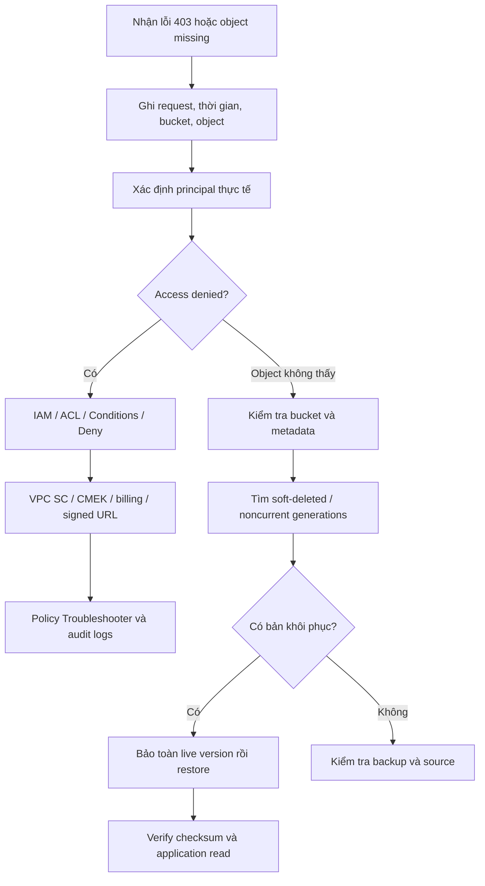

# Điều tra Cloud Storage access denied và dữ liệu bị xóa

Khi ứng dụng Java trên Google Cloud nhận lỗi 403 khi đọc object Cloud Storage, hoặc một file quan trọng biến mất khỏi bucket, đội vận hành phải xác định danh tính request, quyền cần thiết và trạng thái dữ liệu. Cấp thêm quyền rộng cho service account có thể che khuất nguyên nhân; restore vội vàng có thể ghi đè phiên bản đang tồn tại.

Bài học này trình bày quy trình điều tra IAM/ACL, policy chặn, audit logs, Soft Delete, Object Versioning, retention và holds. Nội dung thuộc chương **Vận hành và xử lý sự cố**, module **CLOUD_PROVIDERS_GCP**.

> Chỉ thực thi các lệnh thay đổi quyền, restore hoặc cấu hình bucket trong project sandbox được phê duyệt. Bảo toàn bằng chứng trước khi sửa policy hoặc khôi phục dữ liệu.

## 1. Mục tiêu học tập

- Phân tích 403/404 và xác định principal, resource, permission.
- Phân biệt IAM allow/deny, PAB, IAM Conditions và ACL.
- Kiểm tra UBLA, Public Access Prevention, VPC Service Controls và CMEK.
- Dùng Policy Troubleshooter và Cloud Audit Logs.
- Phân biệt live, noncurrent, soft-deleted và permanently deleted object.
- Khôi phục đúng generation và xác minh checksum.
- Viết runbook incident, backup, retention và least privilege.

## 2. Hai tình huống khác nhau

### 2.1. Ứng dụng nhận 403

Ví dụ:

```text
service-account@project.iam.gserviceaccount.com
does not have storage.objects.get access to the
Google Cloud Storage object.
```

Lỗi cho biết request bị từ chối bởi permission hoặc policy. Nó không chứng minh object đã bị xóa. Có thể principal khác dự kiến, role gán sai bucket, IAM condition hết hạn, deny policy chặn hoặc request vi phạm VPC Service Controls.

### 2.2. Object không còn trong danh sách

Nguyên nhân có thể là object đã bị xóa, overwrite, trở thành noncurrent, soft-deleted, lifecycle tự động xóa, sai project/prefix hoặc caller thiếu storage.objects.list. Bucket cũng có thể đã bị xóa. Không thấy object trong list mặc định chưa đủ để kết luận dữ liệu mất vĩnh viễn.

### 2.3. Luồng điều tra



## 3. Thu thập thông tin

Ghi lại project, bucket, object path, hành động thất bại (GET/LIST/CREATE/DELETE/RESTORE), thời gian UTC, HTTP status, permission trong lỗi, principal, runtime, request ID và generation nếu có. Không đưa access token, signed URL còn hiệu lực hoặc dữ liệu nhạy cảm vào ticket.

### 3.1. Xác nhận project và account

```bash
gcloud config get-value project
gcloud auth list
gcloud config get-value account
```

Đây là danh tính của gcloud CLI, không bảo đảm ứng dụng Cloud Run/GKE/VM dùng cùng account. Kiểm tra service account gắn với runtime, ADC và Workload Identity Federation nếu có.

### 3.2. Kiểm tra bucket và object

```bash
gcloud storage buckets describe gs://BUCKET_NAME
gcloud storage objects describe gs://BUCKET_NAME/OBJECT_NAME
gcloud storage ls gs://BUCKET_NAME/
```

Các lệnh cần permission tương ứng. Nếu metadata query cũng trả 403, ghi permission cụ thể; không coi việc không đọc được metadata là bằng chứng object không tồn tại. Object name phân biệt chữ hoa/thường; kiểm tra case, prefix, slash và URL encoding.

## 4. Permission theo thao tác

| Thao tác | Permission |
|---|---|
| Đọc nội dung/metadata object | storage.objects.get |
| Liệt kê object | storage.objects.list |
| Xem metadata bucket | storage.buckets.get |
| Liệt kê bucket | storage.buckets.list |
| Tạo object | storage.objects.create |
| Xóa object | storage.objects.delete |
| Restore soft-deleted object | storage.objects.restore và storage.objects.create; thêm list/get cần thiết |
| Bulk restore | Có thể cần storage.buckets.restore |

Overwrite object live thường cần create và delete. Một số CLI command thực hiện nhiều API calls; ví dụ bulk delete có thể cần list trước khi xóa.

### 4.1. Role thường gặp

| Role | Sử dụng |
|---|---|
| roles/storage.objectViewer | Đọc và list object |
| roles/storage.objectCreator | Tạo object mới |
| roles/storage.objectUser | Thao tác object theo permission của role |
| roles/storage.objectAdmin | Quản lý object, bao gồm xóa |
| roles/storage.admin | Quản lý bucket và object; rất rộng |

Ưu tiên role hẹp trên bucket cần dùng. Không cấp Storage Admin toàn project chỉ để sửa lỗi download.

## 5. Principal không đúng

Lỗi có thể nêu service account khác với dự kiến do Cloud Run revision mới, GKE service account mapping, VM identity, CI impersonation hoặc ADC. Nếu lỗi ghi Anonymous caller, request có thể không dùng credential mà bạn định dùng. Kiểm tra client config và runtime identity; không in access token.
## 6. IAM allow, Deny, PAB và Conditions

Có allow binding không bảo đảm request được phép. Quyền có thể bị chặn bởi IAM Deny policy, Principal Access Boundary (PAB), IAM Condition không thỏa hoặc group membership không đúng. Kiểm tra policy ở bucket và các cấp cha: project, folder, organization.

Ví dụ condition chỉ cho phép prefix public:

```text
resource.name.startsWith("projects/_/buckets/reports-bucket/objects/public/")
&& request.time < timestamp("2026-12-01T00:00:00Z")
```

Nếu ứng dụng đọc `private/summary.csv`, điều kiện không match. Kiểm tra resource name, request time, tags và membership. Không thêm allow binding rồi kết luận lỗi sẽ biến mất nếu có Deny/PAB.

## 7. IAM và ACL: Uniform Bucket-Level Access

Cloud Storage có hai hệ thống cấp quyền: IAM và ACL. Khi UBLA tắt, chúng hoạt động song song; quyền từ một trong hai hệ thống có thể cấp access. Khi UBLA bật, ACL bị vô hiệu hóa và quyền truy cập chỉ dựa trên IAM.

### 7.1. Kiểm tra UBLA

```bash
gcloud storage buckets describe gs://BUCKET_NAME --format="yaml(iamConfiguration)"
```

Xem `uniformBucketLevelAccess.enabled`. Ứng dụng cũ có thể dựa vào object ACL để chia sẻ file riêng lẻ. Khi bật UBLA, grant chỉ có từ ACL bị thu hồi; API đọc/ghi ACL có thể trả `400 Bad Request`.

**Không bật UBLA trong incident để “sửa IAM”.** Trước khi chuyển bucket hiện hữu, đo ACL usage, kiểm tra object/default ACL, ánh xạ grant quan trọng sang IAM, test consumer và có rollout plan. UBLA không thể tắt sau khi bật liên tục 90 ngày.

### 7.2. Giới hạn Policy Troubleshooter

Policy Troubleshooter phân tích IAM allow, deny và PAB; công cụ không đánh giá quyền ACL và không chẩn đoán VPC Service Controls. Với bucket fine-grained, kiểm tra ACL riêng. Với perimeter violation, dùng VPC Service Controls violation analyzer.
## 8. Policy và cấu hình ngoài IAM

### 8.1. Public Access Prevention

Public Access Prevention ngăn grant công khai qua `allUsers` hoặc `allAuthenticatedUsers`. Nếu website/client cũ dựa vào public object, policy này có thể làm truy cập công khai thất bại.

```bash
gcloud storage buckets describe gs://BUCKET_NAME --format="yaml(publicAccessPrevention)"
```

Không tắt Public Access Prevention để chữa lỗi truy cập riêng tư. Với ứng dụng, dùng IAM service identity hoặc signed URL phù hợp.

### 8.2. Organization Policy

Constraint ở organization/folder/project có thể giới hạn public access, bucket location, cơ chế mã hóa, domain restricted sharing hoặc service usage. Một user có quyền admin ở bucket vẫn có thể bị policy cấp cao hơn hạn chế. Kiểm tra Policy Denied logs và nhờ administrator xem policy ở resource cha.

### 8.3. VPC Service Controls

VPC SC có thể chặn request qua ranh giới service perimeter dù IAM allow đã đúng. Kiểm tra project chứa bucket và project gọi API có thuộc perimeter dự kiến không; ingress/egress policy có cho phép principal, service và nguồn request không; access level, IP và endpoint có phù hợp không.

Nếu lỗi nói request bị tổ chức chặn hoặc có perimeter violation, dùng VPC Service Controls violation analyzer. Thêm Storage Object Viewer không giải quyết vi phạm perimeter.

### 8.4. Requester Pays

Bucket bật Requester Pays có thể yêu cầu request chỉ rõ billing project. Kiểm tra client đã truyền user project/billing project chưa và principal có `serviceusage.services.use` trên project thanh toán hay không. Đây là lỗi billing context, khác lỗi thiếu `storage.objects.get`.

### 8.5. CMEK và Cloud KMS

Nếu object dùng customer-managed encryption key (CMEK), Cloud Storage cần quyền dùng key version. Kiểm tra key version còn ENABLED hay đã DISABLED/DESTROYED; Cloud Storage service agent có `roles/cloudkms.cryptoKeyEncrypterDecrypter` trên key không; key và bucket có location tương thích không; rotation/policy có thay đổi gần thời điểm sự cố không.

Không xóa hoặc disable KMS key trong lúc điều tra. Object có thể vẫn tồn tại nhưng không giải mã được.

### 8.6. Signed URL

Với signed URL, kiểm tra URL còn hiệu lực, HTTP method trùng method đã ký, path/query/signed headers không bị thay đổi, Content-Type khớp và signing identity còn quyền. Signed URL là bearer credential; không ghi URL đầy đủ vào log/ticket.

## 9. Policy Troubleshooter

Công cụ cần ba đầu vào: principal, resource và permission. Trong Console, mở IAM & Admin → Policy Troubleshooter. Nếu error message có Error ID và đường dẫn troubleshoot, ưu tiên dùng Error ID để giữ context request.

Ví dụ kiểm tra service account có quyền đọc object trong bucket:

```bash
gcloud beta policy-intelligence troubleshoot-policy iam //storage.googleapis.com/projects/_/buckets/BUCKET_NAME --principal-email="APP_SA@PROJECT_ID.iam.gserviceaccount.com" --permission="storage.objects.get"
```

Thay principal, bucket và permission bằng giá trị thật. Lệnh cần quyền xem policy ở các cấp liên quan và Policy Troubleshooter API.

Kết quả có thể là Granted, Not granted, Denied hoặc Unknown. Nếu Not granted, xem binding/condition/membership. Nếu Denied, tìm deny policy/PAB. Nếu Unknown, nhờ administrator có quyền đọc policy kiểm tra. Kết quả không thay thế việc kiểm tra ACL, VPC SC, Requester Pays, CMEK hoặc signed URL.

## 10. Cloud Audit Logs: ai đã xóa object?

Cloud Audit Logs giúp trả lời “ai làm gì, khi nào, ở đâu?”:

- **Admin Activity:** thay đổi cấu hình/metadata bucket.
- **Data Access ADMIN_READ:** đọc cấu hình/metadata.
- **Data Access DATA_READ:** đọc dữ liệu object, list object.
- **Data Access DATA_WRITE:** tạo, sửa, xóa, restore object.
- **System Event:** hoạt động do hệ thống Google Cloud thực hiện.

### 10.1. Data Access logs mặc định

Admin Activity logs bật mặc định. **Data Access logs thường tắt mặc định** và cần bật rõ ràng. Thao tác đọc/ghi object, gồm delete, được ghi trong Data Access chứ không phải Admin Activity. Nếu logs chưa bật tại thời điểm sự cố, có thể không có audit record cho hành động xóa.

Một số thao tác do Object Lifecycle Management hoặc Autoclass thực hiện không được ghi như request do user khởi tạo. Không thấy principal trong audit logs không chứng minh object chưa bị xóa.

### 10.2. Bật Data Access audit logs

Trong IAM & Admin → Audit Logs, tìm Cloud Storage và bật `DATA_READ`/`DATA_WRITE` theo chính sách. Việc bật có thể tăng log volume và chi phí. Thực hiện ở phạm vi organization/project được security owner phê duyệt. Bật logs hôm nay không tạo lại lịch sử của tuần trước.

### 10.3. Logs Explorer: tìm delete event

```text
logName="projects/PROJECT_ID/logs/cloudaudit.googleapis.com%2Fdata_access"
protoPayload.serviceName="storage.googleapis.com"
protoPayload.methodName="storage.objects.delete"
resource.type="gcs_bucket"
resource.labels.bucket_name="BUCKET_NAME"
```

Mở log entry và xem `timestamp`, `protoPayload.authenticationInfo.principalEmail`, `protoPayload.methodName`, `protoPayload.resourceName`, `protoPayload.status`, `protoPayload.requestMetadata.callerIp` và user agent nếu có. Một số field có thể bị redacted hoặc không xuất hiện tùy loại request.

### 10.4. Tìm policy denied

```text
logName="projects/PROJECT_ID/logs/cloudaudit.googleapis.com%2Fpolicy"
protoPayload.serviceName="storage.googleapis.com"
protoPayload.status.code=7
resource.labels.bucket_name="BUCKET_NAME"
```

Policy Denied logs có thể cho biết request bị chặn bởi policy. Nếu không có kết quả, vẫn cần kiểm tra lỗi client, IAM, VPC SC và audit configuration.

### 10.5. Lifecycle deletion không có principal

Nếu object bị xóa do lifecycle rule, audit logs không nhất thiết có user gọi `storage.objects.delete`. Kiểm tra lifecycle configuration, điều kiện age/prefix/storage class/version, soft-deleted/noncurrent generations, inventory report, IaC change history và scheduler logs. Sửa rule qua change management và ghi cấu hình trước/sau.
## 11. Kiểm tra cấu hình bảo vệ dữ liệu

```bash
gcloud storage buckets describe gs://BUCKET_NAME --format="yaml(name,location,versioning,softDeletePolicy,retentionPolicy,iamConfiguration,publicAccessPrevention)"
```

Kiểm tra Soft Delete, Versioning, retention policy, lock, holds, lifecycle, UBLA/ACL, Public Access Prevention, IP filtering, CMEK và network policy. Chụp lại cấu hình trước khi thay đổi để làm bằng chứng incident.

## 12. Phân loại trạng thái object

| Trạng thái | Ý nghĩa | Cách tìm/khôi phục |
|---|---|---|
| Live generation | Phiên bản hiện tại | Đọc metadata, tải và verify |
| Noncurrent generation | Phiên bản cũ do overwrite/delete khi versioning bật | Liệt kê all versions, copy/promote theo runbook |
| Soft-deleted object | Đã xóa nhưng còn trong retention | `--soft-deleted`, restore generation |
| Overwritten live object | Object name còn nhưng nội dung sai | Kiểm tra generations/versioning |
| Object held/retained | Không thể xóa/replace trước hạn hoặc khi hold còn | Kiểm tra retention/hold |
| Bucket soft-deleted | Bucket bị xóa trong cửa sổ phục hồi | Restore bucket trước, rồi objects nếu dùng CLI/API |
| Permanently deleted | Hết thời hạn bảo vệ, không còn bản khác | Tìm backup/archive/source |
| Inaccessible | Object còn nhưng principal không đọc được | IAM, policy, network, key |

403 không có nghĩa object bị xóa; 404 cũng không phải bằng chứng đầy đủ rằng object chưa từng tồn tại. Xác minh với principal có quyền phù hợp và kiểm tra generation/history.

## 13. Soft Delete trong Cloud Storage

Soft Delete bảo vệ dữ liệu khi object hoặc bucket bị xóa nhầm hoặc do hành vi độc hại. Khi bật, object/bucket chuyển sang trạng thái soft-deleted trong retention; trong thời gian này không thể đọc/sửa như object live, nhưng có thể liệt kê và khôi phục.

Theo tài liệu Cloud Storage hiện hành tháng 11/2026, Soft Delete bật mặc định cho các bucket hỗ trợ với retention mặc định **7 ngày**; thời hạn có thể cấu hình từ **3 đến 90 ngày**. Bucket có tính năng không tương thích có thể khác. Luôn đọc policy thực tế.

### 13.1. Kiểm tra policy

```bash
gcloud storage buckets describe gs://BUCKET_NAME --format="default(soft_delete_policy)"
```

Không dựa vào giá trị mặc định để kết luận bucket production đang giữ đúng thời hạn.

### 13.2. Liệt kê soft-deleted objects

```bash
gcloud storage ls "gs://BUCKET_NAME/**" --soft-deleted
```

Xem version soft-deleted của một object:

```bash
gcloud storage ls gs://BUCKET_NAME/OBJECT_NAME --soft-deleted
```

Ghi generation, thời điểm xóa, size và metadata có thể lấy được. Soft-deleted objects bị ẩn khỏi list thông thường; không thấy trong list mặc định không có nghĩa chúng không còn.

### 13.3. Restore một object theo generation

Sau khi xác định đúng generation:

```bash
gcloud storage restore gs://BUCKET_NAME/OBJECT_NAME#GENERATION_NUMBER
```

Trong incident production, chỉ định generation rõ ràng để tránh khôi phục nhầm bản cũ.

Restore tạo live copy/generation mới trong cùng bucket. Nếu đã có live object cùng tên, restore có thể ghi đè live version hiện tại; version bị ghi đè sẽ chuyển sang soft-deleted. Trước khi restore, copy/bảo toàn live version hiện có, xác nhận checksum/size/generation cần phục hồi, rồi mới restore và verify.

### 13.4. Bulk restore

```bash
gcloud storage restore "gs://BUCKET_NAME/**" --async --deleted-after-time="2026-11-18T00:00:00Z" --deleted-before-time="2026-11-19T00:00:00Z"
```

Bulk restore là thao tác bất đồng bộ; có thể mất thời gian đáng kể để bắt đầu và hoàn tất. Ghi operation ID, theo dõi trạng thái và kiểm tra kết quả từng prefix/manifest. Không restore toàn bucket khi chỉ cần một nhóm nhỏ.

### 13.5. Bucket bị xóa

Nếu cả bucket bị xóa và còn soft-deleted, restore bucket trước. Console có luồng cho phép restore bucket cùng objects. CLI/JSON API restore bucket có thể chỉ tạo bucket rỗng; cần restore object riêng. Nếu một bucket live mới chiếm cùng tên, có thể phải xử lý xung đột tên trước khi restore bucket cũ.

### 13.6. Giới hạn Soft Delete

Hết retention thì object có thể bị xóa vĩnh viễn. Soft-deleted object không thể đọc trực tiếp hoặc sửa metadata. Restore tạo generation mới. Soft Delete không thay thế backup độc lập và dữ liệu soft-deleted vẫn tạo chi phí lưu trữ.

## 14. Object Versioning và generation

Object Versioning giữ các phiên bản cũ ở trạng thái noncurrent khi object live bị overwrite hoặc xóa. Mỗi version có generation riêng.

```bash
gcloud storage ls --all-versions gs://BUCKET_NAME/OBJECT_NAME
```

Đối chiếu generation, checksum, thời gian tạo và metadata với manifest/backup. Không chọn chỉ dựa trên thời gian gần nhất.

| Tính năng | Object Versioning | Soft Delete |
|---|---|---|
| Bảo vệ chính | Giữ phiên bản cũ thành noncurrent | Giữ object/bucket đã xóa trong cửa sổ phục hồi |
| Trạng thái | Noncurrent generation | Soft-deleted resource |
| Cách tìm | `--all-versions` | `--soft-deleted` |
| Khôi phục | Copy/promote version theo runbook | Restore generation |
| Bảo vệ xóa bucket | Không | Có thể khôi phục bucket trong retention |

Versioning hữu ích giữ lịch sử thay đổi; Soft Delete hữu ích khi xóa nhầm/ác ý. Có thể kết hợp nhưng cần lifecycle và dự toán storage.
## 15. Retention, Bucket Lock và holds

### 15.1. Bucket retention policy

Retention policy ở cấp bucket quy định object phải tồn tại tối thiểu bao lâu trước khi bị xóa hoặc thay thế. Policy áp dụng với object hiện tại và mới theo cấu hình.

### 15.2. Bucket Lock

Khi retention policy được **lock**, thời hạn không thể giảm hoặc gỡ bỏ; có thể tăng. Đây là thao tác không thể đảo ngược. Bucket đã lock không thể xóa cho đến khi mọi object thỏa retention.

Không dùng Bucket Lock để chữa lỗi xóa bị từ chối. Kiểm tra policy và ngày hết hạn trước khi mở incident.

### 15.3. Object Retention Lock

Retention configuration ở cấp object đặt `retain-until time` riêng. Mode locked ngăn giảm hoặc xóa thời hạn retention. Đây là cơ chế cho từng object, khác Bucket Lock áp dụng toàn bucket.

### 15.4. Temporary hold và event-based hold

- **Temporary hold:** ngăn xóa/thay thế cho đến khi được gỡ.
- **Event-based hold:** giữ object đến khi sự kiện liên quan xảy ra; khi gỡ hold, thời gian retention bucket có thể được tính lại.

Không tự gỡ legal hold hoặc event-based hold khi chưa có phê duyệt của owner/legal/compliance.

## 16. Lifecycle Management và object biến mất theo lịch

Lifecycle rule có thể tự động xóa object theo tuổi/ngày tạo, chuyển storage class hoặc xóa noncurrent versions. Nếu dữ liệu biến mất theo lịch, kiểm tra lifecycle policy trước khi kết luận IAM đã xóa:

- Điều kiện age, prefix, storage class và number of newer versions.
- Thời điểm rule được cập nhật.
- Object age/metadata.
- Soft-deleted/noncurrent generations.
- IaC PR/change record.
- Scheduler/application logs.

Cloud Audit Logs không ghi đầy đủ các thao tác do Lifecycle Management thực hiện như request user. Không thấy delete principal không chứng minh lifecycle không xóa.

Nếu cần dừng rule, thay đổi qua change management và lưu cấu hình trước/sau. Không xóa toàn bộ lifecycle config khi chỉ một rule gây lỗi.

## 17. Runbook phục hồi object bị xóa

### 17.1. Bảo toàn hiện trạng

1. Mở incident, chỉ định incident commander.
2. Ghi bucket, object path, project, location và thời gian phát hiện.
3. Dừng/hạn chế writer hoặc job có thể tiếp tục overwrite/xóa theo runbook.
4. Lưu error, audit logs, lifecycle config và change record.
5. Không thay đổi retention, versioning, IAM hoặc CMEK trước khi thu thập bằng chứng.
6. Xác định business owner và mức độ ảnh hưởng.

### 17.2. Xác định generation

- Kiểm tra object live.
- Liệt kê noncurrent versions.
- Liệt kê soft-deleted versions.
- Xem bucket có bị soft-delete không.
- Kiểm tra retention/hold.
- Xác định generation và checksum kỳ vọng.
- Xác minh cửa sổ retention còn hiệu lực.

### 17.3. Restore có kiểm soát

1. Nếu live object cùng tên đang có, copy nó sang quarantine trước.
2. Ghi generation cần phục hồi vào incident record.
3. Dùng restore theo generation cụ thể.
4. Với bulk restore, theo dõi long-running operation.
5. Không thay đổi metadata/ACL khi chưa rõ yêu cầu.
6. Chưa đưa dữ liệu về production cho đến khi verify xong.

### 17.4. Xác minh

- Object tồn tại ở path mong đợi.
- Generation mới và metadata được ghi lại.
- Size và checksum khớp manifest/backup.
- Đọc được bằng service account ứng dụng.
- Consumer đọc thử trong môi trường kiểm soát.
- File format/schema hợp lệ.
- Downstream job không xử lý lặp hoặc tạo side effect sai.
- Data owner xác nhận nội dung đúng.

### 17.5. Khôi phục vận hành

Mở lại writer/scheduler theo thứ tự, theo dõi error/retry, kiểm tra lifecycle rule, ghi root cause và xác nhận backup/retention đã được cải thiện.

## 18. Runbook điều tra 403

```text
INCIDENT: Cloud Storage access denied
BUCKET: [bucket]
OBJECT: [object path]
ACTION: [GET | LIST | CREATE | DELETE | RESTORE]
REQUEST_TIME_UTC: [timestamp]
HTTP_STATUS: [status]
ERROR_PERMISSION: [storage.objects.*]
PRINCIPAL_IN_ERROR: [principal]
CLIENT_RUNTIME: [Cloud Run | GKE | VM | local | CI]

1. Preserve the original error and request metadata.
2. Confirm project, bucket, object path and generation.
3. Confirm the effective principal used by the client.
4. Confirm the exact missing permission.
5. Review bucket IAM, inherited IAM, ACL and UBLA.
6. Check IAM Conditions, Deny and PAB policies.
7. Check VPC Service Controls, Public Access Prevention,
   Requester Pays and CMEK.
8. Use Policy Troubleshooter where supported.
9. Review Policy Denied and Data Access audit logs.
10. Apply the smallest approved policy/configuration fix.
11. Retest the exact operation as the same principal.
12. Record the change and remove temporary access if applicable.
```

### 18.1. Ví dụ lỗi download

Ứng dụng Cloud Run trả 403 với permission `storage.objects.get`:

1. Lấy service account gắn với revision đang phục vụ.
2. Kiểm tra bucket đúng project và object path đúng case/prefix.
3. Kiểm tra role bucket có grant `storage.objects.get`.
4. Kiểm tra IAM Deny/PAB/Condition.
5. Kiểm tra UBLA/ACL và VPC SC.
6. Nếu object dùng CMEK, xác minh key version và service agent.
7. Retest từ đúng runtime identity, không chỉ từ máy developer.

### 18.2. Ví dụ lỗi list

Nếu download object đã biết thành công nhưng list prefix trả 403, principal có thể thiếu `storage.objects.list`. Cấp quyền list chỉ khi workload cần khám phá object; nếu app chỉ đọc path cố định, có thể giữ quyền hẹp.

### 18.3. Ví dụ lỗi upload/overwrite

- Upload object mới cần `storage.objects.create`.
- Overwrite live object có thể cần cả `storage.objects.create` và `storage.objects.delete`.
- Bucket retention policy/hold có thể ngăn replace.
- IAM condition/managed folder có thể giới hạn path.
- CMEK có thể chặn ghi nếu service agent không dùng được key.

Phân biệt upload mới với overwrite trước khi cấp delete permission.

## 19. Thực hành Cloud Shell: kiểm tra quyền

Các bước sau dành cho sandbox. Thay placeholder bằng tài nguyên thử nghiệm.

### 19.1. Biến môi trường

```bash
export PROJECT_ID="YOUR_SANDBOX_PROJECT"
export BUCKET_NAME="YOUR_TEST_BUCKET"
export OBJECT_NAME="reports/demo.txt"
export PRINCIPAL="APP_SA@PROJECT_ID.iam.gserviceaccount.com"

gcloud config set project "$PROJECT_ID"
```

### 19.2. Kiểm tra policy và cấu hình

```bash
gcloud storage buckets describe "gs://$BUCKET_NAME"
gcloud storage buckets get-iam-policy "gs://$BUCKET_NAME" --format=yaml
```

Xác định UBLA, Public Access Prevention, Soft Delete, Versioning, Retention Policy và bucket location.

### 19.3. Kiểm tra metadata và đọc thử

```bash
gcloud storage objects describe "gs://$BUCKET_NAME/$OBJECT_NAME"
gcloud storage cp "gs://$BUCKET_NAME/$OBJECT_NAME" "./current-demo.txt"
```

Nếu command trả 403, ghi permission và principal. Không chuyển sang user admin rồi kết luận service account đã được sửa; phải retest bằng principal gốc.

### 19.4. Policy Troubleshooter

```bash
gcloud beta policy-intelligence troubleshoot-policy iam //storage.googleapis.com/projects/_/buckets/$BUCKET_NAME --principal-email="$PRINCIPAL" --permission="storage.objects.get"
```

Nếu output Not Granted, xem binding/condition/membership. Nếu Denied, tìm deny policy/PAB. Nếu Unknown, nhờ administrator có quyền đọc policy kiểm tra. Công cụ không thay thế phân tích ACL và VPC SC.

## 20. Thực hành restore soft-deleted object

**Chỉ thực hiện trong bucket thử nghiệm riêng.** Không chạy lệnh delete trên object production hoặc bucket dùng chung.

### 20.1. Tạo object

```bash
printf "cloud-storage-recovery-lab\n" > recovery-demo.txt
gcloud storage cp recovery-demo.txt "gs://$BUCKET_NAME/recovery-demo.txt"
gcloud storage objects describe "gs://$BUCKET_NAME/recovery-demo.txt"
```

Ghi generation và checksum từ metadata.

### 20.2. Xóa object thử nghiệm

```bash
gcloud storage rm "gs://$BUCKET_NAME/recovery-demo.txt"
```

Trong bucket Soft Delete bật, object có thể chuyển sang soft-deleted state. Delete thành công không có nghĩa object bị hard-delete ngay.

### 20.3. Liệt kê version soft-deleted

```bash
gcloud storage ls "gs://$BUCKET_NAME/recovery-demo.txt" --soft-deleted
```

Ghi generation number chính xác. Nếu không thấy, kiểm tra policy, retention, bucket/project và khả năng object đã hết hạn.

### 20.4. Restore generation

```bash
gcloud storage restore "gs://$BUCKET_NAME/recovery-demo.txt#GENERATION_NUMBER"
gcloud storage objects describe "gs://$BUCKET_NAME/recovery-demo.txt"
gcloud storage cp "gs://$BUCKET_NAME/recovery-demo.txt" "./restored-recovery-demo.txt"
```

Trên Windows PowerShell, dùng `Get-FileHash .\restored-recovery-demo.txt -Algorithm SHA256`. Trên Cloud Shell/Linux, dùng `sha256sum restored-recovery-demo.txt`. So sánh với hash file gốc.
## 21. Bảo vệ dữ liệu từ trước sự cố

| Cơ chế | Chống lại | Không thay thế |
|---|---|---|
| Least-privilege IAM | Principal thiếu quyền gây xóa/đọc ngoài ý muốn | Backup |
| Soft Delete | Xóa nhầm/ác ý trong retention window | Bản sao độc lập |
| Object Versioning | Overwrite/xóa version hiện tại | Bảo vệ xóa toàn bucket |
| Bucket/Object retention | Xóa trước hạn lưu | Phục hồi dữ liệu sai nội dung |
| Holds | Ngăn xóa/thay thế khi hold còn | Backup |
| Backup/copy project khác | Mất bucket/project hoặc sự cố diện rộng | IAM hygiene |
| Inventory/checksum | Phát hiện thiếu/sai dữ liệu | Tự phục hồi dữ liệu |

### 21.1. Soft Delete policy

Chọn thời hạn dựa trên thời gian phát hiện, escalation, phê duyệt restore, kích thước dataset, thời gian bulk restore, RPO/RTO và chi phí. Bucket dữ liệu tạm có thể phát sinh storage cost tăng khi giữ soft-deleted objects. Không tắt Soft Delete toàn tổ chức chỉ để tiết kiệm.

### 21.2. Versioning và lifecycle

Nếu bật versioning, cần rule xóa noncurrent versions có thời hạn rõ. Không giữ versioning vô hạn mà không dự toán storage. Lifecycle policy phải được review như code, test prefix/age và tránh áp nhầm vào object quan trọng.

### 21.3. Bucket Lock và holds

Dùng Bucket Lock/Object Retention Lock khi compliance yêu cầu immutability. Trước khi lock, legal/compliance owner phải duyệt retention, thử trên bucket test, kiểm tra ngày hết hạn và ảnh hưởng delete/overwrite, lưu change record và hiểu lock có thể không đảo ngược.

### 21.4. Backup độc lập

Với dữ liệu critical:

- Duy trì copy/backup ở bucket hoặc project khác theo kiến trúc được duyệt.
- Giới hạn quyền xóa của workload runtime.
- Tách backup writer và recovery operator.
- Kiểm tra checksum/manifest định kỳ.
- Diễn tập restore trong môi trường cách ly.
- Bảo vệ backup khỏi cùng principal có quyền xóa nguồn.

Replication/copy không tự thay thế backup nếu thao tác xóa được đồng bộ sang bản sao.

## 22. IAM và audit cho ứng dụng Java

### 22.1. Không dùng key JSON cố định

Trên Cloud Run/GKE/Compute Engine, gắn service identity cho workload và dùng ADC. Tránh lưu service account JSON key trong Git, Docker image, ConfigMap, startup script, Cloud Storage hoặc log. Workload Identity Federation for GKE và service account runtime giảm phụ thuộc key tĩnh.

### 22.2. Tách quyền runtime và recovery

Ứng dụng thường chỉ cần đọc hoặc ghi theo use case. Quyền restore, thay đổi bucket policy, xóa bucket và quản lý retention nên thuộc vai trò vận hành riêng, có approval và audit. Một lỗi ứng dụng không nên tự có quyền xóa/khôi phục mọi object.

### 22.3. Log đúng thông tin

Application logs nên ghi bucket/object path (mask nếu nhạy cảm), operation, principal, HTTP status, permission error, correlation ID, generation/precondition, retry count và outcome. Không log signed URL đầy đủ, OAuth token, customer payload hoặc key material.

## 23. Lỗi thường gặp

| Triệu chứng | Nguyên nhân có thể | Hướng điều tra |
|---|---|---|
| 403 `storage.objects.get` | Thiếu read permission | Principal, bucket IAM, deny/condition |
| 403 `storage.objects.list` | Thiếu list permission | Xác định app có cần list không |
| Anonymous caller | Request không dùng credential dự kiến | ADC, service account, client config |
| 403 Account Disabled | Billing chưa bật | Billing/project |
| 403 dù có allow role | Deny/PAB/condition hoặc VPC SC | Policy Troubleshooter/VPC SC analyzer |
| ACL cũ không còn hiệu lực | UBLA bật | IAM mapping và ACL usage |
| Public object không đọc được | Public Access Prevention/org policy | IAM hoặc signed URL |
| CMEK object không đọc được | KMS key/permission/version | Key và Storage service agent |
| Requester Pays error | Thiếu billing project | User project và serviceusage |
| Object không thấy trong list | Thiếu list permission hoặc sai prefix | Principal/path |
| Object bị xóa nhưng còn bản | Soft Delete/Versioning | Liệt kê versions |
| Restore ghi đè dữ liệu mới | Cùng object name đang có live version | Copy live version trước |
| Không restore được | Hết retention hoặc thiếu quyền | Policy, generation, restore permission |
| Delete bị từ chối | Retention/hold/lock | Legal/compliance requirement |
| Không thấy delete audit log | Data Access chưa bật hoặc lifecycle delete | Audit config/lifecycle |
| Bucket bị xóa | Soft-deleted hoặc hard-deleted | Restore bucket/backup |
| Signed URL 403 | Expiry, method, signature, header/path | Tạo URL mới đúng method |
| Upload overwrite 403 | Thiếu create/delete hoặc retention | Operation và object policy |

## 24. Bài thực hành: incident giả lập

**Bối cảnh:** Spring Boot trên Cloud Run tải file từ bucket `finance-reports-lab`. Sau deploy, API trả 403. Cùng thời điểm, `daily/2026-11-18.csv` không còn trong danh sách.

### 24.1. Mục tiêu

- Xác định service account thực tế.
- Tìm permission thiếu hoặc policy chặn.
- Xác minh object còn live, noncurrent hay soft-deleted.
- Restore đúng generation mà không ghi đè phiên bản hiện tại.
- Ghi audit evidence và preventive action.

### 24.2. Các bước

1. Ghi thời gian, request ID, project, bucket, object và error text.
2. Kiểm tra Cloud Run revision/service account đang nhận traffic.
3. Dùng `gcloud auth list` để xác nhận CLI identity riêng.
4. Kiểm tra bucket IAM và Policy Troubleshooter với `storage.objects.get`.
5. Nếu Troubleshooter báo granted, kiểm tra VPC SC, CMEK, Requester Pays và signed URL.
6. Kiểm tra Data Access audit logs cho delete event và xác nhận logs đã bật lúc sự kiện xảy ra.
7. Kiểm tra lifecycle configuration.
8. Liệt kê `--soft-deleted` và `--all-versions`.
9. Chọn generation theo manifest/checksum.
10. Copy live version hiện có vào vùng quarantine nếu trùng object name.
11. Restore generation mục tiêu trong sandbox.
12. Xác minh checksum, generation, service account read và ứng dụng.
13. Cập nhật IAM tối thiểu hoặc sửa lifecycle rule qua review.
14. Viết incident report và kế hoạch diễn tập restore.

### 24.3. Báo cáo lab

```yaml
incident_id: gcs-access-recovery-lab-01
project: YOUR_SANDBOX_PROJECT
bucket: finance-reports-lab
object: daily/2026-11-18.csv
access_denied:
  principal: OBSERVED_PRINCIPAL
  permission: storage.objects.get
  root_cause: IAM_OR_DENY_OR_VPC_SC_OR_KMS
data_recovery:
  object_state_before: SOFT_DELETED_OR_NONCURRENT_OR_LIVE
  restored_generation: OBSERVED_GENERATION
  checksum_verified: true_or_false
  application_read_verified: true_or_false
audit:
  data_access_logs_enabled_at_incident: true_or_false
  delete_actor_identified: true_or_false
prevention:
  least_privilege_reviewed: true_or_false
  recovery_runbook_tested: true_or_false
  lifecycle_reviewed: true_or_false
decision: RESOLVED_OR_ESCALATED
```

Không ghi `delete_actor_identified: true` nếu Data Access audit logs chưa bật và không có bằng chứng khác. Kết luận phải phản ánh đúng mức độ chắc chắn.

## 25. Checklist khi nhận incident Cloud Storage

- [ ] Ghi nguyên văn error, status code, permission và thời gian UTC.
- [ ] Xác định project, bucket, object path và generation.
- [ ] Xác định principal thật của client runtime.
- [ ] Phân biệt CLI account và ADC/workload identity.
- [ ] Kiểm tra IAM allow/deny/PAB và IAM Conditions.
- [ ] Kiểm tra UBLA/ACL và Public Access Prevention.
- [ ] Kiểm tra VPC Service Controls và organization policies.
- [ ] Kiểm tra Requester Pays và billing project.
- [ ] Kiểm tra CMEK key version và Storage service agent.
- [ ] Kiểm tra signed URL method, headers, path và expiry.
- [ ] Xác nhận Data Access audit logs đã bật trước sự kiện.
- [ ] Kiểm tra lifecycle, Object Versioning và Soft Delete.
- [ ] Kiểm tra Bucket Lock, Object Retention Lock và holds.
- [ ] Bảo toàn live generation trước restore.
- [ ] Chọn đúng soft-deleted/noncurrent generation và checksum.
- [ ] Theo dõi bulk restore operation nếu dùng.
- [ ] Xác minh dữ liệu và quyền đọc của ứng dụng.
- [ ] Ghi root cause, owner, corrective action và audit evidence.
- [ ] Diễn tập recovery và cập nhật runbook định kỳ.

## Kết luận

Điều tra Cloud Storage cần tách **quyền truy cập** khỏi **trạng thái dữ liệu**. Lỗi 403 thường đòi hỏi xác định principal, permission và các lớp IAM/ACL, deny, PAB, condition, VPC SC, Requester Pays hoặc CMEK. Object không còn trong danh sách có thể vẫn tồn tại ở noncurrent generation hoặc soft-deleted state; cũng có thể đã bị lifecycle xóa hoặc hết thời hạn phục hồi.

Quy trình an toàn là bảo toàn bằng chứng, xác minh danh tính và cấu hình, dùng Policy Troubleshooter cùng audit logs, tìm generation/soft-delete, bảo toàn live version trước restore và xác minh checksum sau khôi phục. Soft Delete, Object Versioning, retention và holds giải quyết các mục tiêu khác nhau; không tính năng nào thay thế hoàn toàn backup độc lập và diễn tập phục hồi. Kết hợp least privilege, Data Access audit, lifecycle review và runbook có owner sẽ giúp xử lý access denied và mất dữ liệu với rủi ro thấp hơn.

## Tài liệu tham khảo

- [Google Cloud Storage — Troubleshooting](https://docs.cloud.google.com/storage/docs/troubleshooting)
- [Google Cloud Storage — Soft Delete overview](https://docs.cloud.google.com/storage/docs/soft-delete)
- [Google Cloud Storage — Use soft-deleted objects](https://docs.cloud.google.com/storage/docs/use-soft-deleted-objects)
- [Google Cloud CLI — gcloud storage restore](https://docs.cloud.google.com/sdk/gcloud/reference/storage/restore)
- [Google Cloud Storage — Object Versioning](https://docs.cloud.google.com/storage/docs/object-versioning)
- [Google Cloud Storage — Cloud Audit Logs](https://docs.cloud.google.com/storage/docs/audit-logging)
- [Google Cloud Logging — Enable Data Access audit logs](https://docs.cloud.google.com/logging/docs/audit/configure-data-access)
- [Google Cloud Storage — Uniform bucket-level access](https://docs.cloud.google.com/storage/docs/uniform-bucket-level-access)
- [Google Cloud Storage — Bucket Lock](https://docs.cloud.google.com/storage/docs/bucket-lock)
- [Google Cloud Storage — Object Retention Lock](https://docs.cloud.google.com/storage/docs/object-lock)
- [Google Cloud Storage — Object holds](https://docs.cloud.google.com/storage/docs/object-holds)
- [Google Cloud IAM — Troubleshoot IAM permissions](https://docs.cloud.google.com/policy-intelligence/docs/troubleshoot-access)
- [Google Cloud IAM — Troubleshoot IAM-related policies](https://docs.cloud.google.com/iam/docs/troubleshoot-policies)
- [Google Cloud VPC Service Controls — Violation analyzer](https://docs.cloud.google.com/vpc-service-controls/docs/violation-analyzer)


