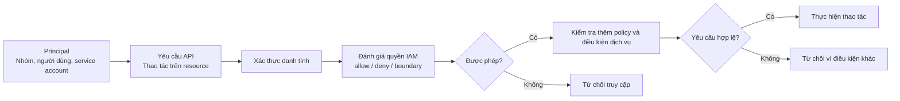
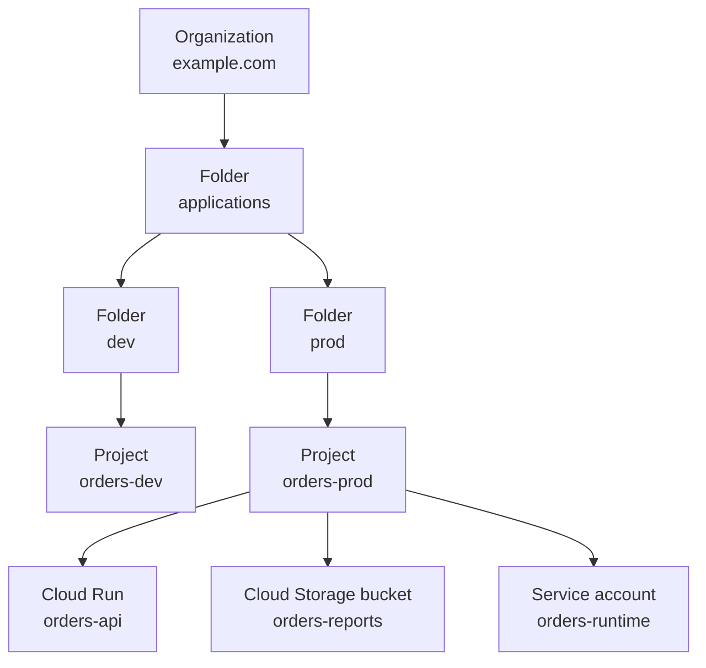
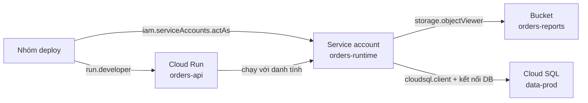

# Principals, IAM policy và resource trong Google Cloud

Trong Google Cloud Platform (GCP), việc một người có thể nhìn thấy project, một pipeline có thể triển khai Cloud Run, hay một service có thể đọc dữ liệu Cloud Storage đều dựa trên mối quan hệ giữa **principal** (chủ thể truy cập), **IAM policy** (chính sách quản lý truy cập) và **resource** (tài nguyên được bảo vệ).

Bài này thuộc chương **IAM và xác thực** của module `CLOUD_PROVIDERS_GCP`. Đây là nền tảng trước khi tổ chức project, VPC, triển khai Compute Engine, GKE, Cloud Run, dùng dịch vụ lưu trữ/cơ sở dữ liệu, tự động hóa phát hành và thiết kế các biện pháp bảo vệ tài nguyên. Hiểu ba thành phần này giúp cấp quyền đúng phạm vi, truy tìm nguyên nhân từ chối truy cập và giảm tác động khi một danh tính bị lộ.

## 1. Mục tiêu

Sau bài học, bạn có thể:

- Giải thích **principal** là gì và phân biệt người dùng, nhóm, service account, danh tính liên kết và principal đặc biệt.
- Nhận diện **resource** cùng đường dẫn Organization → Folder → Project → tài nguyên dịch vụ, đồng thời hiểu nơi có thể gắn IAM policy.
- Đọc một **IAM allow policy**: các `bindings`, `members`, `role`, `condition`, `etag` và `version`.
- Phân biệt **authentication** (xác thực danh tính) với **authorization** (kiểm tra quyền), **permission** với **role**.
- Giải thích quyền kế thừa từ cấp cha, các giới hạn của allow policy và vai trò của IAM deny, Principal Access Boundary.
- Phân tích tình huống Cloud Run, Cloud Storage, Cloud SQL, CI/CD và sử dụng lệnh chỉ đọc để điều tra IAM.

## 2. Bức tranh tổng thể: ai, quyền gì, trên tài nguyên nào?

Một yêu cầu truy cập thường được hiểu qua ba câu hỏi:

1. **Principal là ai?** Ví dụ `alice@example.com`, nhóm `orders-deployers@example.com` hoặc service account chạy một ứng dụng.
2. **Hành động cần permission nào?** Ví dụ đọc thông tin project, cập nhật Cloud Run service hoặc đọc object trong bucket.
3. **Resource nào là đối tượng truy cập?** Ví dụ project `orders-prod`, Cloud Run service `orders-api` hoặc bucket `gs://orders-reports`.

IAM dùng **policy** được gắn vào những resource hỗ trợ để liên kết principal với role. **Role** tập hợp các **permission**; khi principal yêu cầu thực hiện một thao tác, Google Cloud xác định những permission cần thiết và đánh giá các chính sách áp dụng.



Sơ đồ là mô hình khái niệm. Thực tế, thứ tự và cách đánh giá phụ thuộc dịch vụ, cơ chế xác thực, IAM policy và các kiểm soát bổ sung. **Có quyền IAM không bảo đảm mọi cấu hình đều hợp lệ**: API còn có thể bị chặn bởi Organization Policy, quota, mạng hoặc điều kiện của dịch vụ.

## 3. Principal: những danh tính có thể được cấp quyền

**Principal** là một thực thể có thể được xác thực và/hoặc dùng làm đối tượng của quy tắc IAM. Trong **allow policy**, principal thường được khai báo dưới dạng `member` của một binding.

| Loại principal | Biểu diễn thường gặp trong IAM allow policy | Tình huống |
| --- | --- | --- |
| Google Account | `user:alice@example.com` | Cá nhân truy cập Console, CLI hoặc API. |
| Google Group | `group:orders-deployers@example.com` | Tập hợp người dùng được quản lý quyền theo nhóm. |
| Service account | `serviceAccount:orders-runtime@orders-prod.iam.gserviceaccount.com` | Danh tính của Cloud Run, VM, job hoặc quy trình tự động. |
| Domain | `domain:example.com` | Phạm vi người dùng thuộc miền được hỗ trợ; có thể rất rộng. |
| Danh tính từ federation | `principal://...` hoặc `principalSet://...` | Workload hoặc workforce dùng nhà cung cấp danh tính bên ngoài thông qua cơ chế federation. |
| Principal đặc biệt | `allUsers` hoặc `allAuthenticatedUsers` | Truy cập công khai hoặc tập danh tính xác thực rất rộng, khi dịch vụ và chính sách cho phép. |

Các dạng `principal://...` và `principalSet://...` có cú pháp đầy đủ phụ thuộc loại identity pool và selector; không thể thay bằng một email bất kỳ. Khi viết policy thực tế, phải dùng định dạng principal identifier chính xác mà Google Cloud hỗ trợ cho cơ chế đó.

### 3.1. Người dùng và nhóm

Một tài khoản người dùng đại diện cho một cá nhân, nhưng gắn role trực tiếp cho hàng trăm người sẽ khó quản trị. Với một đội triển khai ứng dụng, thường nên cấp quyền cho **Google Group** như `group:orders-deployers@example.com` và quản lý thành viên qua quy trình nhân sự.

Lợi ích:

- Nhân viên mới vào nhóm sẽ nhận quyền theo các binding áp dụng; nhân viên rời nhóm sẽ mất phần quyền xuất phát từ nhóm đó sau khi thay đổi danh tính/nhóm được phản ánh trong hệ thống.
- Có thể rà soát quyền theo **chức năng**: triển khai, vận hành, kiểm toán.
- Hạn chế số binding trực tiếp theo cá nhân và dễ xử lý khi đổi người phụ trách.

Tuy vậy, người dùng vẫn có thể nhận quyền qua **nhiều nguồn**: tài khoản cá nhân, một hoặc nhiều nhóm và binding tại các cấp tổ tiên. Xóa một binding không chắc đã xóa toàn bộ quyền của họ.

### 3.2. Service account: danh tính của workload

**Service account** là một loại danh tính dùng cho ứng dụng hoặc automation, ví dụ:

```text
orders-runtime@orders-prod.iam.gserviceaccount.com
ci-deployer@platform-tools.iam.gserviceaccount.com
```

Service account có hai vai trò cần phân biệt:

1. **Là principal:** nó có thể nhận IAM role để gọi API trên tài nguyên khác, ví dụ đọc một bucket hoặc kết nối Cloud SQL.
2. **Là resource:** bản thân service account là tài nguyên IAM; một principal khác có thể được cấp quyền **dùng/giả mạo danh tính** của nó, hoặc quản lý nó.

Ví dụ, việc cấp `roles/storage.objectViewer` cho `orders-runtime` trên một bucket cho phép workload đọc object trong phạm vi role và resource đó. Điều này **không** đồng nghĩa mọi nhân viên được quyền dùng danh tính `orders-runtime`.

Các permission liên quan service account cũng có ý nghĩa khác nhau:

- `iam.serviceAccounts.actAs`: thường được dùng để **gắn một service account** vào một tài nguyên hoặc workload hỗ trợ.
- Quyền tạo access token (chẳng hạn qua **Service Account Token Creator** khi được cấp phù hợp) cho phép thực hiện các luồng impersonation nhất định.
- Quyền quản lý service account hoặc tạo khóa dài hạn là nhóm quyền khác; nên hạn chế và đánh giá riêng.

Với pipeline CI/CD ngoài Google Cloud, ưu tiên **Workload Identity Federation** khi có thể, thay cho việc lưu một file khóa JSON dài hạn. GKE cũng cung cấp **Workload Identity Federation for GKE** để workload sử dụng IAM mà không phải chia sẻ khóa service account thủ công.

### 3.3. Service agent và tài khoản dịch vụ mặc định

Một số sản phẩm Google Cloud tạo hoặc sử dụng **service agent** riêng để quản lý tài nguyên thay mặt dịch vụ. Đây không phải tài khoản cá nhân hoặc service account tùy ý do ứng dụng sử dụng. Các role service agent thường được thiết kế cho service agent tương ứng; **không nên gán role service agent cho người dùng hoặc workload thông thường**.

Mặt khác, Compute Engine hoặc dịch vụ khác có thể có service account mặc định theo project/tổ chức. Việc tài khoản tồn tại **không có nghĩa nó đang có quyền cần thiết**; phải kiểm tra IAM binding và trạng thái thực tế. Không nên dựa vào giả định mọi service account mặc định đều có quyền Editor.

### 3.4. Principal công khai cần được cân nhắc kỹ

`allUsers` đại diện cho bất kỳ ai, kể cả người chưa xác thực. `allAuthenticatedUsers` là phạm vi danh tính đã xác thực rất rộng, **không giới hạn ở nhân viên công ty**. Các member này chỉ hợp lệ khi loại resource và chính sách tổ chức/dịch vụ cho phép.

Ví dụ Cloud Run public endpoint có thể được cấu hình để cho phép người dùng không cần xác thực IAM gọi dịch vụ; nhưng đó phải là **quyết định xuất bản có chủ đích**, kèm bảo vệ ứng dụng phù hợp. Với bucket lưu báo cáo nội bộ hoặc cơ sở dữ liệu, không dùng principal công khai như một cách sửa nhanh lỗi permission.

## 4. Resource: đối tượng mà quyền được áp dụng

Google Cloud có **resource hierarchy**:



| Cấp/tài nguyên | Vai trò | Ví dụ quyền thường đặt |
| --- | --- | --- |
| **Organization** | Gốc quản trị tài nguyên của tổ chức. | Quyền chỉ dành cho nhóm quản trị tổ chức, kiểm toán được ủy quyền. |
| **Folder** | Phân chia môi trường, phòng ban hoặc sản phẩm. | Role dùng chung cho toàn nhánh `prod` hoặc `dev`. |
| **Project** | Ranh giới quản lý phần lớn tài nguyên dịch vụ. | Role triển khai ứng dụng trên project cụ thể. |
| **Service resource** | Bucket, Cloud Run service, Secret Manager secret, service account và nhiều loại khác. | Role đọc object chỉ trên bucket hoặc quyền dùng một service account xác định. |

**Không phải resource nào cũng hỗ trợ gắn IAM allow policy trực tiếp**, và không phải role nào cũng được cấp tại mọi cấp. Một số quyền cần gắn ở project hoặc resource do dịch vụ chỉ định. Kiểm tra tài liệu IAM của **loại resource cụ thể** trước khi quyết định nơi đặt binding.

Ví dụ Cloud Run service có resource name dạng:

```text
projects/orders-prod/locations/asia-southeast1/services/orders-api
```

Đường dẫn cho biết tên project, region và service. Region xác định nơi triển khai; **resource hierarchy** xác định quan hệ quản lý và phạm vi chính sách. Một service ở hai region khác nhau trong cùng project vẫn có thể nhận các quyền được cấp tại project, nhưng việc kết nối mạng hoặc truy cập dữ liệu ở hai region không tự động giống nhau.

### 4.1. Tài nguyên đích và tài nguyên chứa policy

Giả sử nhóm vận hành được gán role ở Folder `prod`. Khi truy cập Cloud Run service trong project `orders-prod`, policy cấp Folder có thể đóng góp quyền cho yêu cầu. Dù policy không nằm trực tiếp trên Cloud Run service, nó vẫn có phạm vi ảnh hưởng **thông qua tổ tiên**.

Ngược lại, role gắn trên bucket `orders-reports` chỉ áp dụng trong phạm vi bucket theo khả năng của role và chính sách tương ứng; nó không tự cấp quyền đọc mọi bucket khác cùng project.

## 5. IAM permission, role và policy

### 5.1. Permission là thao tác nhỏ nhất được kiểm soát

**IAM permission** thường có tên dạng `service.resource.verb`, ví dụ:

- `run.services.get`: xem thông tin Cloud Run service.
- `run.services.update`: cập nhật Cloud Run service.
- `storage.objects.get`: đọc nội dung hoặc metadata của object trong phạm vi dịch vụ hỗ trợ.
- `resourcemanager.projects.get`: xem thông tin project.

Một API operation có thể cần **nhiều permission** và có thể kiểm tra chúng trên **nhiều resource**. Do đó, chỉ nhìn thấy một permission trong role chưa chắc đủ để thực hiện trọn một quy trình triển khai.

### 5.2. Role nhóm các permission

Một binding thường cấp **role** thay vì cấp trực tiếp từng permission:

| Loại role | Đặc điểm | Khi dùng |
| --- | --- | --- |
| **Basic role** (`roles/owner`, `roles/editor`, `roles/viewer`) | Phạm vi rộng, được tạo cho cách quản trị đơn giản. | Tránh dùng mặc định cho workload hoặc các nhóm có nhiệm vụ hẹp. |
| **Predefined role** | Google Cloud định nghĩa theo chức năng dịch vụ, ví dụ `roles/run.developer` hoặc `roles/storage.objectViewer`. | Ưu tiên khi phù hợp công việc và phạm vi resource. |
| **Custom role** | Tổ chức tự chọn danh sách permission được phép đưa vào custom role. | Khi predefined role quá rộng, và permission cần thiết có thể đưa vào custom role. |

**Nguyên tắc đặc quyền tối thiểu (least privilege):** chỉ cấp permission cần thiết, tại resource thấp nhất đáp ứng nhu cầu và trong thời gian cần dùng. Ví dụ để một nhóm đọc báo cáo trong một bucket, xem xét `roles/storage.objectViewer` tại **bucket đó** thay vì cấp Viewer/Editor trên cả project.

Lưu ý: role chỉ là **tập permission**; **binding của role vào principal trên resource** mới xác định ai nhận quyền ở đâu.

### 5.3. Allow policy có cấu trúc gì?

Đây là **ví dụ minh họa** của IAM allow policy gắn trên project `orders-prod`; các principal, điều kiện và thời điểm được chọn cho mục đích học tập:

```yaml
version: 3
bindings:
  - role: roles/run.developer
    members:
      - group:orders-deployers@example.com
  - role: roles/viewer
    members:
      - group:temporary-auditors@example.com
    condition:
      title: temporary_read_access
      description: Quyen xem co han den thoi diem da phe duyet
      expression: request.time < timestamp("2027-01-01T00:00:00Z")
etag: BwExampleOnly
```

| Trường | Ý nghĩa |
| --- | --- |
| `bindings[]` | Các binding cấp một role cho danh sách member; binding có thể có condition. |
| `role` | Role được cấp, ví dụ `roles/run.developer`. |
| `members[]` | Các principal nhận role theo cú pháp IAM hỗ trợ. |
| `condition` | Biểu thức IAM Conditions; binding chỉ phát huy tác dụng khi điều kiện đúng và ngữ cảnh hỗ trợ. |
| `etag` | Giá trị điều khiển đồng thời (optimistic concurrency) khi cập nhật policy, giúp tránh ghi đè thay đổi của người khác. |
| `version` | Phiên bản định dạng policy; IAM Conditions trong allow policy sử dụng định dạng hỗ trợ version 3. |

**Không dùng `etag: BwExampleOnly` để ghi policy thật.** Khi chỉnh sửa IAM policy bằng API, phải đọc `etag` thực tế rồi gửi lại đúng cách; tránh mô hình read–modify–write ghi đè quyền vừa được người khác cập nhật.

Khi đọc policy, cần phân biệt **nội dung gắn trực tiếp ở resource đang xem** với **quyền hiệu lực** được tính từ resource đó và các cấp tổ tiên.

### 5.4. IAM Conditions không phải cơ chế xác thực

IAM Conditions giới hạn tính hiệu lực của một binding dựa trên các thuộc tính được hỗ trợ, ví dụ thời gian yêu cầu hoặc thuộc tính resource. Trong ví dụ trên, nhóm kiểm toán chỉ hưởng role từ binding khi `request.time` nhỏ hơn thời điểm đã chỉ định.

Điều kiện **không thay thế việc xác thực**. Hệ thống vẫn cần biết principal nào đang gọi API; điều kiện chỉ góp phần quyết định binding có hợp lệ trong ngữ cảnh yêu cầu đó hay không. Không phải mọi thuộc tính đều được hỗ trợ ở mọi dịch vụ hoặc permission; hãy kiểm tra tài liệu IAM Conditions khi thiết kế biểu thức.

## 6. Kế thừa IAM allow từ tài nguyên tổ tiên

Giả sử:

```text
Organization: example.com
└── Folder: workloads
    └── Folder: prod
        ├── Project: orders-prod
        │   ├── Cloud Run service: orders-api
        │   └── Bucket: orders-reports
        └── Project: payments-prod
```

Đặt các binding sau:

| Nơi gắn allow binding | Principal | Role | Phạm vi tác động |
| --- | --- | --- | --- |
| Folder `prod` | `group:prod-observers@example.com` | `roles/viewer` | Quyền được role bao gồm tại các resource tương ứng thuộc hai project trong nhánh `prod`. |
| Project `orders-prod` | `group:orders-deployers@example.com` | `roles/run.developer` | Chỉ trên các resource liên quan trong project `orders-prod`, trừ khi có binding khác. |
| Bucket `orders-reports` | `serviceAccount:orders-runtime@orders-prod.iam.gserviceaccount.com` | `roles/storage.objectViewer` | Quyền đọc object trên bucket được chỉ định. |

Khi một người thuộc nhóm `prod-observers` truy cập `orders-prod`, quyền từ Folder có thể áp dụng dù không xuất hiện trong đầu ra lệnh đọc **policy trực tiếp** của project. Khi nhóm `orders-deployers` được cấp role tại project `orders-prod`, role đó **không tự lan sang** project anh em `payments-prod`.

Những điểm cần ghi nhớ:

1. **Allow có tính cộng dồn:** quyền được cấp từ binding ở tài nguyên và ở những tổ tiên áp dụng đều có thể đóng góp vào quyền hiệu lực.
2. **Binding ở cấp con không gỡ quyền từ cấp cha:** xóa một binding ở project chưa chắc thu hồi được quyền có nguồn từ Folder/Organization.
3. **Điều kiện vẫn có hiệu lực:** binding có IAM Condition chỉ cấp quyền khi biểu thức thỏa mãn.
4. **Chỉ cấp ở cấp cao nếu thật sự muốn cả nhánh nhận quyền:** project mới thêm vào Folder cũng có thể chịu tác động từ binding cấp Folder.

### 6.1. IAM deny và Principal Access Boundary

Một allow binding phù hợp **chưa phải toàn bộ quyết định truy cập**:

- **IAM deny policy:** với permission và principal thuộc quy tắc deny áp dụng, thao tác có thể bị từ chối dù có allow binding. Một số quy tắc có ngoại lệ được cấu hình rõ.
- **Principal Access Boundary (PAB):** giới hạn **tập resource mà principal đủ điều kiện truy cập**, khi cơ chế này được áp dụng cho principal. Nó không tự cấp thêm permission.
- **Organization Policy:** ràng buộc cách tài nguyên được tạo hoặc cấu hình, chẳng hạn vị trí dịch vụ cho những constraint được hỗ trợ. Đây là lớp kiểm soát khác với IAM allow/deny.
- **Điều kiện của dịch vụ:** quyền gọi API không đồng nghĩa đã thỏa mạng, quota, trạng thái tài nguyên hoặc quyền trong database.

Một cách kiểm tra khái niệm:

```text
Có allow binding phù hợp?
    │
    ├─ Không → Không được IAM allow cấp quyền.
    │
    └─ Có
        ├─ Có IAM deny phù hợp? → Có thể bị từ chối.
        ├─ Bị Principal Access Boundary giới hạn? → Có thể bị từ chối.
        └─ Qua các kiểm soát IAM → Vẫn cần thỏa kiểm soát dịch vụ khác.
```

Không nên coi bảng trên là mô tả đầy đủ thứ tự engine đánh giá chính sách. Dùng nó như checklist khi điều tra lỗi.

## 7. Phân biệt authentication và authorization

Hai khái niệm thường gặp trong hướng dẫn IAM:

| Bước | Câu hỏi | Ví dụ |
| --- | --- | --- |
| **Authentication — xác thực** | Yêu cầu này đến từ danh tính nào? | Người dùng đăng nhập `gcloud auth login`; workload có token ngắn hạn qua metadata server hoặc federation. |
| **Authorization — phân quyền** | Danh tính đã xác thực có quyền thực hiện thao tác này trên resource không? | Google Cloud kiểm tra IAM permission cho hành động cập nhật Cloud Run service trong project. |

Xác thực thành công **không đồng nghĩa có quyền**. Ví dụ chạy `gcloud auth login` có thể thành công nhưng `gcloud projects get-iam-policy orders-prod` vẫn bị `PERMISSION_DENIED` nếu danh tính thiếu quyền đọc policy.

Ngược lại, có tên trong allow policy **không tự cấp một phương thức đăng nhập**; principal phải sử dụng cơ chế xác thực phù hợp để gọi dịch vụ. Các token cũng có thời hạn, audience/scope hoặc yêu cầu dịch vụ riêng; IAM policy không sửa những ràng buộc của token.

**Application Default Credentials (ADC)** là cơ chế mà thư viện ứng dụng Google Cloud dùng để tìm credentials tại môi trường chạy. Dùng ADC không tự tạo quyền IAM mới: **danh tính thật sự** mà ADC chọn vẫn phải được cấp quyền cần thiết. Trên máy phát triển, cần phân biệt danh tính đăng nhập CLI và danh tính ứng dụng đang dùng qua ADC.

## 8. Tình huống thực tế: Cloud Run truy cập Cloud Storage và Cloud SQL

Giả sử doanh nghiệp có:

- Project `orders-prod` chứa Cloud Run service `orders-api`.
- Service chạy dưới danh tính `orders-runtime@orders-prod.iam.gserviceaccount.com`.
- Bucket `orders-reports` dùng lưu báo cáo.
- Cloud SQL instance trong project `data-prod`.
- Nhóm `orders-deployers@example.com` triển khai phiên bản mới.

### 8.1. Ba quan hệ quyền khác nhau

| Nhu cầu | Principal | Resource nhận binding | Role/permission minh họa |
| --- | --- | --- | --- |
| Nhóm deploy cập nhật Cloud Run service | `group:orders-deployers@example.com` | Project `orders-prod` hoặc Cloud Run service khi resource/role hỗ trợ | `roles/run.developer` trong phạm vi phù hợp. |
| Nhóm deploy gắn runtime service account cho Cloud Run service | Cùng nhóm deploy | Service account `orders-runtime` | Quyền `iam.serviceAccounts.actAs`, thường qua `roles/iam.serviceAccountUser`. |
| Workload đọc object báo cáo | `serviceAccount:orders-runtime@orders-prod.iam.gserviceaccount.com` | Bucket `orders-reports` | `roles/storage.objectViewer`. |
| Workload kết nối Cloud SQL trong project khác | Runtime service account | Project `data-prod` hoặc phạm vi tài nguyên phù hợp | `roles/cloudsql.client`, cộng với đường kết nối hợp lệ và xác thực database. |

**Phân biệt quyền triển khai và quyền chạy:** người triển khai được phép cập nhật Cloud Run **không có nghĩa** ứng dụng đang chạy với quyền của người đó. Cloud Run gọi API Google Cloud bằng **runtime service account** được gắn cho service. Quyền đọc bucket nên cấp cho runtime service account ở phạm vi bucket, không gán quyền rộng cho cả nhóm deploy.

**Phân biệt Cloud SQL IAM với database authentication:** `roles/cloudsql.client` cung cấp các quyền Cloud SQL cần cho việc kết nối qua cơ chế hỗ trợ; ứng dụng vẫn cần cấu hình mạng/connector phù hợp và phương thức đăng nhập database được hỗ trợ. IAM cho quyền thao tác trên Google Cloud không tự thay thế user/role bên trong PostgreSQL hoặc MySQL.

### 8.2. Sơ đồ luồng truy cập



Nếu Cloud Run gặp lỗi `403` khi tải báo cáo, cần xem **runtime service account đang sử dụng**, bucket đích, binding trực tiếp và inherited, IAM deny/PAB (nếu có), cùng chính sách Cloud Storage. Việc cấp thêm role cho **người deploy** thường không sửa được lỗi truy cập từ ứng dụng.

### 8.3. Pipeline CI/CD sử dụng danh tính bên ngoài

Một GitHub Actions runner có thể dùng **Workload Identity Federation** để đổi danh tính từ nhà cung cấp bên ngoài thành credentials ngắn hạn theo cấu hình tin cậy. Pipeline có thể được ủy quyền để:

1. Truy cập một service account triển khai với quyền được giới hạn.
2. Deploy Cloud Run tại project/region cần thiết.
3. Không giữ private key JSON dài hạn trong hệ thống CI.

Các quyền để workload ngoài Google Cloud dùng hoặc impersonate service account phải được cấp riêng; cấu hình trust trong identity pool phải giới hạn đúng repository, nhánh hoặc thuộc tính nguồn phù hợp. Federation **không tự cấp role deploy** trên toàn organization.

## 9. Thực hành chỉ đọc: lần theo principal, role và resource

Các lệnh sau **chỉ đọc metadata/chính sách**. Thay placeholder bằng thông tin thực tế; tài khoản cần quyền xem IAM policy tương ứng.

```bash
# Allow policy gắn TRỰC TIẾP với project
gcloud projects get-iam-policy PROJECT_ID --format=yaml

# Policy gắn trực tiếp tại Folder và Organization
gcloud resource-manager folders get-iam-policy FOLDER_ID --format=yaml
gcloud organizations get-iam-policy ORG_ID --format=yaml

# IAM policy gắn trực tiếp với service account resource
gcloud iam service-accounts get-iam-policy \
  orders-runtime@orders-prod.iam.gserviceaccount.com \
  --project=orders-prod \
  --format=yaml

# Xem permission của role có sẵn
gcloud iam roles describe roles/run.developer --format=yaml
```

Lưu ý:

- `get-iam-policy` trên project **không tổng hợp toàn bộ binding được kế thừa** từ Folder/Organization.
- IAM policy **của service account resource** trả lời ai có quyền thao tác **đối với service account đó**. Nó không phải danh sách role mà service account nhận trên mọi bucket/project khác.
- `roles/run.developer` có danh sách permission cụ thể; role có thể thay đổi khi Google Cloud cập nhật predefined roles. Kiểm tra trực tiếp role thay vì tự suy luận từ tên role.
- Nếu việc đọc policy thất bại với `PERMISSION_DENIED`, cần kiểm tra quyền xem policy. Không kết luận policy rỗng hay tài nguyên không tồn tại chỉ từ lỗi này.

### 9.1. Quy trình truy tìm lỗi 403/permission denied

1. **Xác định principal thật sự** gửi request: tài khoản CLI, ADC, service account của Cloud Run/VM/GKE, hay principal qua federation?
2. **Đọc resource đích và hành động**: project nào, bucket nào, API method nào, permission nào được báo thiếu?
3. **Lần theo IAM allow binding** từ resource đến Project, Folder, Organization; tính cả thành viên của group và IAM Conditions.
4. **Kiểm tra các hạn chế khác**: IAM deny, PAB, Organization Policy, chính sách theo dịch vụ, quota và cấu hình mạng.
5. **Áp dụng thay đổi nhỏ nhất phù hợp** và chạy lại thao tác. Có thể dùng **Policy Troubleshooter** để phân tích quyền cụ thể khi dịch vụ/công cụ hỗ trợ và bạn có quyền xem dữ liệu cần thiết.

Không phản ứng với mọi lỗi 403 bằng cách cấp `roles/editor` hoặc `roles/owner`: quyền quá rộng làm tăng rủi ro và vẫn không giải quyết những lỗi không thuộc IAM allow.

## 10. Thực hành thiết kế policy theo least privilege

Tình huống: nhóm `orders-deployers` cần deploy ứng dụng, nhóm `prod-observers` chỉ xem tài nguyên sản xuất, còn service `orders-api` chỉ đọc một bucket báo cáo.

Thiết kế gợi ý:

1. Tạo **Google Group** riêng cho deploy và quan sát; quản lý thành viên theo trách nhiệm thực tế.
2. Gắn quyền quan sát ở **Folder `prod`** chỉ khi muốn nhóm quan sát được toàn bộ nhánh; nếu không thì gắn trên project/resource hẹp hơn.
3. Gắn quyền Cloud Run developer ở **project hoặc Cloud Run resource được hỗ trợ** theo đúng phạm vi ứng dụng.
4. Cấp `iam.serviceAccounts.actAs` cho nhóm deploy chỉ trên **runtime service account cần gắn**.
5. Gắn `roles/storage.objectViewer` cho **runtime service account** tại đúng **bucket**.
6. Dùng IAM Conditions, quyền tạm thời và các cơ chế deny/PAB/Organization Policy khi phù hợp; tránh tự đặt những điều kiện chưa được tài nguyên hỗ trợ.
7. Kiểm tra lại bằng danh tính thực tế của nhóm deploy và service; lưu dấu thay đổi để kiểm toán.

Mô hình trên giảm khả năng một nhóm triển khai truy cập dữ liệu không liên quan, giảm quyền có thể bị khai thác khi token workload bị lộ và thuận tiện hơn khi thêm project mới.

## 11. Các nhầm lẫn thường gặp

| Hiểu nhầm | Sự thật |
| --- | --- |
| “Đăng nhập được GCP tức là có quyền truy cập project.” | Xác thực chứng minh danh tính; authorization vẫn phải có IAM permission phù hợp. |
| “Service account chỉ là email, không phải resource.” | Service account vừa có thể làm **principal**, vừa là **resource** mà người khác được cấp quyền thao tác lên. |
| “Gắn role Viewer ở project giúp đọc mọi dữ liệu.” | Scope và permission của role quyết định quyền; không phải dữ liệu/hoạt động nào cũng nằm trong `roles/viewer`. |
| “Không thấy group trong IAM project nghĩa là group không có quyền.” | Binding từ Organization/Folder có thể được kế thừa xuống project. |
| “Role Run Developer tự đủ mọi bước deploy.” | Tùy thao tác, có thể còn cần `iam.serviceAccounts.actAs` và quyền trên các tài nguyên liên quan. |
| “Cloud Run bị 403 thì cấp thêm quyền cho người deploy.” | API tại runtime thường dùng **runtime service account**; cần xác định caller thật. |
| “`allAuthenticatedUsers` chỉ gồm nhân viên đã đăng nhập công ty.” | Đây là tập principal xác thực rất rộng, không mang nghĩa chỉ người trong tổ chức. |
| “IAM allow có quyền nghĩa là lệnh chắc chắn thành công.” | Deny/PAB/Organization Policy/quota/mạng và điều kiện dịch vụ vẫn có thể chặn. |

## 12. Bài tập kiểm tra hiểu biết

Cho hệ thống:

```text
Organization
└── Folder: prod
    ├── Project: orders-prod
    │   ├── Cloud Run: orders-api
    │   ├── Bucket: orders-reports
    │   └── Service Account: orders-runtime
    └── Project: payments-prod
```

Các binding được cấu hình:

- Folder `prod`: `group:prod-readers@example.com` có `roles/viewer`.
- Project `orders-prod`: `group:orders-deployers@example.com` có `roles/run.developer`.
- Bucket `orders-reports`: service account `orders-runtime` có `roles/storage.objectViewer`.

**Câu hỏi**

1. Nhóm `prod-readers` có thể nhận quyền xem các tài nguyên được role hỗ trợ ở `payments-prod` dù policy tại project đó không liệt kê nhóm không?
2. Nhóm `orders-deployers` có tự động quản lý Cloud Run ở `payments-prod` không?
3. Nếu Cloud Run `orders-api` không đọc được object trong bucket, principal đầu tiên cần kiểm tra là ai?
4. Có `roles/run.developer` thì nhóm deploy chắc chắn có thể gắn bất kỳ runtime service account nào cho Cloud Run không?
5. Một người thuộc nhóm `prod-readers` đã bị xóa khỏi IAM project nhưng vẫn xem được tài nguyên. Nên kiểm tra điều gì?
6. Cấp `roles/storage.objectViewer` trên bucket cho `orders-runtime` có đồng nghĩa người deploy được đọc bucket bằng tài khoản cá nhân không?

**Gợi ý đáp án**

1. **Có thể.** Allow binding ở Folder `prod` được áp dụng xuống các project con, miễn permission thuộc role và không bị điều kiện hoặc chính sách khác chặn.
2. **Không.** Binding tại `orders-prod` không tự lan sang project anh em.
3. Kiểm tra **runtime service account** thực sự gắn với Cloud Run; sau đó xem role/binding bucket, IAM deny/PAB, điều kiện, API và resource đích.
4. **Không.** Gắn service account thường cần thêm `iam.serviceAccounts.actAs` trên service account đích và các điều kiện khác của dịch vụ.
5. Kiểm tra **binding tại Folder/Organization** và membership của các group khác; xóa role tại project không xóa quyền kế thừa.
6. **Không.** Quyền của service account và quyền của tài khoản người triển khai là hai danh tính độc lập.

## 13. Ghi nhớ để vận hành an toàn

- **Principal = ai**, **permission/role = được làm gì**, **resource = trên đối tượng nào**, và **IAM policy = mối liên kết được khai báo giữa chúng**.
- **Authentication** nhận diện caller; **authorization** đánh giá caller có permission cần thiết trên resource hay không.
- Ưu tiên **Google Group cho con người**, **service account/federation cho workload** và **quyền hẹp nhất** cho công việc.
- **Allow binding có thể kế thừa** từ Organization/Folder/Project; binding ở cấp con không tự gỡ quyền cấp cha.
- **Service account vừa là principal vừa là resource**. Quyền sử dụng/impersonate service account và quyền mà service account nhận là **hai luồng chính sách khác nhau**.
- Luôn kiểm tra **IAM deny, PAB, IAM Conditions và kiểm soát dịch vụ** khi quyền allow có vẻ đúng mà request vẫn thất bại.
- Khi vận hành Compute Engine, GKE, Cloud Run, Storage và Cloud SQL, hãy theo dõi danh tính thực sự được workload sử dụng, đúng resource đích và các quyền ở cả thời điểm deploy lẫn runtime.

### Tài liệu tham khảo

- [Google Cloud IAM overview](https://cloud.google.com/iam/docs/overview)
- [Principal identifiers](https://cloud.google.com/iam/docs/principal-identifiers)
- [Allow policy structure](https://cloud.google.com/iam/docs/policies)
- [IAM roles and permissions](https://cloud.google.com/iam/docs/understanding-roles)
- [Resource hierarchy access control](https://cloud.google.com/iam/docs/resource-hierarchy-access-control)
- [IAM Conditions](https://cloud.google.com/iam/docs/conditions-overview)
- [Service accounts overview](https://cloud.google.com/iam/docs/service-account-overview)
- [Workload Identity Federation](https://cloud.google.com/iam/docs/workload-identity-federation)
