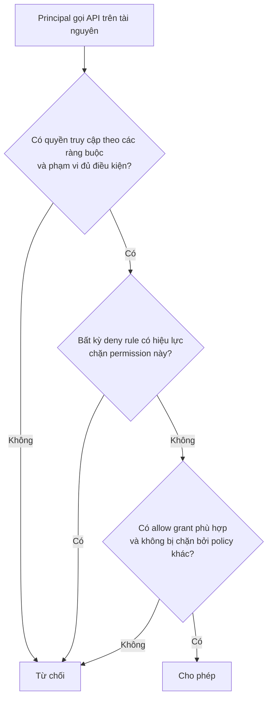
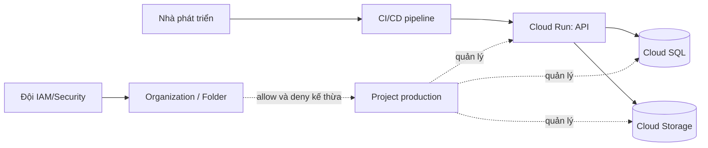

# IAM deny policies và giới hạn quyền truy cập

## 1. Khi đã cấp quyền nhưng vẫn cần chặn một hành động

Trong Google Cloud, **Identity and Access Management (IAM)** xác định **ai** có thể thực hiện **hành động nào** trên **tài nguyên nào**. Cách thường gặp là cấp một role (vai trò) thông qua **allow policy**. Tuy nhiên, tổ chức đôi khi muốn giữ quyền thao tác rộng cho đội vận hành nhưng vẫn **cấm một số hành động có rủi ro cao**, ví dụ:

- Không cho nhóm phát triển tạo khóa dài hạn cho service account ở production.
- Chỉ nhóm quản trị được xóa project hoặc sửa IAM của môi trường quan trọng.
- Chặn xóa một loại tài nguyên nhạy cảm dù người dùng đã được cấp role ở Folder hoặc Organization.
- Áp dụng hạn chế theo nhãn quản trị **Resource Manager tags**, chẳng hạn chỉ chặn thao tác trên project được đánh dấu `env=prod`.

**IAM deny policy** tạo ra các quy tắc cấm sử dụng những IAM permission cụ thể. Nếu một quy tắc deny phù hợp, **permission bị chặn dù role allow đã cấp quyền đó**. Đây là một công cụ để tạo rào chắn bảo mật (guardrail) trên kiến trúc Google Cloud.

Trong module **CLOUD_PROVIDERS_GCP**, khái niệm này liên hệ trực tiếp đến quản trị **Organization/Folder/Project**, bảo vệ **IAM và VPC**, vận hành **Compute Engine, GKE, Cloud Run, Cloud SQL**, triển khai **CI/CD** và hạn chế tác động của sai sót vận hành.

Sau bài học, bạn sẽ biết:

1. Phân biệt **authentication**, **allow**, **deny**, **Principal Access Boundary (PAB)** và các cơ chế hạn chế khác.
2. Giải thích **phạm vi kế thừa**, thứ tự quyết định quyền hiệu lực và tác dụng của ngoại lệ.
3. Đọc và thiết kế **deny rule** gồm principal, permission và điều kiện theo tags.
4. Hiểu cách tạo, liệt kê, kiểm tra và cập nhật deny policies bằng Google Cloud Console và `gcloud`.
5. Nhận biết các nguy cơ khóa nhầm quyền, ảnh hưởng service agents, sự chậm trễ khi policy lan truyền và cách xử lý.

> **Phạm vi:** Bài tập trình bày mẫu policy và lệnh quản trị để học và review. Chỉ áp dụng thay đổi thực tế sau khi đã xác định rõ người phê duyệt, tài khoản khôi phục, phạm vi tác động và quyền cần thiết. Những chuỗi project, email, tag và organization ID trong ví dụ đều là **giả định**.

## 2. Những khái niệm nền tảng

### 2.1. Authentication khác authorization

**Authentication (xác thực)** cho biết yêu cầu đến từ danh tính nào. Ví dụ, nhân viên đăng nhập bằng Cloud Identity/Google Workspace, hoặc Cloud Run sử dụng service account.

**Authorization (phân quyền)** xác định danh tính đó được thực hiện thao tác nào. Ví dụ, một service account có thể được phép đọc Secret Manager nhưng không được sửa IAM của project.

Đăng nhập thành công bằng `gcloud auth login` hoặc nhận được access token **không bảo đảm** được phép truy cập tài nguyên. IAM và những ràng buộc khác vẫn được đánh giá khi API được gọi.

### 2.2. Principal, role, permission, resource

| Thành phần | Ý nghĩa | Ví dụ minh họa |
| --- | --- | --- |
| **Principal** | Danh tính người dùng, nhóm, service account hoặc tập principal | `alice@example.com`, nhóm `platform@example.com` |
| **Role** | Tập hợp các IAM permission được định nghĩa sẵn hoặc tùy chỉnh | `roles/iam.serviceAccountKeyAdmin` |
| **Permission** | Hành động cụ thể mà API yêu cầu | `iam.serviceAccountKeys.create` ở dạng IAM v1 |
| **Resource** | Đối tượng được bảo vệ | Project, service account, VM, bucket, database |
| **Allow policy** | Liên kết principal với role trên một phạm vi tài nguyên | Nhóm platform được cấp role quản trị khóa service account |
| **Deny policy** | Định nghĩa principal không được dùng các permission nhất định | Cấm nhóm platform tạo khóa service account trong project prod |

Vai trò thường được cấp bằng allow policy ở một tài nguyên và **kế thừa xuống con**. Deny policy cũng được áp dụng trong hệ thống phân cấp nhưng được quản lý riêng qua **IAM v2 API**.

## 3. Deny policy được đánh giá như thế nào?

Khi một principal gọi API, hệ thống xác định permission cần thiết, xét các policy liên quan và trả quyết định. Có thể hình dung theo sơ đồ tư duy:



Sơ đồ là **mô hình giải thích**, không phải trình tự xử lý tuần tự chính xác bên trong IAM. IAM xem xét các loại policy liên quan khi quyết định; **một allow grant không thể vô hiệu hóa deny rule đang có hiệu lực**. Các chính sách khác, ví dụ Principal Access Boundary, có thể tiếp tục hạn chế truy cập.

| Allow có permission? | Deny rule hiệu lực chặn permission? | Kết quả xét riêng allow + deny |
| --- | --- | --- |
| Không | Không | **Không được phép**, vì chưa có grant |
| Có | Không | Có thể được phép, nếu các ràng buộc khác cho phép |
| Có | Có | **Bị từ chối** |
| Không | Có | **Bị từ chối** |

Ví dụ, nhóm `platform@example.com` được cấp `roles/iam.serviceAccountKeyAdmin` ở Folder. Nếu deny policy trên project production chặn `iam.googleapis.com/serviceAccountKeys.create` cho nhóm này, họ **không tạo được khóa service account** trong project production, dù role được kế thừa từ Folder.

### Phạm vi kế thừa

Google Cloud Resource Manager tổ chức tài nguyên theo:

```text
Organization
└── Folder: Engineering
    ├── Project: acme-dev-001
    │   └── Tài nguyên dịch vụ
    └── Project: acme-prod-001
        ├── Service accounts
        ├── Compute Engine / GKE / Cloud Run
        └── Cloud SQL / Cloud Storage / dịch vụ khác
```

Deny policy được **gắn vào (attached)** **Organization**, **Folder** hoặc **Project**. Nó áp dụng lên tài nguyên gắn policy và các tài nguyên **hậu duệ** trong phạm vi đó. Deny gắn ở Organization có thể ảnh hưởng hàng loạt project; deny tại project chỉ ảnh hưởng tài nguyên thuộc project đó.

Một deny policy ở cấp con **không thể làm vô hiệu** deny đang có hiệu lực ở cấp cha. Tương tự, cấp thêm role ở project không thể “phá” một deny rule được kế thừa từ Folder hoặc Organization. Các deny policy ở nhiều cấp được xét cùng nhau; cần rà soát **toàn bộ chuỗi tổ tiên** khi phân tích một lỗi quyền.

## 4. Cấu trúc của IAM deny policy

Một deny policy gồm metadata và một hay nhiều deny rule. Những trường thường gặp:

| Trường | Vai trò | Ghi chú |
| --- | --- | --- |
| `displayName` | Tên mô tả dễ đọc | Ví dụ “Chặn tạo service account key ở production” |
| `rules[]` | Danh sách các quy tắc | Mỗi policy cần ít nhất một deny rule |
| `denyRule.deniedPrincipals` | Các principal chịu tác động | Có thể là người dùng, service account, nhóm hoặc principal set được hỗ trợ |
| `denyRule.exceptionPrincipals` | Principal được **loại trừ khỏi quy tắc deny này** | **Không tự cấp quyền allow** và không loại trừ deny của policy khác |
| `denyRule.deniedPermissions` | Các permission bị chặn | Phải thuộc danh sách hỗ trợ cho deny policy, dùng định dạng IAM v2 |
| `denyRule.exceptionPermissions` | Permission được loại trừ khỏi quy tắc này | Hữu ích khi dùng nhóm permission rộng |
| `denyRule.denialCondition` | Điều kiện để deny rule có hiệu lực | Chỉ hỗ trợ điều kiện dựa trên **resource tags** |
| `etag` | Mã phiên bản policy | Dùng khi cập nhật để phát hiện chỉnh sửa đồng thời |
| `name`, `uid`, `kind` | Định danh và loại policy | IAM quản lý metadata khi tạo policy |

### 4.1. Permission dùng định dạng IAM v2

Khi xem role và allow policy, ta thường thấy tên permission dạng `iam.serviceAccountKeys.create`. Deny policy sử dụng dạng **tên dịch vụ đầy đủ** (fully qualified domain name):

```text
IAM v1: iam.serviceAccountKeys.create
IAM v2: iam.googleapis.com/serviceAccountKeys.create

IAM v1: resourcemanager.projects.delete
IAM v2: cloudresourcemanager.googleapis.com/projects.delete
```

Không thay dấu chấm thành dấu gạch chéo một cách máy móc: một số permission có quy tắc tên đặc biệt. Hãy kiểm tra **[Permissions supported in deny policies](https://cloud.google.com/iam/docs/deny-permissions-support)**. **Không phải mọi IAM permission đều có thể dùng trong deny policy.**

### 4.2. Các dạng principal

Ví dụ những principal identifier trong deny policy:

```text
principal://goog/subject/alice@example.com
principalSet://goog/group/platform@example.com
principalSet://goog/public:all
```

Định danh chính xác phụ thuộc loại principal (Google user, Google group, service account, Workforce/Workload Identity Federation…). Ví dụ `principalSet://goog/public:all` đại diện một tập principal rất rộng; **không nên sử dụng mặc định trong mọi policy**.

Trong nhiều bối cảnh, principal set rộng **bao gồm cả service agents** mà sản phẩm Google Cloud dùng để hoạt động. Nếu thực sự cần chặn diện rộng, phải đánh giá và thêm ngoại lệ phù hợp cho service agents theo hướng dẫn của Google Cloud. Chặn nhầm service agents có thể làm các thành phần như GKE, Cloud Run hoặc dịch vụ quản lý khác ngừng hoạt động.

**Quan trọng về ngoại lệ:** `exceptionPrincipals` chỉ nói rằng principal **không bị chặn bởi deny rule này**. Nó **không** tự cấp role, không bỏ qua PAB và không đảm bảo tránh được deny rule khác.

### 4.3. Permission groups

Một số nhóm permission cho phép dùng ký tự `*` theo **mẫu được Google Cloud hỗ trợ**, ví dụ các dạng `SERVICE_FQDN/RESOURCE.*` hoặc `SERVICE_FQDN/*.*` nếu nhóm tương ứng được công bố trong danh sách hỗ trợ.

Nhóm permission giúp quản lý nhiều hành động cùng loại, kể cả các permission tương lai phù hợp mẫu. Nhưng đây cũng là rủi ro: một permission mới được bổ sung có thể tự động bị chặn. **Không được dùng wildcard tùy ý** trong mọi tên permission; chỉ sử dụng những nhóm được liệt kê chính thức và dự báo tác động trước khi áp dụng.

## 5. Ví dụ thực tế: chặn tạo service account key ở production

Giả sử:

- Nhóm `platform@example.com` quản lý vận hành dev, test, production và đã có một số role IAM ở cấp Folder.
- Nhóm `security-admins@example.com` là **tập con** của nhóm platform và chịu trách nhiệm ngoại lệ đã phê duyệt.
- Project `acme-prod-001` chứa các workload production như Cloud Run, GKE và Compute Engine.
- Tổ chức muốn **cấm nhóm platform tạo khóa service account trong project production**, trừ nhóm security-admins. Việc tạo khóa ở các project khác không nằm trong phạm vi deny policy của ví dụ.

### 5.1. Mẫu policy JSON

Nội dung minh họa sau có thể dùng làm bản thiết kế `deny-policy.json` cho môi trường thử nghiệm đã được phê duyệt:

```json
{
  "displayName": "Giới hạn tạo khóa service account ở production",
  "rules": [
    {
      "denyRule": {
        "deniedPrincipals": [
          "principalSet://goog/group/platform@example.com"
        ],
        "exceptionPrincipals": [
          "principalSet://goog/group/security-admins@example.com"
        ],
        "deniedPermissions": [
          "iam.googleapis.com/serviceAccountKeys.create"
        ]
      }
    }
  ]
}
```

Ý nghĩa:

1. Một thành viên platform bình thường **không được tạo khóa mới** cho service account nằm trong phạm vi tài nguyên của project production.
2. Thành viên security-admins (đồng thời thuộc platform) **được loại trừ khỏi deny rule này**, nhưng vẫn cần role allow có `iam.serviceAccountKeys.create` mới thực hiện được.
3. Policy **không thu hồi khóa đã tồn tại**, không tự cấm dùng khóa đã tạo, không tự chặn hành động xóa khóa và không cấm tạo khóa ngoài project này.
4. Những principal **không nằm trong nhóm platform** không bị chặn bởi deny rule này; tổ chức phải xét nhu cầu bảo vệ rộng hơn và các ràng buộc khác.

Nếu yêu cầu bảo mật là **cấm tất cả việc tạo service account key**, quản trị viên có thể cân nhắc cả Organization Policy constraint liên quan đến tạo khóa thay vì chỉ dựa vào một deny rule cho nhóm cụ thể.

### 5.2. Chọn đúng attachment point

Với ví dụ này, attachment point là:

```text
cloudresourcemanager.googleapis.com/projects/acme-prod-001
```

Đây là project giả định, không phải tên hiển thị của folder hoặc billing account. Deny policy chỉ được gắn ở **Organization, Folder hoặc Project**, không gắn trực tiếp như một allow policy lên mọi tài nguyên riêng lẻ.

### 5.3. Cú pháp tạo policy bằng gcloud

Lệnh sau là **ví dụ quản trị làm thay đổi quyền**, **không phải lệnh để chạy mặc định trên production**. Chỉ dùng sau khi đã kiểm tra JSON, danh sách principal, ngoại lệ, quyền quản trị và có phê duyệt thích hợp:

```bash
gcloud iam policies create block-sa-key-creation \
  --attachment-point=cloudresourcemanager.googleapis.com/projects/acme-prod-001 \
  --kind=denypolicies \
  --policy-file=deny-policy.json
```

Nếu dùng **PowerShell** trên Windows, nhập lệnh trên **một dòng**, hoặc sử dụng cú pháp tiếp dòng phù hợp PowerShell:

```powershell
gcloud iam policies create block-sa-key-creation --attachment-point=cloudresourcemanager.googleapis.com/projects/acme-prod-001 --kind=denypolicies --policy-file=deny-policy.json
```

Lệnh dùng `--kind=denypolicies` để phân biệt với loại IAM policy khác. Bạn cần quyền quản lý deny policy, không chỉ role quản lý tài nguyên của một workload.

### 5.4. Lệnh chỉ đọc để xem và kiểm tra

Sau khi chính sách đã được tạo bởi người có thẩm quyền:

```bash
# Liệt kê deny policies được gắn trực tiếp vào project
gcloud iam policies list \
  --attachment-point=cloudresourcemanager.googleapis.com/projects/acme-prod-001 \
  --kind=denypolicies \
  --format=json

# Đọc một deny policy cụ thể
gcloud iam policies get block-sa-key-creation \
  --attachment-point=cloudresourcemanager.googleapis.com/projects/acme-prod-001 \
  --kind=denypolicies \
  --format=json
```

**Cần chú ý:** Liệt kê deny policies được gắn **trực tiếp** ở project **không đảm bảo** đã nhìn thấy các deny policies **kế thừa từ Folder/Organization**. Khi điều tra quyền, phải kiểm tra cả đường tổ tiên.

## 6. Denial condition: hạn chế theo Resource Manager tags

Đôi khi chính sách chỉ nên áp dụng cho **project production**, nhưng quản trị muốn đặt policy ở **Organization** để quản lý tập trung. Khi đó có thể dùng **denial condition** dựa trên **resource tags**.

Ví dụ: không cho nhóm `developers@example.com` xóa project được gắn tag `env=prod`:

```json
{
  "displayName": "Chặn nhóm phát triển xóa project production",
  "rules": [
    {
      "denyRule": {
        "deniedPrincipals": [
          "principalSet://goog/group/developers@example.com"
        ],
        "deniedPermissions": [
          "cloudresourcemanager.googleapis.com/projects.delete"
        ],
        "denialCondition": {
          "title": "Chỉ áp dụng cho môi trường production",
          "expression": "resource.matchTag('123456789012/env', 'prod')"
        }
      }
    }
  ]
}
```

Ở đây `123456789012` là **organization ID giả định** thuộc namespaced name của tag key; phải thay bằng tag thực tế. Chính sách cần gắn ở cấp **Organization** hoặc một phạm vi tổ tiên phù hợp để bao phủ các project cần bảo vệ. Để bảo vệ project production một cách có chủ đích, người quản trị phải đảm bảo các project production **thực sự có tag phù hợp** và quy trình quản lý tag không thể bị người dùng ngoài ý muốn sửa đổi.

### Kết quả khi đánh giá điều kiện

| Kết quả của `denialCondition` | Deny rule có hiệu lực? | Hệ quả |
| --- | --- | --- |
| `true` | **Có** | Principal bị cấm dùng permission nêu trong rule |
| `false` | **Không** | Rule này không chặn; vẫn cần có allow và không bị policy khác chặn |
| Không thể đánh giá | **Có** | Mặc định nghiêng về từ chối truy cập để tránh bỏ qua guardrail |

Điều kiện deny dùng **Common Expression Language (CEL)**, nhưng **chỉ cho phép nhóm hàm điều kiện về resource tags** được hỗ trợ. Không tùy ý thay bằng kiểm tra thời gian, IP, tên tài nguyên hay biểu thức bất kỳ vốn có thể xuất hiện trong **IAM Conditions cho allow policies**.

**Resource Manager tags khác labels:** tags được dùng làm điều kiện truy cập và có cơ chế quản trị riêng; thông thường **labels** để phân loại và báo cáo chi phí không phải nguồn dữ liệu cho `resource.matchTag(...)`.

## 7. Giới hạn và lưu ý quan trọng của deny policies

### 7.1. Không phải permission nào cũng có thể deny

Deny policies chỉ chặn những permission nằm trong **danh sách được hỗ trợ**. Vì vậy, không nên viết policy bằng cách lấy một role, rồi tự giả định mọi permission trong role có thể đưa vào `deniedPermissions`. Hãy tìm đúng permission v2, xác định resource chịu tác động và kiểm tra tính hỗ trợ.

### 7.2. Giới hạn số policy/rule

Theo tài liệu Google Cloud hiện hành, một Organization, Folder hoặc Project có thể gắn **tối đa 500 deny policies**, với **tổng cộng tối đa 500 deny rules** trên các deny policies **gắn vào chính tài nguyên đó**. Số liệu quota/limit có thể thay đổi theo thời điểm; trước thiết kế quy mô lớn, kiểm tra lại tài liệu chính thức.

Số lượng lớn policy không nhất thiết tạo bảo mật tốt hơn. Nhóm quản trị nên gom các quy tắc theo mục tiêu rõ ràng, mô tả owner, phạm vi và đối tượng ngoại lệ để dễ audit và thay đổi.

### 7.3. Quy tắc kế thừa và nhiều policy

Nếu một principal phù hợp với **một deny rule đang có hiệu lực** trong các chính sách liên quan, việc gán thêm role tại tài nguyên con không đủ để cho phép hành động. Ngoại lệ của deny rule A **không tự loại trừ** tác động của deny rule B.

Ví dụ:

- Organization deny quyền xóa project cho mọi thành viên nhóm A.
- Project có allow role `roles/resourcemanager.projectDeleter` cho người dùng X thuộc A.
- Kết quả: X **vẫn không xóa được project**, trừ khi deny ở Organization được thay đổi sao cho X không còn bị rule đó chặn; nếu có deny khác, vẫn phải xét thêm.

### 7.4. Service agents và tài khoản cứu hộ

Deny diện rộng như `principalSet://goog/public:all` có thể chặn **service agents**, làm gián đoạn các dịch vụ được quản lý. Google Cloud khuyến nghị cân nhắc ngoại lệ cho các service agent principal sets phù hợp khi deny principal set rộng. Đừng mặc định mỗi service agent có quyền như một người vận hành, và cũng đừng thêm ngoại lệ quá rộng khi chưa kiểm tra nhu cầu nghiệp vụ.

Cần bảo đảm tổ chức có **đường quản trị và khôi phục được kiểm soát** để sửa policy sai. Việc gỡ một allow role hoặc cấp thêm Owner cho tài khoản khác không thể tự giải quyết một deny có hiệu lực nếu các quyền cần thiết vẫn bị deny.

### 7.5. Policy lan truyền không tức thời

Thay đổi deny policy có tính **eventual consistency**. Google Cloud cho biết trong trường hợp thông thường thay đổi có hiệu lực trong khoảng **2 phút**, nhưng đôi khi có thể cần **7 phút hoặc lâu hơn**. Khi kiểm thử, không kết luận policy thất bại chỉ dựa trên một API call thực hiện ngay sau lúc tạo.

### 7.6. Cập nhật cần quản lý phiên bản

`etag` là thông tin phiên bản giúp tránh ghi đè cập nhật đồng thời. Khi thay đổi deny policy:

1. Đọc bản policy hiện tại và ghi lại etag.
2. Xem các rule, ngoại lệ và điều kiện hiện có; xác định tác động tới chính sách kế thừa.
3. Chuẩn bị bản JSON mới, giữ metadata và etag theo yêu cầu của thao tác cập nhật.
4. Cập nhật bằng lệnh quản trị có kiểm soát, sau đó đọc lại kết quả và xác minh quyền thực tế.

Ví dụ cú pháp cập nhật (không thực thi trong bài học):

```bash
gcloud iam policies update block-sa-key-creation \
  --attachment-point=cloudresourcemanager.googleapis.com/projects/acme-prod-001 \
  --kind=denypolicies \
  --policy-file=deny-policy-updated.json
```

Khi cập nhật policy, thay đổi một rule có thể tác động rộng tới hệ thống; nên áp dụng theo quy trình duyệt thay đổi và quan sát kết quả.

## 8. So sánh deny với các cơ chế giới hạn truy cập khác

Google Cloud có nhiều lớp kiểm soát. Dùng đúng công cụ giúp chính sách rõ ràng và tránh tạo những deny rules quá rộng.

| Công cụ | Trả lời câu hỏi | Thường dùng khi |
| --- | --- | --- |
| **IAM allow policy** | Ai **được cấp** role/permission nào trên tài nguyên? | Cấp quyền tối thiểu cho người dùng và workload |
| **IAM allow conditions** | Khi nào **grant** role có hiệu lực? | Giới hạn theo điều kiện được hỗ trợ, như tags hoặc thuộc tính tài nguyên phù hợp |
| **IAM deny policy** | Principal nào **không được sử dụng** một permission, dù có allow? | Cấm hành động nguy hiểm; chặn các grant thừa hoặc kế thừa |
| **Principal Access Boundary (PAB)** | Principal **đủ điều kiện truy cập** những tập tài nguyên nào? | Hạn chế phạm vi tài nguyên có thể được cấp quyền |
| **Organization Policy** | Những kiểu cấu hình/tài nguyên nào được phép tạo hoặc sử dụng? | Áp đặt ràng buộc như giới hạn việc tạo service account key khi có constraint phù hợp |
| **VPC Service Controls** | Cách kiểm soát luồng dữ liệu/API tới các dịch vụ được hỗ trợ trong perimeter? | Giảm nguy cơ thất thoát dữ liệu theo ranh giới dịch vụ, kết hợp IAM |
| **VPC firewall / Cloud Armor** | Luồng mạng nào được chấp nhận? | Kiểm soát kết nối và lưu lượng, không thay thế IAM permission |

**PAB không cấp quyền truy cập.** Khi principal nằm ngoài phạm vi đủ điều kiện của PAB, allow role có rộng cũng không tự vượt qua ranh giới đó. **Deny policy không phải firewall**: nó chặn permission được hỗ trợ ở tầng authorization, không tự ngăn mọi đường mạng tới VM hoặc database.

IAM cũng không thay thế các biện pháp bảo vệ khác: xác thực mạnh, dùng danh tính workload ngắn hạn thay vì key dài hạn khi phù hợp, mã hóa, audit logs, sao lưu và giám sát chi phí.

## 9. Áp dụng cho kiến trúc dịch vụ Google Cloud

Xét một nền tảng thương mại điện tử có các thành phần:



Nhóm triển khai cần cập nhật image và cấu hình trong project production. Đội security muốn:

- Người phát triển được **triển khai qua pipeline**, nhưng không tự cấp role nhạy cảm hoặc tạo khóa service account lâu dài.
- Chỉ nhóm quản trị được sửa các chính sách IAM quan trọng.
- Không ai được xóa project production ngoài nhóm được chỉ định.
- Hệ thống vẫn hoạt động bình thường khi Cloud Run, Cloud SQL, GKE hoặc dịch vụ khác sử dụng service agents.

Cách phân tích:

1. **Xác định principal thực sự gọi API.** Lệnh chạy trong CI/CD có thể dùng service account của pipeline; deny áp vào nhóm người dùng không mặc nhiên chặn danh tính pipeline.
2. **Phân tích permission cụ thể.** Triển khai Cloud Run, thay đổi IAM, tạo service account key và xóa project là các permission khác nhau; đừng deny cả một service nếu chỉ cần ngăn một hành động.
3. **Chọn attachment point phù hợp.** Quy tắc chỉ áp dụng cho production có thể đặt ở project, hoặc đặt ở tổ tiên với condition theo tags khi muốn quản lý tập trung.
4. **Đánh giá ngoại lệ cần thiết.** Nếu dùng principal set rộng, lập danh sách service agents và đường phục hồi. Ngoại lệ phải đủ hẹp và có người chịu trách nhiệm.
5. **Xác minh end-to-end.** Kiểm tra cả một thao tác hợp lệ (pipeline vẫn triển khai được) và một thao tác phải bị chặn (ví dụ tạo khóa từ principal bị deny).

Ví dụ thực tế: một người dùng có role `roles/resourcemanager.projectIamAdmin` ở project nhưng deny policy ngăn `cloudresourcemanager.googleapis.com/projects.setIamPolicy`. Người đó vẫn có thể thực hiện những thao tác khác đã được allow và không bị policy khác hạn chế, nhưng **không thể thay đổi allow policy của project qua permission đã bị deny**.

> **Lưu ý bảo mật:** Chặn một vài permission có thể giúp ngăn leo thang đặc quyền, nhưng không đủ để khẳng định mọi đường leo thang đã bị chặn. Có nhiều cơ chế khác như tùy chỉnh role, gán service account, thay đổi policy binding hoặc quyền quản trị sản phẩm. Hãy review đường cấp quyền thực tế và danh sách permission hỗ trợ ở thời điểm thiết kế.

## 10. Troubleshooting khi gặp PERMISSION_DENIED

Một lỗi `403 PERMISSION_DENIED` có thể do thiếu allow, deny rule đang hiệu lực, PAB, Organization Policy, IAM Condition, API chưa bật hoặc ràng buộc riêng của dịch vụ. Không nên kết luận “do deny policy” chỉ vì người dùng tin rằng mình đã có role.

Quy trình kiểm tra:

1. **Xác định principal thực tế:** tài khoản `gcloud` hiện dùng, service account gắn VM/Cloud Run hoặc danh tính pipeline.
2. **Xác định resource và permission:** API method, tài nguyên đích, project/folder/organization và permission đòi hỏi.
3. **Kiểm tra allow grant:** role có thực sự chứa permission không? Binding đặt ở đâu? Có IAM Condition nào đang làm binding mất hiệu lực?
4. **Kiểm tra deny policies:** xét policy gắn trực tiếp và kế thừa từ tổ tiên; đọc `deniedPrincipals`, `exceptionPrincipals`, `deniedPermissions` và `denialCondition`.
5. **Kiểm tra PAB và ràng buộc khác:** nếu nằm ngoài phạm vi đủ điều kiện, thêm role không giải quyết được.
6. **Đối chiếu thời điểm và logs:** policy vừa chỉnh sửa có thể chưa lan truyền; xem Cloud Audit Logs và công cụ **Policy Troubleshooter** khi dịch vụ/trường hợp được hỗ trợ.
7. **Sửa đúng nơi gây chặn:** cập nhật deny rule hoặc ngoại lệ tại policy sở hữu; chỉ cấp role bổ sung khi thực sự thiếu allow.

Ví dụ bảng chẩn đoán:

| Hiện tượng | Khả năng nguyên nhân | Hướng xử lý |
| --- | --- | --- |
| User có Owner nhưng không xóa được project | Deny `projects.delete` ở Organization/Folder/Project | Kiểm tra deny policy, condition và danh sách exception |
| Service account không thể tạo key | Deny `serviceAccountKeys.create` hoặc Organization Policy cấm tạo key | Xác định lớp đang chặn; ưu tiên dùng xác thực không cần key |
| Cloud Run ngừng triển khai sau khi siết IAM | Deny nhắm tới principal pipeline hoặc service agent, hay thiếu allow | Đọc principal thực tế, tác động lên service agents và permission cần thiết |
| Người dùng có role nhưng không sửa IAM | Deny `projects.setIamPolicy`; có thể có policy khác | Kiểm tra cả quyền v1/v2 và kế thừa |
| Lệnh vừa thay đổi quyền cho kết quả không đồng nhất | Thay đổi chưa lan truyền | Xác minh phiên bản, đợi hoàn tất quá trình lan truyền và kiểm tra lại |
| Một người được exception nhưng vẫn bị 403 | Không có allow; bị deny rule khác; PAB hoặc policy khác chặn | Xem toàn bộ quyết định authorization, không chỉ một rule |

## 11. Quy trình thiết kế và review deny policy an toàn

Thay vì bắt đầu bằng “deny tất cả”, hãy xuất phát từ **hành động rủi ro cần ngăn**:

### Bước 1: Phát biểu mục tiêu rõ ràng

Ví dụ: “Không cho nhóm developers xóa project có tag `env=prod`; nhóm security-admins được xét ngoại lệ; pipeline triển khai vẫn hoạt động”.

Nêu rõ **ai**, **permission**, **tài nguyên**, **phạm vi** và **hành động vẫn phải hoạt động**.

### Bước 2: Chọn permission tối thiểu

Tra **Permissions supported in deny policies** để tìm permission v2 chính xác. Đừng chọn một permission group rộng nếu chỉ cần deny một hành động. Đọc tất cả đường cấp quyền có thể cho phép thực hiện hành động tương đương.

### Bước 3: Chọn principal và ngoại lệ

Dùng group hoặc principal set có phạm vi phù hợp; kiểm tra cách thành viên được thêm/xóa khỏi group. Đối chiếu service agents và tài khoản khôi phục. Ngoại lệ nên có lý do nghiệp vụ và người duyệt.

### Bước 4: Chọn nơi gắn policy

Gắn ở project khi phạm vi nhỏ, ở Folder/Organization khi cần chính sách chung. Đọc trước các deny policies ở cấp cha, vì chúng có thể đã chặn cùng permission.

### Bước 5: Kiểm tra điều kiện và tags

Nếu dùng tag, xác nhận resource đã nhận đúng tag và người dùng không thể tùy tiện thay đổi tag để vượt ràng buộc. Dự đoán tác động của trường hợp **không đánh giá được** điều kiện.

### Bước 6: Review độc lập và kiểm thử theo tình huống

Thực hiện thử nghiệm trong môi trường được phép, với principal tương đương:

- **Negative test:** principal bị deny phải nhận lỗi khi dùng permission bị chặn.
- **Positive test:** principal exception **có allow hợp lệ** vẫn thực hiện được hành động dự kiến.
- **Regression test:** các đường vận hành bình thường và service agents cần thiết không bị gián đoạn.
- **Scope test:** tài nguyên nằm ngoài phạm vi deny không bị chặn vì policy này.

Với thay đổi rộng ở cấp Organization, việc kiểm thử và chuẩn bị phương án phục hồi là đặc biệt quan trọng.

### Bước 7: Ghi nhận và theo dõi

Lưu bản thiết kế, policy ID, attachment point, etag, người sở hữu, lý do, quyết định ngoại lệ, bằng chứng kiểm thử và nhật ký thay đổi. Theo dõi lỗi quyền sau triển khai, audit logs và định kỳ loại bỏ các rule không còn phù hợp.

## 12. Bài thực hành phân tích policy

### Bài 1: Giải thích chính sách

Cho deny rule:

```json
{
  "deniedPrincipals": [
    "principalSet://goog/group/developers@example.com"
  ],
  "exceptionPrincipals": [
    "principalSet://goog/group/security-admins@example.com"
  ],
  "deniedPermissions": [
    "cloudresourcemanager.googleapis.com/projects.delete"
  ]
}
```

Giả sử policy này gắn ở Folder chứa project prod và test.

1. Thành viên developers có role `roles/resourcemanager.projectDeleter` có thể xóa project thuộc Folder không?
2. Thành viên thuộc **cả developers và security-admins** được exception, nhưng **không có allow** cho `projects.delete`, có xóa được không?
3. Nếu Organization có một deny policy khác cũng chặn `projects.delete` cho security-admins, kết quả câu 2 có thay đổi khi người đó được cấp allow không?

**Gợi ý đáp án:** (1) Không, nếu deny đang hiệu lực. (2) Không, vì exception không cấp allow. (3) Vẫn không, vì deny độc lập tại Organization có thể chặn.

### Bài 2: Đọc điều kiện

Cho biểu thức:

```cel
resource.matchTag('123456789012/env', 'prod')
```

Giải thích hành vi khi điều kiện là `true`, `false` và **không thể đánh giá**. Vì sao không nên thay một Resource Manager tag bằng một label tùy ý?

**Gợi ý:** Deny rule áp dụng khi `true` hoặc không đánh giá được; chỉ không áp dụng do điều kiện khi `false`. Tags và labels có mục tiêu/khả năng dùng trong IAM khác nhau.

### Bài 3: Kiểm tra read-only trong tài khoản được cấp quyền

Đọc danh sách deny policies **gắn trực tiếp** vào một project bạn có quyền xem:

```bash
gcloud iam policies list \
  --attachment-point=cloudresourcemanager.googleapis.com/projects/PROJECT_ID \
  --kind=denypolicies \
  --format=json
```

Sau đó trả lời:

1. Có deny policy nào gắn trực tiếp không?
2. Cần kiểm tra những nơi nào khác để biết deny hiệu lực trên project?
3. Nếu không có quyền xem policy ở Organization/Folder, bạn có thể kết luận “không có deny” không?

**Gợi ý:** Không. Cần xem cả tổ tiên và xác nhận người kiểm tra có quyền đọc cần thiết.

## 13. Những hiểu nhầm thường gặp

| Hiểu nhầm | Cách hiểu chính xác |
| --- | --- |
| “Role Owner luôn vượt được deny.” | Deny phù hợp chặn permission dù role allow cấp quyền. |
| “Cấp thêm role ở project sẽ bỏ được deny cấp Organization.” | Deny ở tổ tiên vẫn có hiệu lực với tài nguyên con. |
| “Exception principal chắc chắn được làm hành động.” | Exception chỉ bỏ deny của rule đó, còn cần allow và không bị chính sách khác chặn. |
| “Mọi IAM permission đều đưa được vào deny.” | Chỉ các permission được Google hỗ trợ cho deny; dùng định dạng v2. |
| “Dùng `*` ở đâu cũng là hợp lệ.” | Wildcard chỉ dùng trong các **permission groups được hỗ trợ**. |
| “Deny conditions giống mọi IAM allow conditions.” | Deny conditions chỉ hỗ trợ điều kiện dựa trên **resource tags**. |
| “Chặn `public:all` không ảnh hưởng dịch vụ hệ thống.” | Có thể bao gồm service agents, cần thiết kế ngoại lệ cẩn thận. |
| “Xem deny policies trong project là đủ.” | Deny gắn ở Organization/Folder cũng có thể kế thừa. |
| “Cập nhật policy có hiệu lực trên toàn hệ thống ngay lập tức.” | Thay đổi cần thời gian lan truyền, đôi khi hơn vài phút. |
| “Deny thay thế VPC firewall và Organization Policy.” | Mỗi công cụ kiểm soát một lớp và loại hành động khác nhau. |

## 14. Checklist trước khi áp dụng deny policy

- [ ] Mục tiêu kiểm soát được diễn đạt bằng **principal + permission + resource + phạm vi**.
- [ ] Đã tra đúng **IAM v2 permission** và xác nhận có trong danh sách được deny.
- [ ] Đã xem tất cả **allow grants** và deny policies cấp Organization/Folder/Project liên quan.
- [ ] Đã chọn phạm vi attachment point phù hợp; không vô tình ảnh hưởng project ngoài dự kiến.
- [ ] Đã thiết kế `exceptionPrincipals` và `exceptionPermissions` ở mức tối thiểu.
- [ ] Đã đánh giá service agents, danh tính pipeline, khả năng phục hồi và quyền quản trị policy.
- [ ] Nếu dùng denial condition, đã xác minh Resource Manager tags và các trường hợp không đánh giá được.
- [ ] Đã kiểm thử cả thao tác bị chặn và thao tác hợp lệ cần tiếp tục hoạt động.
- [ ] Đã chuẩn bị review/rollback, ghi nhận etag và lưu bằng chứng thay đổi.
- [ ] Đã lên kế hoạch giám sát các lỗi authorization trong thời gian policy lan truyền.

## 15. Tài liệu chính thức để tra cứu

1. [Google Cloud – IAM deny policies: tổng quan](https://cloud.google.com/iam/docs/deny-overview)
2. [Deny access to resources: tạo, xem, cập nhật và xóa policy](https://cloud.google.com/iam/docs/deny-access)
3. [Permissions supported in deny policies](https://cloud.google.com/iam/docs/deny-permissions-support)
4. [Principal identifiers for deny policies](https://cloud.google.com/iam/docs/principal-identifiers)
5. [IAM policy types và policy evaluation](https://cloud.google.com/iam/docs/policy-types)
6. [Conditions in deny policies](https://cloud.google.com/iam/docs/conditions-overview)
7. [Prevent users from granting access](https://cloud.google.com/iam/docs/deny-access-change-permissions)
8. [Troubleshooting permission errors](https://cloud.google.com/iam/docs/resolve-permission-errors)
9. [gcloud iam policies – CLI reference](https://cloud.google.com/sdk/gcloud/reference/iam/policies)

**Điểm cần nhớ:** Allow policy trả lời “có quyền nào được cấp?”, còn IAM deny policy trả lời “quyền nào vẫn bị chặn dù đã được cấp?”. Một kiến trúc Google Cloud an toàn cần xét **quyền hiệu lực xuyên suốt tổ chức**, các ngoại lệ có kiểm soát và khả năng vận hành của cả con người lẫn workload.
