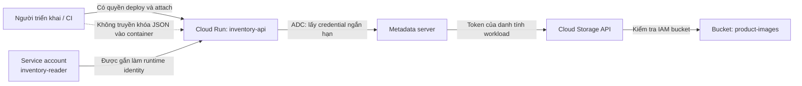
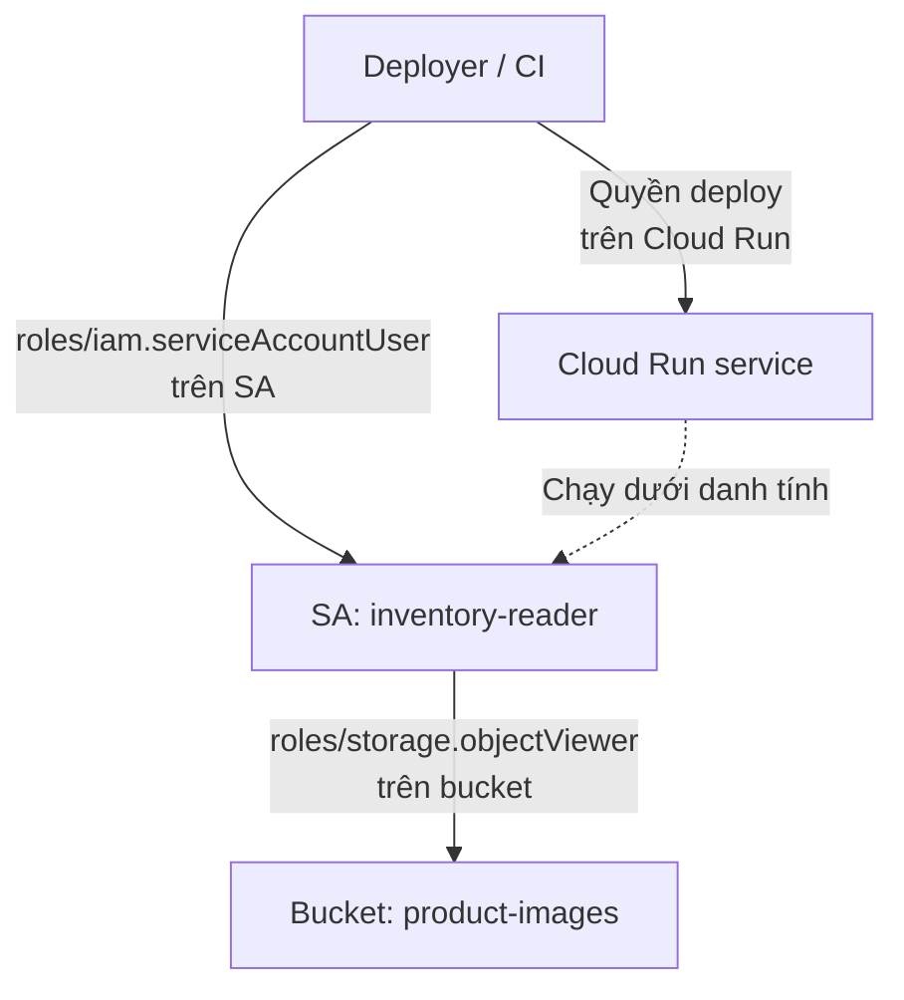
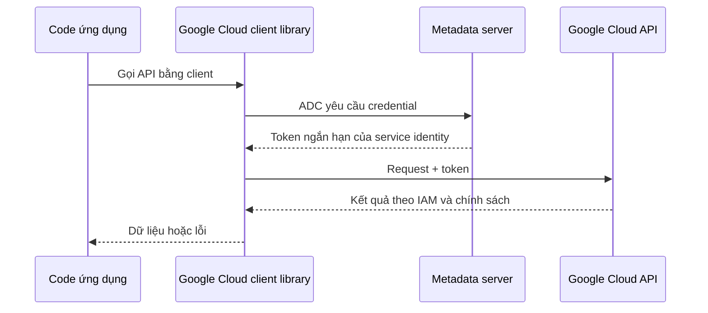

# Service accounts và vòng đời danh tính ứng dụng

Khi một ứng dụng chạy trên Google Cloud cần đọc object trong Cloud Storage, truy vấn BigQuery, gửi thông điệp tới Pub/Sub hoặc truy cập Secret Manager, ứng dụng phải có **danh tính** để Google Cloud xác định *ai đang gọi API*. Danh tính đó cần được cấp **quyền phù hợp** để trả lời *được phép làm gì*. Cơ chế cốt lõi để các workload thực hiện việc này là **service account**.

Bài học thuộc chương **IAM và xác thực** của mô-đun `CLOUD_PROVIDERS_GCP`. Trong hành trình khám phá Google Cloud từ organization, project, IAM và VPC đến Compute Engine, GKE, Cloud Run, lưu trữ, cơ sở dữ liệu, tự động hóa phát hành, giám sát độ tin cậy và chi phí, service account là mắt xích nối **code đang chạy** với **quyền truy cập tài nguyên**. Thiết kế danh tính đúng giúp giảm rủi ro lộ credential, giới hạn tác động khi bị xâm nhập và vận hành ứng dụng xuyên suốt từ triển khai đến ngừng sử dụng.

## 1. Mục tiêu học tập

Sau bài học, bạn có thể:

1. Phân biệt **service account**, tài khoản người dùng, service agent và các danh tính của workload.
2. Giải thích vì sao service account vừa là **principal** được cấp quyền, vừa là **resource** mà người khác có thể được phép sử dụng hoặc quản trị.
3. Phân biệt cấp quyền **cho service account truy cập tài nguyên** với cấp quyền **để một người hoặc runner gắn/mạo danh service account**.
4. Chọn cách xác thực phù hợp cho Cloud Run, Compute Engine, GKE, ứng dụng phát triển tại máy cá nhân và CI/CD bên ngoài Google Cloud.
5. Vận dụng **Application Default Credentials (ADC)**, metadata server, impersonation và Workload Identity Federation để giảm nhu cầu dùng khóa JSON dài hạn.
6. Thực hành tạo một service account đơn nhiệm, cấp quyền đọc đúng bucket, gắn vào workload thử nghiệm và xác minh kết quả.
7. Lập kế hoạch cho toàn bộ vòng đời: **thiết kế → tạo → cấp quyền → sử dụng → giám sát → thay đổi → vô hiệu hóa → xóa/khôi phục**.

## 2. Bối cảnh: vì sao ứng dụng cần danh tính riêng?

Xét ứng dụng `inventory-api` chạy trên Cloud Run. Ứng dụng chỉ cần liệt kê object trong một bucket để lập danh sách hàng hóa, không cần tạo VM, xóa bucket hay chỉnh IAM. Người triển khai có thể là lập trình viên hoặc một pipeline CI/CD, nhưng **quyền của người triển khai không nên trở thành quyền runtime của ứng dụng**.

Ba chủ thể trong cùng một luồng triển khai có mục đích khác nhau:

| Chủ thể | Việc cần làm | Danh tính thường dùng |
| --- | --- | --- |
| Người quản trị/CI/CD | Tạo service account, cấp quyền, triển khai service | Tài khoản người dùng hoặc danh tính triển khai chuyên trách |
| Workload `inventory-api` | Liệt kê object trong bucket khi xử lý request | Service account runtime chỉ có quyền đọc object cần thiết |
| Nền tảng Google Cloud | Điều phối tài nguyên Cloud Run và các API nội bộ của dịch vụ | Các **service agent** do Google Cloud quản lý khi sản phẩm yêu cầu |

Nếu dùng chung một service account nhiều quyền cho người triển khai và mọi ứng dụng, lỗ hổng trong một workload có thể cho phép gọi các API vượt xa nhiệm vụ của nó. Thiết kế tốt phân tách các danh tính theo **mục đích sử dụng và phạm vi tin cậy**.



Sơ đồ nhấn mạnh **đường đi logic**. Khi code gọi API bằng client library, thư viện thường tìm credential thông qua ADC; trong Cloud Run, môi trường cung cấp credential của service identity. Việc xác thực và kiểm tra IAM xảy ra trong hạ tầng Google Cloud, không phải do ứng dụng tự viết mã kiểm tra role.

## 3. Service account là gì?

**Service account** là một danh tính trong Google Cloud IAM dành cho workload hoặc quy trình tự động. Khác với tài khoản người dùng gắn với một con người, service account thường gắn với một ứng dụng, dịch vụ hoặc tác vụ cụ thể.

Ví dụ service account do đội quản trị tạo:

```text
inventory-reader@sample-project.iam.gserviceaccount.com
```

Trong đó:

- `inventory-reader` là ID do người tạo chọn.
- `sample-project` là **project ID sở hữu service account**; service account được tạo trong project và không thể chuyển sang project khác sau khi tạo.
- Địa chỉ email là định danh phổ biến trong cấu hình, IAM member và CLI; mỗi service account còn có **unique ID** riêng.

Service account **không phải một người dùng Google Workspace**, không có mật khẩu tương tác như tài khoản cá nhân và không cần chủ sở hữu là một nhân viên cụ thể. Quyền của service account đến từ **IAM policy bindings** cùng các điều kiện/quy tắc liên quan, không tự phát sinh chỉ vì được tạo.

### 3.1. Phân biệt những danh tính gần nhau

| Loại | Ai tạo/quản lý | Mục đích | Lưu ý |
| --- | --- | --- | --- |
| **User account** | Tổ chức/người dùng | Nhân viên đăng nhập, quản trị, phát triển | Không dùng credential cá nhân làm danh tính dài hạn của ứng dụng production |
| **User-managed service account** | Đội ứng dụng hoặc quản trị | Danh tính riêng cho service, job, VM, pipeline | Ưu tiên cho các workload có quyền cụ thể |
| **Default service account** | Google Cloud tạo khi kích hoạt/khởi tạo một số dịch vụ | Danh tính mặc định của một số workload | Cần kiểm tra role lịch sử; tránh dùng mặc định nếu quá rộng |
| **Service agent** | Google Cloud quản lý cho dịch vụ | Dịch vụ Google Cloud tự thực hiện thao tác cần thiết | Không tự xóa/đổi quyền nếu chưa hiểu phụ thuộc của sản phẩm |
| **Kubernetes ServiceAccount (KSA)** | Kubernetes/GKE | Danh tính trong Kubernetes cho Pod | Khác với IAM service account; có thể liên kết qua Workload Identity Federation for GKE |
| **Federated workload principal** | Được xác minh qua liên kết danh tính | Workload ngoài GCP hoặc trong GKE truy cập tài nguyên | Một số luồng cấp IAM trực tiếp cho principal này, một số luồng mạo danh IAM service account |

Ví dụ Compute Engine default service account thường có dạng:

```text
PROJECT_NUMBER-compute@developer.gserviceaccount.com
```

**PROJECT_NUMBER khác PROJECT_ID.** Một số default service account từng tự động được cấp `roles/editor` trong dự án cũ hoặc cấu hình chính sách tổ chức cho phép. Không suy luận rằng mọi project hiện nay đều cấp Editor; cần kiểm tra IAM policy thực tế và chính sách `iam.automaticIamGrantsForDefaultServiceAccounts`. Ưu tiên một user-managed service account với role hẹp.

## 4. Điểm mấu chốt: service account vừa là principal vừa là resource

Đây là nguyên nhân của nhiều lỗi IAM và cũng là nơi dễ cấp nhầm quyền nhất.

### 4.1. Service account là principal: “nó được làm gì?”

Khi service account là **principal**, IAM binding trên bucket, secret, topic hoặc project quyết định service account được phép thực hiện những hành động nào.

Ví dụ:

```text
Resource: gs://product-images
Member:   serviceAccount:inventory-reader@sample-project.iam.gserviceaccount.com
Role:     roles/storage.objectViewer
```

Binding này cho phép danh tính `inventory-reader` thực hiện các quyền được role cung cấp trên **bucket đó**. Nó **không** cho một lập trình viên quyền giả danh `inventory-reader`, cũng không tự gắn service account này vào Cloud Run.

### 4.2. Service account là resource: “ai được phép sử dụng nó?”

Bản thân service account là một **IAM resource** có policy riêng. Bạn có thể cấp quyền cho một người dùng hoặc danh tính triển khai được gắn hoặc mạo danh service account.

Ví dụ:

```text
Resource: inventory-reader@sample-project.iam.gserviceaccount.com
Member:   user:developer@example.com
Role:     roles/iam.serviceAccountUser
```

Binding này hỗ trợ người dùng **gắn service account vào tài nguyên** khi họ có đủ quyền tạo/sửa tài nguyên đích. Nó không trực tiếp cấp vai trò `roles/storage.objectViewer` cho người dùng; người dùng thực hiện deploy để workload chạy bằng danh tính được gắn.



### 4.3. Các role dễ nhầm

| Role | Cấp trên tài nguyên nào? | Mục đích chính | Không nên nhầm với |
| --- | --- | --- | --- |
| `roles/iam.serviceAccountUser` | Service account | Chứa `iam.serviceAccounts.actAs`, cho phép attach SA khi có quyền thao tác workload | **Không** tự cho phép lấy access token bằng `--impersonate-service-account` |
| `roles/iam.serviceAccountTokenCreator` | Service account | Có thể tạo credential ngắn hạn, ký blob/JWT và mạo danh tùy thao tác | Không phải role chỉ dành cho việc deploy |
| `roles/iam.serviceAccountAdmin` | Service account hoặc phạm vi quản lý phù hợp | Quản lý metadata và vòng đời service account | Không phải role ứng dụng cần để đọc bucket |
| `roles/storage.objectViewer` | Bucket hoặc phạm vi chứa bucket | Cho principal xem/liệt kê object theo quyền role | Không cho quyền gắn hay mạo danh SA |
| `roles/run.developer` và các role deploy liên quan | Cloud Run/project hoặc tài nguyên hỗ trợ | Quản lý triển khai trong phạm vi cho phép | Không tự thay thế `iam.serviceAccounts.actAs` khi chọn runtime SA |

**Tác động bảo mật:** người được quyền mạo danh một service account có thể hành động dưới quyền truy cập của service account đó. Người được attach một service account có đặc quyền vào workload có khả năng gián tiếp sử dụng quyền của nó qua code chạy trên workload. Vì vậy các role trên **service account resource** cũng phải được kiểm soát chặt như các role cấp cho service account.

Có thể áp dụng **IAM Conditions**, cơ chế giới hạn theo thuộc tính ngữ cảnh, và các chính sách tổ chức hỗ trợ để tăng kiểm soát. Những cơ chế này cần thiết kế theo từng loại tài nguyên và permission; không giả định điều kiện nào cũng có tác dụng với mọi API.

## 5. Vòng đời danh tính ứng dụng

Vòng đời service account bắt đầu **trước khi chạy ứng dụng** và tiếp tục cho đến khi mọi phụ thuộc, quyền và credential đã được thu hồi an toàn.

| Giai đoạn | Quyết định/công việc | Bằng chứng nên lưu |
| --- | --- | --- |
| **1. Thiết kế** | Ứng dụng nào cần danh tính? Những API/permission nào bắt buộc? Môi trường nào? | Owner, mục đích, tài nguyên đích, ma trận quyền |
| **2. Tạo** | Chọn project sở hữu, ID/description, quy ước đặt tên | Email, unique ID, project, nhãn quản lý nếu có |
| **3. Cấp quyền** | Grant role hẹp trên tài nguyên đích; grant quyền attach/impersonate cho đúng đối tượng | IAM bindings, lý do cấp, người phê duyệt |
| **4. Kết nối runtime** | Gắn vào Cloud Run/VM, cấu hình GKE workload hoặc Federation cho CI | Cấu hình phiên bản triển khai, môi trường |
| **5. Vận hành** | Theo dõi API call, IAM policy, credential usage, lỗi 403, thay đổi quyền | Audit logs, chỉ số xác thực, cảnh báo |
| **6. Thay đổi/luân chuyển** | Điều chỉnh quyền khi ứng dụng đổi; luân chuyển khóa nếu buộc dùng khóa | Kế hoạch cutover, kết quả kiểm thử |
| **7. Ngừng sử dụng** | Tìm phụ thuộc, chuyển workload, disable trước, quan sát, xóa khi chắc chắn | Danh sách phụ thuộc, bằng chứng không còn sử dụng, lịch xóa |
| **8. Khôi phục khi cần** | Enable account còn bị disable hoặc undelete trong cửa sổ hỗ trợ | Incident/change record, thử nghiệm truy cập |

Không dùng ngày tạo hoặc tên email làm bằng chứng rằng một service account đã hết nhiệm vụ. Service account có thể được workload chạy theo quý, lịch batch ít thường xuyên hoặc quy trình khôi phục thảm họa sử dụng.

## 6. Thiết kế một service account đơn nhiệm

Trước khi tạo bất kỳ danh tính nào, lập **ma trận truy cập** từ công việc thực tế:

| Workload | Tài nguyên cần truy cập | Hành động cần | Vai trò tham khảo |
| --- | --- | --- | --- |
| `inventory-api` trên Cloud Run | Bucket `product-images` | Liệt kê/đọc object | `roles/storage.objectViewer` trên bucket |
| `orders-worker` trên Cloud Run Jobs | Pub/Sub topic `new-orders` | Publish message | `roles/pubsub.publisher` trên topic |
| `billing-report` batch job | Dataset BigQuery báo cáo | Truy vấn dữ liệu | Quyền job và quyền đọc dữ liệu theo mô hình BigQuery |
| `secrets-reader` nội bộ | Một Secret Manager secret | Đọc phiên bản secret | `roles/secretmanager.secretAccessor` trên secret |

Các ví dụ chỉ minh họa. Với BigQuery, quyền tạo job và quyền đọc dữ liệu có thể nằm ở các resource khác nhau; cần xem định nghĩa role, vị trí dataset và yêu cầu sản phẩm thật. Với Secret Manager, hãy hạn chế quyền trên **secret cụ thể** thay vì toàn project khi có thể.

Nguyên tắc chọn scope:

1. **Tách theo workload và môi trường.** `api-dev` và `api-prod` nên có danh tính riêng. Không dùng một SA “all-apps” cho cả hệ thống nếu không có lý do chặt chẽ.
2. **Tối thiểu hóa quyền.** Ưu tiên role chuyên biệt và cấp trên resource đích nhỏ nhất mà dịch vụ hỗ trợ.
3. **Tách quyền triển khai khỏi runtime.** CI có thể cần quyền deploy, nhưng container chỉ cần quyền nghiệp vụ.
4. **Giảm quyền impersonation.** Chỉ cấp `Token Creator` cho đối tượng thực sự cần lấy credential ngắn hạn.
5. **Không dùng credential cố định khi có đường khác.** Trên Google Cloud, ưu tiên service identity gắn với runtime; bên ngoài ưu tiên federation.
6. **Ghi owner rõ ràng.** Service account không tự có “owner là nhân viên”; hồ sơ vận hành phải chỉ ra nhóm chịu trách nhiệm, ứng dụng và hạn rà soát.

Quy tắc “mỗi workload một service account” là hướng khuyến nghị, không phải điều kiện cứng của API. Khi một ứng dụng có nhiều job với nhu cầu quyền rất khác nhau, **mỗi chức năng nhạy cảm** có thể cần một SA riêng.

## 7. Ứng dụng thực sự nhận credential bằng cách nào?

### 7.1. ADC giúp code không cần biết credential đến từ đâu

**Application Default Credentials (ADC)** là chiến lược tìm credential mặc định được hỗ trợ bởi nhiều Google Cloud client libraries. Khi ứng dụng gọi API, thư viện tìm credential theo thứ tự ưu tiên:

1. Biến môi trường `GOOGLE_APPLICATION_CREDENTIALS`, nếu có, trỏ tới file cấu hình credential hợp lệ.
2. Credential của môi trường phát triển do `gcloud auth application-default login` tạo, nếu tồn tại.
3. Credential từ **metadata server** của workload Google Cloud được gắn service account, nếu có.

Thứ tự là **cách tìm nguồn**, không phải bảng xếp hạng mức an toàn. File từ `GOOGLE_APPLICATION_CREDENTIALS` có thể là **cấu hình Workload Identity Federation**, không nhất thiết là private key của service account. Nếu ứng dụng chạy trên Cloud Run mà vẫn đặt biến môi trường này trỏ tới JSON key không cần thiết, code có thể bỏ qua credential của runtime, tăng rủi ro và gây lỗi quyền không mong muốn.

Lệnh `gcloud auth login` xác thực **CLI cho người dùng**; `gcloud auth application-default login` thiết lập **ADC cục bộ cho thư viện ứng dụng**. Hai cơ chế có file/cấu hình riêng và không thể coi là một.

### 7.2. Metadata server và credential ngắn hạn

Khi Cloud Run service được gắn user-managed SA, workload dùng metadata server để nhận token đại diện cho SA; client libraries thường quản lý việc lấy và làm mới token. Không cần đặt file khóa riêng trong image hoặc repository.



Lưu ý bảo mật: mọi code chạy trong cùng một vùng tin cậy của workload và có khả năng dùng credential runtime có thể thực hiện những API được SA cho phép. **Tối thiểu quyền của SA** vẫn là biện pháp quan trọng nhất để hạn chế tác động nếu ứng dụng bị xâm nhập.

### 7.3. Cách xác thực theo môi trường chạy

| Môi trường | Phương án thường ưu tiên | Tránh |
| --- | --- | --- |
| **Cloud Run service/job** | Gắn user-managed service account làm service identity; code dùng ADC | Đưa JSON private key vào image, Secret Manager hoặc source code khi không cần |
| **Compute Engine VM** | Gắn SA vào VM và dùng metadata server/ADC; kiểm tra IAM và access scopes của VM | Dùng user account lâu dài trong startup script |
| **GKE** | Workload Identity Federation for GKE, phân quyền theo workload/Kubernetes SA hoặc liên kết IAM SA khi cần | Đặt JSON key trong Kubernetes Secret để mọi pod dùng chung |
| **Máy lập trình viên** | ADC của người dùng hoặc ADC qua service account impersonation cho kiểm thử phù hợp | Sao chép service account private key giữa nhân viên |
| **CI/CD bên ngoài GCP** | Workload Identity Federation với identity provider tin cậy; impersonation khi cần | Khóa JSON dài hạn trong CI variables |
| **Runtime đặc thù chưa hỗ trợ federation/metadata** | Đánh giá giải pháp broker/credential ngắn hạn hoặc cơ chế khóa như ngoại lệ | Mặc định tạo key cho mọi ứng dụng |

**GKE cần chú ý:** Kubernetes ServiceAccount và IAM service account là hai đối tượng khác nhau. Workload Identity Federation for GKE có thể cho Kubernetes workload được Google Cloud công nhận như một principal và cấp IAM trực tiếp trên resource hỗ trợ; trong các trường hợp cần tương thích hoặc phương án thiết kế khác, có thể dùng **IAM service account impersonation**. Không phải cứ tạo tên KSA giống email IAM SA là chúng tự liên kết.

**Compute Engine cần chú ý:** một số cấu hình VM còn có **OAuth access scopes**. Quyền hiệu lực cần đáp ứng IAM và các giới hạn scope phù hợp, vì vậy một VM có IAM đúng vẫn có thể bị từ chối nếu access scopes quá hẹp. Khi dùng scope `cloud-platform` ở trường hợp được khuyến nghị, tiếp tục kiểm soát quyền bằng IAM.

## 8. Thực hành: tạo danh tính chỉ đọc bucket cho Cloud Run

Bài lab giả định bạn được phép quản trị **project thực hành**, có một **bucket riêng tư** chứa dữ liệu thử nghiệm và một Cloud Run service thử nghiệm. Các lệnh có tác dụng ghi được ghi rõ; **chỉ chạy sau khi thay placeholder và xác nhận đúng tài nguyên**. Không cần tạo key JSON.

### 8.1. Đặt biến và kiểm tra đầu vào (chỉ đọc)

Trong Bash trên Cloud Shell hoặc máy đã có Google Cloud CLI:

```bash
# Thay giá trị bằng project và bucket LAB của bạn.
PROJECT_ID="YOUR_PROJECT_ID"
BUCKET="YOUR_PRIVATE_LAB_BUCKET"
REGION="asia-southeast1"
CLOUD_RUN_SERVICE="inventory-api"

SA_ID="inventory-reader"
SA_EMAIL="$SA_ID@$PROJECT_ID.iam.gserviceaccount.com"

gcloud auth list
gcloud config get-value project

# Xác minh project hiện hữu và tài khoản đang dùng có thể xem.
gcloud projects describe "$PROJECT_ID" \
  --format="value(projectId)"

# Liệt kê service account hiện có (chỉ đọc).
gcloud iam service-accounts list \
  --project="$PROJECT_ID" \
  --format="table(email,displayName,disabled)"

# Kiểm tra bucket lab (chỉ đọc).
gcloud storage buckets describe "gs://$BUCKET"
```

Dùng project ID tường minh để tránh nhầm với cấu hình mặc định. Nếu project, bucket hoặc Cloud Run service chưa tồn tại, cần chuẩn bị hạ tầng theo quyền và quy trình riêng trước khi làm tiếp; không tự chuyển sang project production.

### 8.2. Tạo service account (có thay đổi project)

Chọn một SA **user-managed** có tên phản ánh nhiệm vụ. Nếu email đã tồn tại, xem xét đang được dùng hay không thay vì tạo lại tùy tiện.

```bash
gcloud iam service-accounts create "$SA_ID" \
  --project="$PROJECT_ID" \
  --display-name="Lab inventory reader"
```

Kiểm tra kết quả:

```bash
gcloud iam service-accounts describe "$SA_EMAIL" \
  --project="$PROJECT_ID" \
  --format="yaml(email,uniqueId,displayName,disabled)"
```

**Đừng cấp role Editor, Owner hoặc Storage Admin chỉ để bài lab chạy qua.** Service account mới cần được cấp đúng quyền làm việc, không nên được “nâng quyền phòng hờ”.

### 8.3. Cấp role trên bucket, không cấp toàn project

Bài toán yêu cầu workload **liệt kê và đọc object** trong `BUCKET`. Quyền `roles/storage.objectViewer` nên đặt trên **bucket mục tiêu** khi phù hợp với yêu cầu bảo mật.

Trước khi thay đổi, xem policy hiện tại (chỉ đọc):

```bash
gcloud storage buckets get-iam-policy "gs://$BUCKET"
```

Sau khi xác nhận bucket thuộc lab và danh tính là đúng, **lệnh sau thay đổi IAM của bucket**:

```bash
gcloud storage buckets add-iam-policy-binding "gs://$BUCKET" \
  --member="serviceAccount:$SA_EMAIL" \
  --role="roles/storage.objectViewer"
```

Readback:

```bash
gcloud storage buckets get-iam-policy "gs://$BUCKET"
```

Để hiểu sự khác biệt, so sánh với lệnh dưới đây **chỉ nhằm minh họa, không chạy**:

```bash
# KHÔNG chạy trong bài lab: cấp quyền quá rộng nếu app chỉ cần một bucket.
gcloud projects add-iam-policy-binding "$PROJECT_ID" \
  --member="serviceAccount:$SA_EMAIL" \
  --role="roles/storage.objectViewer"
```

Role trên project có thể áp dụng cho nhiều tài nguyên trong project theo cơ chế kế thừa, rộng hơn nhu cầu “chỉ đọc một bucket”. Trong thực tế, một quyền vẫn có thể bị giới hạn bởi deny policy, principal access boundary, IAM Conditions hoặc quy tắc dịch vụ; luôn kiểm tra quyền hiệu lực cho API thật sự được gọi.

### 8.4. Gắn service account vào Cloud Run (có thay đổi workload)

Người thực hiện cần **quyền cập nhật Cloud Run service** và quyền `iam.serviceAccounts.actAs` trên SA, thường có qua role `roles/iam.serviceAccountUser` tại SA. Hai quyền này là **quyền của deployer**, tách biệt với `roles/storage.objectViewer` của ứng dụng.

Trước khi thay đổi, xem Cloud Run service hiện tại:

```bash
gcloud run services describe "$CLOUD_RUN_SERVICE" \
  --project="$PROJECT_ID" \
  --region="$REGION" \
  --format=yaml
```

Sau khi xác nhận đây là service lab, thực hiện **lệnh cập nhật có tác dụng thật**:

```bash
gcloud run services update "$CLOUD_RUN_SERVICE" \
  --project="$PROJECT_ID" \
  --region="$REGION" \
  --service-account="$SA_EMAIL"
```

Thay service identity của Cloud Run có thể tạo revision mới và tác động ngay đến request sau khi được triển khai. Với ứng dụng có yêu cầu cao, cần kế hoạch rollout, kiểm thử và rollback như mọi thay đổi cấu hình runtime khác.

Readback:

```bash
gcloud run services describe "$CLOUD_RUN_SERVICE" \
  --project="$PROJECT_ID" \
  --region="$REGION" \
  --format=yaml
```

Tìm cấu hình service account trong thông tin template/revision của Cloud Run. Đừng nhầm **người gọi lệnh deploy**, **Cloud Run service identity** và **service agent** của nền tảng.

### 8.5. Code dùng ADC, không dùng service account key

Ví dụ Python dùng Google Cloud Storage client library (cần cài thư viện `google-cloud-storage` trong môi trường ứng dụng):

```python
from google.cloud import storage

BUCKET = "YOUR_PRIVATE_LAB_BUCKET"

# Không tải file key và không chỉ định credential cố định.
client = storage.Client()

for blob in client.list_blobs(BUCKET, max_results=10):
    print(blob.name)
```

Trên Cloud Run, thư viện nhận credential từ service identity theo ADC. Kết quả phụ thuộc IAM, bucket, trạng thái API, cấu hình mạng và điều kiện khác. Nếu trả `403 PERMISSION_DENIED`, đừng thêm ngay role Editor; hãy xác minh service identity, bucket và permission cụ thể còn thiếu.

### 8.6. Thử impersonation khi phát triển cục bộ

Nếu muốn **kiểm tra một lệnh bằng danh tính SA mà không tải private key**, người vận hành có thể dùng `--impersonate-service-account`. Họ cần được phép **tạo credential ngắn hạn cho SA**, thường bằng `roles/iam.serviceAccountTokenCreator` trên đúng service account.

```bash
# Chỉ đọc; giả định người dùng đã được cấp quyền impersonation.
gcloud storage ls "gs://$BUCKET" \
  --impersonate-service-account="$SA_EMAIL"
```

Điểm phân biệt quan trọng: `roles/iam.serviceAccountUser` đủ cho nhiều tình huống **attach**, nhưng **không** đủ để người dùng sử dụng cờ impersonation của gcloud. Quyền `Token Creator` mạnh hơn vì cho phép sử dụng quyền của SA qua credential ngắn hạn; không nên cấp cho mọi thành viên chỉ để tiện thử lệnh.

Đối với client library phát triển cục bộ, có thể sử dụng ADC với impersonation thông qua lệnh và môi trường hỗ trợ, nhưng đó là cấu hình **ADC cục bộ** riêng với `gcloud auth login`. Kiểm tra tài liệu tương ứng trước khi chọn luồng kiểm thử.

## 9. Cách biết workload đang dùng danh tính nào

**Không dựa duy nhất vào việc service account tồn tại.** Phải biết workload được gắn danh tính nào và API đang được gọi với credential nào.

### 9.1. Quan sát từ cấu hình

- **Cloud Run:** xem service identity trong cấu hình service/revision hoặc lệnh `gcloud run services describe`.
- **Compute Engine:** xem thuộc tính `serviceAccounts` của VM cùng access scopes liên quan.
- **GKE:** xem Kubernetes ServiceAccount được Pod sử dụng, chính sách Workload Identity Federation for GKE và cơ chế IAM binding hoặc impersonation đã cấu hình.
- **CI/CD:** xem danh tính runner và liên kết Workload Identity Federation; không dựa trên tên pipeline để suy luận nó chạy với role nào.

### 9.2. Đọc IAM policy đúng nơi

Có ít nhất hai câu hỏi cần hai nguồn kiểm tra:

| Câu hỏi | Chính sách nên kiểm tra |
| --- | --- |
| “`inventory-reader` được quyền đọc bucket nào?” | IAM policy của bucket/project/tổ chức cùng các quy tắc liên quan tới Cloud Storage |
| “Ai có quyền mạo danh hoặc attach `inventory-reader`?” | IAM policy trên **service account** và các policy ở cấp cha có thể cấp quyền áp dụng |

Ví dụ lấy policy **trên service account resource**:

```bash
gcloud iam service-accounts get-iam-policy "$SA_EMAIL" \
  --project="$PROJECT_ID"
```

Lệnh này **không phải** danh sách đầy đủ các role mà SA được cấp trên bucket, secret hoặc project khác. Để tìm các binding ấy, cần kiểm tra IAM policy của tài nguyên đích hoặc dùng công cụ phân tích quyền phù hợp.

### 9.3. Quy trình xử lý lỗi 403

Khi client library báo `PERMISSION_DENIED`:

1. Xác nhận **credential nào** được ADC sử dụng; tìm cấu hình `GOOGLE_APPLICATION_CREDENTIALS` hoặc ADC cục bộ ghi đè ngoài ý muốn.
2. Xác nhận SA/identity thực sự được gắn vào workload và phiên bản cấu hình đang chạy.
3. Xác nhận API, project đích, bucket/dataset/topic/secret và tên resource.
4. Tra **permission** yêu cầu của API, rồi xem policy ở tài nguyên đích và các deny/condition liên quan.
5. Nếu vấn đề xảy ra khi deploy, phân biệt lỗi **quyền attach SA** với lỗi **quyền runtime gọi API**.
6. Sau khi chỉnh đúng quyền cần thiết, thử lại tác vụ nhỏ nhất rồi xem audit log/ứng dụng để xác nhận.

**Lỗi 403 không luôn có nghĩa “thiếu role trên service account”.** Có thể thiếu quyền trên **resource**, bị deny, cấu hình access scope, credential sai hoặc một chính sách khác chặn yêu cầu.

## 10. Theo dõi quyền và sử dụng trong vận hành

Danh tính ứng dụng là tài sản có vòng đời, nên quyền không thể “cấp một lần rồi quên”.

### 10.1. Những gì cần ghi nhận

- Tên ứng dụng và môi trường đang dùng SA; project sở hữu.
- Tài nguyên và permission/role được cấp; lý do nghiệp vụ.
- Người/runner có quyền attach hoặc impersonate.
- Cấu hình workload hoặc job liên kết, lịch chạy batch và người chịu trách nhiệm.
- Danh sách user-managed key nếu có; lịch quay vòng và nơi lưu an toàn.
- Thay đổi IAM, lỗi xác thực, hành vi truy cập bất thường và kết quả rà soát định kỳ.

### 10.2. Nguồn quan sát và giới hạn

**Cloud Audit Logs** có thể giúp theo dõi các thao tác quản trị hoặc truy cập dữ liệu tùy loại log, dịch vụ, quyền và cấu hình bật/giữ log. Không mặc định mọi lời gọi tới dữ liệu đều đã được ghi đầy đủ khi chưa kiểm tra **Data Access audit logs**, đặc tính sản phẩm và chính sách lưu giữ.

**IAM Recommender**, Service Account Insights, Policy Analyzer hoặc các công cụ phân tích tương ứng có thể hỗ trợ phát hiện quyền dư thừa hoặc service account ít sử dụng. Đây là **tín hiệu**, không phải bằng chứng tuyệt đối rằng một workload không còn cần danh tính: batch job chạy thưa, pipeline khôi phục sự cố và ứng dụng tạm dừng có thể không có hoạt động gần đây.

Đối với tài nguyên quan trọng, nên thiết lập cảnh báo cho thay đổi quyền, tạo private key ngoài dự kiến, thao tác impersonation bất thường, lỗi xác thực tăng đột biến và phát hiện credential rò rỉ theo khả năng của dịch vụ và công cụ giám sát.

## 11. Private key của service account và các lựa chọn an toàn hơn

Một service account có thể có nhiều loại credential. **Khóa do người dùng tạo (user-managed key)** là trường hợp cần thận trọng nhất vì file chứa private key có thể được sao chép, rò rỉ và sử dụng ngoài môi trường dự định.

| Phương án | Đặc điểm | Đánh giá |
| --- | --- | --- |
| Runtime service identity + metadata server | Không cần phân phối private key; credential ngắn hạn được cấp cho workload | **Ưu tiên** khi workload chạy trên dịch vụ Google Cloud hỗ trợ |
| Service account impersonation | Danh tính đã được xác thực lấy credential ngắn hạn của SA với quyền phù hợp | **Ưu tiên** cho thao tác CLI/CI cần hành động dưới quyền SA |
| Workload Identity Federation | Trao đổi bằng chứng từ identity provider ngoài GCP/GKE thành quyền truy cập Google Cloud | **Ưu tiên** cho workload không có runtime SA gắn trực tiếp |
| User-managed JSON key | Khóa dài hạn có thể dùng khi ai đó lấy được file | **Ngoại lệ** khi các cách trên không đáp ứng, cần quản trị chặt |
| Google-managed key | Google Cloud quản lý trong các luồng sản phẩm hỗ trợ | Không đồng nghĩa user có thể tải private key về |

**Chính sách tổ chức** có thể chặn tạo hoặc tải lên khóa service account. Tùy thời điểm tạo organization và cấu hình hiện hành, những constraint này có thể đã được áp dụng mặc định. Không tìm cách vượt chính sách bằng cách dùng project khác khi chưa được phép.

Nếu bắt buộc dùng user-managed key:

1. Giải thích rõ vì sao federation, impersonation hoặc runtime identity không áp dụng được.
2. Tạo key theo quy trình được phê duyệt; không commit vào Git, Docker image, artifact công khai hoặc gửi qua chat/email.
3. Lưu tại nơi quản lý bí mật phù hợp, giới hạn đối tượng có thể đọc, quan sát việc sử dụng.
4. Có lịch **rotation**: phát hành key mới, chuyển workload sang key mới, xác minh, rồi vô hiệu hóa/xóa key cũ.
5. Theo dõi cảnh báo rò rỉ, đánh giá ngắn hạn/quyền và kế hoạch ứng phó.

**Vô hiệu hóa hoặc xóa một key không nhất thiết thu hồi tức thời các access token ngắn hạn đã phát hành từ key đó.** Với sự cố nghiêm trọng, có thể cần vô hiệu hóa/xóa cả service account để chặn việc sử dụng danh tính, đồng thời chấp nhận tác động đến những workload đang phụ thuộc. Quyết định này thuộc quy trình ứng cứu sự cố, cần tính toàn bộ ứng dụng sử dụng SA.

## 12. Thay đổi service account khi ứng dụng tiến hóa

Giả sử `inventory-api` ban đầu chỉ đọc object, sau đó cần publish sự kiện lên Pub/Sub.

Phương án kiểm soát:

1. Xác định chính xác **Pub/Sub topic** và permission publish cần dùng.
2. Cấp `roles/pubsub.publisher` cho cùng SA **trên đúng topic** nếu đây vẫn là trách nhiệm hợp lý của ứng dụng; hoặc tách một worker riêng có SA độc lập nếu chức năng mới nên cách ly.
3. Triển khai code ứng dụng, kiểm tra publish thật với payload thử nghiệm.
4. Quan sát `PERMISSION_DENIED` và Cloud Audit Logs, xác nhận workload đang dùng đúng service identity.
5. Rà soát role không còn sử dụng và thu hồi có kiểm soát.

Không mở rộng quyền kiểu `roles/editor` vì triển khai đang bị lỗi. Đó là cách dễ tạo **privilege accumulation**: sau nhiều lần sửa lỗi, một SA nhỏ biến thành danh tính có quyền truy cập gần như toàn project.

Khi chuyển workload từ SA cũ sang SA mới, hãy cập nhật cả **runtime configuration** lẫn **policy trên resource đích**, kiểm tra theo canary/phiên bản, rồi mới thu hồi quyền cũ. Việc đổi email trong biến môi trường không tự tạo IAM binding hoặc đổi runtime identity.

## 13. Ngừng sử dụng, vô hiệu hóa và xóa an toàn

Một service account từng được dùng trong môi trường production có thể còn gắn với batch job, service ít truy cập hoặc quy trình khôi phục. Xóa ngay có thể làm hệ thống ngừng gọi API dù deploy và hạ tầng vẫn hoạt động.

### 13.1. Quy trình decommission đề xuất

1. **Lập danh sách phụ thuộc:** Cloud Run service/job, VM, GKE workload, CI runner, kế hoạch DR, IaC và mọi policy grant/impersonation liên quan.
2. **Chuyển workload:** gắn SA thay thế ở nơi cần, thử chức năng và xác nhận đường truy cập API.
3. **Xem hoạt động:** kết hợp logs/insights với owner của ứng dụng; không dựa duy nhất vào lần truy cập gần nhất.
4. **Vô hiệu hóa có kiểm soát:** đây là bước có tác động thật; theo dõi lỗi trong khoảng đủ dài so với lịch hoạt động (Google Cloud khuyến nghị ít nhất một khoảng quan sát sau khi disable trước khi xóa).
5. **Khôi phục nếu phát hiện phụ thuộc:** enable lại SA trong cửa sổ sự cố, sau đó xử lý root cause.
6. **Xóa khi đã chắc chắn:** ghi nhận ngày xóa, người phê duyệt và kế hoạch dọn IAM binding/credential.
7. **Rà soát sau xóa:** xác nhận không còn workload hoặc cấu hình phụ thuộc vào danh tính đó.

**Vô hiệu hóa** SA làm các yêu cầu dùng danh tính đó và việc phát hành credential theo SA thất bại; hành động này có thể khiến dịch vụ đang chạy mất quyền truy cập. **Xóa** SA là thao tác mạnh hơn: theo tài liệu Google Cloud, việc undelete thường chỉ có thể thực hiện trong **30 ngày sau xóa** và phải thỏa điều kiện, ví dụ tên chưa bị một SA mới sử dụng.

### 13.2. Lệnh tham khảo, không chạy trên hệ thống đang phục vụ

Kiểm tra tình trạng trước (chỉ đọc):

```bash
gcloud iam service-accounts describe "$SA_EMAIL" \
  --project="$PROJECT_ID" \
  --format="yaml(email,uniqueId,disabled)"
```

Chỉ khi đã được phê duyệt trong kế hoạch dừng danh tính và đã chuyển workload, **lệnh sau vô hiệu hóa SA thật**:

```bash
gcloud iam service-accounts disable "$SA_EMAIL" \
  --project="$PROJECT_ID"
```

Nếu phát hiện phụ thuộc ngoài dự kiến và được phép phục hồi:

```bash
gcloud iam service-accounts enable "$SA_EMAIL" \
  --project="$PROJECT_ID"
```

Lệnh xóa bên dưới **chỉ để nhận diện thao tác, không chạy trong bài lab**:

```bash
# MINH HỌA: làm mất khả năng sử dụng danh tính và cần quy trình xóa riêng.
gcloud iam service-accounts delete "$SA_EMAIL" \
  --project="$PROJECT_ID"
```

**Không thể coi việc tạo lại một service account có cùng email là khôi phục.** Google Cloud dùng định danh nội bộ riêng; SA mới có cùng tên là một principal khác, không thừa hưởng IAM bindings của bản đã xóa. Ngược lại, `undelete` hợp lệ phục hồi cùng danh tính, giữ các quyền tương ứng.

Trong IAM policy, tham chiếu tới SA bị xóa có thể tạm xuất hiện với tiền tố `deleted:` và hậu tố chỉ unique ID. Khi dọn dẹp policy, cần cẩn thận không nhầm principal mới/cũ chỉ vì email giống nhau.

### 13.3. Default service account cần xử lý thận trọng

Một số dịch vụ dựa vào default service account khi không chọn danh tính runtime khác. Xóa default SA có thể gây sự cố triển khai hoặc gọi API và có thể không tạo lại được sau khi xóa. Nếu chưa chắc chắn, **ưu tiên vô hiệu hóa có kế hoạch** thay vì xóa; trước tiên thay các workload mặc định bằng user-managed SA với IAM được kiểm soát.

## 14. Sự cố thường gặp và cách truy nguyên

| Hiện tượng | Nguyên nhân khả dĩ | Hướng xử lý |
| --- | --- | --- |
| Deployer có quyền sửa Cloud Run nhưng không chọn được SA | Thiếu `iam.serviceAccounts.actAs` trên SA | Kiểm tra quyền attach và policy trên SA; không cấp Token Creator chỉ để chữa lỗi này |
| Có `roles/iam.serviceAccountUser` nhưng `--impersonate-service-account` báo lỗi | `actAs` không cấp quyền tạo token | Cần quyền phù hợp như `roles/iam.serviceAccountTokenCreator`, chỉ cấp cho người thực sự cần impersonate |
| Ứng dụng đọc bucket trả 403 dù deploy thành công | SA runtime thiếu permission trên bucket, hoặc ADC dùng identity khác | Kiểm tra policy bucket và credential thực tế |
| Máy dev chạy được, Cloud Run thất bại | Máy dev dùng ADC user; Cloud Run dùng runtime SA khác | Thử với đúng SA/impersonation và phân quyền riêng |
| GKE Pod không thể gọi API | KSA, workload identity, IAM binding hoặc annotation/liên kết thiếu phù hợp | Rà lại luồng Workload Identity Federation for GKE của đúng cluster |
| VM có IAM role nhưng API bị từ chối | Access scopes VM hạn chế hoặc credential sai | Kiểm tra IAM, scope và runtime credential |
| Dừng một SA khiến nhiều ứng dụng lỗi cùng lúc | SA dùng chung quá nhiều workload | Enable phục hồi nếu được phép; tách SA theo workload và chuyển từng ứng dụng |
| Sau khi tạo lại SA cùng email, role cũ “mất” | SA mới có unique ID khác | Dùng undelete khi hợp lệ; nếu là SA mới thì cấp quyền/cấu hình lại có kiểm soát |
| Lộ file JSON key trong repository | Khóa dài hạn bị sao chép | Xử lý incident, vô hiệu hóa/xóa key, kiểm tra token và quyền; loại khỏi nơi lưu và rà soát logs |

Một câu hỏi gốc giúp xử lý nhanh: **đây là lỗi xác thực danh tính, quyền sử dụng service account, quyền của service account trên tài nguyên, hay cấu hình workload?** Việc phân loại đúng giúp tránh cấp quyền quá rộng.

## 15. Bài tập vận dụng

### Bài tập 1 — service account có hai mặt

Một lập trình viên được gán `roles/iam.serviceAccountUser` trên `report-reader`. `report-reader` có `roles/storage.objectViewer` trên bucket `finance-reports`.

**Câu hỏi:** lập trình viên có thể chạy `gcloud storage ls ... --impersonate-service-account=report-reader` chỉ bằng role `Service Account User` không? Nếu được quyền triển khai VM và attach `report-reader`, ứng dụng trên VM có thể làm gì?

*Đáp án định hướng:* Không tự mạo danh để lấy token CLI chỉ nhờ `roles/iam.serviceAccountUser`; thao tác này cần quyền tạo credential ngắn hạn phù hợp. Nếu lập trình viên có đủ quyền deploy và attach, code trên VM có thể sử dụng service identity để thực hiện các API được SA cho phép, phụ thuộc cấu hình/giới hạn runtime. Điều này cho thấy quyền attach một SA có đặc quyền cần quản lý kỹ.

### Bài tập 2 — chọn credential đúng

Một job chạy mỗi tối trong Cloud Run phải đọc object từ một bucket. Nhóm đang cân nhắc tạo private key JSON để đưa vào image.

**Yêu cầu:** đề xuất một thiết kế thay thế.

*Đáp án định hướng:* Tạo user-managed SA riêng cho job; cấp `roles/storage.objectViewer` trên bucket mục tiêu; gắn SA làm service identity của Cloud Run Job; code dùng ADC từ metadata server. Không cần lưu key trong image.

### Bài tập 3 — CI/CD bên ngoài GCP

Pipeline từ nhà cung cấp Git bên ngoài Google Cloud cần deploy Cloud Run. Nhóm không muốn giữ khóa JSON.

**Yêu cầu:** chọn phương án xác thực và nêu hai loại quyền cần phân biệt.

*Đáp án định hướng:* Thiết kế Workload Identity Federation với nguồn danh tính đáng tin cậy, sau đó cấp quyền phù hợp cho principal hoặc cho phép impersonate một SA triển khai riêng. Đối tượng deploy cần quyền sửa Cloud Run và thường cần `iam.serviceAccounts.actAs` trên runtime SA; nếu có impersonation, cần thêm quyền tạo token ngắn hạn trên SA được impersonate. Quyền của SA runtime để gọi API ứng dụng là phạm vi khác.

### Bài tập 4 — 403 sau khi deploy

Ứng dụng Python chạy tại máy cá nhân đọc bucket được. Cùng code khi chạy trên Cloud Run trả `403`. Runtime SA đã được gắn nhưng không có quyền trên bucket.

**Yêu cầu:** xác định nguyên nhân và hành động tối thiểu.

*Đáp án định hướng:* ADC trên máy cá nhân và Cloud Run dùng các principal khác nhau. Cấp permission đọc object cần thiết cho runtime SA **trên bucket mục tiêu**, kiểm tra lại service identity và API. Không nâng toàn project lên Editor.

### Bài tập 5 — xóa nhầm rồi tạo lại cùng email

Một SA `batch-runner` bị xóa, nhóm tạo ngay SA mới cùng ID và thấy các quyền cũ không còn tác dụng.

**Yêu cầu:** giải thích vì sao, và lần sau nên xử lý thế nào.

*Đáp án định hướng:* SA mới có unique ID khác, được xem là principal khác. Nếu còn trong cửa sổ undelete và tên chưa bị chiếm, khôi phục SA cũ có thể giữ danh tính; nếu đã tạo SA mới, cần quy trình kiểm tra và cấp lại role phù hợp cho principal mới. Trước khi xóa, chuyển workload, disable có kiểm soát và theo dõi phụ thuộc để tránh sự cố.

### Bài tập 6 — rà soát vòng đời

Một công ty có 50 service account, trong đó nhiều SA không có hoạt động 90 ngày nhưng được dùng khi diễn tập khôi phục thảm họa mỗi nửa năm.

**Yêu cầu:** có nên xóa toàn bộ SA không hoạt động trong 90 ngày?

*Đáp án định hướng:* Không. Insights về không hoạt động là tín hiệu để điều tra, không chứng minh SA không còn cần. Cần owner, lịch chạy, phụ thuộc DR, kiểm tra các policy và theo dõi; chỉ disable/xóa theo quy trình sau khi xác minh.

## 16. Checklist thiết kế danh tính ứng dụng

- [ ] Mỗi workload/nhóm chức năng nhạy cảm có danh tính phù hợp; không chia sẻ SA đặc quyền vô cớ.
- [ ] Đã phân biệt danh tính **người deploy**, **runtime workload**, **service agent** và **principal ngoài GCP**.
- [ ] Project sở hữu SA, email, unique ID, owner nghiệp vụ và mục đích đã được ghi nhận.
- [ ] Quyền của SA trên resource đích là **ít nhất cần thiết**, với scope nhỏ nhất khả thi.
- [ ] Quyền **attach** và **impersonate** được cấp cho đúng đối tượng, không nhập nhằng hai role.
- [ ] Workload trên Google Cloud dùng service identity/metadata server và ADC nếu được hỗ trợ.
- [ ] GKE, CI/CD hoặc workload ngoài GCP được xem xét dùng Workload Identity Federation phù hợp.
- [ ] Không tạo/lưu private key JSON khi có phương án xác thực an toàn hơn.
- [ ] Đã kiểm tra runtime đang sử dụng đúng danh tính và IAM binding trên đúng tài nguyên.
- [ ] Có logging, cảnh báo và rà soát quyền/credential theo vòng đời.
- [ ] Khi thay đổi quyền, có kiểm thử nghiệp vụ và xem xét lỗi 403, deny, condition, scope.
- [ ] Khi ngừng dùng, kiểm tra phụ thuộc, disable/quan sát trước khi delete và biết giới hạn undelete.

## 17. Tài liệu Google Cloud chính thức

Các trang dưới đây giúp kiểm tra cú pháp CLI, quyền IAM và hành vi hiện hành của từng sản phẩm:

- [Service accounts overview](https://cloud.google.com/iam/docs/service-account-overview): service account là principal và resource, các loại danh tính và vòng đời.
- [Service account permissions](https://cloud.google.com/iam/docs/service-account-permissions): `Service Account User`, `Token Creator` và quyền cho các trường hợp attach/impersonate.
- [Attach service accounts to resources](https://cloud.google.com/iam/docs/attach-service-accounts): cơ chế gắn runtime SA và quyền của deployer.
- [Application Default Credentials](https://cloud.google.com/docs/authentication/application-default-credentials): thứ tự tìm credential và nguồn metadata server.
- [Cloud Run service identity](https://cloud.google.com/run/docs/securing/service-identity): danh tính runtime và cách gọi API từ Cloud Run.
- [Workload Identity Federation for GKE](https://cloud.google.com/kubernetes-engine/docs/concepts/workload-identity): định danh Kubernetes workload với Google Cloud.
- [Best practices for using service accounts securely](https://cloud.google.com/iam/docs/best-practices-service-accounts): quản trị quyền, mục đích và danh tính ít sử dụng.
- [Service account key management](https://cloud.google.com/iam/docs/best-practices-for-managing-service-account-keys): hạn chế, bảo vệ và luân chuyển khóa.
- [Delete and undelete service accounts](https://cloud.google.com/iam/docs/service-accounts-delete-undelete): vô hiệu hóa, xóa, khôi phục và giới hạn thời gian.
- [Google Cloud IAM policy overview](https://cloud.google.com/iam/docs/policies): cách IAM policy và bindings điều khiển truy cập.

Hãy luôn đặt hai câu hỏi riêng cho một service account: **“Ai có thể gắn hoặc sử dụng danh tính này?”** và **“Khi danh tính này gọi API, nó thực sự được làm gì?”**. Kết hợp chúng với vòng đời tạo, giám sát và thu hồi có kiểm soát sẽ giúp ứng dụng GCP có quyền truy cập cần thiết mà không tích lũy quyền hoặc phụ thuộc credential khó bảo vệ.
