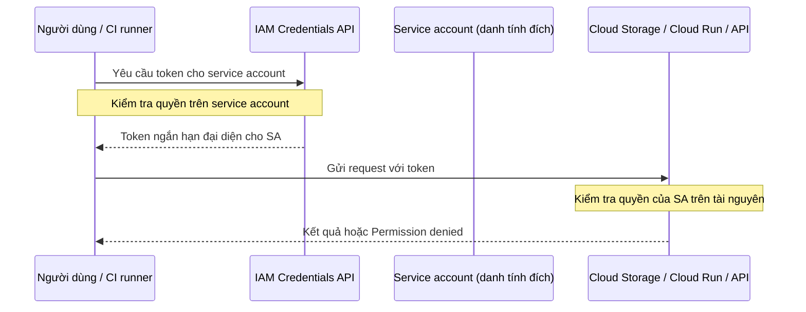

# Service account impersonation và thông tin xác thực ngắn hạn

> **Chương:** IAM và xác thực  
> **Module:** CLOUD_PROVIDERS_GCP  
> **Phạm vi module:** Khám phá Google Cloud từ tổ chức project, IAM và VPC đến Compute Engine, GKE, Cloud Run, dịch vụ lưu trữ và cơ sở dữ liệu. Qua các tình huống triển khai, người học biết lựa chọn dịch vụ, bảo vệ tài nguyên, tự động hóa phát hành và theo dõi độ tin cậy cùng chi phí.

Khi một lập trình viên cần kiểm tra quyền truy cập Cloud Storage của ứng dụng, hoặc một pipeline CI/CD cần triển khai Cloud Run, việc tải và chia sẻ **JSON private key** của service account là cách làm rủi ro: khóa có thể bị sao chép, đưa nhầm lên Git hoặc tồn tại lâu hơn công việc cần thực hiện. **Service account impersonation** cho phép một danh tính đã được xác thực lấy **thông tin xác thực ngắn hạn** của một service account, sử dụng trong phạm vi quyền của service account đó, mà không cần phát hành private key cho người gọi.

Đây là một kỹ thuật quan trọng trong quản lý IAM trên GCP. Nó giúp người học thực hành nguyên tắc **quyền tối thiểu**, phân biệt người khởi tạo hành động với danh tính thực thi, và thiết kế quy trình phát hành, truy cập tài nguyên, ghi nhận audit an toàn hơn.

## Mục tiêu học tập

Sau bài này, bạn có thể:

1. Giải thích **service account**, **impersonation**, **OAuth 2.0 access token**, **OIDC ID token** và sự khác nhau với JSON service account key.
2. Mô tả đường đi của quyền từ **principal gọi** → **quyền tạo token trên service account** → **quyền của service account trên tài nguyên đích**.
3. Phân biệt **Service Account Token Creator**, **Service Account User**, **Service Account OpenID Connect Identity Token Creator** và vai trò của Workload Identity Federation.
4. Dùng `gcloud --impersonate-service-account` để kiểm tra một tài nguyên với quyền của service account, không lưu khóa dài hạn.
5. Lựa chọn thông tin xác thực thích hợp khi gọi Google Cloud API, Cloud Run hoặc chạy workload trên GKE/Compute Engine.
6. Nhận diện lỗi IAM, theo dõi audit và thu hồi quyền impersonation khi kết thúc bài lab.

## 1. Bắt đầu từ danh tính và quyền

Trong Google Cloud, **principal** là một danh tính có thể được IAM cấp quyền: người dùng, nhóm, service account hoặc danh tính khác được hỗ trợ. **Service account** là danh tính dành cho ứng dụng hoặc workload; địa chỉ thường có dạng:

```text
SERVICE_ACCOUNT_NAME@PROJECT_ID.iam.gserviceaccount.com
```

Service account đồng thời có hai vai trò:

- Là **principal**: có thể được cấp các IAM role trên bucket, project, database, Secret Manager hoặc tài nguyên khác.
- Là **resource**: có chính sách IAM riêng để quyết định ai được phép sử dụng, quản lý hoặc tạo credential đại diện cho service account đó.

Ví dụ, một service account `app-reader@my-iam-lab-1234.iam.gserviceaccount.com` được cấp `roles/storage.objectViewer` trên **một bucket thử nghiệm**. Một lập trình viên `student@example.com` chỉ có quyền tạo token cho service account đó. Lập trình viên có thể dùng token ngắn hạn để thử đọc object dưới danh tính `app-reader`, nhưng không vì thế mà có quyền xóa object hay quản trị mọi tài nguyên trong project.

Hai bước cấp quyền cần tách biệt:

1. **Ai được impersonate service account?** Quyết định ở IAM policy **của service account**.
2. **Service account được làm gì?** Quyết định ở IAM policy **của tài nguyên đích** hoặc cấp tổ chức/folder/project được thừa kế.

Nếu service account được trao quyền quá rộng, người có thể impersonate nó cũng có thể sử dụng quyền rộng đó. Vì vậy, granting `roles/iam.serviceAccountTokenCreator` phải được xem là một quyết định bảo mật có tác động thực tế.

## 2. Impersonation hoạt động như thế nào?



Diễn biến theo từng bước:

1. **Caller** (người dùng đã đăng nhập `gcloud` hoặc workload có danh tính) xác thực bằng thông tin của chính mình.
2. Caller yêu cầu IAM Service Account Credentials API tạo credential cho service account đích. Google Cloud đánh giá quyền tương ứng, ví dụ `iam.serviceAccounts.getAccessToken`.
3. API trả về token có **thời hạn sử dụng giới hạn**. Token đại diện cho service account đích và **không chứa private key do khách hàng quản lý**.
4. Caller sử dụng token để truy cập dịch vụ. Google Cloud kiểm tra các role mà **service account đích** được cấp trên tài nguyên tương ứng, cùng với các điều kiện/chính sách liên quan.
5. Token hết hạn; để tiếp tục, caller phải lấy token mới và khi đó quyền impersonation lại được đánh giá. Token không tự trở thành khóa dài hạn.

**Điểm mấu chốt:** quyền impersonation chỉ cho phép **lấy credential**; quyền thực hiện thao tác cụ thể vẫn phụ thuộc quyền của service account ở đích. Nếu người dùng không có quyền Token Creator, bước lấy token thất bại; nếu service account không có quyền trên bucket, bước gọi Cloud Storage thất bại.

### 2.1. Impersonation có phải đăng nhập bằng service account key?

Không. Hai cách tạo ra hệ quả vận hành khác nhau:

| Tiêu chí | Service account impersonation | JSON service account key do khách hàng quản lý |
|---|---|---|
| Dữ liệu cần phát cho caller | Quyền gọi API tạo token, không phát hành private key | File JSON chứa private key |
| Thời hạn sử dụng credential cuối | Token ngắn hạn, thường tối đa 1 giờ theo cấu hình mặc định | Private key có thể còn dùng được đến khi bị vô hiệu hóa/xóa, tùy trạng thái |
| Lấy lại credential | Caller phải có quyền impersonation và thực hiện yêu cầu mới | Người có khóa có thể sử dụng khóa để xin token theo khả năng được cấp |
| Rủi ro khi lộ | Token có thể bị lạm dụng đến khi hết hạn; quyền mint thêm là rủi ro riêng | Lộ private key tạo nguy cơ truy cập kéo dài đến khi xử lý khóa |
| Audit | Có thể theo dõi hoạt động tạo token và thao tác tiếp theo khi đã cấu hình log phù hợp | Khó quy kết ai đã dùng một bản sao khóa bị chia sẻ |
| Khuyến nghị | Ưu tiên khi cần chạy thao tác dưới danh tính SA từ caller được phép | Tránh tạo khóa khi có giải pháp ngắn hạn hoặc danh tính workload thích hợp |

**Ngắn hạn không có nghĩa vô hại:** access token hoặc ID token vẫn là bearer credential nhạy cảm. Ai lấy được token còn hiệu lực có thể sử dụng nó trong phạm vi mà token và quyền của service account cho phép. Không ghi token vào log, tài liệu, chat, ảnh chụp màn hình hoặc repository.

## 3. Các loại credential ngắn hạn

### 3.1. OAuth 2.0 access token

**Access token** thường dùng để gọi Google Cloud APIs như Cloud Storage, Compute Engine, Secret Manager hoặc API quản trị được hỗ trợ. Token được gửi kèm request, thường trong HTTP header:

```http
Authorization: Bearer ACCESS_TOKEN
```

API thực hiện **authorization** dựa trên danh tính của service account, IAM và các điều kiện liên quan. Access token không phải một lời hứa rằng tất cả các thao tác đều được phép.

IAM Credentials API hỗ trợ phương thức `generateAccessToken` với danh sách **OAuth scopes** và thời hạn `lifetime`. Mặc định thời hạn tối đa thông thường là **3.600 giây (1 giờ)**; khả năng kéo dài tối đa đến **12 giờ** chỉ áp dụng trong những trường hợp có organization policy cho phép và cách gọi hỗ trợ. Trong thực hành cơ bản, hãy giữ thời hạn mặc định/ngắn, không mở rộng chỉ vì thuận tiện.

**Token hết hạn không có refresh token đi kèm** trong phản hồi của `generateAccessToken`. Nếu dùng API trực tiếp, ứng dụng cần gọi lại để lấy token mới, với quyền của caller còn hợp lệ. Khi dùng `gcloud --impersonate-service-account`, CLI có thể thực hiện việc lấy credential phục vụ từng lệnh.

### 3.2. OpenID Connect (OIDC) ID token

**ID token** là token thể hiện **danh tính** theo OpenID Connect, thường là JWT có các claim như người phát hành, chủ thể, thời điểm hết hạn và đặc biệt là **audience (`aud`)**. ID token thường dùng khi gọi **dịch vụ yêu cầu xác thực người gọi**, ví dụ Cloud Run service chỉ cho phép các danh tính được cấp quyền invoke.

Ví dụ, service A muốn gọi service B trên Cloud Run:

1. Service A lấy ID token có `aud` phù hợp với URL/audience mà service B chấp nhận.
2. Service A gửi ID token tới service B.
3. Service B hoặc lớp xác thực phía trước kiểm tra chữ ký, audience, thời hạn và quyền invoke; nếu cấu hình yêu cầu IAM, danh tính SA phải được cấp quyền tương ứng, ví dụ `roles/run.invoker` trên dịch vụ.

**Không dùng ID token thay cho access token trong mọi Google Cloud API.** ID token dành cho nhận diện đối tượng gọi và đối tượng nhận; OAuth access token thường phù hợp hơn để gọi API quản lý tài nguyên.

ID token tạo bằng IAM Credentials API `generateIdToken` có thời hạn khoảng **1 giờ**. Phương thức yêu cầu `iam.serviceAccounts.getOpenIdToken` trên service account.

### 3.3. Chữ ký JWT, blob và khái niệm thường nhầm

IAM Credentials API còn hỗ trợ **ký JWT hoặc blob** theo quyền được cấp. Đây là chức năng khác với việc xin OAuth access token hay ID token; không tự dùng chữ ký JWT như credential để gọi mọi dịch vụ.

| Loại | Dùng chính cho | Điều cần kiểm tra |
|---|---|---|
| **Access token** | Gọi Google Cloud APIs được hỗ trợ | OAuth scopes, IAM trên tài nguyên, token expiry |
| **ID token** | Chứng minh danh tính trước một service nhận cụ thể | `aud`, issuer, expiry, quyền invoke nếu có |
| **Signed JWT/blob** | Kịch bản cần chữ ký hoặc tích hợp được thiết kế riêng | Định dạng, đối tác xác minh, quyền ký và mục đích |
| **API key** | Nhận diện ứng dụng cho các API hỗ trợ API key; không đại diện cho IAM service account | Giới hạn key, API/quota và yêu cầu xác thực khác |
| **JSON private key của SA** | Tự ký thông tin xác thực bằng khóa do khách hàng quản lý | Bảo vệ, vòng đời, thu hồi; ưu tiên tránh khi có giải pháp tốt hơn |

## 4. Quyền IAM nào thực sự cần?

Các role tên gần nhau nhưng **không thay thế cho nhau**:

| Role / permission | Khả năng chính | Khi nào dùng |
|---|---|---|
| `roles/iam.serviceAccountTokenCreator` | Tạo access token, ID token; ký JWT/blob; hỗ trợ một số chuỗi ủy quyền | Caller cần impersonate SA bằng `gcloud` hoặc IAM Credentials API |
| `roles/iam.serviceAccountOpenIdTokenCreator` | Tạo OIDC ID token thông qua `iam.serviceAccounts.getOpenIdToken` | Chỉ cần ID token, không cần quyền mint access token/ký |
| `roles/iam.serviceAccountUser` | Có `iam.serviceAccounts.actAs` để **gắn** SA vào tài nguyên tương thích | Cho phép triển khai một VM, Cloud Run service, job... với SA chạy workload |
| `roles/iam.workloadIdentityUser` | Cho phép workload identity thuộc mô hình được hỗ trợ lấy credential từ SA theo cấu hình federation | Workload Identity Federation for GKE hoặc kịch bản federation tương ứng |
| Role trên bucket/Cloud Run/Secret Manager... | Quyền làm việc trên **tài nguyên đích** | Cấp cho **SA đích** những quyền đúng việc |

**Quan trọng:** `roles/iam.serviceAccountUser` **không cấp** quyền `gcloud --impersonate-service-account`. Quyền **actAs** cho phép gắn SA vào một số tài nguyên, còn tạo access token trực tiếp cần `iam.serviceAccounts.getAccessToken`, thường nằm trong `roles/iam.serviceAccountTokenCreator`.

Ngược lại, có `roles/iam.serviceAccountTokenCreator` không tự cho phép tạo VM, sửa Cloud Run hay truy cập bucket nếu service account đích không có các role tương ứng.

### 4.1. Cấp quyền ở cấp nào?

Trong một lab, nên cấp quyền Token Creator **trực tiếp trên service account cụ thể**. Cấp ở cấp project hoặc cao hơn có thể mở rộng phạm vi đến nhiều service account và làm tăng rủi ro leo thang đặc quyền.

```text
User: student@example.com
   │
   └── Token Creator trên duy nhất SA: app-reader@...iam.gserviceaccount.com
                │
                └── SA có Storage Object Viewer trên một bucket lab
                                │
                                └── Đọc/list object trong bucket lab
```

Mô hình này có thể giới hạn **caller nào** được sử dụng **SA nào** và **SA đó** được thực hiện **hành động gì**. Cần rà soát thêm quyền kế thừa từ organization, folder, project, điều kiện IAM và quyền của workload đã gắn sẵn SA.

### 4.2. Ranh giới tin cậy trong hệ thống thực tế

Ví dụ một pipeline triển khai Cloud Run:

- Danh tính pipeline được cấp quyền impersonate **deploy SA**.
- Deploy SA chỉ có quyền phát hành những dịch vụ cần quản lý và **actAs** runtime SA khi kiến trúc triển khai yêu cầu.
- **Runtime SA** của Cloud Run chỉ có quyền đọc secret hoặc ghi đúng bucket cần thiết cho ứng dụng.

Việc tách **deploy identity** và **runtime identity** tránh để mã ứng dụng thừa hưởng tất cả quyền quản trị phát hành. Các role cụ thể phải được thiết kế theo loại resource và thao tác, không gán sẵn Owner/Editor cho mọi service account.

## 5. Chuẩn bị bài thực hành: điều kiện và phạm vi

Bài lab sử dụng:

- Một **Google Cloud project dành riêng cho thực hành**, người học được phép tạo service account và chỉnh các policy được chỉ định.
- Một **Cloud Storage bucket thử nghiệm đã tồn tại**, chỉ chứa dữ liệu được phép đọc. Bài này **không yêu cầu tạo bucket mới hoặc dữ liệu nhạy cảm**.
- Một tài khoản người dùng đã đăng nhập `gcloud` (hoặc một principal caller phù hợp) để yêu cầu token.
- Người quản trị có quyền cấu hình IAM trên service account và bucket. Học viên có thể cần nhờ quản trị viên thực hiện các bước cấp role.
- **IAM API** và **Service Account Credentials API** được bật theo yêu cầu của project và tổ chức.

Các lệnh dưới đây dành cho **Cloud Shell hoặc terminal Bash** có Google Cloud CLI. Giá trị `my-iam-lab-1234`, `student@example.com` và `my-existing-lab-bucket` là **placeholder**, cần thay bằng tên project/tài nguyên do bạn được phép sử dụng. Nếu thiếu quyền tạo hoặc cấp role, đọc như bài minh họa và làm việc với quản trị viên; **không cấp quyền rộng để vượt qua kiểm soát tổ chức**.

### 5.1. Xác minh danh tính và project đích

```bash
# Thay bằng project học tập và tài khoản caller thật của bạn
PROJECT_ID="my-iam-lab-1234"
CALLER_EMAIL="student@example.com"
SA_NAME="app-reader-lab"
SA_EMAIL="$SA_NAME@$PROJECT_ID.iam.gserviceaccount.com"
BUCKET_NAME="my-existing-lab-bucket"

# Xem tài khoản đang xác thực trong gcloud
gcloud auth list --filter="status:ACTIVE"

# Xem project đích trước khi thao tác với IAM
gcloud projects describe "$PROJECT_ID" \
  --format="table(projectId,name,lifecycleState)"

printf 'Project: %s\nCaller: %s\nService account: %s\nBucket: %s\n' \
  "$PROJECT_ID" "$CALLER_EMAIL" "$SA_EMAIL" "$BUCKET_NAME"
```

**Kiểm tra:** người dùng đang đăng nhập phải là danh tính mong muốn (hoặc danh tính được ủy quyền); `CALLER_EMAIL` phải **khớp với danh tính thực tế** sẽ được cấp quyền Token Creator. Đừng giả định khai báo biến `CALLER_EMAIL` sẽ tự thay đổi tài khoản xác thực trong `gcloud`.

### 5.2. Kiểm tra và bật API cần thiết

Người có quyền quản trị phù hợp có thể bật các API trong project:

```bash
# Xem API đang bật (read-only)
gcloud services list --enabled --project="$PROJECT_ID"

# Chỉ thực hiện nếu các API chưa bật và được phép thay đổi project
gcloud services enable \
  iam.googleapis.com \
  iamcredentials.googleapis.com \
  --project="$PROJECT_ID"
```

Lỗi `SERVICE_DISABLED` hoặc thông báo tương đương có thể chỉ ra chưa bật API; lỗi `PERMISSION_DENIED` có thể do thiếu `serviceusage.services.enable` hoặc policy chặn. Việc có quyền impersonate một service account không đồng nghĩa có quyền bật API của project.

## 6. Thực hành: tạo SA, cấp quyền, impersonate và xác minh

### Bước 1 — Tạo service account chỉ cho lab

Người có quyền quản lý service account trong project có thể chạy:

```bash
gcloud iam service-accounts create "$SA_NAME" \
  --display-name="Read-only impersonation lab" \
  --project="$PROJECT_ID"

gcloud iam service-accounts describe "$SA_EMAIL" \
  --project="$PROJECT_ID" \
  --format="table(email,displayName,disabled)"
```

Không tải khóa JSON; lab này **không cần** lệnh `gcloud iam service-accounts keys create`. Nếu service account cùng tên đã tồn tại, hãy kiểm tra chủ sở hữu và dùng service account riêng được phép, không sửa/xóa SA của người khác.

### Bước 2 — Cấp quyền cho SA trên bucket thử nghiệm

Người quản trị bucket cấp đúng quyền đọc/list object:

```bash
gcloud storage buckets add-iam-policy-binding "gs://$BUCKET_NAME" \
  --member="serviceAccount:$SA_EMAIL" \
  --role="roles/storage.objectViewer" \
  --project="$PROJECT_ID"
```

Quyền này được gán **cho service account ở tài nguyên đích**, không gán cho người dùng caller. Nó cho phép service account truy cập các object theo khả năng của role và các ràng buộc khác; không cho phép xóa bucket hoặc quản lý toàn project.

**Điểm kiểm tra:** xác nhận `BUCKET_NAME` là bucket lab đúng chủ sở hữu; bucket có thể nằm trong project khác nếu tổ chức đã cấp quyền hợp lệ, nhưng với bài cơ bản nên dùng cùng project để dễ quản lý và dọn dẹp.

### Bước 3 — Cấp quyền impersonation cho caller

Người có quyền chỉnh IAM policy **trên SA đích** thực hiện:

```bash
gcloud iam service-accounts add-iam-policy-binding "$SA_EMAIL" \
  --member="user:$CALLER_EMAIL" \
  --role="roles/iam.serviceAccountTokenCreator" \
  --project="$PROJECT_ID"
```

Giải thích lệnh:

- `"$SA_EMAIL"` là **resource được bảo vệ**: service account đích.
- `--member="user:$CALLER_EMAIL"` là người được phép yêu cầu credential.
- `--role="roles/iam.serviceAccountTokenCreator"` cho phép caller mint token và thực hiện các hành động ký mà role hỗ trợ. Quyền này cần được phê duyệt và giới hạn chặt.
- `--project="$PROJECT_ID"` xác định project chứa service account.

Trên Console, có thể vào **IAM & Admin → Service Accounts → chọn service account → Permissions** và cấp principal/role thích hợp. Tránh nhầm với bảng IAM cấp project khi mục tiêu chỉ cho phép impersonate **một** service account.

### Bước 4 — Dùng impersonation cho **một lệnh** gcloud

Từ phiên `gcloud` đã đăng nhập bằng `CALLER_EMAIL`:

```bash
# Lệnh này truy cập bucket bằng danh tính và quyền của SA đích
gcloud storage ls "gs://$BUCKET_NAME" \
  --project="$PROJECT_ID" \
  --impersonate-service-account="$SA_EMAIL"
```

Kỳ vọng:

- Nếu caller có quyền Token Creator, API cần thiết đã bật, SA có quyền trên bucket và không bị policy khác chặn, lệnh liệt kê object thành công.
- Nếu caller thiếu quyền tạo token, lỗi xuất hiện ở **bước impersonation**, có thể đề cập `iam.serviceAccounts.getAccessToken`.
- Nếu token được tạo nhưng SA thiếu quyền đọc/list object trên bucket, lệnh có thể trả lỗi **Cloud Storage permission denied**. Đây là hai loại lỗi cần chẩn đoán khác nhau.

Lệnh chỉ liệt kê object, **không sửa object và không cần truyền private key**. Cờ `--impersonate-service-account` áp dụng cho lệnh này; danh tính đăng nhập gốc vẫn là người dùng caller.

### Bước 5 — Minh họa tạo access token

Google Cloud CLI có lệnh tạo access token thay mặt service account:

```bash
# Lấy token nhưng không in bearer credential ra terminal/log
gcloud auth print-access-token \
  --impersonate-service-account="$SA_EMAIL" > /dev/null
```

Trong ví dụ này, redirect output sang `/dev/null` để tránh vô tình làm lộ token khi chụp màn hình hoặc sao chép nhật ký. Trong ứng dụng thật, client library thường thay bạn quản lý việc lấy và làm mới token. Nếu phải cầm token trực tiếp để gọi REST API, hãy coi nó là **secret** và bảo vệ trên toàn bộ đường đi.

IAM Credentials API hỗ trợ `generateAccessToken` với request dạng:

```http
POST https://iamcredentials.googleapis.com/v1/projects/-/serviceAccounts/SERVICE_ACCOUNT_EMAIL:generateAccessToken
Content-Type: application/json
Authorization: Bearer CALLER_ACCESS_TOKEN

{
  "scope": [
    "https://www.googleapis.com/auth/cloud-platform"
  ],
  "lifetime": "900s"
}
```

Đây là **mẫu định dạng** để hiểu API, không phải lệnh có thể gửi nguyên văn. `CALLER_ACCESS_TOKEN` là token của danh tính yêu cầu; `SERVICE_ACCOUNT_EMAIL` là SA đích. Giá trị `900s` minh họa yêu cầu token 15 phút; API có thể áp chính sách và giới hạn tuổi token. Phản hồi thành công có `accessToken` và `expireTime`; không đưa phản hồi này vào log công khai.

### Bước 6 — Chẩn đoán quyền theo hai lớp

```bash
# Kiểm tra policy trên service account (caller có role nào trên SA?)
gcloud iam service-accounts get-iam-policy "$SA_EMAIL" \
  --project="$PROJECT_ID"

# Kiểm tra policy trên bucket (SA có quyền truy cập dữ liệu nào?)
gcloud storage buckets get-iam-policy "gs://$BUCKET_NAME" \
  --project="$PROJECT_ID"
```

Hai kết quả này là bằng chứng hữu ích nhưng **chưa phản ánh tất cả quyền hiệu lực**: quyền có thể được kế thừa từ cấp tổ chức/folder/project, có IAM Conditions, deny policy hoặc ràng buộc khác. Không kết luận chỉ từ một dòng binding rằng thao tác cuối cùng chắc chắn được phép.

## 7. Khi nào dùng ID token thay vì access token?

Giả sử một service Cloud Run chỉ cho phép request được xác thực, URL là `https://SERVICE-REGION-PROJECT.a.run.app`. Service account gọi phải được cấp quyền invoke tương ứng (thường là `roles/run.invoker` trên service đích). Caller được phép tạo ID token cho SA đó.

```bash
# Ví dụ minh họa: thay bằng URL/audience hợp lệ của Cloud Run service đích
SERVICE_URL="https://SERVICE-REGION-PROJECT.a.run.app"

# Tạo ID token có audience chính xác; giấu giá trị token
gcloud auth print-identity-token \
  --impersonate-service-account="$SA_EMAIL" \
  --audiences="$SERVICE_URL" \
  --include-email > /dev/null
```

Trong request thực tế tới Cloud Run, client gửi ID token qua header Authorization và service nhận kiểm tra danh tính, audience cùng IAM invoker. Token có audience sai có thể bị từ chối **ngay cả khi** role đã đúng. Việc tạo được ID token cũng **không chứng minh** người gọi có quyền invoke service.

Nếu nhu cầu chỉ là tạo ID token, nên cân nhắc `roles/iam.serviceAccountOpenIdTokenCreator` trên SA thay vì role Token Creator rộng hơn. Còn để dùng `gcloud --impersonate-service-account` cho các API thông thường, cần quyền tạo access token.

## 8. Impersonation, ADC và danh tính workload

Các cách lấy credential dưới đây có mục đích khác nhau:

| Môi trường | Cách thường phù hợp | Lưu ý |
|---|---|---|
| **Lập trình viên dùng gcloud CLI** | Dùng `--impersonate-service-account` trên lệnh cụ thể | Cần quyền Token Creator trên SA; dễ thấy chính xác lệnh nào chạy dưới danh tính SA |
| **Ứng dụng local dùng client library** | Application Default Credentials (ADC) có cấu hình impersonation nếu ngôn ngữ/library hỗ trợ | ADC cho thư viện ứng dụng khác với danh tính đăng nhập của gcloud CLI |
| **Cloud Run runtime** | Gắn service account phù hợp vào service/job; dùng credential do nền tảng cung cấp | Thường không cần file key hoặc tự mint bằng quyền Token Creator |
| **Compute Engine VM** | Gắn service account và lấy credential từ metadata server theo cơ chế nền tảng | Hạn chế quyền SA và lưu ý API access scopes của VM khi áp dụng |
| **GKE workload** | Workload Identity Federation for GKE theo mô hình được hỗ trợ | Liên kết Kubernetes identity với quyền Google Cloud; tránh mang khóa SA vào Pod |
| **CI/CD ngoài GCP** | Workload Identity Federation với nhà cung cấp danh tính được tin cậy; có thể impersonate SA khi cần | Không lưu JSON key dài hạn trong CI secret nếu có cơ chế federation phù hợp |

### 8.1. Application Default Credentials (ADC) là gì?

ADC là cơ chế để **Google Cloud client libraries** tìm credential trong môi trường. ADC và `gcloud auth login` phục vụ những luồng sử dụng khác nhau. Việc một lệnh `gcloud` dùng impersonation không nhất thiết làm chương trình ứng dụng local tự động dùng cùng danh tính.

Với những ngôn ngữ/client libraries có hỗ trợ impersonation cho local ADC (ví dụ **Go, Java, Node.js và Python**, theo tài liệu tương ứng), có thể cấu hình:

```bash
# Chỉ chạy trên máy phát triển cá nhân có chủ đích cấu hình ADC
gcloud auth application-default login \
  --impersonate-service-account="$SA_EMAIL"
```

Lệnh này **ghi cấu hình ADC cục bộ** để thư viện tương thích có thể lấy credential ngắn hạn khi chạy chương trình. Nó không phải lựa chọn mặc định phù hợp cho mọi ngôn ngữ, mọi môi trường CI/CD hoặc máy dùng chung. Nếu đã có ADC riêng, cần hiểu rằng thay đổi này ảnh hưởng các ứng dụng local dùng ADC; kiểm tra và khôi phục cấu hình khi hoàn tất.

### 8.2. Gắn service account vào workload khác với impersonate từ máy local

Khi triển khai Cloud Run, GKE hoặc VM, phần mềm nên lấy credential từ danh tính workload được nền tảng hỗ trợ khi có thể. Chẳng hạn một Cloud Run service đã gắn **runtime service account** có thể dùng client library với ADC trong môi trường chạy, tránh đưa khóa vào image.

Người **triển khai** một tài nguyên có thể cần `iam.serviceAccounts.actAs` đối với runtime SA; quyền này thường đến từ `roles/iam.serviceAccountUser`. Nhưng mã đang chạy với runtime SA và người triển khai là hai principal khác nhau. Đừng cấp Token Creator rộng chỉ để triển khai nếu thao tác chỉ cần `actAs` và các quyền tạo/cập nhật tài nguyên tương ứng.

### 8.3. Federation khác gì impersonation?

**Workload Identity Federation** cho phép một workload ngoài GCP (ví dụ CI runner) sử dụng danh tính được nhà cung cấp hỗ trợ để truy cập Google Cloud theo cấu hình liên kết, thay cho lưu khóa JSON. Một số luồng truy cập sử dụng **service account impersonation** sau bước federation; cũng có trường hợp truy cập trực tiếp bằng principal federation nếu dịch vụ cho phép.

**Workload Identity Federation for GKE** cung cấp cơ chế cho Pod/workload truy cập Google Cloud theo quyền được thiết kế, gắn với Kubernetes service account hoặc principal tương ứng. Cách cấu hình quyền phụ thuộc mô hình trực tiếp hay liên kết với IAM service account. Không giả định mọi Pod tự có quyền truy cập toàn project.

## 9. Bảo mật credential và giới hạn blast radius

Một hệ thống dùng credential ngắn hạn vẫn có thể bị lạm dụng khi IAM cho phép người không đúng vai trò impersonate SA đặc quyền.

### Những nguyên tắc quan trọng

1. **Không phát hành private key khi có thể dùng credential từ nền tảng, federation hoặc impersonation.** Kiểm tra và quản lý những khóa cũ còn tồn tại.
2. **Giới hạn SA đích:** mỗi workload/pipeline có SA chuyên trách; tránh một SA được cấp Owner/Editor để dùng chung nhiều môi trường.
3. **Giới hạn quyền impersonation:** cấp cho đúng principal **trên đúng service account**; kiểm tra role Token Creator có các quyền ký JWT/blob ngoài quyền mint token.
4. **Giới hạn tuổi token:** ưu tiên thời hạn mặc định/ngắn; không tăng lifetime vượt mức cần thiết.
5. **Bảo vệ bearer token:** không đưa vào file cấu hình, URL query, log, issue tracker, output CI công khai hoặc shell history nếu có thể tránh.
6. **Phân tách môi trường:** SA production và SA dev có quyền riêng; caller test không nên có quyền impersonate production SA.
7. **Theo dõi audit:** ghi nhận ai tạo credential, khi nào, cho SA nào, và thao tác nào đã xảy ra trên tài nguyên được bảo vệ.
8. **Thu hồi quyền kịp thời:** xóa binding impersonation không còn cần; nhớ rằng token **đã được phát hành có thể còn hiệu lực cho đến khi hết hạn**.

### 9.1. Audit log hỗ trợ điều tra ra sao?

IAM có thể ghi nhận sự kiện tạo credential ngắn hạn (ví dụ `GenerateAccessToken` / `GenerateIdToken`) khi cấu hình **Data Access audit logs** phù hợp. Audit log của thao tác trên dịch vụ đích có thể hỗ trợ xác định danh tính thực thi và thông tin ủy quyền tùy API, bản ghi và cấu hình logging.

Một cuộc điều tra nên xác minh:

- Principal nào gọi IAM Credentials API?
- Token được tạo cho **service account nào** và vào thời điểm nào?
- Có quyền impersonation nào được cấp hoặc thay đổi trước sự kiện?
- Sau đó resource nào được truy cập, ở project nào, thành công hay thất bại?
- Các log cần thiết đã bật và thời hạn lưu giữ có đủ để phân tích không?

Không mặc định mọi sự kiện đều xuất hiện trong log: **Data Access audit logs có thể cần bật** và việc xem log phụ thuộc quyền của người kiểm tra. Ghi log và lưu trữ cũng có thể có chi phí tùy dịch vụ/cấu hình. Nên dùng Cloud Logging và các công cụ giám sát IAM theo chính sách tổ chức.

### 9.2. Khi caller bị thu hồi quyền, token cũ ra sao?

Việc xóa binding Token Creator làm caller mất quyền **xin token mới** (sau khi thay đổi IAM có hiệu lực), nhưng token đã tạo có thể tiếp tục hoạt động **đến khi hết hạn**. Vì thế khi xử lý sự cố lộ token cần xem cả phạm vi quyền của SA, thời điểm hết hạn, truy cập API và biện pháp giảm tác động phù hợp. Đừng coi thao tác bỏ binding là cơ chế thu hồi tức thì mọi credential đang tồn tại.

## 10. Hoàn tất bài lab và dọn quyền đã tạo

Sau khi đã xác minh kết quả, người có quyền quản lý IAM cần xóa các binding thử nghiệm do lab tạo. Chỉ chạy trên **SA và bucket riêng** bạn đã kiểm tra, không xóa role đang được workload khác sử dụng.

```bash
# Kiểm tra lại danh tính và mục tiêu trước khi gỡ quyền
printf 'Caller: %s\nSA: %s\nBucket: %s\n' \
  "$CALLER_EMAIL" "$SA_EMAIL" "$BUCKET_NAME"

# Gỡ quyền impersonation của riêng caller trên SA lab
gcloud iam service-accounts remove-iam-policy-binding "$SA_EMAIL" \
  --member="user:$CALLER_EMAIL" \
  --role="roles/iam.serviceAccountTokenCreator" \
  --project="$PROJECT_ID"

# Gỡ quyền đọc của SA đối với bucket lab
gcloud storage buckets remove-iam-policy-binding "gs://$BUCKET_NAME" \
  --member="serviceAccount:$SA_EMAIL" \
  --role="roles/storage.objectViewer" \
  --project="$PROJECT_ID"

# Xem lại policy trên SA, bucket để xác nhận binding của lab không còn
gcloud iam service-accounts get-iam-policy "$SA_EMAIL" --project="$PROJECT_ID"
gcloud storage buckets get-iam-policy "gs://$BUCKET_NAME" --project="$PROJECT_ID"
```

Nếu service account được tạo **chỉ để làm bài này** và không còn gắn với workload hay tài nguyên nào, người có quyền phù hợp có thể xóa SA đó sau khi kiểm tra. **Không xóa SA dùng chung hoặc runtime SA của ứng dụng**. Tương tự, giữ bucket nếu nó tồn tại từ trước bài lab và có dữ liệu thuộc chủ sở hữu khác.

Để xác nhận quyền Token Creator đã bị thu hồi, thử lại lệnh `--impersonate-service-account` dưới đúng caller sau khi thay đổi IAM có hiệu lực. Lưu ý CLI/ứng dụng có thể cache credential đã cấp; muốn xác minh quyền tạo **token mới**, cần hiểu trạng thái cache và lifetime khi diễn giải kết quả.

## 11. Những lỗi thường gặp và hướng chẩn đoán

| Triệu chứng | Nguyên nhân có thể | Hành động phù hợp |
|---|---|---|
| `PERMISSION_DENIED` hoặc thiếu `iam.serviceAccounts.getAccessToken` khi impersonate | Caller chưa có Token Creator trên SA đích, IAM Condition/deny hoặc policy khác chặn | Xác minh danh tính đăng nhập và policy của SA; cấp đúng quyền ở phạm vi hẹp |
| `SERVICE_DISABLED` hoặc API không tìm thấy | IAM Credentials API chưa bật ở project cần thiết | Kiểm tra `iamcredentials.googleapis.com` và quyền bật API |
| Mint token thành công nhưng `gcloud storage ls` thất bại | SA không có `storage.objects.list`/quyền tương ứng trên bucket hoặc ràng buộc khác | Xem policy bucket và quyền thực tế của SA, tránh cấp Owner |
| `gcloud auth print-identity-token` có token nhưng gọi Cloud Run bị từ chối | Sai `aud`, SA chưa có quyền invoker, cấu hình ingress/authentication không phù hợp | Kiểm tra audience, IAM trên Cloud Run service và đường truy cập |
| Dùng `roles/iam.serviceAccountUser` nhưng không impersonate được | `actAs` cho phép gắn SA, không bao gồm tạo access token | Dùng quyền tạo token được phê duyệt nếu thực sự cần impersonation |
| Lệnh dùng sai danh tính | `gcloud` đang chọn tài khoản khác, hoặc nhầm project/SA | Kiểm tra `gcloud auth list`, `PROJECT_ID` và `SA_EMAIL` |
| Ứng dụng local không dùng danh tính như lệnh gcloud | ADC và gcloud CLI sử dụng đường tìm credential khác nhau | Kiểm tra cấu hình ADC và khả năng hỗ trợ impersonation của thư viện |
| Token vừa hoạt động rồi báo hết hạn | Credential đã vượt thời hạn | Lấy token mới qua cơ chế được hỗ trợ; không dùng key dài hạn để né expiry |
| Không thấy log mint token | Data Access audit logs chưa bật hoặc thiếu quyền xem | Kiểm tra policy logging, service và thời gian lưu |
| Đã bỏ quyền nhưng request cũ còn thành công | Token phát hành trước đó còn hiệu lực | Chờ expiry, giảm quyền SA nếu cần ứng phó và kiểm tra log |

## 12. Bốn tình huống áp dụng

### Tình huống A — Lập trình viên cần kiểm tra quyền bucket

Học viên phải chắc chắn ứng dụng chỉ có thể đọc object trong một bucket GCP. Quản trị tạo một SA đọc dữ liệu và cấp Token Creator trên SA ấy cho học viên. Học viên dùng `gcloud storage ls --impersonate-service-account` để xác minh, sau đó gỡ binding. Nhờ vậy, không cần cung cấp JSON key và không cần cấp quyền Storage Admin trực tiếp cho học viên.

### Tình huống B — Pipeline CI/CD triển khai Cloud Run

Pipeline ngoài GCP có thể dùng **Workload Identity Federation** để xác thực bằng danh tính CI, rồi impersonate SA dành cho triển khai nếu kiến trúc yêu cầu. Deploy SA chỉ được cập nhật dịch vụ trong phạm vi cần thiết; runtime SA của Cloud Run được cấp quyền truy cập Secret Manager và dữ liệu phù hợp. Cần kiểm soát cả **ai được mint token của deploy SA** và **deploy SA được gán runtime SA nào**.

### Tình huống C — Cloud Run gọi API riêng

Một Cloud Run service A muốn gọi service B chỉ chấp nhận người gọi đã xác thực. Runtime SA của A được cấp quyền invoke service B và ứng dụng lấy ID token với audience B theo cơ chế nền tảng. Không bắt buộc thiết kế thêm một tầng impersonation nếu workload đã có danh tính và quyền thích hợp.

### Tình huống D — Token Creator được cấp nhầm trên project

Người dùng `student@example.com` được cấp Token Creator ở **cấp project** thay vì trên một service account lab. Quyền này có thể cho phép họ xin credential từ nhiều SA, trong đó có SA đặc quyền. Cách xử lý là đánh giá phạm vi ảnh hưởng, gỡ binding quá rộng, thay bằng binding trên SA cụ thể, giảm quyền của SA đích và kiểm tra audit liên quan.

## 13. Câu hỏi tự kiểm tra

**1. Service account impersonation có yêu cầu tạo JSON service account key không?**  
**Trả lời:** không. Caller xác thực bằng danh tính của mình, được cấp quyền tạo credential ngắn hạn cho SA và dùng credential đó để gọi dịch vụ.

**2. Một caller có Token Creator trên SA nhưng SA không được cấp quyền đọc bucket. Caller có đọc được object không?**  
**Trả lời:** không chỉ nhờ Token Creator. Caller có thể mint token nếu các điều kiện tương ứng thỏa mãn, nhưng request đọc bị đánh giá bằng quyền của SA trên bucket.

**3. `roles/iam.serviceAccountUser` có dùng được `--impersonate-service-account` không?**  
**Trả lời:** không. Role này chủ yếu cho phép `actAs` để gắn SA vào resource được hỗ trợ, không cấp quyền tạo access token.

**4. Khi gọi Google Cloud API thông thường, nên dùng access token hay ID token?**  
**Trả lời:** thường là OAuth 2.0 **access token**. ID token dùng cho những dịch vụ cần xác thực danh tính người gọi với audience cụ thể, ví dụ Cloud Run.

**5. Vì sao không nên mở rộng lifetime access token nếu không cần?**  
**Trả lời:** token bị lộ có thể dùng trong khoảng thời gian còn hiệu lực. Thời hạn ngắn giảm cửa sổ lạm dụng nhưng không thay thế quyền tối thiểu và bảo vệ credential.

**6. Xóa quyền Token Creator có làm mọi token đã phát hành lập tức vô hiệu không?**  
**Trả lời:** không nhất thiết. Token đã phát hành có thể còn dùng được đến lúc hết hạn; cần đánh giá rủi ro và log.

**7. Vì sao role Token Creator trên SA đặc quyền được xem là nhạy cảm?**  
**Trả lời:** người được cấp role có thể tạo credential để sử dụng quyền của SA, đồng thời role còn hỗ trợ các hoạt động ký. Rủi ro phụ thuộc toàn bộ quyền của SA đích.

**8. Một Pod GKE có nên chứa private key của SA để gọi Google Cloud API?**  
**Trả lời:** nên ưu tiên cơ chế danh tính workload được GKE/Google Cloud hỗ trợ, ví dụ Workload Identity Federation for GKE, và cấp quyền tối thiểu; chỉ xem xét key khi thực sự không có lựa chọn phù hợp và có chính sách kiểm soát riêng.

## Ghi nhớ

- **Impersonation gồm hai cổng quyền:** caller có quyền mint credential trên SA, còn **SA có quyền** đối với tài nguyên cần truy cập.
- **Access token** dùng phổ biến với Google Cloud APIs; **ID token** chứng minh danh tính cho audience cụ thể; cả hai đều phải được bảo vệ.
- **Token Creator khác Service Account User**: `getAccessToken` và `actAs` phục vụ hai mục đích khác nhau.
- Ưu tiên **credential ngắn hạn, workload identity và federation** để giảm việc lưu giữ private key dài hạn, đồng thời hạn chế quyền SA và phạm vi impersonation.
- Khi xử lý sự cố, kiểm tra **caller → SA → tài nguyên đích**, audit và thời hạn token. Việc thu hồi quyền mint token mới không đồng nghĩa lập tức vô hiệu mọi token cũ.

## Tài liệu tham khảo

- [Google Cloud — Service account impersonation](https://cloud.google.com/iam/docs/service-account-impersonation)
- [Google Cloud — Use service account impersonation](https://cloud.google.com/docs/authentication/use-service-account-impersonation)
- [Google Cloud — Create short-lived credentials](https://cloud.google.com/iam/docs/create-short-lived-credentials-direct)
- [Google Cloud — Roles for service account authentication](https://cloud.google.com/iam/docs/service-account-permissions)
- [Google Cloud — Service account audit logs](https://cloud.google.com/iam/docs/audit-logging/examples-service-accounts)
- [Google Cloud — Application Default Credentials](https://cloud.google.com/docs/authentication/application-default-credentials)
