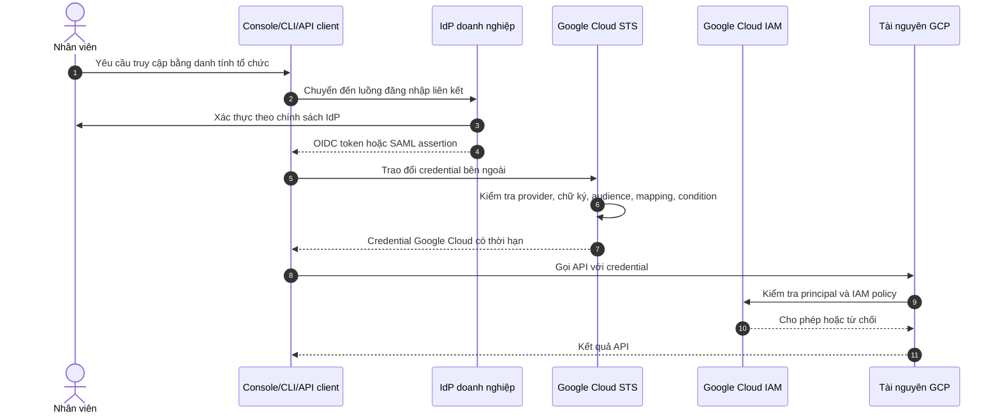
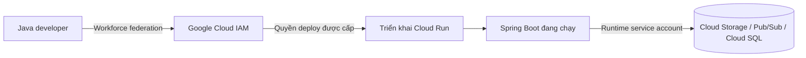

# Workforce Identity Federation cho người dùng tổ chức

## 1. Bài toán: cho nhân sự đăng nhập Google Cloud bằng danh tính doanh nghiệp

Một doanh nghiệp có hàng trăm lập trình viên Java, kỹ sư vận hành và chuyên gia bảo mật. Nhân sự đã có tài khoản trong hệ thống danh tính tập trung như **Microsoft Entra ID**, **Okta** hoặc một Identity Provider (IdP) hỗ trợ **OpenID Connect (OIDC)** hay **SAML 2.0**. Khi nhóm triển khai ứng dụng Spring Boot lên **Cloud Run**, quản lý cluster **GKE**, kiểm tra máy ảo **Compute Engine** hoặc theo dõi ngân sách, họ cần truy cập Google Cloud với quyền phù hợp.

Nếu tạo một tài khoản Google Cloud riêng không được quản trị tập trung cho từng người, tổ chức phải xử lý thêm vòng đời tài khoản, thay đổi nhóm quyền, khóa tài khoản khi nghỉ việc và đối soát truy cập. **Workforce Identity Federation** cho phép **người dùng tổ chức** đăng nhập vào các sản phẩm Google Cloud được hỗ trợ bằng danh tính từ IdP bên ngoài, sau đó được **Google Cloud IAM** đánh giá quyền truy cập. Mô hình này không yêu cầu đồng bộ từng danh tính bên ngoài thành một người dùng Cloud Identity/Google Workspace tương ứng.

Trong chương **IAM và xác thực** của mô-đun **CLOUD_PROVIDERS_GCP**, bài học tập trung vào hành trình **người dùng → IdP → Workforce Identity Pool → Google Cloud IAM → tài nguyên**, cách cấu hình niềm tin giữa hai hệ thống và cách giới hạn quyền theo nhóm, thuộc tính. Đây là kỹ năng nền tảng để tổ chức bảo vệ tài nguyên, vận hành hệ thống Java, phát hành phần mềm và điều tra sự cố trên GCP.

### Kết quả học tập

Sau bài này, bạn có thể:

1. Giải thích mục đích và phạm vi của **Workforce Identity Federation (WIF)**, phân biệt với **Workload Identity Federation** và các loại SSO khác.
2. Trình bày vai trò của **workforce identity pool**, **pool provider**, **IdP token/assertion**, **Security Token Service (STS)**, **attribute mapping**, **attribute condition** và **IAM allow policy**.
3. Thiết kế quy trình cấp quyền cho **nhân viên, nhà thầu và nhóm vận hành** mà không sử dụng một vai trò quá rộng cho toàn bộ người đăng nhập.
4. Mô tả các bước cấu hình OIDC/SAML, thử đăng nhập trên **Google Cloud console (federated)**, **gcloud CLI** và API/client library có hỗ trợ.
5. Chẩn đoán lỗi issuer/audience, claim mapping, group membership, IAM, quota project và token hết hạn; giám sát hoạt động và thu hồi quyền.

## 2. Phân biệt Workforce với các giải pháp nhận dạng khác

| Công nghệ | Danh tính chính | Trường hợp phù hợp | Điều cần nhớ |
| --- | --- | --- | --- |
| **Workforce Identity Federation** | **Con người**: nhân viên, đối tác, nhà thầu | Dùng IdP bên ngoài để truy cập Google Cloud console, CLI và API được hỗ trợ | Đối tượng federated được ràng buộc IAM qua workforce pool; không cần đồng bộ toàn bộ user thành Google Account |
| **Workload Identity Federation** | **Ứng dụng/công việc** ngoài GCP, ví dụ pipeline GitHub hoặc workload Azure | Cấp danh tính cho máy, tránh dùng service account key dài hạn | Dùng **workload identity pool**, khác đối tượng và đường dẫn principal của workforce pool |
| **Workload Identity Federation for GKE** | Pod/workload Kubernetes trong GKE | Workload gọi API Google Cloud qua danh tính Kubernetes | Được cấu hình cho workload GKE; không thay thế đăng nhập người dùng tổ chức |
| **Cloud Identity / Google Workspace federation** | Người dùng có tài khoản Cloud Identity/Workspace tương ứng | Tổ chức dùng nhiều sản phẩm Google cần mô hình account đồng bộ | Có thể tích hợp IdP để SSO nhưng có yêu cầu quản trị danh tính Google khác với workforce federation |
| **Identity Platform / Firebase Authentication** | **Khách hàng cuối** của ứng dụng | Người dùng đăng nhập vào web/mobile/app nghiệp vụ | Không tự động cấp quyền quản trị Google Cloud project qua IAM |
| **Service account** | Ứng dụng chạy trên Cloud Run, GKE hoặc VM | Backend Java đọc Cloud Storage, publish Pub/Sub hoặc kết nối dịch vụ | Không dùng danh tính nhân sự cho quy trình nền tự động |

Ví dụ: **kỹ sư** dùng Workforce Identity Federation để truy cập Cloud Logging khi trực sự cố; **dịch vụ Spring Boot** chạy trên Cloud Run nên dùng runtime service account để gọi Cloud Storage; **GitHub Actions** ngoài GCP nên đánh giá Workload Identity Federation cho pipeline. Tách các loại danh tính giúp quyền truy cập được thu hồi, kiểm toán và giới hạn theo đúng chủ thể.

> Workforce Identity Federation là cơ chế **xác thực và liên kết danh tính**. Việc một người đăng nhập IdP thành công **không đồng nghĩa** người đó được quyền xem log, triển khai Cloud Run hoặc đọc secret. Các quyền này phải được cấp riêng bằng IAM trên tài nguyên phù hợp.

## 3. Các thành phần và đường đi của một phiên đăng nhập

### 3.1. Thành phần cốt lõi

| Thành phần | Nhiệm vụ | Ví dụ |
| --- | --- | --- |
| **Google Cloud organization** | Ranh giới sở hữu cấu hình workforce pool, cấp quyền cho các project/folder/resource bên dưới | Organization của doanh nghiệp |
| **Workforce identity pool** | Không gian tên để tổ chức các principal từ IdP, quản lý phiên và tập hợp provider | `corp-employees` |
| **Workforce pool provider** | Cấu hình quan hệ tin cậy với một IdP, protocol, issuer/metadata, mapping và condition | `entra-prod`, `okta-contractors` |
| **External IdP** | Xác thực người dùng theo chính sách của doanh nghiệp (MFA, account lifecycle, group) | Microsoft Entra ID, Okta hoặc OIDC/SAML IdP |
| **OIDC token / SAML assertion** | Mang thông tin người dùng và thuộc tính mà Google Cloud có thể kiểm chứng | `sub`, `groups`, tenant, department |
| **STS / cơ chế token exchange** | Kiểm tra credential bên ngoài và phát hành thông tin truy cập Google Cloud có thời hạn | Trao đổi theo OAuth 2.0 Token Exchange |
| **Google Cloud IAM** | Đánh giá principal, role, điều kiện và quyền trên tài nguyên đích | Cho nhóm trực vận hành đọc Cloud Logging |
| **Cloud Audit Logs** | Ghi nhận hoạt động theo loại log đã bật | Ai đã truy cập hoặc thay đổi cấu hình |

Workforce pool được tạo **ở cấp organization** và có thể được tham chiếu khi gán IAM trong các project/folder của organization. Trường hợp thông thường, pool/provider sử dụng location `global`; **pool ID phải duy nhất toàn cục**. Không tạo mỗi project một workforce pool chỉ để phân quyền: nên thiết kế pool theo nguồn IdP và dùng IAM binding trên project/resource cho phạm vi truy cập.

### 3.2. Sơ đồ xác thực và phân quyền



Sơ đồ mô tả **ranh giới trách nhiệm**; các bước thực tế khác nhau theo OIDC authorization code flow, SAML, CLI và API. Một số hệ thống trung gian sẽ trao đổi mã ủy quyền với IdP thay vì để token xuất hiện trực tiếp trong browser. Về nguyên tắc, **IdP chịu trách nhiệm xác thực**, **provider/STS kiểm chứng liên kết danh tính**, còn **IAM quyết định quyền trên tài nguyên**. Cấu hình MFA tại IdP không thay thế quyền IAM.

### 3.3. Claims, mapping và condition là ba khái niệm khác nhau

- **Claim/attribute của IdP**: dữ liệu IdP phát hành, chẳng hạn một ID người dùng ổn định, danh sách group ID hoặc tenant ID.
- **Attribute mapping**: biểu thức ánh xạ claim của IdP sang thuộc tính IAM như `google.subject`, `google.groups`, `attribute.department`.
- **Attribute condition**: biểu thức điều kiện tại provider quyết định **danh tính nào được phép liên kết/đổi token**. Điều kiện không tự tạo quyền đọc/ghi tài nguyên.

Thông thường, `google.subject` là thuộc tính quan trọng để nhận diện người dùng nhất quán. Nên chọn **định danh ổn định và không tái sử dụng**, đối chiếu hướng dẫn riêng của IdP vì cấu trúc ID/UPN/email có thể khác nhau. Với nhóm, ưu tiên ID có tính ổn định và nhóm chuyên dùng để cấp quyền.

## 4. OIDC và SAML: chọn protocol theo IdP

### 4.1. OpenID Connect (OIDC)

OIDC dựa trên OAuth 2.0, dùng ID token dạng JWT với các claim như **issuer (`iss`), audience (`aud`), subject (`sub`), expiration (`exp`)**. Đối với provider, cần có **issuer URI dùng HTTPS** và **client ID** trùng với audience mà IdP phát hành cho ứng dụng liên kết. Google Cloud xác minh token dựa trên cấu hình provider và khóa ký phù hợp.

Đối với đăng nhập bằng browser, **authorization code flow** thường được ưu tiên hơn implicit flow. Với code flow, token được trao đổi qua kênh backend phù hợp và có thể lấy thêm claim từ UserInfo endpoint nếu cấu hình cho phép. Nếu nhóm quyền không nằm trong token, cần kiểm tra cấu hình IdP và chính sách đưa thuộc tính vào ID token/UserInfo.

### 4.2. SAML 2.0

IdP phát hành một **SAML assertion** đã ký, trong đó chứa thông tin về subject và attributes. Khi cấu hình cần chú ý metadata của IdP, **SP Entity ID/audience**, **Assertion Consumer Service (ACS) URL**, chứng thư và vòng đời khóa ký. Ví dụ tên thuộc tính nhóm có thể khác nhau giữa các IdP; không thể giả định SAML luôn có `assertion.groups` như JWT.

### 4.3. So sánh theo yêu cầu triển khai

| Tiêu chí | OIDC | SAML 2.0 |
| --- | --- | --- |
| Credential đầu vào | OIDC ID token (JWT) | SAML assertion (XML, thường được mã hóa/đóng gói theo flow) |
| Metadata tin cậy | Issuer, client ID/audience, signing key/JWKS | SAML metadata, entity ID, certificate |
| Mapping ví dụ | `google.subject=assertion.sub` | `google.subject=assertion.subject` |
| Nhóm quyền | Claim `groups` nếu IdP phát hành | SAML attribute do IdP định nghĩa |
| Lưu ý | Cấu hình đúng tenant, redirect URL, audience, token size | Cấu hình đúng NameID, ACS, metadata, signing/encryption |

Chọn protocol mà **IdP và chính sách SSO của tổ chức** hỗ trợ ổn định. Cả hai đều có thể dùng Workforce Identity Federation nếu cấu hình đúng. Một provider cấu hình sai issuer, audience hoặc khóa ký sẽ làm quá trình liên kết thất bại trước khi IAM được đánh giá.

## 5. Thiết kế tổ chức: pool, provider, nhóm và phạm vi quyền

### 5.1. Đừng dùng workforce pool làm tập hợp quyền cho mọi project

Giả sử tổ chức có ba nhóm:

- **`gcp-java-developers`**: được xem thông tin cần thiết trong project phát triển và triển khai vào môi trường dev theo quy trình được cấp quyền.
- **`gcp-observability-readers`**: được đọc log/metric để hỗ trợ xử lý sự cố.
- **`gcp-security-auditors`**: được xem thông tin kiểm toán ở phạm vi công việc được phê duyệt.

Những group này được quản lý tại IdP. Workforce pool nhận group/attribute qua mapping; **IAM binding** tại project hoặc tài nguyên xác định group nào được làm gì. Cùng một người có thể thuộc nhiều group nhưng không cần một vai trò Owner/Editor trên toàn organization.

Nên quản lý group theo **quyền truy cập/nhóm nhiệm vụ cụ thể**, không lấy nhóm email thảo luận hoặc cơ cấu nhân sự rộng làm mặc định. Khi dùng nhiều IdP, kiến trúc có thể dùng những pool tách biệt theo từng IdP theo khuyến nghị chính thức, rồi gán IAM dựa trên principal của đúng pool đó. Khi cấp quyền cho đối tác, cần xác định mức độ tin cậy vào bảo mật IdP của đối tác trước khi cho federation trực tiếp.

### 5.2. Mapping và điều kiện: ví dụ OIDC minh họa

Giả sử IdP phát hành:

```json
{
  "iss": "https://id.example.org/oidc",
  "aud": "cloud-console-client",
  "sub": "user-immut-124",
  "groups": ["gcp-observability-readers"],
  "department": "engineering",
  "tenant": "trusted-tenant"
}
```

Đây chỉ là **payload giả định minh họa**; token OIDC thực tế còn được ký và chứa những claim bắt buộc khác. Trong cấu hình provider có thể khai báo:

```text
google.subject=assertion.sub
google.groups=assertion.groups
attribute.department=assertion.department
```

Nếu issuer phục vụ **nhiều tenant**, phải ràng buộc đúng tenant được phép, ví dụ:

```cel
assertion.tenant == 'trusted-tenant'
```

Tên `tenant` và dạng dữ liệu phải lấy từ **claim thực tế đã kiểm tra** của IdP; với Entra ID có thể là claim khác như `tid`. Không sao chép nguyên biểu thức ví dụ nếu IdP không cung cấp thuộc tính đó. Khi dùng nhiều tenant chung issuer, điều kiện không đúng có thể khiến tổ chức chấp nhận danh tính ngoài phạm vi mong muốn.

**Phân biệt:** mapping `google.groups` khiến Google Cloud biết người dùng thuộc nhóm nào; **nó không tự cấp role**. Chỉ sau khi có IAM policy binding cho principal set tương ứng, người dùng mới có quyền đối với tài nguyên được gán.

## 6. Cú pháp IAM principal và cách cấp quyền theo nhóm

Workforce federation cho phép tham chiếu người dùng hoặc tập người dùng trong IAM bằng các principal identifier:

| Đối tượng | Định dạng principal |
| --- | --- |
| Một người (subject) | `principal://iam.googleapis.com/locations/global/workforcePools/POOL_ID/subject/SUBJECT_VALUE` |
| Một nhóm từ `google.groups` | `principalSet://iam.googleapis.com/locations/global/workforcePools/POOL_ID/group/GROUP_ID` |
| Một thuộc tính tùy chọn | `principalSet://iam.googleapis.com/locations/global/workforcePools/POOL_ID/attribute.department/engineering` |
| Toàn bộ người dùng trong pool | `principalSet://iam.googleapis.com/locations/global/workforcePools/POOL_ID/*` |

**Tránh cấp role cho toàn bộ pool bằng dấu `*`.** Một người mới được IdP cho phép đăng nhập có thể lập tức thừa hưởng quyền rất lớn. Hãy dùng **nhóm truy cập chuyên trách** hoặc các principal set có attribute phù hợp, rồi giới hạn role và resource. Khuyến nghị này đặc biệt quan trọng với tài nguyên nhạy cảm như Secret Manager, production Cloud SQL và cấu hình IAM.

Ví dụ minh họa: quản trị viên được ủy quyền cấp **Logging Viewer** cho nhóm trực vận hành trên **project thử nghiệm**:

```bash
# Thay toàn bộ giá trị giữ chỗ, chạy bằng danh tính quản trị có quyền cấp IAM.
gcloud projects add-iam-policy-binding PROJECT_ID \
  --member="principalSet://iam.googleapis.com/locations/global/workforcePools/POOL_ID/group/gcp-observability-readers" \
  --role="roles/logging.viewer"
```

Một người thuộc `gcp-observability-readers` và đã đăng nhập qua provider có thể đọc log tương ứng theo quyền role và những policy/điều kiện áp dụng; người thuộc nhóm khác không tự nhận quyền này. Đối với tài nguyên chứa dữ liệu nhạy cảm, phải kiểm tra thêm **quyền Data Access logs, IAM Conditions, tổ chức và policy bảo mật** nếu có.

### 6.1. Service Usage Consumer và quota project

Khi sử dụng một số luồng trao đổi token của Workforce Identity Federation, người dùng liên kết cần quyền **`serviceusage.services.use`** trên **workforce pool user project** dùng cho quota và billing. Role ít đặc quyền chứa quyền này là `roles/serviceusage.serviceUsageConsumer`. Quyền đó **không thay cho** quyền đọc/ghi Cloud Storage hoặc quyền xem GKE. Khi báo lỗi quota project, kiểm tra quyền này và việc bật các API cần thiết, không cấp Owner để thử.

### 6.2. IAM evaluation vẫn theo nguyên tắc thông thường

IAM có thể bị giới hạn bởi các deny policies, IAM Conditions, Organization Policies hoặc những ranh giới truy cập được cấu hình. Cần phân biệt:

1. **Provider cho phép liên kết danh tính?** Token/claims và condition hợp lệ.
2. **IAM có binding đúng principal/role/resource?** Có quyền mục tiêu.
3. **Điều kiện hoặc lớp chính sách khác có từ chối?** Ví dụ IAM Condition hoặc deny policy.
4. **Dịch vụ đích có hỗ trợ federated identity ở cách dùng hiện tại?** Tra bảng hỗ trợ chính thức.

## 7. Quy trình cấu hình Workforce Identity Federation

### Bước 1 — Xác định điều kiện tiên quyết

Chuẩn bị một **Google Cloud organization**, quyền quản trị đủ để tạo workforce pool/provider và cấp IAM theo cơ chế nội bộ; một **IdP tương thích OIDC hoặc SAML**; cùng project thử nghiệm để phân quyền. Cần có người phụ trách IdP và Google Cloud phối hợp để khai báo **redirect URL, issuer/audience, group claim** và chính sách MFA.

Kiểm tra các API liên quan theo tài liệu hiện hành (ví dụ **IAM API**, **Security Token Service API**, **Cloud OAuth API** khi luồng yêu cầu). Cần phân biệt **organization number**, **project ID**, **project number** và **pool ID**; các định danh này không thể thay thế nhau.

### Bước 2 — Tạo workforce identity pool ở cấp organization

Ví dụ lệnh CLI minh họa khi tổ chức đã phê duyệt và đã có danh tính quản trị có quyền:

```bash
gcloud iam workforce-pools create POOL_ID \
  --organization=ORGANIZATION_NUMBER \
  --display-name="Corporate workforce" \
  --description="External corporate identities" \
  --session-duration=3600s \
  --location=global
```

**Thay toàn bộ chữ IN HOA** trước khi chạy. `POOL_ID` phải duy nhất toàn cục. Thời lượng phiên mặc định hiện được tài liệu Google Cloud nêu là **1 giờ**; cấu hình thường cho phép từ **15 phút đến 12 giờ**, tùy giới hạn đang áp dụng. Chọn thời lượng dựa trên mức độ nhạy cảm, thời gian thao tác thực tế và quy trình cấp quyền tạm thời.

### Bước 3 — Đăng ký ứng dụng ở IdP và tạo provider

**Với OIDC:** đăng ký một ứng dụng tích hợp Google Cloud tại IdP, lấy issuer URL và client ID, cấu hình claim và redirect URL. Với đăng nhập Console/CLI qua browser, redirect URI thường có dạng:

```text
https://auth.cloud.google/signin-callback/locations/global/workforcePools/POOL_ID/providers/PROVIDER_ID
```

Tạo provider trong **Google Cloud Console → IAM → Workforce Identity Pools → chọn pool → Add Provider**, chọn OIDC, nhập issuer URI/client ID, lựa chọn authorization code flow và những thiết lập được hướng dẫn. Nếu IdP yêu cầu client secret, quản lý secret theo quy trình an toàn, tránh đưa secret vào tài liệu công khai, Git hoặc lịch sử lệnh terminal. Áp dụng mapping và attribute condition rồi dùng chức năng **Debug IdP token/Validate provider attributes** để xác nhận giá trị thực tế.

**Với SAML:** đăng ký ứng dụng tại SAML IdP, cấu hình **SP Entity ID** và **ACS URL**, tải metadata chứng thư cần thiết, tạo SAML provider và mapping SAML attributes sang Google Cloud attributes. Theo dõi vòng đời **signing certificate** khi định kỳ xoay khóa để tránh gián đoạn đăng nhập.

Giá trị `POOL_ID`/`PROVIDER_ID` trong URL và cấu hình phải khớp provider thực tế. Provider được tạo nhưng mapping thiếu `google.subject`, nhóm nhận không đúng hoặc condition luôn `false` vẫn khiến đăng nhập thất bại hoặc quyền không khớp.

### Bước 4 — Gán IAM trên project hoặc tài nguyên

Tạo **access group** tại IdP (ví dụ `gcp-observability-readers`), đưa một người dùng thử nghiệm vào nhóm và xác minh nhóm xuất hiện sau mapping. Gán một role hẹp như `roles/logging.viewer` trên project demo bằng principal set của group. Không gán vai trò `roles/owner` hay `roles/editor` chỉ để chứng minh WIF hoạt động.

Với quyền quản trị tạo resource hoặc deploy Cloud Run/GKE, chia role theo trách nhiệm: **người xem**, **người triển khai**, **người quản lý IAM** và **runtime service account** là những chủ thể khác nhau.

### Bước 5 — Kiểm thử đăng nhập bằng gcloud CLI

Google Cloud CLI có thể tạo **login configuration** cho browser sign-in:

```bash
gcloud iam workforce-pools create-login-config \
  locations/global/workforcePools/POOL_ID/providers/PROVIDER_ID \
  --output-file=login-config.json

gcloud auth login --login-config=login-config.json
gcloud auth list
```

Lệnh `create-login-config` tạo tệp chứa thông tin cấu hình endpoint/audience, **không phải private key của IdP**. Tuy nhiên phải bảo vệ tính **toàn vẹn của tệp** vì sửa endpoint có thể làm sai hướng xác thực. Lệnh `gcloud auth login` lưu credential phiên cục bộ; nên dùng máy có kiểm soát truy cập và không chia sẻ user profile. Trong Windows PowerShell, các lệnh nhiều dòng dùng ký tự tiếp dòng **backtick** hoặc viết trên một dòng; dấu `\` ở cuối dòng trong ví dụ trên dành cho Bash.

Để thử quyền sau khi đăng nhập:

```bash
gcloud config set project PROJECT_ID
gcloud logging logs list --project=PROJECT_ID
```

So sánh hai người dùng: một thuộc access group hợp lệ và một không thuộc nhóm. Người không có quyền có thể **đăng nhập thành công** nhưng gặp `PERMISSION_DENIED` khi truy cập log; đó là bằng chứng IAM đang đánh giá riêng với xác thực.

### Bước 6 — Đăng nhập Google Cloud console (federated)

Người dùng có thể truy cập **Google Cloud console (federated)** qua liên kết đăng nhập được cấu hình cho workforce provider và hoàn thành luồng tại IdP. Giao diện và phạm vi dịch vụ có thể khác Console dành cho Google Account thông thường. Tổ chức cần cung cấp **đúng URL đăng nhập của provider**, chính sách MFA, quy tắc cấp quyền và tài liệu khôi phục khi IdP gặp sự cố.

Kiểm tra [bảng sản phẩm hỗ trợ identity federation](https://cloud.google.com/iam/docs/federated-identity-supported-services) trước khi cam kết mọi tính năng Console/CLI/API đều hoạt động giống Google Account.

## 8. Token ngắn hạn và truy cập API bằng Java

### 8.1. Browser login, CLI và credential file là các luồng khác nhau

Workforce Identity Federation có thể đổi token bên ngoài sang credential Google Cloud **có thời hạn** qua STS. Tùy loại provider và môi trường, người dùng có thể:

- Đăng nhập qua **browser** trên Console (federated).
- Dùng `gcloud auth login --login-config=...` để tương tác CLI với IdP trong browser.
- Dùng **external account credential configuration** khi phải lấy token từ file, URL hoặc executable có hỗ trợ, rồi để Google Auth Library/client library thực hiện exchange.

Không đồng nhất `gcloud auth login` với **Application Default Credentials (ADC)** mà Java đang đọc. Nếu chạy thư viện Java, phải biết **nguồn credential đang được client library chọn**. Nhiều Google Cloud Client Libraries for Java hỗ trợ workforce pools, nhưng phạm vi hỗ trợ có thể khác nhau theo sản phẩm/phiên bản.

### 8.2. Ví dụ cấu hình external account từ OIDC token có sẵn

Nếu IdP đã cấp một **OIDC ID token còn hiệu lực** vào tệp được bảo vệ, có thể tạo credential configuration:

```bash
gcloud iam workforce-pools create-cred-config \
  locations/global/workforcePools/POOL_ID/providers/PROVIDER_ID \
  --subject-token-type=urn:ietf:params:oauth:token-type:id_token \
  --credential-source-file=PATH_TO_IDP_ID_TOKEN_FILE \
  --workforce-pool-user-project=USER_PROJECT_ID \
  --output-file=workforce-cred.json
```

`workforce-cred.json` là **tệp cấu hình**, không phải service account key. **Tệp ID token nguồn mới là credential nhạy cảm** và phải được tạo/cập nhật bởi luồng IdP an toàn trước khi hết hạn. Người dùng phải có `serviceusage.services.use` trên quota/user project phù hợp. Không sao chép token thật vào tài liệu, repository hoặc log.

Đối với `gcloud`, tài liệu còn hướng dẫn đăng nhập bằng `gcloud auth login --cred-file=workforce-cred.json` khi loại credential được hỗ trợ. Với **Java client library**, cấu hình ADC bằng cách trỏ `GOOGLE_APPLICATION_CREDENTIALS` đến file external account trong môi trường thực thi phù hợp, sau đó để thư viện tự lấy credential:

```java
import com.google.auth.oauth2.GoogleCredentials;
import java.io.IOException;

public final class FederationCredentialCheck {
    public static GoogleCredentials load() throws IOException {
        // Tôn trọng ADC của môi trường; không chứa token hay key trong mã nguồn.
        return GoogleCredentials.getApplicationDefault();
    }
}
```

Phần này yêu cầu dependency Google Auth Library phù hợp. Việc tải được credential **chưa** chứng minh API GCP cho phép thao tác; test cần gọi API cụ thể với đúng principal, IAM role, quota project và service hỗ trợ federated identity. Ví dụ không phải chương trình chạy nền để đổi token thay mặt mọi người.

### 8.3. Java backend chạy trên GCP nên dùng danh tính nào?

Giả sử kỹ sư đăng nhập qua WIF rồi deploy Spring Boot lên **Cloud Run**. Khi API được chạy, code Java thường sử dụng **runtime service account của Cloud Run**, không mang theo token đăng nhập của kỹ sư. Đây là chủ đích:



Workforce Identity Federation dùng cho **con người quản trị/tác nghiệp**; service account/Workload Identity Federation dùng cho **workload**. Không dùng credential của developer để ứng dụng production truy cập cơ sở dữ liệu hoặc lưu trữ.

## 9. Bảo mật, vòng đời nhân sự và kiểm toán

### 9.1. Nguyên tắc tối thiểu

1. **MFA và chính sách thiết bị tại IdP:** bảo vệ đầu vào của phiên đăng nhập; cần đặc biệt lưu ý tài khoản quản trị.
2. **Giới hạn provider theo issuer và tenant tin cậy:** xác minh đối tượng mà token đại diện; sử dụng attribute conditions khi cùng issuer phục vụ nhiều tenant.
3. **Mapping ID ổn định:** tránh ID có thể cấp lại cho người khác; nếu tái sử dụng subject, IAM binding cũ có thể cấp quyền nhầm người mới.
4. **Cấp IAM theo nhóm truy cập chuyên trách:** không gán wildcard toàn pool, tránh role quá rộng; dùng project/resource scope và điều kiện phù hợp.
5. **Định thời lượng phiên hợp lý:** phiên dài làm tăng thời gian tác động khi token/thiết bị bị đánh cắp hoặc group membership thay đổi.
6. **Tách emergency access:** lưu tài khoản khẩn cấp Cloud Identity/Google Workspace được kiểm soát chặt, không phụ thuộc hoàn toàn vào IdP bên ngoài.
7. **Giám sát token exchange và hành động quản trị:** bật log phù hợp, theo dõi thay đổi pool/provider và binding, xây runbook.

### 9.2. Onboarding và offboarding

Đối với nhân viên mới, tổ chức xác nhận danh tính tại IdP, thêm vào **access group** đúng chức năng và cho đăng nhập. Quyền Google Cloud được tính theo attribute/group nhận từ IdP và các policy hiện có, nên thường không cần tạo user Google riêng cho từng thành viên.

Khi nhân viên đổi nhóm hoặc nghỉ việc:

- **Thu hồi/quản lý group tại IdP**, vô hiệu hóa tài khoản theo quy trình.
- **Kiểm tra phiên/token đang tồn tại**, cần thu hồi session trong Google Cloud khi rủi ro cao hoặc cần cắt quyền khẩn cấp; thay đổi group ở IdP có thể **chưa phản ánh ngay** trong phiên đã tạo.
- **Kiểm tra quyền IAM gán trực tiếp theo subject**, nếu có, và các ngoại lệ; tránh chỉ xóa group nhưng bỏ sót IAM binding cá nhân.
- **Đối soát Cloud Audit Logs** theo thời gian xảy ra sự kiện, ghi lại ai thực hiện và kết quả.

Nếu IdP ngừng hoạt động hoặc cấu hình provider sai, nhân viên có thể không đăng nhập được dù tài nguyên GCP vẫn khỏe mạnh. Chính sách **break-glass/emergency access** cần được diễn tập và tách biệt IdP chính.

### 9.3. Audit Logs và tính riêng tư

Google Cloud có thể ghi principal federated trong audit log khi họ thực hiện thao tác trên tài nguyên. **Đăng nhập và trao đổi token** qua Security Token Service được ghi vào các loại **Data Access logs** cần được bật theo phạm vi tổ chức; những log này không nhất thiết bật sẵn. Có thể bật **detailed audit logging** của provider để tăng khả năng điều tra, nhưng cần đánh giá dữ liệu thuộc tính có thể xuất hiện trong log, chính sách lưu giữ và chi phí.

Nên theo dõi các sự kiện: thay đổi cấu hình provider, chỉnh sửa mapping/condition, gán role cho nhóm rộng, tăng thất bại token exchange, và hoạt động đăng nhập từ tài khoản có quyền nhạy cảm. Không ghi ID token/SAML assertion nguyên vẹn vào application logs hoặc hệ thống hỗ trợ.

## 10. Chẩn đoán sự cố theo từng lớp

| Hiện tượng | Lớp có khả năng lỗi | Cách kiểm tra |
| --- | --- | --- |
| Không chuyển đến IdP hoặc redirect lỗi | Cấu hình browser sign-in | Redirect URI/ACS, provider ID, app registration, session IdP |
| STS không chấp nhận token | Trust/token validation | Issuer, audience/client ID, chữ ký/JWKS, thời hạn, metadata SAML |
| Mapping không tạo được `google.subject` | Attribute mapping | Claim có tồn tại? Kiểu dữ liệu, CEL expression, SAML NameID |
| Đăng nhập bị chặn bởi condition | Attribute condition | Giá trị tenant/group trong token thật; kiểm tra biểu thức trả true/false |
| Đăng nhập được nhưng truy cập project bị từ chối | IAM authorization | Principal string, group value, role, resource, IAM Conditions/deny |
| Lỗi `serviceusage.services.use` | Quota/user project | Project đúng chưa, quyền Service Usage Consumer, các API liên quan |
| CLI chạy nhưng Java `GoogleCredentials.getApplicationDefault()` lỗi | Credential discovery | ADC path, cấu hình external account, token nguồn, hỗ trợ của client library |
| Người vừa được thêm nhóm nhưng chưa có quyền | Session/claims cũ | Đăng nhập lại, kiểm tra claim mới, thời lượng session và IAM binding |
| Một tính năng Console không hoạt động với federated user | Hỗ trợ sản phẩm | Đối chiếu bảng supported products và limitations, xác định đường API khác nếu có |
| Token exchange bỗng thất bại hàng loạt | IdP hoặc quota/provider | Trạng thái IdP, sửa đổi khóa, quota STS, logs và cấu hình pool |

**Trình tự debug nên làm:** xác nhận IdP authentication → kiểm tra provider và token exchange → kiểm tra claims/mapping/condition → kiểm tra IAM principal/role/resource → kiểm tra chính sách và API của sản phẩm. Cách này tránh sửa IAM một cách tùy tiện khi nguyên nhân là thiếu claim hoặc token hết hạn.

**Khi có nguy cơ compromise:** phối hợp đội identity/security thu hồi phiên người dùng, vô hiệu hóa account/IdP access cần thiết, thu hồi IAM binding rộng và đánh giá audit logs. Với sự cố diện rộng liên quan provider, phải cân nhắc tác động đến người dùng hợp lệ trước khi tạm dừng provider; dùng lối truy cập khẩn cấp đã chuẩn bị.

## 11. Tình huống triển khai thực tế cho đội Java

Giả sử một nhóm vận hành quản lý:

- Project **`java-dev`**: lập trình viên deploy bản thử nghiệm Spring Boot lên Cloud Run, xem log cần thiết.
- Project **`java-prod`**: chỉ nhóm phát hành có quyền triển khai, nhóm trực vận hành chỉ xem telemetry theo role được cấp.
- Dịch vụ Java production: dùng **runtime service account riêng** để đọc Cloud SQL, Cloud Storage hoặc Pub/Sub.
- Đội tài chính: chỉ xem Billing và số liệu phù hợp, không cần quyền tạo VM hoặc quản trị IAM.

Đề xuất thiết kế quyền:

| Danh tính/nhóm | Đích | Quyền theo nhu cầu | Nguyên tắc |
| --- | --- | --- | --- |
| `gcp-java-dev-deployers` | Project dev | Role triển khai Cloud Run và quyền service account liên quan ở phạm vi cần thiết | Có quy trình xét duyệt; không cấp Owner |
| `gcp-prod-release-operators` | Project prod | Vai trò phát hành cụ thể, bảo vệ bằng quy trình/JIT khi phù hợp | Tách người phát hành và workload |
| `gcp-observability-readers` | Project dev/prod | `roles/logging.viewer` và quyền xem metrics cần thiết | Đọc dữ liệu phục vụ quan sát; xem xét mức độ nhạy cảm của log |
| `gcp-billing-readers` | Billing account hoặc nguồn báo cáo được phép | Vai trò xem billing theo phạm vi thích hợp | Không gán role dự án không liên quan |
| Cloud Run runtime service account | Bucket/topic/DB cần thiết | Chỉ các quyền nghiệp vụ tương ứng | Không dùng session WIF của developer |

**Thử nghiệm kiểm chứng:**

1. Một developer được IdP xác thực vào workforce pool và thuộc `gcp-java-dev-deployers`.
2. Developer có thể truy cập đúng tài nguyên dev theo IAM, nhưng không tự có quyền deploy vào prod.
3. Một người thuộc `gcp-observability-readers` xem log; khi gỡ group và đăng nhập lại, quyền được tính lại theo claim mới.
4. Một user không thuộc access group vẫn có thể xác thực IdP nhưng nhận lỗi quyền với tài nguyên được bảo vệ.
5. Ứng dụng Spring Boot đang chạy tiếp tục sử dụng runtime service account; thay đổi nhóm của developer không làm thay đổi danh tính của service.

## 12. Bài thực hành, câu hỏi đánh giá và checklist

### Bài tập A — Vẽ kiến trúc WIF

Vẽ đường đi `Developer → OIDC/SAML IdP → workforce pool/provider → STS → IAM → Cloud Run project`. Ghi rõ ở bước nào **người dùng xác thực**, bước nào **Google Cloud xác minh token**, và bước nào **quyết định quyền**. Giải thích vì sao gán role cho toàn workforce pool là một lựa chọn thiếu an toàn.

### Bài tập B — Lập bảng mapping và IAM

Từ ba user giả định `dev-a`, `sre-b`, `finance-c` với group khác nhau, lập mapping `google.subject` và `google.groups`. Xác định principalSet cho mỗi access group, chọn role và project/resource phù hợp. Có ít nhất một thử nghiệm **đăng nhập thành công nhưng không có quyền** để chứng minh phân tách authentication/authorization.

### Bài tập C — Đăng nhập qua môi trường được quản trị

Trong tổ chức có IdP/GCP được cấp quyền, tạo hoặc sử dụng một provider thử nghiệm theo chính sách. Kiểm tra `Debug IdP token`, sign-in bằng `gcloud auth login --login-config`, gọi một API read-only và xác minh log. Nếu không có quyền quản trị organization/IdP, làm **lab thiết kế trên giấy** bằng claims giả định, không tạo tài nguyên thật.

### Bài tập D — Diễn tập lỗi và thu hồi quyền

Trong môi trường thử nghiệm được phép, lần lượt mô phỏng sai group claim, IAM binding thiếu, condition loại một tài khoản test và quota project thiếu `serviceusage.services.use`. Chẩn đoán từng trường hợp bằng chuỗi xác thực → federation → IAM. Thực hiện thay đổi nhóm, đăng nhập lại để quan sát tác động đến quyền.

### Checklist

- [ ] Tôi giải thích đúng đối tượng của Workforce, Workload Identity Federation và Identity Platform.
- [ ] Tôi biết pool nằm ở cấp organization, provider kết nối IdP và STS đổi token có thời hạn.
- [ ] Tôi phân biệt OIDC issuer/audience/subject với SAML metadata/ACS/NameID.
- [ ] Tôi hiểu `google.subject`, `google.groups`, mapping và provider attribute condition.
- [ ] Tôi viết đúng principal string cho subject, group và attribute; tránh wildcard toàn pool.
- [ ] Tôi biết gán role IAM theo resource, nhóm chức năng và nguyên tắc least privilege.
- [ ] Tôi phân biệt phiên gcloud/browser với ADC của ứng dụng Java và runtime service account.
- [ ] Tôi có phương án quota project, lỗi token exchange, session expiry và giới hạn dịch vụ.
- [ ] Tôi có quy trình offboarding, revoke session, emergency access và audit logging.
- [ ] Tôi chứng minh được việc đăng nhập thành công **không** tự tạo quyền truy cập tài nguyên.

Workforce Identity Federation đạt mục đích khi tổ chức có thể dùng danh tính nhân sự sẵn có để truy cập Google Cloud, **quản lý quyền chi tiết bằng IAM**, thu hồi quyền theo vòng đời công việc và điều tra hành động bằng log. Người phát triển Java cần hiểu ranh giới này để quản lý Cloud Run, GKE, Compute Engine, dữ liệu và ngân sách một cách an toàn, trong khi code backend vẫn chạy với danh tính workload riêng.

## 13. Tài liệu chính thức để tra cứu và đối chiếu

- [Workforce Identity Federation — overview](https://cloud.google.com/iam/docs/workforce-identity-federation)
- [Configure Workforce Identity Federation](https://cloud.google.com/iam/docs/configuring-workforce-identity-federation)
- [Obtain short-lived tokens for Workforce Identity Federation](https://cloud.google.com/iam/docs/workforce-obtaining-short-lived-credentials)
- [Principal identifiers for IAM](https://cloud.google.com/iam/docs/principal-identifiers)
- [Best practices for Workforce Identity Federation](https://cloud.google.com/iam/docs/best-practices-workforce-identity-federation)
- [Federated identity — supported products and limitations](https://cloud.google.com/iam/docs/federated-identity-supported-services)
- [Architecture patterns for identity federation](https://cloud.google.com/iam/docs/federated-identity-architectures)
