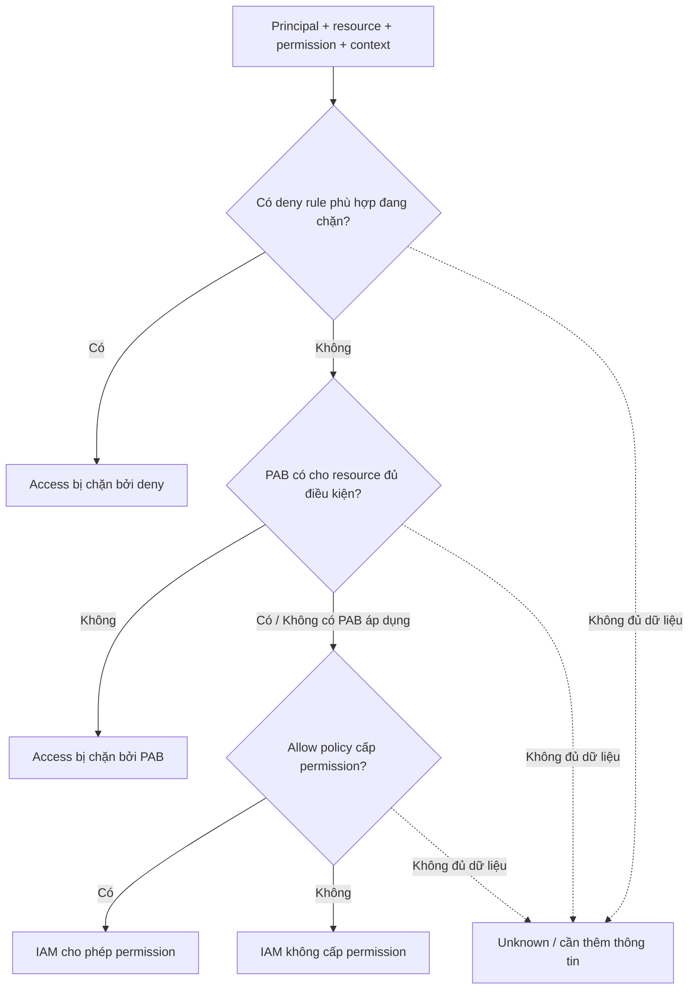
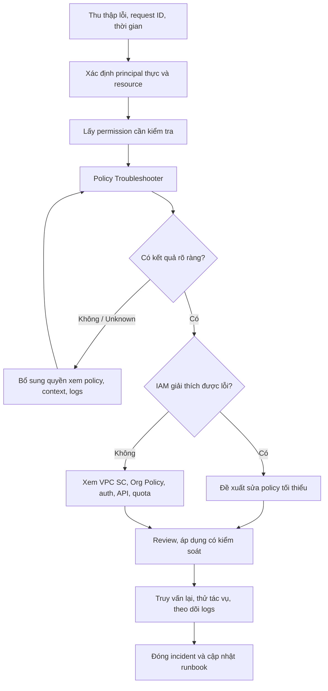

# Policy Troubleshooter và phân tích lỗi cấp quyền

Một pipeline triển khai Cloud Run đang hoạt động bỗng báo `PERMISSION_DENIED`. Người vận hành thấy service account đã được gán một vai trò phù hợp nên cho rằng Google Cloud IAM bị lỗi. Trên thực tế, quyền có thể chưa được **allow**, bị **deny** ở cấp folder/organization, bị giới hạn bởi **Principal Access Boundary**, không thỏa mãn **IAM Condition**, hoặc yêu cầu được gửi bằng một **danh tính khác** với danh tính đang được kiểm tra.

Trong module **CLOUD_PROVIDERS_GCP**, sau khi học cách tổ chức project, IAM, VPC và lựa chọn Compute Engine, GKE, Cloud Run, lưu trữ hay cơ sở dữ liệu, người vận hành cần biết **chứng minh tại sao một thao tác được phép hoặc bị từ chối**. Bài này hướng dẫn quy trình đó bằng **Policy Troubleshooter**, Cloud Audit Logs và các phép kiểm tra bổ sung. Mục tiêu là sửa đúng nguyên nhân, duy trì đặc quyền tối thiểu và giảm nguy cơ ảnh hưởng đến production.

> Các project, email, tên tài nguyên, sự kiện và kết quả truy vấn bên dưới đều **giả định**. Không có truy vấn nào trong bài được thực thi lên project thực tế.

## Mục tiêu học tập

Sau bài học, bạn có thể:

1. Mô tả cách **allow policy**, **deny policy** và **Principal Access Boundary (PAB)** ảnh hưởng đến quyền truy cập.
2. Xây dựng một truy vấn Policy Troubleshooter bằng **principal + full resource name + permission**, kèm context khi có điều kiện.
3. Đọc kết quả `Granted`, `Not granted`, `Denied` và `Unknown` mà không nhầm “không đủ dữ liệu” với “không có quyền”.
4. Sử dụng console, `gcloud` và thông tin từ Cloud Audit Logs để tìm binding, deny rule hoặc điều kiện gây lỗi.
5. Phân biệt lỗi IAM với xác thực, impersonation, VPC Service Controls, Organization Policy, API chưa bật và resource không tồn tại.
6. Lập phương án khắc phục theo **least privilege**, kiểm chứng sau thay đổi và lưu chứng cứ phục vụ kiểm toán.

## 1. Bắt đầu từ một yêu cầu cụ thể

Policy Troubleshooter trả lời một câu hỏi có cấu trúc:

> **Principal P** có quyền **permission X** đối với **resource R** theo các IAM policy có hiệu lực hay không?

Ba thành phần này thường được gọi là **access tuple**:

| Thành phần | Ví dụ | Cần xác định |
| --- | --- | --- |
| **Principal** | `ci-deployer@retail-prod-01.iam.gserviceaccount.com` | Danh tính thực sự dùng token khi gửi yêu cầu |
| **Resource** | `//cloudresourcemanager.googleapis.com/projects/retail-prod-01` | Tên đầy đủ của tài nguyên chịu kiểm tra quyền |
| **Permission** | `resourcemanager.projects.get` | Quyền IAM của thao tác cụ thể, không phải tên vai trò |

Để chẩn đoán chính xác, ghi thêm **thời điểm**, **phương thức API**, **project/region/zone**, **error ID**, **request ID** và **condition context** nếu có. Nếu một thao tác cần nhiều quyền, phải kiểm tra **từng permission trên đúng resource tương ứng**.

Ví dụ, người triển khai Cloud Run có thể cần:

- `run.services.update` trên Cloud Run service khi cập nhật dịch vụ.
- `iam.serviceAccounts.actAs` trên **service account chạy workload** khi gắn danh tính đó vào service.
- `artifactregistry.repositories.downloadArtifacts` trên repository chứa container image, tùy quy trình triển khai.

Có quyền thứ nhất **không chứng minh** hai quyền còn lại được cấp. Do đó một kết quả `GRANTED` cho `run.services.update` chưa đủ kết luận toàn bộ lệnh deploy sẽ thành công.

## 2. Cách IAM quyết định quyền truy cập

### 2.1 Allow policy: quyền phải được cấp rõ ràng

**IAM allow policy** chứa **role bindings**: một vai trò gồm các permission, được gắn cho principal (người dùng, nhóm, service account...) trên tài nguyên. Các binding từ cấp **organization → folder → project → tài nguyên con** có thể được kế thừa xuống theo phạm vi dịch vụ hỗ trợ.

Ví dụ, nhóm `group:retail-developers@example.com` được cấp `roles/viewer` ở folder Retail có thể nhận quyền đọc tương ứng trên các project con. Tuy nhiên, một vai trò có tên “Viewer” **không có nghĩa** sở hữu mọi permission đọc trong mọi sản phẩm: phải kiểm tra permission cụ thể trong vai trò và loại tài nguyên áp dụng.

### 2.2 Deny policy: một quy tắc deny phù hợp có thể chặn allow

**IAM deny policy** chứa các quy tắc chặn những permission được hỗ trợ cho principal thuộc phạm vi quy tắc. Deny policy có thể được gắn tại organization, folder hoặc project và ảnh hưởng đến tài nguyên bên dưới theo quy tắc kế thừa.

Trong đánh giá IAM, **một deny rule phù hợp có hiệu lực sẽ chặn permission ngay cả khi allow policy có binding cấp quyền đó**, trừ trường hợp principal được ngoại lệ hoặc điều kiện deny không áp dụng. Vì vậy, thêm `roles/editor` hoặc `roles/owner` thường không giải quyết được một deny rule đang chặn.

### 2.3 Principal Access Boundary: giới hạn nơi principal đủ điều kiện truy cập

**Principal Access Boundary (PAB)** có thể giới hạn **tập tài nguyên** mà principal được phép xem xét cấp quyền truy cập. PAB **không tự cấp permission**. Một principal có allow binding hợp lệ vẫn có thể không được sử dụng permission nếu tài nguyên nằm ngoài tập đủ điều kiện do PAB quy định.

Tính năng phân tích PAB trong Policy Troubleshooter được tài liệu Google Cloud ghi ở giai đoạn **Preview**; hành vi và mức hỗ trợ có thể thay đổi. Đối với các principal hoặc dạng policy đặc thù, cần đọc giới hạn hiện hành của phiên bản công cụ trước khi kết luận.

### 2.4 IAM Conditions: quyền phụ thuộc hoàn cảnh yêu cầu

Một allow binding hoặc deny rule có thể mang **condition** dùng thông tin về tài nguyên, thời gian, tag hoặc thuộc tính hỗ trợ khác. Ví dụ:

```cel
request.time < timestamp("2027-01-01T00:00:00Z")
```

Một binding với điều kiện trên chỉ có hiệu lực cho yêu cầu tại thời điểm phù hợp. Nếu câu hỏi dùng thời gian không xác định, công cụ có thể trả về **Unknown/Unknown conditional**. Cần cung cấp thời điểm thật của request, cùng các thuộc tính liên quan, thay vì giả định condition đang `true`.

### 2.5 Mô hình quyết định



Đây là sơ đồ **khái niệm** để học, không mô tả trình tự xử lý nội bộ của Google Cloud. Một kết quả cho phép theo IAM vẫn có thể thất bại ở bước **xác thực, API enablement, Organization Policy, VPC Service Controls, quota, cấu hình tài nguyên hoặc kiểm tra riêng của dịch vụ**.

## 3. Policy Troubleshooter cung cấp những gì?

Policy Troubleshooter thuộc bộ công cụ **Policy Intelligence**. Với một access tuple, nó truy xét các **allow/deny/PAB policy có liên quan mà người thực hiện được quyền xem** và giải thích ảnh hưởng của binding hoặc rule đến kết luận.

Các đầu ra đáng quan tâm:

| Kết quả / nhóm dữ liệu | Ý nghĩa vận hành |
| --- | --- |
| **Overall access state** | Trạng thái tổng hợp của quyền được hỏi dựa trên policy được công cụ hỗ trợ |
| **Allow policy explanation** | Vai trò nào chứa permission, binding nào khớp principal, ở tài nguyên nào và điều kiện có thỏa mãn không |
| **Deny policy explanation** | Quy tắc deny nào khớp permission/principal và trường hợp ngoại lệ hoặc điều kiện liên quan |
| **PAB explanation** | Tài nguyên có nằm trong phạm vi principal đủ điều kiện hay không, khi tính năng hỗ trợ |
| **Condition explanation** | Giá trị của điều kiện và context được dùng để đánh giá |
| **Unknown / thiếu thông tin** | Không đủ quyền đọc policy/role, không xác định được nhóm hoặc condition thiếu context |

**Kết quả Policy Troubleshooter là đánh giá policy**, không phải việc công cụ đã thử thực thi hành động như đọc dữ liệu, tạo VM hay deploy. Nó cũng không làm thay đổi quyền khi chỉ chạy truy vấn.

### Quyền cần để chẩn đoán

- **Bật Policy Troubleshooter API** (`policytroubleshooter.googleapis.com`) trong project phù hợp nếu chưa bật; thao tác bật API cần `serviceusage.services.enable`.
- Cần quyền xem **allow/deny policy, custom role** và những policy/identity liên quan để thấy đủ lý do. Vai trò **Security Reviewer** (`roles/iam.securityReviewer`) và **Deny Reviewer** (`roles/iam.denyReviewer`) là các ví dụ được tài liệu gợi ý trong phạm vi phù hợp; quyền cần thiết còn phụ thuộc vị trí tài nguyên và loại policy.
- Việc truy vấn thông qua CLI có thể cần quyền/quota project liên quan, chẳng hạn quyền có trong **Service Usage Consumer** (`roles/serviceusage.serviceUsageConsumer`), cùng quyền gọi API.
- Với binding dùng Google Groups hoặc domain, người phân tích có thể cần quyền quản trị/đọc **membership** phù hợp. Không có quyền đó, kết quả khớp nhóm có thể là `Unknown`.
- Phân tích PAB có thể yêu cầu quyền xem chính sách, binding và resource liên quan đến principal; một số trường hợp yêu cầu quyền ở organization hoặc identity pool.

Không nên cấp `roles/owner` rộng khắp chỉ để đọc kết quả troubleshooting. Hãy xác định quyền xem thiếu và xin cấp theo quy trình an ninh nội bộ.

## 4. Quy trình chẩn đoán chuẩn

Khi một lệnh `gcloud`, API hoặc pipeline báo lỗi, đi theo sáu bước:

1. **Ghi lại lỗi gốc:** Giữ nguyên thông báo lỗi, mã `403`/`PERMISSION_DENIED`, permission được nhắc đến, request ID, error ID, thời gian UTC và phương thức API.
2. **Xác định principal thực:** Với CLI, kiểm tra `gcloud auth list` và các cờ impersonation; với Cloud Run/GKE/Compute Engine, xác định service account hoặc identity federation mà workload dùng lúc gọi API.
3. **Xác định resource chuẩn:** Dùng **full resource name** đúng của dịch vụ; lưu project ID, resource ID, region/zone. Không đánh đồng project gốc của CLI với project sở hữu tài nguyên đang bị truy cập.
4. **Tìm permission chính xác:** Lấy từ thông báo lỗi, tài liệu API hoặc Cloud Audit Logs. Tên role (`roles/run.developer`) **không** phải tên permission (`run.services.update`).
5. **Chạy Policy Troubleshooter:** Xem tổng trạng thái và từng allow, deny, PAB; cung cấp context nếu condition yêu cầu.
6. **Xác minh nguyên nhân và đề xuất thay đổi tối thiểu:** Đối chiếu log, IAM hiện hành và các hệ thống khác; kiểm chứng sau thay đổi bằng truy vấn và thao tác nghiệp vụ phù hợp.

### Bộ thông tin nên ghi vào ticket

```yaml
incident:
  environment: production
  project_id: retail-prod-01
  observed_at_utc: "2026-11-19T01:30:00Z"
  caller: ci-deployer@retail-prod-01.iam.gserviceaccount.com
  resource: //cloudresourcemanager.googleapis.com/projects/retail-prod-01
  permission: resourcemanager.projects.get
  symptom: "PERMISSION_DENIED (illustrative)"
  error_id: "<if-provided-by-service>"
  source: "gcloud / Cloud Audit Logs / CI output"
  evidence:
    - "IAM allow / deny / PAB analysis"
    - "Effective identity and request context"
  proposed_change: "Review only after cause is confirmed"
```

Mẫu trên chỉ là ghi chú điều tra; không chứa access token, khóa service account hoặc secret.

## 5. Sử dụng Policy Troubleshooter trên Console

1. Đăng nhập [Google Cloud Console](https://console.cloud.google.com/) bằng danh tính được phép xem policy. Mở trang **Policy Troubleshooter** trong khu vực IAM/Policy Intelligence.
2. Nếu có **Error ID** từ thông báo thiếu quyền và giao diện hỗ trợ, nhập Error ID để công cụ điền context. Nếu không, chọn cách nhập **Manual**.
3. Nhập **principal**, **full resource name** và **permission**. Ví dụ:
   - Principal: `developer@example.com`
   - Resource: `//cloudresourcemanager.googleapis.com/projects/retail-prod-01`
   - Permission: `resourcemanager.projects.get`
4. Chạy truy vấn. Đọc **overall access state**, sau đó mở phần **Allow policy**, **Deny policy** và **Principal Access Boundary** nếu có.
5. Xem policy được gắn ở **project, folder, organization** nào; xác định role/binding/rule và cách điều kiện được đánh giá. Chú ý các chú thích `Unknown`.
6. Khi có IAM Condition theo thời gian hoặc thuộc tính request, nếu giao diện cho phép hãy khởi chạy troubleshooting **từ audit log đúng sự kiện** để có thêm context.
7. Lưu bằng chứng phù hợp trong ticket và đề xuất phương án sửa. Một số giao diện có thể hiển thị tùy chọn remediation; việc áp dụng thay đổi vẫn cần quyền IAM và quy trình phê duyệt.

**Lưu ý:** Tên menu và trình tự nút bấm có thể thay đổi. Dùng tài liệu Google Cloud hiện hành nếu giao diện khác ảnh minh họa hoặc nếu tổ chức tắt một tính năng Preview.

## 6. Thực hành chẩn đoán chỉ đọc với gcloud

Các lệnh minh họa chạy trên Bash hoặc Cloud Shell; thay giá trị ví dụ bằng môi trường được phép kiểm tra. Không thực thi các lệnh sửa IAM trong phần này.

### 6.1 Kiểm tra người gọi và project

```bash
# Xem các tài khoản đã đăng nhập và tài khoản đang active.
gcloud auth list

# Kiểm tra project mặc định, chỉ để đối chiếu.
gcloud config get-value project

# Xem thông tin project dự kiến dùng để đối chiếu.
gcloud projects describe retail-prod-01 \
  --format="table(projectId,projectNumber,name)"
```

Hai lưu ý:

- `gcloud auth list` phản ánh danh tính CLI; ứng dụng chạy trên GKE/Cloud Run hoặc một quy trình dùng **impersonation** có thể gọi API bằng danh tính khác.
- Một principal có thể truy cập tài nguyên **ở project khác** với project dùng cho quota/billing của API hoặc project đang cấu hình trong CLI. Hãy lấy resource **thực** từ lỗi.

### 6.2 Truy vấn Policy Troubleshooter

Ví dụ chỉ kiểm tra permission đọc metadata project:

```bash
gcloud policy-intelligence troubleshoot-policy iam \
  "//cloudresourcemanager.googleapis.com/projects/retail-prod-01" \
  --principal-email="developer@example.com" \
  --permission="resourcemanager.projects.get"
```

Các tham số:

| Tham số | Mục đích |
| --- | --- |
| `RESOURCE` (đối số đầu) | **Full resource name**, gồm tiền tố `//service.googleapis.com/...` |
| `--principal-email` | Email Google Account hoặc service account hỗ trợ bởi lệnh |
| `--permission` | Một permission cụ thể, ví dụ `resourcemanager.projects.get` |
| `--request-time` | Cung cấp thời điểm request theo RFC 3339 để đánh giá condition liên quan |
| `--resource-name`, `--resource-service`, `--resource-type` | Cung cấp thuộc tính tài nguyên để đánh giá điều kiện |
| `--destination-ip`, `--destination-port` | Context mạng khi điều kiện có sử dụng |

Tùy phiên bản CLI/API, tính năng **PAB troubleshooting** có thể yêu cầu phiên bản **beta/Preview**. Tài liệu công cụ có hướng dẫn dùng `gcloud beta policy-intelligence troubleshoot-policy iam` để lấy phân tích PAB; bản lệnh thông thường được mô tả cho allow/deny. Không mặc định coi thiếu phần PAB trong output là chứng cứ không có PAB áp dụng.

### 6.3 Khi quyền phụ thuộc thời gian

Một binding có IAM Condition hết hạn lúc `2027-01-01T00:00:00Z`. Cùng principal và permission có thể cho kết quả khác ở hai mốc:

```bash
# Tình huống giả định: truy vấn trạng thái tại một thời điểm cụ thể.
gcloud policy-intelligence troubleshoot-policy iam \
  "//cloudresourcemanager.googleapis.com/projects/retail-prod-01" \
  --principal-email="developer@example.com" \
  --permission="resourcemanager.projects.get" \
  --request-time="2026-11-19T01:30:00Z"
```

Nếu condition còn phụ thuộc `resource.name`, `resource.type` hay `request.auth`, chỉ thời điểm sẽ chưa đủ. Cần cung cấp context được công cụ hỗ trợ, hoặc đọc log/tài liệu condition để phân tích phần còn lại. Cảnh báo quan trọng của Google Cloud: công cụ **không tự tải đầy đủ tag cho một số tài nguyên regional**, nên điều kiện dựa trên tag có thể được đánh giá chưa chính xác trong trường hợp đó.

### 6.4 Truy vấn bằng REST khi cần tích hợp công cụ nội bộ

Một ví dụ request body cho phương thức **Policy Troubleshooter API v3**:

```json
{
  "accessTuple": {
    "principal": "developer@example.com",
    "fullResourceName": "//cloudresourcemanager.googleapis.com/projects/retail-prod-01",
    "permission": "resourcemanager.projects.get"
  }
}
```

Endpoint:

```text
POST https://policytroubleshooter.googleapis.com/v3/iam:troubleshoot
```

Ứng dụng gọi REST phải có **OAuth token hợp lệ**, API đã bật và đủ quyền xem policy để nhận thông tin hữu ích. Không ghi token vào tài liệu hoặc ticket. Dữ liệu trả về v3 có các trường tổng trạng thái và giải thích riêng cho nhóm allow/deny/PAB; hãy theo **schema phiên bản được dùng** thay vì giả định các trường của v1/v3 giống hệt nhau.

## 7. Cách đọc kết quả cho đúng

Giả sử Policy Troubleshooter trả kết quả cho `developer@example.com` và permission `resourcemanager.projects.get`:

| Tình huống giả định | Kết quả mong đợi | Cần xem trong output |
| --- | --- | --- |
| Có allow binding trực tiếp, không có deny/PAB chặn | Granted | Role nào chứa permission, binding ở đâu |
| Không có binding cấp permission | Not granted | Role có thiếu permission, sai principal hay sai scope? |
| Có allow nhưng deny policy ở folder chặn | Denied | Deny rule, principal/permission match, exception, condition |
| Có allow nhưng PAB không bao gồm project | Không đủ điều kiện | PAB policy và phạm vi resource |
| Allow chỉ áp dụng trước một thời điểm, request xảy ra sau | Không được cấp qua binding đó | Evaluation của condition và request timestamp |
| Người truy vấn thiếu quyền xem policy/nhóm hoặc thiếu context | Unknown | Quyền xem, thông tin nhóm, custom role, condition context |

Một kết quả **Unknown** không có nghĩa principal chắc chắn được hoặc bị từ chối. Phải bổ sung quyền xem policy/role (theo đúng thẩm quyền), thông tin membership hoặc context trước khi đưa ra kết luận.

### Kiểm tra kế thừa policy

Giả sử sơ đồ:

```text
Organization: 111111111111
└── Folder: retail-prod
    └── Project: retail-prod-01
        └── Cloud Run: api
```

Một allow binding tại organization có thể kế thừa xuống project; một deny rule tại folder có thể chặn ở project. Nếu chỉ chạy `gcloud projects get-iam-policy retail-prod-01`, bạn **chỉ thấy allow policy gắn trực tiếp tại project** theo cách gọi đó, chưa có cái nhìn hoàn chỉnh về tất cả allow/deny/PAB kế thừa. Policy Troubleshooter được thiết kế để tổng hợp các policy hiệu lực mà bạn có quyền xem.

Nếu binding dùng **custom role**, kiểm tra role có chứa permission cần thiết hay không. Nếu binding cấp cho nhóm, kiểm tra membership phù hợp thời điểm và quy tắc đánh giá của công cụ. Việc nhìn thấy tên nhóm trong một policy không tự chứng minh principal cụ thể thuộc nhóm.

## 8. Case study: Cloud Run deployment bị từ chối

Một pipeline triển khai ứng dụng đơn hàng từ Artifact Registry lên Cloud Run trong project `retail-prod-01`, region `asia-southeast1`:

```text
CI trigger / Workload Identity Federation
            |
            v
    ci-deployer service account
            |
            +---- Cloud Run service: api
            |        (cập nhật service)
            |
            +---- Runtime service account: retail-api-runtime
            |        (attach / actAs)
            |
            +---- Artifact Registry repository: retail-images
                     (đọc container image)
```

Lệnh deploy lỗi 403. Không nên tự động gán `roles/editor` cho service account chỉ vì deployment bị từ chối.

**Bước 1 — Xác minh principal.** Xác định token thực dùng cho deployment. Nếu CI đăng nhập bằng Workload Identity Federation rồi impersonate `ci-deployer@retail-prod-01.iam.gserviceaccount.com`, principal thực hiện thao tác Cloud Run có thể là **ci-deployer**, dù người kích hoạt build là thành viên nhóm phát triển.

**Bước 2 — Kiểm tra permission theo thao tác.** Một số quyền cơ bản:

| Resource | Permission ví dụ | Vai trò thường dùng để đạt quyền |
| --- | --- | --- |
| Cloud Run service cần cập nhật | `run.services.update` | `roles/run.developer` hoặc vai trò phù hợp |
| Runtime service account | `iam.serviceAccounts.actAs` | `roles/iam.serviceAccountUser` trên service account |
| Artifact Registry repository | `artifactregistry.repositories.downloadArtifacts` | `roles/artifactregistry.reader` trên repository |

Cloud Run còn có thể cần quyền `run.services.get`, `run.operations.get` và các quyền khác tùy luồng triển khai. Vai trò trong bảng là **gợi ý minh họa**; hãy dựa vào tài liệu quy trình deploy cụ thể và kiểm tra từng permission.

**Bước 3 — Kiểm tra policy.** Nếu `run.services.update` có allow nhưng deployment vẫn 403, không kết luận ngay là Troubleshooter sai. Phải kiểm tra `iam.serviceAccounts.actAs` và quyền đọc image tại **resource tương ứng**. Cũng cần xem deny/PAB và condition của từng quyền.

**Bước 4 — Khắc phục ít quyền nhất.** Nếu thiếu `actAs`, đề xuất cấp `roles/iam.serviceAccountUser` trên **runtime service account cụ thể** cho principal deploy, thay vì cấp toàn project. Nếu repository khác project, cấp quyền đúng repository ở project sở hữu image.

**Bước 5 — Kiểm chứng.** Chạy lại Policy Troubleshooter cho permission đã thiếu, kiểm tra IAM propagation và lặp lại deployment có kiểm soát. Chỉ đánh dấu incident resolved khi ứng dụng deploy được, revision khỏe và logs/metrics không phát hiện lỗi mới.

## 9. Case study: Allow có hiệu lực nhưng deny policy chặn

Người dùng `analyst@example.com` được gán vai trò chứa `storage.objects.get` trên một project, nhưng không thể đọc object trong bucket dữ liệu production. Nhóm kiểm tra và phát hiện một **deny policy** do bộ phận bảo mật gắn ở folder, áp dụng cho quyền đang được thử.

**Chẩn đoán:**

1. Xác định bucket/object, project sở hữu bucket và danh tính dùng token đọc object.
2. Dùng tên tài nguyên đầy đủ đúng định dạng Cloud Storage để kiểm tra quyền, hoặc bắt đầu ở phạm vi project nếu đang điều tra binding kế thừa; lưu ý giới hạn truy xuất allow policy ở các dịch vụ khác nhau.
3. Đọc phần **Deny policy explanation**: rule gắn tại đâu, khớp principal và permission nào, condition có thỏa mãn và principal có nằm trong ngoại lệ không.
4. Không thử “sửa” bằng cách thêm `roles/storage.admin` khi deny vẫn hiệu lực.
5. Nếu business cần quyền truy cập, phối hợp với chủ sở hữu deny policy để xem chính sách có cho phép **exception principal**, nhóm ngoại lệ hoặc sửa điều kiện hay không. Cần xem xét rủi ro dữ liệu trước khi áp dụng.

**Giới hạn:** Policy Troubleshooter không phân tích quyền truy cập cấp từ **Cloud Storage ACL**. Nếu hệ thống còn dùng ACL, kiểm tra riêng theo mô hình kiểm soát truy cập của bucket/object. Nếu yêu cầu bị chặn bởi **VPC Service Controls**, dùng bộ phân tích violation dành cho VPC SC.

## 10. Case study: IAM Condition và yêu cầu ngoài khung giờ

Nhóm vận hành gán quyền cập nhật một tài nguyên cho người dùng trong thời gian bảo trì, thông qua IAM Condition chỉ cho phép trước thời điểm `2027-01-01T00:00:00Z`.

Một yêu cầu tại `2026-12-31T23:30:00Z` có thể thỏa điều kiện; một yêu cầu tại `2027-01-01T01:00:00Z` sẽ không thỏa. Truy vấn thiếu `request.time` có thể không đủ dữ kiện để xác định điều kiện.

**Phương pháp:**

1. Lấy thời điểm yêu cầu từ audit log (đúng múi giờ UTC và định dạng RFC 3339).
2. Chạy Policy Troubleshooter với `--request-time` tương ứng.
3. Đọc phần **condition explanation**; không suy luận từ giờ địa phương nếu chưa chuyển đúng UTC.
4. Nếu condition dùng thuộc tính tài nguyên, bổ sung `--resource-name`, `--resource-service` và `--resource-type` khi phù hợp.
5. Nếu quyền không còn hợp lệ, đưa ra quy trình cấp quyền **có thời hạn** hoặc điều chỉnh cửa sổ bảo trì theo chính sách thay vì xóa hết điều kiện.

Đặc biệt với **tag-based conditions**, phải chú ý cảnh báo về tài nguyên regional của Policy Troubleshooter. Kết quả không đủ context cần được xem như **chưa kết luận**.

## 11. Case study: Service account impersonation bị nhầm principal

Kỹ sư `developer@example.com` chạy lệnh:

```bash
gcloud run services describe api \
  --project="retail-prod-01" \
  --region="asia-southeast1" \
  --impersonate-service-account="ci-deployer@retail-prod-01.iam.gserviceaccount.com"
```

Có **hai bước kiểm tra quyền** quan trọng:

1. **Người dùng → service account:** `developer@example.com` phải được phép impersonate service account. Quyền `iam.serviceAccounts.getAccessToken` (thường trong `roles/iam.serviceAccountTokenCreator`) được kiểm tra trên **service account đích**. Với federation, các điều kiện và vai trò liên quan cũng có thể tham gia.
2. **Service account → Cloud Run:** Sau khi nhận credentials, `ci-deployer@...` phải có `run.services.get` hoặc permission cần thiết trên Cloud Run resource được gọi.

Nếu bước 1 thất bại, kiểm tra access tuple của **developer** với permission `iam.serviceAccounts.getAccessToken` trên service account. Nếu bước 1 thành công nhưng bước 2 thất bại, kiểm tra access tuple của **ci-deployer** với permission Cloud Run.

**Không nhầm `roles/iam.serviceAccountUser` với `roles/iam.serviceAccountTokenCreator`.** Quyền `iam.serviceAccounts.actAs` dùng để gắn service account vào một tài nguyên, còn `iam.serviceAccounts.getAccessToken` dùng để tạo token ngắn hạn cho impersonation trong CLI/API. Hai quyền phục vụ các thao tác khác nhau và nên được cấp tối thiểu.

## 12. Đọc Cloud Audit Logs để lấy bằng chứng

Cloud Audit Logs hỗ trợ xác định **thời điểm, principal, phương thức API, resource, trạng thái và đôi khi permission** gây lỗi. Một truy vấn tham khảo trong **Logs Explorer**:

```text
resource.type="audited_resource"
protoPayload.status.code=7
timestamp>="2026-11-19T00:00:00Z"
```

Đây chỉ là một ví dụ bộ lọc cần **điều chỉnh theo dịch vụ**: log có thể dùng resource type khác `audited_resource`, không phải mọi sự kiện đều mang đúng trạng thái `code=7`, và một lỗi có thể tạo nhiều log. Với một project cụ thể, thêm bộ lọc project hoặc log name tương ứng.

Thông tin thường hữu ích trong một audit log:

```json
{
  "protoPayload": {
    "serviceName": "run.googleapis.com",
    "methodName": "<service-method>",
    "authenticationInfo": {
      "principalEmail": "ci-deployer@retail-prod-01.iam.gserviceaccount.com"
    },
    "authorizationInfo": [
      {
        "permission": "run.services.update",
        "granted": false
      }
    ],
    "status": {
      "code": 7,
      "message": "Permission denied"
    }
  }
}
```

Đây là **bản trích giả định**, không phải đầy đủ schema bắt buộc cho mọi API. Không phải mọi bản ghi đều có `authorizationInfo` hoặc trường giống ví dụ. Khi có thể, mở chính audit log tương ứng rồi chọn chức năng **Troubleshoot access issue** để truyền request context sang Policy Troubleshooter.

**Admin Activity logs** được ghi theo cơ chế của Google Cloud; **Data Access logs** cho nhiều dịch vụ **không bật mặc định**, cần cấu hình trước khi sự cố xảy ra. Không thể kỳ vọng tìm lại một sự kiện Data Access đã không được ghi. Ngoài ra, người đọc logs phải có quyền phù hợp, và log có thể chứa dữ liệu cần bảo vệ.

## 13. Những lỗi nằm ngoài phạm vi Policy Troubleshooter

Policy Troubleshooter rất hữu ích nhưng **không phải công cụ chẩn đoán toàn bộ Google Cloud**:

| Triệu chứng hoặc giới hạn | Cần kiểm tra tiếp |
| --- | --- |
| Token hết hạn, thiếu token, sai audience, `UNAUTHENTICATED` | Chuỗi xác thực, credential, ADC, workload identity/federation, OAuth scopes |
| API chưa bật trên consumer project | Service Usage; API name và project/quota project |
| Resource không tồn tại, sai project hoặc region | Tên tài nguyên, đường dẫn API, trạng thái và quyền xem resource |
| VPC Service Controls chặn truy cập | **VPC Service Controls violation analyzer**, policy perimeter, denial ID |
| Organization Policy chặn cấu hình | Effective organization policy cho loại tài nguyên/thao tác |
| Cloud Storage ACL hoặc chính sách truy cập khác ngoài IAM | ACL và cấu hình bucket/object thích hợp |
| Unified Access Policies (UAPs) | Kiểm tra UAP/binding theo tài liệu; Policy Troubleshooter chưa hỗ trợ UAP |
| IAM Condition thiếu thuộc tính hoặc tag regional | Bổ sung context/audit log; xác minh tag thực tế, không diễn giải Unknown thành Granted |
| Group membership không đọc được, custom role không xem được | Quyền đọc membership, policy/role hoặc phối hợp quản trị danh tính |
| Quota, billing, SKU không khả dụng, cấu hình không hợp lệ | Quota, Cloud Billing, tài liệu dịch vụ và resource constraints |
| Vừa sửa IAM nhưng truy vấn cũ còn kết quả | IAM propagation, cache, token đang dùng, kiểm tra lại sau khi hệ thống nhất quán |

**Tránh “cấp Owner cho chắc”:** ngoài nguy cơ lộ quyền, cách này thường không giải quyết được deny/PAB, Organization Policy hay VPC SC. Khắc phục đúng đích giảm rủi ro bảo mật và giúp audit rõ ràng.

## 14. Quy trình vận hành và phân công trách nhiệm

Một incident quyền truy cập có thể có nhiều chủ sở hữu:

| Vai trò | Trách nhiệm |
| --- | --- |
| Developer/CI owner | Cung cấp lỗi, luồng gọi API, project, danh tính, thời điểm và nhu cầu nghiệp vụ |
| Platform engineer | Chuẩn hóa resource/permission, chạy Policy Troubleshooter, kiểm tra service account và API |
| IAM/Security administrator | Phân tích allow/deny/PAB kế thừa, approve hoặc thực hiện điều chỉnh IAM có kiểm soát |
| Organization administrator | Xem Organization Policy và policy áp dụng ở cấp cao, nếu cần |
| SRE/Operations | Kiểm chứng hoạt động ứng dụng, quan sát logs/metrics và hậu kiểm |

### Runbook đề xuất



Một hồ sơ hoàn chỉnh cần trả lời: **ai** bị lỗi, thao tác **gì**, trên tài nguyên **nào**, **khi nào**, policy **nào** quyết định, đã thay đổi **gì**, người phê duyệt là **ai**, và tác vụ đã hoạt động lại **ra sao**. Với production, nên giữ rollback plan hoặc phương án cấp quyền tạm thời có thời hạn khi phù hợp.

## 15. Những nhầm lẫn thường gặp

| Nhận định sai | Cách hiểu đúng |
| --- | --- |
| “Có `roles/editor` thì chắc chắn gọi được API” | Deny/PAB/condition, API enablement và các kiểm soát khác vẫn có thể chặn |
| “Policy Troubleshooter trả Unknown tức là không có quyền” | Unknown biểu thị thiếu dữ liệu/khả năng xem hoặc context, chưa đủ kết luận |
| “Kiểm tra một permission là đã kiểm tra cả thao tác” | Một thao tác có thể cần nhiều permission trên nhiều tài nguyên |
| “`gcloud auth list` cho biết danh tính của mọi request từ ứng dụng” | Ứng dụng/CI có thể dùng service account, federation hoặc impersonation riêng |
| “Project IAM policy là tất cả IAM” | Còn allow kế thừa, deny, PAB và các policy ở scope khác |
| “Service Account User và Token Creator là một” | `actAs` và `getAccessToken` giải quyết các bước khác nhau |
| “Lỗi 403 luôn do thiếu IAM role” | Có thể do policy khác, cấu hình API hoặc điều kiện dịch vụ |
| “Chỉ cần cấp quyền là lỗi lập tức biến mất” | IAM propagation và các điều kiện khác có thể cần thời gian/kiểm tra lại |
| “Troubleshooter đã thực thi phép thử truy cập thật” | Nó đánh giá IAM policies; không thay thế kiểm tra nghiệp vụ |
| “Troubleshooter phân tích luôn ACL và VPC Service Controls” | Cần công cụ và quy trình riêng cho ACL/VPC SC |

## 16. Bài tập thực hành

### Bài 1 — Xây dựng access tuple

Một ứng dụng dùng service account `orders-reader@retail-dev-01.iam.gserviceaccount.com` không xem được metadata project `retail-dev-01`. Hãy nêu ba trường cần nhập vào Policy Troubleshooter.

<details>
<summary>Gợi ý đáp án</summary>

Principal: `orders-reader@retail-dev-01.iam.gserviceaccount.com`. Full resource name: `//cloudresourcemanager.googleapis.com/projects/retail-dev-01`. Permission: `resourcemanager.projects.get`. Nếu thông báo lỗi chỉ ra permission khác thì phải dùng đúng permission thực tế.
</details>

### Bài 2 — Allow có mà vẫn denied

Một service account có binding chứa `run.services.update` trên project. Troubleshooter xác định một deny rule gắn ở folder đang chặn permission này. Có nên thêm `roles/owner` ở project không?

<details>
<summary>Gợi ý đáp án</summary>

Không. Một deny rule phù hợp vẫn có thể chặn dù có allow. Cần kiểm tra deny rule, phạm vi, condition và exception; phối hợp với owner policy để xử lý theo yêu cầu nghiệp vụ và bảo mật.
</details>

### Bài 3 — Triển khai Cloud Run thiếu quyền nào?

CI có `run.services.update` nhưng báo thiếu `iam.serviceAccounts.actAs` khi triển khai service dùng `retail-api-runtime@retail-prod-01.iam.gserviceaccount.com`. Bạn kiểm tra principal, resource và permission nào?

<details>
<summary>Gợi ý đáp án</summary>

Kiểm tra **principal deploy thực tế** đối với **runtime service account** bằng `iam.serviceAccounts.actAs`. Sau đó xem binding `roles/iam.serviceAccountUser` hoặc role có permission tương ứng ở đúng phạm vi service account, cùng deny/PAB/conditions.
</details>

### Bài 4 — Phân biệt impersonation

Kỹ sư có `roles/iam.serviceAccountUser` trên CI service account nhưng không dùng được `--impersonate-service-account`. Thiếu quyền nào thường cần kiểm tra?

<details>
<summary>Gợi ý đáp án</summary>

Kiểm tra `iam.serviceAccounts.getAccessToken` của **kỹ sư** trên **service account đích**, thường có trong `roles/iam.serviceAccountTokenCreator`. `roles/iam.serviceAccountUser` cung cấp `actAs`, không thay thế quyền tạo token.
</details>

### Bài 5 — Kết quả Unknown

Policy Troubleshooter trả Unknown cho binding được gán qua nhóm; người chạy truy vấn không có quyền đọc membership. Có thể kết luận service account không thuộc nhóm và nên cấp trực tiếp `roles/editor` không?

<details>
<summary>Gợi ý đáp án</summary>

Không. Cần xác minh membership/khả năng đánh giá nhóm và quyền xem policy trước. Unknown không chứng minh thiếu quyền. Việc cấp quyền rộng sẽ che giấu nguyên nhân và vi phạm least privilege.
</details>

### Bài 6 — Chọn công cụ phù hợp

Một request có IAM allow hợp lệ nhưng bị từ chối do **VPC Service Controls**. Công cụ nào cần dùng để phân tích nguyên nhân?

<details>
<summary>Gợi ý đáp án</summary>

Dùng **VPC Service Controls violation analyzer** cùng denial/violation ID; Policy Troubleshooter không chẩn đoán service perimeter. Có thể dùng cả hai công cụ cho các lớp kiểm soát khác nhau.
</details>

## 17. Checklist xử lý sự cố IAM

- [ ] Đã ghi chính xác nguyên văn lỗi, project, thời gian UTC, request ID/error ID.
- [ ] Đã xác định principal **thực** của lời gọi, kể cả impersonation hoặc workload identity.
- [ ] Đã xác định full resource name và permission cần thiết; không dùng role name thay permission.
- [ ] Đã kiểm tra allow policy trực tiếp và kế thừa, custom role và group membership.
- [ ] Đã xem deny policy và Principal Access Boundary áp dụng, cùng exception/condition.
- [ ] Đã cung cấp request context để đánh giá IAM Conditions hoặc ghi rõ Unknown.
- [ ] Đã đối chiếu Cloud Audit Logs nếu có và xem các giới hạn log hiện hành.
- [ ] Đã kiểm tra VPC SC, Organization Policy, API enablement, xác thực và quota nếu IAM chưa giải thích được lỗi.
- [ ] Đã chọn giải pháp least privilege với scope nhỏ nhất phù hợp.
- [ ] Đã kiểm tra IAM propagation, chạy lại troubleshooting và tác vụ nghiệp vụ.
- [ ] Đã lưu chứng cứ trước/sau, người phê duyệt và ghi chú rủi ro/rollback.

## Tài liệu tham khảo chính thức

- [Policy Intelligence — Troubleshoot IAM permissions](https://cloud.google.com/policy-intelligence/docs/troubleshoot-access): hướng dẫn console, CLI, kết quả allow/deny/PAB và IAM Conditions.
- [IAM — Troubleshoot IAM-related policies](https://cloud.google.com/iam/docs/troubleshoot-policies): phân biệt allow, deny, PAB và UAP.
- [IAM — Resolve permission errors](https://cloud.google.com/iam/docs/resolve-permission-errors): quy trình tìm và xử lý nguyên nhân thiếu quyền.
- [IAM — Permission error messages](https://cloud.google.com/iam/docs/permission-error-messages): nguyên nhân và context thông báo lỗi.
- [gcloud policy-intelligence troubleshoot-policy iam](https://cloud.google.com/sdk/gcloud/reference/policy-intelligence/troubleshoot-policy/iam): cú pháp và cờ condition.
- [Policy Troubleshooter REST v3](https://cloud.google.com/policy-intelligence/docs/reference/policytroubleshooter/rest/v3/iam/troubleshoot): request body và response schema.
- [IAM — Full resource names](https://cloud.google.com/iam/docs/resource-names): cách xác định resource dùng trong access tuple.
- [IAM — Service account authentication roles](https://cloud.google.com/iam/docs/service-account-permissions): phân biệt `actAs` với impersonation.
- [Cloud Run IAM roles](https://cloud.google.com/run/docs/reference/iam/roles): các permission cần để triển khai Cloud Run từ container.
- [IAM audit logging](https://cloud.google.com/iam/docs/audit-logging): cấu trúc và cách tìm log hoạt động IAM.
- [VPC Service Controls violation analyzer](https://cloud.google.com/vpc-service-controls/docs/violation-analyzer): phân tích các yêu cầu bị service perimeter từ chối.

