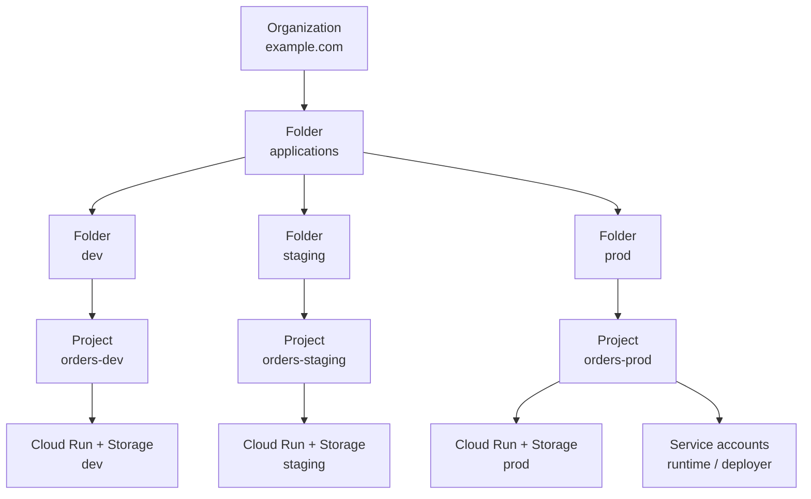
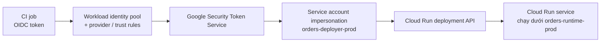

# Thực hành phân quyền theo môi trường và workload trên Google Cloud

Một hệ thống có thể triển khai cùng ứng dụng ở môi trường phát triển, kiểm thử và sản xuất, nhưng **không nên cấp cùng một bộ quyền cho mọi môi trường**. Lập trình viên cần thử nghiệm nhanh trong `dev`; pipeline cần quyền phát hành vào `prod`; ứng dụng đang chạy chỉ cần gọi đúng dịch vụ và dữ liệu mà nó phụ thuộc. Nếu mọi người và mọi workload cùng dùng một tài khoản có quyền rộng, lỗi cấu hình hoặc lộ thông tin xác thực ở một môi trường có thể ảnh hưởng toàn hệ thống.

Bài thực hành thuộc chương **IAM và xác thực** của module `CLOUD_PROVIDERS_GCP`. Khi tổ chức project, IAM và VPC để chạy Compute Engine, GKE, Cloud Run, Cloud Storage và cơ sở dữ liệu, bạn cần xác định rõ **principal nào được làm gì trên resource nào**, thiết kế quyền theo ranh giới môi trường và kiểm chứng quyền trước khi tự động hóa phát hành. Những ví dụ dưới đây dùng tài nguyên giả định; chúng không cấp quyền trong một project thật cho tới khi bạn chủ động chạy lệnh với định danh thực tế.

## 1. Kết quả mong đợi

Sau bài này, bạn có thể:

- Phân tách `dev`, `staging`, `prod` theo project và xác định vai trò của Folder trong kế thừa IAM.
- Xây dựng **ma trận quyền** cho developer, QA, SRE, pipeline CI/CD và danh tính chạy ứng dụng.
- Phân biệt **user/group**, **deployer service account**, **runtime service account** và danh tính Kubernetes ServiceAccount trong GKE.
- Cấp role phù hợp trên đúng project, bucket, Cloud Run service hoặc service account; hạn chế quyền lan rộng qua Folder.
- Sử dụng **Workload Identity Federation** để CI/CD và GKE truy cập Google Cloud với credentials ngắn hạn thay vì lưu khóa JSON dài hạn khi có thể.
- Đọc và kiểm tra IAM policy, truy tìm lỗi `PERMISSION_DENIED` và thu hồi binding khi không còn cần.

## 2. Bài toán: hệ thống Orders có ba môi trường

Công ty triển khai một dịch vụ `orders-api`. Ứng dụng chạy trên **Cloud Run**, đọc tệp từ **Cloud Storage** và kết nối **Cloud SQL**. Đội kỹ thuật có thể có một workload xử lý theo lô trên **GKE** và một số tác vụ bảo trì chạy trên **Compute Engine**.

Để giảm rủi ro lan truyền, mỗi môi trường dùng **project độc lập**:



**Vì sao tách project?**

- Mỗi project có IAM policy, tài nguyên, API và các giới hạn dịch vụ theo scope của chúng; có thể giám sát chi phí theo môi trường.
- Một quyền cấp tại project `orders-dev` không tự lan sang project `orders-prod`.
- Có thể thiết lập Organization Policy và cơ chế quản trị khác theo Folder hoặc project phù hợp với nhu cầu.
- Dễ kiểm soát việc ứng dụng `dev` có được phép sử dụng bucket, database hay service account ở `prod` hay không.

**Điểm cần nhớ:** Folder giúp nhóm dự án và kế thừa các policy được hỗ trợ; Folder **không tự tạo mạng VPC chung, không chia sẻ bí mật hay dữ liệu**, và không tự đồng bộ role của một project sang project anh em. Các tài nguyên dùng chung cần được thiết kế riêng.

Trong ví dụ, tên `example.com`, `orders-dev` và địa chỉ email đều là placeholder. Khi áp dụng thực tế, thay bằng tên miền, project ID và principal đã được tổ chức quản lý.

## 3. Phân tích principal và các loại quyền

Trước khi chạy lệnh IAM, hãy lập danh sách **ai thao tác**, **thao tác gì**, **trên tài nguyên nào**, **ở môi trường nào**.

### 3.1. Những danh tính tham gia

| Principal | Chức năng | Môi trường | Phạm vi nên ưu tiên |
| --- | --- | --- | --- |
| `group:orders-developers@example.com` | Phát triển, xem log, thử triển khai. | `dev` | Project `orders-dev` hoặc tài nguyên cụ thể. |
| `group:orders-qa@example.com` | Kiểm thử và quan sát. | `staging` | Quyền xem và gọi dịch vụ cần kiểm thử, tránh quyền quản trị rộng. |
| `group:prod-observers@example.com` | Theo dõi trạng thái và chẩn đoán. | `prod` | Role chỉ đọc thích hợp; hạn chế quyền xem dữ liệu nhạy cảm. |
| `group:prod-approvers@example.com` | Phê duyệt thay đổi bản phát hành. | `prod` | Quyền trong quy trình phê duyệt; không mặc định cần quyền ghi IAM. |
| `orders-deployer-prod@orders-prod.iam.gserviceaccount.com` | Danh tính pipeline phát hành. | `prod` | Triển khai Cloud Run và dùng đúng runtime service account được duyệt. |
| `orders-runtime-prod@orders-prod.iam.gserviceaccount.com` | Danh tính ứng dụng đang chạy. | `prod` | Đọc bucket và kết nối dịch vụ phụ thuộc; không cần quyền deploy. |
| Kubernetes ServiceAccount `orders/orders-reader` | Workload chạy trong GKE. | `prod` | Quyền đọc resource cần thiết thông qua Workload Identity Federation for GKE. |

**Group** là cách thuận tiện để quản lý con người theo vai trò. **Service account** là danh tính của ứng dụng hoặc automation. Một service account vừa có thể là **principal** được cấp quyền ở bucket/project, vừa là **resource** mà một principal khác có thể được cấp quyền sử dụng hoặc impersonate.

### 3.2. Vai trò IAM mẫu cho từng tác vụ

| Công việc | Role thường xét đến | Nơi cấp tối thiểu khả dụng | Lưu ý |
| --- | --- | --- | --- |
| Cập nhật Cloud Run service | `roles/run.developer` | Service hoặc project, tùy permission và thao tác tạo mới. | Triển khai bằng runtime service account có thể cần thêm `iam.serviceAccounts.actAs`. |
| Gắn service account vào workload | `roles/iam.serviceAccountUser` | **Chính service account** được phép gắn. | Role có `iam.serviceAccounts.actAs`, không đồng nghĩa được tạo access token tùy ý. |
| Đọc object Cloud Storage | `roles/storage.objectViewer` | Bucket hoặc resource được hỗ trợ. | Không cấp tại toàn project nếu chỉ cần một bucket. |
| Gọi Cloud Run service có bật IAM authentication | `roles/run.invoker` | Cloud Run service được gọi. | Đường gọi có thể cần ID token hợp lệ và còn chịu ingress/network. |
| Kết nối Cloud SQL bằng cơ chế hỗ trợ | `roles/cloudsql.client` | Project hoặc phạm vi Cloud SQL hỗ trợ. | Không thay thế mạng và user/role trong database. |
| Xem log | `roles/logging.viewer` và role bổ sung nếu cần | Project hoặc scope được hỗ trợ. | Log nhạy cảm, bao gồm private logs, có thể cần quyền khác. |
| Xem thông tin monitoring | `roles/monitoring.viewer` | Project hoặc scope được hỗ trợ. | Không tương đương quyền xem mọi dữ liệu ứng dụng. |

Không có một predefined role nào thích hợp cho mọi môi trường và mọi thao tác. Khi chọn role, tra cứu **permission thực tế** của role và khả năng gắn role ở resource đích. Các lệnh triển khai còn có thể cần quyền trên Artifact Registry, Cloud Build, service account, API hoặc tài nguyên khác.

## 4. Thiết kế ma trận quyền theo môi trường

Quy tắc quản lý gợi ý:

| Tác vụ | Dev | Staging | Prod |
| --- | --- | --- | --- |
| Developer deploy Cloud Run | Có thể cho phép nhóm dev trực tiếp, trong phạm vi dev. | Thông qua pipeline kiểm thử hoặc nhóm được chỉ định. | Chỉ qua pipeline danh tính phát hành và quy trình phê duyệt. |
| Xem log/monitoring | Developer và SRE theo nhu cầu. | QA, developer và SRE theo role phù hợp. | Nhóm vận hành/quan sát được kiểm soát, tránh lộ dữ liệu nhạy cảm. |
| Đọc object ứng dụng | Runtime service account dev. | Runtime service account staging. | Runtime service account prod, trên bucket prod tương ứng. |
| Truy cập Cloud SQL | Danh tính ứng dụng dev và tài khoản quản trị dev được ủy quyền. | Danh tính ứng dụng staging. | Danh tính runtime prod và nhóm DBA/vận hành đã xét duyệt. |
| Chỉnh IAM trên project | Nhóm quản trị nền tảng có thẩm quyền. | Nhóm quản trị nền tảng có thẩm quyền. | Chỉ nhóm quản trị được phê duyệt; thực hiện qua quy trình có kiểm toán. |
| Dùng service account để deploy | Có thể cho phép nhóm developer dùng runtime SA dev cụ thể. | Pipeline dùng runtime SA staging cụ thể. | Chỉ deployer SA prod được phép gắn runtime SA prod. |

Đây là **ma trận mục tiêu**, chưa phải cấu hình IAM. Biến nó thành các binding cụ thể ở những bước sau.

### 4.1. Nguyên tắc phân quyền tối thiểu

1. **Phân tách theo chức năng:** developer, operator, QA, reviewer, deployer và runtime không cần cùng một bộ permission.
2. **Phân tách theo môi trường:** không cấp quyền prod tại Folder `applications` nếu thực chất chỉ phục vụ dev.
3. **Phân tách theo workload:** `orders-api` và `payments-api` dùng service account riêng; tránh một runtime account đọc được mọi bucket/database.
4. **Ưu tiên predefined role hẹp** trước `roles/editor`, `roles/owner`; dùng custom role khi có lý do và permission được hỗ trợ.
5. **Gắn tại cấp hẹp nhất hỗ trợ thao tác:** bucket cụ thể, service account cụ thể, Cloud Run service cụ thể, hoặc project khi cần tạo tài nguyên mới.
6. **Tách quyền quản lý IAM khỏi quyền chạy ứng dụng:** pipeline không cần quyền sửa Organization Policy hoặc cấp thêm role cho chính nó.

Không nên chỉ xét quyền đang cấp trực tiếp ở project. Allow binding tại **Organization/Folder tổ tiên** có thể tiếp tục áp dụng cho các project con. Cần kiểm tra IAM deny, Principal Access Boundary, IAM Conditions và những kiểm soát dịch vụ khác khi xác minh quyền hiệu lực.

## 5. Chuẩn bị phòng thực hành

**Giả định:** các project, Folder, bucket, Cloud Run service và group đã tồn tại. Người thực hiện có quyền IAM thích hợp để xem và thay đổi binding trên những resource được chỉ định. Việc tạo Organization, Folder và kết nối billing nằm ngoài bài thực hành này.

Các lệnh sau là **ví dụ thao tác**, có thể thay đổi IAM trên project thật nếu chạy. Chỉ thực hiện trong project thử nghiệm/được ủy quyền, thay đầy đủ tên tài nguyên và rà soát phạm vi trước khi áp dụng. Bài tập không yêu cầu tạo khóa service account hoặc lưu credentials vào repository.

Đặt các biến Bash để giảm nhầm project:

```bash
DEV_PROJECT="orders-dev"
STAGING_PROJECT="orders-staging"
PROD_PROJECT="orders-prod"
REGION="asia-southeast1"

DEV_RUNTIME_SA="orders-runtime-dev@$DEV_PROJECT.iam.gserviceaccount.com"
PROD_RUNTIME_SA="orders-runtime-prod@$PROD_PROJECT.iam.gserviceaccount.com"
PROD_DEPLOY_SA="orders-deployer-prod@$PROD_PROJECT.iam.gserviceaccount.com"
```

Xác nhận bạn đang dùng đúng tài khoản và project:

```bash
# Tài khoản CLI và project mặc định đang chọn
gcloud auth list
gcloud config get-value project

# Metadata project, không làm thay đổi tài nguyên
gcloud projects describe "$DEV_PROJECT"
gcloud projects describe "$PROD_PROJECT"

# Xem policy gắn trực tiếp ở project (chưa gồm mọi quyền kế thừa)
gcloud projects get-iam-policy "$DEV_PROJECT" --format=yaml
gcloud projects get-iam-policy "$PROD_PROJECT" --format=yaml
```

Đối với một thao tác liên quan IAM, **đăng nhập thành công chỉ chứng minh authentication**. Authorization còn phụ thuộc permission của tài khoản hiện dùng. Nếu lệnh đọc policy bị `PERMISSION_DENIED`, cần hỏi quản trị viên về quyền xem policy thay vì suy luận project không có IAM.

## 6. Bước 1 — Tạo service account riêng theo môi trường và chức năng

Tạo các service account đại diện cho runtime và pipeline:

```bash
# Runtime của ứng dụng ở môi trường dev
gcloud iam service-accounts create orders-runtime-dev \
  --project="$DEV_PROJECT" \
  --display-name="Orders runtime dev"

# Runtime của ứng dụng ở môi trường prod
gcloud iam service-accounts create orders-runtime-prod \
  --project="$PROD_PROJECT" \
  --display-name="Orders runtime prod"

# Danh tính pipeline chuyên deploy vào prod
gcloud iam service-accounts create orders-deployer-prod \
  --project="$PROD_PROJECT" \
  --display-name="Orders CI/CD deployer prod"
```

Nếu service account đã tồn tại, **không tạo trùng**; dùng lệnh đọc để kiểm tra:

```bash
gcloud iam service-accounts describe "$DEV_RUNTIME_SA" \
  --project="$DEV_PROJECT"

gcloud iam service-accounts describe "$PROD_RUNTIME_SA" \
  --project="$PROD_PROJECT"

gcloud iam service-accounts describe "$PROD_DEPLOY_SA" \
  --project="$PROD_PROJECT"
```

Tại sao phải có cả `orders-deployer-prod` và `orders-runtime-prod`?

- **Deployer service account** dùng khi pipeline gọi API triển khai bản mới. Nó có quyền quản lý tài nguyên phát hành và quyền **gắn** một runtime service account được chỉ định.
- **Runtime service account** là principal mà Cloud Run sử dụng khi ứng dụng gọi API Google Cloud sau khi đã triển khai. Nó nhận quyền truy cập dữ liệu cần thiết, nhưng thường **không cần** quyền deploy hay chỉnh IAM.

**Giới hạn cần nhận thức:** một deployer có quyền cập nhật mã đang chạy dưới runtime identity có thể gián tiếp làm mã dùng quyền của runtime identity. Vì vậy phải bảo vệ pipeline, môi trường build, nguồn image, quy trình review và approval, bên cạnh việc hạn chế IAM role của deployer.

## 7. Bước 2 — Gắn role cho developer ở dev

Ví dụ nhóm phát triển được phép cập nhật Cloud Run trong project `orders-dev`:

```bash
gcloud projects add-iam-policy-binding "$DEV_PROJECT" \
  --member="group:orders-developers@example.com" \
  --role="roles/run.developer"
```

Khi deployment cần gắn `orders-runtime-dev` vào Cloud Run, nhóm deploy cần quyền `iam.serviceAccounts.actAs` trên **service account đích**. Có thể cấp role `roles/iam.serviceAccountUser` tại đúng account:

```bash
gcloud iam service-accounts add-iam-policy-binding "$DEV_RUNTIME_SA" \
  --project="$DEV_PROJECT" \
  --member="group:orders-developers@example.com" \
  --role="roles/iam.serviceAccountUser"
```

Hai binding trên làm hai việc khác nhau: một cho phép thao tác với Cloud Run theo permission của role, một cho phép gắn **service account cụ thể**. Tùy cách triển khai qua source/image, có thể cần thêm quyền xây dựng, lưu/truy cập image và quyền sử dụng service; không mặc định hai role này đủ cho toàn bộ pipeline.

**Kiểm tra:** nhóm `orders-developers` không được cấp các binding tương tự tại `orders-prod`. Đừng cấp `roles/run.developer` ở Folder `applications` chỉ để tiện thử nghiệm dev, vì quyền ở cấp đó có thể lan đến staging và prod.

## 8. Bước 3 — Phân quyền pipeline phát hành prod

Ở prod, thay vì cho mọi developer triển khai trực tiếp, pipeline dùng danh tính `orders-deployer-prod` và được kích hoạt sau các kiểm tra build, test, review, phê duyệt.

### 8.1. Cấp quyền Cloud Run cho deployer

Ví dụ cấp quyền ở project để pipeline **có thể tạo service mới** trong project (đây là phạm vi rộng hơn quyền cập nhật một service đang tồn tại):

```bash
gcloud projects add-iam-policy-binding "$PROD_PROJECT" \
  --member="serviceAccount:$PROD_DEPLOY_SA" \
  --role="roles/run.developer"
```

Nếu pipeline chỉ cập nhật service đã tồn tại, đánh giá khả năng gắn role hẹp hơn tại **Cloud Run service**. Cần xem permission cụ thể cho thao tác của pipeline và yêu cầu truy cập image/registry.

Cho phép deployer **gắn đúng runtime service account prod**:

```bash
gcloud iam service-accounts add-iam-policy-binding "$PROD_RUNTIME_SA" \
  --project="$PROD_PROJECT" \
  --member="serviceAccount:$PROD_DEPLOY_SA" \
  --role="roles/iam.serviceAccountUser"
```

Không nên cấp `roles/iam.serviceAccountUser` trên **toàn project** nếu pipeline chỉ cần một runtime account; làm vậy có thể cho phép nó gắn nhiều service account khác trong project.

### 8.2. Cấp credentials cho pipeline: ưu tiên federation

Pipeline chạy ngoài Google Cloud (ví dụ một hệ thống CI hỗ trợ OIDC) có thể dùng **Workload Identity Federation** để nhận credentials ngắn hạn. Mô hình thường là:



Trong mô hình **impersonation**, principal từ identity pool được cấp `roles/iam.workloadIdentityUser` trên service account deployer; bản thân deployer nhận các quyền triển khai được giới hạn ở các bước trên.

Ví dụ minh họa dưới đây giả định bạn **đã tạo** workload identity pool/provider, xác thực token issuer, khai báo attribute mapping và ràng buộc repository trong trust configuration:

```bash
# Thay số project của identity pool, pool ID và giá trị repository
POOL_PROJECT_NUMBER="123456789012"
POOL_ID="ci-pool"
REPOSITORY="example-co/orders"

gcloud iam service-accounts add-iam-policy-binding "$PROD_DEPLOY_SA" \
  --project="$PROD_PROJECT" \
  --member="principalSet://iam.googleapis.com/projects/$POOL_PROJECT_NUMBER/locations/global/workloadIdentityPools/$POOL_ID/attribute.repository/$REPOSITORY" \
  --role="roles/iam.workloadIdentityUser"
```

**Các điều kiện bắt buộc để an toàn:** phải cấu hình provider chỉ chấp nhận issuer đáng tin cậy, giới hạn những claim liên quan như tổ chức, repository, nhánh hoặc môi trường phát hành phù hợp, và bảo vệ cơ chế approval của pipeline. Binding `principalSet` một mình **không chứng minh** provider đã kiểm tra những điều kiện đó. `POOL_PROJECT_NUMBER` là **project number của nơi chứa identity pool**, có thể khác `PROD_PROJECT`.

Không cần tải xuống private key JSON của service account để dùng OIDC federation. Một service account không nên được dùng chung cho nhiều pipeline/môi trường với quyền vượt nhu cầu.

### 8.3. Triển khai Cloud Run với runtime identity riêng

Sau khi pipeline đã xác thực thành danh tính deployer phù hợp và có quyền truy cập container image, ví dụ:

```bash
gcloud run deploy orders-api \
  --project="$PROD_PROJECT" \
  --region="$REGION" \
  --image="asia-southeast1-docker.pkg.dev/orders-prod/apps/orders-api:v1" \
  --service-account="$PROD_RUNTIME_SA"
```

Lệnh là minh họa, sẽ triển khai thật nếu chạy. Image repository phải tồn tại và Cloud Run cần quyền kéo image theo cấu hình; pipeline phải được cấp quyền tương ứng. Trong các tổ chức có kiểm soát thay đổi, chỉ chạy sau khi artifact được kiểm chứng và phiên bản image đã được duyệt.

**Phân biệt:** account gọi `gcloud run deploy` là **deployer**; account Cloud Run dùng trong runtime là giá trị `--service-account`. Quyền đọc dữ liệu của ứng dụng nên được cấp cho runtime account, không gắn vào deployer trừ khi pipeline thực sự cần đọc dữ liệu đó.

## 9. Bước 4 — Chỉ cấp quyền dữ liệu cho runtime workload

### 9.1. Cloud Run chỉ đọc bucket của môi trường tương ứng

Giả sử bucket chứa báo cáo của `orders-api` ở prod là `gs://orders-reports-prod`. Cấp quyền đọc object cho **runtime prod** tại đúng bucket:

```bash
gcloud storage buckets add-iam-policy-binding gs://orders-reports-prod \
  --member="serviceAccount:$PROD_RUNTIME_SA" \
  --role="roles/storage.objectViewer"
```

Ở dev, thao tác tương tự phải sử dụng `orders-runtime-dev` và bucket `gs://orders-reports-dev`. **Không** dùng một runtime service account chung cho cả hai môi trường và không cấp role đọc ở cấp project nếu chỉ cần một bucket.

Nếu ứng dụng cần **ghi object mới**, `roles/storage.objectViewer` không đủ; phải chọn role/permission ghi phù hợp và cân nhắc quyền overwrite/delete. Không mặc định dùng `roles/storage.admin` chỉ để sửa lỗi quyền ghi.

### 9.2. Kết nối Cloud SQL ở project khác

Giả sử Cloud SQL instance ở project `orders-data-prod`. Runtime có thể cần quyền để sử dụng cơ chế kết nối Google Cloud:

```bash
DATA_PROD_PROJECT="orders-data-prod"

gcloud projects add-iam-policy-binding "$DATA_PROD_PROJECT" \
  --member="serviceAccount:$PROD_RUNTIME_SA" \
  --role="roles/cloudsql.client"
```

Lưu ý:

- `roles/cloudsql.client` phục vụ quyền kết nối Cloud SQL qua các cơ chế được hỗ trợ. **Không** thay thế quyền truy cập mạng, cấu hình Cloud SQL connector/Auth Proxy hay các yêu cầu khác của dịch vụ.
- Quyền truy cập **bên trong PostgreSQL/MySQL** (database user, role, quyền trên bảng) là bước riêng.
- Tổ chức có thể cần cân nhắc phạm vi hẹp hơn nếu kiểu tài nguyên và permission hỗ trợ; ví dụ project ở đây để minh họa rõ ranh giới giữa project chứa Cloud Run và project chứa database.
- Môi trường dev không nên kết nối thẳng tới database sản xuất chỉ vì nhóm developer có quyền tạo workload ở dev.

### 9.3. Cloud Run gọi một Cloud Run service khác

Nếu `orders-api` cần gọi một Cloud Run backend yêu cầu IAM authentication, backend có thể cấp `roles/run.invoker` cho runtime service account của caller tại **service đích**:

```bash
gcloud run services add-iam-policy-binding backend-api \
  --project="$PROD_PROJECT" \
  --region="$REGION" \
  --member="serviceAccount:$PROD_RUNTIME_SA" \
  --role="roles/run.invoker"
```

Caller phải gửi **ID token phù hợp audience** khi backend yêu cầu IAM authentication. Role Invoker và ID token không tự bỏ qua ingress restriction, VPC/service networking hoặc logic xác thực riêng của ứng dụng.

## 10. Bước 5 — Phân quyền một workload GKE

Khi ứng dụng chạy trên GKE, có ít nhất hai cấp danh tính cần phân biệt:

- **Kubernetes ServiceAccount (KSA):** danh tính của workload trong Kubernetes, ví dụ `orders/orders-reader`.
- **IAM principal thông qua Workload Identity Federation for GKE:** cho workload sử dụng cơ chế xác thực để gọi Google Cloud API theo danh tính/workload được ánh xạ.

Với dịch vụ hỗ trợ principal identifier của Workload Identity Federation for GKE, có thể cấp IAM role **trực tiếp cho principal KSA**, tránh chia sẻ khóa JSON hoặc để mọi Pod dùng cùng một Google service account có quyền rộng.

Giả sử cluster đã được bật/cấu hình Workload Identity Federation for GKE theo chế độ của cluster/node pool, namespace `orders` và KSA `orders-reader` đã tồn tại:

```bash
# Project number của project chứa GKE cluster / workload identity pool
GKE_PROJECT_NUMBER="123456789012"
GKE_PROJECT_ID="orders-prod"

gcloud storage buckets add-iam-policy-binding gs://orders-reports-prod \
  --member="principal://iam.googleapis.com/projects/$GKE_PROJECT_NUMBER/locations/global/workloadIdentityPools/$GKE_PROJECT_ID.svc.id.goog/subject/ns/orders/sa/orders-reader" \
  --role="roles/storage.objectViewer"
```

Định danh `principal://...` trong ví dụ là **principal KSA** của đúng namespace và service account, không phải `serviceAccount:orders-runtime-prod@...`. Khi dùng cách này, Pod cần chạy dưới `serviceAccountName: orders-reader` và cấu hình cluster phù hợp.

Trường hợp dịch vụ đích hoặc thư viện chưa hỗ trợ đúng dạng principal, GKE còn có cơ chế để KSA **impersonate một IAM service account** đã được ủy quyền. Việc bật WIF, cấu hình GKE metadata server, account binding và deployment là các bước cần kiểm tra riêng; bản thân thao tác thêm IAM binding ở bucket **không tự cấu hình** cluster.

**Không cấp cho default node service account quyền đọc mọi bucket** chỉ vì một Pod cần đọc dữ liệu. Nên phân quyền theo KSA/namespace/workload và lưu ý Pod có thể sử dụng danh tính KSA mà nó được phép gắn.

## 11. Bước 6 — Kiểm tra policy và quyền hiệu lực

Sau mỗi thay đổi, kiểm tra **đúng tài nguyên chứa IAM policy**, không chỉ project:

```bash
# Allow policy gắn trực tiếp vào project
gcloud projects get-iam-policy "$DEV_PROJECT" --format=yaml
gcloud projects get-iam-policy "$PROD_PROJECT" --format=yaml

# Ai được phép thao tác trên runtime service account?
gcloud iam service-accounts get-iam-policy "$PROD_RUNTIME_SA" \
  --project="$PROD_PROJECT" \
  --format=yaml

# Ai có quyền trên bucket prod?
gcloud storage buckets get-iam-policy gs://orders-reports-prod

# IAM policy của Cloud Run backend
gcloud run services get-iam-policy backend-api \
  --project="$PROD_PROJECT" \
  --region="$REGION" \
  --format=yaml
```

**Chú ý hai góc nhìn về service account:**

1. `gcloud iam service-accounts get-iam-policy` cho biết **ai được phép thao tác trên service account resource**, chẳng hạn quyền `actAs`.
2. Để biết **service account được cấp role ở đâu**, cần kiểm tra policy trên **project/bucket/Cloud Run service** đích và binding từ các cấp tổ tiên. Không thể đọc policy *của service account* rồi kết luận đó là toàn bộ quyền mà nó có.

### 11.1. Kiểm tra quyền kế thừa từ Folder

Một nhóm được cấp `roles/viewer` tại Folder `prod` có thể nhận quyền xem nhiều tài nguyên trong `orders-prod`, dù `gcloud projects get-iam-policy orders-prod` không liệt kê binding ấy.

Để đọc policy tại Folder hoặc Organization (cần quyền tương ứng):

```bash
gcloud resource-manager folders get-iam-policy FOLDER_ID --format=yaml
gcloud organizations get-iam-policy ORG_ID --format=yaml
```

Không nên dùng kết quả **policy gắn trực tiếp** tại một resource để suy ra toàn bộ quyền hiệu lực. Nếu nghi ngờ, sử dụng **Policy Troubleshooter** trong Console cho bộ ba **principal – permission – resource** cụ thể; kết quả phân tích phụ thuộc vào quyền xem policy và dữ liệu liên quan.

### 11.2. Bảng kiểm thử hành vi mong muốn

| Thử nghiệm | Kỳ vọng |
| --- | --- |
| Developer dev triển khai Cloud Run ở `orders-dev` sau khi đã có quyền phụ trợ cần thiết. | **Cho phép**. |
| Developer dev triển khai trực tiếp vào `orders-prod`. | **Từ chối**, nếu không có grant khác hoặc quyền kế thừa. |
| Runtime prod đọc object trong `orders-reports-prod`. | **Cho phép** theo role và những điều kiện dịch vụ áp dụng. |
| Runtime dev đọc object trong `orders-reports-prod`. | **Từ chối**, nếu không có grant khác. |
| Pipeline prod gắn một runtime service account ngoài danh sách được duyệt. | **Từ chối** nếu pipeline không có `actAs` trên service account đó. |
| Caller không có `run.invoker` gọi backend yêu cầu IAM authentication. | **Từ chối** nếu không được phép qua cơ chế truy cập khác. |
| Pod GKE dùng KSA `orders-reader` đọc bucket khi WIF đã thiết lập đúng. | **Cho phép** khi IAM và đường truy cập hợp lệ. |

Đây là **kết quả mục tiêu theo thiết kế**, không bảo đảm từ chỉ các lệnh ví dụ. Phải kiểm tra mọi IAM binding ở tổ tiên, điều kiện, deny, PAB và cấu hình dịch vụ thật để xác nhận.

### 11.3. Chứng minh lỗi phân quyền mà không mở quyền rộng

Khi gặp `403 PERMISSION_DENIED`, hãy ghi **principal thật**, **resource**, **permission/API method** và **thời điểm**:

1. **Ai gửi request?** Tài khoản CLI hiện tại, danh tính ADC, service account Cloud Run/Compute Engine hay KSA qua federation?
2. **Quyền nào thiếu?** Quyền deploy Cloud Run, `iam.serviceAccounts.actAs`, `storage.objects.get`, quyền Cloud SQL hay quyền gọi service?
3. **Binding đặt đúng chỗ chưa?** Project, bucket, Cloud Run service, service account resource hoặc ancestor Folder/Organization?
4. **Có điều kiện hoặc deny?** IAM Conditions, deny policies và PAB có thể hạn chế allow.
5. **Ngoài IAM còn vấn đề nào?** Cloud Run ingress, database login, VPC, API chưa bật, quota hoặc Organization Policy.

Một lỗi điển hình: `orders-runtime-prod` bị `403` khi đọc Cloud Storage. Nếu cấp `roles/storage.objectViewer` cho **nhóm developer** mà không cấp cho **runtime service account**, lỗi vẫn có thể còn. Cần sửa binding của đúng principal ở đúng bucket.

## 12. Thu hồi quyền và quy trình vận hành

Hãy có kế hoạch hoàn tác khi một binding được cấp nhầm hoặc không còn cần. Ví dụ, để thu hồi các binding minh họa ở dev và prod:

```bash
# Thu hồi quyền developer ở project dev
gcloud projects remove-iam-policy-binding "$DEV_PROJECT" \
  --member="group:orders-developers@example.com" \
  --role="roles/run.developer"

# Thu hồi quyền deployer được gắn runtime service account prod
gcloud iam service-accounts remove-iam-policy-binding "$PROD_RUNTIME_SA" \
  --project="$PROD_PROJECT" \
  --member="serviceAccount:$PROD_DEPLOY_SA" \
  --role="roles/iam.serviceAccountUser"

# Thu hồi quyền đọc bucket của runtime prod
gcloud storage buckets remove-iam-policy-binding gs://orders-reports-prod \
  --member="serviceAccount:$PROD_RUNTIME_SA" \
  --role="roles/storage.objectViewer"
```

Chỉ chạy lệnh thu hồi khi đã xác nhận đúng thành viên, role và resource. Một binding khác ở cấp tổ tiên vẫn có thể cấp quyền tương ứng. Quyền đã thu hồi cũng có thể chưa bị phản ánh tức thì tới mọi token hoặc hệ thống tùy cơ chế; hãy **kiểm chứng bằng hành vi và audit logs**, không chỉ nhìn màn hình IAM.

### 12.1. Quyền khẩn cấp và kiểm toán

Trong prod, tổ chức có thể cần quy trình **break-glass** dành cho sự cố nghiêm trọng. Quy trình đó nên có phê duyệt, thời hạn, nhật ký truy cập và rà soát sau sự cố. Quyền khẩn cấp không nên là `roles/owner` cấp thường trực cho cả nhóm developer.

**Cloud Audit Logs** hỗ trợ điều tra thao tác quản trị và truy cập theo khả năng dịch vụ. Admin Activity logs và Data Access logs có quy tắc thu thập/bật khác nhau; cần chuẩn bị cấu hình và quyền đọc log phù hợp nếu muốn kiểm tra hoạt động truy cập dữ liệu. Kết hợp Audit Logs với mã thay đổi infrastructure-as-code và lịch sử pipeline để trả lời **ai đã cấp role nào, khi nào và vì sao**.

### 12.2. Những lỗi thiết kế cần tránh

| Lỗi | Hậu quả | Cách sửa |
| --- | --- | --- |
| Cấp `roles/editor` cho mọi runtime account. | Mã ứng dụng bị lỗi hoặc bị khai thác có phạm vi tác động lớn. | Cấp role hẹp theo resource và nhu cầu API. |
| Cấp `roles/run.developer` tại Folder `applications` cho nhóm dev. | Developer có thể nhận quyền tại staging/prod. | Gắn role ở `orders-dev` hoặc resource dev. |
| Dùng một runtime SA cho cả dev và prod. | Khó bảo đảm cách ly dữ liệu và môi trường. | Tạo SA độc lập theo workload/môi trường. |
| Cho pipeline `actAs` trên mọi service account project. | Pipeline có thể gắn account quyền cao hơn nhu cầu. | Cấp `roles/iam.serviceAccountUser` tại SA cụ thể. |
| Lưu khóa JSON service account trong CI. | Rò rỉ khóa có thể dẫn đến truy cập kéo dài. | Dùng federation/token ngắn hạn và kiểm soát trust. |
| Chỉ xem project IAM policy rồi kết luận không có quyền. | Bỏ sót quyền kế thừa ở Folder/Organization. | Đọc policy tổ tiên, dùng Policy Troubleshooter. |
| Thấy `403` liền cấp quyền rộng. | Tăng rủi ro, chưa chắc sửa được lỗi. | Xác định caller, permission, resource và các lớp kiểm soát. |

## 13. Bài tập vận dụng

### Bài tập A — Xác định vị trí cấp quyền

Cho hệ thống `orders-dev`, `orders-staging`, `orders-prod` và bucket `orders-reports-prod`. Hãy đề xuất nơi gắn quyền trong các trường hợp:

1. Developer chỉ cần triển khai Cloud Run ở dev.
2. Service account `orders-runtime-prod` chỉ cần đọc object trong bucket prod.
3. Pipeline prod cần gắn service account `orders-runtime-prod` khi deploy.
4. SRE cần xem metrics của cả ba project; chưa có yêu cầu xem dữ liệu ứng dụng.
5. Pod `orders/orders-reader` trên GKE prod cần đọc bucket prod.

**Đáp án gợi ý:** (1) Project/service dev phù hợp, với role Cloud Run hẹp. (2) Bucket prod, `roles/storage.objectViewer` cho runtime SA. (3) Trên chính runtime SA, cấp `roles/iam.serviceAccountUser` cho deployer SA. (4) Cân nhắc `roles/monitoring.viewer` trên các project liên quan hoặc Folder chỉ khi muốn áp cho toàn nhánh; xem cấu hình metrics scope nếu dùng cross-project view. (5) Workload Identity Federation for GKE được cấu hình phù hợp và role đọc ở bucket cho principal KSA, hoặc cơ chế impersonation được hỗ trợ.

### Bài tập B — Phân tích sự cố

Sau một đợt phát hành, dịch vụ `orders-api` chạy trên Cloud Run ở prod đọc bucket bị `403`. Developer đăng nhập bằng tài khoản cá nhân vẫn đọc được bucket trên Console. Một đồng nghiệp đề nghị cấp `roles/editor` cho tất cả service accounts trong project.

Hãy trả lời:

1. Vì sao việc developer đọc được bucket **không chứng minh** Cloud Run đọc được?
2. Cần xác định principal nào ở runtime?
3. Nên kiểm tra policy trên resource nào?
4. Nếu runtime SA đã có `roles/storage.objectViewer` trên bucket mà vẫn lỗi, cần kiểm tra thêm điều gì?

**Đáp án gợi ý:** (1) Developer và workload là hai principal khác nhau. (2) Runtime service account được cấu hình thực tế trên Cloud Run service/revision. (3) IAM policy tại bucket và các tài nguyên tổ tiên phù hợp. (4) Object/key thực sự được truy cập, bucket/project đúng, IAM Conditions, IAM deny/PAB, Organization Policy, cấu hình ứng dụng và error detail. Không mở `roles/editor` để đoán lỗi.

### Bài tập C — Đánh giá quyền kế thừa

Nhóm `group:prod-observers@example.com` có `roles/viewer` tại Folder `prod`. Quản trị viên xóa một binding Viewer cho nhóm này trên project `orders-prod` nhưng nhóm vẫn xem được một số metadata. Điều gì xảy ra?

**Đáp án:** quyền Viewer từ Folder `prod` vẫn có thể kế thừa xuống project. Muốn thay đổi phạm vi, cần đánh giá và chỉnh binding đúng cấp hoặc thiết kế Folder/project lại; không thể chỉ xóa binding ở project để loại bỏ một allow từ ancestor.

## 14. Checklist trước khi đưa IAM vào vận hành

- [ ] Có sơ đồ **Organization / Folder / Project** rõ ràng cho dev, staging, prod.
- [ ] Ma trận quyền theo **principal × thao tác × resource × môi trường** được phê duyệt.
- [ ] Mỗi runtime workload có danh tính phù hợp, chỉ nhận role cần thiết.
- [ ] Deployer và runtime là các danh tính riêng; `actAs` giới hạn vào account được phép.
- [ ] CI/CD bên ngoài dùng **Workload Identity Federation** hoặc phương thức không lưu khóa dài hạn khi được hỗ trợ.
- [ ] GKE workload dùng KSA/Workload Identity Federation phù hợp, tránh chia sẻ quyền node quá rộng.
- [ ] Đã kiểm tra role/binding trên resource đích **và** trên các ancestor.
- [ ] Đã thử các trường hợp **được phép** và **bị từ chối** bằng principal thực tế.
- [ ] Đã tính đến deny, PAB, IAM Conditions, Organization Policy và cấu hình dịch vụ.
- [ ] Có audit logs, quy trình thu hồi quyền và rà soát IAM định kỳ.

## 15. Kết luận

Phân quyền an toàn trên Google Cloud bắt đầu từ **tách môi trường**, sau đó tách **danh tính của người**, **danh tính deployer** và **danh tính runtime**. Mỗi IAM binding phải thể hiện rõ principal, role và resource đích, với phạm vi đủ hẹp cho công việc.

Đối với **Cloud Run**, cần phân biệt quyền phát hành với quyền ứng dụng gọi API. Đối với **GKE**, cần phân biệt Kubernetes ServiceAccount với IAM principal qua Workload Identity Federation. Đối với **Cloud Storage** và **Cloud SQL**, cần cấp quyền tới dữ liệu hoặc dịch vụ thực sự sử dụng, đồng thời kiểm tra mạng, xác thực database và ràng buộc khác.

Khi mở rộng sang Compute Engine, thêm project hay tự động hóa release, hãy tiếp tục sử dụng cùng một quy trình: **xác định principal → xác định permission → chọn role → chọn resource/scope → cấp quyền → kiểm chứng → giám sát và thu hồi khi không cần**.

### Tài liệu Google Cloud tham khảo

- [IAM overview](https://cloud.google.com/iam/docs/overview)
- [Resource hierarchy access control](https://cloud.google.com/iam/docs/resource-hierarchy-access-control)
- [Roles and permissions](https://cloud.google.com/iam/docs/understanding-roles)
- [Service accounts overview](https://cloud.google.com/iam/docs/service-account-overview)
- [Workload Identity Federation](https://cloud.google.com/iam/docs/workload-identity-federation)
- [Workload Identity Federation for GKE](https://cloud.google.com/kubernetes-engine/docs/concepts/workload-identity)
- [Cloud Run service identity](https://cloud.google.com/run/docs/securing/service-identity)
- [IAM Policy Troubleshooter](https://cloud.google.com/policy-intelligence/docs/troubleshoot-access)
