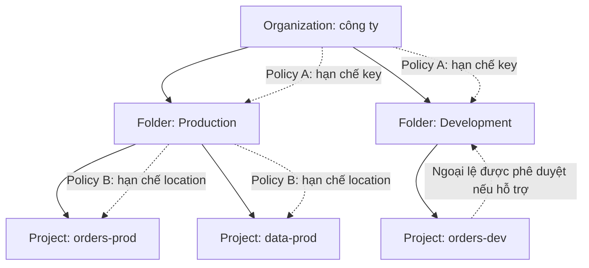
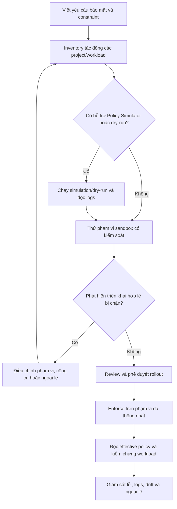

# Organization Policy và các ràng buộc tài nguyên

Một kỹ sư có quyền tạo Compute Engine VM, triển khai Cloud Run hoặc cấu hình Cloud Storage chưa chắc được phép thực hiện **mọi cách cấu hình** tài nguyên ấy. Doanh nghiệp có thể yêu cầu tài nguyên chỉ được tạo tại những vị trí được phê duyệt, hạn chế khóa service account lâu hạn, kiểm soát kết nối công khai hoặc buộc một nhóm thiết lập bảo mật. Đó là vai trò của **Google Cloud Organization Policy Service**: thiết lập các giới hạn quản trị nhất quán trên nhiều project.

Bài học thuộc chương **Quản trị tổ chức** của module `CLOUD_PROVIDERS_GCP`. Khi học cách tổ chức project, IAM và VPC, lựa chọn Compute Engine/GKE/Cloud Run, lưu dữ liệu, tự động hóa phát hành hoặc quản lý độ tin cậy và chi phí, bạn cần biết liệu chính sách tổ chức có cho phép cấu hình mong muốn không. Chọn đúng dịch vụ về mặt kỹ thuật nhưng vi phạm ràng buộc quản trị vẫn là một thiết kế không triển khai được.

Trong bài này, **constraint** là loại hạn chế được hệ thống định nghĩa; **organization policy** là cấu hình áp dụng constraint đó cho một vị trí trong cây tài nguyên; **effective policy** là kết quả sau khi xét kế thừa, ghi đè, điều kiện và mặc định được quản lý bởi Google. Ví dụ là môi trường giả định: không có thao tác nào cần được thực hiện trên tổ chức production để hoàn thành việc đọc bài.

## 1. Organization Policy giải quyết vấn đề gì?

Hãy hình dung một công ty có vài chục project. Nhóm bảo mật yêu cầu không tạo khóa JSON của service account cho các workload mới. Nếu chỉ viết quy định trong wiki, mỗi nhóm có thể quên kiểm tra; nếu tự tạo script kiểm tra định kỳ, cấu hình sai có thể đã đi vào production. Organization Policy đưa một phần quy tắc xuống lớp thực thi của các dịch vụ Google Cloud có hỗ trợ constraint.

| Vấn đề | Quy định mong muốn | Vai trò của Organization Policy |
| --- | --- | --- |
| Quản lý thông tin xác thực | Hạn chế tạo khóa service account do người dùng quản lý | Chặn hành vi tạo khóa mới khi constraint tương ứng có hiệu lực. |
| Vị trí tài nguyên | Chỉ cho phép tạo tài nguyên hỗ trợ ở các location đã được duyệt | Từ chối yêu cầu tạo mới trái quy định tại dịch vụ hỗ trợ. |
| Hạn chế cấu hình mạng | Không cho phép một số kiểu endpoint hoặc ingress | Áp dụng constraint phù hợp với từng dịch vụ và kiểu tài nguyên. |
| Quản trị đa project | Mọi project trong folder production theo quy tắc chung | Đặt policy ở organization hoặc folder để các project con kế thừa. |
| Ngoại lệ có kiểm soát | Một nhóm sandbox có phương án khác để thử nghiệm | Dùng child policy hoặc điều kiện theo tag khi constraint cho phép và đã phê duyệt. |

Organization Policy tạo **guardrail** (hàng rào kỹ thuật). Nó không tự phát hiện mọi lỗ hổng, không thay thế rà soát cấu hình đang tồn tại và không tự biến mọi dịch vụ thành tuân thủ chính sách. Khả năng áp dụng phụ thuộc constraint, loại tài nguyên, dịch vụ thực thi và thời điểm kiểm tra.

### 1.1. Phân biệt với IAM, VPC và các công cụ quản trị khác

| Cơ chế | Câu hỏi chính | Ví dụ |
| --- | --- | --- |
| **IAM allow/deny** | *Ai* có quyền làm hành động nào trên tài nguyên? | Service account triển khai chỉ được cập nhật Cloud Run service trong project được giao. |
| **Organization Policy** | *Kiểu cấu hình hoặc hành vi nào* được hệ thống cho phép? | Không được tạo khóa service account mới dù người gọi có quyền IAM tương ứng. |
| **VPC/firewall/Cloud Armor** | Luồng mạng nào được phép đi vào/đi ra hoặc được bảo vệ ra sao? | Chặn một nguồn IP đến ứng dụng; kiểm soát ingress/egress. |
| **VPC Service Controls** | Hạn chế rủi ro dữ liệu đi qua ranh giới truy cập dịch vụ hỗ trợ | Tạo service perimeter cho dịch vụ và project phù hợp. |
| **Quotas** | Có thể tiêu thụ bao nhiêu tài nguyên hoặc gọi API với tốc độ nào? | Giới hạn số CPU hoặc số request API theo phạm vi quota. |
| **Cloud Billing budgets** | Chi phí đang đến đâu so với ngân sách? | Gửi cảnh báo khi dự báo vượt mức chi tiêu; không mặc định là hard cap. |

Một yêu cầu tạo VM thành công thường phải thỏa **đồng thời** IAM, Organization Policy, các quota, giới hạn dịch vụ và các điều kiện riêng của sản phẩm. Có role `Owner` trên project không có nghĩa được bỏ qua Organization Policy có hiệu lực. Ngược lại, Organization Policy cho phép một kiểu cấu hình không có nghĩa tài khoản lập tức có quyền IAM để tạo tài nguyên đó.

## 2. Ba khái niệm cốt lõi: constraint, policy và enforcement

### Constraint: quy tắc có thể kiểm tra

Constraint xác định một điều kiện hạn chế. Tên trong API/reference thường có dạng:

```text
constraints/iam.managed.disableServiceAccountKeyCreation
constraints/gcp.resourceLocations
```

Tên cụ thể mang tính hợp đồng API; chữ `managed` và các loại constraint phản ánh cơ chế cấu hình. Không tự nghĩ tên dựa trên mô tả tiếng Anh. Trước khi dùng, kiểm tra [danh mục constraint chính thức](https://cloud.google.com/resource-manager/docs/organization-policy/org-policy-constraints) hoặc [Organization Policy constraints](https://docs.cloud.google.com/organization-policy/reference/org-policy-constraints).

### Organization policy: cấu hình gắn vào một resource

Với Organization Policy API v2, resource policy có tên điển hình:

```text
organizations/123456789012/policies/iam.managed.disableServiceAccountKeyCreation
folders/234567890123/policies/iam.managed.disableServiceAccountKeyCreation
projects/my-production-project/policies/iam.managed.disableServiceAccountKeyCreation
```

Trong các lệnh CLI, constraint có thể được truyền dưới dạng `iam.managed.disableServiceAccountKeyCreation`, trong khi tài liệu reference hiển thị thêm tiền tố `constraints/`. Phần sau `policies/` trong resource name là constraint name, không phải tên tuỳ ý của file YAML.

Mỗi policy cấu hình **một constraint** ở phạm vi resource đã chọn, có một hoặc nhiều rule. Những rule quyết định có enforce, cho phép hoặc từ chối giá trị nào, hay điều kiện nào phải đúng. Khi có policy ở nhiều cấp, kết quả trên project được đánh giá theo quy tắc phân cấp và loại constraint.

### Enforcement: dịch vụ đích kiểm tra khi có yêu cầu

Organization Policy Service lưu và cung cấp chính sách; **dịch vụ Google Cloud liên quan** thực thi hạn chế theo cách mà constraint định nghĩa. Chẳng hạn, khi cố tạo service account key và constraint chặn hoạt động đó, API có thể trả lỗi `FAILED_PRECONDITION`. Một số constraint chỉ áp dụng khi tạo hoặc cập nhật resource, và nhiều constraint không làm thay đổi các tài nguyên đã tạo trước đó.

Vì thế, cần phân biệt:

- **Cấu hình policy đã tồn tại:** câu trả lời của CLI/API về policy resource.
- **Effective policy:** quy tắc áp dụng sau kế thừa và default cho resource được hỏi.
- **Thực tế tuân thủ:** trạng thái tài nguyên hiện hữu và những yêu cầu đã/đang được dịch vụ kiểm tra.

Ba lớp này liên quan nhưng không tương đương nhau.

## 3. Policy lan truyền qua Organization → Folder → Project như thế nào?

Hệ thống tài nguyên thường có dạng:



Đây là sơ đồ học tập về **phạm vi**. Một project không nằm trong folder Production sẽ không tự nhận những policy chỉ gắn tại folder ấy. Tuy nhiên nó vẫn có thể kế thừa các policy được gắn ở organization hoặc ancestor khác.

### 3.1. “Không có policy trực tiếp” khác “không có hạn chế”

Nếu project `orders-prod` không có policy trực tiếp cho một constraint, nó thường kế thừa giá trị hiệu lực từ folder/organization. Nếu cả cây không có policy chủ động, hành vi **Google-managed default** của constraint sẽ có hiệu lực; một số default đã hạn chế sẵn. Vì vậy một lệnh `describe` không kèm `--effective` trả `NOT_FOUND` không chứng minh project được phép làm mọi thứ.

### 3.2. Kế thừa, ghi đè và hợp nhất tùy loại constraint

| Loại chính sách | Quy tắc quan trọng | Lưu ý thực hành |
| --- | --- | --- |
| Managed constraint hiện đại | Child policy có thể kế thừa hoặc ghi đè policy từ ancestor, nhưng không dùng cơ chế merge tương tự legacy list | Đọc effective policy; kiểm tra cú pháp `parameters` của constraint. |
| Legacy boolean constraint | Nếu project/folder có rule riêng, giá trị enforce của rule đó quyết định tại cấp ấy | Có thể ghi đè `true`/`false` khi được phép; đừng mặc định boolean “càng lên cao càng không thể nới”. |
| Legacy list constraint | Có thể thay thế hoặc hợp nhất theo cấu hình kế thừa; khi hợp nhất, giá trị deny được ưu tiên nếu xung đột | Đọc `inheritFromParent` và effective policy, không chỉ YAML ở project. |
| Custom constraint | Có rule enforce theo điều kiện riêng do tổ chức định nghĩa; triển khai trên resource được Google hỗ trợ | Xác nhận điều kiện, resource type và method CREATE/UPDATE nào được kiểm tra. |

**Không có một công thức merge đúng cho mọi policy.** Với legacy list rules, có thể khai báo `inheritFromParent: true` để hợp nhất theo cơ chế loại constraint. Với managed constraints, kế thừa hoạt động kiểu chọn policy hiệu lực từ cấp thích hợp rồi áp dụng, không hợp nhất parameter list giống legacy. Để dự đoán kết quả, xem tài liệu [Hierarchy evaluation](https://docs.cloud.google.com/organization-policy/hierarchy-evaluation) và chạy `describe --effective`.

### 3.3. Ba thao tác thường bị hiểu nhầm

- **Inherit parent:** bỏ cấu hình cụ thể ở child để dùng chính sách hiệu lực từ cha.
- **Override:** đặt policy trên child nhằm thay đổi kết quả so với policy được kế thừa, nếu quyền và kiểu constraint cho phép.
- **Restore Google-managed default:** đưa resource về hành vi mặc định của constraint, **có thể khác** với kế thừa chính sách cha. Default không nhất thiết đồng nghĩa “cho phép hết”.

Thao tác `delete` policy ở project thường khiến project quay lại kế thừa từ cha; còn `reset` được thiết kế để khôi phục hành vi default của constraint. Trước khi dùng trong production phải kiểm tra cụ thể lệnh, loại constraint và effective policy sau thao tác.

## 4. Phân loại constraint và cách nhận diện cú pháp

Google Cloud hiện mô tả ba nhóm chính:

| Nhóm | Đặc điểm | Tình huống điển hình |
| --- | --- | --- |
| **Managed constraints** | Google định nghĩa rule và có thể cung cấp `parameters`, tích hợp tốt hơn với công cụ phân tích policy | Hạn chế một hành vi, loại tài nguyên hoặc danh sách giá trị cấu hình cụ thể do Google quản lý. |
| **Legacy managed constraints** | Các constraint định nghĩa sẵn cũ, thường dùng **boolean** hoặc **list** với `allowedValues`/`deniedValues` | Hạn chế vị trí tài nguyên, các giá trị trong cấu hình của dịch vụ. |
| **Custom constraints** | Tổ chức tự định nghĩa hạn chế cho resource type được hỗ trợ, thường dùng biểu thức CEL và phương thức thực thi cụ thể | Bắt buộc một thuộc tính trên Cloud Run/GKE/Compute Engine khi CREATE/UPDATE có hỗ trợ. |

Ví dụ về **boolean rule**:

```yaml
name: organizations/123456789012/policies/iam.managed.disableServiceAccountKeyCreation
spec:
  rules:
  - enforce: true
```

Ví dụ có tính minh họa về **legacy list rule** cho restriction location:

```yaml
name: folders/234567890123/policies/gcp.resourceLocations
spec:
  rules:
  - values:
      allowedValues:
      - in:asia-southeast1-locations
```

Ví dụ thứ hai dùng value group theo region; trước khi áp dụng, phải đối chiếu **giá trị group**, danh sách dịch vụ hỗ trợ và nhu cầu dùng global/multi-region. Nó có thể chặn cả resource được tạo gián tiếp bởi dịch vụ khác. Việc chỉ cho phép một region không đủ để chứng minh toàn bộ dữ liệu và mọi log/backup đều nằm ở region ấy.

Với custom constraints, tổ chức định nghĩa resource type, loại method (ví dụ CREATE/UPDATE), condition và hành vi (thường ALLOW/DENY) theo schema của Organization Policy API; policy tại organization/folder/project sau đó quyết định có enforce constraint ấy hay không. Không thể viết tùy tiện một expression CEL cho resource mà dịch vụ không hỗ trợ custom constraints.

### 4.1. Chọn constraint theo yêu cầu thay vì theo tên nghe quen

| Yêu cầu governance | Constraint/nhóm kiểm tra đầu tiên | Điều phải xác minh |
| --- | --- | --- |
| Không phát hành khóa service account lâu hạn | `iam.managed.disableServiceAccountKeyCreation` | Tác động đến workload cũ và các quy trình quản lý khóa. |
| Không tạo service account ngoài cơ chế cấp phát tập trung | `iam.managed.disableServiceAccountCreation` | Dịch vụ có tự động tạo default service account khi kích hoạt không? |
| Tài nguyên phải tạo tại vị trí đã phê duyệt | `gcp.resourceLocations` | Dịch vụ, resource type, location group, ngoại lệ và giới hạn không hồi tố. |
| Chỉ chấp nhận ingress thích hợp với Cloud Run | Các constraint Cloud Run có sẵn hoặc custom constraint hỗ trợ resource tương ứng | Cấu hình ingress khác với IAM invoker; có ảnh hưởng load balancer/VPC không? |
| Giới hạn chia sẻ hoặc cấp quyền theo domain | Constraint liên quan IAM/domain | Phân biệt membership IAM, service account và các ngoại lệ tổ chức. |
| Không cho cấu hình VM vi phạm tiêu chuẩn | Constraint Compute Engine managed hoặc custom hỗ trợ VM | Phân biệt create-time với update-time và các loại tài nguyên liên quan. |

Tên constraint và loại hỗ trợ có thể thay đổi theo thời gian, đặc biệt khi Google cung cấp managed constraint thay thế một legacy constraint. Không chọn cả hai một cách tự động: đọc mô tả, giới hạn và cách tương tác của chúng.

## 5. IAM nào cần để xem và quản lý Organization Policy?

Chức năng Organization Policy có quyền đọc và quyền ghi riêng. Người thiết kế hoặc kiểm tra policy có thể cần quyền đọc policy resource và effective policy; người đổi policy phải có các quyền quản trị tại resource phù hợp.

| Tác vụ | Phạm vi quyền nên xem xét |
| --- | --- |
| Xem một constraint và policy hiệu lực | Quyền đọc organization policy/constraint theo IAM của resource; có thể nhờ admin cấp role đọc phù hợp. |
| Tạo, sửa, xóa policy tại organization/folder/project | Quyền quản trị policy, thông thường `roles/orgpolicy.policyAdmin` trong phạm vi được giao. |
| Tạo custom constraint | Quyền tạo/quản lý custom constraint ở cấp organization, cộng quyền áp dụng policy tại resource mục tiêu. |
| Xem dry-run violation logs | Quyền đọc Cloud Logging/Audit Logs phù hợp với phạm vi lưu log. |
| Dùng policy tags hoặc delegations | Quyền quản lý tag bindings/đọc tag cần thiết, ngoài quyền quản trị policy khi sửa đổi. |

Chỉ cấp quyền quản trị cho người/quy trình có trách nhiệm về governance. Tác động của một policy tại organization có thể lan ra hàng trăm project. Tài khoản deploy ứng dụng thông thường **không cần** quyền sửa organization policy để phát hành Cloud Run service.

### Tách danh tính người vận hành và ứng dụng

IAM xác định ai được chỉnh policy; Organization Policy xác định cấu hình tài nguyên nào được chấp nhận. Nếu policy cấm khóa service account, đường thay thế được khuyến nghị là dùng danh tính workload và credentials ngắn hạn (service account attached to runtime, Workload Identity Federation khi phù hợp), thay vì xin quyền Owner để cố tạo khóa.

## 6. Kiểm tra trực tiếp và effective policy bằng gcloud

Các lệnh dưới đây là **chỉ đọc**. Chạy bằng danh tính có quyền kiểm tra project/folder/organization được phép. Thay project ID, folder ID và organization ID bằng giá trị thực:

```bash
# Policy gắn trực tiếp trên organization cho constraint được chọn.
gcloud org-policies describe iam.managed.disableServiceAccountKeyCreation \
  --organization=123456789012

# Policy gắn trực tiếp ở folder (nếu có).
gcloud org-policies describe gcp.resourceLocations \
  --folder=234567890123

# Policy gắn trực tiếp trên project.
gcloud org-policies describe iam.managed.disableServiceAccountKeyCreation \
  --project=orders-prod

# Kết quả áp dụng thực tế ở project sau kế thừa/default.
gcloud org-policies describe iam.managed.disableServiceAccountKeyCreation \
  --project=orders-prod \
  --effective
```

Diễn giải kết quả:

1. `describe` **không có** `--effective` trả policy đặt trực tiếp ở cấp được hỏi. `NOT_FOUND` có thể chỉ có nghĩa là **không có policy trực tiếp** ở cấp ấy.
2. `describe --effective` trả policy sau tính toán kế thừa/default ở cấp resource; đây là dữ liệu cần đọc trước khi cho rằng yêu cầu sẽ được chấp nhận.
3. Nếu một rule có điều kiện theo tag, cần xem thêm tag bindings thực sự của resource và cách điều kiện được đánh giá.
4. Khi policy mới được thay đổi, quá trình thực thi có độ trễ lan truyền; tài liệu nêu có thể mất tới khoảng **15 phút** để hiệu lực đầy đủ. Không kết luận chính sách bị bỏ qua từ một lần thử ngay sau khi set.

Không có quyền đọc sẽ tạo lỗi `PERMISSION_DENIED`. Đây khác với `NOT_FOUND` do không có policy trực tiếp; phải đọc error details và phạm vi resource trước khi kết luận.

### 6.1. Xác định đường nguồn gốc của một hạn chế

Giả sử project `orders-prod` không thể tạo khóa service account:

1. Đọc effective policy cho `iam.managed.disableServiceAccountKeyCreation` ở project.
2. Đọc policy trực tiếp ở project, folder cha và organization khi được cấp quyền.
3. Xác định nơi có rule enforce hoặc Google-managed default đang hạn chế.
4. Xem rule có điều kiện tag không, constraint có được Google bật mặc định cho tổ chức này không.
5. Đối chiếu audit logs và error details của chính hành động bị chặn.

Điều này tốt hơn việc thử thêm IAM role rộng hoặc tự yêu cầu bỏ constraint toàn tổ chức.

## 7. Thiết kế policy theo yêu cầu tài nguyên

Một tổ chức thường có nhiều môi trường với mức rủi ro khác nhau. Hãy mô tả yêu cầu trước, chọn constraint sau.

| Ngữ cảnh | Quy định | Phạm vi gợi ý | Kiểm tra tác động |
| --- | --- | --- | --- |
| Production API trên Cloud Run | Hạn chế đường ingress không được phê duyệt | Folder Production hoặc project mục tiêu | Domain, load balancer, Cloud Run invoker IAM, đường gọi nội bộ. |
| Dữ liệu có yêu cầu residency | Hạn chế location cho resource types được hỗ trợ | Folder dữ liệu nhạy cảm | Cloud SQL/Cloud Storage/BigQuery, backups, log, region của phụ thuộc. |
| Máy ảo Compute Engine | Chặn cấu hình VM hoặc credential không an toàn theo constraint phù hợp | Folder VM hoặc tổ chức | Autoscaling, image pipeline, service accounts, monitoring agent. |
| GKE | Hạn chế cấu hình cluster/node không phù hợp | Folder môi trường chạy container | Tính tương thích với GKE Autopilot/Standard và quá trình nâng cấp. |
| Toàn bộ tổ chức | Hạn chế khóa service account do người dùng tạo | Organization | CI/CD, automation, công cụ bên thứ ba dùng credentials lâu hạn. |

Đừng đặt một rule cấp tổ chức khi chưa kiểm tra các dịch vụ tự tạo tài nguyên phụ trợ. Ví dụ, chặn việc tạo service account có thể làm một số sản phẩm không hoàn tất bước enable/initialization nếu quy trình của chúng phụ thuộc tạo default service account. Muốn quản trị an toàn phải khảo sát cả **đường vận hành hiện tại** và **quy trình tạo mới**.

### 7.1. Ràng buộc vị trí và hiểu lầm “đã đảm bảo data residency”

Constraint `gcp.resourceLocations` có thể giới hạn việc tạo resource ở location được chấp thuận cho **dịch vụ/resource được hỗ trợ**. Nó không phải chứng nhận toàn bộ dữ liệu của mọi dịch vụ ở một quốc gia. Phải đọc tài liệu từng dịch vụ về nơi xử lý dữ liệu, backup/replica, routing, log, metadata và location của dịch vụ dùng kèm.

Một ví dụ tác động: nếu `orders-prod` chỉ cho phép một region trong khi hệ thống disaster recovery dự kiến tạo database replica tại region thứ hai, phương án DR có thể thất bại ngay tại bước tạo replica. Quy tắc residency, RTO/RPO và kiến trúc đa vùng phải được thiết kế cùng nhau.

### 7.2. Phân biệt nhãn (labels) và tags khi đặt rule theo điều kiện

Nhiều organization policies hỗ trợ **conditional rules** bằng **Resource Manager tags**. Đây là cơ chế quản trị có namespace, tag key/tag value và bindings; không được nhầm với labels gắn trực tiếp vào Compute Engine VM, Cloud Run hoặc project cho mục đích metadata/billing.

Ví dụ biểu thức CEL sử dụng trong điều kiện policy:

```text
resource.matchTag("123456789012/environment", "development")
```

Biểu thức này chỉ là minh họa: số namespace, tag key và tag value phải tương ứng với tag thực tế của tổ chức. Với constraints hỗ trợ điều kiện, dùng tag để giới hạn ngoại lệ cho một nhóm resource thay vì mở rộng toàn bộ organization.

## 8. Policy có điều kiện và ngoại lệ hợp lệ

Ngoại lệ là thay đổi có chủ đích đối với phạm vi và cách thực thi, không phải lý do để bỏ kiểm soát. Một quy trình được review có thể gồm:

1. Người đề xuất ghi rõ policy/constraint đang chặn việc gì và tác động nghiệp vụ.
2. Chủ sở hữu chính sách xác minh nguyên nhân, loại dữ liệu/tài nguyên và đường triển khai thay thế.
3. Chỉ định chính xác project/folder hoặc tag condition được phép khác biệt.
4. Đánh giá IAM: ai có thể đặt hoặc thay tag, ai có quyền sửa policy, việc đổi tag có tạo đường vượt kiểm soát không.
5. Đặt hạn sử dụng và tiêu chí đóng ngoại lệ; theo dõi thay đổi và audit logs.
6. Kiểm chứng lại effective policy và trạng thái tài nguyên sau thay đổi.

Lưu ý: quyền đặt tag cũng là một phần mô hình bảo mật. Nếu một developer có thể gắn tag `environment=exempt` lên mọi project, chính sách điều kiện dựa vào tag ấy có thể mất ý nghĩa. Cần quản lý tag bindings và việc ủy quyền chặt chẽ.

### Minh họa decision record (ADR)

```text
Chính sách: Hạn chế tạo service account key
Constraint: iam.managed.disableServiceAccountKeyCreation
Mục tiêu: Không phát hành credentials dài hạn do người dùng quản lý
Phạm vi: Organization 123456789012
Tác động: Script legacy đang đọc file JSON key từ ổ đĩa
Giải pháp ưu tiên: Workload Identity Federation / attached service account
Ngoại lệ (nếu cần): project cụ thể, owner, thời hạn, kiểm toán
Kiểm chứng: effective policy + thử trên sandbox + audit log
Rollback: có người phê duyệt, đánh giá tác động trước khi thay đổi
```

## 9. Dry-run và Policy Simulator: kiểm chứng trước khi chặn

Một cấu hình có thể hợp lệ về cú pháp nhưng lại chặn tác vụ quan trọng: ví dụ hệ thống CI/CD đang tạo khóa service account, công cụ phát hành cần region không được phép, hoặc sản phẩm tự động tạo tài nguyên phụ trợ. Cần kiểm tra trên môi trường thử nghiệm và sử dụng các khả năng đánh giá policy khi dịch vụ hỗ trợ.

### 9.1. Dry-run là gì?

Ở dry-run mode, một constraint hỗ trợ dry-run có thể **ghi nhận vi phạm dự kiến trong audit logs nhưng chưa từ chối yêu cầu chỉ vì rule dry-run**. Rule live, IAM và các ràng buộc khác vẫn hoạt động bình thường. Nhờ đó nhóm vận hành quan sát mức tác động trước khi chuyển sang enforce.

**Dry-run không hỗ trợ cho tất cả constraint.** Theo tài liệu Google Cloud, nhóm custom và managed constraints được hỗ trợ; trong số legacy managed constraints chỉ một số loại cụ thể hỗ trợ. Luôn đọc mục hỗ trợ dry-run của constraint và phương thức trước khi đưa vào rollout.

Ví dụ minh họa file YAML dành cho một managed constraint có hỗ trợ dry-run:

```yaml
# Chính sách minh họa; thay ID bằng organization được giao quyền.
# Chỉ có dryRunSpec trong ví dụ này.
name: organizations/123456789012/policies/iam.managed.disableServiceAccountKeyCreation
dryRunSpec:
  rules:
  - enforce: true
```

Sau khi một quản trị viên đã review và lưu nội dung trên thành file `policy-dry-run.yaml`, lệnh minh họa để **cập nhật trạng thái dry-run** là:

```bash
# CÓ THAY ĐỔI CẤU HÌNH: chỉ chạy sau khi được duyệt trong môi trường phù hợp.
gcloud org-policies set-policy policy-dry-run.yaml \
  --update-mask=dryRunSpec
```

Một policy đã có cấu hình live phải được giữ nguyên khi cập nhật dry-run; `--update-mask=dryRunSpec` nhằm tránh đụng vào `spec`. Trước khi thao tác thật cần đọc policy hiện hữu, quản lý `etag`/concurrency theo cách API và công cụ yêu cầu, và tránh ghi đè thay đổi của quản trị viên khác.

### 9.2. Lộ trình từ đề xuất đến enforce



Policy Simulator và dry-run có mục đích liên quan nhưng không đồng nhất. Simulator đánh giá tác động dự kiến dựa trên khả năng/dữ liệu hỗ trợ; dry-run quan sát các yêu cầu trong thời gian chính sách mô phỏng có hiệu lực. Không một công cụ nào thay thế việc thử các luồng tạo, cập nhật và triển khai thực tế của dịch vụ.

### 9.3. Chuyển policy sang live

Về hình thức, một file policy có thể chứa `spec` cho live rule và `dryRunSpec` cho dry-run rule. Đối với những constraint hỗ trợ, lệnh `set-policy` với `--update-mask=spec` có thể cập nhật riêng live spec, **nhưng phải có file cấu hình phù hợp đã được phê duyệt**.

Sau khi thay đổi, kiểm tra policy và audit logs, ghi lại version/etag và đợi khoảng thời gian propagation được tài liệu nêu trước khi kết luận. Đừng tự động chuyển từ `dryRunSpec` sang `spec` chỉ vì không thấy log vi phạm trong vài phút — có thể hệ thống chưa phát sinh thao tác cần kiểm tra.

## 10. Custom constraints: khi định nghĩa sẵn chưa đủ

Giả sử tiêu chuẩn nội bộ muốn mọi Cloud Run service mới trong production phải dùng một kiểu ingress cụ thể. Nếu có constraint Google-managed đáp ứng đúng, ưu tiên sử dụng nó. Nếu không, đội nền tảng có thể xem xét custom constraints **khi Cloud Run resource type và thuộc tính tương ứng được hỗ trợ**.

Một custom constraint được định nghĩa ở mức organization và thường bao gồm:

| Thành phần | Câu hỏi cần giải quyết |
| --- | --- |
| Tên custom constraint | Có tên duy nhất và ổn định trong organization chưa? |
| Resource type | Loại tài nguyên nào được hỗ trợ (ví dụ một resource của Cloud Run)? |
| Method types | Kiểm tra khi `CREATE`, `UPDATE` hay cả hai? |
| CEL condition | Điều kiện xác định cấu hình hợp lệ hoặc vi phạm là gì? |
| Action type | Điều kiện đúng dẫn tới `ALLOW` hay `DENY` theo định nghĩa? |
| Metadata/description | Người vận hành có hiểu lỗi và cách khắc phục không? |

Định nghĩa custom constraint **không tự động áp dụng** cho toàn bộ tài nguyên. Sau khi có constraint, phải tạo organization policy tham chiếu đến tên `custom.*` và enforce ở phạm vi đã chọn. Dùng dry-run/Policy Simulator khi hỗ trợ, sau đó thử cả lệnh tạo mới và cập nhật đối tượng.

Giới hạn quan trọng:

- Không phải mọi dịch vụ và resource type đều hỗ trợ custom constraints.
- Một số trường được phép đọc trong CEL, một số không; tên field phải theo schema mà dịch vụ công bố.
- Một rule chỉ áp dụng cho CREATE không nhất thiết chặn UPDATE, và ngược lại.
- Một constraint mới thường không tự sửa trạng thái của tài nguyên cũ; cần khảo sát riêng các tài nguyên hiện hữu.
- Một policy đặt sai tầng có thể chặn đường nâng cấp/deploy của hệ thống đang hoạt động.

Tham khảo [Create custom constraints](https://docs.cloud.google.com/organization-policy/create-custom-constraints) và [Cloud Run custom constraints](https://docs.cloud.google.com/run/docs/securing/custom-constraints) để xem schema và ví dụ đã được Google xác nhận.

## 11. Tình huống triển khai: sản phẩm đặt hàng đa môi trường

Một doanh nghiệp có ba project:

| Project | Workload | Ràng buộc quản trị |
| --- | --- | --- |
| `orders-dev` | Cloud Run API dev, Cloud SQL dev, CI/CD thử nghiệm | Có môi trường thử nhưng vẫn tuân thủ hạn chế service account keys; ngoại lệ phải được duyệt. |
| `orders-prod` | Cloud Run API, Cloud SQL HA, bucket lưu ảnh | Vị trí tài nguyên cần được phê duyệt; ingress theo thiết kế mạng; hạn chế credentials lâu hạn. |
| `shared-platform` | Artifact Registry, logging, pipeline, mạng kết nối dùng chung | Chính sách phù hợp với dependency của hai môi trường; quản lý riêng người có quyền chỉnh policy. |

### 11.1. Bắt đầu từ yêu cầu của hệ thống

Ứng dụng cần Cloud Run kết nối Cloud SQL, lưu ảnh trên Cloud Storage và phát hành qua CI/CD. RPO/RTO có thể yêu cầu replica hoặc backup ở một địa điểm khác. Trước khi áp dụng policy “chỉ một region”, nhóm phải xác định:

1. Workload chạy ở region nào, backup và disaster recovery có cần thêm region không?
2. Cloud Storage bucket có location khác với Compute/Cloud SQL không?
3. Có pipeline hoặc managed service tự tạo resource ở location mặc định khác không?
4. Đường ingress Cloud Run cần public, internal hay qua load balancer?
5. CI/CD hiện lấy credentials bằng cách nào? Có còn dùng file khóa JSON dài hạn không?

Nếu chưa trả lời được, không nên triển khai constraint rộng ra production.

### 11.2. Dùng ma trận quản trị trước khi viết policy

| Quyết định | Phạm vi | Đơn vị xác minh | Bằng chứng |
| --- | --- | --- | --- |
| Không tạo service account keys mới | Organization | Nhóm Platform & Security | Effective policy, chạy workflow không dùng key, audit logs. |
| Location của tài nguyên nhạy cảm | Folder Production hoặc project data | Chủ sở hữu data & SRE | Danh sách region, ma trận dịch vụ hỗ trợ, thử tạo tài nguyên, thiết kế DR. |
| Ingress của Cloud Run | Project `orders-prod` theo constraint hỗ trợ | Team API/Security | Kiểm tra deploy, load balancer, endpoint nội bộ, invoker IAM. |
| Ngoại lệ sandbox | Project được duyệt | Security owner | ADR, thời hạn, quyền tag, effective policy sau cập nhật. |

Ma trận này nối quản trị tổ chức với lựa chọn dịch vụ, bảo vệ tài nguyên, tự động hóa phát hành và độ tin cậy. Mục tiêu không phải tạo thật nhiều policy mà là bảo đảm ràng buộc có thể giải thích, kiểm thử và vận hành.

### 11.3. Khi CI/CD triển khai thất bại

Giả sử pipeline trước đây dùng service account key JSON để deploy Cloud Run. Sau khi hạn chế tạo khóa mới, quy trình rotate key thất bại. Cách xử lý phù hợp là chuyển pipeline sang federation/impersonation hoặc service account identity thích hợp, xác minh quyền deploy tối thiểu và cập nhật tài liệu vận hành. Chỉ xin bỏ Organization Policy cho toàn bộ production để “chạy lại build” làm mất mục tiêu kiểm soát và thường không giải quyết nguyên nhân lâu dài.

## 12. Tìm nguyên nhân khi API trả lỗi do policy

Lỗi thường gặp có thể xuất hiện dưới dạng:

```text
FAILED_PRECONDITION: Operation denied by org policy
... constraints/<constraint-name> ...
```

Thông báo cụ thể thay đổi tùy dịch vụ/API. Các lỗi `PERMISSION_DENIED` cũng có thể do IAM hoặc các cơ chế kiểm soát khác. Cần đọc **error code, chi tiết vi phạm và tên constraint**, tránh kết luận bằng một vài từ khóa.

| Hiện tượng | Nguyên nhân có thể | Cách kiểm tra |
| --- | --- | --- |
| Không tạo được service account key | Constraint chặn tạo key mới, hoặc IAM thiếu quyền | Đọc error details; kiểm tra effective `iam.managed.disableServiceAccountKeyCreation` và IAM. |
| Không tạo được Cloud SQL/VM ở một region | Location constraint, quota, SKU/region availability | Kiểm tra `gcp.resourceLocations`; so region với availability và quota của dịch vụ. |
| Cloud Run deploy báo ingress không hợp lệ | Constraint của Cloud Run hoặc schema request không đúng | Đọc tên constraint từ lỗi, kiểm tra effective policy và config ingress. |
| Policy không xuất hiện ở project | Đang xem direct policy, policy được kế thừa từ folder/org | Thử `describe --effective` và kiểm tra hierarchy. |
| Mới thay policy nhưng hành vi chưa đổi | Propagation delay hoặc dịch vụ chưa kiểm tra ở thao tác tương ứng | Đợi theo tài liệu; thử create/update có kiểm soát, không kiểm tra bằng resource cũ không liên quan. |
| Developer có Owner nhưng vẫn bị chặn | Organization Policy hoặc cơ chế kiểm soát khác độc lập với IAM allow | So IAM action với constraint cụ thể. |
| Một số resource cũ vẫn không tuân thủ | Constraint chỉ chặn create/update, không hồi tố | Inventory resource hiện hữu, đặt kế hoạch remediate riêng. |

### Quy trình chẩn đoán năm bước

1. **Ghi đúng request bị lỗi:** project ID, location, resource type, API method, thời gian và request ID; không đưa access token/secret vào ticket.
2. **Đọc phản hồi API/audit logs:** xác định lỗi IAM, quota, thiếu API, Organization Policy hoặc cấu hình service.
3. **Tìm constraint cụ thể:** tra danh mục chính thức, kiểm tra dịch vụ thực thi và default.
4. **Đọc direct và effective policy:** lần theo organization → folder → project, kiểm tra conditions/tags và phiên bản mới cập nhật.
5. **Đề xuất cách khắc phục có kiểm soát:** chỉnh workload để tuân thủ hoặc xin ngoại lệ giới hạn phạm vi, thời gian và người phê duyệt; thử lại sandbox, ghi bằng chứng.

Không biến một lỗi constraint thành yêu cầu “cấp quyền orgpolicy.policyAdmin cho developer”. Quyền sửa chính sách tổ chức là quyền quản trị rộng và có thể làm thay đổi bảo vệ của nhiều workload.

## 13. Những lỗi thiết kế governance thường gặp

1. **Lẫn IAM với Organization Policy:** IAM cho phép một action nhưng constraint vẫn chặn kiểu cấu hình; sửa sai lớp sẽ không giải quyết được.
2. **Đọc direct policy rồi kết luận không có giới hạn:** policy có thể kế thừa hoặc do Google-managed default đặt.
3. **Cho rằng mọi boolean/list/managed constraint hợp nhất giống nhau:** cách đánh giá có khác biệt theo loại.
4. **Hiểu reset và inherit là một:** quay về default có thể giữ một giới hạn do Google thiết lập.
5. **Chọn `gcp.resourceLocations` như giải pháp residency duy nhất:** chưa tính phạm vi dịch vụ hỗ trợ, backup, logs, metadata và phụ thuộc khác region.
6. **Gắn label để mong policy condition theo tag tự hoạt động:** Resource Manager tags và resource labels có semantics khác nhau.
7. **Bật constraint cấp organization ngay lập tức:** có thể chặn CI/CD, bootstrap hoặc dịch vụ tạo resource tự động.
8. **Tin rằng dry-run hỗ trợ mọi constraint và kiểm tra đầy đủ:** có constraint không hỗ trợ, và luồng hiếm gặp có thể chưa được phát sinh trong thử nghiệm.
9. **Kỳ vọng policy sửa tài nguyên hiện hữu:** nhiều ràng buộc chỉ ảnh hưởng create/update và cần chương trình remediate.
10. **Cho phép bất kỳ ai tạo ngoại lệ:** mất kiểm toán và có nguy cơ vượt kiểm soát chỉ bằng thay tag/project.

## 14. Bài tập thực hành

### Bài tập A — Đọc policy mà không sửa cấu hình

Bạn có quyền xem project `orders-prod` trong một tổ chức. Hãy tìm constraint liên quan khóa service account và trả lời:

1. Policy có được gắn trực tiếp trên project không?
2. Effective policy đang enforce hay không?
3. Nếu direct policy trả `NOT_FOUND`, cần kiểm tra thêm cấp nào?
4. Có Google-managed default hoặc tag condition cần xét không?

Ghi lệnh `gcloud org-policies describe` tương ứng và giải thích từng kết quả giả định. **Không yêu cầu tạo key thật** để hoàn thành bài tập.

### Bài tập B — Thiết kế ràng buộc location

Công ty muốn dữ liệu giao dịch ưu tiên `asia-southeast1` nhưng đội SRE cần một nơi phục hồi sau thảm họa. Hãy soạn bảng ràng buộc gồm: loại dữ liệu, dịch vụ, primary location, backup/DR location, constraint hỗ trợ, ngoại lệ được duyệt và phương pháp kiểm chứng. Nếu yêu cầu chỉ cho phép đúng một region khiến kế hoạch DR không khả thi, trình bày quyết định cần thương lượng với Security/Compliance.

### Bài tập C — Dry-run trước khi chặn ingress

Nhóm bảo mật muốn giới hạn ingress của Cloud Run production. Hãy mô tả:

- Tài nguyên và constraint cần tra cứu;
- Điều kiện để dùng managed hoặc custom constraint;
- Cách áp dụng dry-run khi được hỗ trợ và đọc audit logs;
- Các luồng CI/CD, health check, load balancer và đường gọi nội bộ phải thử;
- Phạm vi rollout, tiêu chí rollback và người phê duyệt.

### Bài tập D — Điều tra lỗi tạo service account

Một script tạo service account key trả `FAILED_PRECONDITION`. Developer khẳng định đã có quyền Owner project. Hãy lập giả thuyết về IAM, Organization Policy và default, viết thứ tự kiểm tra, rồi đề xuất một giải pháp dùng credentials ngắn hạn thay vì xin bỏ toàn bộ policy.

### Câu hỏi tự kiểm tra

1. Constraint khác policy và effective policy như thế nào?
2. Vì sao quyền IAM đủ chưa bảo đảm thao tác tạo tài nguyên thành công?
3. Legacy list policy có thể hợp nhất trong tình huống nào, và làm sao biết kết quả?
4. Khi không có policy trực tiếp, điều gì quyết định hành vi sau cùng?
5. Dry-run khác live enforcement và Policy Simulator ra sao?
6. Tags khác labels thế nào trong việc giới hạn ngoại lệ?
7. Vì sao áp dụng location constraint không tự động bảo đảm mọi dữ liệu ở một region?
8. Tại sao phải kiểm tra các workflow CI/CD trước khi chặn tạo service account key?

**Quy trình ghi nhớ:** xác định rủi ro → tìm constraint phù hợp → chọn tầng áp dụng → kiểm tra inheritance/effective policy → đánh giá service và tài nguyên hiện hữu → thử simulation/dry-run/sandbox → review ngoại lệ → enforce có kiểm soát → giám sát và đối soát.

## 15. Tài liệu chính thức để tiếp tục

- [Organization Policy Service overview](https://docs.cloud.google.com/organization-policy/overview)
- [Organization policy constraints reference](https://docs.cloud.google.com/organization-policy/reference/org-policy-constraints)
- [Hierarchy evaluation](https://docs.cloud.google.com/organization-policy/hierarchy-evaluation)
- [Create organization policies](https://docs.cloud.google.com/organization-policy/create-organization-policies)
- [Apply organization policies](https://docs.cloud.google.com/organization-policy/apply-policies)
- [Test organization policies (dry-run)](https://docs.cloud.google.com/organization-policy/test-policies)
- [Create custom constraints](https://docs.cloud.google.com/organization-policy/create-custom-constraints)
- [Restrict resource locations](https://docs.cloud.google.com/organization-policy/restrict-locations)
- [Restrict IAM service account usage](https://docs.cloud.google.com/organization-policy/restrict-service-accounts)

Đặc tính constraint, giá trị cho phép, dịch vụ hỗ trợ và hành vi mặc định có thể thay đổi. Trước khi áp dụng trong hệ thống thật, luôn xem reference của đúng constraint và kiểm tra kết quả **effective policy** tại project chịu tác động.
