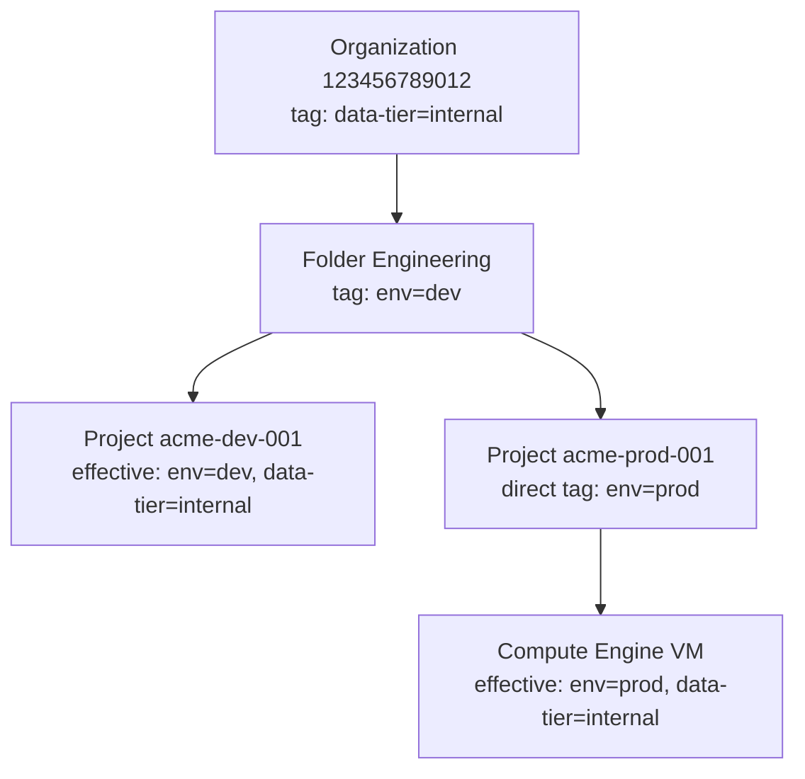
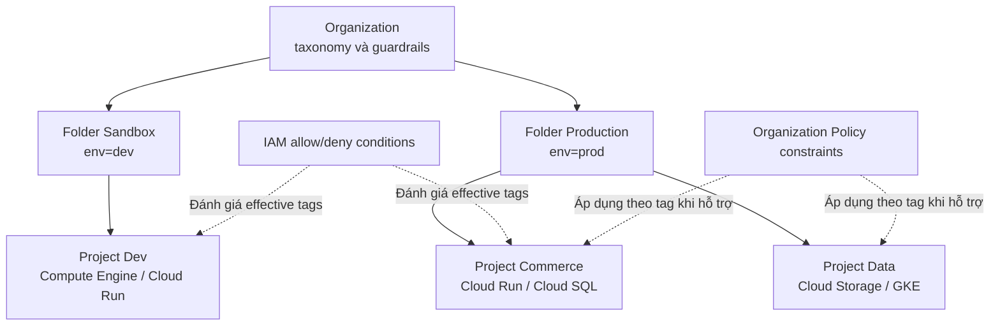

# Áp dụng tags cho IAM Conditions và chính sách tổ chức

## 1. Vì sao tổ chức cần tags để quản trị Google Cloud?

Khi Google Cloud chỉ có một project thử nghiệm, việc cấp quyền và cấu hình chính sách theo từng project có vẻ đơn giản. Nhưng khi tổ chức có hàng chục hoặc hàng trăm project cho **development, staging, production**, nhiều nhóm sản phẩm và nhiều loại dữ liệu, việc cấu hình thủ công dễ tạo ngoại lệ khó kiểm soát:

- Nhà phát triển cần sửa VM trong môi trường **dev** nhưng không được tác động tới hệ thống **prod**.
- Các workload quan trọng cần tuân thủ quy tắc bảo mật nghiêm ngặt, dù được chuyển sang Folder hoặc Project mới.
- Đội vận hành muốn áp dụng cùng một loại **Organization Policy** cho nhóm tài nguyên phù hợp, thay vì tạo một policy cho từng project.
- Đội an ninh cần xác định ai được phép thay đổi dấu hiệu phân loại môi trường, vì **đổi tag có thể làm đổi quyền truy cập**.

**Resource Manager tags** giải quyết bài toán phân loại tài nguyên bằng các cặp **key–value** có thể được kiểm soát bằng IAM và được sử dụng làm **điều kiện** cho các chính sách hỗ trợ. Ví dụ, tag `env=dev` có thể giúp một IAM allow binding chỉ cấp quyền thao tác lên tài nguyên phát triển; tag `env=prod` có thể kích hoạt một ràng buộc của Organization Policy.

Trong module **CLOUD_PROVIDERS_GCP**, kiến thức này kết nối quản trị Organization/Folder/Project với IAM, VPC, Compute Engine, GKE, Cloud Run, lưu trữ, database và tự động hóa triển khai. Tags là một thành phần của kiến trúc quản trị: chúng giúp nhóm áp dụng quy tắc nhất quán khi hạ tầng mở rộng, đồng thời hỗ trợ đánh giá các đánh đổi về bảo mật, độ tin cậy và vận hành.

Sau bài học, bạn có thể:

1. Phân biệt **Resource Manager tags**, **labels** và **network tags**.
2. Tạo mô hình **TagKey → TagValue → TagBinding**, hiểu định danh, phạm vi và tính kế thừa.
3. Viết biểu thức CEL dựa trên tags cho **IAM Conditions** và chính sách tổ chức.
4. Giải thích vì sao IAM allow condition và **Organization Policy condition** dẫn đến hai loại quyết định khác nhau.
5. Lập quy trình thiết kế, kiểm tra và thay đổi tags an toàn trên hệ thống nhiều project.

> **Quy ước:** Organization ID `123456789012`, Project ID `acme-dev-001`, Project number `987654321098`, tài khoản và ID tag ở đây đều là **ví dụ giả định**. Các lệnh có khả năng thay đổi tài nguyên chỉ để học cú pháp và phải được điều chỉnh, kiểm tra tác động trước khi áp dụng trên hệ thống thật.

## 2. Tags là gì và khác labels ở điểm nào?

Một **Resource Manager tag** là cặp giá trị **tag key** và **tag value** được định nghĩa tại **Organization hoặc Project**. Khi muốn gán cặp đó cho một tài nguyên, Google Cloud tạo một **tag binding** liên kết tag value với tài nguyên. Đối với các loại tài nguyên được hỗ trợ, IAM và Organization Policy có thể đọc tag hiệu lực để đánh giá điều kiện.

| Đặc điểm | Resource Manager tags | Labels | Network tags của Compute Engine |
| --- | --- | --- | --- |
| Mục đích phổ biến | Quản trị, phân loại, điều kiện truy cập và chính sách | Báo cáo, lọc, phân bổ chi phí, tự động hóa | Lựa chọn VM làm đích của một số quy tắc firewall truyền thống |
| Cách quản lý | TagKey, TagValue và TagBinding là các tài nguyên riêng | Metadata trên từng tài nguyên | Trường cấu hình mạng của VM |
| Kế thừa theo Organization/Folder/Project | Có, theo quy tắc effective tags | Không theo cơ chế Resource Manager tags | Không |
| Dùng trong IAM tag-based conditions | Có, khi loại tài nguyên/quyền hỗ trợ | Không | Không |
| Dùng làm điều kiện Organization Policy | Có, trong phạm vi constraint và tài nguyên hỗ trợ | Không | Không |
| Phân quyền người được sửa | Vai trò quản trị tag và gắn tag; có thể phân quyền riêng | Quyền của tài nguyên/dịch vụ tương ứng | Quyền cập nhật cấu hình VM và mạng tương ứng |

**Không thay** `resource.matchTag(...)` bằng giá trị label hoặc network tag rồi kỳ vọng IAM Conditions hoạt động. Nếu cần điều kiện truy cập dựa trên môi trường, dùng **Resource Manager tags** đã được tạo và gắn đúng cách.

Google Cloud còn có những loại tag chuyên dụng, chẳng hạn **secure tags** và các tính năng tag khác. Cần kiểm tra mục đích cùng khả năng hỗ trợ trước khi áp dụng; tên gọi “tag” không có nghĩa mọi cơ chế tag đều thay thế nhau. **Không lưu dữ liệu nhạy cảm** như mật khẩu, token hay thông tin nhận dạng cá nhân trong tag.

## 3. Mô hình dữ liệu: TagKey, TagValue và TagBinding

Giả sử tổ chức tạo hệ phân loại môi trường:

```text
Organization: organizations/123456789012
  TagKey:
    shortName: env
    namespacedName: 123456789012/env
    permanent ID: tagKeys/111111111111

  TagValues:
    shortName: dev
    permanent ID: tagValues/222222222222
    namespacedName: 123456789012/env/dev

    shortName: prod
    permanent ID: tagValues/333333333333
    namespacedName: 123456789012/env/prod
```

Trong ví dụ trên, việc định nghĩa key `env` và hai value `dev`, `prod` **chưa tự gắn** tag lên project nào. Phải tạo **TagBinding** giữa `tagValues/222222222222` hoặc `tagValues/333333333333` và tài nguyên đích.

### Ba loại tên dễ nhầm

| Tên | Ví dụ | Cách dùng |
| --- | --- | --- |
| **Short name** | `env`, `prod` | Tên dễ đọc bên trong namespace đã định nghĩa |
| **Namespaced name** | `123456789012/env`, `123456789012/env/prod` | Biểu thức `resource.matchTag('123456789012/env', 'prod')` và nhiều lệnh gcloud |
| **Permanent ID** | `tagKeys/111111111111`, `tagValues/333333333333` | Biểu thức `resource.matchTagId(...)`, đối chiếu định danh bất biến |

Phần tiền tố của namespaced name có thể là **Organization ID dạng số** hoặc **Project ID** nếu tag key được tạo ở project. Không lấy Project number hoặc tên Folder tùy ý để thay cho namespace thực tế.

**Lựa chọn ID hay tên:** namespaced name dễ đọc, dễ quản lý bằng cấu hình khai báo; nhưng nếu một tag bị xóa và tạo lại với cùng tên, điều kiện dùng tên có thể vô tình khớp đối tượng mới. Permanent ID không tái sử dụng, nên phù hợp khi cần tránh rủi ro này; đổi lại, tạo lại tag sẽ yêu cầu cập nhật các điều kiện tham chiếu ID cũ.

### Giới hạn gắn tag và các giá trị động

Một tài nguyên chỉ có thể **gắn trực tiếp một value cho mỗi key**. Google Cloud có giới hạn số tag binding trực tiếp trên tài nguyên và một số dịch vụ có giới hạn riêng; cần xem tài liệu hỗ trợ của loại tài nguyên cụ thể.

Google Cloud hỗ trợ **dynamic tag values** cho một số use case ở trạng thái phát hành tương ứng, nhưng **dynamic tag values hiện không dùng trong IAM Conditions hoặc Organization Policy Service constraints**. Vì vậy, với tag `env` làm điều kiện kiểm soát, nên dùng những value **định nghĩa sẵn** như `dev`, `test` và `prod`.

## 4. Tags được kế thừa và ghi đè như thế nào?

Khi một tag value được gắn vào Organization, Folder hoặc Project, **tài nguyên con kế thừa** giá trị đó. Tài nguyên con có thể gắn một value **khác cùng tag key** để ghi đè giá trị được kế thừa.



Trong ví dụ:

- `acme-dev-001` **kế thừa** `env=dev` từ Folder Engineering.
- `acme-prod-001` **ghi đè** `env=dev` bằng `env=prod` vì cùng key `env`.
- VM thuộc project prod thường thấy **effective tags** gồm `env=prod` và `data-tier=internal`, trừ khi có binding gần hơn ghi đè theo cùng key.

Nếu gỡ binding `env=prod` khỏi project prod, nó có thể **trở lại kế thừa** `env=dev` từ Folder cha. Điều này rất quan trọng: **xóa tag trực tiếp không nhất thiết khiến resource trở thành “không có tag”**.

### Effective tags khác direct tags

**Direct tags** là các tag được gắn trực tiếp vào resource. **Effective tags** là kết quả sau khi áp dụng cả các binding được gắn trực tiếp và kế thừa từ các tài nguyên tổ tiên.

Khi điều tra vì sao IAM Conditions trả về `true` hay một Organization Policy được áp dụng, hãy xem **effective tags**, không chỉ danh sách direct bindings. Ngoài ra, hành động **di chuyển project sang Folder khác** cũng có thể thay đổi effective tags và do đó thay đổi kết quả policy.

Một cách thiết kế thận trọng là đặt **giá trị mặc định an toàn** tại Organization rồi chỉ ghi đè ở tài nguyên đã được phân loại và phê duyệt. Ví dụ, `env=unclassified` là giá trị mặc định cho phân quyền, còn `env=dev` chỉ được gắn sau khi kiểm tra nhóm quản lý. Khi đó tài nguyên chưa được phân loại sẽ **không khớp** condition grant quyền cho dev.

## 5. Biểu thức CEL dùng với tags

IAM Conditions và các Organization Policy rules có điều kiện theo tag dùng một tập biểu thức từ **Common Expression Language (CEL)**. Những hàm thường dùng:

| Hàm | Ví dụ | Ý nghĩa |
| --- | --- | --- |
| `resource.matchTag(key, value)` | `resource.matchTag('123456789012/env', 'prod')` | Resource có effective tag key/value này |
| `resource.hasTagKey(key)` | `resource.hasTagKey('123456789012/cost-center')` | Resource có một value bất kỳ của key |
| `resource.matchTagId(keyId, valueId)` | `resource.matchTagId('tagKeys/111111111111', 'tagValues/333333333333')` | So khớp bằng permanent IDs |
| `resource.hasTagKeyId(keyId)` | `resource.hasTagKeyId('tagKeys/111111111111')` | Có key theo permanent ID |

Ví dụ điều kiện cho phép truy cập môi trường dev **và** workload đã được phân loại owner:

```cel
resource.matchTag('123456789012/env', 'dev') &&
resource.hasTagKey('123456789012/team')
```

Ví dụ điều kiện áp dụng cho **prod hoặc staging**:

```cel
resource.matchTag('123456789012/env', 'prod') ||
resource.matchTag('123456789012/env', 'staging')
```

Đây chỉ là các biểu thức; muốn thay đổi quyền thực tế, chúng cần được đặt vào **đúng loại policy**, trên **đúng phạm vi**, với **principal/role hoặc constraint tương ứng**.

**Giới hạn không giống nhau:** IAM allow conditions có những thuộc tính khác ngoài tags khi được hỗ trợ; còn **tag-based conditions của Organization Policy** chỉ hỗ trợ những hàm/biểu thức tag được tài liệu dịch vụ chấp nhận. Không nên chép một biểu thức CEL của IAM sang Organization Policy mà không kiểm tra khả năng hỗ trợ, độ dài biểu thức và số nhánh.

## 6. Áp dụng tags cho IAM allow Conditions

### 6.1. Đề bài

Nhóm `developers@example.com` cần quản trị các VM Compute Engine trong môi trường phát triển. Họ **không được quản trị VM production** thông qua role này. Organization có hai project, cùng một Folder:

| Project | Effective tag | Hành vi mong muốn với binding này |
| --- | --- | --- |
| `acme-dev-001` | `env=dev` | Role quản trị VM có hiệu lực, nếu các policy khác cho phép |
| `acme-prod-001` | `env=prod` | Role quản trị VM từ binding này không có hiệu lực |
| Project chưa phân loại | `env=unclassified` | Role quản trị VM từ binding này không có hiệu lực |

Đội IAM có thể tạo một **IAM allow binding có condition** ở phạm vi Folder chứa các project, ví dụ mảnh JSON sau:

```json
{
  "role": "roles/compute.instanceAdmin.v1",
  "members": [
    "group:developers@example.com"
  ],
  "condition": {
    "title": "ManageDevInstances",
    "description": "Chỉ grant role cho tài nguyên có effective tag env=dev",
    "expression": "resource.matchTag('123456789012/env', 'dev')"
  }
}
```

Đây là **một binding** mẫu, chưa phải toàn bộ allow policy của Folder. Role `roles/compute.instanceAdmin.v1` chứa các quyền quản trị Compute Engine được chỉ định theo tài liệu role; các hành động cụ thể vẫn có thể cần permission bổ sung trên tài nguyên liên quan.

### 6.2. Cách hiểu kết quả

- Khi request nhắm tới tài nguyên mà condition khớp `env=dev`, **binding đó có thể cấp** các permission trong role.
- Khi request nhắm tới tài nguyên với `env=prod` hoặc không khớp, **binding đó không cấp** các permission của role.
- Nếu người dùng có **allow binding khác** vẫn cấp cùng permission ở project prod, binding có điều kiện này **không thu hồi** quyền đã cấp ở nơi khác.
- Nếu **IAM deny policy**, **Principal Access Boundary** hoặc ràng buộc khác chặn hành động, condition `true` cũng không đảm bảo request thành công.
- Một số API/permission đánh giá điều kiện trong ngữ cảnh tài nguyên khác với kỳ vọng; cần thử đúng thao tác và xác minh loại tài nguyên hỗ trợ tags trong IAM.

**Điểm then chốt:** IAM allow condition là **điều kiện của một quyền được cấp**; nó không phải quy tắc “deny tuyệt đối” cho mọi grant khác. Muốn cấm quyền kể cả khi có allow khác, hãy xem xét **IAM deny policy** với permission và điều kiện được hỗ trợ.

### 6.3. Thêm condition qua Google Cloud Console

Một quy trình thao tác trên môi trường được phê duyệt:

1. Xác định resource chứa allow policy cần chỉnh, chẳng hạn Folder hoặc Project, và các role hiện có.
2. Mở **IAM → Grant access** hoặc chỉnh binding của principal có sẵn.
3. Chọn role, **Add IAM condition → Resource → Tag**.
4. Chọn tag key/value từ scope hoặc chuyển sang trình soạn condition và nhập `resource.matchTag('123456789012/env', 'dev')`.
5. Xem lại **toàn bộ role grants** của principal và phạm vi kế thừa; lưu thay đổi sau khi được duyệt.
6. Kiểm tra tích cực lẫn tiêu cực: dev phải hoạt động, prod không được grant từ binding này.

Một số màn hình Console không hỗ trợ đầy đủ allow condition dựa trên tags cho mọi luồng thao tác; khi gặp giới hạn giao diện, có thể dùng `gcloud` hoặc API tương ứng và kiểm tra quyền thực tế.

### 6.4. Tags có thể làm thay đổi quyền mà không sửa binding

Giả sử binding trên đã được tạo tại Folder. Nếu người có quyền gắn tag sửa VM từ `env=prod` sang `env=dev`, condition có thể khớp và role trở nên có hiệu lực. Vì vậy **quyền tạo/sửa TagBinding cũng là một quyền nhạy cảm**. Không nên cấp khả năng tự thay đổi tag môi trường cho những principal đang bị giới hạn quyền dựa trên chính tag đó.

## 7. Áp dụng tags cho IAM deny Conditions

Deny conditions cũng có thể xét resource tags, nhưng **danh sách permission được deny** và biểu thức hỗ trợ có quy định riêng. Ví dụ, đội bảo mật muốn cấm một nhóm xóa project có effective tag `env=prod`:

```json
{
  "displayName": "Protect production projects",
  "rules": [
    {
      "denyRule": {
        "deniedPrincipals": [
          "principalSet://goog/group/developers@example.com"
        ],
        "deniedPermissions": [
          "cloudresourcemanager.googleapis.com/projects.delete"
        ],
        "denialCondition": {
          "title": "ProductionOnly",
          "expression": "resource.matchTag('123456789012/env', 'prod')"
        }
      }
    }
  ]
}
```

JSON là mẫu **IAM deny policy**, không phải Organization Policy. Trong IAM deny, permission phải nằm trong **[danh sách hỗ trợ](https://cloud.google.com/iam/docs/deny-permissions-support)** và dùng định dạng **IAM v2**. Deny policy được gắn vào **Organization, Folder hoặc Project** và kế thừa xuống con.

Nếu condition của một deny rule đánh giá ra `true` (hoặc không đánh giá được theo ngữ nghĩa deny được hỗ trợ), các principal bị deny không thể dùng permission đó, **dù đã có allow**. `exceptionPrincipals`, nếu có, chỉ loại trừ principal khỏi **rule tương ứng**, không tự cấp quyền và không vô hiệu các deny rule khác.

IAM deny không có nghĩa chặn toàn bộ mạng, API hoặc mọi cách thao tác lên một dịch vụ. Nó chỉ chặn **permission cụ thể** trong phạm vi chính sách. Với Cloud Run, GKE, Compute Engine và dịch vụ quản lý, phải đánh giá cả service accounts, CI/CD identities và service agents trước khi đặt deny rule rộng.

## 8. Áp dụng tags cho Organization Policy

**Organization Policy Service** quản lý các **constraints** đặt ra giới hạn về những cấu hình hoặc hành động với tài nguyên Google Cloud. Một constraint có thể yêu cầu/vô hiệu tính năng, giới hạn vị trí được tạo tài nguyên hoặc kiểm soát cấu hình dịch vụ, tùy danh mục constraint. Trong nhiều trường hợp, constraint được đánh giá **khi tạo hoặc cập nhật tài nguyên**, chứ không biến mọi thao tác IAM thành bị từ chối.

Với chính sách tổ chức **có điều kiện theo tag**, cùng một constraint có thể mang quy tắc khác nhau tùy tài nguyên có tag nào.

### 8.1. Ví dụ boolean constraint: hạn chế serial port access

Giả sử tổ chức muốn dùng constraint **`compute.disableSerialPortAccess`** để hạn chế serial port access đối với Compute Engine ở môi trường production, còn môi trường khác theo quy tắc mặc định chưa bật constraint này.

Một policy YAML minh họa, đặt ở cấp Organization:

```yaml
name: organizations/123456789012/policies/compute.disableSerialPortAccess
spec:
  rules:
    - condition:
        expression: "resource.matchTag('123456789012/env', 'prod')"
        title: "ProductionOnly"
      enforce: true
    - enforce: false
```

Đọc policy theo từng phần:

1. `name` chỉ ra resource sở hữu policy (`organizations/123456789012`) và **constraint** (`compute.disableSerialPortAccess`).
2. Rule đầu tiên có condition `env=prod` và `enforce: true`: áp dụng constraint cho tài nguyên đáp ứng điều kiện.
3. Rule thứ hai **không có condition**, đóng vai trò **quy tắc mặc định** trong policy khi condition phía trên không khớp.
4. `enforce: false` chỉ nói rằng **constraint này** không bị enforce qua rule đó; không xóa các IAM deny, Org Policies hoặc hạn chế khác.

Ở loại policy này, Google Cloud yêu cầu có **một quy tắc không điều kiện** khi sử dụng các rule có condition. Khi sửa, cần giữ đúng cấu trúc và đánh giá quy tắc kế thừa theo Organization/Folder/Project.

**Giới hạn quan trọng:** Một constraint có hỗ trợ điều kiện dựa trên tag ở **Organization/Folder/Project** chưa chắc hỗ trợ điều kiện dựa trên **tag gắn trực tiếp vào service resource** như VM hoặc bucket. Với các legacy managed constraints, phạm vi hỗ trợ cho tag của service resources bị giới hạn ở một số constraint nhất định. Luôn kiểm tra [Scope organization policies with tags](https://cloud.google.com/organization-policy/scope-policies) và tài liệu constraint cụ thể.

### 8.2. Cú pháp đọc và cập nhật policy

Để xem policy đã đặt trực tiếp và policy **hiệu lực** (kể cả kế thừa), người có quyền phù hợp dùng:

```bash
# Policy gắn trực tiếp trên Organization
gcloud org-policies describe compute.disableSerialPortAccess \
  --organization=123456789012

# Policy hiệu lực trên một Project
gcloud org-policies describe compute.disableSerialPortAccess \
  --project=acme-prod-001 \
  --effective
```

Lệnh đặt policy thực tế là:

```bash
# Chỉ dùng khi đã phê duyệt, rà soát policy hiện hữu và sao lưu bản cấu hình
gcloud org-policies set-policy policy.yaml
```

**Cảnh báo thao tác:** `set-policy` **ghi chính sách cho resource chỉ định**, có thể ghi đè rules hiện có. Đây là thay đổi có phạm vi rộng, phải đánh giá hiệu lực hiện tại, quyền quản trị, sự kế thừa và phương án khôi phục. Ví dụ `policy.yaml` chỉ mô tả cấu trúc; bài học **không thực thi** lệnh thay đổi policy.

### 8.3. Ví dụ list constraint: giới hạn vùng triển khai

Một kịch bản khác dùng `gcp.resourceLocations` (list constraint) để kiểm soát tập location được cho phép. Với list constraint, policy thường biểu diễn tập giá trị `allowedValues`/`deniedValues` và có thể có rule theo tag.

```yaml
name: organizations/123456789012/policies/gcp.resourceLocations
spec:
  rules:
    - values:
        allowedValues:
          - in:us-east1-locations
    - condition:
        expression: "resource.matchTag('123456789012/region-exception', 'us-west1')"
      values:
        allowedValues:
          - in:us-west1-locations
```

Đây là **ví dụ cấu trúc** gần với tài liệu Google Cloud, không phải khuyến nghị vùng cho hệ thống thực tế. Ngữ nghĩa của `allowedValues` và sự kết hợp giữa các rule được xác định theo **loại constraint** và cách tính chính sách hiệu lực. Không tự hiểu rằng mọi list constraint sẽ cộng dồn các giá trị theo cách giống hệt. Khi định nghĩa policy triển khai, tra schema, danh sách region được hỗ trợ, ràng buộc dữ liệu và dùng Policy Simulator/dry run nếu khả dụng.

## 9. Khác biệt giữa IAM Conditions và Organization Policy Conditions

| Câu hỏi | IAM allow condition theo tag | IAM deny condition theo tag | Organization Policy rule theo tag |
| --- | --- | --- | --- |
| **Đối tượng** | Một IAM binding của principal + role | Một deny rule cho principal + permission | Một constraint đặt trên Organization/Folder/Project |
| **Tác dụng khi khớp** | Binding có thể **grant** permission | Deny rule **chặn** permission | Rule áp dụng giá trị/enforcement của constraint |
| **Khớp rồi có chắc API thành công?** | Không, còn phải xét deny/PAB và yêu cầu API | Không, đây là quy tắc từ chối | Không, còn IAM và các ràng buộc khác |
| **Khi tag thiếu/không khớp** | Binding đó không grant | Deny rule không áp dụng khi condition trả `false` | Rule không khớp; cần xem rule mặc định và kế thừa |
| **Ví dụ** | Cho developers quản lý VM `env=dev` | Chặn xóa project `env=prod` | Bật ràng buộc serial port ở `env=prod` |
| **Cần kiểm tra** | Hỗ trợ IAM condition của permission và resource | Danh sách denied permissions + điều kiện tags | Constraint, rule không điều kiện và loại resource được hỗ trợ |

**Một vấn đề có thể cần nhiều công cụ.** Ví dụ: dùng IAM allow condition để giới hạn người triển khai vào dev; IAM deny để chặn xóa project prod; Organization Policy để cấm một cấu hình nguy hiểm. Tags giúp xác định phạm vi, nhưng bản thân tags **không grant/deny** nếu không có policy tham chiếu.

## 10. Tạo tag và gắn tag bằng gcloud

Các ví dụ bên dưới minh họa quy trình quản trị. Lệnh `list`/`describe` là **đọc dữ liệu**; lệnh `create` làm thay đổi cấu hình tổ chức. Chỉ dùng các giá trị thật và quyền được cấp trong môi trường phù hợp.

### Bước 1: Liệt kê tag keys và values

```bash
# Chỉ đọc: tag keys được định nghĩa trên Organization
gcloud resource-manager tags keys list \
  --parent=organizations/123456789012

# Chỉ đọc: các values của key env minh họa
gcloud resource-manager tags values list \
  --parent=tagKeys/111111111111
```

Các permanent ID trong ví dụ cần thay bằng giá trị thực từ kết quả `list`.

### Bước 2: Tạo tag key và tag values

Nếu tổ chức **chưa có** key `env` và đã phê duyệt taxonomy, người có quyền quản trị có thể tạo:

```bash
# Tạo key thuộc organization, sau đó lấy ID trả về
gcloud resource-manager tags keys create env \
  --parent=organizations/123456789012

# Sau khi đã có TagKey, tạo các predefined values
gcloud resource-manager tags values create dev \
  --parent=tagKeys/111111111111

gcloud resource-manager tags values create prod \
  --parent=tagKeys/111111111111
```

Không tạo trùng key/value chỉ để chạy bài tập. Nên dùng taxonomy được ban hành trong tổ chức để các chính sách không phụ thuộc vào nhiều bộ tag cùng nghĩa.

### Bước 3: Gắn tag vào project

Sau khi xác định **Project number** của project đích và **TagValue ID** cần gắn, có thể tạo TagBinding:

```bash
gcloud resource-manager tags bindings create \
  --tag-value=tagValues/222222222222 \
  --parent=//cloudresourcemanager.googleapis.com/projects/987654321098
```

Đây là ví dụ **gắn tag `env=dev`** cho project giả định. Đối với Organization, Folder và Project là tài nguyên global, **không cần** `--location`. Khi gắn vào tài nguyên regional/zonal của sản phẩm, tham số `--location` có thể bắt buộc và resource name phải đúng theo dịch vụ.

**Quyền cần thiết:** người tạo/đổi tag definition có thể cần `roles/resourcemanager.tagAdmin`; người gắn/bỏ tag cần `roles/resourcemanager.tagUser` trên tag value và tài nguyên đích cùng các permission riêng của dịch vụ nếu có. Nên tách trách nhiệm **quản trị taxonomy**, **gắn tag**, **quản lý IAM** và **quản trị Organization Policy**.

### Bước 4: Kiểm tra direct và effective tags

```bash
# Chỉ đọc: tag bindings được gắn trực tiếp
gcloud resource-manager tags bindings list \
  --parent=//cloudresourcemanager.googleapis.com/projects/987654321098

# Chỉ đọc: bao gồm cả các tags được kế thừa
gcloud resource-manager tags bindings list \
  --parent=//cloudresourcemanager.googleapis.com/projects/987654321098 \
  --effective
```

Khi kiểm chứng IAM/Org Policy có condition, **dùng kết quả effective**. Nếu API chưa phản ánh tag vừa đổi, cần tính đến thời gian lan truyền.

### Bước 5: Gỡ tag khi có quy trình thay đổi phù hợp

```bash
# Minh họa lệnh thay đổi, không chạy mặc định
gcloud resource-manager tags bindings delete \
  --tag-value=tagValues/222222222222 \
  --parent=//cloudresourcemanager.googleapis.com/projects/987654321098
```

Trước khi gỡ, kiểm tra **tag value kế thừa sẽ hiện ra sau đó**. Việc gỡ `env=prod` có thể khiến project kế thừa `env=dev`, vô tình grant quyền hoặc nới chính sách. Cần review tác động và lựa chọn default an toàn.

## 11. Thiết kế taxonomy và phân quyền quản trị tags

Một hệ thống tags bền vững cần đặt tên nhất quán và có chủ sở hữu rõ ràng.

| Tag key gợi ý | Values minh họa | Công dụng dự kiến | Ai nên quản trị? |
| --- | --- | --- | --- |
| `env` | `unclassified`, `dev`, `staging`, `prod` | Phạm vi quyền và cấu hình theo môi trường | Platform/Security |
| `data-tier` | `public`, `internal`, `restricted` | Phân loại dữ liệu để chọn guardrail | Data governance/Security |
| `criticality` | `low`, `medium`, `high` | Kế hoạch kiểm thử khôi phục hoặc quy định vận hành | SRE/Owner hệ thống |
| `exception-approved` | `no`, `yes` | Cho phép policy ngoại lệ có kiểm soát | Người phê duyệt riêng |

Bảng chỉ là gợi ý thiết kế, không phải danh mục bắt buộc của Google Cloud. Một tag chỉ nên được dùng để điều khiển policy nếu ý nghĩa của nó **ổn định, có thể kiểm chứng và được kiểm soát người sửa**.

### Cần tách quyền nào?

- **Tag administrator:** tạo/sửa định nghĩa TagKey/TagValue, quản lý vòng đời taxonomy.
- **Tag user/binding manager:** gắn hoặc gỡ tag trên tài nguyên được chỉ định.
- **IAM policy administrator:** tạo và sửa allow/deny bindings tham chiếu tags.
- **Organization Policy administrator:** tạo/sửa constraints, rule có điều kiện theo tags.
- **Resource owner:** đề xuất phân loại workload; không nên tự ý gỡ tag dùng làm guardrail.

Nếu cùng một người vừa có quyền quản trị workload vừa có quyền đổi tag khiến chính mình được grant thêm quyền, cơ chế phân tách nhiệm vụ có thể bị vô hiệu hóa. Một hệ thống nhiều team cần workflow duyệt thay đổi tag nhạy cảm, audit logs và kiểm tra định kỳ.

## 12. Tình huống vận hành xuyên nhiều dịch vụ

Giả sử một công ty có ba nhóm workload:



**Yêu cầu nghiệp vụ:**

1. Developers cần quyền quản lý tài nguyên được phân loại dev; hoạt động trên prod qua pipeline với service account được cấp quyền riêng.
2. Mọi project production phải đáp ứng những guardrail bảo mật tối thiểu.
3. Khi đưa một workload từ dev lên prod, quyền và constraint phải được đánh giá lại.
4. Việc triển khai vẫn cần đáp ứng SLO, RTO/RPO, quota và ngân sách; tag không tự giải quyết yêu cầu hiệu năng hay độ tin cậy.

**Phân tích thiết kế:**

- Tag `env` có predefined values, định nghĩa ở Organization để dùng nhất quán.
- IAM allow binding của developers chỉ khớp `env=dev`, gắn trên phạm vi tổ tiên phù hợp.
- Các permission đặc biệt như xóa project hoặc thay đổi cấu hình IAM cần được quản lý riêng; cân nhắc deny policy nếu muốn cấm bất kể allow grants.
- Organization Policy dùng condition theo `env=prod` cho các constraint hỗ trợ; mặc định xử lý tài nguyên chưa có tag được thiết kế an toàn.
- Pipeline triển khai sử dụng service account riêng với quyền tối thiểu; kết quả IAM Conditions cần kiểm tra trên danh tính **thực sự gọi API**.
- Bất kỳ thay đổi `env=dev` → `env=prod` hoặc di chuyển project qua Folder phải có bước phân tích **effective tags trước/sau**.

### Bảng kiểm thử cho tình huống

| Tài nguyên | Effective `env` | Principal/hành động | Kỳ vọng với ví dụ |
| --- | --- | --- | --- |
| VM Dev | `dev` | Developer quản lý VM bằng binding có condition | Có thể được grant role, nếu không có policy khác chặn |
| VM Prod | `prod` | Developer dùng cùng binding | Binding này không grant quyền |
| Project Prod | `prod` | Developer xóa project, bị IAM deny rule phù hợp | Bị từ chối dù có allow |
| VM Prod | `prod` | Người dùng thay đổi serial port theo constraint được enforce | Bị giới hạn theo Organization Policy |
| Project chưa phân loại | `unclassified` | Developer dùng binding chỉ khớp `dev` | Binding không grant quyền |
| Project Prod mới di chuyển Folder | Giá trị có thể thay đổi | Các thao tác CI/CD và người dùng liên quan | Phải kiểm tra lại effective tags và policy |

Đây là ma trận kiểm thử **kiến trúc mẫu**, chưa chứng minh các sản phẩm cụ thể đã được cấu hình chính xác. Cần kiểm thử dưới quyền thật trong một project được cấp phép trước khi áp dụng chính sách cho toàn bộ production.

## 13. Những lỗi thường gặp và cách điều tra

| Hiện tượng | Nguyên nhân khả dĩ | Cách kiểm tra |
| --- | --- | --- |
| Condition không khớp dù đã “gắn tag” | Gắn **label**, network tag hoặc dùng sai namespace | Kiểm tra TagKey/TagValue và `tags bindings list --effective` |
| Tài nguyên thiếu quyền sau khi gỡ tag | Tag hiệu lực chuyển sang value khác hoặc không còn khớp allow condition | So sánh effective tags trước/sau, xem binding có condition |
| Project chuyển Folder bị đổi quyền | Effective tags và policy kế thừa thay đổi | Kiểm tra tổ tiên cũ/mới, TagBindings, IAM và Org Policy effective |
| Developer vẫn truy cập prod | Có allow binding khác, hoặc có quyền tự đổi tag | Dùng Policy Troubleshooter và xem toàn bộ allow/deny/PAB, quyền Tag User |
| Constraint không hoạt động trên VM được tag trực tiếp | Constraint không hỗ trợ tag conditions trên loại service resource đó | Xem phạm vi hỗ trợ và dùng tag ở Organization/Folder/Project nếu phù hợp |
| Không tạo được TagBinding | Thiếu Tag User trên tag value/resource hoặc permission riêng dịch vụ | Xem IAM chính xác trên tag và tài nguyên đích |
| Lệnh `org-policies describe` không tìm thấy policy tại một cấp | Không có policy gắn trực tiếp ở cấp đó | Kiểm tra `--effective` và các policy cấp tổ tiên |
| Thay tag xong quyền chưa đổi ngay | Thay đổi tag/policy chưa lan truyền | Chờ trạng thái nhất quán và thử lại đúng thời điểm |
| Tài nguyên không có tag vẫn vượt guardrail production | Policy chỉ kích hoạt khi `env=prod` và thiếu default an toàn | Thiết kế baseline rule, quy trình tạo tài nguyên và phân loại bắt buộc |

**Chú ý về thời gian:** thay đổi tag thường có hiệu lực trong khoảng vài phút; tài liệu Resource Manager nêu đa số trường hợp trong **2 phút**, đôi khi **7 phút hoặc lâu hơn**. Thay đổi **Organization Policy** có thể cần thời gian lan truyền khác (tài liệu nêu có thể tới khoảng **15 phút**). Không dùng lần gọi API ngay sau thay đổi để khẳng định chính sách đã ổn định.

### Trình tự điều tra gợi ý

1. Xác định **principal**, API method, permission, resource và thời gian request.
2. Xem **effective tags** của resource; xác nhận tag key namespace và giá trị.
3. Kiểm tra allow/deny bindings và conditions từ tài nguyên tới các tổ tiên.
4. Xem **effective Organization Policy** của constraint nếu lỗi xuất hiện khi tạo/cập nhật tài nguyên.
5. Xác nhận dịch vụ và resource type có hỗ trợ điều kiện theo tag.
6. Kiểm tra **Cloud Audit Logs**, Policy Troubleshooter/Policy Simulator hoặc **dry-run** của Organization Policy nếu trường hợp được hỗ trợ.
7. Đề xuất thay đổi nhỏ nhất có thể giải quyết nguyên nhân, kiểm thử quyền và hành vi ngoài ý muốn.

## 14. Quy trình triển khai có kiểm soát

### Giai đoạn 1: Thiết kế taxonomy

Liệt kê nhóm tài nguyên, yêu cầu IAM và constraint, các key/value và người sở hữu. Xác định **giá trị mặc định an toàn** và hành vi khi tag thiếu, gắn sai hoặc bị gỡ.

### Giai đoạn 2: Phân quyền

Phân tách quyền quản trị taxonomy, gắn/bỏ tag, sửa IAM và sửa Organization Policy. Với tag có tác động bảo mật, áp dụng phê duyệt và audit. Kiểm tra cả service account của pipeline và service agents.

### Giai đoạn 3: Thử nghiệm

Tạo hoặc sử dụng project thử nghiệm được cấp phép. Gắn tag theo kế hoạch, kiểm tra effective tags và thử **positive case** (quyền hợp lệ phải hoạt động), **negative case** (quyền bị giới hạn phải không hoạt động) và **fallback case** (tag chưa có/được gỡ).

### Giai đoạn 4: Review chính sách

Với IAM, đánh giá toàn bộ grants/denies, không chỉ condition đang viết. Với Organization Policy, kiểm tra **constraint**, rule mặc định, inheritance và trạng thái enforcement; dùng simulator/dry-run nếu phù hợp.

### Giai đoạn 5: Triển khai và theo dõi

Áp dụng từng phạm vi, theo dõi audit logs và lỗi authorization/deploy sau thời gian lan truyền. Ghi lại phiên bản chính sách, tag IDs, ảnh hưởng dự kiến, người chịu trách nhiệm và cách phục hồi.

### Giai đoạn 6: Rà soát định kỳ

Định kỳ tìm những tag keys không còn dùng, project thiếu phân loại, người có quyền Tag User quá rộng, điều kiện tham chiếu ID đã không còn và ngoại lệ chính sách hết hạn.

## 15. Bài tập thực hành

### Bài 1: Tính effective tags

Cho Organization gắn `env=unclassified`, Folder `Engineering` gắn `env=dev` và Project `Payments` gắn `env=prod`.

1. Tài nguyên bên trong Project `Payments` nhìn thấy effective `env` nào?
2. Nếu gỡ direct binding `env=prod` trên `Payments`, effective `env` trở thành gì?
3. Nếu Folder `Engineering` bị chuyển sang vùng phân cấp mới không kế thừa `env=unclassified`, điều gì có thể thay đổi?

**Đáp án gợi ý:** (1) `prod`; (2) `dev`; (3) cần tính lại toàn bộ effective tags và policy kế thừa theo tổ tiên mới.

### Bài 2: So sánh hai biểu thức

```cel
resource.matchTag('123456789012/env', 'dev')
```

```cel
resource.hasTagKey('123456789012/env')
```

Giải thích vì sao cùng một tài nguyên `env=prod` chỉ khớp biểu thức thứ hai. Khi dùng cho IAM allow, sự khác biệt này ảnh hưởng phạm vi được grant ra sao?

### Bài 3: Đọc cấu trúc Organization Policy

```yaml
name: organizations/123456789012/policies/compute.disableSerialPortAccess
spec:
  rules:
    - condition:
        expression: "resource.matchTag('123456789012/env', 'prod')"
      enforce: true
    - enforce: false
```

Hãy giải thích vai trò của rule không điều kiện. Nếu tài nguyên `env=dev`, constraint này có được enforce bởi policy minh họa không? Nếu tài nguyên chưa được phân loại nhưng thực chất là production, tại sao đây là một rủi ro về taxonomy và governance?

### Bài 4: Kiểm tra read-only với quyền được cấp

Trên một tài nguyên được phép xem, hãy liệt kê TagKeys, TagValues và direct/effective TagBindings bằng những lệnh `gcloud` đã học. So sánh với một IAM binding hoặc Organization Policy đang áp dụng nếu bạn có quyền đọc. Không cần tạo/gỡ tags để hoàn thành bài tập.

### Bài 5: Thiết kế một quy trình thay đổi

Một project phát triển sắp chuyển sang production, có Cloud Run và Cloud SQL. Viết các bước review tối thiểu để:

- Chuyển effective tag môi trường đúng cách.
- Ngăn nhóm phát triển giữ nhầm quyền sản xuất.
- Xác nhận Organization Policy cần thiết có hiệu lực với resource được hỗ trợ.
- Không gián đoạn CI/CD hoặc các service agents.
- Kiểm tra lại chi phí, backup, giám sát và mục tiêu độ tin cậy sau chuyển môi trường.

## 16. Checklist kiểm soát tags và policies

- [ ] Tags dùng để điều khiển policy là **Resource Manager tags**, không phải labels hoặc network tags.
- [ ] Key/value được định nghĩa sẵn; không dùng dynamic tag values cho IAM/Org Policy conditions.
- [ ] Namespace, short name và permanent ID được xác định chính xác.
- [ ] Đã kiểm tra direct và **effective tags**, bao gồm thừa kế/ghi đè khi di chuyển tài nguyên.
- [ ] Có giá trị mặc định an toàn cho tình huống tag thiếu hoặc bị gỡ.
- [ ] Đã tách quyền Tag Admin, Tag User, IAM Admin và Organization Policy Admin phù hợp.
- [ ] IAM allow conditions được hiểu là giới hạn **một binding**, không tự chặn các grants khác.
- [ ] IAM deny policy tham chiếu permission được hỗ trợ và xét đúng principal/service agents.
- [ ] Organization Policy có rule mặc định, đúng loại constraint và đúng phạm vi tag được hỗ trợ.
- [ ] Đã dùng kiểm thử, simulator hoặc dry-run khi thích hợp để đánh giá quyền và policy trước triển khai.
- [ ] Có audit log, owner, kiểm soát thay đổi và phương án phục hồi.
- [ ] Sau khi cập nhật tags/policy đã chờ đủ thời gian lan truyền và xác minh hành vi thực tế.

## 17. Tài liệu chính thức Google Cloud

Để kiểm tra khả năng hỗ trợ theo dịch vụ và phiên bản tại thời điểm triển khai:

1. [Resource Manager tags – Overview](https://cloud.google.com/resource-manager/docs/tags/tags-overview)
2. [Create and manage tags](https://cloud.google.com/resource-manager/docs/tags/tags-creating-and-managing)
3. [IAM – Tags and conditional access](https://cloud.google.com/iam/docs/tags-access-control)
4. [IAM Conditions – Attribute reference](https://cloud.google.com/iam/docs/conditions-attribute-reference)
5. [Organization Policy – Scope policies with tags](https://cloud.google.com/organization-policy/scope-policies)
6. [Create organization policies](https://cloud.google.com/organization-policy/create-organization-policies)
7. [Services that support tags](https://cloud.google.com/resource-manager/docs/tags/tags-supported-services)
8. [IAM deny overview](https://cloud.google.com/iam/docs/deny-overview)
9. [Google Cloud CLI – Resource Manager tags](https://cloud.google.com/sdk/gcloud/reference/resource-manager/tags)
10. [Google Cloud CLI – Organization policies](https://cloud.google.com/sdk/gcloud/reference/org-policies)

**Ghi nhớ:** tag không tự tạo ra quyền hay ràng buộc. Giá trị của nó đến từ **policy tham chiếu tag**, **nơi policy được áp dụng**, **effective tags** của resource và **người có quyền chỉnh sửa tags**. Vì vậy, mọi thiết kế IAM Conditions và Organization Policy theo tags cần được kiểm tra đồng thời trên cả bốn yếu tố này.
