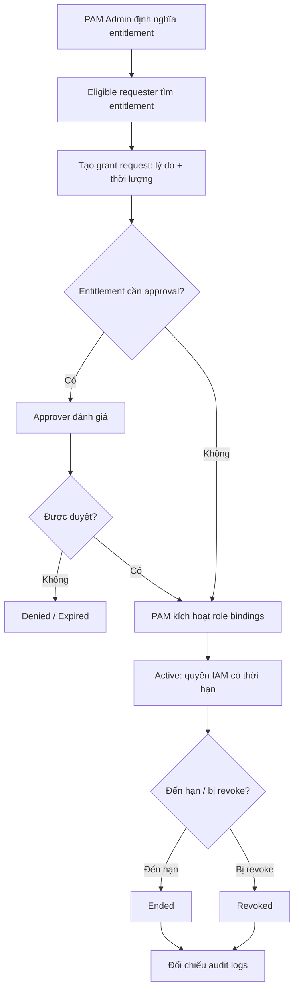

# Privileged Access Manager và cấp quyền có thời hạn

Kỹ sư trực production đôi khi cần thực hiện thao tác mà quyền truy cập hằng ngày không cho phép: sửa cấu hình Cloud Run để khắc phục sự cố, điều tra một máy ảo Compute Engine, hoặc bảo trì tài nguyên trong Google Cloud. Nếu cấp sẵn quyền quản trị rộng và giữ vĩnh viễn, một tài khoản bị chiếm đoạt có thể gây ảnh hưởng lớn. Nếu mọi lần xử lý đều cần quản trị viên thêm rồi xóa IAM binding thủ công, đội vận hành dễ chậm trễ và khó kiểm toán.

**Google Cloud Privileged Access Manager (PAM)** giải quyết bài toán này bằng cơ chế **just-in-time (JIT) privileged access**: người dùng đủ điều kiện **yêu cầu một tập vai trò IAM đã được định nghĩa trước**, có thể phải nêu lý do và được phê duyệt; quyền chỉ có hiệu lực trong một **khoảng thời gian hữu hạn**, rồi được PAM gỡ bỏ. Bài học thuộc chương **Quản trị tổ chức**, kết nối kiến thức về project, folder, organization, IAM, bảo vệ tài nguyên, vận hành Compute Engine/GKE/Cloud Run và độ tin cậy của hệ thống.

Các project, tài khoản và sự kiện trong bài là **ví dụ giả định**. Những lệnh thay đổi quyền được trình bày để học quy trình và chỉ nên thực thi trên tài nguyên được cho phép, sau khi đã kiểm tra scope, người yêu cầu và chính sách tổ chức.

## Mục tiêu học tập

Sau bài học, bạn có thể:

1. Phân biệt **entitlement**, **grant request**, **approval**, **active grant**, **IAM role binding** và **audit log**.
2. Thiết kế quyền JIT theo **principal, role, resource, duration, justification và approval workflow**.
3. Chuẩn bị Google Cloud PAM tại đúng cấp **organization, folder hoặc project**, với các quyền quản trị cần thiết.
4. Thực hiện luồng yêu cầu, phê duyệt, kiểm tra trạng thái và thu hồi grant qua Console hoặc `gcloud`.
5. Giải thích vai trò của IAM Conditions, IAM deny policy, Principal Access Boundary và thời gian lan truyền quyền.
6. Thiết kế runbook cho bảo trì production, emergency access, kiểm toán và xử lý lỗi cấp quyền.

## 1. Vì sao cần truy cập đặc quyền theo thời gian?

Một người phát triển ứng dụng thường chỉ cần xem logs, kiểm tra trạng thái service và triển khai trên development. Khi sự cố production xảy ra, người này có thể cần **quyền mạnh hơn trong 60 phút** để thay đổi Cloud Run service. Sau khi sự cố được xử lý, quyền đó không còn cần thiết.

So sánh ba cách:

| Cách quản lý | Quyền khi không có sự cố | Cách xử lý khi cần đặc quyền | Rủi ro chính |
| --- | --- | --- | --- |
| Cấp vai trò quản trị **vĩnh viễn** | Luôn có quyền | Dùng ngay | Bề mặt tấn công lớn, khó chứng minh nhu cầu truy cập liên tục |
| Thêm/xóa IAM binding **thủ công** | Có thể không có quyền | Mở ticket, admin thêm binding rồi nhớ gỡ | Quên gỡ, khó chuẩn hóa thời hạn và phê duyệt |
| **Privileged Access Manager** | Quyền nền ở mức tối thiểu | Yêu cầu grant từ entitlement; xét duyệt nếu cấu hình; tự hết hạn | Cần thiết kế entitlement, quyền, giám sát và quy trình đúng |

PAM phù hợp cho **truy cập nâng quyền có kiểm soát**. Nó không thay thế việc thiết kế IAM chuẩn, đăng nhập an toàn, phân tách môi trường, tổ chức project, backup hay giới hạn dữ liệu nhạy cảm.

### Tình huống điển hình

- **Incident response:** On-call SRE cần quyền cập nhật một dịch vụ sản xuất trong 1 giờ.
- **Bảo trì cơ sở dữ liệu:** DBA cần quyền quản trị cấu hình Cloud SQL trong cửa sổ bảo trì.
- **Kiểm tra an ninh:** Kỹ sư bảo mật cần quyền điều tra cao hơn thông thường trong thời gian ngắn.
- **Break-glass:** Tập người trực khẩn cấp có thể kích hoạt quyền không cần phê duyệt, nhưng phải nêu lý do và được giám sát chặt.
- **Thay đổi hạ tầng giới hạn:** Một kỹ sư cần vai trò phù hợp để xử lý sự cố Compute Engine/VPC mà không giữ role suốt tháng.

**Lưu ý:** Khi định nghĩa quyền, phải chọn vai trò có chứa permission thực tế của tác vụ. Ví dụ, có `roles/run.developer` không mặc nhiên cấp `iam.serviceAccounts.actAs` trên runtime service account; nếu tác vụ cần cả hai quyền, phải thiết kế chúng riêng đúng phạm vi.

## 2. Mô hình của Google Cloud PAM

PAM có hai loại tài nguyên trung tâm:

1. **Entitlement:** Một *cấu hình quyền có thể yêu cầu*. Nó xác định resource scope, IAM roles, principal đủ điều kiện, thời gian tối đa và quy trình xét duyệt.
2. **Grant:** Một *yêu cầu cấp quyền cụ thể* dựa trên entitlement, do principal đủ điều kiện tạo, có thời lượng yêu cầu, lý do, trạng thái và lịch sử phê duyệt.



### Các thành phần trong entitlement

| Thành phần | Ý nghĩa | Ví dụ minh họa |
| --- | --- | --- |
| **Scope** | Organization, folder hoặc project nơi tạo entitlement | Project `retail-prod-01` |
| **Entitlement ID** | Tên ổn định để người dùng tìm quyền được phép yêu cầu | `prod-cloudrun-incident` |
| **Role bindings** | Các IAM roles tạm cấp; có thể kèm IAM Conditions | `roles/run.developer` |
| **Eligible requesters** | Danh sách người/nhóm/identity được quyền tạo yêu cầu | Nhóm `sre-oncall@example.com` |
| **Maximum grant duration** | Thời lượng tối đa một lần kích hoạt | 1 giờ (`3600s`) |
| **Justification requirement** | Có bắt buộc người yêu cầu nêu lý do? | Ticket `INC-2042` |
| **Approval workflow** | Không cần duyệt hoặc có các approver được chỉ định | Nhóm `platform-approvers@example.com` |
| **Notifications** | Người liên quan cần nhận thông báo | Hộp thư giám sát vận hành |

PAM dùng **IAM role bindings có điều kiện thời gian** để cấp và gỡ quyền. Cơ chế này tuân theo quy tắc lan truyền thay đổi của IAM: grant chuyển sang `Active` không có nghĩa mọi yêu cầu đến tất cả dịch vụ đều thấy quyền ngay tức thì; ngược lại, thu hồi hoặc hết hạn cũng cần được kiểm tra theo trạng thái và quyền hiệu lực.

### Một entitlement không phải một grant

Tạo entitlement **không tự động cấp quyền** cho tất cả người trong danh sách requester. Người đủ điều kiện mới có khả năng **yêu cầu**. Khi grant được kích hoạt, **chỉ principal thực hiện yêu cầu** nhận nâng quyền; việc thêm một Google Group vào danh sách eligible requesters không khiến toàn bộ thành viên nhóm đồng loạt được cấp role đặc quyền.

Một entitlement có thể phục vụ nhiều lần xử lý sự cố độc lập, với các grant có lý do và thời hạn khác nhau.

## 3. PAM tương tác với IAM và resource hierarchy thế nào?

Trong Google Cloud, project có thể nằm dưới folder và organization. Entitlement được tạo ở cấp nào thì các quyền IAM cấp bởi entitlement có phạm vi gốc ở cấp đó; quyền có thể **kế thừa xuống tài nguyên con** theo cách IAM hoạt động.

```text
Organization: example.com
└── Folder: Retail
    ├── Project: retail-dev-01
    └── Project: retail-prod-01
        ├── Cloud Run service: checkout
        ├── Compute Engine VM: worker-01
        └── Cloud SQL instance: orders-db
```

Một entitlement gắn tại **folder Retail** với role quản trị rộng có thể ảnh hưởng **cả dev và prod**, nếu role được kế thừa. Một entitlement tại **project retail-prod-01** thường dễ giới hạn phạm vi hơn. Với nhu cầu chỉ thao tác trên một tập nhỏ tài nguyên, có thể sử dụng **IAM Conditions** khi dịch vụ và permission hỗ trợ điều kiện phù hợp.

Không được mặc định rằng một entitlement gắn cấp project chỉ cấp quyền trên đúng một Cloud Run service. Nếu role được cấp ở project mà không có ràng buộc bổ sung, nhiều tài nguyên cùng project có thể nằm trong phạm vi đó.

### Các lớp kiểm soát tiếp tục có hiệu lực

PAM cấp **allow bindings tạm thời**, nên quyền cuối cùng vẫn chịu các lớp kiểm soát khác:

- **IAM deny policy:** Một deny rule phù hợp có thể chặn permission, ngay cả khi grant PAM đang `Active`.
- **Principal Access Boundary:** Có thể giới hạn tập tài nguyên mà principal đủ điều kiện truy cập; PAM không tự vượt qua giới hạn đó.
- **IAM Conditions:** Role tạm cấp có thể kèm điều kiện về resource/time/tag và thuộc tính được IAM hỗ trợ.
- **Organization Policy:** Có thể ngăn loại cấu hình hoặc loại tài nguyên, không được giải quyết chỉ bằng cách thêm role.
- **VPC Service Controls:** Có thể chặn yêu cầu đi qua perimeter dù IAM đã cho phép.
- **API enablement, quota, billing và xác thực:** Vẫn cần được đáp ứng trước khi thao tác nghiệp vụ thành công.

Do đó, **`Active` không đồng nghĩa “có quyền làm mọi việc”**. Khi lỗi `PERMISSION_DENIED` còn xuất hiện, hãy kiểm tra đúng principal, permission, resource và điều kiện qua Policy Troubleshooter/Cloud Audit Logs.

## 4. Chọn phạm vi và vai trò theo nguyên tắc least privilege

Quy trình thiết kế entitlement nên bắt đầu từ **việc cần làm**, rồi mới chọn role:

1. Ghi nhu cầu: “on-call cần cập nhật Cloud Run service `checkout` khi xử lý lỗi 5xx”, không chỉ “cần quyền admin”.
2. Xác định **API operations và IAM permissions** cần thiết; phân biệt quyền cập nhật Cloud Run, quyền `iam.serviceAccounts.actAs` và quyền đọc image trong Artifact Registry.
3. Tìm predefined role hoặc tạo **custom role** đủ permission. Tránh các role gồm quyền quản lý IAM rộng nếu không thực sự cần.
4. Chọn scope nhỏ nhất có thể: **project** phù hợp, hoặc điều kiện giới hạn tài nguyên khi được hỗ trợ.
5. Giới hạn requesters, approvers và duration theo lịch vận hành.
6. Ghi rõ rationale, mã ticket, owner và cách kiểm chứng/thu hồi.

| Quyết định | Phương án nên cân nhắc | Rủi ro khi cấu hình quá rộng |
| --- | --- | --- |
| Resource scope | Project production cụ thể | Folder/organization lan xuống nhiều project |
| Role | Vai trò đủ thao tác, custom role nếu cần | `Owner`/`Editor` hoặc quyền `setIamPolicy` vượt nhu cầu |
| Eligible requesters | Nhóm on-call có quản lý membership | Ai cũng có thể request hoặc lạm dụng quy trình |
| Approvers | Người độc lập với requester và hiểu rủi ro | Không có kiểm soát cho thay đổi quan trọng |
| Max duration | Thời gian hoàn thành tác vụ cộng biên độ hợp lý | Quyền mạnh tồn tại quá lâu |
| Justification | Bắt buộc có ticket, scope, thời gian | Không có bằng chứng mục đích cấp quyền |
| Logging/alerting | Giám sát request, approve, active, revoke | Khó điều tra sau incident |

**Cảnh báo quan trọng:** PAM không đảm bảo ngăn được **persistence** nếu role tạm thời có permission như `resourcemanager.projects.setIamPolicy`, các permission `*setIamPolicy` hoặc `iam.roles.update`. Người được nâng quyền có thể dùng khoảng thời gian đó để tạo **binding lâu dài** hoặc sửa role. Chọn role ít quyền, quy trình review và phát hiện thay đổi IAM ngoài dự kiến.

### Giới hạn được tài liệu PAM nêu

Tài liệu Google Cloud hiện hành mô tả:

- Một entitlement có thể cấu hình **tối đa 30 roles**.
- **Max grant duration** trong khoảng **30 phút đến 7 ngày** (tương ứng `1800s` đến `604800s`); một yêu cầu không được vượt giới hạn của entitlement.
- Có thể khai báo tối đa **20 requesting principals** và tối đa **20 principals ở mỗi cấp approval**; có thể dùng group để quản lý nhiều thành viên, nhưng chỉ requester cụ thể nhận quyền.
- Chỉ dùng predefined/custom roles cho **dịch vụ hỗ trợ IAM Conditions**. Nhóm legacy basic roles `Owner`, `Editor`, `Viewer` **không được PAM hỗ trợ**; tài liệu có phân biệt các basic roles `Admin`, `Writer` và `Reader` được hỗ trợ.
- Một requester có tối đa **10 open grants cho một entitlement** tại cùng thời điểm, và không thể tạo yêu cầu trùng phạm vi với grant đang active/scheduled/awaiting approval.
- Không nên cấp **service agent roles** trong entitlement vì các vai trò đó dành cho danh tính do Google quản lý và có thể chứa quyền rất mạnh.

Các giới hạn và tính năng Preview thay đổi theo thời gian; cần đối chiếu tài liệu trước khi triển khai trên production. Không nên chọn duration 7 ngày chỉ vì công cụ cho phép nếu runbook chỉ cần 1 giờ.

## 5. Chuẩn bị PAM và quyền quản trị

Trước khi tạo entitlement:

1. Xác định organization/folder/project sẽ chứa entitlement và tài nguyên cần quản lý.
2. Kiểm tra PAM đã được **onboard/enable** ở scope phù hợp chưa. Dịch vụ API của PAM có tên `privilegedaccessmanager.googleapis.com`.
3. Chuẩn bị IAM cho người quản trị cấu hình, người xem audit và người quản lý IAM scope.
4. Xác nhận các vai trò dự kiến cấp **được PAM hỗ trợ**, không có permission dễ cho phép duy trì quyền vĩnh viễn sau grant.
5. Kiểm tra danh sách eligible requesters/approvers, group membership, notification và chính sách bảo vệ production.

### Phân tách quyền

| Nhân vật | Vai trò/quyền điển hình | Ghi chú |
| --- | --- | --- |
| **PAM administrator** | `roles/privilegedaccessmanager.admin` | Quản lý entitlements/grants theo phạm vi |
| **IAM administrator tại project** | `roles/resourcemanager.projectIamAdmin` | Tài liệu PAM yêu cầu kết hợp khi tạo/sửa/xóa entitlement cấp project |
| **IAM administrator tại folder** | `roles/resourcemanager.folderAdmin` | Cần cho thao tác IAM ở folder tương ứng |
| **IAM administrator tại organization** | `roles/iam.securityAdmin` | Kết hợp PAM Admin khi cấu hình ở organization |
| **Viewer** | `roles/privilegedaccessmanager.viewer` | Xem thông tin entitlement/grant khi có quyền phù hợp |
| **Audit reviewer** | `roles/logs.viewer`, quyền log bổ sung nếu cần | Xem Cloud Audit Logs tại phạm vi được phép |
| **Eligible requester** | Được liệt kê trong entitlement | Tài liệu PAM không yêu cầu một role PAM riêng chỉ để tạo yêu cầu đủ điều kiện |
| **Approver** | Được liệt kê trong workflow xét duyệt | Không cần role PAM riêng chỉ để phê duyệt/deny grant của entitlement mà họ được chỉ định |

Đây là hướng dẫn theo **predefined roles** thông thường; quyền chi tiết còn phụ thuộc loại tài nguyên và các policy của tổ chức. Người chỉ chịu trách nhiệm cấp quyền theo ticket không cần nhận đồng thời mọi vai trò IAM quản trị.

### Kiểm tra CLI trước khi thao tác

```bash
# Chỉ đọc danh tính và project mặc định của Google Cloud CLI.
gcloud auth list
gcloud config get-value project

# Kiểm tra project muốn quản trị (thay bằng project thực tế).
gcloud projects describe retail-prod-01 \
  --format="table(projectId,projectNumber,name)"

# Kiểm tra API PAM trong danh sách đã bật của project.
gcloud services list --enabled \
  --project=retail-prod-01 \
  --filter="config.name:privilegedaccessmanager.googleapis.com"
```

Nếu cần bật PAM hoặc thực hiện onboarding, hãy dùng quy trình setup chính thức và quyền `serviceusage.services.enable`/IAM tương ứng. **Không bật API trên nhầm project** hoặc cố giải quyết lỗi permission bằng cách cấp `roles/owner`.

## 6. Tạo entitlement qua Google Cloud Console

Giả sử đội SRE cần quyền `roles/run.developer` tối đa 1 giờ trong project `retail-prod-01` khi xử lý sự cố ứng dụng.

1. Mở [Privileged Access Manager trong Google Cloud Console](https://console.cloud.google.com/iam-admin/pam) và chọn **đúng project** hoặc cấp scope dự kiến.
2. Mở tab **Entitlements**, chọn **Create**.
3. Đặt entitlement ID, ví dụ `prod-cloudrun-incident`; chọn roles được phép tạm cấp. Nếu phải giới hạn tài nguyên bên dưới project, cân nhắc **IAM Conditions** có thể áp dụng cho các permissions đó.
4. Nhập **Maximum grant duration** là **1 giờ**, không dài hơn nhu cầu thực tế.
5. Chọn **eligible requesters**, chẳng hạn nhóm on-call; cấu hình **justification bắt buộc**.
6. Chọn hình thức approval:
   - Với tác vụ production có rủi ro, chỉ định **manual approvers** và yêu cầu lý do phê duyệt nếu thích hợp.
   - Với luồng break-glass không cần phê duyệt, cần quy trình độc lập: nhóm requester hạn chế, thời lượng ngắn, log/alert và hậu kiểm.
7. Thêm notification recipients cần thiết, rà soát ảnh hưởng role/scope và tạo entitlement.
8. Yêu cầu người quản trị kiểm tra lại cấu hình; chưa có grant nào được tự động cấp chỉ vì entitlement tồn tại.

**Chú ý phân tách trách nhiệm:** Người cấu hình entitlement có thể kiểm soát quyền tạm cấp. Nên quản lý thay đổi entitlement qua review, giới hạn quản trị viên được phép sửa, và có cơ chế phát hiện khi điều kiện/role thay đổi.

### Thiết kế entitlement dưới dạng bảng trước khi tạo

| Trường | Giá trị minh họa |
| --- | --- |
| Scope | `projects/retail-prod-01` |
| ID | `prod-cloudrun-incident` |
| Roles | `roles/run.developer` (xem các permission bổ sung khi thực thi) |
| Eligible requesters | `group:sre-oncall@example.com` |
| Approvers | `group:platform-approvers@example.com` |
| Maximum duration | `3600s` |
| Requester justification | Bắt buộc, gắn số incident |
| Approval | Một approver độc lập, nếu workflow hỗ trợ |
| Notification | Nhóm vận hành/an ninh |
| Owner | Platform Security |

Đây là **bảng đặc tả**, không phải YAML schema gửi thẳng vào PAM API. Tài liệu CLI có định dạng `entitlement.yaml` riêng gồm các trường như `privilegedAccess`, `eligibleUsers`, `maxRequestDuration`, `requesterJustificationConfig` và `approvalWorkflow`; cần lấy schema đúng phiên bản công cụ trước khi viết IaC/script.

### Phê duyệt nhiều cấp

Một số tùy chọn như **hai cấp xét duyệt tuần tự** và yêu cầu nhiều approver ở mỗi cấp được tài liệu Google Cloud gắn với **Security Command Center Premium/Enterprise** và trạng thái **Preview**. Không nên mặc định mọi tổ chức đều có lựa chọn này. Kiểm tra entitlement và điều kiện sản phẩm trước khi thiết kế quy trình yêu cầu hai cấp.

## 7. Người dùng yêu cầu quyền tạm thời

Ví dụ on-call nhận nhiệm vụ khắc phục lỗi Cloud Run `checkout` trong `retail-prod-01`.

1. Người dùng mở PAM, chọn scope nơi entitlement có hiệu lực, tab **My entitlements**.
2. Chọn `prod-cloudrun-incident` và **Request grant**.
3. Nhập thời lượng, ví dụ **60 phút**, không lớn hơn giới hạn entitlement.
4. Nhập lý do cụ thể: `INC-2042: checkout 5xx, rollback revision sau khi kiểm tra lỗi`. Lý do nên nêu *việc làm, resource, ticket và thời gian cần dùng*.
5. Gửi yêu cầu. Tùy cấu hình, grant có thể **chờ phê duyệt** hoặc được kích hoạt ngay.
6. Chỉ thực hiện tác vụ đặc quyền sau khi grant thực sự ở trạng thái **Active**, kiểm tra quyền IAM đã lan truyền và xác nhận **đúng project**.
7. Hoàn tất xử lý sự cố, theo dõi thay đổi, đóng hoặc chủ động thu hồi quyền sớm nếu không còn cần.

PAM có hỗ trợ **scheduled grants** trong những luồng/phiên bản nhất định; một grant đã được duyệt có thể được lên lịch bắt đầu trong tương lai. Với request kích hoạt ngay, nếu không được quyết định trong **24 giờ**, grant hết hạn. Với request lên lịch, approval phải hoàn thành **trước thời điểm kích hoạt đã chọn**.

### Gửi yêu cầu bằng gcloud

Cú pháp sau minh họa **tác vụ tạo quyền**, không chạy trên hệ thống thực trong bài. Các giá trị project/entitlement là giả định:

```bash
# Tìm entitlement mà tài khoản đang đăng nhập có quyền yêu cầu.
gcloud pam entitlements search \
  --project=retail-prod-01 \
  --location=global \
  --caller-access-type=grant-requester

# Xem một entitlement cụ thể trước khi xin quyền.
gcloud pam entitlements describe prod-cloudrun-incident \
  --project=retail-prod-01 \
  --location=global

# Yêu cầu grant 1 giờ, gắn mã incident.
gcloud pam grants create \
  --entitlement=prod-cloudrun-incident \
  --project=retail-prod-01 \
  --location=global \
  --requested-duration=3600s \
  --justification="INC-2042: investigate checkout 5xx and rollback if approved"
```

CLI trả về một **grant ID**, cần lưu để xem trạng thái và audit. Đừng kết luận câu lệnh `create` thành công nghĩa là IAM đã cấp quyền; grant vẫn có thể chờ phê duyệt hoặc đang kích hoạt.

## 8. Người phê duyệt đánh giá grant

Approver cần xem **requester**, **resource scope**, **roles**, **thời lượng**, **justification**, **thời điểm yêu cầu** và độ phù hợp với ticket. Nếu cần đối chiếu, xác minh tình huống với người phụ trách hệ thống.

Quy trình Console:

1. Vào PAM, tab **Approve grants** → **Pending approval**.
2. Mở yêu cầu, đọc đầy đủ entitlement và lý do.
3. Nếu hợp lệ, **Approve** và nhập lý do khi workflow yêu cầu.
4. Nếu không hợp lệ, **Deny** và giải thích để requester gửi yêu cầu đúng hơn.

**Không thể tự phê duyệt yêu cầu của chính mình.** Đây là một ranh giới kiểm soát quan trọng; approver cần độc lập với requester.

### CLI dành cho người duyệt

```bash
# Danh sách entitlement mà bạn là approver.
gcloud pam entitlements search \
  --project=retail-prod-01 \
  --location=global \
  --caller-access-type=grant-approver

# Tìm grant đang cần bạn xét duyệt trong entitlement.
gcloud pam grants search \
  --project=retail-prod-01 \
  --location=global \
  --entitlement=prod-cloudrun-incident \
  --caller-relationship=can-approve

# Ví dụ tác vụ phê duyệt (thay GRANT_ID thực tế).
gcloud pam grants approve GRANT_ID \
  --project=retail-prod-01 \
  --location=global \
  --entitlement=prod-cloudrun-incident \
  --reason="INC-2042: reviewed scope and approved for incident mitigation"
```

Với yêu cầu thiếu thông tin hoặc vượt phạm vi, dùng `gcloud pam grants deny` với lý do rõ ràng. Approval đã quyết định không thể coi như một bước có thể “undo” đơn giản; nếu quyền đã Active và cần dừng sớm, dùng **revoke** theo quy trình.

### Khi yêu cầu có nhiều approvers

Tùy cấu hình entitlement, cần đủ số lượng approval trước khi kích hoạt. Trong workflow nhiều cấp (nếu khả dụng), cấp sau chỉ được mời khi cấp trước hoàn tất; một lần **deny** có thể đưa grant về `Denied` và dừng luồng. Theo dõi trạng thái tổng, không dựa chỉ vào lời nhắn “đã có người bấm Approve”.

## 9. Vòng đời và trạng thái grant

Một grant không đơn thuần là “đã cấp” hoặc “chưa cấp”. Khi vận hành, cần phân biệt:

| Trạng thái hiển thị | Ý nghĩa | Hành động hợp lý |
| --- | --- | --- |
| **Approval awaited** | Đang chờ người duyệt | Theo dõi SLA, kiểm tra request chưa hết hạn |
| **Scheduled** | Được lên lịch kích hoạt trong tương lai | Đối chiếu cửa sổ bảo trì và approval deadline |
| **Activating** | PAM đang áp dụng quyền | Chưa vội thao tác, đợi chuyển Active |
| **Active** | Grant đã được kích hoạt | Xác minh đúng permission và thực hiện tác vụ được duyệt |
| **Activation failed** | Không thể kích hoạt vì lỗi không thể retry tự động | Kiểm tra quyền PAM/service agent, IAM policy và lỗi được trả về |
| **Denied** | Yêu cầu bị từ chối | Xem lý do, điều chỉnh scope hoặc ticket |
| **Expired** | Yêu cầu chưa được duyệt đúng hạn | Gửi yêu cầu mới nếu vẫn cần |
| **Ended** | Thời lượng grant đã hết, quyền được PAM gỡ | Kiểm tra công việc và audit |
| **Revoking / Revoked** | Đang thu hồi / đã thu hồi trước hạn | Theo dõi đến trạng thái cuối |
| **Withdrawing / Withdrawn** | Requester đang rút / đã rút grant | Đối chiếu trạng thái hiện hành |

Trạng thái thực tế còn có thể có nhãn đặc biệt, như **Modified through IAM**, nếu role binding do PAM tạo bị sửa trực tiếp ở IAM. Khi binding bị sửa ngoài PAM, PAM **chỉ có thể xóa những binding do mình tạo mà chưa bị sửa**, nên cần điều tra và dọn dẹp theo đúng quy trình. Không sửa trực tiếp binding PAM đang quản lý để thử “đẩy nhanh” quyền.

### IAM propagation và thời điểm hết hạn

PAM dựa trên IAM Conditions có giới hạn thời gian. Quyền có thể chưa sẵn sàng ngay sau khi grant chuyển sang Active vì thay đổi IAM cần lan truyền. Khi hết hạn hoặc bị revoke, cũng cần lưu ý tác vụ đang chạy, tokens/session và quyền được cấp bằng những kênh khác.

**Hết hạn grant không đảo ngược thao tác đã thực hiện**: VM đã tạo, cấu hình Cloud Run đã thay đổi hoặc một IAM binding vĩnh viễn do người có quyền tạo vẫn tồn tại trừ khi được kiểm tra và xử lý riêng. Vì vậy thời hạn grant chỉ là **một lớp kiểm soát truy cập**, không phải công cụ rollback hạ tầng.

## 10. Xem và thu hồi grant

Người vận hành hoặc auditor cần nhìn được trạng thái grant, người được cấp, thời gian và lịch sử quyết định.

```bash
# Liệt kê grants thuộc một entitlement (yêu cầu quyền xem phù hợp).
gcloud pam grants list \
  --project=retail-prod-01 \
  --location=global \
  --entitlement=prod-cloudrun-incident

# Xem grant ID cụ thể.
gcloud pam grants describe GRANT_ID \
  --project=retail-prod-01 \
  --location=global \
  --entitlement=prod-cloudrun-incident

# Ví dụ thu hồi một grant đang Active trước hạn.
# Chỉ người có quyền phù hợp được thực hiện trong thực tế.
gcloud pam grants revoke GRANT_ID \
  --project=retail-prod-01 \
  --location=global \
  --entitlement=prod-cloudrun-incident \
  --reason="INC-2042 resolved; elevated access no longer required"
```

**Đọc grant trước khi revoke:** Xác định đúng grant ID, requester, resource, trạng thái và lý do. Thu hồi có thể ảnh hưởng công việc đang chạy; phối hợp với on-call khi cần. Sau lệnh, kiểm tra trạng thái chuyển sang `Revoked` và xác minh IAM hiệu lực.

Theo tài liệu PAM, **lịch sử grant trong giao diện** có thể xem trong **30 ngày sau khi grant kết thúc**; việc lưu giữ log để kiểm toán dài hạn nên dựa trên Cloud Audit Logs, sink/retention của tổ chức chứ không kỳ vọng lịch sử UI tồn tại vĩnh viễn.

## 11. Kiểm toán PAM qua Cloud Audit Logs

Với một grant đặc quyền, kiểm toán nên trả lời:

1. **Ai** tạo request? Với **lý do và ticket** nào?
2. **Ai** phê duyệt hoặc từ chối? Quyết định khi nào?
3. Grant **kích hoạt** lúc nào, trong phạm vi nào và mang role nào?
4. Trong khoảng Active, người được cấp đã **làm gì** trên tài nguyên?
5. Grant **hết hạn** hay **bị thu hồi** lúc nào? Có thay đổi IAM ngoài PAM không?

Một truy vấn Logs Explorer tham khảo:

```text
protoPayload.serviceName="privilegedaccessmanager.googleapis.com"
timestamp>="2026-11-19T00:00:00Z"
```

Bộ lọc này có thể điều chỉnh bằng project, entitlement/grant resource name và phương thức API. PAM tạo **Admin Activity audit logs** cho các thao tác thay đổi như `ApproveGrant`, `RevokeGrant`, `CreateEntitlement` (theo loại API/permission); các lần xem dữ liệu có thể thuộc **Data Access logs**, cần cấu hình/đủ quyền để truy cập theo quy tắc logging của Google Cloud.

Google Cloud còn ghi nhận một số **system events** liên quan đến vòng đời grant, chẳng hạn:

```text
PAMActivateGrant
PAMEndGrant
PAMExpireGrant
PAMReportExternalGrantModification
```

Không nên chỉ truy vấn `ApproveGrant` rồi kết luận không có grant nào được kích hoạt: entitlement **không yêu cầu approval** có thể chuyển Active mà không có approval event; các hoạt động hệ thống có dấu vết riêng.

### Liên kết grant với hành động trên tài nguyên

PAM log cho biết lịch sử **cấp quyền**; log của **Cloud Run**, **Compute Engine**, **Cloud SQL**, **Cloud Storage** hoặc **IAM** mới cho biết các API calls thực tế trong cửa sổ đó. Khi điều tra, đối chiếu:

| Bằng chứng | Nơi xem | Nội dung |
| --- | --- | --- |
| Entitlement/Grant ID | PAM history/API | Vai trò, người yêu cầu, lý do, duration |
| Approval/denial event | PAM audit logs | Người duyệt, thời điểm, lý do |
| Activation/revoke/end | PAM system events và grant status | Khoảng thời gian quyền có thể được sử dụng |
| API modifications | Cloud Audit Logs của dịch vụ | Principal, resource, method, status |
| Change ticket/CI logs | Hệ thống vận hành | Mục tiêu, người chịu trách nhiệm, kết quả |
| IAM policy changes | Cloud Audit Logs IAM/Resource Manager | Binding nào được thêm/sửa/xóa ngoài dự kiến |

Các Data Access logs của một số dịch vụ **không bật mặc định**, và không phải mọi phương thức API đều tạo cùng loại log. Thiết kế log sink, quyền đọc và retention trước khi xảy ra sự cố; tránh ghi token, mật khẩu hoặc dữ liệu khách hàng trong lý do grant.

## 12. Case study: Khắc phục sự cố Cloud Run ở production

Ứng dụng bán hàng chạy Cloud Run trong `retail-prod-01`. Trong đợt release, phiên bản mới làm tăng tỷ lệ 5xx. SRE on-call cần kiểm tra revisions và có thể rollback cấu hình.

### Thiết kế trước sự cố

- Quyền thường trực: xem logs và thông tin service phù hợp với công việc.
- Entitlement: `prod-cloudrun-incident` gắn cấp project, role được chọn sau khi liệt kê các permissions cần cho rollback.
- Requesters: nhóm SRE trực.
- Approvers: platform lead hoặc security on-call; requester không được tự duyệt.
- Max duration: **60 phút**; bắt buộc nêu ticket và lý do.
- Notifications: người phụ trách production, security monitoring.
- Hậu kiểm: log thay đổi Cloud Run, revision cuối, thời gian grant hết hiệu lực.

### Dòng thời gian minh họa

| Thời gian UTC | Sự kiện | Điều cần xác minh |
| --- | --- | --- |
| 08:00 | Alert tỉ lệ 5xx tăng | Đã xác nhận impact production |
| 08:07 | On-call tạo grant `INC-2042`, 60 phút | Đúng entitlement, đúng project |
| 08:10 | Approver duyệt | Lý do và người duyệt hợp lệ |
| 08:11 | Grant Active | IAM đã lan truyền, đúng principal |
| 08:20 | SRE rollback revision | Audit log và change record |
| 08:35 | Error rate trở về bình thường | SLO/latency, health check |
| 08:40 | Thu hồi grant sớm | Trạng thái Revoked, kiểm tra quyền |
| 09:00 | Post-incident review | Tác vụ đã làm, việc cần cải tiến |

**Điểm thiết kế:** Role tạm thời cần đáp ứng thao tác rollback nhưng không cho phép đổi IAM hoặc xóa project. Nếu rollback cần dùng runtime service account, xác minh chính xác quyền `iam.serviceAccounts.actAs` và tài nguyên của nó. IAM deny policy hay Organization Policy vẫn có thể chặn tác vụ; khi đó phải phân tích chính sách tương ứng, không tăng quyền một cách tùy tiện.

### Thời gian hoàn thành incident không đồng nghĩa thời gian grant

60 phút là giới hạn **quyền**, không phải SLA để ứng dụng khỏe lại. Sau khi hoàn tất thay đổi, thu hồi sớm có thể giảm thời gian lộ đặc quyền. Nếu sự cố kéo dài, cần tạo request mới hoặc dùng luồng gia hạn được hỗ trợ bởi quy trình, thay vì sửa thủ công IAM binding tạm thời.

## 13. Case study: Break-glass có kiểm soát

Một hệ thống quan trọng có thể gặp sự cố ngoài giờ, khi approver thông thường không phản hồi. Đội bảo mật quyết định tạo entitlement **break-glass** không yêu cầu phê duyệt trước.

Các biện pháp giảm rủi ro:

1. **Giới hạn người đủ điều kiện** ở một nhóm nhỏ có quy trình xác thực mạnh và kiểm tra membership định kỳ.
2. **Giới hạn scope/role**, không mặc định cấp Owner hay quyền sửa IAM toàn organization.
3. **Thời lượng ngắn**, yêu cầu justification ghi incident ID, người chỉ huy và tác vụ cần làm.
4. **Thông báo tự động** ngay khi grant được yêu cầu/Active; giám sát Cloud Audit Logs và hành động trên resource.
5. **Hậu kiểm bắt buộc**: xác minh hành động, sự cần thiết, các binding vĩnh viễn phát sinh và thời điểm quyền được gỡ.
6. **Diễn tập định kỳ** trên môi trường kiểm soát để phát hiện sự cố quyền hoặc approval trước khi có incident thật.

Không có bước approval **không có nghĩa** không có accountability. Với break-glass, logging, giám sát và review sau sự cố phải được tăng cường tương ứng với quyền truy cập.

## 14. Case study: Entitlement cấp folder nhưng chỉ cần một project

Organization có folder `Retail` chứa `retail-dev-01` và `retail-prod-01`. PAM Admin tạo entitlement ở folder để giảm số cấu hình. SRE chỉ muốn quyền production.

**Rủi ro:** Nếu role được cấp ở folder và kế thừa, quyền có thể áp dụng cả hai project. Cần đánh giá **IAM inheritance** và resource restrictions trước khi chấp thuận.

Các hướng thiết kế:

- Tạo entitlement **trực tiếp ở project prod**, nếu mục tiêu chỉ là quyền tại project đó.
- Nếu muốn **tái sử dụng cấu hình cấp cha**, cân nhắc khả năng yêu cầu grant tại **child scope** khi tính năng được bật/hỗ trợ. Tài liệu Google Cloud mô tả khả năng điều chỉnh scope của entitlement kế thừa ở cấp con là **Preview**.
- Với tài nguyên nhỏ hơn project, áp dụng **IAM Conditions** hoặc yêu cầu có **fine-grained access restrictions** nếu phiên bản API/PAM cung cấp tính năng tương ứng. Kiểm thử chính xác permission và loại tài nguyên được hỗ trợ.
- Kiểm tra kết quả bằng Policy Troubleshooter trên **cả dev và prod** để tránh cấp nhầm quyền ra ngoài ý muốn.

Không dùng tên entitlement `prod-only` để suy luận phạm vi được giới hạn đúng production; **IAM bindings và conditions thực tế** mới quyết định quyền.

## 15. Các lỗi thường gặp và cách chẩn đoán

| Triệu chứng | Điều cần kiểm tra | Cách xử lý |
| --- | --- | --- |
| Không thấy entitlement trong `My entitlements` | Scope đang chọn, requester có nằm trong eligible principals/group không | Kiểm tra project/folder/organization và membership |
| Tạo entitlement bị `PERMISSION_DENIED` | PAM Admin và quyền quản lý IAM scope có đủ không | Kiểm tra role quản trị đúng cấp, tránh cấp Owner toàn cục |
| Request bị từ chối do duration | Thời lượng vượt `maxRequestDuration` hoặc ngoài giới hạn sản phẩm | Điều chỉnh yêu cầu theo entitlement |
| Grant đang `Approval awaited` quá lâu | Approver, thông báo, chính sách approve | Theo dõi người duyệt và thời hạn; request mới nếu hết hạn |
| Grant đã bị `Expired` | Approval không xảy ra trong 24h hoặc trước scheduled time | Tạo yêu cầu mới với ticket hợp lệ |
| Grant `Active` nhưng tác vụ báo 403 | IAM propagation; sai principal/resource; thiếu permission khác; deny/PAB | Policy Troubleshooter và log API, xem đúng tác vụ |
| Grant không kích hoạt, `Activation failed` | Lỗi IAM policy update, service setup, quyền/service agent | Đọc lỗi grant và Cloud Audit Logs, phối hợp PAM admin |
| Grant kết thúc nhưng vẫn thấy quyền | Binding vĩnh viễn tồn tại, IAM propagation hoặc binding PAM bị sửa ngoài | Kiểm tra effective IAM và dấu hiệu `Modified through IAM` |
| Requester muốn tự approve | PAM không cho tự phê duyệt | Chọn approver độc lập hoặc quy trình emergency phù hợp |
| Không thấy toàn bộ lịch sử trong Console | UI có thời gian giữ lịch sử hạn chế | Dùng Cloud Audit Logs/retention riêng phục vụ kiểm toán |
| Một permission bị chặn dù grant Active | IAM deny, PAB, Organization Policy, VPC SC hoặc API riêng | Không sửa bằng cách cấp role rộng hơn; dùng công cụ chuyên trách |

### Chẩn đoán tối thiểu theo thứ tự

```text
Kiểm tra danh tính đang dùng và scope
    ↓
Entitlement có cho phép principal request?
    ↓
Grant ID và trạng thái hiện tại?
    ↓
Approval/duration có hợp lệ?
    ↓
Grant Active và quyền IAM đã lan truyền?
    ↓
Permission trên resource đúng?
    ↓
Deny / PAB / Conditions / Org Policy / VPC SC?
    ↓
Audit logs và xác nhận thao tác nghiệp vụ
```

## 16. Phân biệt PAM với các cơ chế khác

| Cơ chế | Công dụng chính | Quan hệ với PAM |
| --- | --- | --- |
| **IAM allow policy** | Cấp role/permission thông thường | PAM tạo role bindings có thời hạn |
| **IAM Conditions** | Điều kiện để một binding có hiệu lực | PAM dựa vào điều kiện thời gian và có thể dùng condition bổ sung |
| **IAM deny policy** | Chặn những permission được hỗ trợ | Deny phù hợp vẫn có thể chặn quyền PAM |
| **Principal Access Boundary** | Giới hạn tập resource principal đủ điều kiện truy cập | PAM không vượt qua boundary |
| **Policy Troubleshooter** | Giải thích vì sao quyền được hoặc không được cấp | Dùng để chẩn đoán sau khi grant Active |
| **Service account impersonation** | Dùng danh tính service account qua short-lived token | Khác việc cấp tạm IAM role; có thể kết hợp trong kiến trúc xác thực |
| **Cloud Audit Logs** | Ghi lại hoạt động API/system events | Đối chiếu lịch sử cấp quyền với hành động đã làm |
| **Organization Policy** | Giới hạn loại cấu hình/tài nguyên | PAM không thay thế chính sách tổ chức |
| **Cloud Billing budgets** | Giám sát và cảnh báo chi phí | PAM không giới hạn chi phí do thao tác đặc quyền gây ra |

**Không nhầm** grant lifetime với **credential lifetime**. PAM tạo quyền truy cập tạm thời trong IAM; nó không phát hành mật khẩu đặc quyền riêng để có thể thu hồi mọi session ứng dụng ngay lập tức. Cần xét cả token, thao tác đang chạy và những tài nguyên đã thay đổi khi đóng incident.

## 17. Runbook quản trị và hậu kiểm

Một quy trình áp dụng PAM tại tổ chức nên có cả thiết kế trước và vận hành sau:

### Trước khi triển khai

- Có owner của từng entitlement, danh sách roles và lý do nghiệp vụ.
- Có sơ đồ resource hierarchy để xác định chính xác folder/project phạm vi ảnh hưởng.
- Có nguyên tắc chọn max duration, danh sách requester/approver và yêu cầu justification.
- Kiểm tra role không chứa permission tạo khả năng duy trì quyền vĩnh viễn nếu chưa có kiểm soát bổ sung.
- Đảm bảo PAM setup, notifications, audit log visibility và phương án khi approver vắng mặt.
- Kiểm thử trên project không phải production; rà soát IAM inheritance và conditions.

### Khi xảy ra yêu cầu

- Requester ghi ticket, scope, nhiệm vụ, thời gian và kết quả mong muốn.
- Approver kiểm tra requester, role, project, thời lượng và tác động đến dữ liệu.
- Chỉ thao tác khi grant Active và quyền hiệu lực đã được xác nhận.
- Theo dõi những thay đổi cấu hình/triển khai, ghi log và trao đổi với owner của dịch vụ.

### Sau khi hoàn tất

- Thu hồi sớm nếu không còn nhu cầu; đợi trạng thái kết thúc và kiểm tra quyền.
- Đối chiếu grant history, PAM audit logs và API audit logs của dịch vụ.
- Phát hiện binding IAM, role hoặc tài nguyên bị thay đổi ngoài phạm vi ticket.
- Cập nhật postmortem, danh sách entitlements và thời lượng nếu thực tế khác giả định.
- Giữ chứng cứ theo chính sách retention của tổ chức; đừng chỉ dựa vào lịch sử 30 ngày trong Console.

## 18. Bài tập thực hành

### Bài 1 — Thiết kế entitlement

On-call cần cập nhật Cloud Run trong một project production tối đa 45 phút, nhưng không được sửa IAM. Hãy xác định entitlement scope, role, eligible requesters, approvers, duration và justification.

<details>
<summary>Gợi ý đáp án</summary>

Scope ở project production cụ thể; role tối thiểu chứa các permission cần để update Cloud Run, không chứa `setIamPolicy`; nhóm on-call là eligible requesters; nhóm platform lead độc lập là approvers; maximum 45 phút (nằm trong 30 phút–7 ngày); justification có incident ticket, service và tác vụ. Kiểm tra IAM Conditions nếu cần giới hạn đúng service.
</details>

### Bài 2 — Khi grant chưa đủ

Grant PAM chứa `roles/run.developer` đã Active nhưng deploy Cloud Run vẫn báo thiếu `iam.serviceAccounts.actAs`. Có nên cấp PAM Admin cho requester?

<details>
<summary>Gợi ý đáp án</summary>

Không. PAM Admin quản lý entitlements, không phải quyền dùng runtime service account. Cần xác định đúng principal và runtime service account, kiểm tra permission `iam.serviceAccounts.actAs` rồi cấp đúng vai trò/phạm vi nếu được duyệt, đồng thời xem deny/PAB.
</details>

### Bài 3 — Có được tự duyệt?

Một người vừa là requester vừa có tên trong danh sách approver. Họ muốn tự duyệt yêu cầu khẩn cấp của chính mình.

<details>
<summary>Đáp án</summary>

PAM không cho approve yêu cầu do chính người đó tạo. Cần approver khác theo quy trình hoặc một entitlement break-glass riêng được phê duyệt trước về thiết kế, có justification và audit chặt.
</details>

### Bài 4 — Khác biệt giữa Ended và không còn dấu vết

Grant đã `Ended` nhưng trong production vẫn có một IAM binding `roles/iam.securityAdmin` được tạo trong thời gian grant Active. Quyền đó có tự mất theo grant không?

<details>
<summary>Đáp án</summary>

Không thể giả định. PAM chỉ tự quản lý bindings do PAM tạo và còn nguyên; một binding vĩnh viễn được tạo riêng có vòng đời độc lập. Cần điều tra Cloud Audit Logs và xử lý IAM binding phát sinh theo chính sách.
</details>

### Bài 5 — Tính thời hạn

Entitlement cho phép tối đa 1 giờ. Người dùng xin 90 phút để bảo trì và không có approver trả lời trong 24 giờ đối với request kích hoạt ngay. Hãy nêu hai vấn đề.

<details>
<summary>Đáp án</summary>

Yêu cầu 90 phút vượt `maxRequestDuration` 60 phút nên cần giảm duration hoặc thay đổi entitlement qua quản trị phù hợp. Yêu cầu chờ phê duyệt ngay mà không được xét duyệt trong 24 giờ sẽ `Expired`, cần request lại nếu vẫn cần quyền.
</details>

### Bài 6 — Chọn scope

Folder `Retail` có cả project dev và prod, nhưng kỹ sư chỉ cần sửa một dịch vụ production. Đặt entitlement ở folder có thể tạo rủi ro gì?

<details>
<summary>Gợi ý đáp án</summary>

Role cấp tại folder có thể kế thừa xuống cả hai project. Nên tạo entitlement project-level hoặc dùng cơ chế giới hạn scope/condition được PAM và dịch vụ hỗ trợ, rồi xác minh quyền trên cả hai môi trường.
</details>

### Bài 7 — Phân tích lỗi sau khi revoke

Grant đã chuyển `Revoked`, nhưng một VM mới vẫn tồn tại trong project. PAM bị lỗi rollback hay không?

<details>
<summary>Đáp án</summary>

Không. Revoke nhằm thu hồi quyền IAM tạm thời; nó không tự xóa VM hoặc đảo ngược thao tác đã thực hiện. Cần hậu kiểm và thay đổi tài nguyên bằng quy trình quản lý hạ tầng riêng.
</details>

## 19. Checklist đánh giá một entitlement production

- [ ] Scope đúng organization/folder/project và đã kiểm tra tác động kế thừa.
- [ ] Role/permissions tối thiểu, không cấp IAM admin rộng nếu không cần.
- [ ] Chỉ dùng roles và services được PAM hỗ trợ.
- [ ] Requesters là principal/nhóm được quản lý membership rõ ràng.
- [ ] Approvers độc lập; có kế hoạch khi người duyệt vắng mặt.
- [ ] Duration vừa đủ, không vượt giới hạn sản phẩm và nghiệp vụ.
- [ ] Justification bắt buộc khi phù hợp; không chứa secrets hoặc dữ liệu nhạy cảm.
- [ ] Có notification, Cloud Audit Logs và nơi lưu chứng cứ dài hạn.
- [ ] Đã kiểm thử request, approval, Active, revoke/end và IAM propagation.
- [ ] Đã kiểm tra deny/PAB/Organization Policy/VPC SC và service-specific permissions.
- [ ] Có runbook incident, break-glass và hậu kiểm IAM binding thay đổi ngoài PAM.
- [ ] Rà soát entitlement/role/approver định kỳ và khi thay đổi cấu trúc tổ chức.

## Tài liệu tham khảo chính thức

- [Google Cloud — Privileged Access Manager overview](https://cloud.google.com/iam/docs/pam-overview): khái niệm, trường hợp sử dụng, giới hạn và tương tác với IAM.
- [Privileged Access Manager permissions and setup](https://cloud.google.com/iam/docs/pam-permissions-and-setup): chuẩn bị quyền và khởi tạo tại project/folder/organization.
- [Create entitlements in Privileged Access Manager](https://cloud.google.com/iam/docs/pam-create-entitlements): requester, roles, scope, maximum duration, approval workflows và giới hạn.
- [Request temporary elevated access](https://cloud.google.com/iam/docs/pam-request-temporary-elevated-access): tạo grant, thời lượng, justification, activation và giới hạn request.
- [Approve or deny grants](https://cloud.google.com/iam/docs/pam-approve-deny-grants): workflow xét duyệt và deadline.
- [View grants](https://cloud.google.com/iam/docs/pam-view-grants): trạng thái, lịch sử và thay đổi binding ngoài PAM.
- [Revoke grants](https://cloud.google.com/iam/docs/pam-revoke-grants): thu hồi grant trước hạn.
- [Privileged Access Manager audit logging](https://cloud.google.com/iam/docs/audit-logging/audit-logging-pam): Admin Activity, Data Access và system events.
- [gcloud pam reference](https://cloud.google.com/sdk/gcloud/reference/pam): lệnh entitlements/grants bằng CLI.
- [IAM Conditions overview](https://cloud.google.com/iam/docs/conditions-overview): giới hạn truy cập theo thuộc tính của policy binding.
- [Policy Troubleshooter](https://cloud.google.com/policy-intelligence/docs/troubleshoot-access): giải thích nguyên nhân permission không được cấp dù đã Active.

