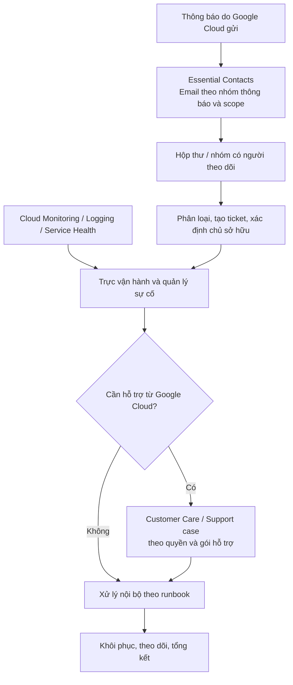
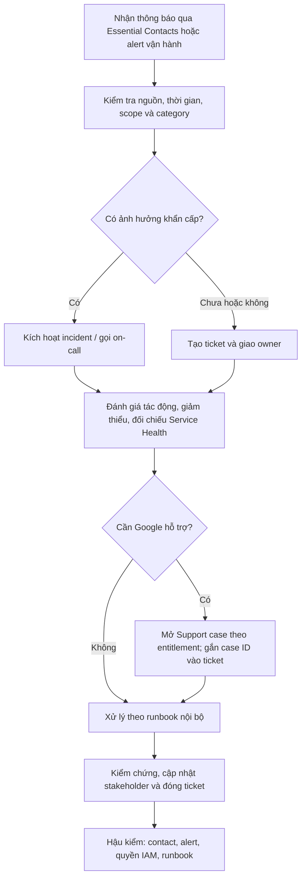

# Essential Contacts, kênh hỗ trợ và đầu mối vận hành trên Google Cloud

Một hệ thống Google Cloud được thiết kế tốt vẫn có thể gặp sự cố nếu **thông báo quan trọng không đến đúng người**. Google có thể gửi cảnh báo về bảo mật, thanh toán, nguy cơ đình chỉ dịch vụ hoặc thay đổi sản phẩm; trong khi đội vận hành phải theo dõi Cloud Run, GKE, Compute Engine, mạng VPC, lưu trữ và cơ sở dữ liệu. Mỗi loại thông tin cần người tiếp nhận, hành động xử lý và kênh leo thang khác nhau.

Bài học nằm trong chương **Quản trị tổ chức** của module `CLOUD_PROVIDERS_GCP`. Sau khi hiểu cấu trúc Organization, Folder, Project và IAM, người học cần xây dựng hệ thống liên lạc để quản trị tài nguyên, bảo vệ ứng dụng, tự động hóa triển khai và theo dõi độ tin cậy cùng chi phí. Trọng tâm ở đây là **Essential Contacts**, các **kênh hỗ trợ của Google Cloud**, và **cơ chế phân công đầu mối vận hành** cho tổ chức có nhiều project.

> Essential Contacts là một cách đăng ký **địa chỉ email nhận các thông báo được Google Cloud phân loại**. Đây không phải hệ thống trực ca, không tự mở ca hỗ trợ kỹ thuật và không thay thế cảnh báo ứng dụng trong Cloud Monitoring.

## 1. Mục tiêu học tập

Sau bài học, bạn có thể:

- Giải thích Essential Contacts là gì, khi nào sử dụng và những giới hạn của dịch vụ.
- Phân biệt các nhóm thông báo **Billing, Legal, Product updates, Security, Suspension, Technical**.
- Chọn nơi cấu hình liên hệ ở **Organization, Folder hoặc Project**, nhận diện liên hệ được kế thừa từ cấp cha.
- Thiết kế danh sách **đầu mối chính, đầu mối dự phòng, hộp thư nhóm và đường leo thang** cho từng loại thông báo.
- Phân biệt Essential Contacts với **Google Cloud Customer Care/Support**, **Service Health**, **Cloud Monitoring**, cảnh báo ngân sách và công cụ quản lý sự cố nội bộ.
- Chuẩn bị hồ sơ hỗ trợ kỹ thuật có đủ bằng chứng mà không đưa mật khẩu, khóa dịch vụ hoặc thông tin nhạy cảm vào yêu cầu.
- Kiểm tra quy trình tiếp nhận thông báo bằng các tình huống bảo mật, thanh toán, thay đổi sản phẩm và gián đoạn dịch vụ.

## 2. Vì sao đầu mối liên lạc là một phần của quản trị tổ chức?

Hãy xét một doanh nghiệp có các project `orders-dev`, `orders-staging`, `orders-prod` và `payments-prod`. Hệ thống đang chạy ổn, nhưng một thông báo liên quan tới dự án sản xuất được gửi tới địa chỉ email cá nhân của nhân viên đã chuyển bộ phận. Nhóm vận hành không nhận được thông tin đúng lúc; các bước xử lý tiếp theo bị chậm dù dashboard và IAM vẫn được cấu hình chính xác.

Vấn đề có ít nhất bốn mặt:

1. **Người nhận:** Google Cloud liên hệ với địa chỉ nào cho thông tin liên quan Organization, Folder hoặc Project?
2. **Phân loại:** đây là thông báo bảo mật, billing, pháp lý, thay đổi sản phẩm hay sự cố kỹ thuật?
3. **Hành động:** ai có trách nhiệm đọc, xác minh, đánh giá tác động và tạo công việc xử lý?
4. **Leo thang:** khi cần thông tin từ Google Cloud hoặc khi ảnh hưởng vượt phạm vi một đội, phải mở yêu cầu hỗ trợ ở đâu và liên hệ ai?

Thiết kế đúng cần kết hợp nhiều cơ chế:



Đường nhận email từ Essential Contacts, cảnh báo của hệ thống giám sát và kênh mở Support case **bổ sung** cho nhau. Không nên trông chờ chỉ một kênh đảm nhận toàn bộ vòng đời sự cố.

## 3. Essential Contacts là gì?

**Essential Contacts** cho phép đăng ký những địa chỉ email đại diện để nhận **các loại thông báo quan trọng từ Google Cloud** về tài nguyên trong phạm vi đã chọn. Một bản ghi liên hệ thường có các thuộc tính:

| Thuộc tính | Ý nghĩa |
| --- | --- |
| **Email address** | Địa chỉ mà thông báo được gửi tới. Có thể chọn địa chỉ nhóm được quản lý để tránh lệ thuộc một cá nhân. |
| **Notification categories** | Một hay nhiều nhóm thông báo mà địa chỉ sẽ đăng ký nhận. |
| **Language** | Ngôn ngữ ưu tiên cho thông báo theo danh sách Google Cloud hỗ trợ; không phải mọi thông báo đều chắc chắn được dịch. |
| **Resource scope** | Organization, Folder hoặc Project nơi cấu hình liên hệ. |

Ví dụ một bản ghi mang ý nghĩa: “Gửi các thông báo thuộc nhóm `SECURITY` và `SUSPENSION` về nhánh tài nguyên này tới `gcp-security@example.com`”. Địa chỉ đó không tự được cấp quyền xem project, dữ liệu hay IAM policy.

### 3.1. Nhóm thông báo cần quan tâm

| Nhóm | Mục đích nhận thông tin | Đầu mối nên phụ trách |
| --- | --- | --- |
| **Billing** | Thông tin về thanh toán, tài khoản thanh toán và các vấn đề billing có liên quan. | FinOps, Finance hoặc quản trị billing. |
| **Legal** | Thông báo pháp lý, vấn đề điều khoản hoặc yêu cầu có tính pháp lý. | Pháp chế hoặc đầu mối tuân thủ. |
| **Product updates** | Cập nhật sản phẩm hoặc thay đổi có thể ảnh hưởng kế hoạch sử dụng dịch vụ. | Cloud Platform, kiến trúc sư hệ thống, chủ sở hữu dịch vụ. |
| **Security** | Những thông báo bảo mật và vấn đề cần phản ứng về an ninh. | Cloud Security hoặc Security Operations. |
| **Suspension** | Cảnh báo liên quan nguy cơ hoặc hành động đình chỉ dịch vụ/tài nguyên. | Đầu mối vận hành ưu tiên cao, phối hợp Security và Billing tùy nguyên nhân. |
| **Technical** | Thông báo kỹ thuật liên quan dịch vụ, tài nguyên hoặc thay đổi vận hành. | SRE/Cloud Operations và các nhóm sản phẩm phụ trách workload. |

Tên category xuất hiện trong cấu hình/API thường theo dạng `BILLING`, `LEGAL`, `PRODUCT_UPDATES`, `SECURITY`, `SUSPENSION` và `TECHNICAL`. Tùy giao diện/API, bạn cũng có thể gặp lựa chọn liên quan tới tất cả danh mục. Nên **gán rõ các nhóm cần thiết** thay vì mặc định mọi email phải nhận toàn bộ loại thông báo.

**Lưu ý:** danh mục biểu thị **chủ đề**, không phải mức độ khẩn cấp. Một thông báo Technical có thể chỉ yêu cầu xem kế hoạch thay đổi; một thông báo Billing có thể dẫn tới gián đoạn nếu không xử lý kịp. Luôn đọc nội dung và thời hạn trong thông báo trước khi xác định mức ưu tiên nội bộ.

### 3.2. Essential Contacts không làm những gì?

Essential Contacts **không**:

- Cấp IAM role hay quyền truy cập cho người nhận email.
- Thay thế cơ chế phân quyền người được tạo và theo dõi **Support case**.
- Bảo đảm phát hiện mọi sự cố của workload hoặc gửi cảnh báo mỗi khi API/VM/Pod lỗi.
- Cung cấp lịch trực ca, trạng thái xác nhận đã đọc, tự động phân công sự cố hoặc SLA phản hồi nội bộ.
- Thay thế chính sách backup, Cloud Monitoring alerting, log tập trung hay thông báo từ hệ thống thanh toán/định danh khác.

Một người có thể là người nhận Essential Contacts nhưng **không có quyền mở Support case**. Ngược lại, người có IAM role phù hợp để mở Support case có thể không phải địa chỉ Essential Contacts của tổ chức.

## 4. Phạm vi Organization, Folder, Project và liên hệ được kế thừa

Essential Contacts được quản lý theo cây tài nguyên Google Cloud. Cấu hình tại cấp cha có thể áp dụng cho các tài nguyên con bên dưới; liên hệ tại cấp con bổ sung khả năng tiếp nhận cho nhu cầu riêng của nhánh đó.

Xét cây tài nguyên:

```text
Organization: example.com
├── Folder: shared-services
│   └── Project: net-host-prod
└── Folder: applications
    ├── Folder: dev
    │   └── Project: orders-dev
    └── Folder: prod
        ├── Project: orders-prod
        └── Project: payments-prod
```

Một phương án cấu hình:

| Nơi cấu hình | Email liên hệ | Category | Chủ đích |
| --- | --- | --- | --- |
| **Organization** | `cloud-security@example.com` | Security, Suspension | Đội bảo mật nhận thông báo quan trọng của toàn tổ chức. |
| **Organization** | `cloud-finance@example.com` | Billing | Đầu mối thanh toán cấp tổ chức. |
| **Organization** | `cloud-legal@example.com` | Legal | Đầu mối pháp chế. |
| **Folder `applications`** | `cloud-platform@example.com` | Product updates, Technical | Đội nền tảng nắm thay đổi và vấn đề kỹ thuật của nhánh ứng dụng. |
| **Folder `prod`** | `sre-prod@example.com` | Technical, Suspension | Nhóm SRE chịu trách nhiệm khối sản xuất. |
| **Project `payments-prod`** | `payments-owner@example.com` | Technical | Đội ứng dụng thanh toán nhận thông tin liên quan project của mình. |

Khi đánh giá liên hệ hiệu lực cho `payments-prod`, cần xét các bản ghi đặt tại chính project và các tổ tiên có thể áp dụng: Folder `prod`, Folder `applications` và Organization. **Liên hệ gắn ở cấp con không mặc nhiên xóa liên hệ của cấp cha.**

### 4.1. Chọn cấp cấu hình theo phạm vi trách nhiệm

**Đặt tại Organization** khi đầu mối thật sự có trách nhiệm toàn doanh nghiệp: bảo mật trung tâm, pháp chế, quản trị billing chung hoặc quản trị nền tảng. Lợi ích là những project mới tạo dưới tổ chức vẫn có đầu mối cấp tổ chức phù hợp.

**Đặt tại Folder** khi thông báo cần được phân tuyến theo đơn vị kinh doanh, đội nền tảng hoặc môi trường. Ví dụ Folder `prod` có nhóm SRE trực sản xuất, còn Folder `dev` có nhóm platform/dev tools theo dõi thay đổi ít khẩn cấp hơn.

**Đặt tại Project** khi dự án cần chủ sở hữu riêng, ví dụ `payments-prod` do một nhóm có chuyên môn thanh toán vận hành. Không cần lặp cùng một email trên hàng trăm project nếu một bản ghi ở Folder đã đáp ứng nhiệm vụ.

### 4.2. “Liên hệ trực tiếp” và “liên hệ hiệu lực” khác nhau

Khi kiểm tra cấu hình phải phân biệt:

- **Direct contacts:** bản ghi được lưu trực tiếp trên Organization, Folder hoặc Project cụ thể.
- **Computed/effective contacts:** tập liên hệ phù hợp với tài nguyên và danh mục đang xét, bao gồm những liên hệ có nguồn từ tổ tiên theo cơ chế kế thừa của dịch vụ.

Nếu chỉ liệt kê các liên hệ **trực tiếp** của `payments-prod`, bạn có thể không thấy `cloud-security@example.com` dù nhóm Security vẫn được cấu hình ở Organization. Ngược lại, việc một email xuất hiện trong danh sách liên hệ hiệu lực **không có nghĩa** người dùng email đó có thể quản trị project.

Đừng nhầm logic kế thừa này với IAM allow policy. Hai cơ chế cùng dùng cây Resource Manager nhưng **quy tắc áp dụng và mục đích khác nhau**; không thể suy luận quyền IAM từ danh sách Essential Contacts.

## 5. Thiết kế đầu mối vận hành: nhóm, người chịu trách nhiệm và dự phòng

Một danh sách email không đủ nếu không có người chịu trách nhiệm theo dõi và xử lý. Trước khi đăng ký Essential Contacts, hãy xây dựng **sổ liên lạc vận hành**.

| Vai trò | Nhóm chính | Nhóm dự phòng | Trách nhiệm |
| --- | --- | --- | --- |
| Security Contact | Cloud Security/SOC | SRE trưởng ca | Đánh giá thông báo bảo mật, điều phối xử lý rủi ro và lưu chứng cứ. |
| Billing Contact | FinOps/Finance | Cloud Platform | Kiểm tra tình trạng thanh toán, hạn thanh toán và chi phí. |
| Suspension Contact | Incident Manager hoặc SRE | Security + Billing | Ưu tiên xác minh và tránh gián đoạn; điều phối đúng nhóm nguyên nhân. |
| Technical Contact | Cloud Operations/SRE | Chủ sở hữu workload | Đánh giá thay đổi hoặc vấn đề kỹ thuật, đối chiếu lịch triển khai. |
| Product Updates Contact | Cloud Platform | Kiến trúc sư/nhóm ứng dụng | Phân tích thay đổi, deprecation và công việc chuyển đổi. |
| Legal Contact | Pháp chế | Đầu mối tuân thủ | Đánh giá yêu cầu pháp lý và thông báo các bên liên quan. |
| Support Case Owner | SRE/Cloud Support Coordinator | Người trực vận hành được ủy quyền | Tạo, cập nhật, theo dõi case và chuyển thông tin sang nhóm xử lý. |

### 5.1. Vì sao nên dùng email nhóm được quản lý?

Ví dụ `gcp-security@example.com` là một hộp thư nhóm hoặc alias có phân phối tới những người đang trực. Khi một kỹ sư nghỉ việc, tổ chức chỉ cần cập nhật thành viên nhóm mà không phụ thuộc việc nhớ sửa hàng loạt contact riêng lẻ.

Cần thiết kế:

1. **Nhóm chính và nhóm dự phòng** có chủ sở hữu rõ ràng.
2. Cơ chế xác nhận người trực đã nhận thông tin và tạo ticket nội bộ.
3. Quy trình cập nhật thành viên khi thay người, nghỉ phép, đổi nhà thầu.
4. Kiểm tra quyền nhận email từ bên ngoài, bộ lọc spam và chính sách lưu trữ thư.
5. Xác thực rằng hộp thư hoạt động; tránh alias không người quản trị hoặc chuyển tiếp tới địa chỉ cá nhân không được kiểm soát.

Không phải mọi thông báo đều cần đánh thức người trực vào ban đêm. **Thông báo Security/Suspension có rủi ro cao** cần quy trình sàng lọc nhanh, trong khi Product updates thường có thể vào backlog thay đổi theo lịch. Mức ưu tiên thực tế phải dựa trên nội dung thông báo và tác động tới doanh nghiệp.

### 5.2. Trách nhiệm khác với quyền IAM

Một nhân viên thuộc nhóm `cloud-legal@example.com` không cần `roles/owner` trên mọi project để nhận thông báo pháp lý. Người phụ trách Finance cũng không nhất thiết cần quyền đọc dữ liệu Cloud SQL. Cấp **role phù hợp với công việc thực tế**, tách khỏi tư cách người nhận thông báo.

Nhóm có quyền thay đổi Essential Contacts nên là người quản trị được giao trách nhiệm. Google Cloud cung cấp các quyền và role IAM liên quan Essential Contacts, chẳng hạn nhóm role quản trị và chỉ xem; hãy kiểm tra định nghĩa role hiện hành rồi cấp tại scope cần thiết. Không cấp `roles/owner` chỉ để sửa địa chỉ liên hệ.

## 6. Cấu hình Essential Contacts trong Console

Ví dụ cấu hình ở cấp Organization hoặc Project:

1. Đăng nhập Google Cloud Console bằng danh tính có quyền thích hợp.
2. Chọn đúng **Organization, Folder hoặc Project** ở bộ chọn tài nguyên.
3. Mở mục **Essential Contacts** (có thể truy cập bằng tìm kiếm trong Console nếu vị trí menu thay đổi).
4. Thêm email nhóm được giám sát; chọn các **notification categories** cần nhận.
5. Chọn ngôn ngữ hỗ trợ thích hợp rồi lưu cấu hình.
6. Kiểm tra lại danh sách liên hệ, phạm vi áp dụng và đầu mối thực tế quản lý hộp thư.
7. Với project con, kiểm tra **liên hệ hiệu lực** để chắc chắn đã tính đến cấu hình kế thừa.

Để tránh nhầm môi trường, ghi vào phiếu thay đổi các trường: resource type, resource ID, email, category, nhóm chịu trách nhiệm, người phê duyệt và lý do thay đổi. Cách đặt tên email nên thể hiện rõ chức năng, ví dụ `gcp-security@...` thay vì `contact1@...`.

### 6.1. Mẫu bản ghi liên hệ trong API

Mô hình JSON sau minh họa các trường chính của một bản ghi; **không phải lời gọi API để tự động tạo contact**:

```json
{
  "email": "gcp-security@example.com",
  "notificationCategorySubscriptions": [
    "SECURITY",
    "SUSPENSION"
  ],
  "languageTag": "en"
}
```

Trong đó:

- `email` là địa chỉ nhận thông báo.
- `notificationCategorySubscriptions` liệt kê nhóm thông báo.
- `languageTag` chọn ngôn ngữ ưu tiên theo định dạng mà dịch vụ hỗ trợ. `en` ở đây là giá trị ví dụ; cần xem danh sách ngôn ngữ thực tế trong Console/API.

Các API kiểm tra của Essential Contacts thường phân biệt việc **liệt kê bản ghi trực tiếp** với việc **tính tập contact áp dụng** cho tài nguyên. Ví dụ đường dẫn REST dưới đây thể hiện ý nghĩa của phép đọc:

```text
GET /v1/organizations/123456789012/contacts
    → Liệt kê contact gắn trực tiếp với Organization

GET /v1/projects/orders-prod/contacts
    → Liệt kê contact gắn trực tiếp với Project

GET /v1/projects/orders-prod/contacts:compute
    → Tính contact áp dụng tại Project, gồm nguồn kế thừa phù hợp
```

Đây là đường dẫn tham khảo của Essential Contacts API; khi gọi thực tế phải dùng host `essentialcontacts.googleapis.com`, danh tính có quyền truy cập API và các tham số truy vấn bắt buộc/được hỗ trợ theo phiên bản API. Không dùng kết quả `list` trực tiếp của project để thay thế việc kiểm tra contact hiệu lực.

### 6.2. Kiểm tra sau cấu hình

Có thể kiểm tra ngay các điều kiện sau:

- Email được nhập đúng và nhóm nhận có người quản trị.
- Category cần thiết đã được chọn tại scope phù hợp.
- Project production nhận đúng contact từ tổ tiên và contact riêng.
- Không có liên hệ đã nghỉ việc, email tự chuyển tiếp không còn chủ sở hữu hoặc địa chỉ bị chặn thư từ bên ngoài.
- Có ticket/runbook cho thông báo cần hành động.

Việc gửi **email kiểm tra nội bộ** tới alias chỉ chứng minh hệ thống thư có thể nhận email; **không xác nhận** Google Cloud đã phát sinh một thông báo Essential Contacts thử nghiệm. Hãy xác minh cấu hình trong Console/API và thực hiện diễn tập quy trình tiếp nhận riêng.

## 7. Kênh hỗ trợ Google Cloud: Customer Care và Support case

**Essential Contacts** là kênh đăng ký người nhận thông báo. **Google Cloud Customer Care/Support** là kênh trao đổi với Google khi cần giải đáp hoặc hỗ trợ xử lý vấn đề của sản phẩm và dịch vụ theo quyền và gói hỗ trợ mà tổ chức có.

Google Cloud có các lựa chọn hỗ trợ như **Basic, Standard, Enhanced, Premium**; tính năng, thời gian phục vụ, mức độ ưu tiên và cam kết phản hồi phụ thuộc **gói đang có, loại sự cố, sản phẩm và điều khoản hiện hành**. Không nên đưa ra cam kết “phản hồi trong X phút” chỉ từ tên gói mà chưa kiểm tra hợp đồng/hỗ trợ thực tế.

| Nhu cầu | Kênh nên dùng | Ghi chú |
| --- | --- | --- |
| Đọc hướng dẫn cấu hình IAM hoặc Cloud Run | Tài liệu sản phẩm và hướng dẫn Google Cloud | Thích hợp cho tìm hiểu, không thay thế ứng cứu sự cố production. |
| Hỏi về hóa đơn và khoản phí | Billing Support / mục Billing tương ứng | Thường đi theo quy trình hỗ trợ thanh toán riêng. |
| Ứng dụng gặp lỗi kỹ thuật cần Google điều tra | Customer Care / Support case | Quyền mở case và phạm vi hỗ trợ tùy gói/hợp đồng. |
| Theo dõi vấn đề dịch vụ Google Cloud công bố | Google Cloud Service Health | Có góc nhìn tổng quát và các tính năng thông tin theo project khi được hỗ trợ. |
| Theo dõi metrics, log và cảnh báo của workload | Cloud Monitoring, Cloud Logging, hệ thống on-call | Đây là cơ chế phát hiện và phản ứng nội bộ. |
| Thông báo pháp lý, bảo mật, đình chỉ từ Google | Essential Contacts và quy trình ứng cứu nội bộ | Email phải có người phụ trách xử lý. |
| Trao đổi thiết kế với đối tác hoặc account team | Đối tác/kênh tài khoản đã được tổ chức ký kết | Chỉ dùng khi doanh nghiệp có đầu mối và quyền lợi tương ứng. |

### 7.1. Ai được phép mở và quản lý Support case?

Quyền quản lý Support case là **một phần khác** với Essential Contacts. Có các IAM role dành cho việc xem hoặc chỉnh sửa technical support cases; ví dụ `roles/cloudsupport.techSupportViewer` và `roles/cloudsupport.techSupportEditor` trong các môi trường hỗ trợ tương ứng. Khả năng sử dụng role và tạo case còn phụ thuộc cấu hình Customer Care, tài nguyên và gói đăng ký.

Trong thực tế, nên:

- Giao quyền mở/cập nhật case cho SRE, đội platform hoặc người điều phối hỗ trợ được ủy quyền.
- Có người **thay ca** có thể tiếp quản case khi người tạo không có mặt.
- Lưu case ID trong ticket sự cố nội bộ, tránh nhiều đội cùng mở case trùng nhau.
- Rà soát định kỳ nhóm có quyền xem/thay đổi case; không mặc định người nhận email Essential Contacts cần `roles/owner`.

### 7.2. Những gì nên có trong một Support case

Khi tạo case trong **Google Cloud Console → Support** (vị trí màn hình có thể thay đổi), nội dung cần đủ để kỹ sư hỗ trợ hiểu rõ phạm vi và tác động:

| Trường | Ví dụ minh họa |
| --- | --- |
| **Tiêu đề** | “Cloud Run ở asia-southeast1 có tỷ lệ HTTP 5xx tăng mạnh”. |
| **Dịch vụ / location** | Cloud Run, region `asia-southeast1`. |
| **Project / resource** | Project ID `orders-prod`, service `orders-api`. |
| **Thời gian** | Bắt đầu `2026-11-19 01:15 UTC`, kéo dài đến hiện tại. |
| **Tác động kinh doanh** | 30% yêu cầu đặt hàng trả lỗi; chưa có phương án thay thế. |
| **Dấu hiệu kỹ thuật** | Các mã lỗi, request ID, log đã làm sạch, đồ thị độ trễ và tỉ lệ 5xx. |
| **Bước đã thử** | Rollback revision, kiểm tra quota và mạng; mô tả kết quả. |
| **Mức độ ưu tiên** | Đánh giá theo tác động thực tế và tiêu chí của Customer Care/gói hỗ trợ. |
| **Đầu mối phản hồi** | Nhóm SRE đang trực, kênh liên lạc được phê duyệt. |

**Không gửi** password, private key, service account JSON key, access token, cookie phiên đăng nhập hoặc dữ liệu khách hàng không cần thiết vào case. Đối với log, xóa/mã hóa thông tin nhận dạng và chỉ chia sẻ phần cần để điều tra theo chính sách tổ chức.

### 7.3. Phân biệt mức độ nghiêm trọng nội bộ và mức ưu tiên hỗ trợ

Doanh nghiệp có thể gọi một sự cố là `SEV-1` theo runbook nội bộ, còn cổng Customer Care dùng hệ thống **priority/severity** của gói hỗ trợ. Hai hệ thống phân loại không nhất thiết có tên và tiêu chí giống nhau.

Ví dụ:

- **Nội bộ:** `SEV-1` nghĩa là dịch vụ đặt hàng production không hoạt động, cần incident commander và cập nhật cho bên liên quan.
- **Khi mở Support case:** chọn mức phù hợp với ảnh hưởng, quy định của gói và quy trình Google Cloud; trình bày đầy đủ số liệu để kỹ sư hỗ trợ đánh giá.

Không chọn mức cao nhất chỉ để được phản hồi nhanh khi không đáp ứng tiêu chí. Ngược lại, trường hợp ảnh hưởng nghiêm trọng phải được mô tả và leo thang đúng kênh theo quyền lợi hỗ trợ.

## 8. Những kênh quan sát và cảnh báo khác không thể bỏ qua

### 8.1. Google Cloud Service Health

**Google Cloud Service Health** cung cấp thông tin về những sự kiện dịch vụ Google Cloud, trong đó có góc nhìn trạng thái dịch vụ công khai và các tính năng **Personalized Service Health** theo project/tài nguyên khi hỗ trợ và được cấu hình phù hợp.

Khi nghi ngờ lỗi khu vực hoặc dịch vụ:

1. Kiểm tra đồ thị lỗi của workload trong Cloud Monitoring.
2. Kiểm tra Service Health xem có sự kiện phù hợp thời gian, location và sản phẩm hay không.
3. Đối chiếu sự cố công bố với lỗi thực tế của ứng dụng; **không mặc định** mọi lỗi của workload đều có thông báo Service Health.
4. Nếu cần điều tra sâu và có quyền hỗ trợ, mở Support case kèm thời điểm, project ID, request ID và evidence.

### 8.2. Cloud Monitoring và hệ thống trực ca

Cloud Monitoring nên tạo alert policies cho:

- Tỷ lệ HTTP 5xx của Cloud Run hoặc Load Balancer.
- Độ trễ tăng và khả năng xử lý request giảm.
- GKE node/Pod không sẵn sàng, lỗi scheduling hoặc autoscaling.
- Compute Engine VM không khỏe, CPU/memory/disk bất thường.
- Cloud SQL CPU, connections, storage hoặc tính sẵn sàng.
- Quota usage cao, API rate limit và lỗi quyền khi hệ thống có metric/log phù hợp.

Alert policies có thể dùng notification channels hỗ trợ để gửi đến nhóm on-call hoặc công cụ sự cố. Cấu hình on-call, phân ca, xác nhận nhận sự cố và quy tắc leo thang cần được vận hành **riêng**. Email Essential Contacts không tự thay thế cơ chế này.

### 8.3. Billing và cảnh báo chi phí

**Cloud Billing budgets** có thể cảnh báo ngưỡng chi tiêu và dự báo tùy cấu hình; đây là cơ chế giám sát chi phí khác với nhóm thông báo Billing của Essential Contacts. Một budget thông thường **không phải chốt chặn chi tiêu cứng**. Đầu mối Finance cần thống nhất với Cloud Operations về:

- Kênh nhận thông báo billing chính thức.
- Ngưỡng cảnh báo chi phí hoạt động, owner và lịch kiểm tra.
- Quy trình kiểm tra khoản phí bất thường, tăng quota hoặc triển khai sai cấu hình.
- Cách phản ứng nếu tài khoản thanh toán có nguy cơ ảnh hưởng dịch vụ.

### 8.4. Cloud Logging, Audit Logs và bảo mật

**Cloud Audit Logs** giúp truy xuất hành vi quản trị và một số hoạt động truy cập theo khả năng từng dịch vụ; **Security Command Center** và cơ chế bảo mật khác có thể giúp nhận diện phát hiện rủi ro theo cấu hình tổ chức. Các công cụ này không được thay bằng đăng ký Security category trong Essential Contacts.

Tình huống một service account bị lạm dụng: cần điều tra danh tính, log và tài nguyên đích; Essential Contacts có thể cung cấp thông tin quan trọng từ Google nhưng điều tra và ứng cứu vẫn dựa vào hệ thống quan sát và nhân sự nội bộ.

## 9. Runbook: từ email thông báo đến hành động cụ thể

Doanh nghiệp nên thống nhất một quy trình đủ đơn giản để người mới trực ca cũng làm đúng.



### 9.1. Bước tiếp nhận và xác minh nguồn

Không bấm vào link lạ hoặc đăng nhập qua đường dẫn trong email chưa được kiểm tra. Xác minh nguồn thông báo qua các kênh chính thức, đặc biệt với thông báo thanh toán hoặc đình chỉ có thể bị giả mạo. Xác định:

- Project, Folder, Organization hoặc billing account nào liên quan.
- Thời gian và thời hạn hành động; email có yêu cầu thực hiện trước mốc nào không.
- Loại thông báo và tác động đến dịch vụ sản xuất.
- Chủ sở hữu ứng dụng và bộ phận được giao theo sổ đầu mối.

### 9.2. Phân loại và chuyển đúng nhóm

| Loại nhận được | Bước xử lý đầu tiên | Khi nào leo thang? |
| --- | --- | --- |
| **Billing** | Finance kiểm tra trạng thái thanh toán và Billing Console. | Có nguy cơ đình chỉ, chi phí bất thường lớn hoặc cần hỗ trợ thanh toán. |
| **Security** | SOC xác minh dấu hiệu, đánh giá tài nguyên ảnh hưởng, áp dụng quy trình ứng cứu. | Dữ liệu/khóa có nguy cơ lộ, hoạt động bất thường hoặc dịch vụ production bị đe dọa. |
| **Suspension** | Incident Manager xác minh chính sách hoặc vấn đề thanh toán/dịch vụ, chỉ định owner. | Ngay khi có khả năng gián đoạn quan trọng hoặc thời hạn sát. |
| **Technical** | SRE đọc chi tiết, đối chiếu tài nguyên, lịch thay đổi và trạng thái hệ thống. | Có lỗi production, deadline cập nhật kỹ thuật hoặc cần Google điều tra. |
| **Product updates** | Platform đưa vào backlog, phân tích tương thích và lịch nâng cấp. | Có deprecation/breaking change ảnh hưởng sản phẩm, phải lập kế hoạch trước hạn. |
| **Legal** | Chuyển cho pháp chế và lưu dấu xử lý theo quy định nội bộ. | Có hạn phản hồi hoặc nghĩa vụ pháp lý cần lãnh đạo/đơn vị tuân thủ tham gia. |

Thông báo có tính chất **khẩn cấp** phải có kênh riêng để tìm đúng người trực; email nhóm nên tự chuyển thành ticket/incident theo quy tắc được đội vận hành phê duyệt.

### 9.3. Liên lạc trong và sau sự cố

Khi mở sự cố:

1. Chỉ định **incident commander** hoặc owner điều phối.
2. Ghi tác động, phạm vi project/region/service, thời điểm bắt đầu và các biện pháp giảm thiểu.
3. Nếu có Support case, giao **một đầu mối** cập nhật trạng thái tới Google và đồng bộ thông tin với đội nội bộ.
4. Thông báo theo nhịp đã thỏa thuận tới người dùng nội bộ và bên liên quan, không suy đoán nguyên nhân khi chưa có bằng chứng.
5. Sau khôi phục, ghi rõ root cause đã xác minh, điểm thiếu trong kênh cảnh báo/đầu mối và công việc phòng ngừa.

Không nên để mọi thành viên tự gửi các bản tóm tắt khác nhau tới Google; một kênh phối hợp rõ ràng giúp tránh thông tin mâu thuẫn và tăng hiệu quả xử lý case.

## 10. Tình huống triển khai theo tổ chức

### 10.1. Tình huống A — Cảnh báo nguy cơ đình chỉ ở project prod

Tổ chức có:

```text
Organization: example.com
├── Contact SECURITY / SUSPENSION → cloud-security@example.com
├── Contact BILLING              → cloud-finance@example.com
└── Folder: applications
    └── Folder: prod
        ├── Contact SUSPENSION / TECHNICAL → sre-prod@example.com
        └── Project: orders-prod
```

Nếu một thông báo Suspension liên quan `orders-prod` thuộc phạm vi các liên hệ này, các đầu mối tương ứng có thể nhận email theo cấu hình kế thừa. Việc nhóm Security và SRE cùng nhận thông tin **không có nghĩa một trong hai tự chịu trách nhiệm toàn bộ**. Runbook phải quy định Incident Manager chủ trì, Finance kiểm tra nguy cơ billing nếu có, Security kiểm tra nguyên nhân vi phạm/bảo mật nếu liên quan, và SRE đánh giá tác động tới Cloud Run/Cloud SQL.

Chuỗi xử lý mẫu:

1. Xác minh thông báo trên kênh chính thức, xác định deadline và scope.
2. Kích hoạt quy trình vận hành khẩn cấp nếu có nguy cơ mất dịch vụ.
3. Kiểm tra nguyên nhân phù hợp: billing, policy, security hoặc yêu cầu tuân thủ.
4. Chủ sở hữu mở kênh hỗ trợ tương ứng nếu cần, cung cấp project ID và bằng chứng đã kiểm chứng.
5. Sau xử lý, xác minh trạng thái tài nguyên, khả năng phục vụ và cảnh báo chi phí/bảo mật.

### 10.2. Tình huống B — Cloud Run tăng lỗi 5xx nhưng chưa có email Essential Contacts

Cloud Monitoring phát hiện HTTP 5xx tăng từ 0,2% lên 18% trên `orders-api`. Không có thông báo Essential Contacts.

Điều này **không phải bằng chứng Essential Contacts bị lỗi**. Lỗi có thể do mã ứng dụng, database, mạng, quota hoặc tình trạng dịch vụ; Essential Contacts không cung cấp một cơ chế alert mặc định cho mọi lỗi ứng dụng.

Đội SRE thực hiện:

1. Xem dashboard, log và revision mới nhất của Cloud Run.
2. Kiểm tra kết nối tới Cloud SQL, độ trễ và số connection, quota theo region, thay đổi VPC.
3. Đối chiếu Service Health nếu có dấu hiệu lỗi hạ tầng.
4. Rollback hoặc giảm tải theo runbook nếu cần, ghi lại kết quả.
5. Mở Support case nếu có đủ bằng chứng cần Google điều tra và tổ chức có quyền hỗ trợ.

### 10.3. Tình huống C — Product update có hạn chuyển đổi

Đội Platform nhận thông báo Product updates về một thay đổi có thời hạn áp dụng. Người trực ca xử lý theo một **quy trình thay đổi**, không tự nâng cấp production ngay:

- Ghi chính xác sản phẩm, API/feature, ngày hiệu lực và project có thể ảnh hưởng.
- Tìm danh sách ứng dụng dùng tính năng, xác định chủ sở hữu.
- Tạo ticket với người chịu trách nhiệm và ngày hoàn thành trước deadline.
- Thử trên dev/staging, kiểm tra IAM/Organization Policy, đánh giá gián đoạn và chi phí.
- Phê duyệt rồi phát hành prod theo CI/CD; kiểm tra hậu triển khai và đóng ticket.

Đây là lý do nhóm Product updates thường được giao cho Platform/Architecture và owner workload, trong khi Suspension cần kênh phản ứng khẩn cấp hơn.

## 11. Kiểm toán và bảo trì danh sách liên hệ

Essential Contacts chỉ có ích nếu danh sách được duy trì. Một checklist vận hành:

| Chu kỳ gợi ý | Việc cần làm | Đầu ra |
| --- | --- | --- |
| Khi tạo project mới | Kiểm tra inherited contacts và owner project. | Project đã có đầu mối Security, Billing, Technical phù hợp. |
| Khi thay nhân sự hoặc nhà cung cấp | Rà soát email, nhóm và kênh trực ca. | Không còn địa chỉ mồ côi, người dự phòng sẵn sàng. |
| Hàng quý | Kiểm tra trực tiếp và effective contacts tại các scope quan trọng. | Danh sách contact đúng với cơ cấu tổ chức hiện tại. |
| Sau sự cố / Support case | Đánh giá thông báo tới đúng người chưa, có trễ hay lạc kênh không. | Cải tiến quy trình và đào tạo người trực. |
| Trước thay đổi billing hoặc organization | Rà soát Billing, Legal, Suspension và Support ownership. | Rõ đầu mối trước thay đổi quản trị có phạm vi lớn. |

### 11.1. Dữ liệu nên lưu trong sổ liên lạc

Mỗi record quản trị nội bộ nên có:

```yaml
resource: "projects/orders-prod"
contact_category: "TECHNICAL"
contact_email: "sre-prod@example.com"
owner_team: "Cloud SRE"
backup_team: "Cloud Platform"
ticket_queue: "PROD-OPS"
oncall_reference: "internal-oncall-schedule"
last_reviewed: "2026-11-19"
```

Đây là **mẫu dữ liệu quản trị nội bộ**, không phải định dạng yêu cầu của Essential Contacts API. Các trường `owner_team`, `ticket_queue`, `oncall_reference` và `last_reviewed` giúp đội vận hành kiểm toán, nhưng bản thân Essential Contacts không tự quản lý lịch trực hay ticket queue này.

Không đưa số điện thoại cá nhân, thông tin xác thực hoặc bí mật vào sổ liên lạc công khai. Nếu dùng hệ thống on-call, lưu tham chiếu tới schedule được phân quyền phù hợp.

### 11.2. Kiểm toán quyền quản trị liên hệ và Support

Hai nhóm quyền cần xem riêng:

- Ai được tạo/sửa/xóa **Essential Contacts** ở Organization, Folder và Project?
- Ai được xem/tạo/cập nhật **Support cases** theo gói hỗ trợ?

Đồng thời rà soát quyền IAM của từng account trong workflow ứng cứu. Ví dụ, tài khoản chỉ đọc log không mặc nhiên được sửa billing; chủ sở hữu ticket không mặc nhiên được cấp quyền quản trị Organization. Quyền quá rộng có thể tạo rủi ro còn lớn hơn việc thiếu một thông báo.

## 12. Bài tập thực hành

Giả sử doanh nghiệp vận hành cây resource:

```text
Organization: example.com
└── Folder: applications
    ├── Folder: dev
    │   └── Project: orders-dev
    └── Folder: prod
        ├── Project: orders-prod
        └── Project: payments-prod
```

Doanh nghiệp có các nhóm `cloud-security@example.com`, `cloud-finance@example.com`, `sre-prod@example.com`, `orders-team@example.com`, `payments-team@example.com` và `cloud-legal@example.com`.

**Bài tập A — Thiết kế contact**

Hãy đề xuất scope và category cho:

1. Nhóm Security giám sát rủi ro toàn Organization.
2. Nhóm Finance quản lý tình trạng billing của tổ chức.
3. Nhóm SRE vận hành toàn bộ project ở Folder `prod`.
4. Đội Payments nhận thông báo kỹ thuật liên quan riêng `payments-prod`.
5. Pháp chế nhận thông báo pháp lý trên phạm vi toàn doanh nghiệp.

**Đáp án gợi ý:**

| Nhu cầu | Cấu hình đề xuất | Lý do |
| --- | --- | --- |
| Security | Organization, `SECURITY` và cân nhắc `SUSPENSION` theo phân công. | Có phạm vi toàn tổ chức và tiếp nhận thông báo quan trọng. |
| Finance | Organization, `BILLING`. | Một đầu mối quản trị thanh toán tập trung; phối hợp với scope billing thực tế. |
| SRE production | Folder `prod`, `TECHNICAL` và `SUSPENSION`. | Bao phủ các project production trong nhánh. |
| Payments | Project `payments-prod`, `TECHNICAL`. | Chủ sở hữu ứng dụng nhận thông tin cho project riêng. |
| Legal | Organization, `LEGAL`. | Tập trung xử lý vấn đề pháp lý của tổ chức. |

**Bài tập B — Kiểm tra kế thừa**

`payments-prod` không có bản ghi `cloud-security@example.com` trong danh sách contact **gắn trực tiếp** ở project. Tuy nhiên Organization đã cấu hình email đó cho `SECURITY`. Có thể kết luận nhóm Security không nhận thông báo liên quan `payments-prod` không?

**Đáp án:** Không. Cần kiểm tra **computed/effective contacts** để tính các cấu hình kế thừa từ Organization/Folder. Danh sách direct contacts của project không phải toàn bộ tập liên hệ áp dụng.

**Bài tập C — Phân biệt kênh**

Trong 10 phút, Cloud Run `orders-api` trả nhiều lỗi `503` nhưng không có email Essential Contacts. Bạn sẽ:

1. Chờ email Essential Contacts?
2. Kiểm tra Cloud Monitoring, Logging, revision, backend và Service Health?
3. Mở ngay Support case ở mức ưu tiên cao nhất mà không có thông tin tác động?

**Đáp án:** Ưu tiên **(2)**, kích hoạt runbook theo mức độ ảnh hưởng, giảm thiểu sự cố và thu thập bằng chứng. **Không** chờ email Essential Contacts vì dịch vụ này không giám sát mọi lỗi workload. Nếu cần Google hỗ trợ, tạo Support case theo quyền/gói đang có, cung cấp dữ liệu cụ thể và chọn mức ưu tiên phù hợp.

**Bài tập D — Người nhận và người xử lý khác nhau**

Finance nhận thông báo Billing có nguy cơ đình chỉ một project production. Finance không có quyền sửa Cloud Run và SRE không quản lý tài khoản thanh toán. Ai xử lý?

**Đáp án:** Kích hoạt quy trình liên phòng ban: Finance xử lý billing, SRE đánh giá nguy cơ gián đoạn và phương án ứng cứu, Incident Manager điều phối khi cần. Không nên cấp `roles/owner` cho tất cả chỉ để giải quyết tình huống; mỗi nhóm làm phần việc theo quyền đã được ủy quyền.

## 13. Ghi nhớ

- **Essential Contacts** giúp Google Cloud gửi những nhóm thông báo được phân loại tới địa chỉ liên hệ theo Organization, Folder hoặc Project.
- **Notification category** chỉ loại nội dung; mức độ khẩn cấp phải được đánh giá theo thông báo và tác động thực tế.
- Liên hệ **có thể áp dụng từ tổ tiên**: phải phân biệt direct contacts và computed/effective contacts.
- Nên dùng **địa chỉ nhóm có chủ sở hữu, backup và quy trình theo dõi**, thay cho một địa chỉ cá nhân duy nhất.
- Được đăng ký nhận Essential Contacts **không đồng nghĩa có IAM role**, quyền mở Support case hoặc quyền truy cập dữ liệu.
- **Customer Care/Support**, **Service Health**, **Cloud Monitoring**, **Cloud Logging** và **Billing budgets** phục vụ những mục đích khác nhau; cần kết hợp chúng trong quy trình vận hành.
- Khi có sự cố, xác minh thông báo, phân loại, chỉ định owner, giảm thiểu ảnh hưởng, mở Support case nếu cần và hậu kiểm các kênh liên lạc.
- Sổ liên lạc, IAM của người xử lý, lịch trực, alert policies và quy trình leo thang phải được rà soát khi **tạo project, đổi nhân sự, thay kiến trúc hoặc sau sự cố**.

### Tài liệu Google Cloud để tham khảo

- [Essential Contacts overview](https://cloud.google.com/resource-manager/docs/managing-notification-contacts)
- [Essential Contacts API](https://cloud.google.com/essential-contacts/docs/reference/rest)
- [Google Cloud Customer Care](https://cloud.google.com/support)
- [Get support](https://cloud.google.com/support/docs/getting-support)
- [Google Cloud Service Health](https://cloud.google.com/service-health/docs/overview)
- [Cloud Monitoring alerting](https://cloud.google.com/monitoring/alerts)
- [Cloud Billing budgets](https://cloud.google.com/billing/docs/how-to/budgets)
