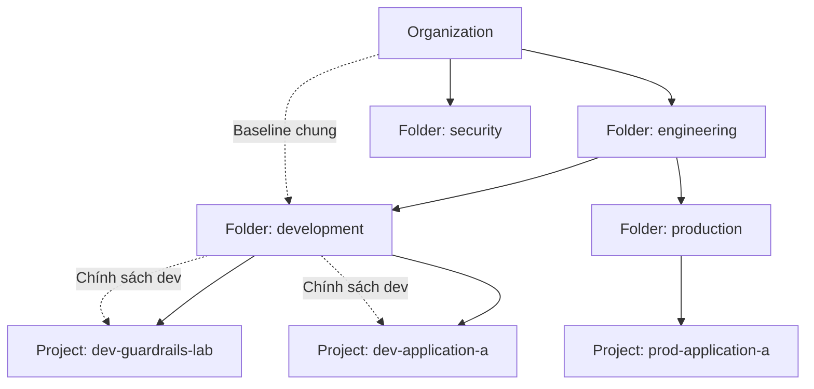
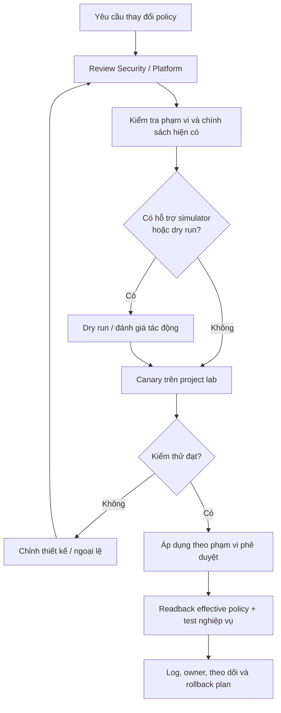

# Thực hành thiết lập guardrails cho môi trường phát triển

Một đội phát triển ứng dụng trên Google Cloud cần đủ quyền để thử nghiệm Compute Engine, GKE, Cloud Run, cơ sở dữ liệu và dịch vụ lưu trữ. Nhưng nếu mỗi thành viên có quyền Owner trên mọi project, có thể tạo service account key tùy ý, cấp IP công khai không kiểm soát và triển khai ở bất kỳ region nào, môi trường phát triển sẽ tích lũy rủi ro bảo mật, chi phí và vận hành. **Guardrails** là các quy tắc và cơ chế kiểm soát giúp đội phát triển làm việc trong **ranh giới đã thống nhất**.

Bài học thuộc chương **Quản trị tổ chức** của mô-đun `CLOUD_PROVIDERS_GCP`. Mô-đun đi từ tổ chức project, IAM và VPC đến Compute Engine, GKE, Cloud Run, lưu trữ, cơ sở dữ liệu, tự động hóa phát hành, theo dõi độ tin cậy và chi phí. Bài thực hành này kết nối những kiến thức đó thành một môi trường `dev` có quyền phù hợp, chính sách được kiểm chứng và khả năng phát hiện vi phạm.

## 1. Mục tiêu học tập

Sau bài học, bạn có thể:

1. Phân biệt guardrail **ngăn chặn**, **phát hiện**, **khắc phục** và **quản lý chi phí**.
2. Thiết kế vùng áp dụng guardrail theo **organization → folder → project** mà vẫn tách biệt `dev`, `staging` và `prod`.
3. Chọn các lớp bảo vệ phù hợp: **IAM**, **Organization Policy**, mạng/VPC, danh tính workload, log, quota và budget.
4. Kiểm tra **effective organization policy**, hiểu vai trò của chính sách kế thừa và cách sử dụng chế độ **dry run** với constraint được hỗ trợ.
5. Thực hành chính sách hạn chế tạo khóa service account trên **project lab**, có xác nhận phạm vi, ghi lại trạng thái cũ, đọc lại kết quả và phương án rollback.
6. Xây dựng ma trận kiểm thử hành vi được phép/bị chặn, theo dõi bằng Cloud Audit Logs và quyết định có nên triển khai rộng hơn không.
7. Nhận diện giới hạn của từng cơ chế: budget alert không luôn là giới hạn cứng; Organization Policy không thay thế IAM, firewall hay backup.

**Phạm vi thực hành:** bài sử dụng ví dụ project `dev-guardrails-lab` thuộc tổ chức đã có sẵn. Các mã định danh chỉ là ví dụ. Những bước **đọc cấu hình** có thể thực hiện với quyền xem phù hợp; thao tác **áp dụng policy** chỉ dành cho quản trị viên có quyền trên **project thử nghiệm được ủy quyền**. Bài học không yêu cầu thay đổi organization hoặc production thật.

## 2. Guardrail là gì và khác quy định vận hành ra sao?

Một câu “Không nên tạo khóa JSON cho service account” là **quy định**. Guardrail tự động từ chối thao tác tạo khóa, hoặc ghi nhận khi thao tác đó xảy ra, biến quy định thành hành vi có thể kiểm chứng.

| Nhóm | Mục tiêu | Cơ chế GCP ví dụ | Cần quan sát |
| --- | --- | --- | --- |
| **Preventive** – ngăn chặn | Không cho tạo cấu hình không hợp lệ | Organization Policy, IAM deny/allow policy, firewall | Lệnh bị từ chối với lý do cụ thể |
| **Detective** – phát hiện | Nhận diện sai lệch, hành vi bất thường | Cloud Audit Logs, Cloud Asset Inventory, Security Command Center, Monitoring | Log, finding, cảnh báo đúng đối tượng |
| **Corrective** – khắc phục | Đưa tài nguyên về trạng thái cho phép | Quy trình sửa IAM, automation có phê duyệt, IaC reconciliation | Thay đổi có người chịu trách nhiệm và readback |
| **Cost/usage** – kiểm soát chi phí | Biết sớm chi phí tăng, hạn chế cấp phát vượt mức | Cloud Billing budget alerts, quota, limits cấu hình dịch vụ | Thông báo, chỉ số quota, xu hướng sử dụng |

Một guardrail tốt mô tả được **đối tượng bị kiểm soát, hành động cần ngăn, phạm vi áp dụng, người sở hữu, cách kiểm chứng và cách xử lý ngoại lệ**. Ví dụ: “Không tạo **user-managed service account key** trong các project thuộc folder development; các workload dùng runtime identity hoặc Workload Identity Federation; ngoại lệ phải được rà soát riêng”.

Không có một dịch vụ duy nhất kiểm soát toàn bộ tổ chức. Bạn cần kết hợp các lớp bảo vệ vì mỗi sản phẩm giải quyết một loại quyết định:

- **IAM** trả lời: *Ai được làm gì trên tài nguyên nào?*
- **Organization Policy** trả lời: *Những loại cấu hình hoặc hành động nào bị ràng buộc bởi constraint?*
- **VPC, firewall và cấu hình mạng** trả lời: *Luồng mạng nào được phép đi qua?*
- **Audit/Monitoring** trả lời: *Điều gì đã xảy ra, đang xảy ra, hoặc sắp có nguy cơ?*
- **Budgets và quotas** giúp kiểm soát mức sử dụng và chi phí theo cơ chế của từng sản phẩm.

## 3. Ranh giới quản trị: organization, folder, project

Guardrails phải được gắn vào đúng cấp quản trị. Một mô hình tham khảo:



**Organization** là phạm vi rộng để quản trị tài nguyên và các chính sách nền. **Folder** tạo nhóm project theo môi trường hoặc đơn vị sở hữu. **Project** là ranh giới phổ biến cho IAM bindings, API, quota, tài nguyên ứng dụng và theo dõi chi phí.

Một policy đặt trên folder có thể ảnh hưởng đến **toàn bộ project con**, gồm cả project được tạo về sau. Vì vậy, nếu mới thử một constraint, hãy bắt đầu ở **project lab** trước khi áp dụng ở folder `development`.

### 3.1. IAM inheritance và Organization Policy inheritance

Cả hai có thể xuất hiện ở organization, folder và project nhưng **không hoạt động giống nhau**:

| Khía cạnh | IAM allow policy | Organization Policy |
| --- | --- | --- |
| Câu hỏi | Principal này có permission không? | Yêu cầu/cấu hình này có thỏa constraint không? |
| Dạng khai báo | Binding principal ↔ role, có thể có condition | Constraint + rules; boolean, list hoặc tham số tùy loại |
| Kế thừa | Role cấp ở cấp cha thường áp dụng xuống tài nguyên con | Effective policy được tính theo constraint và rules ở các cấp liên quan |
| Cách kiểm chứng | Policy, IAM Policy Troubleshooter, thử permission có kiểm soát | `org-policies describe --effective`, audit log, Policy Simulator/dry run khi hỗ trợ |
| Sai lầm phổ biến | Cấp Editor để giải quyết mọi lỗi | Nghĩ rằng một policy con luôn có thể/không thể ghi đè mọi điều kiện cha |

**Effective policy** là chính sách thực sự được đánh giá sau khi xét kế thừa/quy tắc cho constraint đó. Đừng chỉ nhìn policy định nghĩa trực tiếp trên project: project có thể không có bản policy cục bộ nhưng đang chịu ràng buộc từ folder hoặc organization. Cơ chế merge, replace hoặc override phụ thuộc loại constraint và cấu hình; cần kiểm tra kết quả hiệu lực, không đoán từ tên folder.

### 3.2. Labels và tags không giống nhau

- **Labels** là metadata dạng key–value thường dùng phân loại, báo cáo, lọc và phân tích chi phí theo khả năng hỗ trợ của dịch vụ.
- **Resource Manager tags** là cấu trúc quản trị riêng, có TagKey/TagValue/TagBinding và quyền quản lý tương ứng; một số Organization Policy hoặc IAM Conditions có thể dùng tags để áp dụng điều kiện.

Không dùng nhãn `environment=dev` như một “tường bảo vệ” tự động. Muốn chính sách thay đổi theo môi trường, phải chọn đúng loại **tag/condition được sản phẩm hỗ trợ**, bảo vệ quyền sửa tag và kiểm tra biểu thức chính sách.

## 4. Chuyển yêu cầu nghiệp vụ thành bộ guardrails

Giả sử công ty muốn đội backend tự thử nghiệm API và database, nhưng chỉ được dùng tài nguyên GCP được cấp phép cho `dev`. Hãy viết mục tiêu thành những điều có thể thử nghiệm được:

| Mã | Mục tiêu cho môi trường dev | Cơ chế đề xuất | Phép thử |
| --- | --- | --- | --- |
| G-01 | Thành viên dev không có toàn quyền project | IAM theo group, role tối thiểu, tách deployer/runtime SA | Tài khoản dev không cấp được Owner/Editor ngoài quyền được giao |
| G-02 | Hạn chế tạo khóa riêng tư dài hạn cho SA | Managed Organization Policy constraint về tạo service account key | Thao tác tạo khóa bị từ chối khi policy live có hiệu lực; workload vẫn dùng ADC |
| G-03 | Dùng dịch vụ ở location được phê duyệt | Organization Policy về resource locations (nếu dịch vụ hỗ trợ) | Tạo tài nguyên được hỗ trợ ở location ngoài danh sách bị chặn |
| G-04 | Tránh mở cổng quản trị từ Internet | Firewall policy/Firewall Rules và quy trình kiểm tra cấu hình mạng | Rule cho SSH/RDP từ nguồn công khai không được đưa vào môi trường quản lý |
| G-05 | Tài nguyên phải xác định người chịu trách nhiệm | Quy ước labels/tags, review IaC hoặc custom constraint nếu hỗ trợ | Pipeline kiểm tra metadata bắt buộc trước deploy |
| G-06 | Có tín hiệu khi chi phí bất thường | Billing budget alerts, quota và Monitoring | Gửi được cảnh báo theo ngưỡng; không nhầm với chặn cứng |
| G-07 | Có dấu vết thay đổi chính sách và IAM | Audit Logs, Cloud Asset Inventory, alert | Truy lại được chủ thể, thời điểm, phạm vi và hành động |

Các ví dụ không có nghĩa mọi project đều phải bật **toàn bộ** constraint. Chọn policy theo tính năng ứng dụng, lịch triển khai và những ngoại lệ đã được đánh giá. Chẳng hạn, chặn **tạo service account** hoàn toàn có thể làm hỏng các bước khởi tạo một số dịch vụ; ràng buộc **tạo service account key** thường hợp lý hơn khi mục tiêu chỉ là giảm credential dài hạn.

## 5. Chuẩn bị project lab và ma trận quyền

Trước khi chạy script, xác định đúng những giá trị sau:

| Biến/giá trị | Ý nghĩa | Ví dụ minh họa |
| --- | --- | --- |
| `ORG_ID` | ID organization quản trị | `123456789012` |
| `DEV_FOLDER_ID` | Folder chứa các project dev | `234567890123` |
| `LAB_PROJECT_ID` | Project chỉ dùng thực hành | `dev-guardrails-lab` |
| `POLICY_ADMIN` | Danh tính được phép quản lý Org Policy ở phạm vi thử nghiệm | Một nhóm quản trị được ủy quyền |
| `DEVELOPER_GROUP` | Nhóm developer được cấp quyền vừa đủ | Group của đội lập trình |
| `BILLING_ACCOUNT` | Tài khoản thanh toán của project | Chọn từ cấu hình Cloud Billing được phép xem |

Project/organization phải thực sự tồn tại; ID trong bảng là **placeholder**, không phải tài nguyên được tạo bởi bài học. Nếu dùng Cloud Shell hoặc máy đã cài Google Cloud CLI:

```bash
gcloud --version
gcloud auth list
gcloud config get-value project

# Chọn project lab được phép đọc; giữ project tường minh trong các lệnh sau.
LAB_PROJECT_ID="YOUR_LAB_PROJECT_ID"

gcloud projects describe "$LAB_PROJECT_ID" \
  --format="yaml(projectId,projectNumber,parent,lifecycleState)"

# Xem IAM allow policy hiện hành của project.
gcloud projects get-iam-policy "$LAB_PROJECT_ID" \
  --format="yaml(bindings)"
```

Các lệnh trên **chỉ đọc**. Trong bài, nếu quyền xem không đủ, báo nhóm quản trị cấp đúng role/permission phục vụ kiểm kê thay vì cấp Owner chỉ để chạy một lệnh.

Các vai trò cần phân biệt:

- **Developer:** triển khai/xem workload theo vai trò chuyên biệt, không mặc nhiên được chỉnh IAM hoặc policy.
- **Organization Policy Administrator** (`roles/orgpolicy.policyAdmin`): có thể quản lý Organization Policy trong phạm vi được gán; là quyền mạnh và cần giới hạn người sở hữu.
- **Deployer/CI:** có quyền triển khai dịch vụ cụ thể và `iam.serviceAccounts.actAs` trên runtime SA khi cần gắn vào workload.
- **Runtime service account:** có permission chỉ cho API ứng dụng cần, ví dụ đọc một bucket hoặc publish một topic.
- **Billing administrator/đối tượng quản lý ngân sách:** cần quyền phù hợp với Cloud Billing; quyền trên project không tự động cấp mọi quyền quản lý billing account.

Nếu organization đã có baseline, nhóm dev không được tùy tiện nới policy của cấp cha. Trong thực tế, phạm vi quản trị guardrail thường thuộc nhóm Platform/Security, còn developer gửi yêu cầu thay đổi qua quy trình review.

## 6. Khảo sát hiện trạng trước khi thay đổi

### 6.1. Đọc Organization Policy đang có hiệu lực

Chọn ba constraint minh họa:

- `iam.managed.disableServiceAccountKeyCreation`: managed constraint nhằm chặn tạo credential khóa service account do người dùng quản lý.
- `iam.disableServiceAccountKeyCreation`: phiên bản **legacy managed** có mục tiêu tương tự; ở một số organization có thể đang được thực thi mặc định.
- `gcp.resourceLocations`: legacy managed list constraint dùng quản lý những location mà các dịch vụ hỗ trợ có thể tạo một số loại tài nguyên.

```bash
LAB_PROJECT_ID="YOUR_LAB_PROJECT_ID"

# Đọc chính sách hiệu lực, gồm tác động của cấp cha.
gcloud org-policies describe \
  iam.managed.disableServiceAccountKeyCreation \
  --project="$LAB_PROJECT_ID" \
  --effective

gcloud org-policies describe \
  iam.disableServiceAccountKeyCreation \
  --project="$LAB_PROJECT_ID" \
  --effective

gcloud org-policies describe \
  gcp.resourceLocations \
  --project="$LAB_PROJECT_ID" \
  --effective
```

Nếu lệnh trả `NOT_FOUND`, điều đó thường cho biết **không có policy tương ứng tại phạm vi tra cứu theo API**, không có nghĩa mọi yêu cầu đều được cho phép. Hãy xét constraint default, chính sách khác, IAM và ràng buộc dịch vụ. Ngoài effective policy, cần đọc policy **cục bộ** để biết có đang ghi đè một cấu hình trực tiếp hay không:

```bash
gcloud org-policies describe \
  iam.managed.disableServiceAccountKeyCreation \
  --project="$LAB_PROJECT_ID"
```

**Không được áp dụng policy mới đè lên tài nguyên có thay đổi đang chờ review**. Nếu có policy cục bộ, lưu bản hiện tại cùng `etag` và so sánh với thiết kế mới trước khi thay đổi; sử dụng cơ chế kiểm soát phiên bản/concurrency được công cụ hỗ trợ.

### 6.2. Đọc những cấu hình ngoài Organization Policy

```bash
# Các subnet và vùng của project.
gcloud compute networks subnets list \
  --project="$LAB_PROJECT_ID" \
  --format="table(name,region.basename(),ipCidrRange)"

# Firewall rules hiện có trong VPC; chưa bao gồm mọi lớp firewall policy.
gcloud compute firewall-rules list \
  --project="$LAB_PROJECT_ID" \
  --format="table(name,network,direction,priority,disabled)"

# Danh sách service accounts để biết workload identity sẵn có.
gcloud iam service-accounts list \
  --project="$LAB_PROJECT_ID" \
  --format="table(email,displayName,disabled)"
```

Đọc một danh sách firewall rules của VPC **không đủ** để đánh giá toàn bộ đường mạng; còn có hierarchical firewall policies, network firewall policies, routes, load balancer và cấu hình ingress/egress tùy sản phẩm. Nếu project chưa bật Compute Engine API hoặc chưa có VPC, các lệnh liên quan có thể không trả được danh sách như mong đợi; cần ghi nhận rõ thay vì âm thầm thay đổi API.

## 7. Chọn constraint phù hợp và hiểu giới hạn của dry run

**Organization Policy Service** cung cấp các constraint do Google Cloud quản lý và khả năng khai báo custom constraints cho những resource/thuộc tính được hỗ trợ. Tên constraint và phạm vi áp dụng cần được kiểm tra theo tài liệu mới nhất của sản phẩm.

Có ba khái niệm dễ nhầm:

1. **Kiểm tra cấu hình (readback):** đọc policy hiện có, nhất là `--effective`. Việc này không hề mô phỏng một thay đổi.
2. **Policy Simulator:** đánh giá tác động của một thay đổi với khả năng sản phẩm và loại constraint hỗ trợ. Nó không bảo đảm phát hiện mọi kiểu sử dụng tương lai.
3. **Organization Policy dry run:** định nghĩa `dryRunSpec` cho constraint được hỗ trợ; hệ thống ghi nhận vi phạm tiềm năng trong log nhưng **không chặn bằng dry-run rule**.

**Dry run không được hỗ trợ cho tất cả constraint.** Google Cloud hỗ trợ custom constraints, managed constraints và một số legacy managed constraints cụ thể. Ví dụ `gcp.resourceLocations` là legacy constraint nên không được mặc nhiên dùng trong mẫu `dryRunSpec`. Bài lab chọn **managed constraint `iam.managed.disableServiceAccountKeyCreation`**, và vẫn cần xác minh nó có sẵn đối với organization của bạn.

Để thực hành, cần project có billing được bật theo yêu cầu của tính năng dry run, quyền quản lý Organization Policy và nơi xem audit logs phù hợp. Nếu tính năng không khả dụng hoặc quyền không đủ, làm phần **đọc và thiết kế policy** rồi nhờ quản trị viên thực hiện trên project lab.

## 8. Thực hành A: dry run chính sách hạn chế tạo service account key

**Mục tiêu:** trong project lab, thử ghi nhận các yêu cầu tạo user-managed service account key có thể bị từ chối trong tương lai, trước khi cân nhắc bật chặn thật. Guardrail hướng đội phát triển dùng **Cloud Run/Compute Engine service identity, ADC, impersonation hoặc Workload Identity Federation**, thay vì phân phát file JSON private key.

### 8.1. Kiểm tra phạm vi và trạng thái ban đầu

```bash
LAB_PROJECT_ID="YOUR_LAB_PROJECT_ID"
CONSTRAINT="iam.managed.disableServiceAccountKeyCreation"

gcloud projects describe "$LAB_PROJECT_ID" \
  --format="yaml(projectId,projectNumber,parent)"

gcloud org-policies describe "$CONSTRAINT" \
  --project="$LAB_PROJECT_ID"

gcloud org-policies describe "$CONSTRAINT" \
  --project="$LAB_PROJECT_ID" \
  --effective
```

Nếu project đang có policy cục bộ do nhóm khác quản lý, **không tự ghi đè**. Lập thay đổi theo policy hiện có, giữ lại `spec` và `etag` cần thiết để xử lý cập nhật đồng thời. Nếu hai policy legacy và managed cùng hạn chế tạo key, thay đổi chỉ một policy có thể **không thay đổi kết quả cuối cùng** vì policy kia vẫn có hiệu lực.

### 8.2. Soạn policy chỉ có dryRunSpec

Tạo file `dev-key-policy-dryrun.yaml` **ở máy lab** với nội dung sau, thay `YOUR_LAB_PROJECT_ID`:

```yaml
name: projects/YOUR_LAB_PROJECT_ID/policies/iam.managed.disableServiceAccountKeyCreation
dryRunSpec:
  rules:
    - enforce: true
```

Lưu ý cấu trúc:

- `name` xác định **project** và constraint đích; đây không phải tên project hiển thị trên Console.
- `dryRunSpec` ghi quy tắc mô phỏng. Nó **không** phải `spec` dùng để chặn thật.
- `enforce: true` chỉ ra hành vi sẽ kiểm tra theo managed constraint.
- Không đưa policy này lên folder hoặc organization chỉ vì dùng chung constraint name; đổi cấp áp dụng có thể ảnh hưởng nhiều project.

Sau khi kiểm tra kỹ file và quyền được ủy quyền, lệnh dưới đây **ghi cấu hình dry run vào project lab**, tuy **không chặn thao tác do quy tắc dry run**:

```bash
gcloud org-policies set-policy \
  ./dev-key-policy-dryrun.yaml \
  --update-mask=dryRunSpec
```

`--update-mask=dryRunSpec` giúp chỉ cập nhật trường dry run của policy, giảm nguy cơ vô tình cập nhật policy live. Hành vi của chính sách có thể cần thời gian lan truyền; không kết luận thất bại chỉ vì thay đổi chưa xuất hiện ngay lập tức.

### 8.3. Xác minh dry run đã lưu

```bash
gcloud org-policies describe \
  iam.managed.disableServiceAccountKeyCreation \
  --project="$LAB_PROJECT_ID"

gcloud org-policies describe \
  iam.managed.disableServiceAccountKeyCreation \
  --project="$LAB_PROJECT_ID" \
  --effective
```

Ở kết quả policy **cục bộ**, tìm `dryRunSpec.rules`. Kiểm tra cả `spec` và effective policy để biết hiện đã có ràng buộc **live** nào hay chưa. Việc thấy `dryRunSpec.enforce=true` **không chứng minh** đã có vi phạm, cũng **không chứng minh** thao tác tạo key đang bị chặn.

Để đánh giá tác động, dùng mục **Organization Policy / Dry run** trong Console và tìm các **Organization Policy audit logs** về vi phạm tiềm năng. Những log này chỉ xuất hiện khi có hoạt động liên quan; không có log trong một khoảng ngắn không đủ để kết luận chính sách vô hại. Xem xét workload có lịch chạy dài và các công cụ thường được dùng ngoài giờ.

Bài lab **không yêu cầu cố ý tạo một JSON private key** để kích hoạt vi phạm: tạo credential thật mang rủi ro bảo mật và không cần thiết để hiểu quy trình guardrail.

## 9. Thực hành B: áp dụng guardrail live có kiểm soát

Sau khi xem tác động dry run và hoàn thành review, nhóm quản trị có thể quyết định áp dụng chính sách **live** tại chính project lab. Trước bước này phải có:

- Danh sách workload đang dùng SA key và phương án chuyển sang ADC/federation.
- Xác nhận policy ở parent có thể ảnh hưởng, bao gồm phiên bản legacy.
- Bản sao cấu hình policy **cục bộ hiện có**, người phụ trách rollback và thời điểm áp dụng.
- Kịch bản kiểm thử các luồng deploy, Cloud Run, VM và pipeline CI/CD liên quan.

### 9.1. YAML live cho project lab

Đây là **mẫu cấu hình có tác dụng chặn thật**, không dùng trên production khi chưa được phê duyệt:

```yaml
name: projects/YOUR_LAB_PROJECT_ID/policies/iam.managed.disableServiceAccountKeyCreation
spec:
  rules:
    - enforce: true
```

Lưu file dưới tên `dev-key-policy-live.yaml`. Chỉ người được ủy quyền quản trị project lab mới thực hiện:

```bash
gcloud org-policies set-policy \
  ./dev-key-policy-live.yaml \
  --update-mask=spec
```

Thao tác này cập nhật phần **live** của policy. Nó không tự xóa khóa đã tồn tại hoặc chuyển workload sang danh tính mới. Nếu project đã có policy cục bộ, thao tác đặt mới có thể thay quy tắc cũ; phải hợp nhất và xử lý concurrency đúng cách thay vì copy nguyên mẫu trên để ghi đè. Kiểm tra tài liệu CLI của phiên bản đang dùng nếu công cụ yêu cầu biểu thức `update-mask` khác.

### 9.2. Đọc lại và đánh giá hành vi

```bash
gcloud org-policies describe \
  iam.managed.disableServiceAccountKeyCreation \
  --project="$LAB_PROJECT_ID"

gcloud org-policies describe \
  iam.managed.disableServiceAccountKeyCreation \
  --project="$LAB_PROJECT_ID" \
  --effective
```

Cần xác minh `spec.rules.enforce` và **effective policy** tại project. Sau thời gian lan truyền, chạy **các quy trình nghiệp vụ đã được phê duyệt**: triển khai Cloud Run với runtime SA, gọi API qua ADC, build/deploy qua runner CI và các tác vụ dự kiến vẫn phải hoạt động. Nếu có luồng được phép tạo key nhưng nay thất bại, đó là trường hợp phải xử lý ngoại lệ bằng thiết kế credential hoặc chính sách có phạm vi phù hợp.

### 9.3. Rollback và khác biệt giữa revert với delete

**Rollback đúng** là trở về **cấu hình đã được ghi nhận trước khi thay đổi**, không chỉ đặt `enforce: false` theo suy đoán.

- Nếu project đã có policy cục bộ trước bài lab: khôi phục đúng `spec` đã lưu, bảo đảm không ghi đè những thay đổi hợp lệ phát sinh sau đó.
- Nếu ban đầu không có policy cục bộ và project chỉ mới được thêm policy trong lab: quản trị viên có thể cân nhắc xóa **policy cục bộ đó** để trở về trạng thái kế thừa từ parent.
- Nếu parent đang enforce policy, xóa policy cục bộ **không bỏ được** ràng buộc từ cấp cha.
- Đối với cấu hình chỉ cần xóa dry run mà vẫn giữ live policy, cần update riêng `dryRunSpec`, không xóa nhầm toàn bộ policy.

Lệnh xóa một policy cục bộ sau đây được đưa ra **chỉ để nhận diện**, không chạy khi chưa có bản ghi trạng thái cũ và kế hoạch rollback:

```bash
# CÓ TÁC ĐỘNG: xóa policy cục bộ của constraint tại project.
gcloud org-policies delete \
  iam.managed.disableServiceAccountKeyCreation \
  --project="YOUR_LAB_PROJECT_ID"
```

Trong thực tế phải bảo vệ các thao tác restore/delete bằng thay đổi có review, kiểm tra `etag` khi công cụ hỗ trợ và đọc lại effective policy. Đặc biệt, **rollback policy không đồng nghĩa mọi workload lập tức trở lại**: có thể cần chờ chính sách lan truyền và sửa những cấu hình đã bị thay đổi trong quá trình thử nghiệm.

## 10. Thực hành C: giới hạn phạm vi triển khai location

Một tổ chức có thể muốn môi trường dev chủ yếu chạy ở region được chấp thuận để quản trị dữ liệu, độ trễ và chi phí. Constraint `gcp.resourceLocations` cho phép hạn chế vị trí **đối với các loại tài nguyên/dịch vụ hỗ trợ constraint này**.

### 10.1. Xác định nhu cầu trước

Ví dụ đội phát triển có người dùng kiểm thử tại Việt Nam và muốn dùng `asia-southeast1` làm ứng viên. Không nên mặc định region này hợp lệ cho mọi workload: một số dịch vụ hoặc tính năng chỉ có tại region khác; dịch vụ lưu trữ có location loại regional, dual-region hoặc multi-region; quy tắc lưu trú dữ liệu còn liên quan backup, log và luồng di chuyển dữ liệu.

Hãy lập bảng phụ thuộc:

| Workload | Vị trí cân nhắc | Câu hỏi phải kiểm tra |
| --- | --- | --- |
| Cloud Run API | `asia-southeast1` | Dịch vụ/cấu hình và database phụ thuộc có sẵn trong region không? |
| GKE cluster | Region hoặc zone được hỗ trợ | Node pool và machine type có sẵn ở mọi zone dự kiến không? |
| Cloud SQL | Region đặt database | HA, backup, replica và độ trễ tới ứng dụng ra sao? |
| Cloud Storage bucket | Location được sản phẩm hỗ trợ | Object có yêu cầu lưu trú/dự phòng riêng không? |
| BigQuery dataset | Regional hoặc multi-regional | Query, dataset khác và data transfer có cùng location hay tương thích không? |

### 10.2. Kiểm tra policy và triển khai với quản trị viên

Đọc trước:

```bash
gcloud org-policies describe gcp.resourceLocations \
  --project="$LAB_PROJECT_ID" \
  --effective
```

Với constraint dạng danh sách, admin thiết lập những **allowed location values** theo cú pháp và giá trị được Google Cloud công bố. Không tùy tiện đặt mã region vào YAML khi chưa đối chiếu danh mục allowed values của constraint. Vì đây là legacy managed constraint, **không mặc định có dry run**. Hãy dùng công cụ kiểm tra tác động được hỗ trợ, chạy thử ở project lab và đọc lại effective policy.

Nếu giới hạn location làm pipeline thất bại, phân biệt:

1. Constraint chặn vì location bị cấm.
2. Dịch vụ chưa hỗ trợ region/zone chọn.
3. VPC/subnet, disk và workload đặt khác phạm vi.
4. Quota hoặc capacity tại region/zone không đủ.

Guardrail hợp lý không nhất thiết chỉ cho **một** region; nên xem xét các vị trí dự phòng theo RTO/RPO và đặc tính lưu trữ của ứng dụng.

## 11. Guardrails IAM: giữ quyền developer ở mức cần thiết

Organization Policy không thay thế thiết kế IAM. Một developer có thể làm việc hiệu quả nếu có các quyền triển khai và quan sát rõ ràng mà không phải toàn quyền cả project.

| Nhóm người hoặc workload | Nhu cầu | Cấp quyền theo nguyên tắc |
| --- | --- | --- |
| Developer | Xem log, đọc trạng thái dịch vụ, triển khai vào dev nếu được giao | Role chuyên biệt theo dịch vụ; quyền trên đúng project/tài nguyên |
| CI deployer | Triển khai Cloud Run/GKE, dùng runtime SA | Role deploy và `iam.serviceAccounts.actAs` trên đúng service account |
| Runtime service account | Gọi database, bucket, Pub/Sub, Secret Manager | Role nghiệp vụ nhỏ nhất trên resource đích |
| Security/Platform | Quản lý policy, xem audit, xử lý ngoại lệ | Quyền quản trị có kiểm soát và audit |
| Billing/FinOps | Xem cost, cấu hình budget/alert | Quyền Cloud Billing tương ứng |

**Rủi ro điển hình:** đội cấp `roles/editor` cho default Compute Engine service account hoặc gắn service account có quyền rộng vào VM phát triển. Bất kỳ code nào chạy trong VM với khả năng lấy runtime credential đều có thể sử dụng các quyền của SA đó trong giới hạn tương ứng. Cần tách service account theo workload và tránh user-managed keys khi có ADC.

Trước khi áp dụng IAM, lập ma trận: **principal → role → resource → lý do → ngày rà soát**. Có thể dùng IAM Policy Troubleshooter để đánh giá quyền hiệu lực; kiểm tra cả allow, deny và điều kiện theo những gì sản phẩm hỗ trợ. Một policy cho phép developer deploy nhưng từ chối quyền sửa IAM là hợp lý hơn việc cấp toàn quyền để “đỡ lỗi 403”.

### 11.1. Kiểm tra IAM hiện tại (chỉ đọc)

```bash
gcloud projects get-iam-policy "$LAB_PROJECT_ID" \
  --format="table(bindings.role,bindings.members)"

# Policy trực tiếp trên một service account, nếu bạn có quyền đọc.
gcloud iam service-accounts get-iam-policy \
  "RUNTIME_SA@YOUR_LAB_PROJECT_ID.iam.gserviceaccount.com" \
  --project="$LAB_PROJECT_ID"
```

Policy của service account resource cho biết ai có quyền quản lý/attach/impersonate nó ở phạm vi policy đó; **không** cho biết toàn bộ role service account đang có trên bucket, project hoặc secret khác. Phải đọc policy tài nguyên đích hoặc dùng công cụ phân tích IAM phù hợp.

## 12. Guardrails mạng: giảm bề mặt truy cập công khai

Mục tiêu của môi trường dev không phải “không có Internet trong mọi trường hợp”, mà là **chỉ cho những luồng cần thiết và có lý do**. Những kiểm soát có thể cân nhắc:

- **Không cấp external IP cho VM mặc định**; khi VM cần gọi API hoặc tải package từ Internet, đánh giá Cloud NAT, Private Google Access hoặc đường egress phù hợp.
- **Chặn SSH/RDP công khai** theo thiết kế firewall, ưu tiên cách truy cập quản trị như IAP TCP forwarding hoặc cơ chế được tổ chức duyệt.
- **Phân vùng mạng** giữa môi trường ứng dụng và dữ liệu; chỉ mở cổng cần thiết, tránh rule `0.0.0.0/0` cho các cổng quản trị.
- **Thiết kế ingress cho Cloud Run/GKE** dựa trên sản phẩm và yêu cầu public/private, thay vì suy từ việc ứng dụng dùng VPC.
- **Lập kế hoạch DNS và kết nối tới dịch vụ quản lý** như Secret Manager/Artifact Registry; siết egress mà không kiểm tra phụ thuộc dễ gây lỗi build/deploy.

Một bảng rà soát network:

| Thành phần | Kiểm tra | Phản ứng khi lệch |
| --- | --- | --- |
| VM dev | Có external IP ngoài yêu cầu? | Xác nhận nhu cầu; chuyển sang egress có quản lý nếu phù hợp |
| Firewall | Rule ingress mở nguồn công khai tới port quản trị? | Đề xuất rule hẹp, theo danh tính/phạm vi mạng; kiểm thử kết nối |
| Subnet | Thuộc region và CIDR được duyệt? | Đối chiếu dự báo quy mô, mạng dùng chung và route |
| Cloud Run | Ingress/egress có phù hợp? | Kiểm tra cấu hình runtime, endpoint và identity caller |
| Load balancer | Public endpoint và backend có bảo vệ? | Dùng auth, WAF/Cloud Armor khi yêu cầu, monitoring |

Có thể dùng **hierarchical firewall policies** và các chính sách mạng cấp cao để áp quy tắc cho nhóm tài nguyên, nhưng chúng có mô hình đánh giá/độ ưu tiên riêng; cần kiểm tra chính sách đang gắn với tổ chức/folder/VPC và tác động lên traffic thực tế. Không giả định một rule trong VPC là toàn bộ quyết định cuối.

## 13. Guardrails chi phí: budgets, quota và nhãn

Môi trường dev có thể phát sinh hóa đơn lớn nếu chạy VM/GPU liên tục, tạo database cỡ lớn hoặc quên xóa môi trường thử nghiệm. Nên phối hợp ba cơ chế:

### 13.1. Billing budgets

Trong **Cloud Billing → Budgets & alerts**, quản trị viên có thể cấu hình budget theo billing account hoặc phạm vi hỗ trợ như project, nhãn hoặc dịch vụ; chọn kỳ theo tháng và các ngưỡng cảnh báo như 50%, 80% và 100%.

**Lưu ý cập nhật:** *alerts-only budget* chỉ **thông báo**, không tự ngắt API, dừng VM hoặc giới hạn cứng số tiền phải trả. Một số loại **spend cap budget** có thể được hỗ trợ theo sản phẩm/điều kiện nhất định; phải xác minh phạm vi và tính khả dụng trong Cloud Billing trước khi gọi là “giới hạn cứng”. Nếu dùng Pub/Sub notification để tự động hóa phản ứng, cần thiết kế chấp nhận độ trễ/chi phí tích lũy, kiểm thử logic và cân nhắc tác động khi dừng project.

### 13.2. Quotas và giới hạn dịch vụ

Quota hạn chế một số mức sử dụng hoặc tốc độ tạo tài nguyên, ví dụ số vCPU theo region hay số request API. Quota **không tương đương trần chi tiêu**: tài nguyên ít nhưng đắt vẫn có thể phát sinh chi phí lớn; chi phí storage/network không nhất thiết liên quan quota bạn đang quan sát.

Với team dev, có thể yêu cầu giới hạn phù hợp cho project và dùng quota monitoring để nhận biết khi gần chạm ngưỡng. Một số loại quota có thể được yêu cầu nâng/hạ tùy API và quyền, phải kiểm tra cơ chế cụ thể.

### 13.3. Labels cho phân bổ chi phí

Ví dụ nhãn thống nhất:

```yaml
environment: dev
team: payments
cost-center: cc123
owner: backend-platform
```

Nhãn chỉ hữu ích nếu dịch vụ hỗ trợ, dữ liệu được gắn nhất quán và báo cáo Cloud Billing sử dụng đúng metadata. Có thể bổ sung kiểm tra nhãn trong Terraform plan hoặc pipeline deploy. **Không mặc định** mọi tài nguyên GCP hỗ trợ cùng một tập labels, và không dùng labels như hàng rào phân quyền.

## 14. Guardrails phát hiện: Audit Logs, Asset Inventory, Monitoring

Một tổ chức cần biết **có ai cố thay đổi policy/IAM, có tài nguyên mới không đúng chuẩn và có hóa đơn tăng bất thường không**.

| Nguồn tín hiệu | Giá trị | Giới hạn cần hiểu |
| --- | --- | --- |
| **Cloud Audit Logs – Admin Activity** | Theo dõi nhiều thay đổi quản trị | Phải chọn đúng service/resource/log scope và retention |
| **Cloud Audit Logs – Data Access** | Theo dõi một số truy cập dữ liệu theo cấu hình | Không mặc nhiên bật/ghi đầy đủ cho mọi dịch vụ; có thể phát sinh chi phí log |
| **Cloud Asset Inventory** | Khảo sát/snapshot tài nguyên và IAM, hỗ trợ tìm lệch chuẩn | Dữ liệu theo thời điểm, cần phân tích và phân quyền |
| **Security Command Center** | Phát hiện một số sai lệch/vấn đề bảo mật theo gói tính năng | Finding phụ thuộc dịch vụ, cấu hình và mức hỗ trợ |
| **Cloud Monitoring/Logging alert** | Cảnh báo sự cố và chỉ số quan trọng | Phải cấu hình kênh nhận, ngưỡng và quy trình phản hồi |
| **Cloud Billing reports/budgets** | Theo dõi chi phí, biến động theo thời gian | Độ trễ dữ liệu chi phí; alerts-only không ngăn chi tiêu |

Bài thực hành ghi nhận được các kết quả sau:

1. Sự thay đổi chính sách Org Policy có dấu vết người thực hiện.
2. Effective policy sau triển khai có đúng giá trị dự kiến.
3. Tín hiệu dry run được đánh giá trên những luồng nghiệp vụ có thực; không dựa vào “không thấy log” như bằng chứng an toàn.
4. Budget alert có email/Pub/Sub hoặc kênh thông báo hoạt động.
5. Có một người hoặc nhóm **chịu trách nhiệm xử lý** khi tìm thấy vi phạm.

Khi thiết lập log export hoặc alert trong project, xét đến quyền truy cập, dữ liệu có thể nhạy cảm, thời gian lưu và chi phí. Chỉ xây dashboard mà không có owner xử lý sẽ không tạo guardrail vận hành hiệu quả.

## 15. Từ thay đổi thủ công sang policy as code

Sau lab, nên đưa cấu hình guardrail vào quy trình có review, ví dụ repository IaC hoặc hệ thống quản lý chính sách của tổ chức. Tập tin chỉ dẫn chính sách trong bài thực hành được đưa vào phiên bản quản lý thay đổi khi quy trình đã trưởng thành.



Một pull request thay đổi guardrail nên có:

- **Mục tiêu và rủi ro:** loại hành vi nào phải chặn/phát hiện, vì sao.
- **Phạm vi:** organization, folder, project, tập tài nguyên và môi trường bị ảnh hưởng.
- **Kế hoạch xác minh:** policy cũ, policy mới, phép thử dương/âm, thời điểm kiểm tra.
- **Phụ thuộc/ngoại lệ:** CI, Cloud Run, GKE, VM, SA, database, backup, region dự phòng.
- **Quy trình khôi phục:** chính xác state cần trở về, người được quyền và cách kiểm tra lại.

Organization Policy có thể mất thời gian lan truyền; chạy pipeline ngay sau `set-policy` không đảm bảo mọi yêu cầu đều đã thấy policy mới. Cần có giai đoạn verify hiệu lực, kiểm tra hành vi theo phạm vi và ghi nhận kết quả trước khi mở rộng lên folder.

## 16. Bài thực hành tổng hợp: dev API và chi phí dự đoán được

Nhóm phát triển ứng dụng đặt hàng có Cloud Run API, Pub/Sub, Cloud SQL và bucket lưu ảnh. Họ cần khả năng thử nghiệm mà không để một lỗi credential hoặc config mạng ảnh hưởng toàn tổ chức.

**Thiết kế guardrail đề xuất:**

1. **Project và folder:** mọi ứng dụng dev ở các project được chỉ định dưới folder `development`; production nằm ở folder khác.
2. **IAM:** developer có quyền deploy/xem log trong dev; CI deployer riêng; runtime SA cho Cloud Run chỉ được publish Pub/Sub và truy cập secret/bucket cần thiết.
3. **Credential:** kiểm tra managed constraint cấm tạo service account key, thử dry run ở project lab, sau đó mới enforce theo quy trình.
4. **Network:** hạn chế dịch vụ nội bộ ra public, kiểm tra ingress Cloud Run và firewall VPC; ứng dụng cần egress được thiết kế đường phù hợp.
5. **Location:** đặt Cloud Run và Cloud SQL tại region được phê duyệt sau khi đối chiếu hỗ trợ sản phẩm; đánh giá constraint resource locations nếu cần ràng buộc.
6. **Cost:** tạo budget alert theo project dev, thiết kế quota và lịch dừng tài nguyên thử nghiệm có owner.
7. **Observation:** theo dõi policy changes, IAM changes, lỗi 403, drift và chi phí qua logs/alerts.

### 16.1. Ma trận kiểm thử chấp nhận

| Kiểm thử | Kỳ vọng | Nếu không đúng |
| --- | --- | --- |
| Tài khoản developer xem logs dịch vụ dev | Được phép theo role cấp | Kiểm tra IAM trên project/log scope |
| Developer đổi IAM toàn project khi không được giao | Bị từ chối | Kiểm tra quyền được kế thừa từ folder/organization |
| Cloud Run dùng runtime SA để đọc bucket cần thiết | Thành công | Kiểm tra ADC, service identity và policy bucket |
| Tạo SA key mới khi live constraint hoạt động | Bị từ chối theo constraint | Kiểm tra managed/legacy policy hiệu lực và thời gian lan truyền |
| Tạo tài nguyên ở region khác (với dịch vụ có hỗ trợ constraint) | Bị từ chối nếu ngoài allowlist | Kiểm tra allowed location values và phạm vi constraint |
| CI deploy một thay đổi Cloud Run hợp lệ | Thành công sau khi áp policy | Kiểm tra deployer roles, SA actAs và các phụ thuộc |
| Chi phí dev vượt ngưỡng ngân sách alerts-only | Gửi cảnh báo theo điều kiện đã đặt | Kiểm tra budget scope, recipient và kênh thông báo; không giả định hệ thống dừng |
| Thay đổi policy bởi quản trị viên | Có dấu vết quản trị | Kiểm tra Audit Logs, retention và sink/alert |

**Không cần tạo tài nguyên không an toàn để chạy mọi bài kiểm thử âm.** Có thể dùng Policy Simulator hoặc đánh giá trên tài nguyên lab do nhóm quản trị kiểm soát, lựa chọn theo constraint hỗ trợ. Với những phép thử có tác động thật như tạo key hoặc tạo VM public, phải có phương án an toàn riêng và không dùng trên production.

### 16.2. Tiêu chí hoàn thành

Guardrail có thể xem là hoàn thành bước thử nghiệm khi:

- Effective policy đúng phạm vi và giá trị được phê duyệt.
- Workload dev hợp lệ hoạt động, không phát sinh lỗi quyền/config ngoài dự kiến.
- Đã xử lý các luồng bị chặn oan hoặc trường hợp ngoại lệ cần thiết.
- Logs và cảnh báo tới đúng người xử lý; budget/quotas hiểu theo đúng giới hạn sản phẩm.
- Có bản ghi thay đổi, owner và kế hoạch rollback đã được xác minh.

## 17. Lỗi thường gặp và cách xử lý

| Hiện tượng | Nguyên nhân thường gặp | Cách xử lý |
| --- | --- | --- |
| `PERMISSION_DENIED` khi đọc policy | Thiếu quyền xem Organization Policy | Xin đúng quyền xem tại resource cần đọc; không xin Owner vô điều kiện |
| `PERMISSION_DENIED` khi set-policy | Thiếu quyền Org Policy Admin hoặc bị hạn chế bởi policy cấp cao | Xác định người quản trị và phạm vi được ủy quyền |
| Policy cục bộ không có nhưng resource bị chặn | Policy kế thừa hoặc constraint default | Đọc `--effective` và cả những constraint liên quan |
| Dry run được lưu nhưng thao tác vẫn không bị chặn | Dry run chỉ ghi nhận, không thực thi chặn | Dùng live `spec` sau review, nếu muốn enforce |
| Không tạo được dry run cho một constraint | Loại constraint không hỗ trợ dry run | Xem tài liệu hỗ trợ, dùng simulator/canary khi phù hợp |
| Sau khi đổi live policy, trạng thái có vẻ chưa đổi | Chính sách có thời gian lan truyền; API hoặc tài nguyên có hành vi khác | Chờ lan truyền trong giới hạn tài liệu, readback và thử yêu cầu phù hợp |
| Đặt region restriction khiến build/deploy lỗi | Location được phép không chứa thành phần phụ thuộc | Kiểm tra Artifact Registry, GKE, Cloud Run, database và backup |
| Sau khi hạn chế SSH thì không truy cập VM được | Không chuẩn bị IAP/VPN/đường quản trị thay thế | Kiểm tra đường truy cập trước khi thay firewall |
| Quota chưa vượt nhưng tiền vẫn tăng | Quota không phải giới hạn hóa đơn | Dùng reports/budget; xem loại chi phí và chiến lược dừng tài nguyên |
| Budget vượt 100% nhưng workload vẫn chạy | Budget dạng alerts-only | Chọn cơ chế kiểm soát được hỗ trợ; thiết kế automation riêng nếu cần |
| Xóa policy local nhưng vẫn bị chặn | Parent policy còn hiệu lực | Xem policy ở cấp cha, không cố nới mà không có phê duyệt |
| Lỗi IAM sau khi đổi SA | Deployer và runtime principal khác nhau | Kiểm tra `actAs`, quyền runtime và ADC |

## 18. Bài tập tự luyện

### Bài 1 – phân biệt IAM và Organization Policy

Một developer có role cho phép tạo VM, nhưng lệnh tạo VM ở region X bị từ chối vì location policy.

**Hỏi:** phải cấp thêm role Editor không?

*Đáp án định hướng:* Không. Đó có thể là **Organization Policy** chặn location, không phải thiếu IAM permission. Cần xem effective `gcp.resourceLocations`, loại tài nguyên bị điều chỉnh, location hỗ trợ và yêu cầu ngoại lệ đúng quy trình.

### Bài 2 – chọn đúng cấp áp dụng

Nhóm Platform mới muốn thử hạn chế service account key mà chưa biết pipeline dev nào còn phụ thuộc key.

**Hỏi:** nên áp lên organization ngay không?

*Đáp án định hướng:* Trước tiên kiểm tra hiện trạng, áp dry run nếu constraint hỗ trợ và thử ở **project lab** có kiểm soát. Sau khi xác minh tác động, mới lên kế hoạch triển khai trên folder hoặc organization theo review.

### Bài 3 – phân biệt alerts-only budget với quota

Project có monthly budget 100 USD, tháng này chi phí đạt 105 USD; các VM vẫn chạy.

**Hỏi:** budget có bị lỗi không?

*Đáp án định hướng:* Nếu đó là **alerts-only budget** thì việc tiếp tục tính phí là bình thường; budget chỉ cảnh báo. Quota giới hạn mức sử dụng theo dịch vụ, không thay thế trần hóa đơn. Cần xem khả năng sử dụng spend cap budget nếu được hỗ trợ hoặc giải pháp tự động kiểm soát có đánh giá tác động.

### Bài 4 – phân tích rollback sai

Trước lab, folder cha có policy cấm tạo key. Nhóm thử policy mới tại project rồi xóa policy cục bộ, nhưng tạo key vẫn bị chặn.

**Hỏi:** lý do là gì?

*Đáp án định hướng:* Xóa policy tại project có thể làm project trở lại kế thừa ràng buộc từ folder/organization. Để đánh giá quyền hiệu lực, phải kiểm tra `--effective` và các constraint tương ứng, không coi project local policy là toàn bộ quyết định.

### Bài 5 – sự khác nhau giữa dry run và enforcement

Nhóm đưa `dryRunSpec.enforce=true` vào policy và thấy lệnh vốn bị cấm vẫn thực hiện được.

*Đáp án định hướng:* Dry run ghi nhận vi phạm giả định khi constraint hỗ trợ và yêu cầu xảy ra; **không từ chối** yêu cầu. Muốn chặn thật phải áp live `spec` sau khi đã đánh giá và phê duyệt.

### Bài 6 – guardrail mạng

Một VPC firewall rule của môi trường dev mở SSH từ `0.0.0.0/0`. Team cần vào VM để debug.

*Đáp án định hướng:* Đánh giá IAP TCP forwarding, VPN hoặc đường quản trị có kiểm soát, rule nguồn hẹp theo yêu cầu, xác thực người dùng và Audit Logs. Kiểm thử truy cập thay thế trước khi thay rule; áp dụng thay đổi theo scope dev với rollback.

## 19. Checklist triển khai guardrails

- [ ] Xác định được **organization, folder, project** và chủ sở hữu từng môi trường.
- [ ] Ghi rõ mục tiêu, phạm vi, ngoại lệ và người chịu trách nhiệm của từng guardrail.
- [ ] Kiểm tra policy cục bộ và **effective policy** trước khi thay đổi.
- [ ] Phân biệt IAM allow/deny, Organization Policy và network policy.
- [ ] Chọn constraint được hỗ trợ cho đúng loại tài nguyên; không suy luận theo tên.
- [ ] Với dry run, xác nhận constraint hỗ trợ và nhớ rằng hành vi **không bị chặn**.
- [ ] Có đánh giá tác động cho Cloud Run, GKE, Compute Engine, CI/CD và database.
- [ ] IAM của developer, deployer và runtime SA tuân thủ quyền tối thiểu.
- [ ] Thiết kế network ingress/egress và phương án truy cập quản trị trước khi siết firewall.
- [ ] Budget/quotas được diễn giải đúng: alerts-only không tự ngăn phát sinh chi phí.
- [ ] Đã cấu hình Audit Logs, cảnh báo và người xử lý phát hiện vi phạm.
- [ ] Lệnh thay đổi được kiểm soát bằng review; có bản ghi cấu hình trước và sau.
- [ ] Đã kiểm tra effective policy và các luồng nghiệp vụ sau khi triển khai.
- [ ] Có phương án rollback dựa trên **trạng thái trước thay đổi**, không đoán.

## 20. Tài liệu chính thức

- [Introduction to the Organization Policy Service](https://cloud.google.com/resource-manager/docs/organization-policy/overview): khái niệm constraint, chính sách và phạm vi kế thừa.
- [Create organization policies](https://cloud.google.com/organization-policy/create-organization-policies): cấu hình `spec`, `rules` và cập nhật policy.
- [Test organization policies](https://cloud.google.com/organization-policy/test-policies): phạm vi hỗ trợ dry run, `dryRunSpec` và cách xem vi phạm.
- [Restrict service accounts](https://cloud.google.com/organization-policy/restrict-service-accounts): managed và legacy constraints liên quan service account.
- [Organization policy constraints](https://cloud.google.com/resource-manager/docs/organization-policy/org-policy-constraints): danh mục và giới hạn theo constraint.
- [Scope organization policies with tags](https://cloud.google.com/organization-policy/scope-policies): dùng tags và điều kiện để phạm vi chính sách linh hoạt.
- [Google Cloud IAM](https://cloud.google.com/iam/docs/overview): principal, role, allow và deny.
- [VPC firewall rules](https://cloud.google.com/firewall/docs/firewalls): quản lý truy cập mạng và quy tắc firewall.
- [Cloud Audit Logs](https://cloud.google.com/logging/docs/audit): kiểm tra dấu vết quản trị và truy cập.
- [Cloud Asset Inventory](https://cloud.google.com/asset-inventory/docs/overview): phát hiện thay đổi và kiểm kê tài nguyên.
- [Create and manage budgets](https://cloud.google.com/billing/docs/how-to/budgets): budget alerts, phạm vi và các lựa chọn kiểm soát chi phí.
- [gcloud org-policies command reference](https://cloud.google.com/sdk/gcloud/reference/org-policies): cú pháp `describe`, `set-policy`, `delete`.

Một guardrail vận hành tốt phải cùng lúc đáp ứng hai điều: **ngăn hoặc phát hiện đúng rủi ro đã xác định** và **cho phép những luồng phát triển hợp lệ tiếp tục hoạt động**. Vì vậy hãy triển khai theo vòng lặp **đo hiện trạng → chọn constraint → đánh giá tác động → thử trên project lab → áp dụng → đọc lại → giám sát → điều chỉnh** thay vì coi một lần bật policy là đã hoàn tất quản trị môi trường.
