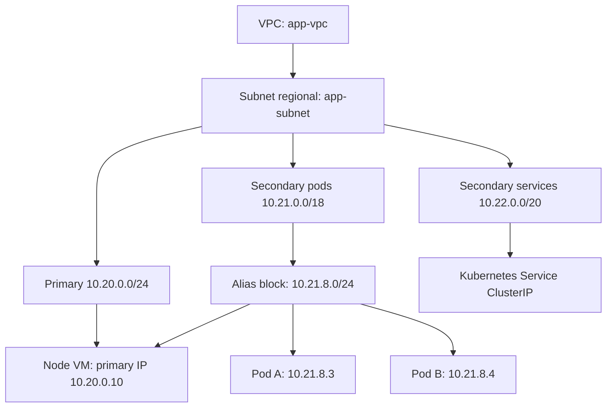

# Primary IP ranges, secondary ranges và alias IP

> **Chương:** VPC và định tuyến  
> **Module:** CLOUD_PROVIDERS_GCP  
> **Phạm vi module:** Khám phá Google Cloud từ tổ chức project, IAM và VPC đến Compute Engine, GKE, Cloud Run, dịch vụ lưu trữ và cơ sở dữ liệu. Qua các tình huống triển khai, người học biết lựa chọn dịch vụ, bảo vệ tài nguyên, tự động hóa phát hành và theo dõi độ tin cậy cùng chi phí.

Khi triển khai workload vào Google Cloud, một **VPC network** cung cấp không gian mạng logic cho các tài nguyên tương thích. Mỗi subnet có **primary IPv4 range**; subnet cũng có thể có nhiều **secondary IPv4 ranges**. Trong những mô hình cần nhiều địa chỉ trên cùng một giao diện mạng, Google Cloud còn hỗ trợ **alias IP ranges**. Ba khái niệm liên quan nhưng không đồng nghĩa: *primary/secondary* mô tả **dải địa chỉ thuộc subnet**; *alias IP* mô tả **địa chỉ hoặc dải địa chỉ gán thêm cho một giao diện VM**.

Phân biệt chúng đặc biệt quan trọng khi thiết kế Compute Engine và **GKE VPC-native**: IP của node thường lấy từ primary range, IP của Pod lấy từ secondary range dành cho Pod thông qua alias IP, còn IP ảo của Kubernetes Service được phân phối từ dải dành cho Service. Nếu lập kế hoạch sai, có thể hết địa chỉ Pod dù subnet vẫn còn đủ IP để tạo VM.

## Mục tiêu học tập

Sau bài này, bạn có thể:

1. Phân biệt phạm vi toàn cục của VPC với phạm vi **regional** của subnet và **zonal** của nhiều VM.
2. Giải thích primary IP range, secondary IP range và alias IP range bằng sơ đồ và ví dụ CIDR.
3. Mô tả cách địa chỉ IP của VM, Pod và Kubernetes Service được cấp trong GKE VPC-native.
4. Lập kế hoạch các dải CIDR tránh trùng lặp và nhận biết rủi ro hết địa chỉ.
5. Tạo và kiểm tra custom-mode VPC cùng subnet có secondary ranges bằng Console hoặc `gcloud`.
6. Phân biệt **định tuyến**, **tường lửa** và **quyền IAM** khi kiểm tra kết nối, cũng như dọn tài nguyên lab an toàn.

## 1. Bức tranh chung: VPC, subnet và VM

Trong GCP, **VPC network là tài nguyên toàn cục**; subnet là **tài nguyên theo region**. Một VPC có thể chứa nhiều subnet ở các region khác nhau. Máy ảo Compute Engine nằm trong một **zone**, nhưng giao diện mạng của máy nối vào một subnet thuộc **region chứa zone đó**.

```text
Project: demo-network
└── VPC network: app-vpc (global)
    ├── Region: asia-southeast1
    │   ├── Subnet: app-subnet
    │   │   ├── Primary IPv4: 10.20.0.0/24
    │   │   ├── Secondary "pods": 10.21.0.0/18
    │   │   └── Secondary "services": 10.22.0.0/20
    │   └── VM node ở zone asia-southeast1-a
    │       ├── Primary internal IP: 10.20.0.10
    │       └── Alias IP range cho Pod: 10.21.8.0/24
    └── Region khác
        └── Subnet riêng với các dải CIDR không trùng lặp
```

Các địa chỉ ở đây **chỉ để minh họa**, chưa có tài nguyên nào được tạo. Mạng thực tế cần xem xét kết nối với mạng on-premises, VPC Peering, mạng dùng chung (Shared VPC), yêu cầu IP của từng workload và chính sách tổ chức trước khi quyết định CIDR.

| Khái niệm | Thuộc về đâu? | Vai trò chính |
|---|---|---|
| **VPC network** | Project host mạng, phạm vi toàn cục | Mạng logic, cơ sở cho kết nối, định tuyến và firewall |
| **Subnet** | Một VPC và một region | Chứa các dải địa chỉ để cấp cho workload |
| **Primary IPv4 range** | Subnet | Cấp địa chỉ nội bộ chính cho giao diện VM và các tài nguyên dùng primary IP |
| **Secondary IPv4 range** | Subnet | Tạo thêm không gian IPv4 có tên, ví dụ dành cho Pod/Service của GKE |
| **Primary internal IP của NIC** | Giao diện mạng VM | Địa chỉ nội bộ chính của giao diện, lấy từ primary range |
| **Alias IP range** | Giao diện mạng VM | Một hoặc nhiều IP bổ sung hoặc một block IP từ primary/secondary range của subnet |
| **Kubernetes Service ClusterIP** | Dịch vụ ảo trong cụm GKE | Địa chỉ ảo cho truy cập Service; không đồng nhất với alias IP gán cho VM |

Một VPC **không** có một CIDR duy nhất phải nhập khi tạo mạng. Các CIDR được khai báo trên **các subnet**. Với **custom-mode VPC**, người quản trị tự tạo subnet và chọn địa chỉ; với **auto-mode VPC**, Google Cloud tạo sẵn các subnet theo vùng và những khoảng IP đã quy định. Khi cần kiểm soát kế hoạch IP hoặc tích hợp mạng hybrid, custom mode thường dễ quản lý hơn.

## 2. Primary IPv4 range là gì?

**Primary IPv4 range** là dải IPv4 chính của subnet, biểu diễn bằng CIDR. Ví dụ:

```text
Primary range: 10.20.0.0/24
Mạng lý thuyết: 10.20.0.0 đến 10.20.0.255 (256 địa chỉ)
VM A - nic0: 10.20.0.10
VM B - nic0: 10.20.0.11
```

Một giao diện VM lấy **primary internal IPv4 address** từ primary range của subnet mà giao diện kết nối. Khi tạo VM, địa chỉ này có thể được cấp tự động hoặc chọn theo cơ chế của dịch vụ. Không phải cả 256 địa chỉ của `/24` đều cấp được: Google Cloud dành riêng một số địa chỉ theo quy tắc của subnet.

### Đặc điểm cần nhớ

- **Subnet có một primary IPv4 range**, nhưng có thể có nhiều secondary ranges.
- **Primary internal IP** là IP chính của NIC; một VM có thể có nhiều NIC nếu cấu hình máy và dịch vụ cho phép, nhưng mỗi NIC thuộc một subnet phù hợp.
- Primary range thường phục vụ VM/node, các tài nguyên sử dụng primary address và các mục đích mà dịch vụ yêu cầu.
- Kích thước primary range ảnh hưởng đến số địa chỉ có thể cấp cho VM hoặc node. Nếu dùng GKE VPC-native, **node IP** thường lấy ở đây, trong khi **Pod IP** lấy ở dải khác.
- Có thể **mở rộng** primary range theo quy tắc của sản phẩm khi còn không gian không xung đột; việc **thu nhỏ** hay thay thế CIDR không nên coi là thao tác đơn giản.

**Ví dụ:** một cluster có 100 node, mỗi node cần primary IP, thì subnet primary `/28` quá nhỏ dù Pod secondary range rất lớn. Ngược lại, primary `/24` còn nhiều IP không bảo đảm cluster tạo thêm Pod được nếu secondary range dành cho Pod đã hết.

## 3. Secondary IPv4 ranges là gì?

**Secondary IPv4 range** là một dải IPv4 bổ sung có **tên** trong subnet. Nó không thay thế primary range. Một subnet có thể có nhiều secondary ranges, ví dụ:

```text
Subnet: app-subnet, region asia-southeast1
  primary:          10.20.0.0/24
  secondary "pods": 10.21.0.0/18
  secondary "services": 10.22.0.0/20
```

Trong subnet này:

- `10.20.0.0/24` cung cấp địa chỉ chính cho VM/node.
- `10.21.0.0/18` là dải phụ có tên `pods`, dành cho địa chỉ Pod theo kiến trúc GKE VPC-native.
- `10.22.0.0/20` là dải phụ có tên `services`, dành cho địa chỉ ClusterIP của Kubernetes Service trong ví dụ GKE.

### Quy tắc thiết kế

1. Mỗi CIDR phải đúng dạng **network prefix**. Ví dụ `10.21.0.0/18` bao phủ `10.21.0.0` đến `10.21.63.255`; địa chỉ `10.21.8.0/18` sẽ không biểu diễn một dải mạng căn chỉnh đúng /18.
2. **Primary và secondary ranges không được chồng lấn** với nhau hay với các subnet khác trong cùng VPC. Các kết nối tới mạng khác còn có ràng buộc về địa chỉ chồng lấn.
3. **Tên secondary range** được dùng khi các dịch vụ như GKE tham chiếu dải; đừng nhầm tên `pods` với địa chỉ CIDR.
4. Phân bổ dung lượng theo số VM/node, số Pod và Service cần phục vụ, đồng thời để chỗ mở rộng.
5. Không giả định thêm secondary range giúp mọi tài nguyên tự động chuyển IP từ primary sang secondary; dịch vụ phải được cấu hình để **sử dụng** dải phù hợp.

Với mạng riêng, nhóm địa chỉ IPv4 RFC 1918 thường là lựa chọn phổ biến. Một số kiến trúc GCP còn có thể dùng địa chỉ nội bộ theo cơ chế khác được hỗ trợ; vì vậy, không nên suy luận rằng mọi secondary range đều bắt buộc nằm trong duy nhất một loại dải private IP. Trong bài thực hành này ta chỉ dùng các CIDR ví dụ thuộc `10.0.0.0/8`.

## 4. Alias IP là gì và liên quan ra sao đến subnet?

**Alias IP range** là một địa chỉ IP hoặc một khối địa chỉ IP bổ sung được gán cho **giao diện mạng của VM**. Về nguồn cấp phát, alias IP có thể được chọn từ **primary range hoặc một secondary range** của subnet mà NIC đang sử dụng. Đây không phải một VPC mới, không phải một subnet riêng và không phải một địa chỉ public.

```text
NIC của một VM
│
├── Primary internal IP: 10.20.0.10
│   └── lấy từ primary subnet range 10.20.0.0/24
│
└── Alias IP range: 10.21.8.0/24
    └── lấy từ secondary "pods" 10.21.0.0/18
        ├── Pod A: 10.21.8.3
        ├── Pod B: 10.21.8.4
        └── Các IP còn lại trong block được quản lý theo workload
```

Giả sử GKE gán một block alias `10.21.8.0/24` cho node; VPC biết rằng địa chỉ của các Pod thuộc block đó có thể được chuyển đến NIC của node. Google Cloud quản lý tuyến đến địa chỉ alias theo mô hình mạng của nền tảng, giúp tránh phải tạo một custom static route riêng cho từng Pod.

**Không nhầm ba hành động sau:**

| Hành động | Tác động |
|---|---|
| Thêm secondary range `pods=10.21.0.0/18` vào subnet | Khai báo **nguồn địa chỉ phụ**; chưa đồng nghĩa gán toàn bộ dải cho VM |
| Gán alias block `10.21.8.0/24` cho NIC một node | Dành **một phần của nguồn địa chỉ** cho giao diện VM đó |
| Pod dùng IP `10.21.8.3` trên node | Workload/container dùng IP trong block đã được cấp; GKE/CNI xử lý chi tiết mạng |

### Alias IP không tự giải quyết mọi vấn đề kết nối

Gán một alias IP range cho NIC không đồng nghĩa ứng dụng trong guest OS đã tự cấu hình lắng nghe ở mọi địa chỉ trong dải. Với VM tự quản lý, cần cấu hình hệ điều hành và ứng dụng phù hợp với mô hình sử dụng địa chỉ. Trong GKE VPC-native, Kubernetes/GKE và thành phần mạng của cụm tự động quản lý nhiều bước đó cho Pod.

Alias IP cũng **không thay thế firewall**. Nếu route đến đích tồn tại nhưng rule ingress/egress chặn giao thức hoặc cổng, traffic vẫn thất bại. Việc dịch vụ có thể sử dụng IP còn liên quan đến IAM, thiết lập ứng dụng, chính sách GKE và đường đi mạng thực tế.

## 5. GKE VPC-native sử dụng các dải địa chỉ như thế nào?

Trong **VPC-native GKE**, cụm sử dụng alias IP để cung cấp địa chỉ Pod từ secondary range của subnet. Một bố trí điển hình:



**Giải thích:**

- **Node (VM):** lấy primary internal IP từ primary range của subnet.
- **Pod:** lấy IP từ secondary range cho Pod. GKE phân bổ block alias IP cho node và quản lý IP của Pod trong block đó.
- **Kubernetes Service:** được cấp một **ClusterIP ảo** từ dải Service phù hợp với cấu hình cụm; ClusterIP không phải alias IP gắn cho NIC của node. Đường xử lý lưu lượng Service do cơ chế networking của Kubernetes/GKE đảm nhiệm.
- **GKE Autopilot hoặc Standard:** đều có các quyết định về dải địa chỉ; mức độ kiểm soát node và một số cơ chế cấp phát/cấu hình có thể khác. Cần xem lựa chọn của cluster đang sử dụng.

### 5.1. Vì sao không dùng chung một dải cho tất cả?

Việc tách primary, Pod secondary và Service secondary giúp:

- Có ranh giới rõ ràng giữa địa chỉ của node, Pod và Service.
- Dễ dự trù dung lượng cho từng nhóm và theo dõi chỗ nào đang cạn.
- Giảm nhu cầu gán một primary IP riêng cho từng Pod.
- Hỗ trợ GKE quản lý IP Pod mà không phải tạo thủ công route cho mỗi Pod.

Tách dải địa chỉ **không tự tạo cách ly bảo mật** giữa Pod và VM. Phân quyền, firewall và Kubernetes NetworkPolicy hoặc cơ chế chính sách mạng được hỗ trợ phải được thiết kế riêng.

### 5.2. Tính dung lượng trước khi triển khai

Giả sử cluster dự kiến tối đa **12 node** và mỗi node hỗ trợ **tối đa 64 Pod**. Không nên chỉ nhân `12 × 64 = 768` rồi chọn CIDR có vừa đúng 768 địa chỉ: GKE cấp **block IP theo node** dựa trên giới hạn Pod/node và các quy tắc làm tròn, không nhất thiết dùng hết block.

Trong một cấu hình cụ thể, nếu mỗi node được cấp block `/24` (256 địa chỉ), 12 node sẽ cần tổng cộng 3.072 địa chỉ **để phân bổ block**, trước khi tính headroom. Dải `/20` có 4.096 địa chỉ lý thuyết, có thể phù hợp về quy mô block cho ví dụ này; dải `/18` có nhiều headroom hơn. **Đây chỉ là phép tính minh họa**, vì kích thước block thực tế phụ thuộc cấu hình max Pods per node, chế độ cụm và tính năng cấp phát IP.

Khi thiết kế thực:

1. Xác định tối đa node theo cụm và từng node pool.
2. Xác định giới hạn Pod mỗi node và cách GKE tính block IP.
3. Dự phòng node tăng thêm trong lúc nâng cấp, sửa chữa hoặc autoscaling.
4. Kiểm tra giới hạn sử dụng Service IP và cluster IP allocation mode.
5. Tránh trùng lặp với các VPC khác, peering, VPN/Interconnect và mạng on-premises.
6. Ghi lại cả **tên dải** và **CIDR**, kiểm tra các giới hạn của phiên bản/cấu hình GKE trước khi tạo cụm.

Một dự án có thể **còn CPU và quota nhưng không tạo được Pod/node** nếu thiếu IP. Vì thế dung lượng IP là một phần của capacity planning, không chỉ là cấu hình mạng ban đầu.

## 6. Định tuyến và firewall liên quan thế nào?

Khi subnet có primary và secondary IP ranges, VPC sử dụng **subnet routes** để định tuyến đến các dải địa chỉ đó. Khi có alias IP range gắn với giao diện VM, nền tảng quản lý việc phân phối đến NIC tương ứng. Bạn **không cần tự tạo một static route riêng cho từng alias IP của Pod** trong mô hình GKE VPC-native thông thường.

```text
Nguồn phát traffic
      │
      ▼
VPC routing: có đường đến CIDR đích không?
      │
      ▼
Firewall / chính sách mạng: có cho phép luồng này không?
      │
      ▼
NIC / node / Pod / ứng dụng đích: có nhận và xử lý không?
```

| Lớp | Chức năng | Ví dụ gây lỗi |
|---|---|---|
| **Subnet range** | Xác định nguồn địa chỉ nội bộ được cấp | Không còn IP khả dụng cho node hoặc Pod |
| **VPC routing** | Xác định đường tới dải IP đích | Mạng hybrid chưa biết route đến secondary CIDR |
| **VPC firewall** | Kiểm soát lưu lượng đến/đi từ các VM theo rule áp dụng | Chặn TCP port dù hai máy cùng VPC |
| **GKE NetworkPolicy / chính sách mạng** | Kiểm soát giao tiếp giữa các workload theo cơ chế được bật | Pod không truy cập được service dù CIDR hợp lệ |
| **Application/service** | Lắng nghe trên cổng, xác thực và xử lý request | Dịch vụ không mở port hoặc từ chối authorization |

### 6.1. Secondary range có tự đi qua VPN hoặc peering không?

Không nên tự giả định. Trong cùng VPC, subnet routes hỗ trợ các dải primary/secondary. Nhưng khi đi qua **Cloud VPN, Cloud Interconnect, VPC Network Peering** hoặc thiết kế đa VPC khác, cần kiểm tra:

- CIDR không xung đột với mạng đối tác hoặc on-premises.
- Đường đi/đường về và cách **advertise routes** (ví dụ qua Cloud Router và BGP) có bao gồm secondary ranges theo cấu hình thực tế.
- Quy định về import/export custom routes, subnet route exchange và hạn chế của mỗi loại kết nối.
- Firewall, ACL ở cả hai phía, routing của workload và dải địa chỉ được phép.

**Ví dụ:** một ứng dụng on-premises truy cập Pod IP `10.21.8.3` qua kết nối hybrid. Nếu mạng on-premises không biết đường về `10.21.0.0/18`, kết nối có thể thất bại dù Pod đang hoạt động và GKE cấp IP hợp lệ.

### 6.2. Alias IP và NAT

Alias IP là **địa chỉ nội bộ của giao diện**, không phải một public IP. Nếu workload cần truy cập Internet từ IP nội bộ, có thể cần cơ chế egress phù hợp như Cloud NAT hoặc một đường đi khác được kiến trúc cho phép. Gán alias IP **không** tự tạo một địa chỉ public và không tự bảo đảm Internet egress.

## 7. Thực hành: tạo VPC và subnet có primary/secondary ranges

Phần lab chỉ tạo **VPC và subnet**, chưa tạo VM hay GKE cluster; nhờ đó có thể kiểm tra cấu hình IP mà không phải duy trì máy ảo hoặc cụm Kubernetes tính phí. Bạn có thể thực hiện bằng **Console hoặc Cloud Shell**. Nếu học trong tổ chức, hãy dùng project sandbox và CIDR được chủ mạng phê duyệt.

### 7.1. Chuẩn bị quyền và chọn CIDR

Cần có:

- Quyền truy cập project và quyền quản lý VPC/subnet phù hợp, hoặc một quản trị viên thực hiện thao tác thay bạn.
- **Compute Engine API** được bật; không nhất thiết phải tạo VM.
- Quyền xem VPC, subnet và routes để xác minh kết quả.
- Một bộ CIDR không chồng lấn với mạng của project cũng như những mạng kết nối với nó.

Bảng cho lab:

| Thuộc tính | Giá trị minh họa |
|---|---|
| Project ID | `PROJECT_ID` — tự thay bằng project lab |
| VPC | `ip-ranges-lab` |
| Subnet | `app-subnet` |
| Region | `asia-southeast1` |
| Primary | `10.20.0.0/24` |
| Secondary tên `pods` | `10.21.0.0/18` |
| Secondary tên `services` | `10.22.0.0/20` |

**Không áp dụng nguyên xi dải CIDR vào môi trường có kết nối production**: hãy đối chiếu kế hoạch IP trước khi tạo. Không cần gán external IPv4 hoặc mở firewall Internet trong bài này.

### 7.2. Cách A — Google Cloud Console

1. Mở **Google Cloud Console → VPC network → VPC networks** trong đúng project.
2. Chọn **Create VPC network**.
3. Đặt tên `ip-ranges-lab`; chọn **Custom** cho subnet creation mode.
4. Trong phần tạo subnet, nhập tên `app-subnet`, region `asia-southeast1` và **Primary IPv4 range** `10.20.0.0/24`.
5. Thêm **Secondary IPv4 ranges** (nếu giao diện trình bày trong phần subnet): một dải tên `pods`, CIDR `10.21.0.0/18` và một dải tên `services`, CIDR `10.22.0.0/20`.
6. Xem lại tên, region, CIDR và cấu hình firewall do giao diện đề xuất. Không mở cổng từ Internet chỉ để kiểm tra địa chỉ.
7. Chọn **Create**. Sau khi tài nguyên xuất hiện, mở trang chi tiết subnet và đối chiếu thông tin primary/secondary.

Nếu màn hình tạo VPC không hỗ trợ thêm đủ secondary ranges ngay, có thể tạo custom VPC trước rồi tạo hoặc chỉnh subnet qua **VPC network → VPC networks → Subnets** theo quyền được cấp.

### 7.3. Cách B — Cloud Shell và gcloud

Thay `PROJECT_ID` bằng project ID riêng của bài lab và xác nhận đang đăng nhập đúng tài khoản:

```bash
PROJECT_ID="my-gcp-network-lab"
NETWORK_NAME="ip-ranges-lab"
SUBNET_NAME="app-subnet"
REGION="asia-southeast1"

# Kiểm tra danh tính và project
gcloud auth list --filter="status:ACTIVE"
gcloud projects describe "$PROJECT_ID" \
  --format="table(projectId,name,lifecycleState)"

# Đọc danh sách subnet hiện có trước khi chọn CIDR
gcloud compute networks subnets list --project="$PROJECT_ID"
```

Chỉ khi project và kế hoạch CIDR đã đúng, người được cấp quyền có thể chạy:

```bash
# Nếu Compute Engine API chưa bật và bạn được phép bật:
gcloud services enable compute.googleapis.com --project="$PROJECT_ID"

# Tạo VPC ở custom subnet mode
gcloud compute networks create "$NETWORK_NAME" \
  --subnet-mode=custom \
  --project="$PROJECT_ID"

# Tạo một subnet và hai secondary IPv4 ranges có tên
gcloud compute networks subnets create "$SUBNET_NAME" \
  --network="$NETWORK_NAME" \
  --region="$REGION" \
  --range=10.20.0.0/24 \
  --secondary-range=pods=10.21.0.0/18,services=10.22.0.0/20 \
  --project="$PROJECT_ID"
```

**Lưu ý:** tạo VPC/subnet trong lab chưa tạo một VM hay cluster. Tuy nhiên, các dịch vụ liên quan dùng mạng đó có thể phát sinh chi phí; luôn kiểm tra Cloud Billing và dọn tài nguyên sau thực hành.

### 7.4. Xác minh sau khi tạo

```bash
# Liệt kê VPC của project
gcloud compute networks list --project="$PROJECT_ID"

# Liệt kê subnet trong project
gcloud compute networks subnets list --project="$PROJECT_ID"

# Xem trường CIDR và tên các secondary range của subnet cụ thể
gcloud compute networks subnets describe "$SUBNET_NAME" \
  --region="$REGION" \
  --project="$PROJECT_ID" \
  --format="yaml(name,network,region,ipCidrRange,secondaryIpRanges)"

# Xem thông tin các routes trong project
gcloud compute routes list --project="$PROJECT_ID"
```

**Kết quả mong đợi:**

- VPC `ip-ranges-lab` hiển thị với subnet mode **CUSTOM**.
- `app-subnet` nằm ở region `asia-southeast1`.
- Trường `ipCidrRange` là `10.20.0.0/24`.
- Trường `secondaryIpRanges` chứa **`pods = 10.21.0.0/18`** và **`services = 10.22.0.0/20`**.
- Route của VPC được kiểm tra ở cấp mạng phù hợp; không phải tự có alias IP gắn VM vì bài lab chưa tạo VM.

### 7.5. Thử mở rộng bằng secondary range thứ ba (tùy chọn)

Nếu bạn muốn phân biệt việc **khai báo secondary range** với **gán alias IP**, có thể thêm một dải độc lập cho mục đích giả định:

```bash
# Chỉ thử khi 10.23.0.0/24 chưa được sử dụng/chồng lấn
gcloud compute networks subnets update "$SUBNET_NAME" \
  --region="$REGION" \
  --add-secondary-ranges=jobs=10.23.0.0/24 \
  --project="$PROJECT_ID"

gcloud compute networks subnets describe "$SUBNET_NAME" \
  --region="$REGION" \
  --project="$PROJECT_ID" \
  --format="yaml(ipCidrRange,secondaryIpRanges)"
```

Thao tác này làm subnet có thêm secondary range tên `jobs`, **không tự tạo VM, Pod hay alias IP**. Khi đã gắn một range vào workload, việc sửa/xóa range phải xét ràng buộc dịch vụ đang dùng. Trong bài lab, có thể xóa toàn subnet lúc dọn vì chưa có workload phụ thuộc.

## 8. Thực hành quan sát alias IP trên VM (phần mở rộng)

Để nhìn thấy alias IP được gán cho một NIC, cần một VM hoặc node có alias range. Tạo VM và GKE cluster có thể phát sinh chi phí nên phần này là **mở rộng tùy chọn**, không bắt buộc để hoàn thành bài lab ở trên.

### 8.1. Cách quan sát bằng Console

Trên một **VM lab được phép thao tác** trong region của subnet:

1. Vào **Compute Engine → VM instances**, chọn VM đang chạy trong đúng subnet hoặc tạo một VM lab riêng nếu được phép và đã dự trù chi phí.
2. Mở phần **Networking → Network interfaces** trong cấu hình VM; chọn NIC phù hợp.
3. Tìm mục **Alias IP ranges**; chọn secondary range tên `pods` (hoặc range được thiết kế để cấp alias), sau đó chọn một địa chỉ hoặc subrange chưa được cấp.
4. Lưu theo những điều kiện và thao tác được Console hỗ trợ. Một số thay đổi giao diện mạng có thể yêu cầu dừng VM hoặc đáp ứng hạn chế khác.
5. Mở lại chi tiết VM để kiểm tra **primary internal IPv4** và **alias IP range** là hai giá trị riêng.

Khi dùng VM tự quản lý, ứng dụng và hệ điều hành bên trong VM có thể cần thêm cấu hình để sử dụng alias range. Đừng giả định cứ thêm alias là mọi IP trong dải tự phản hồi ping hoặc mọi service tự lắng nghe.

### 8.2. Kiểm tra bằng lệnh chỉ đọc

Nếu VM đã có alias IP và bạn biết chính xác project, zone và tên VM:

```bash
VM_NAME="my-existing-lab-vm"
ZONE="asia-southeast1-a"

gcloud compute instances describe "$VM_NAME" \
  --zone="$ZONE" \
  --project="$PROJECT_ID" \
  --format="yaml(name,zone,networkInterfaces)"
```

Trong thông tin `networkInterfaces`, đối chiếu `networkIP` (primary internal IP) với `aliasIpRanges` (nếu có). Một VM không cấu hình alias có thể không xuất hiện trường `aliasIpRanges`; điều đó **không có nghĩa** subnet không có secondary ranges.

### 8.3. Liên hệ với cấu hình GKE

Khi cấu hình một cluster GKE VPC-native trên subnet có secondary ranges, người quản trị có thể chọn các **named secondary ranges** cho Pod và Service qua cài đặt cluster, ví dụ `pods` và `services`. GKE sẽ sử dụng cấu hình này để phân bổ IP cho node/Pod/Service theo chế độ cụm. Chỉ việc tạo subnet có hai dải ấy **không tự triển khai GKE**.

Do cluster có nhiều thuộc tính quan trọng như node pool, location, quyền truy cập, chế độ Standard/Autopilot, phiên bản và chi phí, bài này dừng ở **quy hoạch địa chỉ** và không đưa lệnh tạo cluster thiếu ngữ cảnh vận hành.

## 9. Dọn tài nguyên trong bài lab

Nếu bạn chỉ tạo VPC/subnet theo bước 7, có thể xóa theo thứ tự **subnet → VPC**, sau khi xác minh không có VM, GKE cluster, kết nối mạng hoặc tài nguyên khác sử dụng chúng.

**Trước khi xóa:** kiểm tra lại `PROJECT_ID`, `NETWORK_NAME`, `SUBNET_NAME` và `REGION`. Chỉ xóa tài nguyên mà bạn tạo riêng cho lab; không sử dụng lệnh này cho VPC dùng chung.

```bash
printf 'Project: %s\nVPC: %s\nSubnet: %s\nRegion: %s\n' \
  "$PROJECT_ID" "$NETWORK_NAME" "$SUBNET_NAME" "$REGION"

# Xác minh subnet và VPC trước khi xóa
gcloud compute networks subnets describe "$SUBNET_NAME" \
  --region="$REGION" \
  --project="$PROJECT_ID"
gcloud compute networks describe "$NETWORK_NAME" \
  --project="$PROJECT_ID"

# Chỉ khi chắc chắn không còn workload phụ thuộc:
gcloud compute networks subnets delete "$SUBNET_NAME" \
  --region="$REGION" \
  --project="$PROJECT_ID"

gcloud compute networks delete "$NETWORK_NAME" \
  --project="$PROJECT_ID"
```

Xác minh kết quả bằng `gcloud compute networks list --project="$PROJECT_ID"` và `gcloud compute networks subnets list --project="$PROJECT_ID"`. Nếu lệnh xóa bị từ chối vì có resource phụ thuộc, hãy **kiểm kê** resource được báo và làm việc với chủ sở hữu, không xóa hàng loạt để vượt lỗi.

## 10. Lỗi thường gặp và cách chẩn đoán

| Tình huống | Nguyên nhân có thể | Hướng xử lý |
|---|---|---|
| Không tạo được subnet | CIDR chồng lấn với primary/secondary của subnet khác hoặc sai định dạng | Kiểm tra toàn VPC và mạng kết nối; dùng prefix căn chỉnh đúng |
| Bị chặn ở bước `gcloud compute networks create` | Thiếu quyền IAM hoặc Compute Engine API chưa bật | Kiểm tra danh tính, role, API và policy; không tự nâng quyền |
| GKE hết IP Pod nhưng VM vẫn tạo được | Secondary range cho Pod quá nhỏ; primary còn IP node | Kiểm tra allocation của cluster, số Pod/node, block size và chiến lược mở rộng Pod range |
| Không tạo được node dù Pod secondary còn rộng | Primary range hết IP cho node hoặc quota/resource khác chặn | Xem primary capacity, quota và trạng thái node pool |
| Service ClusterIP không nằm trong dải Pod | Thiết kế tách secondary cho Service và Pod | Xem range dành cho Service của GKE; đây thường là điều mong đợi |
| VM có secondary subnet range nhưng không có `aliasIpRanges` | Secondary range chỉ tồn tại ở subnet, chưa gắn cho VM | Kiểm tra NIC hoặc cấu hình GKE/node; không nhầm subnet với alias assignment |
| VM có alias IP nhưng không truy cập được ứng dụng | Firewall, route, OS/app, policy hoặc đường về chưa phù hợp | Kiểm tra từng lớp thay vì cấp thêm secondary range vô điều kiện |
| Kết nối on-premises không đến được Pod | Chưa advertise/nhận route của Pod CIDR, trùng IP hoặc firewall | Kiểm tra Cloud Router/VPN và định tuyến hai chiều |
| Muốn xóa subnet nhưng bị từ chối | Còn VM, GKE, forwarding rule hoặc tài nguyên phụ thuộc | Kiểm kê đúng network/subnet, gỡ phụ thuộc theo quy trình |
| Tưởng alias IP là public IP | Nhầm IP nội bộ phụ của NIC với địa chỉ external | Xem cấu hình NIC, external IP và egress/NAT riêng |

## 11. Ba tình huống thiết kế

### Tình huống A — Ứng dụng web trên Compute Engine

Đội triển khai nhiều VM chạy ứng dụng web trong một subnet `10.20.0.0/24`. Mỗi VM cần một primary internal IP; chưa có Pod hay yêu cầu nhiều IP trên một NIC. Trong trường hợp này, **primary range có thể đủ cho nhu cầu mạng cơ bản**. Không cần thêm secondary range hoặc alias IP chỉ để chạy VM web thông thường.

Nếu sau này có thêm một phần mềm mạng sử dụng nhiều IP logic trên cùng NIC, lúc đó mới đánh giá alias IP theo yêu cầu ứng dụng. Việc chọn secondary range là quyết định về **địa chỉ và cách vận hành**, không phải chức năng bắt buộc cho mọi Compute Engine VM.

### Tình huống B — GKE VPC-native tăng số Pod

Một cluster có thể mở rộng node nhưng gặp lỗi cấp Pod IP khi workload tăng. Project còn CPU quota, subnet primary còn IP. Nhóm phát hiện secondary `pods` chỉ có `/23`, không đủ block IP cho các node mới theo cấu hình hiện tại.

Hướng giải quyết cần kiểm tra kích thước block trên mỗi node và các phương án được GKE hỗ trợ, ví dụ mở rộng phạm vi địa chỉ Pod hoặc thiết kế lại cách cấp phát theo phiên bản/chế độ cụm. Không nên đổi primary range một cách ngẫu nhiên vì nguyên nhân chính nằm ở **Pod secondary range**.

### Tình huống C — Kết nối trung tâm dữ liệu vào GCP

Doanh nghiệp có mạng on-premises `10.21.0.0/16`, còn dự án GCP định cấp Pod secondary `10.21.0.0/18`. Hai dải **chồng lấn**, tạo rủi ro định tuyến không rõ ràng khi nối bằng VPN/Interconnect.

Trước khi tạo subnet hoặc cluster, nhóm mạng cần quy hoạch CIDR không trùng, xác nhận quảng bá route và đường về, kiểm tra firewall và chính sách an ninh. Một IP plan tốt giúp tránh phải thay đổi địa chỉ của workload đang chạy sau này.

## 12. Câu hỏi tự kiểm tra

**1. Primary IP range và secondary IP range khác nhau ở đâu?**  
**Trả lời:** primary range là dải địa chỉ chính của subnet, thường cấp primary internal IPv4 cho VM/node; secondary range là dải bổ sung có tên, có thể được dùng cho alias IP hoặc mục đích dịch vụ như Pod/Service của GKE.

**2. Tạo secondary range `pods` có tự động làm một VM nhận alias IP không?**  
**Trả lời:** không. Thêm secondary range chỉ tạo không gian địa chỉ ở subnet; alias IP phải được gán cho NIC qua cơ chế tương ứng hoặc do GKE quản lý.

**3. Nếu một node có primary IP `10.20.0.10` và alias block `10.21.8.0/24` thì IP Pod có thể nằm ở đâu?**  
**Trả lời:** trong ví dụ GKE VPC-native, Pod có thể sử dụng IP thuộc block alias `10.21.8.0/24` đã được cấp cho node, tùy cơ chế phân bổ.

**4. Dải IP dành cho Kubernetes Service có giống một alias range gán vào NIC của VM không?**  
**Trả lời:** không. ClusterIP là IP ảo của Service do networking của Kubernetes/GKE xử lý; nguồn địa chỉ Service có thể đến từ secondary range được chọn cho cluster.

**5. VPC và subnet trong GCP có cùng phạm vi địa lý không?**  
**Trả lời:** không. VPC là tài nguyên global; subnet thuộc region, còn Compute Engine VM thường gắn với một zone trong region đó.

**6. Vì sao primary còn nhiều IP mà GKE vẫn không tạo được Pod mới?**  
**Trả lời:** Pod cần IP từ Pod secondary range theo mô hình VPC-native, và GKE còn cấp block IP cho node. Pod secondary range có thể cạn trước primary range.

**7. Khi route đến Pod CIDR tồn tại, traffic có chắc chắn đi được không?**  
**Trả lời:** không. Firewall, chính sách mạng, đường về và cấu hình ứng dụng vẫn có thể chặn kết nối.

**8. Có nên dùng lại CIDR của mạng on-premises cho secondary range trong VPC hybrid không?**  
**Trả lời:** không nên. Dải chồng lấn khiến thiết kế định tuyến gặp vấn đề; phải lập kế hoạch IP nhất quán trước khi kết nối.

## Ghi nhớ

- **Primary và secondary là đặc tính của subnet; alias IP là phân bổ bổ sung trên giao diện VM.**
- **VPC global, subnet regional, VM zonal** là ba phạm vi cần phân biệt khi chọn vị trí tài nguyên.
- **GKE VPC-native:** node dùng primary range, Pod dùng secondary range dành cho Pod qua alias IP, Service ClusterIP lấy từ dải Service phù hợp và là địa chỉ ảo.
- **Thiết kế CIDR** phải xét số node, Pod, Service, cách cấp block và các mạng kết nối; hết IP có thể xảy ra trước khi hết CPU hoặc quota.
- **Định tuyến, firewall và chính sách workload** là những lớp khác nhau; thêm địa chỉ không tự sửa lỗi kết nối.
- **Thực hành xong phải kiểm kê và dọn tài nguyên lab** theo quyền sở hữu, đồng thời theo dõi những dịch vụ thực tế dùng VPC có thể tạo chi phí.

## Tài liệu tham khảo

- [Google Cloud — VPC networks](https://cloud.google.com/vpc/docs/vpc)
- [Google Cloud — Alias IP ranges](https://cloud.google.com/vpc/docs/alias-ip)
- [Google Cloud — Subnets](https://cloud.google.com/vpc/docs/subnets)
- [Google Cloud — Routes](https://cloud.google.com/vpc/docs/routes)
- [Google Kubernetes Engine — VPC-native clusters](https://cloud.google.com/kubernetes-engine/docs/concepts/alias-ips)
