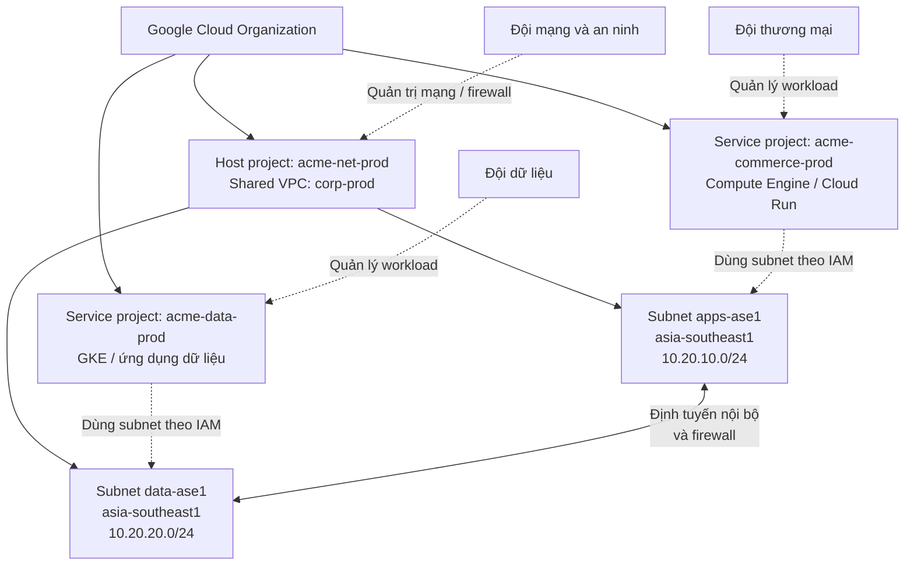

# Shared VPC và phân tách host project với service project

## 1. Bài toán mạng khi có nhiều project Google Cloud

Một hệ thống Google Cloud thường phát triển từ một project thử nghiệm thành nhiều project theo môi trường, nhóm sản phẩm hoặc yêu cầu quản trị. Ví dụ, đội bán hàng vận hành API bằng Cloud Run, đội dữ liệu sử dụng GKE và Cloud SQL, còn đội nền tảng quản lý VPC, firewall, VPN và đường truyền tới hệ thống tại văn phòng. Nếu mỗi đội tự tạo VPC riêng, tổ chức phải quản lý nhiều dải IP, kết nối chéo, quy tắc bảo mật và điểm truy cập ra ngoài.

**Shared VPC** cho phép tài nguyên của nhiều **service project** sử dụng **một hoặc nhiều mạng VPC được quản lý trong host project**. Kiến trúc này tách trách nhiệm quản lý **mạng dùng chung** khỏi trách nhiệm triển khai và vận hành **workload**. Các tài nguyên đủ điều kiện ở những service project khác nhau có thể trao đổi qua địa chỉ IP nội bộ trên cùng VPC, chịu sự chi phối của routing và firewall phù hợp.

Trong module **CLOUD_PROVIDERS_GCP**, đây là kiến thức kết nối **Organization/Folder/Project, IAM, VPC và định tuyến** với Compute Engine, GKE, Cloud Run, cơ sở dữ liệu, hạ tầng dưới dạng mã (IaC), theo dõi độ tin cậy và quản lý chi phí.

Sau bài học, bạn có thể:

1. Phân biệt rõ **host project**, **service project**, **Shared VPC network**, **shared subnet** và **IAM Network User**.
2. Thiết kế sơ đồ kết nối và phân quyền giữa đội mạng, đội an ninh và đội ứng dụng.
3. Giải thích những giới hạn về liên kết project, subnet, định tuyến, firewall và tài nguyên đã tồn tại.
4. Nhận diện yêu cầu riêng của **Compute Engine, GKE và Cloud Run** khi sử dụng Shared VPC.
5. Áp dụng các lệnh `gcloud` để quan sát, cấu hình trong môi trường được cấp quyền và kiểm chứng một triển khai.
6. Đánh giá Shared VPC về **bảo mật, độ tin cậy, chi phí và trách nhiệm vận hành**.

> **Lưu ý:** Các tên project, dải IP, nhóm và địa chỉ trong ví dụ đều là giả định. Lệnh tạo, liên kết hoặc thay đổi IAM được trình bày để học cú pháp; chỉ thực hiện trên môi trường được phép và sau khi đã kiểm tra ảnh hưởng.

## 2. Khái niệm và cấu trúc kiến trúc

### 2.1. Host project giữ tài nguyên mạng

**Host project** là project được quản trị viên bật tính năng Shared VPC. Nó chứa mạng VPC dùng chung và các tài nguyên mạng liên quan, chẳng hạn:

- Mạng VPC, subnet regional, dải IPv4 chính/phụ, một số địa chỉ IP.
- Các tuyến (routes), quy tắc firewall và chính sách firewall được áp dụng theo đúng phạm vi.
- Những thành phần mạng như Cloud Router, Cloud NAT, Cloud VPN hoặc Cloud Interconnect khi được triển khai trong host project.
- Quyền IAM cho phép principal từ service project **sử dụng** các subnet dùng chung.

Không phải mọi tài nguyên networking bắt buộc phải nằm ở host project. Chẳng hạn, vị trí của load balancer và các thành phần backend phụ thuộc loại load balancing, và các dịch vụ managed có cách tích hợp riêng. Cần đọc tài liệu của sản phẩm trước khi quyết định vị trí triển khai.

### 2.2. Service project giữ workload

**Service project** là project được gắn (attach) vào một host project. Nó chứa tài nguyên ứng dụng và chịu trách nhiệm vận hành tương ứng:

- Compute Engine VM hoặc managed instance groups.
- GKE clusters và các workload Kubernetes.
- Cloud Run services/jobs kết nối được hỗ trợ tới Shared VPC.
- Các dịch vụ lưu trữ, cơ sở dữ liệu và thành phần ứng dụng theo khả năng kết nối của từng sản phẩm.
- IAM cho ứng dụng, CI/CD, quota và báo cáo chi phí tài nguyên thuộc project đó.

Việc gắn service project **không tự cấp** cho mọi principal quyền dùng tất cả subnet và **không tự chuyển** VM hoặc mạng đã có sang Shared VPC.

### 2.3. Một sơ đồ dễ hình dung



Hai service project trong sơ đồ dùng **cùng một VPC**. Các gói tin được định tuyến theo mạng đó; project là ranh giới quản trị tài nguyên và quyền truy cập, **không tự động là bức tường chặn lưu lượng giữa hai nhóm ứng dụng**. Muốn ngăn truy cập giữa các workload, vẫn phải thiết kế firewall, định danh, xác thực ứng dụng và các ràng buộc phù hợp.

### 2.4. Những giới hạn cơ bản

| Quy tắc | Hệ quả thiết kế |
| --- | --- |
| Host và service project thông thường phải thuộc **cùng Organization** | Dùng tổ chức làm ranh giới quản trị; di chuyển giữa Organization có quy trình đặc biệt và ngoại lệ chuyển tiếp |
| **Một service project chỉ gắn với một host project** tại một thời điểm | Không thể dùng cơ chế attach để nối trực tiếp một service project tới hai host project |
| Một host project có thể phục vụ **nhiều service project** | Phù hợp quản trị mạng tập trung cho nhiều đội, trong giới hạn quota |
| Một project không đồng thời là host project và service project | Không thể tạo chuỗi “host → service → service” bằng Shared VPC |
| Có thể có **nhiều host project** trong một Organization | Thường tách mạng production và nonproduction, hoặc theo ranh giới cần cô lập |
| VPC trong host project là **mạng global**, subnet là **regional** | VM hoặc tài nguyên zonal phải chọn zone thuộc region của shared subnet tương ứng |
| Shared VPC có thể dùng custom-mode hoặc auto-mode VPC; không hỗ trợ legacy VPC | Custom-mode thường giúp kiểm soát IPAM và quy hoạch subnet chủ động |

Số lượng host/service project, tài nguyên mạng và quan hệ attach đều chịu **quota/limits**; tra cứu tại thời điểm thiết kế thay vì cố định một con số trong kiến trúc dài hạn.

## 3. Shared VPC giải quyết điều gì, và không giải quyết điều gì?

### Lợi ích chính

- **Tập trung quản lý mạng:** đội network có thể quản lý CIDR, route, kết nối hybrid và firewall trong host project.
- **Phân tách nhiệm vụ:** đội ứng dụng có thể tạo VM/cluster trong project của mình mà không cần quyền sửa VPC ở host.
- **Dùng IP nội bộ giữa nhiều project:** các tài nguyên tham gia cùng Shared VPC có thể dùng tuyến nội bộ của VPC, với điều kiện firewall và dịch vụ cho phép.
- **Quản trị nhất quán:** dễ áp dụng chuẩn kết nối ra ngoài, DNS, quan sát và kiểm soát network egress cho nhiều workload.
- **Theo dõi chi phí theo nhóm:** đa phần chi phí tài nguyên workload vẫn gắn với service project sở hữu tài nguyên.

### Giới hạn cần hiểu đúng

- **Attach project không tạo “đường hầm” mới:** các tài nguyên phải được cấu hình sử dụng mạng hoặc subnet chia sẻ; attach chỉ thiết lập quan hệ có thể sử dụng.
- **Không tự cấp quyền truy cập mạng:** principal vẫn cần quyền IAM thích hợp, và dịch vụ có thể cần service agent riêng được ủy quyền.
- **Không tự cô lập lưu lượng:** chia thành nhiều service project hoặc subnet **không phải firewall**.
- **Không tự mở truy cập internet:** VM không có external IP thường cần Cloud NAT hoặc đường egress phù hợp; Private Google Access có mục đích khác.
- **Không tự cấp quyền ứng dụng:** quyền `compute.networkUser` cho subnet không đồng nghĩa quyền đọc Cloud Storage, Secret Manager hay Cloud SQL.
- **Không tự sửa mạng hiện hữu:** VM và các thành phần đã có trong service project không đổi mạng chỉ vì service project vừa được attach.

## 4. Phân tách quyền quản trị: ai sở hữu phần nào?

Shared VPC chỉ tạo ra sự phân tách có ý nghĩa nếu IAM được thiết kế tương ứng.

| Vai trò quản trị | IAM role thường gặp | Phạm vi cấp | Trách nhiệm chính |
| --- | --- | --- | --- |
| **Shared VPC Admin** | `roles/compute.xpnAdmin`, kèm các quyền quản trị project/IAM cần thiết như `roles/resourcemanager.projectIamAdmin` | Organization hoặc Folder phù hợp | Bật host project, attach/detach service project, tổ chức ủy quyền |
| **Network Admin** | `roles/compute.networkAdmin` | Host project | Quản trị VPC, subnet, route và phần lớn tài nguyên mạng; vai trò này không mặc nhiên cho sửa firewall |
| **Security Admin** | `roles/compute.securityAdmin` | Host project hoặc phạm vi được duyệt | Quản trị firewall và những phần security networking tương ứng |
| **Service Project Admin** | `roles/compute.networkUser` | Host project hoặc **subnet** được cấp | Sử dụng mạng/subnet đã được cho phép; không trở thành Network Admin |
| **Compute/Workload Admin** | Ví dụ `roles/compute.instanceAdmin.v1` | Service project | Tạo và quản lý VM; thường cần kết hợp quyền dùng subnet |
| **Service agent** | Role theo từng dịch vụ và kịch bản | Host project, subnet và/hoặc service project | Thao tác thay mặt GKE, Cloud Run hoặc sản phẩm managed |

**Nguyên tắc quyền tối thiểu:** Ưu tiên cấp `roles/compute.networkUser` trên **subnet cụ thể** nếu đội chỉ cần dùng một số subnet. Cấp trên **toàn host project** rộng hơn và có thể cho phép sử dụng cả các subnet hiện tại lẫn subnet được tạo sau này.

### Hai lớp quyền cùng lúc

Giả sử nhân viên `devops@example.com` cần tạo VM trong service project `acme-commerce-prod`, dùng subnet `apps-ase1` ở host project `acme-net-prod`:

1. Ở **service project**, principal cần role cho phép tạo VM và quản lý tài nguyên tương ứng.
2. Ở **host project hoặc subnet `apps-ase1`**, principal cần `roles/compute.networkUser` để dùng subnet.
3. Những quyền phụ như sử dụng service account của VM, disk, image hoặc tài nguyên khác phải được cấp theo từng thao tác.

Nếu thiếu quyền ở lớp (1), principal không tạo được VM. Nếu thiếu quyền ở lớp (2), lệnh có thể thất bại khi gắn network interface dù principal có toàn quyền đối với VM trong service project.

**Ví dụ phân quyền trong thực tế:** đội ứng dụng sở hữu các template, image, CI/CD và workload ở service project; đội network sở hữu subnet, địa chỉ và route ở host; đội security kiểm soát ingress/egress. Cần quy trình yêu cầu thay đổi khi workload muốn mở port hoặc cần thêm subnet.

### IAM không phải là lớp lọc gói tin

Role `compute.networkUser` điều khiển **ai có thể sử dụng mạng khi tạo/cấu hình tài nguyên đủ điều kiện**. Khi VM A và VM B đã chạy trên cùng VPC, việc gói tin có thể đi qua hay không còn phụ thuộc vào **routes, firewall rules/policies, OS firewall và ứng dụng**. Thu hồi Network User không phải một công tắc ngắt toàn bộ lưu lượng hiện hữu.

## 5. Quy hoạch subnet, IP và tuyến đường

### 5.1. VPC global, subnet regional

Một VPC trong Google Cloud có phạm vi **global**. Subnet có phạm vi **region** và được sử dụng bởi tài nguyên ở region tương ứng. Ví dụ:

| Vùng | Shared subnet minh họa | Primary CIDR | Workload |
| --- | --- | --- | --- |
| `asia-southeast1` | `apps-ase1` | `10.20.10.0/24` | VM/API của service project Commerce |
| `asia-southeast1` | `data-ase1` | `10.20.20.0/24` | Node GKE thuộc service project Data |
| `asia-southeast2` | `apps-ase2` | `10.21.10.0/24` | Tài nguyên phục hồi ở region khác nếu có thiết kế DR |

CIDR và vị trí chỉ để luyện tập, **không phải dải IP đã được cấp cho hệ thống thật**. Khi quy hoạch IPAM, cần tránh xung đột với mạng on-premises, Cloud VPN/Interconnect, VPC Peering và các dải địa chỉ dự kiến cho dịch vụ managed.

### 5.2. Primary và secondary IP ranges

- VM sử dụng địa chỉ nội bộ từ **primary range** của subnet.
- GKE theo mô hình **VPC-native** sử dụng **secondary ranges** cho Pod và Service theo cấu hình cluster.
- Kích thước CIDR phải tính tăng trưởng, số node/pod, mức dự phòng và địa chỉ dành riêng; không chỉ tính số VM hiện tại.

Những secondary ranges ở host project có thể được sử dụng bởi GKE cluster ở service project nếu quyền và cấu hình đáp ứng yêu cầu GKE Shared VPC. Vì vậy đội mạng và đội Kubernetes phải thống nhất IPAM trước khi tạo cluster.

### 5.3. Routing và firewall

VPC cung cấp cơ chế định tuyến giữa các subnet và các tuyến động/tĩnh theo cấu hình mạng. Khi hai VM ở **cùng Shared VPC nhưng khác service project**, định tuyến nội bộ vẫn dựa trên địa chỉ và route của VPC. Tuy nhiên:

- **Firewall vẫn phải cho phép luồng cần thiết.** Google Cloud có các hành vi firewall mặc định (ví dụ implied deny ingress); đừng hiểu có route là có quyền kết nối.
- Một số route, Cloud Router và kết nối hybrid được quản trị tập trung trong host project.
- DNS, Private Google Access, Cloud NAT, Private Service Connect và kết nối tới dịch vụ managed có **cấu hình riêng**, không tự bật nhờ Shared VPC.
- Chính sách firewall cấp Organization/Folder và network firewall policies có thể tác động lên traffic; kiểm tra thứ tự ưu tiên và phạm vi áp dụng.

Ví dụ: VM xử lý thanh toán ở `apps-ase1` cần gọi API nội bộ tại `data-ase1` qua TCP 8443. Đội mạng phải xác định route phù hợp, quy tắc ingress được chấp nhận ở đích, danh tính/nhãn mạng mục tiêu và kiểm tra TLS/xác thực ứng dụng. Việc cả hai VM cùng dùng `corp-prod` chưa đủ để kết luận kết nối thành công.

### 5.4. Quyền dùng subnet khác với chặn truyền dữ liệu

Giả sử đội Commerce chỉ được cấp Network User trên `apps-ase1`. Họ không thể tự dùng `data-ase1` để tạo VM mới nếu thiếu quyền tương ứng. Nhưng VM Commerce **vẫn có thể kết nối** tới IP của dịch vụ ở `data-ase1` nếu routes và firewall cho phép. Để thực sự phân tách luồng dữ liệu, cần **firewall policies, segmentation** và kiểm soát ứng dụng.

## 6. Quy trình cấu hình Shared VPC với gcloud

Phần này mô tả một quy trình có thể kiểm chứng trong môi trường lab được phê duyệt. Dùng tên giả định:

```text
Organization:   organizations/123456789012
Host project:   acme-net-prod
Service project: acme-commerce-prod
VPC network:    corp-prod
Subnet:         apps-ase1
Region:         asia-southeast1
CIDR:           10.20.10.0/24
Group:          commerce-devops@example.com
```

**Điều kiện trước khi triển khai:** host và service project thuộc cùng Organization theo quy tắc thông thường; người thực hiện được cấp quyền Shared VPC Admin ở phạm vi phù hợp; billing, Compute Engine API, quyền quản trị mạng/IAM và quota đáp ứng yêu cầu. Kiểm tra các Organization Policies liên quan trước khi thay đổi.

### Bước 1: Xác minh project và API

```bash
# Chỉ đọc: xác nhận đúng Project ID
gcloud projects describe acme-net-prod
gcloud projects describe acme-commerce-prod

# Chỉ đọc: kiểm tra Compute Engine API đã bật hay chưa
gcloud services list --enabled --project=acme-net-prod \
  --filter="config.name=compute.googleapis.com"
gcloud services list --enabled --project=acme-commerce-prod \
  --filter="config.name=compute.googleapis.com"
```

Nếu API chưa bật, người được phép có thể dùng `gcloud services enable compute.googleapis.com --project=PROJECT_ID` cho từng project. Bật API có thể phát sinh tác động quản trị/chi phí tùy những dịch vụ được sử dụng sau đó; phải tuân thủ quy trình thay đổi của tổ chức.

### Bước 2: Tạo VPC custom mode và subnet ở host project

```bash
# Thay đổi tài nguyên: chỉ thực hiện ở lab được phê duyệt
gcloud compute networks create corp-prod \
  --subnet-mode=custom \
  --project=acme-net-prod

gcloud compute networks subnets create apps-ase1 \
  --network=corp-prod \
  --region=asia-southeast1 \
  --range=10.20.10.0/24 \
  --project=acme-net-prod
```

Việc tạo subnet này **không tự cấu hình ingress firewall, Cloud NAT hoặc các dải IP phụ cho GKE**. Nếu mạng và subnet đã tồn tại, nên đọc cấu hình, không tạo trùng.

### Bước 3: Bật host project

```bash
# Thay đổi trạng thái Shared VPC: yêu cầu quyền Shared VPC Admin
gcloud compute shared-vpc enable acme-net-prod
```

Đây là lệnh cho trường hợp principal có quyền quản trị Shared VPC ở cấp Organization. Nếu quyền được cấp **ở Folder**, Google Cloud có luồng lệnh `gcloud beta compute shared-vpc enable` tương ứng; kiểm tra tài liệu và phạm vi quyền trước khi thực hiện.

**Bật host chưa tự chia sẻ mạng cho service project.** Cần attach service project và cấu hình quyền sử dụng subnet riêng ở các bước tiếp theo.

### Bước 4: Attach service project

```bash
# Thay đổi quan hệ project; phải có quyền và thỏa mãn constraints
gcloud compute shared-vpc associated-projects add acme-commerce-prod \
  --host-project=acme-net-prod
```

Kiểm tra mối quan hệ bằng lệnh chỉ đọc:

```bash
# Từ service project, xem host đang được gắn
gcloud compute shared-vpc get-host-project acme-commerce-prod

# Từ host, xem danh sách service project đã gắn
gcloud compute shared-vpc list-associated-resources acme-net-prod
```

Nếu thất bại, kiểm tra Organization, quyền Shared VPC Admin trên các Folder liên quan, API, quota, và policy `constraints/compute.restrictSharedVpcHostProjects`.

### Bước 5: Chỉ cấp quyền dùng subnet cần thiết

Trong ví dụ, đội Commerce chỉ cần subnet `apps-ase1`. Trước tiên **đọc IAM policy hiện có**:

```bash
gcloud compute networks subnets get-iam-policy apps-ase1 \
  --region=asia-southeast1 \
  --project=acme-net-prod \
  --format=json
```

Sau khi duyệt đối tượng được phép dùng subnet, cấp quyền:

```bash
# Thay đổi IAM trên một subnet, không cấp toàn host project
gcloud compute networks subnets add-iam-policy-binding apps-ase1 \
  --region=asia-southeast1 \
  --project=acme-net-prod \
  --member="group:commerce-devops@example.com" \
  --role="roles/compute.networkUser"
```

Kiểm tra lại policy và danh sách subnet mà principal dùng được (chạy dưới đúng danh tính cần kiểm tra):

```bash
gcloud compute networks subnets get-iam-policy apps-ase1 \
  --region=asia-southeast1 \
  --project=acme-net-prod

gcloud compute networks subnets list-usable \
  --project=acme-net-prod
```

Lệnh `list-usable` cho thấy subnet mà danh tính đang chạy lệnh có quyền sử dụng; kết quả phụ thuộc IAM của người đăng nhập. Nó **không chứng minh** VM/Cloud Run/GKE đã kết nối mạng thành công.

**Phân biệt principal:** Nếu CI/CD tạo VM thay mặt đội ứng dụng bằng service account, chính **service account của pipeline** có thể là principal cần Network User, không chỉ nhóm nhân viên. GKE/Cloud Run còn có **service agents** cần được cấp đúng role theo tài liệu của sản phẩm.

### Bước 6: Dùng subnet khi tạo workload

Với một VM mới trong service project, cần chỉ rõ **service project** ở tham số project và **shared subnet** từ host project. Ví dụ minh họa trong lab:

```bash
# Ví dụ tạo VM có thể phát sinh chi phí; chỉ thực hiện khi được cấp phép
gcloud compute instances create commerce-demo-vm \
  --project=acme-commerce-prod \
  --zone=asia-southeast1-a \
  --machine-type=e2-micro \
  --subnet=projects/acme-net-prod/regions/asia-southeast1/subnetworks/apps-ase1 \
  --no-address
```

Kiểu VM, image mặc định, quota và hỗ trợ machine type phải được kiểm tra theo region và chính sách tại thời điểm chạy. `--no-address` tránh gán external IPv4 cho VM, **nhưng VM sẽ không tự có internet outbound**; muốn cập nhật gói từ internet có thể cần Cloud NAT hoặc giải pháp egress phù hợp.

Sau khi tạo VM, xác minh network interface bằng lệnh đọc:

```bash
gcloud compute instances describe commerce-demo-vm \
  --project=acme-commerce-prod \
  --zone=asia-southeast1-a \
  --format="yaml(networkInterfaces)"
```

Địa chỉ subnet phải nằm trong host project, còn VM nằm trong service project. Đây là biểu hiện cốt lõi của Shared VPC: **chung mạng, tách quyền sở hữu workload**.

## 7. Ba kiểu cấp quyền sử dụng subnet

| Phương án | Phạm vi sử dụng | Khi nào phù hợp | Cần lưu ý |
| --- | --- | --- | --- |
| **Cấp Network User trên host project** | Các subnet trong các VPC của host project, gồm subnet mới phù hợp về sau | Nhóm platform có nhu cầu rộng và được tin cậy | Quyền rộng hơn, dễ cho phép deploy sai subnet |
| **Cấp Network User trên subnet** | Chỉ subnet đã được cấp | Phân chia theo team, môi trường hoặc lớp ứng dụng | Cần cập nhật IAM khi mở rộng subnet; vẫn phải kiểm soát traffic |
| **Kết hợp IAM và Organization Policy** | Subnet được IAM cho dùng và ràng buộc từ policy nếu hỗ trợ | Tổ chức cần guardrail trên nhiều project | Constraint phụ thuộc loại tài nguyên; không thay thế firewall |

Ví dụ quản trị, `constraints/compute.restrictSharedVpcSubnetworks` có thể hạn chế tập subnet được dùng khi tạo một số loại tài nguyên đủ điều kiện; `constraints/compute.restrictSharedVpcHostProjects` giới hạn host project có thể attach. Các constraint có **phạm vi và thời điểm tác động cụ thể**, thường không tự ảnh hưởng những VM hiện hữu giống cách chúng hạn chế việc tạo tài nguyên mới.

## 8. Shared VPC với Compute Engine, GKE và Cloud Run

### 8.1. Compute Engine

Với VM, quản trị viên service project chọn shared subnet trong **cùng region** với zone của VM, được quyền dùng subnet và có các quyền Compute Engine cần thiết. VM được tạo trong service project, còn network/subnetwork được tham chiếu tới host project.

Đội mạng ở host project quản lý route, firewall và IPAM. Nếu muốn VM không có public IP, có thể dùng `--no-address` kết hợp quy tắc Organization Policy kiểm soát external IP và phương án Cloud NAT/Private Google Access khi phù hợp.

**Điểm cần nhớ:** VM đã gắn vào một VPC khác trong service project không tự chuyển sang Shared VPC. Di chuyển workload có thể cần **tạo VM/network interface hoặc tài nguyên mới** và kế hoạch cutover; không mặc định rằng mọi loại tài nguyên được phép đổi subnet tại chỗ.

### 8.2. Google Kubernetes Engine (GKE)

GKE có thêm các yêu cầu ngoài attach service project:

1. Mạng VPC và các **primary/secondary ranges** phải được chuẩn bị cho nodes, Pods và Services.
2. **GKE service agent** của service project cần các quyền cần thiết ở host project hoặc subnet. Tài liệu GKE Shared VPC có thể yêu cầu `roles/compute.networkUser` và `roles/container.hostServiceAgentUser` theo quy trình cấu hình.
3. Nếu GKE cần tự tạo/quản lý firewall resources trong host project, đội quản trị cần chọn quyền tối thiểu được tài liệu hỗ trợ hoặc vai trò tương ứng; không tự cho service agent Security Admin trên toàn Organization.
4. Việc tạo cluster, node pool và load balancer phải xét **network firewall, IP aliases, secondary ranges, quota** và loại cluster.

Ví dụ GKE service agent của service project có Project number `234567890123` có dạng:

```text
service-234567890123@container-engine-robot.iam.gserviceaccount.com
```

**Không** thay Project number bằng Project ID. Những service agents khác như `SERVICE_PROJECT_NUMBER@cloudservices.gserviceaccount.com` cũng có thể cần quyền theo luồng triển khai. Dùng tài liệu [Configure clusters with Shared VPC](https://cloud.google.com/kubernetes-engine/docs/how-to/cluster-shared-vpc) và cách bật GKE access thực tế để chọn đúng role.

### 8.3. Cloud Run

Cloud Run service hoặc job trong service project có thể gửi traffic ra Shared VPC bằng:

- **Direct VPC egress**: kết nối egress trực tiếp tới shared subnet, không cần Serverless VPC Access connector.
- **Serverless VPC Access connector**: dùng connector theo cấu hình được hỗ trợ; connector có thể nằm trong service project hoặc được chia sẻ từ host project theo thiết kế.

Đội vận hành cần kiểm tra **Cloud Run service agent**, subnet, IAM và lựa chọn egress. Ví dụ Cloud Run service agent của service project có dạng:

```text
service-SERVICE_PROJECT_NUMBER@serverless-robot-prod.iam.gserviceaccount.com
```

Khi sử dụng Direct VPC egress trong Shared VPC, agent có thể cần `roles/compute.networkUser` trên subnet hoặc host project và quyền xem mạng tương ứng theo quy trình Cloud Run. Tùy cấu hình địa chỉ IPv6/dual-stack, có thể cần thêm vai trò khác. Không suy ra rằng role `roles/run.admin` dành cho người deploy tự động cấp luôn quyền network cho service agent.

**Lưu ý quan trọng:** với Cloud Run **services/jobs**, Direct VPC dùng cho **egress** vào VPC; nó **không** tự biến mọi request inbound thành traffic đi qua subnet đó. Ingress phải được cấu hình riêng (Cloud Run ingress settings, load balancer, IAM và lớp bảo vệ ứng dụng).

### 8.4. Cloud SQL và các dịch vụ managed khác

Một VM hoặc Cloud Run dùng Shared VPC có thể cần truy cập Cloud SQL bằng private IP, Private Service Connect hoặc phương án kết nối được dịch vụ hỗ trợ. **Shared VPC không tự cung cấp kết nối private tới mọi dịch vụ managed**.

Với Cloud SQL private IP, có thể cần thiết lập **Private Services Access** trên VPC của host project cùng dải IP được cấp phát và quyền tương ứng. Lựa chọn còn phụ thuộc công nghệ database, version, cách mạng của sản phẩm và quy tắc tương thích với Shared VPC. Khi triển khai, hãy kiểm tra hướng dẫn kết nối riêng của Cloud SQL thay vì chỉ attach project.

## 9. Tính chi phí: host hay service project trả tiền?

Shared VPC tập trung mạng nhưng không gom mọi khoản phí vào host project. Theo nguyên tắc chung:

- **Compute Engine VM và tài nguyên workload** trong service project được tính phí tại service project sở hữu tài nguyên.
- **Network egress** phát sinh từ VM thường được ghi nhận ở project chứa VM.
- Chi phí của **load balancer** phụ thuộc project sở hữu các thành phần load balancer liên quan.
- **Cloud VPN gateway** nằm ở project nào thì chi phí outbound qua gateway thường gắn với project đó; nếu VPN gateway ở host project, có thể có khoản phí gắn vào host.
- Với **VLAN attachment của Cloud Interconnect**, phí traffic qua attachment có thể được gắn với project sở hữu attachment.

Do đó, cần xem **Cloud Billing theo cả host và service projects** khi dự toán. Shared VPC giúp phân tách cost center, nhưng không đảm bảo tổng bill của một team chỉ gồm khoản phí trong service project của team đó.

Ví dụ:

| Thành phần | Project sở hữu | Nơi thường ghi nhận chi phí |
| --- | --- | --- |
| VM xử lý đơn hàng | `acme-commerce-prod` | Service project Commerce |
| Node GKE phục vụ phân tích | `acme-data-prod` | Service project Data và các phần phí theo mô hình GKE |
| Cloud VPN gateway trong host | `acme-net-prod` | Host project đối với các khoản phí của gateway và traffic tương ứng |
| Cloud NAT / load balancer | Phụ thuộc cách tạo và loại tài nguyên | Kiểm tra SKU, project sở hữu và tài liệu billing hiện hành |

Để tối ưu, đo chi phí theo **thành phần có thể kiểm soát**: lưu lượng giữa vùng, egress, Cloud NAT, load balancing, dữ liệu logging và mức sử dụng VM/cluster. Chọn Shared VPC không tự làm giảm các loại giá này.

## 10. Tình huống triển khai: nhóm Commerce và Data

### Yêu cầu

Một tổ chức có hai ứng dụng:

- **Commerce:** Cloud Run API nhận đơn hàng; một VM xử lý tác vụ đêm; cần truy cập service nội bộ.
- **Data:** GKE chạy pipeline dữ liệu; chỉ công bố API dữ liệu cần thiết cho Commerce.
- **Platform/Network:** quản lý subnet, kết nối on-premises và hệ thống kiểm soát egress.
- **Security:** quản lý firewall và theo dõi hành vi mạng.

Mục tiêu là dùng cùng VPC production nhưng **không cấp quyền quản trị mạng cho các đội ứng dụng**, đồng thời hạn chế việc một đội nhìn thấy hoặc truy cập dữ liệu đội còn lại.

### Quyết định thiết kế

1. Tạo host project riêng `acme-net-prod` với VPC custom-mode `corp-prod`.
2. Tạo các subnet phân theo workload/region, chuẩn bị secondary ranges cho GKE.
3. Attach `acme-commerce-prod` và `acme-data-prod` vào host.
4. Cấp `compute.networkUser` theo subnet cho đúng người/CI/CD/service agent.
5. Dùng firewall policies để chỉ cho phép Commerce gọi API dữ liệu trên port cần thiết, kết hợp xác thực ứng dụng.
6. Thiết kế Cloud NAT/Private Google Access, DNS và kết nối tới database có chủ đích.
7. Thiết lập logging, metrics, kiểm tra reachability và cảnh báo cả ở host lẫn service projects.

### Ma trận quyền và lưu lượng

| Tình huống | Mong muốn | Kiểm soát cần có |
| --- | --- | --- |
| CI Commerce tạo VM trên `apps-ase1` | Cho phép | Role tạo VM ở service project và Network User trên subnet |
| CI Commerce tạo VM trên `data-ase1` | Từ chối | Không cấp Network User trên subnet Data, thêm Org Policy khi cần |
| VM Commerce gọi API Data port 8443 | Chỉ cho phép đúng API | Routing, firewall ingress/egress, TLS và xác thực ứng dụng |
| VM Commerce kết nối trực tiếp database Data | Từ chối | Firewall, auth database, giới hạn danh tính và đường mạng |
| Đội Data sửa route mặc định hoặc mở ingress toàn VPC | Từ chối | Giữ quyền Network/Security Admin ở host project |
| Sự cố VPN làm mất kết nối on-premises | Phát hiện và phản ứng được | Monitoring, cảnh báo, runbook, phương án phục hồi |

**Điểm đánh đổi:** Mạng dùng chung giảm số kết nối và chuẩn hóa quản trị, nhưng một thay đổi firewall hoặc route ở host có thể ảnh hưởng **nhiều service project**. Vì vậy cần IaC, đánh giá tác động, thay đổi có kiểm soát, kiểm thử kết nối và cách rollback.

## 11. Shared VPC so với các lựa chọn kết nối khác

| Phương án | Khi nào phù hợp | Điểm khác Shared VPC |
| --- | --- | --- |
| **VPC riêng trong từng project** | Một nhóm có nhu cầu mạng đơn giản, tự quản trị độc lập | Mỗi VPC có route/firewall/IPAM riêng; cần thiết kế kết nối nếu muốn giao tiếp chéo |
| **Shared VPC** | Nhiều project cần dùng chung mạng với quản trị mạng tập trung | Tài nguyên từ service projects dùng subnet host theo quyền được cấp |
| **VPC Network Peering** | Cần private IP connectivity giữa **hai mạng VPC riêng** | Hai mạng vẫn quản trị độc lập; peering không chia sẻ IAM và không đồng nhất subnet/firewall |
| **Private Service Connect** | Muốn xuất bản/tiêu thụ một dịch vụ riêng qua endpoint | Kết nối theo mô hình dịch vụ, không làm các project cùng sở hữu một VPC |
| **Cloud VPN / Interconnect** | Kết nối Google Cloud với on-premises hoặc hạ tầng khác | Tạo đường kết nối hybrid; có thể kết hợp với Shared VPC để nhiều service project dùng chung |

**Ví dụ quyết định:** Nếu hai đội cần một mạng thống nhất và đội platform quản trị mọi subnet, Shared VPC thường phù hợp. Nếu hai công ty hoặc hai tổ chức phải giữ mạng độc lập và chỉ công bố một API riêng, Private Service Connect hoặc phương án kết nối chuyên biệt thường đáng đánh giá hơn. Không nên dùng Shared VPC như cách thay thế mọi nhu cầu kết nối liên tổ chức.

## 12. Những lỗi thường gặp và quy trình điều tra

| Triệu chứng | Nguyên nhân khả dĩ | Hướng kiểm tra |
| --- | --- | --- |
| Không attach được service project | Khác Organization, project đã gắn host khác, thiếu quyền hoặc Org Policy chặn | `get-host-project`, IAM Shared VPC Admin, `restrictSharedVpcHostProjects` |
| Không thấy shared subnet | Chưa attach, subnet chưa được chia sẻ/ủy quyền hoặc tài khoản không có quyền xem/dùng | `list-associated-resources`, `list-usable`, IAM trên subnet |
| `PERMISSION_DENIED` khi tạo VM | Có role VM ở service project nhưng thiếu Network User trên subnet | Kiểm tra principal chạy lệnh và `get-iam-policy` của subnet |
| VM tạo được nhưng không kết nối tới VM khác | Firewall ingress/egress, route hoặc OS/application chưa cho phép | VPC Flow Logs, Firewall Rules Logging, Connectivity Tests và kiểm tra port |
| VM không truy cập được internet | Không có external IP và thiếu Cloud NAT/egress; route hoặc firewall không phù hợp | Kiểm tra interface, NAT/router, firewall và tuyến mặc định |
| GKE cluster không tạo được | Thiếu secondary ranges, IAM của GKE service agent hoặc quyền firewall | Xem GKE Shared VPC guide, CIDR, service agents và operations logs |
| Cloud Run không dùng được private IP | Chưa cấu hình Direct VPC egress/connector; service agent thiếu IAM | Kiểm tra region/subnet, Cloud Run service agent và egress settings |
| Cloud SQL private IP không hoạt động | Private Services Access/PSC hoặc route/địa chỉ chưa được thiết lập đúng | Đọc cấu hình mạng Cloud SQL và network host |
| Chi phí mạng tăng tại host project | VPN, Interconnect, NAT hoặc thành phần host sở hữu có traffic phát sinh | Billing theo project/SKU và luồng mạng thực tế |
| Workload không đổi network sau attach | Tài nguyên hiện hữu không tự tái cấu hình | Lập kế hoạch tạo lại hoặc chuyển dịch theo loại dịch vụ |

### Trình tự troubleshooting

1. Xác định **service project**, **host project**, **loại workload**, **subnet/region** và danh tính thực sự thực thi.
2. Đọc quan hệ attach bằng `get-host-project` hoặc `list-associated-resources`.
3. Kiểm tra **subnet có được phép sử dụng không** và IAM/Org Policy liên quan.
4. Xem cấu hình network interface, IP, route, firewall, DNS, NAT và service configuration.
5. Kiểm tra bằng **Connectivity Tests**, **VPC Flow Logs**, **Firewall Rules Logging** và log ứng dụng nếu được bật/áp dụng.
6. Phân biệt **lỗi phân quyền khi tạo tài nguyên** với **lỗi kết nối khi tài nguyên đang chạy**.
7. Sửa điểm gây lỗi có phạm vi nhỏ nhất, kiểm tra lại cả luồng được phép lẫn luồng phải bị chặn.

## 13. Vận hành an toàn và vòng đời Shared VPC

### Quy trình thay đổi mạng

Các thay đổi ở host project có phạm vi tác động rộng, nên cần:

- Mô tả rõ **ai là owner** của host, service project, subnet và các chính sách.
- Quản lý VPC, subnet, route, firewall và IAM bằng **Terraform/IaC** hoặc quy trình cấu hình được review.
- Theo dõi **Cloud Audit Logs**, VPC Flow Logs, Firewall Rules Logging và Monitoring trong phạm vi thích hợp.
- Có quy trình yêu cầu subnet/IP, mở port, thay route, cấp Network User và thu hồi quyền.
- Kiểm tra thay đổi trên project thử nghiệm hoặc môi trường tương đương; lập kế hoạch rollback và truyền thông khi ảnh hưởng production.
- Định kỳ rà soát subnet chưa dùng, IP còn trống, IAM quá rộng, kết nối chéo, quota và chi phí.

### Bảo vệ host project

Host project là tài nguyên trọng yếu vì các service projects phụ thuộc vào mạng của nó. Google Cloud sử dụng **lien** trong một số trường hợp để giảm nguy cơ xóa nhầm host project, nhưng tổ chức vẫn phải quản lý quyền xóa project, sửa lien, tắt API và thay đổi routing/firewall. Lien **không thay thế** quy trình phê duyệt và bảo vệ theo Organization Policy.

### Khi cần gỡ service project

Việc tháo (detach) project trong hệ thống đang chạy có thể làm mất kết nối và ảnh hưởng tài nguyên phụ thuộc. Quy trình chuẩn là:

1. Kiểm kê VM, GKE, Cloud Run, network interfaces, load balancers, connector và các tham chiếu tới shared subnet.
2. Thiết kế mạng thay thế hoặc loại bỏ dependencies theo tài liệu của từng loại tài nguyên.
3. Thực hiện thay đổi workload có kiểm soát, xác minh không còn tài nguyên phụ thuộc Shared VPC.
4. Chỉ sau đó quản trị viên mới detach service project và, khi phù hợp, tắt Shared VPC ở host.

Lệnh chỉ đọc để xem trước:

```bash
gcloud compute shared-vpc list-associated-resources acme-net-prod
gcloud compute shared-vpc get-host-project acme-commerce-prod
```

Lệnh detach **có thể gây gián đoạn**, không thực hiện trong bài học:

```bash
gcloud compute shared-vpc associated-projects remove acme-commerce-prod \
  --host-project=acme-net-prod
```

Không xóa host project hoặc service project chỉ để “làm sạch mạng” khi còn phụ thuộc; tham khảo quy trình [Deprovision Shared VPC](https://cloud.google.com/vpc/docs/deprovisioning-shared-vpc).

## 14. Bài thực hành và tình huống kiểm tra kiến thức

### Bài 1: Phân biệt tài nguyên và vai trò

Cho host project `team-network`, hai service projects `app-a` và `app-b` dùng cùng Shared VPC. Hãy xác định nơi nên chứa:

1. Subnet dùng chung và firewall rules.
2. VM và CI/CD pipeline của ứng dụng A.
3. IAM role `roles/compute.networkUser` để đội ứng dụng A sử dụng subnet được phân quyền.
4. Chi phí compute của VM ứng dụng B.

**Gợi ý:** (1) Host; (2) service project A; (3) IAM trên host hoặc subnet, principal của đội A; (4) service project B.

### Bài 2: Giải thích sự khác nhau giữa IAM và firewall

Đội App A chỉ có `compute.networkUser` trên subnet `app-a-subnet`. VM A cần gọi VM B thuộc subnet khác trong cùng VPC. Liệu điều đó có tự động bị cấm hay không? Vì sao cần xem cả routing, firewall và kiểm soát ứng dụng?

**Gợi ý:** Không tự động bị cấm. Network User hạn chế quyền **dùng subnet khi cấu hình tài nguyên**, còn traffic đang chạy chịu kiểm soát của các lớp mạng và ứng dụng.

### Bài 3: Kiểm tra quan hệ Shared VPC bằng lệnh chỉ đọc

Với quyền đọc phù hợp, chạy:

```bash
gcloud compute shared-vpc get-host-project SERVICE_PROJECT_ID
gcloud compute shared-vpc list-associated-resources HOST_PROJECT_ID
gcloud compute networks subnets list-usable --project=HOST_PROJECT_ID
```

Trả lời: project nào là host, service project nào được attach, principal hiện tại có thể sử dụng subnet nào? Lệnh nào chứng minh tài nguyên **đang dùng subnet**, thay vì chỉ chứng minh **có quyền** dùng subnet?

**Gợi ý:** Cần xem cấu hình network của chính VM/GKE/Cloud Run bằng lệnh describe tương ứng; `list-usable` chỉ cho biết khả năng sử dụng theo quyền.

### Bài 4: Thiết kế ma trận kiểm soát production

Tổ chức muốn đội Commerce triển khai Cloud Run vào shared subnet `apps-prod` nhưng không sửa VPC và không được truy cập database của đội Data. Hãy nêu:

1. Những principal nào cần IAM ở **service project** và **host/subnet**?
2. Cloud Run dùng **Direct VPC egress** hay connector, và ingress được kiểm soát ở đâu?
3. Firewall và cơ chế xác thực nào cần kiểm tra giữa Commerce và Data?
4. Những khoản chi phí nào phải theo dõi ở cả host và service project?

### Bài 5: Điều tra sự cố

Một pipeline GKE chạy tốt trong service project nhưng tạo cluster mới thất bại với lỗi quyền subnet; một pipeline Compute Engine khác vẫn tạo VM thành công. Hãy đưa ra ba giả thuyết có thể kiểm chứng.

**Gợi ý:** Service agent GKE thiếu Network User/Host Service Agent User; secondary ranges chưa được chuẩn bị; quyền firewall trong host không đủ. Không nên chỉ cấp thêm Owner cho cả service project vì không giải quyết đúng nguồn lỗi và mở rộng quyền không cần thiết.

## 15. Checklist trước khi áp dụng Shared VPC

- [ ] Đã phân biệt Organization, Folder, host project, service projects và owner của mỗi cấp.
- [ ] Các project đủ điều kiện attach; service project chưa gắn với host khác.
- [ ] Đã xác định rõ VPC custom-mode, dải IP, region, secondary ranges cho GKE, kế hoạch tăng trưởng.
- [ ] Đã chọn chia sẻ toàn bộ subnet hay từng subnet, có lý do về phạm vi quyền.
- [ ] Đã cấp Network User tối thiểu trên host/subnet và quyền workload tại service project.
- [ ] Đã rà soát IAM của CI/CD service accounts, Cloud Run/GKE service agents.
- [ ] Đã kiểm tra các Organization Policy constraints áp dụng cho host và shared subnet.
- [ ] Đã thiết kế route, firewall, DNS, NAT, private connectivity và ingress/egress của từng dịch vụ.
- [ ] Đã xác định ứng dụng nào cần tạo lại hoặc cutover khi chuyển từ VPC riêng.
- [ ] Đã xác minh các luồng được phép và bị cấm bằng công cụ mạng phù hợp.
- [ ] Đã tính chi phí network, VPN/Interconnect, NAT, load balancing và log theo project sở hữu.
- [ ] Đã có runbook, kế hoạch thay đổi, giám sát và phương án tháo service project an toàn.

## 16. Tài liệu Google Cloud chính thức

1. [Shared VPC – Tổng quan và mô hình host/service project](https://cloud.google.com/vpc/docs/shared-vpc)
2. [Provision Shared VPC – Cấu hình và cấp quyền](https://cloud.google.com/vpc/docs/provisioning-shared-vpc)
3. [Deprovision Shared VPC – Tháo và vô hiệu hóa an toàn](https://cloud.google.com/vpc/docs/deprovisioning-shared-vpc)
4. [Shared VPC – Quotas and limits](https://cloud.google.com/vpc/docs/quota)
5. [VPC Network overview – Routing và phạm vi mạng](https://cloud.google.com/vpc/docs/overview)
6. [IAM roles for networking-related job functions](https://cloud.google.com/iam/docs/job-functions/networking)
7. [GKE – Configure clusters with Shared VPC](https://cloud.google.com/kubernetes-engine/docs/how-to/cluster-shared-vpc)
8. [Cloud Run – Connect to a Shared VPC network](https://cloud.google.com/run/docs/configuring/connecting-shared-vpc)
9. [Cloud Run – Direct VPC egress with Shared VPC](https://cloud.google.com/run/docs/configuring/shared-vpc-direct-vpc)
10. [Cloud SQL – Configure private IP](https://cloud.google.com/sql/docs/mysql/configure-private-ip)
11. [Organization Policy constraints – Shared VPC](https://cloud.google.com/resource-manager/docs/organization-policy/org-policy-constraints)

**Ghi nhớ:** Shared VPC giúp **một mạng phục vụ nhiều project** và giữ quyền quản trị mạng tập trung ở **host project**, trong khi tài nguyên ứng dụng và phần lớn chi phí nằm ở **service projects**. Thiết kế đúng đòi hỏi đồng thời ba lớp: **quan hệ attach**, **IAM cho quyền dùng subnet**, và **routing/firewall cùng cấu hình riêng của workload**. Thiếu bất kỳ lớp nào cũng có thể dẫn tới lỗi triển khai, kết nối hoặc bảo mật.
