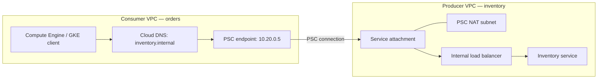
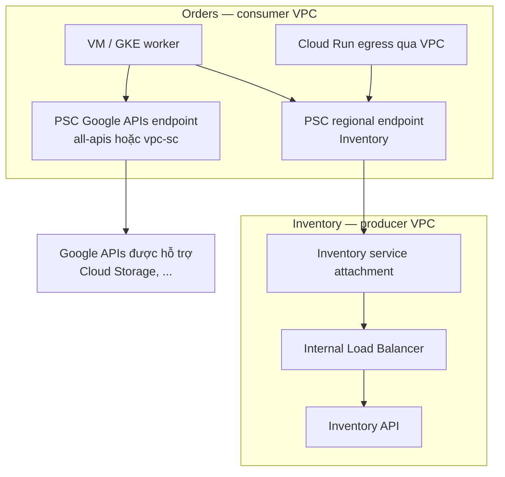

# Private Service Connect cho dịch vụ và API

Khi một ứng dụng chạy trong Google Cloud cần gọi Cloud Storage, BigQuery, Cloud SQL hoặc một API nội bộ do nhóm khác cung cấp, câu hỏi không chỉ là “có kết nối được không?”. Nhóm kiến trúc còn phải xác định **địa chỉ nào được truy cập, lưu lượng đi theo đường nào, ai có quyền kết nối, dịch vụ nào thực sự nhận request và cách kiểm chứng kết nối mà không mở rộng phạm vi mạng quá mức**.

**Private Service Connect (PSC)** là khả năng kết nối riêng tư trong hệ sinh thái VPC của Google Cloud. PSC có thể tạo điểm truy cập IP nội bộ từ mạng của **consumer** tới dịch vụ được **producer** công bố, hoặc tới các Google APIs được hỗ trợ. PSC giúp tách ranh giới hai mạng và kiểm soát đường truy cập, nhưng không tự thay thế xác thực ứng dụng, IAM, mã hóa, firewall hay VPC Service Controls.

Bài này thuộc chương **VPC và định tuyến** của module `CLOUD_PROVIDERS_GCP`. Các ví dụ kết nối kiến thức tổ chức project/IAM/VPC với Compute Engine, GKE, Cloud Run, lưu trữ, cơ sở dữ liệu, phát hành và quan sát hệ thống. Mục tiêu là chọn đúng **loại PSC, phạm vi địa chỉ, DNS, phân quyền và tiêu chí kiểm chứng** trước khi triển khai production.

## 1. Kết quả cần đạt

Sau bài học, người học có thể:

1. Giải thích consumer, producer, endpoint, service attachment, NAT subnet và PSC backend.
2. Phân biệt PSC endpoint cho **nhóm Google APIs** với endpoint cho **published service** ở một VPC khác.
3. Hiểu vì sao Google APIs endpoint dùng **global internal IPv4** trong khi endpoint tới một published service thông thường dùng **regional internal IP** cùng region với service attachment.
4. Xác định vai trò của Cloud DNS/Service Directory, định tuyến VPC, firewall, IAM và kết nối hybrid.
5. Đọc cấu hình và trạng thái PSC bằng `gcloud`; lập quy trình tạo endpoint, kiểm chứng HTTP/TLS và xử lý `PENDING`, `REJECTED` hoặc lỗi DNS.
6. Chọn PSC khi phù hợp, so sánh với Private Google Access, Private Services Access, VPC Network Peering và Cloud NAT.

## 2. Mô hình tư duy: consumer và producer

| Vai trò/thành phần | Nơi tồn tại | Chức năng |
| --- | --- | --- |
| **Consumer** | Project/VPC của ứng dụng gọi dịch vụ | Chủ sở hữu endpoint, IP nội bộ và chính sách truy cập từ client. |
| **Producer** | Project/VPC của bên cung cấp, hoặc Google | Vận hành dịch vụ đích và công bố kết nối được phép. |
| **PSC endpoint** | VPC consumer | Forwarding rule cùng IP nội bộ để client gửi traffic tới đích PSC. |
| **Service attachment** | Phía producer của published service | Công bố một dịch vụ qua load balancer được hỗ trợ, khai báo NAT subnet và cách chấp nhận consumer. |
| **PSC NAT subnet** | VPC producer của published service | Cấp IP để dịch địa chỉ nguồn của kết nối consumer; khác hoàn toàn Cloud NAT dùng cho outbound Internet. |
| **PSC backend** | Cấu hình load balancer của consumer | Dùng PSC network endpoint group làm backend khi cần khả năng định tuyến/chính sách của load balancer. |

Ví dụ một nhóm “Orders” truy cập API “Inventory” do nhóm khác vận hành:



Consumer gọi một **địa chỉ trong VPC của mình**, không cần cấp toàn quyền truy cập mạng producer. Producer cho phép hoặc từ chối kết nối theo chính sách service attachment. Ứng dụng vẫn phải triển khai xác thực/ủy quyền của riêng nó nếu dữ liệu cần được bảo vệ.

**PSC không phải VPC peering toàn mạng.** Client không tự có đường đến mọi subnet, VM hay database của producer; consumer chỉ truy cập dịch vụ đã được công bố qua endpoint/backend được cấu hình.

## 3. Hai tình huống PSC rất khác nhau

| Tiêu chí | Endpoint tới **Google APIs** toàn cục | Endpoint tới **published service** |
| --- | --- | --- |
| Đích | Nhóm APIs `all-apis` hoặc `vpc-sc` do Google cung cấp | URI service attachment của producer, ví dụ API nội bộ hoặc dịch vụ managed hỗ trợ PSC. |
| Địa chỉ consumer | **Global internal IPv4**, thuộc VPC; địa chỉ không nằm trong dải subnet hiện có | **Regional internal IP** lấy từ subnet consumer cùng region với service attachment (IPv4; IPv6 trong cấu hình được hỗ trợ). |
| Forwarding rule | **Global forwarding rule** | **Regional forwarding rule** |
| Phạm vi dùng | Các resource trong VPC ở nhiều region có thể dùng; có thể kết nối hybrid được hỗ trợ | Theo mặc định client cùng region; global access của consumer chỉ khi service hỗ trợ và đã bật. |
| Producer / NAT subnet | Google quản lý API bundle; không tự tạo service attachment/NAT subnet | Producer quản lý service attachment, NAT subnet, backend load balancer và accept/reject. |
| DNS | Có thể tự cấu hình các tên trong `p.googleapis.com` qua Service Directory; cần kiểm tra mapping tên API | Tự tạo DNS private hoặc dùng đăng ký Service Directory/tên miền producer khi hỗ trợ. |
| Quyền truy cập | API vẫn yêu cầu OAuth/IAM hoặc xác thực tương ứng | Connection acceptance là kiểm soát network; xác thực của ứng dụng vẫn độc lập. |

Ngoài hai luồng cơ bản, PSC còn hỗ trợ **backends cho Google APIs** (qua load balancer hỗ trợ), **regional/multi-regional Google APIs**, service connection policies cho một số dịch vụ managed và network attachments/interfaces cho bài toán đảo chiều kết nối. Không nên lấy hướng dẫn dành cho API bundles toàn cục để áp dụng cho mọi kiểu PSC.

## 4. PSC truy cập Google APIs: khi muốn IP nội bộ do mình chọn

Theo cách truy cập Google APIs thông thường, tên như `storage.googleapis.com` có thể phân giải thành địa chỉ IP được định tuyến công khai. Khi resource Google Cloud gọi những IP ấy, lưu lượng có thể vẫn ở trên mạng Google; điều này **không đồng nghĩa** nó dùng endpoint IP riêng trong VPC.

PSC cho Google APIs cho phép đặt một hoặc nhiều **global internal IPv4 addresses** trong VPC để truy cập các API được hỗ trợ. Điều này hữu ích khi bạn muốn phân tách đường truy cập theo nhóm workload, lập quy tắc egress rõ ràng hoặc đưa request từ on-prem qua VPN/Interconnect tới một IP riêng đã biết.

### 4.1. Chọn API bundle

| Bundle | Phạm vi | Khi nên cân nhắc |
| --- | --- | --- |
| `all-apis` | Phần lớn Google APIs và dịch vụ trong danh sách hỗ trợ; tương đương phạm vi VIP `private.googleapis.com` | Workload cần nhiều APIs, gồm cả APIs không hỗ trợ VPC Service Controls. |
| `vpc-sc` | Chỉ APIs và dịch vụ được hỗ trợ bởi VPC Service Controls; tương đương phạm vi VIP `restricted.googleapis.com` | Muốn giới hạn khả năng kết nối tới nhóm APIs được hỗ trợ bởi VPC Service Controls. |

Chọn `vpc-sc` **không tự tạo VPC Service Controls perimeter**. Perimeter là chính sách bảo vệ dữ liệu cần cấu hình riêng; IAM của tài khoản vẫn quyết định quyền gọi Cloud Storage, BigQuery hay tài nguyên khác. Cả hai bundle chỉ hỗ trợ những giao thức/đích mà tài liệu liệt kê, không phải một proxy TCP tổng quát cho mọi Internet host.

Ví dụ: một VM chỉ cần gọi Cloud Storage và Pub/Sub có thể dùng PSC API endpoint, nhưng service account của VM vẫn cần quyền cụ thể trên bucket hoặc topic. Nếu VM không có permission, kết nối mạng thành công sẽ chỉ giúp request đến nơi nhận lỗi `403`.

### 4.2. Phạm vi của IP và DNS khác nhau

Với **global Google APIs endpoint**, IP phải là **một địa chỉ IPv4 đơn lẻ**, được dành riêng cho `PRIVATE_SERVICE_CONNECT` trên VPC; nó **không được nằm trong dải primary/secondary của subnet hiện hữu hoặc các range bị cấm chồng lấp**. Điều này khác endpoint published service, vốn lấy IP từ subnet regional.

Khi tạo endpoint, Service Directory có thể thiết lập private zone `p.googleapis.com` và các bản ghi API như `storage-ENDPOINT_NAME.p.googleapis.com`. Tên API mặc định `storage.googleapis.com` **không tự nhiên chuyển sang PSC** chỉ vì endpoint đã tồn tại. Cần dùng tên PSC được cung cấp hoặc cấu hình private DNS phù hợp với cách client gọi API, đồng thời giữ đúng TLS hostname/SNI.

### 4.3. Ví dụ cấu hình API endpoint (minh họa, có thay đổi tài nguyên)

Giả định consumer có project `orders-net-dev`, VPC `orders-vpc` và địa chỉ `10.255.0.5` đã được kiểm tra không trùng bất kỳ subnet/route bị cấm. Người vận hành cần IAM phù hợp (chẳng hạn `roles/compute.networkAdmin`; quản lý DNS/Service Directory có quyền riêng), các APIs tương ứng đã được bật, và phê duyệt thay đổi cho môi trường.

```bash
# LỆNH THAY ĐỔI CẤU HÌNH - chỉ thực hiện trên sandbox được cấp quyền.
PROJECT_ID="orders-net-dev"
NETWORK="orders-vpc"
ADDRESS_NAME="psc-google-api-ip"
ENDPOINT_NAME="pscgoogleapi"

# 1. Reserve một global internal IP dành cho PSC Google APIs.
gcloud compute addresses create "$ADDRESS_NAME" \
  --project="$PROJECT_ID" \
  --global \
  --purpose=PRIVATE_SERVICE_CONNECT \
  --addresses=10.255.0.5 \
  --network="$NETWORK"

# 2. Tạo global forwarding rule tới API bundle.
gcloud compute forwarding-rules create "$ENDPOINT_NAME" \
  --project="$PROJECT_ID" \
  --global \
  --network="$NETWORK" \
  --address="$ADDRESS_NAME" \
  --target-google-apis-bundle=all-apis
```

Đây là ví dụ cách đặt cặp **global address + global forwarding rule**; chưa cấu hình đầy đủ DNS, client, firewall hay mạng hybrid. Trong sản xuất, cân nhắc Terraform/IaC, owner, labels, quota, chi phí và quy trình rollback.

**Đọc lại mà không thay đổi tài nguyên:**

```bash
gcloud compute addresses describe psc-google-api-ip \
  --project=orders-net-dev --global

gcloud compute forwarding-rules describe pscgoogleapi \
  --project=orders-net-dev --global

gcloud compute forwarding-rules list \
  --project=orders-net-dev --global \
  --filter='target:(all-apis OR vpc-sc)'
```

### 4.4. Kiểm tra từ client thực sự nằm trong VPC

Một VM hoặc workload **ở mạng consumer** mới là nơi phù hợp kiểm tra DNS và đường lưu lượng. Chạy:

```bash
# Kiểm tra tên PSC; tên chính xác tùy endpoint/DNS đã tạo.
nslookup storage-pscgoogleapi.p.googleapis.com

# Kiểm tra endpoint Google APIs ở mức HTTP; theo tài liệu Google:
curl -v http://10.255.0.5/generate_204
```

Nếu PSC endpoint cho Google APIs hoạt động, truy vấn kiểm tra có thể trả mã HTTP `204`. Lệnh `ping`/ICMP **không phải phép kiểm chứng phù hợp** vì API endpoints không phản hồi ping. Khi cần kiểm tra quyền trên một API thật, dùng công cụ có xác thực (`gcloud` hoặc client library) từ cùng workload và xác minh request đi đúng DNS/endpoint.

## 5. PSC published service: cung cấp dịch vụ giữa các VPC

Với dịch vụ mà một nhóm hoặc tổ chức khác cung cấp, producer có thể dùng **internal load balancer được hỗ trợ** để phục vụ backend và tạo **service attachment** công bố endpoint riêng tư cho consumer. Consumer tạo forwarding rule trong VPC của mình trỏ đến URI service attachment. Cấu trúc tổng quát:

```text
CONSUMER
  client -> endpoint IP (regional forwarding rule)
                         |
                         v
PRODUCER
  service attachment -> internal load balancer -> service backend
           |
           +-- NAT subnet để SNAT nguồn kết nối consumer
           +-- connection preference / consumer accept list
```

### 5.1. Trách nhiệm của producer

Producer cần chuẩn bị:

1. Dịch vụ chạy ổn định (VM, GKE hoặc backend được hỗ trợ) và một **load balancer** phù hợp với PSC; kiểm tra health checks và listener/port.
2. Một hoặc nhiều **PSC NAT subnets** riêng có mục đích cung cấp địa chỉ nguồn đã NAT cho luồng PSC. Không nhầm với subnet máy ảo hoặc Cloud NAT.
3. **Service attachment** tham chiếu load balancer và NAT subnet, cùng connection preference.
4. Quy tắc chấp nhận consumer: có thể tự động chấp nhận hoặc chỉ chấp nhận theo danh sách project/VPC/endpoint được hỗ trợ. Với môi trường đa bên, danh sách chấp nhận cụ thể thường dễ kiểm soát hơn.
5. Cơ chế xác thực ứng dụng (ví dụ mTLS, token, OAuth hoặc IAM ở lớp dịch vụ khi thích hợp) và giám sát lỗi.

Ví dụ URI service attachment:

```text
projects/inventory-prod/regions/asia-southeast1/serviceAttachments/inventory-api
```

URI là định danh **producer công bố cho consumer**, không phải URL HTTP và không phải IP của máy backend.

**NAT subnet sizing:** địa chỉ trong NAT subnet có thể bị tiêu thụ theo từng endpoint/backend kết nối. Subnet quá nhỏ khiến một consumer mới không kết nối được dù application backend vẫn khỏe. Theo quy tắc thường gặp, mỗi PSC connection cần một hoặc hai IP từ NAT subnet tùy cấu hình; cần tính cả các kết nối được truyền tiếp và phần địa chỉ subnet không dùng được.

### 5.2. Trách nhiệm của consumer

Consumer cần biết:

- VPC consumer và project chứa endpoint;
- Region của **service attachment**, subnet consumer cùng region;
- Dải IP còn trống trong subnet, có đường đi và firewall egress tới endpoint;
- URI service attachment do producer cung cấp;
- Quy định chấp nhận kết nối, quota và người liên hệ producer;
- DNS nội bộ để ứng dụng dùng tên ổn định thay cho IP;
- Cách xác thực ứng dụng và chứng chỉ TLS.

Endpoint được publish qua service attachment là **regional**; region của endpoint phải khớp region của service attachment. Mặc định chỉ các client trong cùng region truy cập được. Tùy tính năng producer hỗ trợ, tùy chọn **PSC global access** cho phép consumer từ các region khác truy cập endpoint; nó không di chuyển service attachment sang một region khác.

### 5.3. Ví dụ tạo endpoint tới published service (minh họa)

Giả định đã có `orders-vpc`, subnet `orders-subnet-sea1` trong `asia-southeast1`, service attachment hoạt động và producer chấp nhận consumer:

```bash
# LỆNH THAY ĐỔI CẤU HÌNH - chỉ chạy khi được phân quyền trên sandbox.
CONSUMER_PROJECT="orders-net-dev"
REGION="asia-southeast1"
NETWORK="orders-vpc"
SUBNET="orders-subnet-sea1"
PSC_IP_NAME="inventory-psc-ip"
PSC_ENDPOINT="inventory-psc"
ATTACHMENT="projects/inventory-prod/regions/asia-southeast1/serviceAttachments/inventory-api"

# 1. Địa chỉ trong subnet regional của consumer.
gcloud compute addresses create "$PSC_IP_NAME" \
  --project="$CONSUMER_PROJECT" \
  --region="$REGION" \
  --subnet="$SUBNET"

# 2. Regional forwarding rule trỏ vào service attachment của producer.
gcloud compute forwarding-rules create "$PSC_ENDPOINT" \
  --project="$CONSUMER_PROJECT" \
  --region="$REGION" \
  --network="$NETWORK" \
  --address="$PSC_IP_NAME" \
  --target-service-attachment="$ATTACHMENT"
```

Không thêm `--allow-psc-global-access` trừ khi đã kiểm tra producer service hỗ trợ; không phải mọi published service cho phép tùy chọn này. Nếu dùng **Shared VPC**, subnet và network có thể thuộc host project, còn endpoint thuộc service project; phải dùng resource URI và IAM tương ứng.

Đọc cấu hình và trạng thái:

```bash
gcloud compute forwarding-rules describe inventory-psc \
  --project=orders-net-dev \
  --region=asia-southeast1

gcloud compute forwarding-rules list \
  --project=orders-net-dev \
  --filter='target~serviceAttachments'
```

Trường trạng thái kết nối PSC (thường hiển thị là `pscConnectionStatus` trong mô tả forwarding rule) giúp phân biệt đã được chấp nhận hay đang chờ producer. Chỉ khi trạng thái là `ACCEPTED` và mạng, DNS, firewall, backend đều đúng thì request ứng dụng mới có cơ sở hoạt động.

## 6. Hiểu connection acceptance và trạng thái endpoint

Producer có thể chọn tự động nhận mọi kết nối phù hợp hoặc **duyệt tường minh** consumer theo danh sách cho phép/từ chối. Một số dịch vụ managed của Google có quy trình chấp nhận riêng.

| Trạng thái / hiện tượng | Ý nghĩa thường gặp | Hành động |
| --- | --- | --- |
| `PENDING` | Đã có request, producer chưa chấp nhận hoặc chưa hoàn tất điều kiện chấp nhận | Liên hệ producer, kiểm tra accept list và connection limit/quota. |
| `ACCEPTED` | Producer đã chấp nhận kết nối PSC | Tiếp tục kiểm tra DNS, firewall egress, TLS, listener, health backend. |
| `REJECTED` | Producer hoặc policy từ chối kết nối | Xem reject list, accept list, Organization Policy và phạm vi consumer. |
| `NEEDS_ATTENTION` / trạng thái khác | Có điều kiện cần xử lý tùy dịch vụ và loại endpoint | Đọc trạng thái chính xác và tài liệu dịch vụ; không suy đoán từ tên. |
| Tạo forwarding rule thất bại | Sai region, IP, VPC, URI, quota hoặc quyền | Kiểm tra cấu hình infrastructure trước khi chẩn đoán ứng dụng. |

Nếu producer thay đổi chính sách chấp nhận, tác động tới các kết nối **đã được ACCEPTED** có thể phụ thuộc cấu hình connection reconciliation. Không mặc định thay accept list sẽ cắt ngay mọi phiên đang hoạt động; producer cần xem chính sách và quy trình thu hồi.

Khi producer publish một API dùng chung cho nhiều consumer, cần ghi rõ SLA/SLO, cơ chế quota ở ứng dụng, quy trình cấp quyền, khôi phục sự cố và yêu cầu versioning. PSC chỉ giải quyết đường truy cập mạng.

## 7. DNS, TLS, routing và firewall: bốn bước phải khớp

Một endpoint có thể được tạo đúng nhưng client vẫn không kết nối vì tên DNS phân giải sai, egress bị chặn hoặc chứng chỉ TLS không khớp hostname.

### 7.1. DNS

- **API bundle endpoint:** Service Directory có thể tạo private zone `p.googleapis.com` và tên như `storage-pscgoogleapi.p.googleapis.com`. Nếu ứng dụng dùng `storage.googleapis.com`, phải thiết kế DNS override hoặc cấu hình client để dùng endpoint phù hợp, có tính tới chứng chỉ và hostname.
- **Published service:** consumer có thể tạo private Cloud DNS zone, ví dụ `inventory.internal`, trỏ A record tới regional endpoint IP. Nếu producer hỗ trợ domain và Service Directory registration, có thể tận dụng tích hợp đó.
- **Hybrid:** client on-prem không tự thấy private zone trong VPC; cần DNS forwarding/inbound policy và đường kết nối phù hợp để truy vấn và tới đúng IP.

Không nên tạo wildcard DNS override toàn bộ `googleapis.com` mà chưa kiểm tra APIs dùng kèm như Artifact Registry, GKE, Cloud Run và chức năng tương thích. Sai cấu hình có thể gây gián đoạn rộng hoặc gửi request ra một đích không hỗ trợ API.

### 7.2. Kết nối và định tuyến

Consumer cần có đường đi tới IP endpoint. Với published service, endpoint nằm trong subnet VPC consumer và được triển khai theo region service attachment. Với global Google APIs endpoint, IP có phạm vi global nội bộ của VPC và không thuộc subnet thông thường.

Truy cập từ on-prem có thể dùng Cloud VPN/Cloud Interconnect với quảng bá route và thiết lập DNS thích hợp. **VPC Network Peering không có tính bắc cầu tổng quát:** việc một VPC thấy mạng khác không có nghĩa mọi bên thứ ba đều truy cập endpoint theo cùng đường, trừ khi tài liệu tính năng PSC hỗ trợ trường hợp đó.

### 7.3. Firewall và chính sách mạng

Firewall egress ở consumer có thể chặn traffic tới endpoint nội bộ. Network firewall rules, hierarchical firewall policies và các cơ chế chuyên biệt của sản phẩm vẫn cần được xem xét. Ở producer, load balancer và backend phải nhận traffic đã được PSC NAT, cùng các health checks thích hợp.

**PSC không đồng nghĩa “mạng đã an toàn”:** dữ liệu nhạy cảm vẫn cần phân quyền, mã hóa, kiểm tra danh tính, kiểm soát truy vấn và ghi log. Mạng private giảm bề mặt lộ diện nhưng không thay thế zero trust.

### 7.4. TLS và kiểm tra thực tế

Từ VM consumer:

```bash
# Published service: kiểm tra DNS ánh xạ đến PSC endpoint IP.
nslookup inventory.internal

# Kiểm tra kết nối TLS bằng hostname đúng với chứng chỉ của producer.
curl --verbose --connect-timeout 5 https://inventory.internal/health

# Đối chiếu trạng thái forwarding rule qua CLI (chạy từ terminal có IAM).
gcloud compute forwarding-rules describe inventory-psc \
  --project=orders-net-dev --region=asia-southeast1
```

Endpoint `ACCEPTED` và DNS trỏ đúng IP **chưa bảo đảm** health endpoint sẽ trả `200`. Ứng dụng có thể yêu cầu token, backend bị lỗi hoặc certificate không đúng tên. Không dùng `curl -k` để tắt TLS verification làm “giải pháp”; cần cấu hình chứng chỉ, host và trust chain chính xác.

## 8. Phân biệt PSC với các phương án kết nối khác

| Công nghệ | Mục đích chính | Khi chọn |
| --- | --- | --- |
| **PSC endpoint cho Google APIs** | Truy cập Google APIs hỗ trợ qua global internal IP của VPC consumer | Cần IP/dải đường đi riêng cho API và DNS/routing kiểm soát được, kể cả bài toán hybrid hỗ trợ. |
| **PSC endpoint cho published service** | Consumer truy cập đúng một dịch vụ qua service attachment, không peering toàn mạng | Nhiều team, nhiều project/VPC hoặc bên thứ ba cung cấp API/db private. |
| **Private Google Access** | Cho resource không có external IP truy cập Google APIs/dịch vụ hỗ trợ theo đường private của Google | Cần dùng Google APIs mà không nhất thiết tạo endpoint PSC do mình đặt IP. |
| **Private Services Access** | Thiết lập private connectivity tới một số managed services qua kết nối dựa trên VPC peering và dải IP cấp phát | Dịch vụ được chọn yêu cầu mô hình PSA; kiểm tra model từng sản phẩm. |
| **VPC Network Peering** | Trao đổi route giữa các VPC theo phạm vi được hỗ trợ | Cần kết nối network-to-network; chấp nhận các giới hạn IP overlap và non-transitivity. |
| **Cloud NAT** | Egress outbound cho một số workload không có external IP | Client phải truy cập Internet/public endpoints; Cloud NAT không publish một private API giữa hai VPC. |
| **Cloud VPN / Cloud Interconnect** | Kết nối mạng on-prem và Google Cloud | Có yêu cầu hybrid; có thể kết hợp PSC hoặc phương thức truy cập API khác. |

Chọn công nghệ theo **đích kết nối**. Việc ứng dụng chạy trên Cloud Run không tự bắt buộc dùng PSC; Cloud Run có cơ chế egress vào VPC phù hợp, nhưng PSC chỉ cần nếu đích dịch vụ/API được thiết kế truy cập bằng PSC. Tương tự Cloud SQL có thể dùng các phương án kết nối private khác tùy loại instance và khả năng sản phẩm.

## 9. PSC cho managed services và kiến trúc phức tạp

Không phải mọi dịch vụ Google-managed dùng cùng một cách thiết lập PSC. Một số sản phẩm, chẳng hạn các cấu hình Cloud SQL được hỗ trợ, cho phép kết nối qua PSC và sử dụng **service attachment được quản lý**. Consumer có thể cần tạo endpoint hoặc dùng cơ chế tự động hóa kết nối theo tài liệu sản phẩm.

Các khả năng liên quan:

- **Service connection policy:** với những managed services hỗ trợ, network administrator có thể cho phép dịch vụ tự tạo kết nối PSC theo chính sách trong VPC consumer. Cần xem phạm vi mạng, subnet, service class và quota.
- **PSC backends:** PSC network endpoint groups đóng vai trò backend cho load balancer hỗ trợ. Điều này hữu ích khi cần load balancing, TLS termination, chính sách hoặc điểm truy cập tập trung; không đồng nhất với forwarding-rule endpoint trực tiếp.
- **PSC interfaces / network attachments:** hướng tích hợp khác để producer workload dùng kết nối được consumer cấp qua network attachment; bài toán và quyền khác endpoint nhận traffic.

Trước khi thiết kế kết nối Cloud SQL, AlloyDB, Apigee, Cloud Run hoặc sản phẩm khác bằng PSC, đọc trang hỗ trợ riêng của sản phẩm. Kiểm tra ai là producer, ai quản lý service attachment, cần accept list hay project cho phép, region, địa chỉ và DNS nào, có multi-region/global access không.

## 10. Bảo mật khi triển khai PSC

PSC là lớp kết nối. Một thiết kế an toàn phải có các lớp kiểm soát khác:

1. **IAM cho quản trị mạng:** tách quyền tạo forwarding rule/address, tạo service attachment, sửa Cloud DNS/Service Directory, sửa VPC firewall và quản trị policy. `roles/compute.networkAdmin` là role rộng cho quản lý mạng; cấp theo phạm vi thực sự cần.
2. **Connection acceptance:** producer chỉ chấp nhận consumer đã được duyệt; giới hạn số kết nối và theo dõi danh sách kết nối theo thời gian.
3. **Xác thực và phân quyền ở lớp ứng dụng:** OAuth/OIDC, mTLS hoặc cơ chế service phù hợp. IP private không phải danh tính người dùng.
4. **TLS:** dùng chứng chỉ hợp lệ, xác thực hostname, mã hóa dữ liệu theo chính sách; không phơi lộ secrets trong log mạng.
5. **VPC Service Controls nếu áp dụng:** thiết kế perimeter và kiểm tra API bundle tương thích; `vpc-sc` bundle không phải cấu hình perimeter.
6. **Quan sát và kiểm toán:** theo dõi cấu hình endpoint/service attachment, kết nối được chấp nhận, lỗi backend, latency, timeout, thay đổi DNS và thay đổi IAM.
7. **Tách môi trường:** production/dev cần phân định project, VPC, owner, địa chỉ và quyền DNS; tránh dùng một endpoint rộng cho mọi môi trường nếu không có lý do.

Hãy kiểm tra cả **Organization Policy** của producer lẫn consumer khi tạo hoặc nhận kết nối PSC. Nếu organization cấm một loại kết nối, danh sách chấp nhận ở service attachment không nhất thiết vượt được ràng buộc đó.

## 11. Độ tin cậy, khả năng mở rộng và chi phí

| Nhóm | Rủi ro | Cách kiểm chứng trước production |
| --- | --- | --- |
| **NAT subnet** | Không đủ IP cho số lượng endpoint/backend hoặc propagated connections | Tính số consumer hiện tại/dự kiến, số IP tiêu thụ mỗi kết nối và phần địa chỉ dùng được. |
| **Quota và limits** | Vượt quota forwarding rules, internal IPs hoặc PSC connections | Tra quota theo project/region, kiểm tra giới hạn target và alert chủ động. |
| **Region** | Consumer và service attachment khác region; global access không được hỗ trợ | Kiểm tra region pair, tính năng producer, đường DR khi mất region. |
| **Service availability** | Endpoint chấp nhận nhưng LB/backend producer không khỏe | Health checks, SLO latency/error rate, diễn tập sự cố producer. |
| **DNS** | Record sai, zone không được nhìn thấy từ client, cache cũ | Tra DNS từ VM/GKE/on-prem từng đường, xem TTL và fallback. |
| **Security** | Có kết nối nhưng thiếu auth; policy quá rộng | Kiểm tra IAM, application auth, accept lists, egress firewall và audit. |
| **Cost** | Phí endpoint/data processing, load balancer, DNS, network transfer | Ước lượng theo PSC pricing, lưu lượng, region và tài nguyên liên quan; đọc Cloud Billing thực tế. |

Chi phí có thể phát sinh từ các thành phần của PSC, lưu lượng xử lý, load balancer, truyền dữ liệu giữa các region, Cloud DNS và tài nguyên mạng phụ trợ. Mô hình tính phí khác nhau theo endpoint/backend, producer/consumer và loại lưu lượng; không chỉ nhìn phí VM hoặc database rồi kết luận kết nối PSC miễn phí.

**Đừng mặc định endpoint bảo đảm HA.** Nếu backend chỉ có một zone, nếu producer chỉ deploy một region hoặc nếu DNS phụ thuộc một cấu hình chưa được kiểm thử, PSC không tự tạo khả năng phục hồi vùng. Cần thiết kế failover, health checks, SLO, runbook và thử nghiệm độc lập.

## 12. Chẩn đoán lỗi theo thứ tự

Một quy trình thực tế:

1. **Nhận diện loại PSC:** Google APIs bundle hay published service? Endpoint global hay regional? Đừng dùng lệnh `--global` để describe một endpoint published service regional.
2. **Xác minh tồn tại và status:** địa chỉ, forwarding rule, target, `pscConnectionStatus`; nếu producer quản lý service attachment, xác minh accept/reject list và quota.
3. **Xác minh DNS từ client:** tên thực mà ứng dụng dùng có resolve về endpoint IP nội bộ đúng không? Client on-prem có dùng đúng forwarding không?
4. **Kiểm tra network:** VPC/subnet/region, egress firewall, route và tính năng global access/peering/hybrid được hỗ trợ.
5. **Kiểm tra service và TLS:** producer load balancer/backend health, listener/port, chứng chỉ; gọi bằng hostname hợp lệ.
6. **Kiểm tra lớp ứng dụng:** authentication, IAM/API permissions, token scope, timeout và logs/traces.
7. **Kiểm tra quota/chi phí và thay đổi gần đây:** forwarding rules, NAT subnet capacity, DNS records, service attachment target changes, billing/cost guardrails.

| Triệu chứng | Giả thuyết đáng kiểm tra | Cách thu hẹp |
| --- | --- | --- |
| `nslookup` trả IP public cho tên dự kiến private | Không có đúng Cloud DNS private zone/record trên mạng client | Chạy DNS từ chính VPC client, so kết quả với IP endpoint. |
| `PENDING` lâu | Producer chưa accept, thiếu connection limit hoặc service-specific approval | Đọc connection status và yêu cầu producer kiểm tra accept list. |
| `REJECTED` | Consumer bị từ chối bởi accept/reject policy hoặc org policy | So project/VPC/endpoint ID và policy; không tạo endpoint mới bừa bãi. |
| `ACCEPTED` nhưng `curl` timeout | Firewall egress, route, target load balancer/backend hoặc region | Kiểm tra cổng và health, VPC Network Intelligence Center khi phù hợp. |
| `403` từ Cloud Storage API | Mạng đã tới API nhưng identity/IAM/VPC-SC từ chối | Kiểm tra access token, IAM, perimeter và response body. |
| `TLS certificate mismatch` | DNS hostname không khớp chứng chỉ của producer | Kiểm tra DNS, SNI, hostname, CA chain; không tắt verify. |
| PSC endpoint Google APIs không ping được | ICMP không được hỗ trợ | Dùng HTTP `/generate_204` hoặc API call có xác thực. |
| Tạo regional endpoint báo sai địa chỉ | Dùng IP ngoài subnet, khác region hoặc dùng IP global PSC APIs | Chọn regional internal address trong đúng subnet, cùng region attachment. |

### Các lệnh kiểm tra chỉ đọc gợi ý

```bash
# Danh sách forwarding rules và địa chỉ để rà soát.
gcloud compute forwarding-rules list --project=orders-net-dev
gcloud compute addresses list --project=orders-net-dev

# Endpoint cho Google APIs là global.
gcloud compute forwarding-rules describe pscgoogleapi \
  --project=orders-net-dev --global

# Endpoint tới published service là regional.
gcloud compute forwarding-rules describe inventory-psc \
  --project=orders-net-dev --region=asia-southeast1

# Phía producer nếu được cấp IAM đọc:
gcloud compute service-attachments describe inventory-api \
  --project=inventory-prod --region=asia-southeast1
```

Không đăng access token, địa chỉ dịch vụ nội bộ hoặc cấu hình IAM nhạy cảm lên ticket công khai. Ghi đủ thông tin cần thiết cho vận hành: resource names, region, trạng thái, thời điểm và request/correlation ID nếu có.

## 13. Case study: Orders dùng PSC truy cập API và dịch vụ riêng

Một đội phát triển vận hành hệ thống đặt hàng:

- **Orders:** API chạy trên Cloud Run, một worker trên GKE và một VM xử lý legacy. Dữ liệu giao dịch lưu Cloud SQL, ảnh lưu Cloud Storage.
- **Inventory:** dịch vụ nội bộ của đội khác, vận hành qua internal load balancer trên VPC producer.
- **Security:** yêu cầu hạn chế truy cập Internet không cần thiết, chỉ cho phép kết nối API được xác định và bảo vệ credentials.

Kiến trúc lựa chọn:



Lưu ý: sơ đồ chỉ minh họa logic. **Cloud Run cần cấu hình egress vào VPC** phù hợp để tiếp cận endpoint PSC; không mặc định mọi Cloud Run service tự sử dụng VPC endpoint vì có cùng project. Cloud SQL cần đánh giá đường kết nối riêng theo khả năng instance và yêu cầu cụ thể.

### Quyết định thiết kế

1. Chọn PSC Google APIs endpoint cho workloads cần IP nội bộ cố định để gọi APIs; đối chiếu nhu cầu `all-apis` hay `vpc-sc` và xác thực IAM.
2. Inventory producer công bố service attachment, consumer tạo regional PSC endpoint. Chỉ những project/VPC được phê duyệt mới có thể kết nối; ứng dụng Inventory vẫn yêu cầu token riêng.
3. Sử dụng Cloud DNS private record `inventory.internal` và kiểm chứng từ GKE/VM/Cloud Run theo từng đường truy cập.
4. Quy định SLO, health checks, quota và phương án khi Inventory producer gặp sự cố; Orders không được phụ thuộc vào một request Inventory vô hạn thời gian.
5. Đặt nhãn owner, environment và cost center cho tài nguyên mạng; theo dõi lưu lượng, egress và chi phí PSC trong Cloud Billing.

### Checklist trước phát hành

- [ ] Đã xác định consumer/producer, tên project, VPC, region và owner của mỗi đầu.
- [ ] Endpoint đúng loại: global Google APIs hoặc regional published service.
- [ ] IP và subnet hợp lệ, không chồng lấn; NAT subnet producer đủ công suất nếu áp dụng.
- [ ] DNS từ đúng workload resolve tới IP PSC; hostname/certificate TLS hợp lệ.
- [ ] Producer đã accept consumer; endpoint có trạng thái phù hợp.
- [ ] IAM, firewall, service authentication và VPC Service Controls (nếu có) được kiểm tra.
- [ ] Test HTTP/API và failure mode; có metric, log, alert, runbook.
- [ ] Rà soát quota, chi phí và năng lực phục hồi theo region.

## 14. Bài tập thực hành

### Bài A — Nhận diện đúng loại endpoint

Đội A muốn từ VM không có external IP gọi `storage.googleapis.com`. Đội B muốn từ GKE gọi API riêng của đội C nằm trong VPC khác. Hãy đề xuất PSC path cho từng đội và giải thích sự khác nhau ở **IP, forwarding rule scope, DNS và identity**. Khi nào Private Google Access có thể đủ cho đội A?

### Bài B — Lỗi `PENDING`

Đội Orders đã tạo regional forwarding rule trỏ tới `projects/inventory-prod/regions/asia-southeast1/serviceAttachments/inventory-api`. Endpoint ở trạng thái `PENDING`. Hãy liệt kê ba điều producer cần kiểm tra trước khi team consumer thay DNS hoặc code ứng dụng.

### Bài C — DNS phân giải ra IP public

Một VM trong VPC có PSC Google APIs endpoint `10.255.0.5` nhưng `nslookup storage.googleapis.com` vẫn trả IP public. Hãy giải thích vì sao và nêu hai cách client có thể gọi đúng endpoint: dùng tên `p.googleapis.com` đã được tạo hoặc cấu hình DNS override phù hợp. Vì sao không nên tắt xác thực TLS?

### Bài D — Thiết kế dịch vụ đa vùng

Producer Inventory chỉ chạy tại `asia-southeast1`, consumer có workload ở `asia-southeast1` và `asia-east1`. Hãy kiểm tra khả năng PSC global access do producer hỗ trợ, rủi ro network latency và tình huống region producer ngừng hoạt động. Nêu phương án đảm bảo RTO/RPO và metric cần theo dõi.

### Bài E — Tìm lỗi `403`

VM gọi được endpoint PSC Google APIs và nhận phản hồi từ Cloud Storage nhưng request đọc bucket bị `403`. Liệt kê thứ tự kiểm tra token, IAM, tổ chức/perimeter, API scope và bucket policy. Giải thích vì sao tạo thêm forwarding rule không phải giải pháp.

### Câu hỏi tự kiểm tra

1. PSC endpoint có cho consumer truy cập mọi subnet producer giống VPC peering không?
2. Vì sao endpoint Google APIs dùng global IP còn published service endpoint cần region khớp attachment?
3. Điểm khác biệt giữa PSC NAT subnet của producer và Cloud NAT outbound Internet là gì?
4. VPC Service Controls perimeter có tự hình thành khi chọn `vpc-sc` bundle không?
5. Endpoint trạng thái `ACCEPTED` đã đủ bảo đảm API trả `200` chưa?
6. Vì sao phải kiểm tra DNS từ đúng client chứ không chỉ từ máy phát triển?
7. Những nguồn chi phí và rủi ro vận hành nào cần tính trước khi dùng PSC production?

**Quy trình ghi nhớ:** xác định đích là **Google APIs hay published service** → chọn kiểu PSC và phạm vi IP → kiểm tra consumer/producer, region, subnet, acceptance → cấu hình DNS/routing/firewall → kiểm chứng TLS và quyền ứng dụng → giám sát độ tin cậy, quota và chi phí.

## 15. Tài liệu chính thức

- [Private Service Connect overview](https://cloud.google.com/vpc/docs/private-service-connect)
- [Private Service Connect compatibility](https://cloud.google.com/vpc/docs/private-service-connect-compatibility)
- [About accessing global Google APIs through endpoints](https://cloud.google.com/vpc/docs/about-accessing-google-apis-endpoints)
- [Access global Google APIs through endpoints](https://cloud.google.com/vpc/docs/configure-private-service-connect-apis)
- [About published services](https://cloud.google.com/vpc/docs/about-vpc-hosted-services)
- [About accessing published services through endpoints](https://cloud.google.com/vpc/docs/about-accessing-vpc-hosted-services-endpoints)
- [Access published services through endpoints](https://cloud.google.com/vpc/docs/configure-private-service-connect-services)
- [Manage published services](https://cloud.google.com/vpc/docs/manage-private-service-connect-services)
- [Configure Private Google Access](https://cloud.google.com/vpc/docs/configure-private-google-access)
- [Private Service Connect pricing](https://cloud.google.com/vpc/network-pricing#private-service-connect)

Giới hạn tính năng, khả năng của producer, cách định tuyến Google APIs, chính sách VPC Service Controls và giá có thể thay đổi theo dịch vụ. Trước khi triển khai, đối chiếu loại endpoint, region, URI service attachment, quota và yêu cầu bảo mật với tài liệu chính thức tại thời điểm vận hành.
