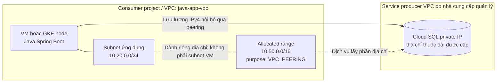
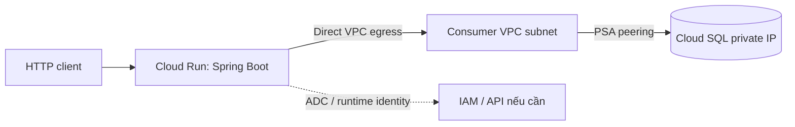
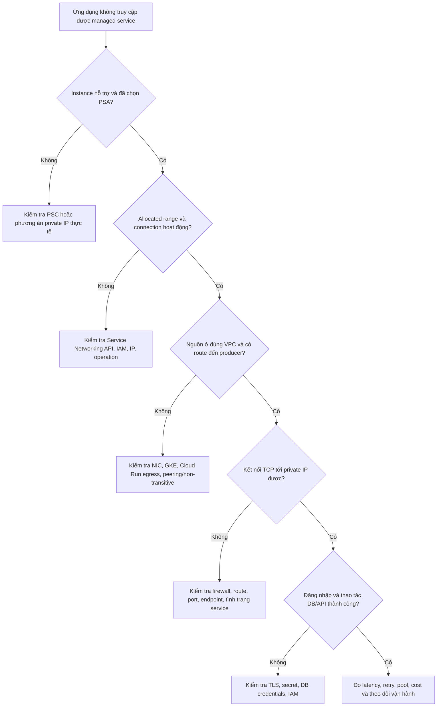

# Private services access và kết nối dịch vụ được quản lý

## 1. Bài toán: ứng dụng Java cần kết nối riêng tới dịch vụ GCP

Một ứng dụng Spring Boot triển khai trên **Compute Engine**, **Google Kubernetes Engine (GKE)** hoặc **Cloud Run** cần kết nối với **Cloud SQL for PostgreSQL** hay một dịch vụ được quản lý khác. Nhóm phát triển muốn tránh công khai database ra Internet, quản lý địa chỉ IP một cách có kế hoạch, giữ độ trễ thấp và kiểm soát đường đi của lưu lượng. Câu hỏi đặt ra là: tài nguyên chạy trong **VPC của dự án** giao tiếp với tài nguyên đang chạy trong **mạng VPC do Google hoặc nhà cung cấp dịch vụ quản lý** bằng cách nào?

**Private services access (PSA)** là một phương án kết nối riêng cho các dịch vụ hỗ trợ mô hình này. PSA tạo một kết nối dựa trên **VPC Network Peering** giữa VPC của bên sử dụng dịch vụ (*service consumer*) và VPC của bên cung cấp (*service producer*). Các tài nguyên có thể giao tiếp bằng **địa chỉ IPv4 nội bộ**, không cần đi qua Internet công cộng cho đường truyền này. PSA thường xuất hiện trong kiến trúc Cloud SQL private IP và một số dịch vụ được quản lý khác.

Trong chương **VPC và định tuyến** của mô-đun **CLOUD_PROVIDERS_GCP**, bài học liên hệ PSA với tổ chức project, IAM, mô hình mạng VPC, lựa chọn Cloud Run/GKE/Compute Engine và vận hành các dịch vụ lưu trữ, cơ sở dữ liệu. Trọng tâm là **hiểu đúng ranh giới giữa hai mạng, cấu hình tài nguyên IP và route, chọn PSA hoặc phương án khác theo yêu cầu, kiểm thử và xử lý sự cố**.

### Mục tiêu học tập

Sau khi học, bạn có thể:

1. Giải thích **consumer VPC**, **producer VPC**, **allocated IP range**, **private connection** và vai trò của **Service Networking API**.
2. Phân biệt **PSA**, **Private Service Connect (PSC)**, **Private Google Access**, **Direct VPC egress/Serverless VPC Access** và **VPC Network Peering** thông thường.
3. Lập kế hoạch CIDR để tránh trùng lặp với subnet, route, mạng on-premises và các mạng kết nối khác.
4. Cấu hình, xác minh PSA bằng **Google Cloud Console**, **gcloud** hoặc **Terraform**; liên kết một dịch vụ được quản lý như Cloud SQL.
5. Giải thích vì sao kết nối riêng **không tự cấp quyền IAM, không tự xác thực database và không giải quyết mọi đường định tuyến**.
6. Chẩn đoán các lỗi thiếu API/quyền, hết dải IP, trùng CIDR, không có đường đi, lỗi xác thực và chi phí mạng phát sinh.

## 2. Kiến trúc PSA hoạt động như thế nào?

### 2.1. Consumer, producer và kết nối giữa hai mạng

Hãy hình dung doanh nghiệp sở hữu VPC tên `java-app-vpc`, chứa một VM hoặc GKE node chạy Java. Google Cloud tạo hoặc quản lý một VPC riêng ở phía **service producer** để chạy dịch vụ mà khách hàng đã đăng ký, ví dụ một Cloud SQL instance. Mặc dù cùng nằm trên hạ tầng Google Cloud, hai VPC vẫn là **hai miền mạng tách biệt**.

PSA liên kết chúng qua VPC Network Peering. Người dùng cần chuẩn bị một **allocated IP range** trong consumer VPC; bên producer sử dụng phần địa chỉ từ dải được dành riêng này cho các tài nguyên dịch vụ của mình. Đường truyền giữa hai bên dùng các route nội bộ được tạo/thông báo qua kết nối peering theo các quy tắc của Google Cloud.



**Quan trọng:** dải `10.50.0.0/16` trong sơ đồ là **ví dụ minh họa**, chỉ dùng nếu đã chắc chắn không trùng các mạng hiện có và kế hoạch tương lai. Đừng tạo subnet VM trên dải được dành cho PSA; tài nguyên ở producer VPC sẽ sử dụng nó theo cơ chế của dịch vụ.

### 2.2. Hai bước bắt buộc trước khi dùng dịch vụ

PSA bao gồm hai bước cấu hình hạ tầng tách biệt:

1. **Reserve một allocated IPv4 range** trong consumer VPC, với mục đích `VPC_PEERING` và scope global.
2. **Create private connection** giữa consumer VPC và service producer qua **Service Networking API** (`servicenetworking.googleapis.com`), chỉ định tên dải đã cấp.

Sau đó mới **tạo/cấu hình instance** của dịch vụ hỗ trợ PSA (chẳng hạn Cloud SQL private IP) để nó lấy địa chỉ từ phía producer. Tạo allocated range **không tự động** tạo connection; tạo connection **không tự động** tạo database.

| Thành phần | Ai quản lý? | Dùng để làm gì? |
| --- | --- | --- |
| Consumer VPC và subnets | Người sử dụng dịch vụ, có thể ở Shared VPC host project | Nơi ứng dụng/nodes đi vào mạng riêng |
| Allocated range | Người dùng reserve trong consumer VPC | Để producer không cấp địa chỉ trùng các mạng đã định |
| Private connection / peering | Service Networking kết hợp nhà cung cấp | Trao đổi route giữa consumer và producer VPC |
| Producer VPC và subnet dịch vụ | Google hoặc nhà cung cấp dịch vụ được quản lý | Chứa địa chỉ/tài nguyên phía dịch vụ |
| Managed service instance | Người dùng cấu hình service, producer vận hành hạ tầng | Cloud SQL, Filestore, Memorystore… tùy hỗ trợ |
| IAM, firewall, database authentication | Được cấu hình ở các lớp tương ứng | Giới hạn ai được tạo/quản lý tài nguyên và ai thật sự được kết nối/sử dụng |

### 2.3. PSA không phải một đường kết nối trung chuyển tổng quát

Vì dựa trên **VPC Network Peering**, PSA thừa hưởng giới hạn của peering:

- **Không có định tuyến bắc cầu (non-transitive):** nếu VPC A kết nối PSA đến producer và VPC B peer với A, B **không tự động** truy cập được producer thông qua A.
- Route được chia sẻ theo quy tắc **subnet/custom route import-export** của peering. Mạng on-premises đi qua VPN/Interconnect cần cấu hình export/import route và quảng bá đường về phù hợp.
- Hai bên phải tránh địa chỉ **chồng lấn**. Một custom route trùng với dải đã reserve có thể làm giảm khả năng phân bổ IP, dù giao diện vẫn hiển thị dải có vẻ đủ lớn.
- **IPv6 allocated range không được hỗ trợ** cho PSA; mô hình được mô tả dùng địa chỉ IPv4 nội bộ.
- Không phải mọi dịch vụ quản lý đều hỗ trợ PSA; cần tra danh sách chính thức và tùy chọn riêng của từng sản phẩm.

Do đó, “đã peer với VPC có PSA” không đồng nghĩa “có route đến Cloud SQL”. Phải kiểm tra đường đi từ **nguồn thực tế** đến **đích thực tế**.

## 3. PSA khác gì các phương án private access khác?

Tên các tính năng dễ gây nhầm vì đều liên quan “private”. Chúng giải quyết những ranh giới khác nhau.

| Cơ chế | Đích đến và mô hình | Dùng khi nào? | Giới hạn cần nhớ |
| --- | --- | --- | --- |
| **Private services access (PSA)** | VPC consumer ↔ VPC producer qua peering | Dịch vụ được quản lý hỗ trợ PSA, ví dụ Cloud SQL private IP theo mô hình PSA | Không transitive; phải reserve địa chỉ và tạo connection |
| **Private Service Connect (PSC)** | Consumer truy cập một endpoint/backend riêng trỏ đến dịch vụ được công bố hoặc Google APIs | Cần điểm truy cập quản lý ở cấp dịch vụ, tách biệt mạng, kết nối từ nhiều VPC khi sản phẩm hỗ trợ | Cấu hình endpoint, service attachment hoặc service connection policy theo mô hình PSC; khác PSA |
| **Private Google Access (PGA)** | VM **không có external IP** gọi **Google APIs/services** qua địa chỉ dịch vụ Google | Gọi Cloud Storage API, BigQuery API và các Google APIs được hỗ trợ | Bật theo **subnet** và kiểm tra DNS/route/firewall; không thay cho PSA để đến private IP của Cloud SQL |
| **Direct VPC egress** | Workload Cloud Run gửi egress vào VPC đã chọn | Cloud Run kết nối địa chỉ nội bộ, kể cả đích đến qua PSA | Chỉ là **đường ra từ Cloud Run đến VPC**; không tự tạo PSA |
| **Serverless VPC Access** | Connector nối serverless workload tới VPC | Khi cần/còn sử dụng connector thay cho Direct VPC egress | Có vòng đời, dung lượng và chi phí connector riêng |
| **Cloud NAT** | Chuyển đổi địa chỉ cho lưu lượng outbound phù hợp | Workload nội bộ cần truy cập Internet mà không có external IP riêng | Không tạo kết nối PSA và không thay thế phương án vào managed private IP |
| **Cloud VPN / Cloud Interconnect** | Kết nối on-premises với VPC | Người dùng nội bộ cần vào mạng GCP | Kết nối tới producer qua PSA còn yêu cầu route export/advertisement thích hợp |

Ví dụ phân biệt nhanh:

- **VM đọc object Cloud Storage bằng API** → xét **Private Google Access** hoặc **PSC for Google APIs**, tùy cách triển khai; không cấu hình PSA chỉ vì muốn gọi `storage.googleapis.com`.
- **VM kết nối Cloud SQL PostgreSQL qua private IP** → có thể dùng **PSA**, hoặc **PSC** nếu Cloud SQL và kiến trúc được chọn hỗ trợ.
- **Cloud Run kết nối Cloud SQL private IP theo PSA** → cần **PSA cho VPC** **và** một đường **Cloud Run egress vào VPC** như Direct VPC egress.
- **Nhà thầu cần truy cập dịch vụ riêng được công bố từ VPC khác** → đánh giá **PSC endpoint** thay vì mặc định peering toàn mạng.

### 3.1. Cloud SQL hiện có cả PSA và PSC

Trong các tùy chọn kết nối private IP của **Cloud SQL for PostgreSQL**, Google Cloud hỗ trợ cả **Private services access** và **Private Service Connect**; tài liệu hiện hành khuyến nghị xem xét PSC vì tính linh hoạt trong quản lý địa chỉ, mở rộng và kiểm soát truy cập. Trong giao diện tạo instance của project mới, PSC có thể là lựa chọn mặc định. Điều đó **không khiến PSA sai**: nhiều hệ thống hiện hữu vẫn dùng PSA và nhiều managed services hỗ trợ phương án này.

Hãy chọn dựa trên số lượng VPC/consumer, yêu cầu on-premises và cross-cloud, kiểm soát endpoint, hỗ trợ cụ thể của service, hạn mức và kế hoạch migration. **Không tự suy ra mọi Cloud SQL instance private IP đều dùng PSA.** Trước khi sửa mạng, xác định phương án mà instance hiện tại đang sử dụng.

## 4. Lập kế hoạch địa chỉ, route, IAM và Shared VPC

### 4.1. Thiết kế dải IPv4 trước khi reserve

Ví dụ một doanh nghiệp có:

| Mục đích | Dải minh họa | Ghi chú |
| --- | --- | --- |
| Subnet ứng dụng trong `asia-southeast1` | `10.20.0.0/24` | VM, GKE nodes, hoặc Cloud Run Direct VPC egress |
| Subnet workload khác | `10.21.0.0/24` | Tài nguyên nội bộ consumer VPC |
| Allocated range dành cho PSA | `10.50.0.0/16` | **Reserve riêng** cho producer, không tạo subnet ứng dụng ở đây |
| Mạng on-premises | `172.20.0.0/16` | Kết nối qua VPN/Interconnect nếu có |

Đây chỉ là các dải **mẫu**, không phải cấu hình được đảm bảo phù hợp với hệ thống thật. Kiểm tra ít nhất: subnet hiện tại/tương lai, secondary ranges của GKE, connected VPC, NCC spokes, IP on-premises, VPN/Interconnect routes, các **custom static/dynamic routes** và quy hoạch địa chỉ toàn tổ chức.

Theo hướng dẫn Google Cloud, đối với các service của Google, **/24 là mức tối thiểu** cho allocated range PSA trong trường hợp được hỗ trợ và **/16 thường được khuyến nghị** để có khả năng phát triển. Riêng Cloud SQL có thể cần phần không gian **/24 khả dụng theo region và loại database** theo kiến trúc mà service sử dụng. Nếu dự định chạy nhiều region, nhiều loại DB hoặc thêm Memorystore/Filestore, đừng dùng dải quá nhỏ.

**Tại sao dải đủ lớn vẫn báo hết IP?** Google Cloud loại trừ các phần không thể cấp phát vì chồng lấn route hoặc tài nguyên đã sử dụng. Dải reserve không có nghĩa toàn bộ địa chỉ sẵn sàng cấp phát mãi mãi. Sử dụng **Network Analyzer** hoặc công cụ kiểm tra PSA IP utilization và đối chiếu subranges đã được producer dùng.

### 4.2. IAM và API cần thiết

Trước khi thao tác mạng, người triển khai thường cần:

- **Service Networking API** (`servicenetworking.googleapis.com`) để tạo private connection và **Compute Engine API** (`compute.googleapis.com`) để quản lý VPC, global address.
- Quyền mạng thích hợp, thông thường **Compute Network Admin** (`roles/compute.networkAdmin`) trên project sở hữu VPC cho người/automation được ủy quyền.
- Quyền bật API nếu API chưa hoạt động, quyền tạo service instance như Cloud SQL theo vai trò riêng; không dùng Owner cho tất cả tác vụ chỉ để đơn giản hóa.
- Xác định **VPC host project** và **service project** khi dùng Shared VPC. Phần allocation/connection được thiết lập tại project sở hữu VPC; cần bật API/quyền theo yêu cầu của cả hai project.

**PSA chỉ giải quyết kết nối IP.** Người dùng vẫn cần IAM để quản trị instance; ứng dụng vẫn cần cơ chế xác thực và quyền trong chính database hoặc dịch vụ. Kết nối private IP không tự mã hóa mọi giao thức end-to-end hay thay thế TLS, xác thực DB và quản trị secret.

## 5. Thực hành gcloud: cấu hình PSA cho VPC mẫu

Phần này là **lab có thể thực hiện trong project thử nghiệm**, không phải lệnh tự động chạy trong bài đọc. Các lệnh **tạo tài nguyên tính phí ở bước dịch vụ sau đó** và có thể ảnh hưởng hạ tầng nếu dùng nhầm project. Hãy xác nhận project và CIDR cùng nhóm mạng trước khi chạy. Ví dụ dùng Bash; PowerShell cần đổi cú pháp tiếp dòng hoặc viết lệnh trên một dòng.

**Giả định lab:** VPC custom-mode tên `java-app-vpc`, subnet `java-app-subnet` tại `asia-southeast1`, prefix ứng dụng `10.20.0.0/24`, allocated PSA `10.50.0.0/16`. Khi áp dụng thực tế hãy chọn dải đã được kiểm tra không trùng với hệ thống.

### Bước 1 — Chọn project và bật API

```bash
gcloud config set project YOUR_PROJECT_ID
gcloud services enable compute.googleapis.com servicenetworking.googleapis.com
```

Nếu muốn tạo Cloud SQL ở bước sau, phải bật thêm `sqladmin.googleapis.com` và có billing/quota/quyền tương ứng. Trên Shared VPC, thực hiện thao tác networking ở **host project** và kiểm tra yêu cầu API trong **service project**.

### Bước 2 — Tạo hoặc chọn consumer VPC

Nếu đã có VPC phù hợp, **không tạo VPC mới**. Với project lab trống:

```bash
gcloud compute networks create java-app-vpc --subnet-mode=custom

gcloud compute networks subnets create java-app-subnet \
  --network=java-app-vpc \
  --region=asia-southeast1 \
  --range=10.20.0.0/24
```

Subnet này là nơi workload lấy IP. Dải PSA phía dưới sẽ **khác hoàn toàn** subnet.

### Bước 3 — Reserve allocated range global cho PSA

```bash
gcloud compute addresses create java-psa-range \
  --global \
  --purpose=VPC_PEERING \
  --addresses=10.50.0.0 \
  --prefix-length=16 \
  --network=java-app-vpc \
  --description="Reserved for managed service producers"

gcloud compute addresses list --global --filter="purpose=VPC_PEERING"
```

Tên `java-psa-range` là tên **reservation**, không phải địa chỉ IP của Cloud SQL. `--global` thể hiện scope của allocated range; không đồng nghĩa dịch vụ cơ sở dữ liệu sẽ được triển khai ở mọi region. Nếu không muốn chọn dải bằng tay, có thể bỏ `--addresses` để Google Cloud chọn vùng còn khả dụng theo kích thước chỉ định, nhưng vẫn phải đối chiếu quy hoạch IP của tổ chức.

### Bước 4 — Tạo private connection qua Service Networking

```bash
gcloud services vpc-peerings connect \
  --service=servicenetworking.googleapis.com \
  --ranges=java-psa-range \
  --network=java-app-vpc

gcloud services vpc-peerings list --network=java-app-vpc
```

Lệnh `connect` có thể trả về một **long-running operation**. Khi đó đợi operation hoàn tất và kiểm tra trạng thái:

```bash
gcloud services vpc-peerings operations describe --name=OPERATION_NAME
```

Lệnh kiểm tra phải hiển thị kết nối cùng allocated range liên quan trước khi tạo managed service. Trong Console có thể vào **VPC networks → chọn mạng → Private services access → Allocated IP ranges for services / Private connections to services** để kiểm tra.

### Bước 5 — Tạo Cloud SQL dùng private IP theo PSA

Trong **Cloud SQL → Create instance → PostgreSQL → Connections**, chọn **Private IP**, chọn **Private Service Access (PSA)** và chỉ định `java-app-vpc` cùng allocated range nếu giao diện yêu cầu. Sau khi tạo, xem **Private IP** của instance.

Một lệnh tạo instance dùng PSA có thể giống ví dụ sau (phiên bản CLI và flags của Cloud SQL cần đối chiếu khi thực hành):

```bash
gcloud beta sql instances create java-pg-lab \
  --project=YOUR_PROJECT_ID \
  --database-version=POSTGRES_16 \
  --cpu=2 \
  --memory=4GB \
  --region=asia-southeast1 \
  --network=projects/YOUR_PROJECT_ID/global/networks/java-app-vpc \
  --no-assign-ip \
  --allocated-ip-range-name=java-psa-range
```

Trên **Shared VPC**, `--project` có thể là service project và đường `--network` phải trỏ đến **host project**. Tạo Cloud SQL thực tế có chi phí instance/storage/backup; ví dụ không bắt buộc nếu chỉ học cấu hình PSA. Trước khi tạo, kiểm tra SKU, quyền và cách xóa môi trường thử nghiệm.

### Bước 6 — Kiểm tra phía dịch vụ

```bash
gcloud sql instances describe java-pg-lab \
  --format="json(region,ipAddresses,settings.ipConfiguration)"
```

Kết quả cần phản ánh instance dùng private IP và network đã chọn. **Tạo instance thành công mới chứng minh phía control plane**, chưa chứng minh Java application ở nguồn thực tế đã kết nối được. Phần tiếp theo giải thích cách đi từ VM/GKE/Cloud Run vào PSA.

## 6. Lối vào PSA từ Compute Engine, GKE và Cloud Run

### 6.1. Compute Engine

VM được kết nối vào **consumer VPC có private connection**, có đường đi hợp lệ đến private IP của service, rồi dùng TCP client phù hợp (ví dụ JDBC PostgreSQL). **VM không cần external IP** cho đường kết nối PSA này.

Quy trình kiểm tra mẫu:

1. Xác nhận NIC của VM đang ở **đúng VPC** và subnet.
2. Đọc private IP và cổng của managed service (ví dụ PostgreSQL `5432`).
3. Xác nhận route và chính sách firewall/egress phù hợp; nếu có firewall phân tầng, xét cả hierarchical firewall policy.
4. Trên máy kiểm thử được phép, dùng `nc -vz DB_PRIVATE_IP 5432` hoặc công cụ tương đương để kiểm tra TCP; kế tiếp dùng client PostgreSQL/JDBC để kiểm tra xác thực DB.

Chỉ thử kết nối TCP không xác minh được quyền đọc bảng. Chỉ đăng nhập database thành công không chứng minh ứng dụng đã xử lý transaction/timeout đúng.

### 6.2. GKE

Đối với GKE, workload có thể nằm trong các Pod sử dụng IP range riêng và giao tiếp qua node/VPC. Khi truy cập PSA:

- Xác định **cluster VPC**, node subnet, Pod secondary ranges và đường ra của workload. Không mặc định cluster ở cùng project nghĩa là cùng VPC.
- Kiểm tra chính sách **NetworkPolicy** nếu được bật, firewall egress, DNS trong cluster và connection pool của Java service.
- Khi dùng nhiều cluster/region, phải xét **peering không transitive** và quy tắc network routing thực tế.
- Không nhầm **Workload Identity Federation for GKE** (cấp danh tính ứng dụng để gọi Google APIs) với **PSA** (kết nối IP tới managed service).

Nếu GKE ở VPC A còn Cloud SQL theo PSA ở VPC B, trong khi A chỉ peer với B, sẽ **không có bảo đảm** đường đi bắc cầu qua B đến producer. Phải thiết kế mô hình hỗ trợ kết nối trực tiếp hoặc chọn PSC khi dịch vụ/kiến trúc phù hợp.

### 6.3. Cloud Run: cần cấu hình đường egress vào VPC

Cloud Run không nằm trực tiếp trong một subnet của consumer VPC theo cách VM hoạt động. Để service gọi private IP của Cloud SQL qua PSA, hãy cấu hình **Direct VPC egress** hoặc **Serverless VPC Access connector** được hỗ trợ để đưa lưu lượng vào VPC có PSA.

Ví dụ triển khai Cloud Run từ image đã có:

```bash
gcloud run deploy java-api \
  --image=REGION-docker.pkg.dev/PROJECT_ID/REPOSITORY/IMAGE:TAG \
  --region=asia-southeast1 \
  --network=java-app-vpc \
  --subnet=java-app-subnet \
  --vpc-egress=private-ranges-only \
  --no-allow-unauthenticated
```

Thay toàn bộ placeholder phù hợp với image/thông số thực tế. Với `private-ranges-only`, lưu lượng đến các địa chỉ nội bộ đủ điều kiện đi qua VPC; nếu muốn **mọi** lưu lượng outbound đi qua VPC, phải chọn `all-traffic` và thiết kế cả đường ra Internet/NAT/PGA khi cần. Direct VPC egress còn có yêu cầu về vùng subnet, đủ IP khả dụng và quyền sử dụng mạng.

**PSA và Direct VPC egress là hai cấu hình bổ sung cho nhau**, không thể chỉ bật một trong hai và mong toàn bộ chuỗi hoạt động.



Kết nối TCP tới Cloud SQL vẫn cần quyền/đăng nhập DB; nếu dùng **Cloud SQL Java Connector**, **Cloud SQL Auth Proxy** hoặc cơ chế IAM DB authentication, cần cấu hình các điều kiện và quyền tương ứng. Chọn đúng phương án truy cập private IP theo hướng dẫn Cloud SQL và thư viện Java bạn sử dụng.

## 7. Ví dụ Spring Boot kết nối Cloud SQL PostgreSQL private IP

Đây là ví dụ **tầng ứng dụng** để minh họa cách PSA đưa traffic đến DB. Việc kết nối riêng đã được cấu hình ở tầng mạng; Java vẫn dùng **JDBC driver/PostgreSQL**, HikariCP hoặc thư viện tương đương, chứ không có “PSA SDK” cho câu lệnh SQL.

### 7.1. Cấu hình DataSource

```yaml
spring:
  datasource:
    url: jdbc:postgresql://${DB_PRIVATE_IP}:5432/${DB_NAME}
    username: ${DB_USER}
    password: ${DB_PASSWORD}
    hikari:
      maximum-pool-size: 5
      connection-timeout: 10000
```

Đây là **cấu hình tối giản phục vụ lab**: biến môi trường/secret phải được cung cấp cho workload, và database/database user phải có sẵn. Trong môi trường production, quản lý password qua **Secret Manager** hoặc cơ chế cấp secret phù hợp; dùng **TLS và xác thực mạnh** theo chính sách Cloud SQL, cân nhắc Cloud SQL Java Connector/Auth Proxy hoặc IAM DB authentication nếu phương án đó hỗ trợ trường hợp triển khai. **Private IP không đồng nghĩa kết nối tự động được mã hóa ở tầng ứng dụng.**

### 7.2. Repository nhỏ để kiểm tra kết nối

```java
package dev.example.gcp;

import org.springframework.jdbc.core.JdbcTemplate;
import org.springframework.stereotype.Repository;

@Repository
public class DatabaseHealthRepository {
    private final JdbcTemplate jdbcTemplate;

    public DatabaseHealthRepository(JdbcTemplate jdbcTemplate) {
        this.jdbcTemplate = jdbcTemplate;
    }

    public boolean canQueryDatabase() {
        Integer result = jdbcTemplate.queryForObject(
                "SELECT 1", Integer.class);
        return Integer.valueOf(1).equals(result);
    }
}
```

Ví dụ sử dụng Spring JDBC và PostgreSQL JDBC driver; cần dependency thích hợp của Spring Boot. **Không mở endpoint health database công khai** chỉ để thử nghiệm. Khi ứng dụng tăng số instance Cloud Run, tổng số DB connections có thể bằng **số instance × kích thước pool**; cần giới hạn song song và có chiến lược lỗi khi database gián đoạn.

### 7.3. Tách rõ bốn loại lỗi

| Trạng thái | Có nghĩa gì? | Điều cần kiểm tra |
| --- | --- | --- |
| Không resolve được tên dịch vụ | Vấn đề DNS | Tên host, zone DNS, resolver của runtime |
| Timeout khi kết nối TCP đến private IP | Khả năng lỗi mạng/route/firewall/port hoặc đích không phục vụ | Consumer VPC, PSA status, peering route, egress, firewall, private IP |
| PostgreSQL trả lỗi authentication | TCP đã tới DB nhưng credential/DB role không hợp lệ | DB user, password/IAM auth, TLS, database name |
| Ứng dụng bị `PERMISSION_DENIED` khi quản lý instance qua Cloud SQL API | Thiếu quyền IAM trên control plane | Service account, Cloud SQL IAM roles, API enablement |

Điều tra từ **network path trước**, rồi đến **giao thức/database authentication**, cuối cùng mới kết luận vấn đề nằm ở Java code hay quyền quản trị.

## 8. Tự động hóa PSA bằng Terraform

Terraform hữu ích khi đội Java có nhiều môi trường dev/staging/prod hoặc phải dựng lại network cho CI/CD. Đoạn minh họa sau tạo **VPC + subnet + allocated range + private connection**, không tạo Cloud SQL:

```hcl
variable "project_id" {
  type = string
}

provider "google" {
  project = var.project_id
}

resource "google_compute_network" "consumer" {
  name                    = "java-app-vpc"
  auto_create_subnetworks = false
}

resource "google_compute_subnetwork" "app" {
  name          = "java-app-subnet"
  region        = "asia-southeast1"
  ip_cidr_range = "10.20.0.0/24"
  network       = google_compute_network.consumer.id
}

resource "google_compute_global_address" "psa_range" {
  name          = "java-psa-range"
  purpose       = "VPC_PEERING"
  address_type  = "INTERNAL"
  address       = "10.50.0.0"
  prefix_length = 16
  network       = google_compute_network.consumer.id
}

resource "google_service_networking_connection" "psa" {
  network                 = google_compute_network.consumer.id
  service                 = "servicenetworking.googleapis.com"
  reserved_peering_ranges = [google_compute_global_address.psa_range.name]
}
```

**Điều kiện sử dụng:** APIs và quyền phù hợp phải được cấp; CIDR cần thay bằng dải đã quy hoạch; có thể cần quản lý dependencies/API enablement trong Terraform nếu môi trường chưa được bootstrap. Khi tạo một Cloud SQL instance bằng Terraform, cấu hình `ip_configuration.private_network` tham chiếu đúng network và để việc tạo phụ thuộc vào `google_service_networking_connection.psa`.

Khi áp dụng ngoài lab, tham số hóa tên/VPC/region/CIDR và sử dụng state backend an toàn. **Đừng chạy `terraform destroy` vào connection PSA dùng chung** khi còn Cloud SQL hoặc dịch vụ khác phụ thuộc; thao tác xóa peering có thể làm mất kết nối tới nhiều tài nguyên dù bản thân database chưa bị xóa.

## 9. Shared VPC, mạng on-premises và DNS

### 9.1. Shared VPC: tài nguyên khác project nhưng dùng cùng mạng

Trong Shared VPC, **host project** sở hữu VPC/subnets; **service projects** có thể sở hữu Cloud SQL hoặc ứng dụng sử dụng mạng đó. Vì vậy:

1. Network admin chuẩn bị allocated range và private connection tại **host project**.
2. Các API cần thiết được bật trong host và service project theo yêu cầu của dịch vụ, cùng IAM cho người triển khai trên đúng project.
3. Instance Cloud SQL tham chiếu **resource path của VPC host**; không nhầm project tạo DB với project sở hữu network.
4. Workload ở service project phải có quyền sử dụng subnet và cấu hình đường đi đúng VPC.

Không tự tạo connection PSA riêng ở mỗi service project nếu nhiều dự án đang dùng chung **một consumer VPC**.

### 9.2. Kết nối on-premises qua VPN hoặc Interconnect

Giả sử mạng nội bộ của doanh nghiệp (ví dụ `172.20.0.0/16`) kết nối với consumer VPC qua Cloud VPN hoặc Cloud Interconnect. Người dùng muốn nhân viên tại data center truy cập dịch vụ PSA.

Mặc định, producer thường học các **subnet routes** của consumer VPC, không tự biết route về mọi nguồn on-premises. Cần:

- **Export custom routes** phù hợp từ consumer sang producer peering, để producer biết đường trả lưu lượng về on-premises.
- **Advertise** các prefix PSA cần thiết từ Cloud Router/phương án hybrid về on-premises.
- Kiểm tra địa chỉ nguồn, route không chồng lấn, thiết bị firewall và quy tắc của dịch vụ; một số nguồn non-RFC1918 cần cấu hình riêng.
- Bảo đảm VPN/Interconnect kết thúc ở **chính VPC/Shared VPC có PSA**, bởi peering không hỗ trợ đi bắc cầu qua VPC khác.

Thực hiện theo [hướng dẫn hybrid connectivity cho PSA](https://cloud.google.com/vpc/docs/configure-private-services-access#configure-hybrid-connectivity) và yêu cầu dịch vụ. Tránh bật export route hàng loạt mà không đánh giá khả năng route xung đột, nhất là khi có dải Google API/Private Google Access liên quan.

### 9.3. DNS khi dùng managed services

PSA cung cấp **đường truyền đến địa chỉ nội bộ**, không có nghĩa mọi tên miền tùy ý sẽ resolve như mong đợi. Tùy dịch vụ, bạn có thể dùng private IP trực tiếp, tên DNS do sản phẩm hỗ trợ hoặc Cloud DNS private zones.

Một số service producer hỗ trợ **DNS peering** để bên producer resolve các tên trong private DNS zone của consumer. **Cloud SQL không hỗ trợ tính năng DNS peering đó** theo tài liệu PSA, vì vậy không thể dựa vào DNS peering như giải pháp chung cho mọi managed service. Nếu dùng tên host cho kết nối DB Java, xác minh record và phạm vi DNS thực tế mà workload thấy.

## 10. Tính bảo mật, độ tin cậy và chi phí

### 10.1. Private network không thay thế xác thực

PSA giảm việc phải công khai managed service bằng public IP, nhưng không tự bảo đảm “mọi kết nối đều an toàn”. Cần ít nhất ba lớp:

- **Network:** giới hạn các nguồn có route, subnet, egress policy và firewall phù hợp. Kiểm tra producer service có yêu cầu kiểm soát riêng không.
- **Identity và application:** IAM để tạo/quản trị service, Cloud SQL authentication/IAM DB auth để đăng nhập, TLS khi cần và secret rotation.
- **Governance:** organization policies, VPC Service Controls khi dịch vụ/tình huống được hỗ trợ, audit logging, inventory và thay đổi qua review/IaC.

Trong nhiều kịch bản, VPC Service Controls bảo vệ **truy cập Google APIs** ở ranh giới dịch vụ/dữ liệu; nó **không tương đương** với peering và cũng không tự chặn mọi lưu lượng TCP tới private IP. Đừng dùng riêng VPC SC như một thay thế cho phương án kết nối mạng và xác thực DB.

### 10.2. Độ tin cậy và phạm vi lỗi

PSA là một kết nối mạng phục vụ **nhiều instance managed service** nếu được hỗ trợ. Sửa allocated ranges hoặc xóa connection thiếu kiểm soát có thể ảnh hưởng đến nhiều database/managed service trong cùng VPC. Khi cân nhắc HA, cần nhìn cả:

- **Region/zone** đặt workload Java và database, latency và failure domain.
- **DB HA, backup, replica và maintenance** theo đặc tính Cloud SQL, không phải PSA tự cung cấp.
- **Dải IP dự phòng** để mở rộng dịch vụ/region khi database mới được tạo.
- **Đường kết nối từ serverless** (subnet đủ IP, cấu hình egress, connector nếu dùng).
- **Runbook khôi phục** cho lỗi network peering, lỗi quota và migration VPC.

### 10.3. Các khoản phí cần tính

Đừng kết luận “private” nghĩa là “không mất phí”. Tùy mô hình, có thể có **inter-region/inter-zone data transfer**, phí Cloud SQL/managed service, tài nguyên Cloud Run/VM/GKE, Serverless VPC Access connector, Cloud NAT hoặc Cloud DNS. Khảo sát [VPC pricing](https://cloud.google.com/vpc/network-pricing) và trang giá của từng dịch vụ; PSA không phải công cụ tối ưu hóa chi phí tự động.

## 11. Chẩn đoán sự cố PSA theo từng tầng

| Hiện tượng | Khả năng thường gặp | Kiểm tra và xử lý |
| --- | --- | --- |
| `SERVICE_NETWORKING_NOT_ENABLED` khi tạo Cloud SQL private IP | Chưa bật Service Networking API ở project cần thiết | Bật `servicenetworking.googleapis.com`/`compute.googleapis.com` theo project/VPC owner |
| `gcloud services vpc-peerings connect` thất bại | Thiếu role, API hoặc allocated range | Xác minh Network Admin/quyền, tên network/range và operation |
| `ALLOCATION_EXHAUSTED` hoặc không cấp được private IP mới | Dải quá nhỏ/đã dùng/route overlap | Xem utilization, quy hoạch CIDR, cân nhắc **bổ sung** allocated range hợp lệ |
| Tạo DB xong nhưng không thấy private IP | Instance cấu hình PSC/public-only hoặc chọn nhầm network | Xem `settings.ipConfiguration` và tùy chọn kết nối thực tế |
| VM/GKE không thể mở TCP đến private IP | Sai VPC, thiếu route, firewall/egress, đích không phục vụ | Kiểm tra NIC/cluster network, peering status và reachability |
| Cloud Run không kết nối được DB | Chưa cấu hình Direct VPC egress/connector hoặc subnet sai vùng | Xem cấu hình revision và mạng đầu ra, IP capacity và IAM mạng |
| On-premises timeout nhưng VM trong VPC kết nối tốt | Thiếu route trở về hoặc Cloud Router advertisement | Kiểm tra custom route export, prefixes PSA được advertise, nơi kết thúc VPN |
| VPC B peer với VPC A có PSA nhưng không tới DB | **Peering không transitive** | Thiết kế đường kết nối có hỗ trợ thay vì kỳ vọng B→A→producer |
| TCP kết nối được nhưng JDBC trả lỗi credential | Tầng xác thực PostgreSQL, TLS hoặc DB user | Kiểm tra secret, database name, IAM DB auth/connector nếu dùng |
| Đọc `storage.googleapis.com` lỗi dù PSA khỏe | Sai cơ chế private API access | Kiểm tra Private Google Access/PSC for Google APIs, DNS và route |
| DNS nội bộ không resolve qua managed service | Không có DNS zone/record thích hợp hoặc dịch vụ không hỗ trợ peered DNS | Kiểm tra Cloud DNS private zone và quy định DNS của service |

### 11.1. Chuỗi kiểm tra gợi ý



Lệnh kiểm tra hạ tầng nên thực hiện từ tài khoản có quyền **read-only** đủ để xem mạng và connection. Trên hệ thống thật, tránh bật log chứa password/connection string đầy đủ. **Connectivity Tests**, **Network Analyzer**, các thông tin route, VPC Flow Logs và logs của dịch vụ có thể hỗ trợ xác định đoạn nào bị lỗi; kiểm tra phạm vi hỗ trợ của từng công cụ đối với managed service.

## 12. Những nhầm lẫn dễ gặp

1. **“Private services access chính là Private Google Access.”** Không đúng. PSA peering tới VPC của service producer; PGA cho VM internal-only truy cập các Google APIs/services được hỗ trợ.
2. **“Đã có allocated range thì database chắc chắn kết nối được.”** Còn cần connection, service instance, đúng VPC và đường đi từ workload.
3. **“VPC Peering giống VPN transit giữa các VPC.”** Không đúng. Peering không tự chuyển tiếp tuyến của mạng thứ ba.
4. **“Cloud Run hỗ trợ PSA nên không cần cấu hình networking.”** Cloud Run vẫn cần đường egress vào consumer VPC để gọi địa chỉ nội bộ của service.
5. **“Chọn private IP là khỏi cần TLS/password.”** Private IP chỉ quy định đường truyền mạng, không thay thế authentication/encryption.
6. **“IP range /24 có 256 địa chỉ, đủ cho mọi quy mô.”** Số địa chỉ có thể dành riêng theo dịch vụ/region/DB type; cần dự phòng và kiểm tra IP utilization.
7. **“PSA dùng chung an toàn nên có thể xóa connection bất kỳ lúc nào.”** Xóa connection có thể làm mất kết nối tới nhiều managed services đang dùng cùng connection.
8. **“Mọi managed service dùng cùng một API/kỹ thuật.”** Tùy sản phẩm có PSA, PSC, Private Google Access hoặc phương án riêng; đọc tài liệu của **dịch vụ cụ thể**.
9. **“Đặt database và ứng dụng cùng project là kết nối được.”** Quan trọng là consumer VPC, network mode, IP/route, firewall và quyền của ứng dụng.
10. **“Dùng địa chỉ nội bộ nghĩa là chi phí mạng bằng 0.”** Còn phí tài nguyên, data transfer và thành phần networking liên quan.

## 13. Bài tập thực hành và tiêu chí hoàn thành

### Bài tập A — Thiết kế kiến trúc (không cần GCP project)

Vẽ ba thành phần: VM Spring Boot `10.20.0.10` ở consumer VPC; allocated range `10.50.0.0/16`; Cloud SQL PostgreSQL private IP ở producer VPC. Đánh dấu nơi **reserve IP**, nơi **tạo peering**, nơi **IAM quản trị** và nơi **database authentication**. Giải thích vì sao subnet VM không được lấy địa chỉ trong allocated range PSA.

### Bài tập B — Dựng PSA trong project thử nghiệm

Nếu có quyền mạng và billing phù hợp: tạo VPC custom-mode, subnet, allocated range global, private connection; kiểm tra `gcloud services vpc-peerings list`. Không cần tạo Cloud SQL nếu mục tiêu chỉ là xác minh kết nối PSA. Chụp/ghi lại các trường tên VPC, reserved range, operation result, private connection name và tình trạng kết nối.

### Bài tập C — Truy cập Cloud SQL từ Java

Với Cloud SQL lab được phép sử dụng, tạo instance private IP bằng **PSA**, chạy một ứng dụng Java ở cùng consumer VPC hoặc Cloud Run có Direct VPC egress đúng subnet. Dùng JDBC kiểm tra `SELECT 1`, sau đó cố ý dùng sai DB credential để phân biệt **lỗi xác thực** với **lỗi mạng**. Xóa tài nguyên thử nghiệm sau khi thu thập kết quả.

### Bài tập D — Phân tích route và lựa chọn công nghệ

Hệ thống có hai VPC (ứng dụng và dữ liệu), một mạng on-premises và ba managed services. Hãy trả lời:

- VPC thứ hai có tự đi qua peering của VPC thứ nhất đến PSA được không? **Không: không transitive.**
- On-premises cần gì để vào producer VPC? **Kết nối hybrid vào đúng consumer VPC, route export và advertisement phù hợp.**
- Để VM private-only gọi Cloud Storage API, PSA có phải lựa chọn mặc định? **Không: xét PGA hoặc PSC for Google APIs.**
- Khi Cloud SQL phải nhận kết nối từ nhiều VPC, nên đánh giá gì? **PSC theo hỗ trợ Cloud SQL và yêu cầu về endpoint/địa chỉ/khả năng mở rộng.**

### Checklist

- [ ] Tôi giải thích được PSA là kết nối **consumer VPC ↔ producer VPC** dùng **VPC Network Peering**.
- [ ] Tôi biết allocated range global `VPC_PEERING` và private connection là **hai bước khác nhau**.
- [ ] Tôi không dùng dải PSA cho subnet VM/GKE và đã kiểm tra trùng route/CIDR.
- [ ] Tôi biết API/IAM cần thiết, nhất là khi dùng **Shared VPC**.
- [ ] Tôi phân biệt PSA, PSC, PGA, Direct VPC egress và Cloud NAT.
- [ ] Tôi tạo/đọc được private connection và kiểm tra managed service đã có private IP.
- [ ] Tôi giải thích được vì sao VPC peering không chuyển tiếp từ mạng thứ ba.
- [ ] Tôi kiểm thử được **network → TCP → database/API authentication** theo đúng thứ tự.
- [ ] Tôi xác định được tác động của việc xóa connection, IP exhaustion, cross-region latency và phí mạng.
- [ ] Tôi có thể đưa cấu hình vào Terraform/IaC và lập runbook cho tình huống sự cố.

PSA là một công cụ quan trọng để các workload Java trên GCP giao tiếp riêng với những dịch vụ được quản lý theo mô hình VPC producer/consumer. Giá trị của nó nằm ở **đường kết nối IPv4 nội bộ có kiểm soát**, đi cùng quy hoạch địa chỉ và định tuyến đúng, quyền IAM và xác thực ở tầng dịch vụ. Khi hệ thống mở rộng ra nhiều VPC, nhiều môi trường hoặc kết nối hybrid, hãy đánh giá **Private Service Connect** và các tùy chọn mạng được hỗ trợ của từng sản phẩm thay vì mặc định PSA đáp ứng mọi nhu cầu.

## 14. Tài liệu Google Cloud tham khảo

- [Private services access — overview, supported services, limitations](https://cloud.google.com/vpc/docs/private-services-access)
- [Configure private services access — allocated range, connection, hybrid routes](https://cloud.google.com/vpc/docs/configure-private-services-access)
- [Private access options for services — PSA, PSC, PGA](https://cloud.google.com/vpc/docs/private-access-options)
- [Private Service Connect overview](https://cloud.google.com/vpc/docs/private-service-connect)
- [Private Google Access](https://cloud.google.com/vpc/docs/private-google-access)
- [Cloud SQL for PostgreSQL — Private IP configuration options](https://cloud.google.com/sql/docs/postgres/private-ip)
- [Cloud SQL for PostgreSQL — Configure private services access](https://cloud.google.com/sql/docs/postgres/configure-private-services-access)
- [Cloud SQL for PostgreSQL — Connect from Cloud Run](https://cloud.google.com/sql/docs/postgres/connect-run)
- [Cloud Run — Direct VPC egress](https://cloud.google.com/run/docs/configuring/vpc-direct-vpc)
- [Google Cloud VPC pricing](https://cloud.google.com/vpc/network-pricing)
