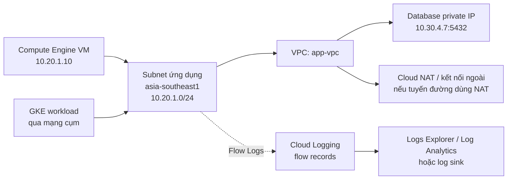

# VPC Flow Logs và quan sát lưu lượng trên Google Cloud

Khi một máy ảo Compute Engine không kết nối được tới Cloud SQL qua địa chỉ private IP, hoặc một ứng dụng trên GKE đột nhiên truyền nhiều dữ liệu ra ngoài, câu hỏi đầu tiên thường là: **lưu lượng đang đi từ đâu tới đâu, qua cổng nào và với khối lượng bao nhiêu?** Kiểm tra cấu hình VPC, subnet, route và firewall cho thấy *đường đi dự kiến*, còn dữ liệu quan sát giúp xác định *những luồng giao tiếp thực tế được ghi nhận*.

**VPC Flow Logs** là một khả năng quan sát lưu lượng mạng của Google Cloud. Nó cung cấp thông tin về các luồng IP dưới dạng bản ghi tổng hợp và có lấy mẫu, hữu ích để phân tích kết nối, giám sát xu hướng, tìm lưu lượng bất thường và hỗ trợ lập kế hoạch mạng. Đây là chủ đề của chương **VPC và định tuyến** trong module `CLOUD_PROVIDERS_GCP`, nơi người học đi từ cách tổ chức project, IAM, VPC tới triển khai Compute Engine, GKE, Cloud Run, các dịch vụ lưu trữ và cơ sở dữ liệu, sau đó vận hành độ tin cậy và chi phí.

Điều quan trọng nhất: **VPC Flow Logs cho biết những gì đã được quan sát và ghi lại; nó không bảo đảm lưu giữ mọi gói tin và không thay thế bằng chứng về quyết định của firewall.**

## 1. Mục tiêu học tập

Sau bài học, bạn có thể:

- Giải thích **flow** là gì và đọc các thuộc tính địa chỉ IP, cổng, giao thức, thời gian, số byte và metadata.
- Xác định phạm vi áp dụng VPC Flow Logs trong mạng Google Cloud và quan hệ giữa **VPC toàn cục**, **subnet theo region**, project và workload.
- Bật, kiểm tra và tìm kiếm flow logs cho subnet qua Console, `gcloud` và Cloud Logging.
- Phân biệt **VPC Flow Logs**, **Firewall Rules Logging**, **Cloud NAT logging**, **Cloud Monitoring** và các công cụ kiểm tra kết nối.
- Nhận biết hệ quả của **sampling**, **aggregation**, **metadata**, **lọc**, **log routing** và **chi phí**.
- Thiết kế quy trình điều tra kết nối giữa Compute Engine, GKE, Cloud Run, Cloud SQL và các mạng liên kết.
- Tránh suy luận sai khi **không thấy log**, khi lưu lượng bị NAT hoặc khi log không chứa dữ liệu ứng dụng.

## 2. VPC Flow Logs ghi lại điều gì?

Một **network flow** thường được nhận diện bằng nhóm thuộc tính kết nối, thường gọi là **5-tuple**:

1. Địa chỉ IP nguồn — `source IP`.
2. Cổng nguồn — `source port`.
3. Địa chỉ IP đích — `destination IP`.
4. Cổng đích — `destination port`.
5. Giao thức IP — `protocol`, ví dụ TCP (`6`) hoặc UDP (`17`).

Những thuộc tính này giúp trả lời câu hỏi **ai kết nối tới ai và bằng giao thức nào**. Bản ghi Flow Logs còn có thể chứa thời gian bắt đầu/kết thúc của khoảng quan sát, số gói và số byte, hướng hoặc vị trí quan sát, cùng metadata về VM, VPC, subnet, project hoặc đặc điểm lưu lượng nếu sẵn có và được cấu hình.

Ví dụ:

```text
Source:      10.20.1.10:51020
Destination: 10.30.4.7:5432
Protocol:    TCP
Time window: 10:15:00–10:15:30
Volume:      18 KiB (minh họa)
```

Giả định VM ứng dụng có IP `10.20.1.10` và database dùng `10.30.4.7:5432`, bản ghi như vậy gợi ý rằng có lưu lượng TCP giữa hai địa chỉ và cổng PostgreSQL trong khoảng thời gian ghi nhận. **Không thể kết luận chỉ từ một flow record rằng truy vấn SQL đã chạy thành công hoặc rằng mọi packet đã được nhận đầy đủ**.

### 2.1. Dữ liệu minh họa dạng JSON

Một bản ghi đơn giản hóa có thể trông như sau:

```json
{
  "connection": {
    "src_ip": "10.20.1.10",
    "src_port": 51020,
    "dest_ip": "10.30.4.7",
    "dest_port": 5432,
    "protocol": 6
  },
  "start_time": "2026-11-19T03:15:00Z",
  "end_time": "2026-11-19T03:15:30Z",
  "bytes_sent": 18432,
  "packets_sent": 28
}
```

Đây là **ví dụ học tập đã giản lược**, không phải bản ghi thực từ một project. Trường cụ thể và metadata có thể khác nhau theo tính năng, chế độ cấu hình và phiên bản dữ liệu. Khi viết truy vấn thực tế, nên mở một bản ghi của chính hệ thống để xác nhận đường dẫn thuộc tính.

### 2.2. VPC Flow Logs không phải packet capture

| Câu hỏi | Flow Logs hỗ trợ đến đâu? |
| --- | --- |
| VM nào trao đổi dữ liệu với IP nào? | Có thể phân tích IP nguồn/đích và metadata khi chúng xuất hiện trong log. |
| Giao tiếp thường dùng cổng nào? | Có thể thống kê `dest_port` và protocol. |
| Lưu lượng tăng mạnh vào thời điểm nào? | Có thể theo dõi lưu lượng đã được lấy mẫu và tổng hợp qua thời gian. |
| Gói tin chứa URL, header HTTP hoặc nội dung SQL gì? | **Không**; Flow Logs không ghi payload ứng dụng. |
| Mọi gói tin đã đi qua mạng hay chưa? | **Không bảo đảm**; Flow Logs có lấy mẫu, tổng hợp và phạm vi thu thập. |
| Firewall đã cho phép hay từ chối request cụ thể? | **Không thể khẳng định chỉ từ Flow Logs**; cần Firewall Rules Logging và dữ liệu liên quan. |
| Một TCP handshake hoặc giao dịch ứng dụng đã hoàn thành? | Flow record đơn lẻ **không đủ** để kết luận. |

Vì không chứa payload, Flow Logs phù hợp với **quan sát luồng và xu hướng**. Nếu cần kiểm tra thông điệp ứng dụng, dùng application logs, trace, request logs hoặc công cụ packet-level thích hợp và được phép sử dụng.

## 3. Flow Logs nằm ở đâu trong kiến trúc VPC?

Trong Google Cloud, **VPC network** là tài nguyên toàn cục, còn **subnet** thuộc một region. Workload sử dụng giao diện mạng hoặc đường kết nối vào VPC; các cơ chế thu thập flow logs có phạm vi và điều kiện riêng.

Một sơ đồ minh họa:



Đây là sơ đồ **logic**, không mô tả việc tất cả traffic đều đi qua một thiết bị VPC duy nhất. Google Cloud VPC sử dụng mạng được xác định bằng phần mềm và những tính năng như route, firewall, NAT, peering hoặc kết nối hybrid có quy tắc riêng.

### 3.1. Cấu hình tại subnet và các tùy chọn quản lý khác

Một cách thông dụng để sử dụng VPC Flow Logs là **bật ghi log cho subnet**. Với những triển khai hoặc tính năng được Google Cloud hỗ trợ, còn có những cách quản lý cấu hình VPC Flow Logs thông qua các API/cấp quản trị khác nhau. Khi chọn phương thức, cần kiểm tra tài liệu hiện hành về **nguồn traffic được hỗ trợ, scope, ưu tiên cấu hình và cách lập hóa đơn**.

Trong bài thực hành, ta sử dụng **subnet-based VPC Flow Logs** vì có thể kiểm tra trực tiếp qua `gcloud compute networks subnets`.

Điểm cần nhớ:

- **Bật log không sửa đường định tuyến hay firewall** của subnet.
- Có thể cấu hình log ở nơi **traffic được hỗ trợ và quan sát được**; không mặc định tất cả kết nối xuyên mạng đều hiện trong một project.
- Ở **Shared VPC**, subnet thuộc **host project**; hãy xác định đúng project chứa subnet và nơi log được ghi/định tuyến trước khi truy vấn.
- Hai subnet thuộc hai region, hai VPC khác nhau hoặc các project khác nhau có thể có cấu hình logging, quyền xem log và chi phí riêng.

### 3.2. Workload nào xuất hiện trong log?

| Nguồn/đích | Cách suy nghĩ khi điều tra |
| --- | --- |
| **Compute Engine VM** | Xác định NIC gắn với subnet nào, IP nguồn/đích, region và project của NIC/subnet. |
| **GKE** | Kiểm tra chế độ mạng của cluster, node, dải IP alias, Pod IP, NAT/SNAT và khả năng ghi nhận/metadata được hỗ trợ; log có thể phản ánh các điểm quan sát khác nhau. |
| **Cloud Run** | Kiểm tra đường egress tới VPC qua **Direct VPC egress** hoặc cơ chế kết nối tương ứng. Không mặc định inbound HTTP tới Cloud Run xuất hiện trong subnet flow logs. |
| **Cloud SQL private IP** | Đối chiếu IP/port và đường kết nối từ client tới dịch vụ, nhưng Flow Logs không cho biết nội dung SQL hoặc kết quả đăng nhập database. |
| **Cloud NAT / internet** | Kiểm tra cách địa chỉ được dịch và đối chiếu với NAT logs khi cần; không giả định nhìn thấy cả trước và sau NAT trong cùng bản ghi. |
| **On-premises qua VPN/Interconnect** | Kiểm tra route, đường VPN/Interconnect, điểm thu thập log và nơi luồng thực sự đi qua. |

Khả năng xuất hiện trong VPC Flow Logs phụ thuộc nguồn traffic, phương thức kết nối và cách cấu hình. **Không thấy flow ở một subnet chưa đủ để khẳng định traffic không tồn tại**.

## 4. VPC Flow Logs khác những công cụ quan sát mạng nào?

Việc chọn đúng nguồn dữ liệu giúp tránh mất thời gian điều tra.

| Công cụ | Trả lời tốt câu hỏi | Không nên kỳ vọng |
| --- | --- | --- |
| **VPC Flow Logs** | IP nào giao tiếp với IP nào, cổng/giao thức gì, mức lưu lượng được ghi nhận qua thời gian? | Payload, mọi packet, hoặc quyết định firewall chính xác của từng packet. |
| **Firewall Rules Logging** | Traffic nào khớp với firewall rule được bật logging; thông tin về rule và hành động được ghi nhận theo cơ chế hỗ trợ? | Bảo đảm đầy đủ mọi flow của VPC hoặc nội dung ứng dụng. |
| **Cloud NAT logging** | Thông tin về NAT translation hoặc lỗi NAT theo chế độ logging được bật. | Thay thế Flow Logs khi cần phân tích toàn bộ giao tiếp nội bộ VPC. |
| **Connectivity Tests (Network Intelligence Center)** | Phân tích **khả năng kết nối dự kiến** theo cấu hình đường mạng, route, firewall và điều kiện được công cụ mô hình hóa. | Khẳng định ứng dụng thực đã truyền dữ liệu thành công trong quá khứ. |
| **Cloud Monitoring / metrics** | Xu hướng lỗi, độ trễ, thông lượng hoặc trạng thái hệ thống qua metric. | Tự cung cấp 5-tuple của từng flow nếu không có nguồn log thích hợp. |
| **Cloud Logging của ứng dụng** | HTTP status, lỗi kết nối database, request ID, lỗi auth. | Thay thế bằng chứng về tuyến mạng ở lớp IP. |
| **Packet Mirroring và công cụ packet capture phù hợp** | Phân tích packet sâu hơn ở những môi trường được hỗ trợ và cho phép. | Là một giải pháp giá rẻ hoặc không rủi ro quyền riêng tư; cần cấu hình riêng. |

**Ví dụ:** Lỗi `Connection timed out` khi VM kết nối `10.30.4.7:5432`. Connectivity Tests có thể phát hiện một rule firewall hoặc route không hợp lý; Firewall Rules Logging có thể cho thấy rule từ chối được ghi; Flow Logs giúp nhìn các flow được ghi nhận; còn log database giúp biết liệu ứng dụng đã tới tầng PostgreSQL hay chưa. **Kết hợp các nguồn** mới đưa ra được kết luận đáng tin cậy.

## 5. Các tham số quyết định chất lượng và chi phí log

Flow Logs có cơ chế **lấy mẫu (sampling)** và **tổng hợp (aggregation)** để giới hạn khối lượng dữ liệu. Đây là điểm ảnh hưởng trực tiếp đến kết quả phân tích.

### 5.1. Sampling: không phải mọi luồng đều có bản ghi

Tỷ lệ sampling biểu diễn phần dữ liệu trong phạm vi tính năng được chọn để ghi/giữ lại theo cơ chế dịch vụ. Tùy phương thức VPC Flow Logs, quá trình có thể liên quan tới lấy mẫu packet rồi tổng hợp và lấy mẫu bản ghi.

- Tỷ lệ cao hơn có thể giúp quan sát những luồng ngắn/hiếm tốt hơn, nhưng tăng lượng log và chi phí.
- Tỷ lệ thấp phù hợp phân tích xu hướng khối lượng lớn, nhưng **có thể bỏ sót** những kết nối ngắn.
- Sampling `0.5` không có nghĩa “chính xác một nửa mọi kết nối của từng VM sẽ được lưu”. Đó là cơ chế lấy mẫu, không bảo đảm bao phủ từng flow.

Với các tình huống bảo mật hoặc điều tra sự cố hiếm, cần hiểu mức độ tin cậy và bổ sung nguồn log phù hợp thay vì coi thiếu log là bằng chứng không có kết nối.

### 5.2. Aggregation interval: gom theo khoảng thời gian

Flow Logs có thể nhóm dữ liệu của một luồng trong các cửa sổ thời gian. Cửa sổ ngắn giúp phân tích biến động gần thời điểm xảy ra, nhưng có thể phát sinh nhiều bản ghi hơn. Cửa sổ dài giảm số record và có thể làm mất chi tiết thời điểm chính xác trong chuỗi biến động.

Ví dụ một kết nối TCP kéo dài vài phút có thể xuất hiện dưới nhiều record tổng hợp theo từng khoảng, thay vì một record cho từng packet. Không nên đếm số record và kết luận đó là số **connection duy nhất** nếu không xem cấu trúc và cách aggregation.

### 5.3. Metadata: tăng ngữ cảnh nhưng cũng tăng dữ liệu

Các trường metadata (khi được hỗ trợ và cấu hình) có thể giúp nhận diện **VM, project, VPC, subnet, region, thuộc tính Kubernetes hoặc mạng**, thay vì chỉ hai IP khó tra cứu. Tuy nhiên:

- Metadata không bảo đảm có ở mọi loại flow hoặc mọi phương thức kết nối.
- Metadata có thể thiếu khi không xác định được endpoint hoặc không được bật.
- Lưu quá nhiều metadata có thể tăng dung lượng, chi phí và nghĩa vụ bảo vệ dữ liệu.

### 5.4. Filtering và log routing

Tùy phương thức cấu hình, bạn có thể chọn/giới hạn dữ liệu cần thu thập theo khả năng dịch vụ, rồi xử lý qua **Cloud Logging Log Router**:

- **Logs Explorer:** điều tra gần thời điểm xảy ra.
- **Log Analytics hoặc BigQuery:** truy vấn lịch sử, tổng hợp theo service/IP/port cho phân tích định kỳ.
- **Log sinks tới đích được hỗ trợ:** xuất bản ghi tới kho lưu trữ hoặc hệ thống xử lý phù hợp.
- **Exclusions và retention:** quản lý khối lượng/chi phí và nhu cầu lưu trữ theo chính sách tổ chức.

Cần phân biệt **lọc ngay tại nguồn** và **lọc/định tuyến sau khi log đã được gửi tới Cloud Logging**: chúng có tác động khác nhau đến khả năng phục hồi dữ liệu và hóa đơn. Hãy kiểm tra mô hình tính phí Logging, sink và đích nhận theo cấu hình hiện hành. Đừng tắt hết log chỉ để giảm chi phí khi còn nhu cầu điều tra production.

## 6. Thực hành: bật Flow Logs cho subnet

**Bối cảnh giả định:** project `orders-prod` có VPC `orders-vpc` và subnet `orders-app-subnet` ở `asia-southeast1`. Một VM hoặc một workload có đường VPC hợp lệ gửi lưu lượng tới database private IP. Ta sẽ bật ghi log tại subnet và tìm bản ghi bằng Cloud Logging.

Các lệnh dưới đây là **lệnh minh họa**. Thay project ID, subnet và region theo hệ thống được phép thao tác. Bật Flow Logs sẽ thay đổi cấu hình logging và có thể làm phát sinh chi phí lưu trữ/xử lý log; chỉ chạy với quyền quản trị và trong môi trường được ủy quyền.

### 6.1. Kiểm tra trước khi bật

```bash
PROJECT_ID="orders-prod"
REGION="asia-southeast1"
SUBNET="orders-app-subnet"

# Xem subnet, VPC, CIDR và cấu hình logging hiện tại
gcloud compute networks subnets describe "$SUBNET" \
  --project="$PROJECT_ID" \
  --region="$REGION" \
  --format="yaml(name,network,ipCidrRange,enableFlowLogs,logConfig)"
```

Trước khi thay đổi, xác nhận:

1. Đúng **project sở hữu subnet**; với Shared VPC, có thể là host project.
2. Subnet nằm trong **region** được yêu cầu.
3. Workload và đường truyền cần quan sát có liên quan tới subnet.
4. Đã có IAM permission thích hợp để cập nhật subnet và quyền xem log.
5. Nhóm FinOps/SRE đã biết tác động đến lượng log và thời gian lưu.

### 6.2. Bật Flow Logs

Ví dụ cho subnet-based logging:

```bash
gcloud compute networks subnets update "$SUBNET" \
  --project="$PROJECT_ID" \
  --region="$REGION" \
  --enable-flow-logs
```

Đây là **thao tác ghi cấu hình**, không phải lệnh đọc. Khi bật, bạn có thể tiếp tục điều chỉnh aggregation interval, sampling rate và metadata trong giao diện Console hoặc các tham số `gcloud` tương ứng nếu tính năng/phương thức cấu hình hỗ trợ. Hãy kiểm tra các giá trị hiện tại trước khi chọn mức thu thập.

Đọc lại trạng thái:

```bash
gcloud compute networks subnets describe "$SUBNET" \
  --project="$PROJECT_ID" \
  --region="$REGION" \
  --format="yaml(name,enableFlowLogs,logConfig)"
```

Việc thấy `enableFlowLogs: true` trong cấu hình tương ứng xác nhận cài đặt subnet đã được bật, **không chứng minh** rằng một flow cụ thể đã xuất hiện. Cần có traffic thuộc phạm vi được hỗ trợ và xét cả sampling, thời gian chuyển log, quyền xem và log routing.

### 6.3. Kiểm tra trong Console

Trong Google Cloud Console:

1. Chọn project chứa subnet.
2. Mở mục **VPC network → VPC networks** và tìm subnet cần quan sát (đường dẫn giao diện có thể thay đổi).
3. Kiểm tra/điều chỉnh Flow Logs trong phần cấu hình subnet.
4. Mở **Logging → Logs Explorer** trong project nhận log.
5. Lọc bản ghi theo log ID, resource và khoảng thời gian, rồi kiểm tra connection/metadata.

Không nên dùng việc “không có log trong 1 phút đầu” để kết luận cấu hình lỗi. Hãy kiểm tra có traffic thực tế, thời gian xử lý/đưa log vào Cloud Logging và cấu hình lọc/giữ log.

## 7. Truy vấn VPC Flow Logs bằng Cloud Logging

Khi dùng **subnet-based VPC Flow Logs**, các bản ghi thường có log ID `compute.googleapis.com/vpc_flows` và monitored resource type `gce_subnetwork`. Đối với cấu hình/nguồn ghi khác, hãy xác nhận loại resource và log ID thực tế thay vì sao chép bộ lọc một cách máy móc.

### 7.1. Xem bản ghi gần đây

Bộ lọc **Logs Explorer**:

```text
resource.type="gce_subnetwork"
log_id("compute.googleapis.com/vpc_flows")
```

Chọn **time range** phù hợp với thời điểm kiểm tra. Nếu nhiều subnet được bật logging, thêm bộ lọc label của monitored resource đã thấy trên bản ghi thực.

Ví dụ lệnh CLI chỉ đọc:

```bash
gcloud logging read \
  'resource.type="gce_subnetwork" AND log_id("compute.googleapis.com/vpc_flows")' \
  --project="$PROJECT_ID" \
  --freshness=1h \
  --limit=20 \
  --format=json
```

Quyền đọc log thường được cấp qua các IAM role thích hợp như **Logs Viewer**, nhưng có thể cần quyền khác cho loại log, bucket log hoặc dữ liệu bị hạn chế. Một tài khoản có quyền xem VM chưa chắc có quyền xem mọi log.

### 7.2. Lọc một cặp IP hoặc cổng

Giả sử đang điều tra traffic từ VM `10.20.1.10` tới database trên cổng TCP `5432`:

```text
resource.type="gce_subnetwork"
log_id("compute.googleapis.com/vpc_flows")
jsonPayload.connection.src_ip="10.20.1.10"
jsonPayload.connection.dest_port=5432
```

Nếu cần cặp IP cụ thể:

```text
resource.type="gce_subnetwork"
log_id("compute.googleapis.com/vpc_flows")
jsonPayload.connection.src_ip="10.20.1.10"
jsonPayload.connection.dest_ip="10.30.4.7"
jsonPayload.connection.protocol=6
```

Đây là **bộ lọc một chiều**. Một traffic exchange có thể sinh record cho hướng ngược lại, và IP/cổng có thể thay đổi do NAT/SNAT hoặc đường đi thực tế. Nếu kết quả rỗng, hãy thử bỏ từng điều kiện và nhìn cấu trúc bản ghi thực trước khi kết luận.

### 7.3. Khám phá các kết nối không mong muốn

Từ các record đang có, nhóm SRE có thể tìm:

- Nguồn có nhiều đích bất thường hoặc cổng đích không được ứng dụng dự kiến sử dụng.
- Kết nối đi tới địa chỉ công cộng ngoài kế hoạch.
- Mức byte/packet tăng mạnh sau một bản release hoặc thay đổi route/NAT.
- Lưu lượng liên quan project dev có vẻ hướng tới tài nguyên production.

**Cảnh báo phương pháp:** IP hoặc cổng bất thường chỉ là dấu hiệu cần điều tra, không tự chứng minh hành vi tấn công. Cần đối chiếu asset inventory, DNS, deployment, firewall logs, application logs và bối cảnh sử dụng thực tế.

## 8. Tình huống 1: VM không kết nối được Cloud SQL qua private IP

Giả sử:

- VM `orders-worker` có IP `10.20.1.10` tại subnet `orders-app-subnet`.
- Cloud SQL có private IP `10.30.4.7` và PostgreSQL lắng nghe TCP `5432`.
- Ứng dụng báo `connection timeout` sau một thay đổi cấu hình.

### 8.1. Điều tra có phương pháp

**Bước 1 — Xác định endpoint thực:** kiểm tra ứng dụng thực sự sử dụng hostname/IP nào, cổng nào và kết nối qua private IP, public IP hay proxy/connector. Không mặc định cấu hình ứng dụng đang trỏ đúng `10.30.4.7`.

**Bước 2 — Kiểm tra đường mạng dự kiến:** đọc cấu hình subnet, route, firewall/đường kết nối giữa mạng ứng dụng và Cloud SQL; dùng **Connectivity Tests** nếu hỗ trợ đường kết nối tương ứng. Kiểm tra yêu cầu VPC, private services access/Private Service Connect hoặc mô hình kết nối Cloud SQL đang sử dụng.

**Bước 3 — Truy vấn flow logs:** lọc theo `src_ip=10.20.1.10` và `dest_port=5432` tại nơi lưu log phù hợp. Quan sát thời gian, đích, số gói/byte và metadata có sẵn.

**Bước 4 — Đối chiếu nguồn khác:** xem Firewall Rules Logging, Cloud SQL logs/metrics, log ứng dụng và các sự kiện vừa triển khai.

**Bước 5 — Sửa nguyên nhân:** ví dụ ứng dụng trỏ sai IP, firewall thiếu rule, network path không hợp lệ hoặc database đã hết khả năng kết nối. Không thay đổi nhiều yếu tố cùng lúc khi chưa có dữ liệu.

### 8.2. Diễn giải các kết quả

| Kết quả quan sát | Có thể suy ra | Chưa thể kết luận |
| --- | --- | --- |
| Có flow tới `10.30.4.7:5432` | Có traffic phù hợp được ghi nhận tại điểm thu thập. | Database login và SQL query đã thành công. |
| Có lưu lượng tới một IP khác | Ứng dụng/NAT/DNS có thể khiến đích khác dự kiến. | Hệ thống chắc chắn bị tấn công. |
| Không có record phù hợp | Chưa thấy traffic trong logs đang truy vấn. | Không có packet nào được gửi. |
| Firewall log báo deny | Rule được ghi nhận từ chối traffic phù hợp. | Mọi gói của toàn bộ kết nối đều đã được mô tả bởi một record. |
| App log ghi `authentication failed` | Kết nối có thể đã tới giai đoạn xác thực ứng dụng/database. | Vấn đề chắc chắn nằm ở VPC routing. |

Điều quan trọng là kết hợp bằng chứng từ đúng **lớp mạng**, **lớp dịch vụ** và **lớp ứng dụng**.

## 9. Tình huống 2: GKE phát sinh lưu lượng ra internet tăng đột biến

Một dịch vụ chạy trên GKE ở project `orders-prod` xuất hiện chi phí egress tăng và log hiển thị nhiều flow tới những IP công cộng. Nhóm cần biết workload nào gây ra lưu lượng.

Quy trình:

1. **Xác nhận chi phí và thời gian:** trong Billing/Monitoring, xác định ngày, region, loại lưu lượng và thời điểm tăng.
2. **Xác định điểm quan sát:** node và Pod của cluster dùng subnet và secondary ranges nào, có thực hiện SNAT không, traffic đi qua Cloud NAT hay tuyến khác?
3. **Bật/kiểm tra Flow Logs trên nguồn được hỗ trợ:** lấy các record có destination IP public, phân tích tổng lưu lượng theo IP/port/time window; lưu ý sampling và metadata.
4. **Đối chiếu Kubernetes:** Pod/namespace/deployment nào được lên lịch trên node, service account nào, revision nào mới phát hành, có batch job hoặc backup đang chạy không?
5. **Kiểm tra Cloud NAT logs và ứng dụng:** NAT có thể làm thay đổi địa chỉ IP ở điểm quan sát; app logs giúp xác định HTTP endpoint hoặc tác vụ cụ thể.
6. **Giảm tác động:** hạn chế outbound không cần thiết theo chính sách mạng khả dụng, sửa tác vụ tạo lưu lượng, thiết lập alert chi phí và hành vi mạng.

**Không suy luận trực tiếp từ IP nguồn trong Flow Logs rằng đó là Pod cụ thể** nếu môi trường có masquerading/SNAT hoặc thiếu Kubernetes metadata. Cần đối chiếu danh tính tại điểm thu thập và cách dịch địa chỉ đang hoạt động.

## 10. Tình huống 3: Cloud Run không truy cập được private resource

Một Cloud Run service cần gọi backend qua VPC. Trong sơ đồ thiết kế, dịch vụ đã được cấu hình **Direct VPC egress** (hoặc cách kết nối VPC được Google Cloud hỗ trợ).

Các bước điều tra:

- Xác nhận **Cloud Run revision** và cấu hình egress thực tế, region, VPC/subnet được chọn; không chỉ xem thông tin cấu hình mong muốn trong mã IaC.
- Kiểm tra địa chỉ private của backend, DNS resolution và cổng đích.
- Dùng Flow Logs trên đường VPC **được hỗ trợ ghi nhận** để xem traffic liên quan; không mặc định toàn bộ inbound HTTPS trực tiếp tới Cloud Run nằm trong subnet log.
- Kiểm tra firewall, route, ingress/egress và service-specific access controls.
- Đối chiếu Cloud Run request/container logs, backend logs, Cloud Monitoring và Connectivity Tests khi công cụ hỗ trợ.

Một yêu cầu Cloud Run bị `403` có thể do **IAM/authorization của backend**, không phải routing. Một lỗi `timeout` có thể liên quan mạng, nhưng cũng có thể do ứng dụng hoặc backend quá tải. **Có Flow Logs không loại bỏ nhu cầu quan sát application layer.**

## 11. Quy trình điều tra khi không thấy VPC Flow Logs

Không có bản ghi tương ứng là tín hiệu cần kiểm tra **khả năng quan sát**, trước khi dùng nó làm bằng chứng mạng bị ngắt:

1. **Đúng project chưa?** Với Shared VPC, subnet có thể nằm ở host project; logs có thể được định tuyến tới một nơi khác.
2. **Đúng subnet và region chưa?** VPC toàn cục nhưng subnet theo region; workload có thể dùng NIC/subnet khác.
3. **Log đã được bật cho nguồn traffic phù hợp chưa?** Kiểm tra cấu hình subnet hoặc cơ chế thu thập đang dùng.
4. **Có traffic thật chưa?** Xác nhận ứng dụng phát sinh kết nối vào đúng thời điểm; lưu ý workload có thể cache/giữ connection.
5. **Khoảng thời gian đủ chưa?** Đối chiếu UTC/timezone, aggregation interval và độ trễ đưa log vào Cloud Logging.
6. **Có sampling/filter không?** Luồng ngắn có thể bị bỏ sót; bộ lọc theo IP/port quá hẹp có thể loại bản ghi.
7. **Logs Router/exclusions/retention thế nào?** Log có thể không được giữ trong bucket đang xem hoặc đã quá thời gian lưu.
8. **Thiếu quyền xem log?** Tài khoản có thể xem VM nhưng không có quyền đọc bucket log liên quan.
9. **Đường kết nối có đặc điểm riêng?** NAT, Cloud Run/GKE, hybrid, traffic không qua điểm thu thập mong đợi hoặc sản phẩm chưa hỗ trợ.

Sau khi kiểm tra các điều kiện trên mà vẫn không có log, sử dụng **các công cụ bổ sung** như Connectivity Tests, firewall logs, NAT logs, Cloud Monitoring, ứng dụng và kiểm tra cấu hình route.

## 12. Thiết kế quan sát mạng cho môi trường dev/staging/prod

Một doanh nghiệp quản lý:

```text
Organization
└── Folder: workloads
    ├── Folder: dev
    │   └── Project: orders-dev
    ├── Folder: staging
    │   └── Project: orders-staging
    └── Folder: prod
        ├── Project: orders-prod
        └── Project: payments-prod
```

Thiết kế Flow Logs nên phù hợp **rủi ro, nhu cầu điều tra và chi phí**, thay vì áp một cấu hình cứng cho mọi subnet.

| Nhu cầu | Dev | Staging | Prod |
| --- | --- | --- | --- |
| Mục đích quan sát | Kiểm tra kết nối và debugging. | Kiểm chứng đường mạng trước release, diễn tập sự cố. | Điều tra sự cố, bảo mật, hiệu năng và xu hướng egress. |
| Mức chi tiết | Lấy mẫu/metadata vừa đủ, bật thêm khi cần. | Có thể tăng độ chi tiết trong giai đoạn kiểm thử. | Chọn sampling/aggregation theo mức quan trọng và nhu cầu lưu trữ. |
| Quyền xem log | Developer được ủy quyền theo project. | QA/SRE theo nhiệm vụ. | SRE/Security/Network Operations với quyền tối thiểu. |
| Thời gian lưu | Phù hợp nhu cầu debugging. | Phù hợp chu kỳ release. | Phù hợp điều tra và quy định bảo mật/tuân thủ. |
| Cảnh báo | Cảnh báo gián đoạn quan trọng. | Kết nối/độ trễ ngoài chuẩn thử nghiệm. | Kết hợp Monitoring, firewall/NAT logs, application errors, budget. |

### 12.1. Quyền IAM cần xem xét

Người bật Flow Logs cần **quyền sửa cấu hình nguồn**, ví dụ quyền cập nhật subnet phù hợp. Người phân tích cần quyền xem log trong Cloud Logging theo resource/log bucket cụ thể. Đội mạng, SRE và bảo mật có thể cần các role khác nhau.

**Không cần cấp `roles/owner` trên toàn Organization** chỉ để bật Flow Logs hoặc truy vấn log. Khi thiết kế Shared VPC, phân biệt quyền trên **host project**, **service project** và quyền xem log sau khi định tuyến.

### 12.2. Chi phí, thông tin nhạy cảm và retention

Flow Logs có thể làm phát sinh chi phí theo lượng dữ liệu log được ghi nhận, lưu trữ, phân tích và xuất đi đích khác. Một subnet có lưu lượng lớn, sampling cao, metadata phong phú và aggregation interval ngắn có thể tạo rất nhiều record.

Dù không chứa payload, **IP, endpoint và mẫu kết nối** vẫn có thể tiết lộ cấu trúc hệ thống hoặc hành vi người dùng. Vì vậy:

- Cấp quyền đọc/xuất log theo nguyên tắc đặc quyền tối thiểu.
- Chọn retention theo nhu cầu pháp lý, bảo mật và khả năng điều tra thực tế.
- Chỉ xuất dữ liệu sang BigQuery/Pub/Sub/kho lưu trữ được phê duyệt.
- Cân đối sampling, aggregation, metadata và log routing dựa trên dữ liệu sử dụng thật.
- Theo dõi chi phí Logging và các đích lưu trữ; cấu hình budget alerts khi phù hợp.

### 12.3. Flow Logs và độ tin cậy ứng dụng

Flow Logs giúp điều tra **lưu lượng mạng**, nhưng không phải chỉ số SLO trực tiếp. Đối với Cloud Run và GKE, tiếp tục đo error rate, latency, request volume và saturation; đối với Cloud SQL, theo dõi CPU, connections, disk và truy vấn lỗi; đối với VPC, bổ sung kết quả Connectivity Tests và log firewall/NAT.

Khi xảy ra sự cố, việc hỏi *“VPC Flow Logs có record không?”* là một bước thu thập bằng chứng, **không phải tiêu chí duy nhất để đánh giá dịch vụ khỏe mạnh**.

## 13. Bài tập thực hành

### Bài tập A — Đọc một flow record

Cho bản ghi minh họa:

```text
src_ip:       10.4.1.20
src_port:     51000
dest_ip:      10.5.2.15
dest_port:    443
protocol:     6
start_time:   11:00:00
end_time:     11:01:00
bytes_sent:   262144
```

Trả lời:

1. Đây là giao thức IP nào, destination port nào?
2. Có thể kết luận chắc chắn URL nào đã được gọi không?
3. `bytes_sent` có đại diện chính xác cho toàn bộ byte của kết nối không?

**Đáp án:** (1) Protocol `6` là TCP, cổng đích `443` thường dùng cho HTTPS nhưng bản ghi không tự chứng minh ứng dụng đã thực hiện phiên HTTPS hợp lệ. (2) Không; Flow Logs không có URL/payload. (3) Không nhất thiết; phụ thuộc sampling, aggregation, điểm quan sát và hướng record.

### Bài tập B — Không có log khi thử kết nối

VM `10.20.1.10` không kết nối được tới database `10.30.4.7:5432`. Logs Explorer không hiển thị record nào có `src_ip=10.20.1.10`.

Bạn cần kiểm tra ít nhất **sáu** nguyên nhân trước khi kết luận không có traffic.

**Gợi ý:** project/host project, subnet/region, logging enabled, sampling, thời gian, filter, quyền xem log, logging routing, workload gửi request thật chưa và mạng có NAT/đường kết nối khác không.

### Bài tập C — Chọn công cụ phù hợp

Ghép câu hỏi với công cụ:

| Câu hỏi | Công cụ ưu tiên |
| --- | --- |
| “Có những IP đích và cổng nào đang xuất hiện trong lưu lượng được ghi nhận?” | **VPC Flow Logs**. |
| “Firewall rule nào đang được ghi nhận là từ chối một connection?” | **Firewall Rules Logging**, khi rule được bật logging. |
| “Route và firewall cấu hình có cho phép một đường kết nối theo phân tích của Google Cloud không?” | **Connectivity Tests**. |
| “Một API trả HTTP 500 và stack trace gì?” | **Application logs/Cloud Logging**. |
| “NAT có phát sinh translation/error nào liên quan?” | **Cloud NAT logging/metrics**. |
| “Service có đáp ứng SLO latency và error budget không?” | **Cloud Monitoring/SLI-SLO metrics**. |

### Bài tập D — Tối ưu quan sát và chi phí

Subnet prod phát sinh rất nhiều Flow Logs, chi phí Cloud Logging tăng nhưng đội vận hành hiếm khi dùng dữ liệu quá 30 ngày. Đề xuất ba cách giảm chi phí mà vẫn giữ khả năng điều tra.

**Gợi ý đáp án:**

1. Đánh giá sampling và aggregation interval dựa trên mức chi tiết cần thiết, tránh thay đổi tùy tiện trong lúc có sự cố.
2. Chọn metadata/filter phù hợp và quản lý Logs Router/exclusions theo chính sách lưu trữ.
3. Rà soát retention và đích lưu trữ; phân biệt nhu cầu phân tích dài hạn với điều tra gần thời điểm xảy ra.

Không giảm lượng log chỉ vì tỷ lệ phần trăm mặc định; trước tiên phải xác định **thông tin nào nhóm Security/SRE bắt buộc cần** để đáp ứng sự cố và yêu cầu tuân thủ.

## 14. Checklist vận hành

- [ ] Xác định VPC, subnet, region, project sở hữu subnet và các project liên quan.
- [ ] Biết Flow Logs được bật qua cơ chế nào, nguồn traffic nào được hỗ trợ.
- [ ] Có cấu hình sampling, aggregation, metadata và retention được chấp thuận.
- [ ] Biết tên log ID/monitored resource thật trong Logs Explorer và quyền đọc log.
- [ ] Có bộ lọc theo IP, cổng, protocol, thời gian và resource để điều tra nhanh.
- [ ] Hiểu rằng **không có flow record không có nghĩa không có packet**.
- [ ] Có Firewall Rules Logging, Cloud NAT logs, Connectivity Tests và application logs khi cần.
- [ ] Kiểm tra Cloud Run/GKE/NAT/SNAT trước khi gán flow cho một Pod hay service.
- [ ] Theo dõi chi phí Logging và kiểm soát quyền truy cập log.
- [ ] Có runbook cho lỗi kết nối database, traffic egress tăng và gián đoạn dịch vụ.

## 15. Ghi nhớ

- **VPC Flow Logs** quan sát những luồng IP được ghi lại, giúp phân tích nguồn, đích, cổng, giao thức và khối lượng lưu lượng.
- Bản ghi được **lấy mẫu và tổng hợp**; vì vậy không thể chứng minh mọi packet, hoàn tất TCP handshake, thành công của ứng dụng hay quyết định firewall chỉ từ Flow Logs.
- **VPC là mạng toàn cục; subnet theo region.** Khi bật và tìm log, phải xác định đúng subnet, project, Shared VPC host project và đường traffic.
- Dùng **Logs Explorer** để truy vấn flow; kết hợp **Firewall Rules Logging, Cloud NAT logging, Connectivity Tests, Monitoring và application logs** để tìm nguyên nhân.
- Với **Compute Engine, GKE, Cloud Run và Cloud SQL**, cần hiểu điểm quan sát và ảnh hưởng của NAT/SNAT, ingress/egress, private IP và quyền dịch vụ.
- Sampling, aggregation, metadata, retention và log routing là quyết định cân bằng giữa **khả năng điều tra, bảo mật và chi phí**.
- Quan sát lưu lượng mạng là một lớp trong vận hành hệ thống đáng tin cậy, cùng với IAM, chính sách bảo mật, giám sát ứng dụng và quản trị chi phí.

### Tài liệu Google Cloud tham khảo

- [VPC Flow Logs overview](https://cloud.google.com/vpc/docs/about-flow-logs)
- [Using VPC Flow Logs](https://cloud.google.com/vpc/docs/using-flow-logs)
- [VPC Firewall Rules Logging](https://cloud.google.com/vpc/docs/firewall-rules-logging)
- [Cloud NAT logging](https://cloud.google.com/nat/docs/monitoring)
- [Cloud Logging — Logs Explorer](https://cloud.google.com/logging/docs/view/logs-explorer-interface)
- [Cloud Logging — Log Router](https://cloud.google.com/logging/docs/routing/overview)
- [Network Intelligence Center — Connectivity Tests](https://cloud.google.com/network-intelligence-center/docs/connectivity-tests/concepts/overview)
- [Cloud Run Direct VPC egress](https://cloud.google.com/run/docs/configuring/vpc-direct-vpc)
