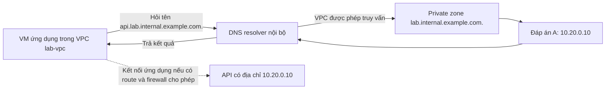

# Cloud DNS private zones và phân giải nội bộ

> **Chương:** DNS và kết nối hybrid  
> **Module:** CLOUD_PROVIDERS_GCP  
> **Phạm vi module:** Khám phá Google Cloud từ tổ chức project, IAM và VPC đến Compute Engine, GKE, Cloud Run, dịch vụ lưu trữ và cơ sở dữ liệu. Qua các tình huống triển khai, người học biết lựa chọn dịch vụ, bảo vệ tài nguyên, tự động hóa phát hành và theo dõi độ tin cậy cùng chi phí.

Một ứng dụng nội bộ thường cần gọi cơ sở dữ liệu, API hoặc máy chủ bằng **tên dễ nhớ** thay vì cố định địa chỉ IP trong mã nguồn. Trên Google Cloud, **Cloud DNS private managed zone** cho phép tạo bản ghi DNS chỉ được phân giải từ những **VPC network đã được cho phép**. Người quản trị có thể dùng tên như `api.lab.internal.example.com.` để trả về địa chỉ nội bộ `10.20.0.10` cho workload trong VPC, mà không xuất bản bản ghi đó ra hệ thống DNS công cộng.

Hiểu đúng private zone giúp thiết kế môi trường Compute Engine, GKE và các dịch vụ có kết nối VPC nhất quán, kiểm soát phạm vi phân giải, xử lý tên trong môi trường hybrid và tránh những lỗi khó phát hiện như nhận `NXDOMAIN` khi truy vấn từ sai VPC hoặc dùng máy chủ DNS không phù hợp.

## Mục tiêu học tập

Sau bài này, bạn có thể:

1. Phân biệt **public zone**, **private managed zone**, **forwarding zone**, **DNS peering zone** và DNS tên máy ảo do Google Cloud cung cấp.
2. Giải thích vai trò của **authorized VPC networks**, DNS suffix, record set, TTL, FQDN và máy chủ phân giải nội bộ `169.254.169.254`.
3. Trình bày quy trình phân giải tên từ VM trong VPC, đặc biệt khi có private zone, public zone và DNS suffix trùng nhau.
4. Tạo private zone, thêm bản ghi `A`, xác minh bằng `gcloud` và, khi có VM phù hợp, bằng `dig`.
5. Chẩn đoán các lỗi `NXDOMAIN`, thiếu quyền, sai VPC, cache, resolver tùy chỉnh và kết nối mạng.
6. Nhận biết khi nào cần **DNS forwarding**, **DNS peering** hoặc **inbound forwarding** cho môi trường kết nối on-premises, Shared VPC và đa VPC.

## 1. DNS nội bộ giải quyết vấn đề gì?

DNS biến tên thành dữ liệu như địa chỉ IPv4, IPv6 hoặc tên đích khác. Ví dụ ứng dụng truy vấn tên `api.lab.internal.example.com.` để lấy địa chỉ `10.20.0.10`, sau đó thiết lập kết nối TCP/HTTPS tới địa chỉ đó.



Trong sơ đồ này, **DNS trả về địa chỉ**, còn mạng và ứng dụng quyết định có kết nối được hay không. Một bản ghi `A` trỏ đến `10.20.0.10` không tự tạo VM/API tại địa chỉ đó, không mở firewall và không cấp quyền IAM.

### Phân biệt các giải pháp DNS trên Google Cloud

| Thành phần | Bản chất | Dùng trong trường hợp nào? |
|---|---|---|
| **Cloud DNS public managed zone** | Bản ghi được công bố qua hệ thống DNS công cộng theo cấu hình ủy quyền tên miền | Website, endpoint công khai, xác minh tên miền |
| **Cloud DNS private managed zone** | Nguồn bản ghi có thẩm quyền cho DNS suffix, khả dụng với VPC/đối tượng được ủy quyền | Tên API, máy chủ, dịch vụ nội bộ |
| **Cloud DNS forwarding zone** | Chuyển truy vấn cho một DNS suffix đến DNS server đích | Phân giải tên do DNS on-premises hoặc DNS server khác quản lý |
| **Cloud DNS peering zone** | Cho VPC tiêu thụ truy vấn namespace bằng cơ chế phân giải của VPC đích | Chia sẻ khả năng phân giải giữa VPC theo cơ chế DNS peering |
| **Compute Engine internal DNS** | Tên nội bộ do Google Cloud cung cấp cho VM theo mô hình nội bộ | Tìm VM theo tên nội bộ do nền tảng quản lý |
| **Cloud DNS server policy** | Điều khiển các chức năng DNS như inbound forwarding hoặc máy chủ thay thế cho outbound | Thiết kế hybrid, định tuyến phân giải theo yêu cầu |

Một private zone thường dùng DNS suffix thuộc **miền mà tổ chức kiểm soát**, chẳng hạn `lab.internal.example.com.` (chỉ là miền ví dụ ở đây). Tránh tự chọn tên dễ va chạm với DNS công cộng, tên nội bộ hệ thống hoặc đuôi `.local` thường dùng cho multicast DNS.

## 2. Cấu trúc private managed zone

Cloud DNS quản lý các **zone**; một zone chứa những **resource record sets**. Trong ví dụ:

```text
Cloud DNS private managed zone
  Managed zone name: lab-private-zone
  DNS suffix:        lab.internal.example.com.
  Visibility:        private
  Authorized VPCs:   lab-vpc

Records:
  api.lab.internal.example.com.  A     300  10.20.0.10
  db.lab.internal.example.com.   A     300  10.20.0.20
  app.lab.internal.example.com.  CNAME 300  api.lab.internal.example.com.
```

**Managed zone name** là tên tài nguyên Cloud DNS trong project, dùng với `gcloud` và API. **DNS suffix (`dnsName`)** là phần tên DNS mà zone quản lý; tên bản ghi phải nằm trong namespace đó. Hai giá trị có ý nghĩa khác nhau.

| Trường | Ý nghĩa | Ví dụ |
|---|---|---|
| **Managed zone name** | ID quản lý zone trong Cloud DNS | `lab-private-zone` |
| **DNS name/suffix** | Hậu tố tên DNS mà zone chịu trách nhiệm | `lab.internal.example.com.` |
| **Visibility** | Công khai hoặc riêng tư | `private` |
| **Authorized networks** | VPC network được truy vấn private zone | `lab-vpc` |
| **Record name** | FQDN của bản ghi | `api.lab.internal.example.com.` |
| **Record type** | Kiểu dữ liệu DNS | `A`, `AAAA`, `CNAME`, `TXT` |
| **TTL** | Số giây resolver/cache có thể giữ kết quả | `300` giây |
| **RDATA** | Dữ liệu trả về của bản ghi | `10.20.0.10` |

### 2.1. FQDN và dấu chấm cuối tên

DNS dùng tên đầy đủ (Fully Qualified Domain Name, **FQDN**). Dấu chấm cuối chuỗi như `api.lab.internal.example.com.` biểu thị tên tuyệt đối; khi nhập lệnh hoặc kiểm tra record, dùng FQDN có dấu chấm cuối để tránh resolver tự nối thêm DNS search suffix.

Ví dụ:

- `api.lab.internal.example.com.` — tên tuyệt đối.
- `api` — tên ngắn; chỉ có thể hoạt động nếu hệ điều hành/ứng dụng có search domain phù hợp.
- `app.lab.internal.example.com.` — có thể là bản ghi `CNAME` đến `api.lab.internal.example.com.` nếu được cấu hình hợp lệ.

Không nên viết ứng dụng phụ thuộc vào tên ngắn `api` nếu không kiểm soát được DNS search domains của container, VM và cluster.

### 2.2. Bản ghi và TTL

| Type | Đặc điểm | Ví dụ sử dụng |
|---|---|---|
| **A** | Tên → IPv4 | `api... → 10.20.0.10` |
| **AAAA** | Tên → IPv6 | Endpoint có địa chỉ IPv6 được hỗ trợ |
| **CNAME** | Một tên là bí danh của tên khác | `app... → api...` |
| **TXT** | Dữ liệu văn bản theo định dạng ứng dụng | Metadata nội bộ, cơ chế xác minh phù hợp |
| **MX / SRV** | Thông tin máy chủ email hoặc dịch vụ | Bài toán ứng dụng tương thích |
| **SOA / NS** | Metadata của zone do hệ thống quản lý | Cloud DNS tạo/quản lý các bản ghi cần thiết khi tạo zone |

**TTL không phải thời hạn sống của máy chủ.** Nó cho biết dữ liệu có thể được cache bao lâu theo quy tắc của resolver. Giảm TTL trước khi đổi IP có thể giúp rút ngắn thời gian lưu bản ghi cũ, nhưng không đảm bảo mọi client cập nhật ngay lập tức; các resolver và thư viện ứng dụng có thể có cache riêng.

Một `CNAME` không thể được dùng như cách thêm một giá trị loại `A` vào cùng tên khi DNS không cho phép đồng tồn tại theo quy tắc record. Trước khi đổi từ A sang CNAME, cần kiểm tra các record set đang có.

## 3. Private zone hiển thị cho ai?

Điểm quan trọng nhất của private managed zone là **phạm vi truy vấn gắn với VPC network được ủy quyền**. Khi tạo hoặc cập nhật zone, người quản trị chọn một hay nhiều VPC network có thể dùng zone đó. Private zone không tự động công khai qua Internet và cũng không tự hiển thị cho mọi project trong organization.

```text
Cloud DNS private zone: lab.internal.example.com.
              |
              +-- Authorized: VPC A  -> có thể phân giải tên trong zone
              |
              +-- Authorized: VPC B  -> có thể phân giải nếu được thêm
              |
              +-- VPC C không được phép -> không nhận dữ liệu từ private zone này
              |
              +-- Người dùng Internet -> không thể tra bản ghi riêng
                  từ DNS công cộng chỉ nhờ biết FQDN
```

**Authorization ở đây thuộc DNS namespace**, không phải giấy phép truy cập máy chủ. Có quyền tra ra IP không đồng nghĩa có thể kết nối đến IP; ngược lại, một kết nối mạng được phép tới IP không tự động làm DNS private zone hiển thị trong VPC khác.

### 3.1. Private zone nằm ở project nào?

Zone là tài nguyên trong một project. Authorized VPC có thể ở cùng project, nhưng mô hình Shared VPC hoặc cross-project binding cần thiết kế IAM và liên kết phù hợp.

- **Lab đơn giản:** zone ở project học tập, gắn một VPC thuộc project đó.
- **Shared VPC:** thông thường tạo private zone trong **host project** và gắn Shared VPC network; service projects dùng chung mạng sẽ có khả năng phân giải phù hợp. Cũng có thể dùng **cross-project binding** nếu được cấu hình và quyền cho phép.
- **Nhiều VPC:** cần chủ động ủy quyền thêm VPC được hỗ trợ hoặc thiết kế DNS peering/forwarding theo kiến trúc, thay vì mặc định VPC Network Peering tự chia sẻ mọi bản ghi private DNS.

Không cấp `roles/dns.admin` rộng ở project chỉ để một workload **truy vấn** DNS; quyền quản trị zone là quyền **thay đổi bản ghi** và có tác động tới nhiều ứng dụng.

### 3.2. Truy vấn từ VM diễn ra qua đâu?

VM Compute Engine sử dụng cơ chế DNS nội bộ thông qua metadata server `169.254.169.254` trong cấu hình chuẩn. Với những VM được cấu hình dùng DNS resolver theo cách nền tảng hỗ trợ, yêu cầu DNS được xử lý theo phạm vi VPC và các chính sách DNS áp dụng.

Điều đó có hai hệ quả vận hành:

1. **Truy vấn bên trong VM thuộc VPC được ủy quyền** mới là phép thử phù hợp cho bản ghi private zone theo đường phân giải thông thường.
2. **Cloud Shell trên trình duyệt, máy tính cá nhân và DNS resolver công cộng** không tự trở thành client trong authorized VPC. Lệnh `dig` trên Cloud Shell có thể không trả về bản ghi riêng dù zone hoàn toàn hợp lệ.

Một VM sử dụng DNS server tùy chỉnh có thể bỏ qua đường phân giải Cloud DNS nếu server ấy không chuyển tiếp truy vấn đúng cách. Không nên suy ra lỗi nằm ở Cloud DNS chỉ từ việc `dig` qua một DNS server khác trả sai kết quả.

## 4. Thứ tự phân giải tên và split-horizon DNS

**Split-horizon DNS** là mô hình cùng một FQDN có thể trả kết quả **khác nhau tùy nguồn truy vấn**. Ví dụ:

| Nơi hỏi | Tên hỏi | Kết quả dự kiến |
|---|---|---|
| VM trong VPC có quyền dùng private zone | `api.internal.example.com.` | `10.20.0.10` |
| Client ngoài Internet hỏi public DNS | `api.internal.example.com.` | Không có private record; chỉ thấy bản ghi public nếu được xuất bản |
| VM thuộc VPC khác không được cấp quyền | `api.internal.example.com.` | Không thấy dữ liệu từ private zone trên; kết quả còn tùy các nguồn DNS khác |

Để tạo split-horizon cho cùng suffix, tổ chức có thể duy trì **private zone** cho VPC nội bộ và **public zone** riêng cho câu trả lời công khai. Hai zone có thể cùng DNS suffix nhưng quản lý tập record và nguồn truy vấn khác nhau.

### 4.1. Longest suffix match

Giả sử VPC được quyền dùng cả:

- Private zone `internal.example.com.`.
- Private zone cụ thể hơn `dev.internal.example.com.`.

Khi VM hỏi `api.dev.internal.example.com.`, private zone `dev.internal.example.com.` là suffix phù hợp **cụ thể hơn**. Zone ấy chịu trách nhiệm trả lời, dù có record cùng tên ở zone `internal.example.com.`.

Nếu zone được chọn có quyền quản lý tên nhưng **không có bản ghi cần hỏi**, resolver có thể trả `NXDOMAIN` hoặc loại câu trả lời phủ định phù hợp. Resolver **không tự quay sang public DNS để tìm cùng tên** chỉ vì record không tồn tại trong private zone có thẩm quyền. Đây là lý do phổ biến khiến tên public đang dùng bỗng không phân giải được sau khi tạo một private zone bao trùm cả suffix.

### 4.2. Các bước xử lý khác

Thứ tự xử lý DNS trong VPC còn phụ thuộc **DNS server policies**, **DNS response policies**, private/forwarding/peering zones, Compute Engine internal DNS và public DNS. Một VPC có **outbound server policy với alternative name servers** có thể chuyển việc phân giải sang các máy chủ DNS đó trước các cơ chế VPC thông thường.

Không nên rút gọn thành quy tắc “private zone luôn có ưu tiên cao nhất” trong mọi cấu hình. Để chẩn đoán, trước tiên cần biết có server policy, response policy hoặc cluster-scoped DNS policy nào đang áp dụng hay không. GKE có thể sử dụng thêm các thành phần DNS trong cluster; truy vấn từ Pod và node cần được đánh giá theo cấu hình cụm thực tế.

**Cảnh báo về CNAME:** hành vi truy vấn tiếp theo sau khi nhận CNAME có các quy định riêng và đang được Google Cloud thay đổi theo lịch công bố; vì vậy khi xây dựng chuỗi CNAME liên quan đến private và public zone phải đối chiếu tài liệu **Name resolution order** tại thời điểm triển khai, thay vì giả định mọi bước truy vấn đều có cùng thứ tự trong mọi phiên bản.

## 5. Thực hành: tạo private zone và bản ghi A

Đây là bài lab **tạo tài nguyên DNS**, không bắt buộc triển khai VM, GKE cluster hay Cloud SQL. Để kiểm tra kết quả phân giải thực sự, hãy dùng **một VM lab đã có sẵn trong đúng VPC được cho phép**. Nếu không có VM, vẫn có thể kiểm tra cấu hình zone và record bằng Console hoặc `gcloud`, nhưng đó **chưa phải** kiểm thử đường phân giải từ workload.

### 5.1. Chuẩn bị

Người học cần có:

- Một **project sandbox** được phép quản lý Cloud DNS và một **VPC network** đã tồn tại trong project đó (hoặc mạng Shared VPC được quản trị cho phép).
- **Cloud DNS API** được bật và danh tính có quyền phù hợp, ví dụ DNS Administrator trên phạm vi được giao. Quyền gắn private zone vào VPC có thể cần thêm permission về mạng.
- Một DNS suffix nội bộ **không gây xung đột** với tên công khai, hostname Compute Engine, zone riêng khác hoặc chính sách tổ chức.
- Một địa chỉ IPv4 mẫu chỉ dành cho bài học, ví dụ `10.20.0.10`. Nếu muốn truy cập ứng dụng thật, địa chỉ này phải được thay bằng **địa chỉ đang được dịch vụ sở hữu**.
- Người phụ trách theo dõi **Cloud Billing** vì Cloud DNS có mô hình tính phí cho zone/query theo loại và mức sử dụng; chỉ có budget alert không đồng nghĩa chặn chi phí.

**Ví dụ thống nhất xuyên suốt:**

| Biến | Giá trị ví dụ | Ý nghĩa |
|---|---|---|
| `PROJECT_ID` | `my-gcp-dns-lab` | Project chứa zone |
| `NETWORK_NAME` | `lab-vpc` | VPC có quyền phân giải |
| `ZONE_NAME` | `lab-private-zone` | Tên resource Cloud DNS |
| `DNS_SUFFIX` | `lab.internal.example.com.` | DNS suffix của zone |
| `RECORD_FQDN` | `api.lab.internal.example.com.` | Tên bản ghi mẫu |
| `RECORD_IP` | `10.20.0.10` | Giá trị A minh họa |
| `TTL` | `300` giây | Thời gian lưu cache danh nghĩa |

Các tên và IP trên là **placeholder**, không bảo đảm tồn tại hoặc phù hợp với mạng của bạn.

### 5.2. Cách A — Google Cloud Console

1. Vào [Google Cloud Console](https://console.cloud.google.com/) và chọn **đúng project**.
2. Mở **Network services → Cloud DNS → Create zone** (tên menu có thể khác đôi chút theo giao diện).
3. Chọn **Private** cho **Zone type/Visibility**.
4. Nhập zone name `lab-private-zone` và DNS name `lab.internal.example.com.`.
5. Trong phần **Options**, chọn kiểu private zone mặc định (không chọn forwarding/peering nếu muốn tự tạo authoritative records).
6. Trong **Networks**, chọn **VPC `lab-vpc`** hoặc VPC đã được chủ mạng cho phép.
7. Xem lại DNS suffix, project, VPC được ủy quyền và tạo zone.
8. Mở zone → **Add record set**. Nhập tên record `api` hoặc FQDN phù hợp với cách Console hiển thị, chọn **Type A**, TTL **300** giây và IPv4 `10.20.0.10`. Lưu record.
9. Mở lại danh sách record để xác nhận FQDN, type, TTL và RDATA.

Đừng thử “xác nhận private zone” bằng cách tạo public zone trùng suffix hoặc thêm bản ghi vào hệ thống DNS công cộng. Lab này **chỉ sử dụng private zone**.

### 5.3. Cách B — Cloud Shell / gcloud

Đăng nhập đúng danh tính và chọn project sandbox. Trong Cloud Shell (Bash), thay toàn bộ placeholder trước khi chạy:

```bash
PROJECT_ID="my-gcp-dns-lab"
NETWORK_NAME="lab-vpc"
ZONE_NAME="lab-private-zone"
DNS_SUFFIX="lab.internal.example.com."
RECORD_FQDN="api.lab.internal.example.com."
RECORD_IP="10.20.0.10"

# Kiểm tra danh tính, project và VPC; các lệnh sau chỉ đọc
gcloud auth list --filter="status:ACTIVE"
gcloud projects describe "$PROJECT_ID" \
  --format="table(projectId,name,lifecycleState)"
gcloud compute networks describe "$NETWORK_NAME" \
  --project="$PROJECT_ID"

# Xem các managed zones trước khi tạo, tránh ghi đè hoặc xung đột suffix
gcloud dns managed-zones list --project="$PROJECT_ID"
```

Người có quyền phù hợp bật DNS API nếu cần:

```bash
# Chỉ chạy khi API chưa bật và việc bật API được phép
gcloud services enable dns.googleapis.com --project="$PROJECT_ID"
```

Tạo private managed zone:

```bash
gcloud dns managed-zones create "$ZONE_NAME" \
  --project="$PROJECT_ID" \
  --dns-name="$DNS_SUFFIX" \
  --description="Private DNS zone for GCP learning lab" \
  --visibility=private \
  --networks="$NETWORK_NAME"
```

Trường `--networks` chọn authorized network. Ví dụ dùng VPC cùng project; với Shared VPC/cross-project binding phải sử dụng đúng định danh network, IAM và cấu hình được tài liệu hỗ trợ.

Tạo một `A` record set:

```bash
gcloud dns record-sets create "$RECORD_FQDN" \
  --project="$PROJECT_ID" \
  --zone="$ZONE_NAME" \
  --type=A \
  --ttl=300 \
  --rrdatas="$RECORD_IP"
```

**Kỳ vọng:** nếu tất cả quyền và cấu hình hợp lệ, zone tồn tại với visibility private và record `api.lab.internal.example.com.` có giá trị `10.20.0.10`. Điều này chỉ xác nhận DNS mapping, **không chứng minh có API đang lắng nghe tại IP mẫu**.

### 5.4. Xác minh cấu hình mà không tạo VM

```bash
# Xem DNS suffix, visibility và các VPC được phép sử dụng zone
gcloud dns managed-zones describe "$ZONE_NAME" \
  --project="$PROJECT_ID" \
  --format="yaml(name,dnsName,visibility,privateVisibilityConfig)"

# Liệt kê toàn bộ record sets trong zone
gcloud dns record-sets list \
  --zone="$ZONE_NAME" \
  --project="$PROJECT_ID"

# Lọc chính xác record A để tránh nhầm với SOA/NS
gcloud dns record-sets list \
  --zone="$ZONE_NAME" \
  --name="$RECORD_FQDN" \
  --type=A \
  --project="$PROJECT_ID"
```

**Điểm kiểm tra:** zone có `dnsName=lab.internal.example.com.`, `visibility=private`, VPC `lab-vpc` nằm trong danh sách được phép; bản ghi `A` có RDATA `10.20.0.10` và TTL `300`.

### 5.5. Xác minh phân giải thực sự từ VM trong VPC

Nếu có sẵn một VM **nằm trong authorized VPC `lab-vpc`** và VM có công cụ `dig`, hãy chạy **trên VM đó**:

```bash
# Truy vấn trực tiếp DNS metadata server của Google Cloud từ VM
dig @169.254.169.254 api.lab.internal.example.com. A

# Kiểm tra máy có thể phân giải thông qua resolver mặc định không
dig api.lab.internal.example.com. A

# Đối chiếu kiểu câu trả lời và server đã xử lý
dig @169.254.169.254 api.lab.internal.example.com. A +noall +answer
```

Kết quả mong đợi là bản ghi `A` cho `api.lab.internal.example.com.` trả về `10.20.0.10`. Trong môi trường Linux có DNS stub resolver (ví dụ systemd-resolved), lệnh `dig` mặc định có thể hiển thị máy chủ local stub; cần xem đường chuyển tiếp thực tế, tránh kết luận sai rằng mọi VM đều hiển thị `169.254.169.254` trong dòng `SERVER`.

**Quan trọng:** đừng chạy `dig @169.254.169.254` từ máy cá nhân hoặc Cloud Shell rồi xem kết quả đó là bài kiểm tra private zone trong VPC. Địa chỉ metadata resolver này dành cho môi trường VM Google Cloud được hỗ trợ; Cloud Shell không tự nằm trong VPC riêng chỉ vì bạn đang quản lý cùng project.

## 6. Điều chỉnh bản ghi và hiểu tác động của cache

Giả sử API di chuyển từ `10.20.0.10` sang `10.20.0.11`. Người có quyền chỉnh record có thể thay RDATA:

```bash
# Chỉ cập nhật nếu bản ghi đang thuộc zone lab và IP mới là mục tiêu hợp lệ
gcloud dns record-sets update "$RECORD_FQDN" \
  --project="$PROJECT_ID" \
  --zone="$ZONE_NAME" \
  --type=A \
  --ttl=300 \
  --rrdatas="10.20.0.11"

# Xác nhận giá trị được ghi vào Cloud DNS
gcloud dns record-sets list \
  --zone="$ZONE_NAME" \
  --name="$RECORD_FQDN" \
  --type=A \
  --project="$PROJECT_ID"
```

Một resolver có thể còn giữ địa chỉ cũ **cho đến khi bản ghi cache hết hạn**. Nếu cần chuyển traffic gần như không gián đoạn, thiết kế DNS chỉ là một phần: ứng dụng cần có health check, load balancing, rollout/rollback và thời gian quá độ thích hợp. Không dùng TTL bằng 0 hoặc đổi qua lại liên tục như một cách thay thế cho chiến lược phát hành.

Khi khách hàng nhận địa chỉ mới, DNS vẫn không bảo đảm `10.20.0.11` có đường mạng phù hợp. Cần đối chiếu route, firewall, IAM và ứng dụng đích. Không dùng `ping` thành công hoặc thất bại như chứng cứ duy nhất cho một hệ thống HTTP/HTTPS.

## 7. Private DNS trong môi trường hybrid và đa VPC

Một private managed zone phù hợp khi **Cloud DNS là nơi bạn quản lý trực tiếp các authoritative records**. Với hệ thống đa mạng hoặc kết nối trung tâm dữ liệu, thường cần thêm các cơ chế khác để giữ quyền quản lý namespace đúng nơi.

### 7.1. Forwarding zone: Cloud DNS hỏi DNS on-premises

Giả sử hệ thống on-premises đã quản lý tên `corp.example.com.`. Thay vì sao chép mọi record vào Cloud DNS, bạn có thể thiết kế **Cloud DNS forwarding zone** cho suffix đó, chuyển truy vấn từ VPC đến máy chủ DNS on-premises theo kết nối **Cloud VPN** hoặc **Cloud Interconnect**.

```text
VM trong VPC
   |
   +--> Cloud DNS forwarding zone: corp.example.com.
             |
             +--> DNS server on-premises (ví dụ 10.50.0.53)
                         |
                         +--> Bản ghi do doanh nghiệp quản lý
```

Đây là mô hình **forwarding**, không phải private managed zone tự lưu authoritative records. Phải kiểm tra DNS target IP, khả năng đi/về của mạng hybrid, firewall UDP/TCP 53 và tuyến phù hợp. Trong một số cơ chế forwarding tiêu chuẩn, yêu cầu tới DNS target riêng có thể đến từ dải nguồn do Cloud DNS sử dụng (ví dụ `35.199.192.0/19`); cần kiểm tra tài liệu của hình thức forwarding thực tế để cấu hình firewall và return route chính xác.

### 7.2. Inbound forwarding: on-premises hỏi tên private trong GCP

Nếu DNS server on-premises cần phân giải `api.lab.internal.example.com.` nằm trong private zone GCP, không thể chỉ trỏ truy vấn vào public DNS rồi mong nhận record riêng.

Thiết kế thông thường:

1. Tạo **Cloud DNS inbound server policy** trên VPC theo cách được hỗ trợ.
2. Sử dụng **inbound forwarding entry points** mà Google Cloud cung cấp cho mạng và region phù hợp.
3. Trên DNS server on-premises, tạo **conditional forwarder** cho suffix cần phân giải, trỏ vào entry points.
4. Bảo đảm Cloud VPN/Interconnect, route, firewall và quyền quản trị hoạt động hai chiều.
5. Truy vấn từ phía on-premises để xác minh. Không giả định chỉ cần kết nối VPN là DNS tự được chuyển tiếp.

Lưu ý chính xác kiểu DNS policy, entry points và giới hạn dịch vụ cần được xác nhận trong tài liệu hiện hành; không tự chọn một IP VM bất kỳ làm “inbound Cloud DNS endpoint”.

### 7.3. DNS peering khác VPC Network Peering

**DNS peering zone** cho phép một **consumer VPC** gửi truy vấn theo DNS suffix đến cơ chế phân giải của **producer VPC**. Đây là quan hệ phân giải **một chiều** theo cấu hình; nó không đồng nghĩa với peering truyền gói dữ liệu giữa hai VPC.

Ví dụ:

```text
Consumer VPC: app-vpc
    |
    | DNS peering zone cho suffix prod.example.com.
    v
Producer VPC: shared-services-vpc
    |
    +--> private zone / forwarding zone / internal DNS
         theo cơ chế phân giải producer VPC
```

VPC Network Peering hoặc Cloud VPN giúp thiết kế đường đi IP giữa mạng, nhưng **không tự biến một VPC thành authorized network** của private zone ở VPC khác. DNS peering hoặc ủy quyền network phù hợp phải được cấu hình riêng; sau khi phân giải được tên, ứng dụng vẫn cần đường mạng và firewall để kết nối.

### 7.4. Shared VPC và GKE

- Với **Shared VPC**, chọn đúng **host project và Shared VPC network** khi quản lý private zone; thiết kế cross-project binding nếu yêu cầu phân quyền quản lý record theo service project.
- Với **GKE**, Pod có thể truy vấn qua **CoreDNS/kube-dns/Cloud DNS** theo cấu hình cluster. Namespace trong Kubernetes (như `svc.cluster.local`) khác với private zone VPC do bạn tạo; cần hiểu DNS policy và chế độ cluster để dự đoán đường phân giải chính xác.
- Với **Cloud Run** và dịch vụ managed dùng kết nối VPC, không giả định mọi request DNS luôn đi qua cùng cơ chế với VM nếu chưa kiểm tra cách dịch vụ kết nối VPC, resolver và tài liệu sản phẩm đang dùng.

## 8. Quản trị, bảo mật và độ tin cậy

### 8.1. DNS private không phải một lớp bảo mật đầy đủ

Private zone giới hạn **khả năng phân giải bản ghi trong phạm vi được hỗ trợ**; nó không mã hóa mọi kết nối, không tự cô lập ứng dụng, không kiểm tra danh tính request và không ngăn client truy cập IP nếu có đường mạng khác.

Khi triển khai thực, kết hợp:

- **IAM:** cấp quyền quản trị DNS record cho đúng người/pipeline; tránh chia sẻ role admin không cần thiết.
- **VPC firewall và route:** kiểm soát đường đi đến đích và cổng dịch vụ.
- **Xác thực ứng dụng:** HTTPS/TLS, IAM hoặc cơ chế application authentication phù hợp.
- **Quản lý tên:** danh mục suffix, chủ sở hữu zone, phân tách dev/staging/prod, tránh trùng tên và thay đổi thiếu kiểm soát.
- **Audit/monitoring:** xem thay đổi zone/record, quyền truy cập quản trị, DNS query logging khi có nhu cầu và quyền.
- **Chi phí:** Cloud DNS có tính phí tùy tài nguyên/truy vấn; logging có thể ảnh hưởng khối lượng log và chi phí.

### 8.2. Query logging và thông tin nhạy cảm

Cloud DNS có khả năng ghi log truy vấn cho một số cấu hình private DNS theo tính năng được hỗ trợ. Tên DNS truy vấn có thể tiết lộ thông tin kiến trúc như tên hệ thống, môi trường hoặc tên dịch vụ. Chỉ bật và lưu log theo mục đích, thời hạn lưu giữ, quyền truy cập và chính sách bảo vệ dữ liệu của tổ chức.

**Private zones không hỗ trợ DNSSEC** theo giới hạn dịch vụ. Điều đó không đồng nghĩa Google Cloud tự công bố bản ghi riêng, nhưng cần hiểu mô hình tin cậy và bảo mật của DNS nội bộ thay vì giả định mọi tính năng của public zone đều tồn tại.

### 8.3. Chống xung đột namespace

Trước khi tạo zone:

1. Kiểm tra những suffix đã có trong cùng VPC và những chính sách DNS liên quan.
2. Tránh tạo private zone quá rộng (ví dụ toàn bộ `example.com.`) nếu chỉ cần `dev.internal.example.com.`. Zone rộng có thể “che” các record công khai cùng hậu tố đối với VPC được ủy quyền.
3. Dành quyền quản lý namespace theo đội hoặc sản phẩm để tránh cập nhật trùng.
4. Thống nhất cách đặt FQDN cho ứng dụng dùng Compute Engine, GKE và Cloud Run; không dùng IP cố định trong cấu hình nếu không cần.
5. Kiểm tra những record đặc biệt như CNAME, SOA/NS và cấu hình reverse lookup nếu yêu cầu giải quyết cả tên → IP lẫn IP → tên.

## 9. Dọn tài nguyên lab

Sau khi thực hành xong, nếu private zone được tạo **chỉ để thử nghiệm** và không còn workload sử dụng, hãy xóa record thử nghiệm rồi xóa zone. Các lệnh sau là thao tác thật, chỉ chạy sau khi đối chiếu `PROJECT_ID`, `ZONE_NAME` và `RECORD_FQDN`. Không xóa zone dùng chung hoặc zone chứa record khác chủ sở hữu.

```bash
printf 'Project: %s\nZone: %s\nRecord: %s\n' \
  "$PROJECT_ID" "$ZONE_NAME" "$RECORD_FQDN"

# Đọc toàn bộ record trước khi xóa để không bỏ sót record do người khác tạo
gcloud dns record-sets list \
  --zone="$ZONE_NAME" \
  --project="$PROJECT_ID"

# Xóa riêng A record của bài lab
gcloud dns record-sets delete "$RECORD_FQDN" \
  --zone="$ZONE_NAME" \
  --type=A \
  --project="$PROJECT_ID"

# Chỉ xóa zone sau khi xác minh không còn record tùy chỉnh cần giữ
gcloud dns managed-zones delete "$ZONE_NAME" \
  --project="$PROJECT_ID"

# Xác minh zone không còn trong danh sách
gcloud dns managed-zones list --project="$PROJECT_ID"
```

Nếu bạn đã tạo thêm record `CNAME` hoặc `A` khác trong zone lab, phải xóa chúng theo quyền sở hữu và kiểm tra lại. **Đừng xóa các bản ghi SOA/NS hệ thống một cách riêng lẻ** để cố dọn zone. Khi không còn record do bạn quản lý, thao tác xóa zone theo quy trình của Cloud DNS sẽ xử lý tài nguyên zone.

Nếu VPC dùng cho lab có các tài nguyên khác, **giữ nguyên VPC**. Bài học này chỉ sở hữu private managed zone và record mà bạn đã tạo; không cần xóa VM, network, VPN, Cloud Router hay tài nguyên của đội khác.

## 10. Chẩn đoán lỗi phân giải nội bộ

Khi tra tên không thành công, cần phân biệt **cấu hình DNS**, **kết quả tra tên** và **kết nối sau khi đã có IP**.

| Hiện tượng | Khả năng gây lỗi | Cách kiểm tra |
|---|---|---|
| `gcloud dns record-sets list` thấy record nhưng `dig` từ VM trả sai | VM ở VPC không được ủy quyền, DNS policy/resolver khác hoặc cache | Xem NIC/VPC của VM, authorized networks, truy vấn `@169.254.169.254` |
| `NXDOMAIN` trong VPC dù public DNS có tên | Private zone cùng suffix phù hợp hơn, nhưng thiếu record | Kiểm tra suffix và record tồn tại trong zone riêng; không mặc định fallback |
| `NXDOMAIN` khi dùng tên ngắn `api` | Search domain không đúng hoặc FQDN chưa hợp lệ | Truy vấn FQDN có dấu chấm cuối |
| `dig` trên Cloud Shell không trả về private IP | Cloud Shell không tự nằm trong authorized VPC | Chạy kiểm tra từ VM trong VPC hoặc môi trường phân giải được hỗ trợ |
| `dig` trả IP cũ sau khi cập nhật | Cache TTL, local resolver hoặc client cache | Kiểm tra bản ghi trên Cloud DNS, so sánh query trực tiếp và chờ cache hết hạn |
| Resolver trả `SERVFAIL` | Forwarding target không trả lời, DNS policy lỗi hoặc rủi ro server đích | Xem forwarding policy/zone, route, UDP/TCP 53, log và trạng thái target |
| DNS thành công nhưng ứng dụng không kết nối | Không có route, firewall chặn, dịch vụ không lắng nghe hoặc từ chối xác thực | Kiểm tra IP, route, firewall, port, TLS và application logs |
| Một VPC khác không tra được record | Chưa nằm trong authorized network; DNS peering chưa cấu hình | Kiểm tra liên kết VPC/zone hoặc thiết kế DNS peering |
| On-premises không phân giải được tên private GCP | Thiếu inbound forwarding hoặc conditional forwarder | Kiểm tra DNS server policy, entry points, VPN/Interconnect và return route |
| Cloud DNS forwarding đến on-premises bị timeout | Chặn DNS target, thiếu tuyến/đường về hoặc target IP không hợp lệ | Kiểm tra nguồn query, route hai chiều, firewall và DNS listener |
| Không tạo được zone hoặc record | API chưa bật, sai quyền IAM, tên/suffix xung đột | Kiểm tra `dns.googleapis.com`, role, quota, DNS suffix và tài nguyên hiện tại |
| Bản ghi đúng nhưng Kubernetes Pod thấy kết quả khác | CoreDNS/kube-dns, cluster policy hoặc cache | Kiểm tra cấu hình DNS của Pod, cluster và thử từ node/VM phù hợp |

### Quy trình chẩn đoán có thứ tự

1. **Xác định client:** VM, GKE Pod, Cloud Run hay máy on-premises? Nằm trong mạng nào?
2. **Xác định tên hỏi:** FQDN có chính xác và thuộc suffix của zone không?
3. **Xác định nguồn phân giải:** resolver mặc định, DNS policy thay thế hay máy chủ DNS tự quản?
4. **Xác định zone nào được chọn:** có zone cụ thể hơn, forwarding zone, peering zone hoặc response policy áp dụng không?
5. **Đối chiếu record:** loại record (A/AAAA/CNAME), TTL và RDATA có đúng không?
6. **Nếu đã trả IP:** kiểm tra routing, firewall, TLS và ứng dụng. DNS thành công chưa đủ kết luận dịch vụ có thể truy cập.
7. **Nếu kết quả không ổn định:** kiểm tra TTL/caching, DNS forwarding target, query logging và thay đổi policy gần đây.

## 11. Tình huống triển khai

### Tình huống A — API nội bộ chuyển địa chỉ

Nhóm phát triển có một API chạy sau internal load balancer, cần tên ổn định `orders.dev.internal.example.com.` cho các VM trong VPC dev. Họ tạo private zone với suffix `dev.internal.example.com.`, record A trỏ đến địa chỉ frontend nội bộ của load balancer và chỉ ủy quyền VPC dev.

Khi địa chỉ backend VM thay đổi, tên DNS của frontend vẫn ổn định nếu IP frontend không đổi. Nếu cần đổi địa chỉ frontend, cập nhật record theo quy trình với TTL và thời gian chuyển tiếp phù hợp. Không dùng DNS để thay cho cơ chế health check của load balancer.

### Tình huống B — Có private zone nhưng VM production không tra được

Zone `internal.example.com.` thuộc project dev và chỉ authorize `dev-vpc`. VM production nằm trong `prod-vpc`, mặc dù cùng organization, vẫn không thấy record riêng từ zone này.

Cách xử lý là xác nhận ownership và cách ly môi trường. Nếu production thực sự cần cùng namespace, cân nhắc cho phép VPC production trên zone được quản lý tập trung hoặc thiết kế DNS peering; tránh bật kết nối hoặc quyền tràn lan chỉ để chữa một truy vấn DNS.

### Tình huống C — Trung tâm dữ liệu cần gọi API tại GCP

Doanh nghiệp có kết nối Cloud VPN, DNS trên on-premises và dịch vụ GCP tên `api.gcp.internal.example.com.` trong private zone. Đường IP qua VPN hoạt động nhưng tên chưa phân giải.

Giải pháp cần **inbound forwarding** từ on-premises đến Cloud DNS, conditional forwarder cho suffix, đường mạng/đường về phù hợp và kiểm tra từ máy on-premises. Kết nối VPN không đồng nghĩa DNS tự được liên thông.

### Tình huống D — Private zone “che” bản ghi public

Website công khai có tên `auth.example.com.`, trong khi đội vận hành tạo private zone `example.com.` cho VPC nhưng quên thêm record `auth.example.com.`. Ở VPC được ủy quyền, người dùng có thể nhận `NXDOMAIN` cho tên đang tồn tại ngoài Internet.

Giải pháp là chọn suffix nội bộ hẹp, thiết kế split-horizon đầy đủ và điều chỉnh private DNS records/zone theo quy trình. Đừng mặc định resolver sẽ hỏi public DNS sau khi private authoritative zone trả lời không tìm thấy tên.

## 12. Câu hỏi tự kiểm tra

**1. Tạo private zone trong project có khiến mọi VPC trong organization tự tra được record không?**  
**Gợi ý:** không. Phạm vi truy vấn phụ thuộc VPC được cho phép và các cơ chế liên kết DNS khác được cấu hình.

**2. `lab-private-zone` và `lab.internal.example.com.` có cùng ý nghĩa không?**  
**Gợi ý:** không. Giá trị đầu là tên tài nguyên quản lý zone; giá trị sau là DNS suffix mà zone quản lý.

**3. Cấu hình record A trỏ tới IP `10.20.0.10` có mở cổng HTTPS tới IP đó không?**  
**Gợi ý:** không. DNS chỉ phân giải tên; mạng, firewall, TLS và dịch vụ đích vẫn phải hoạt động.

**4. Vì sao phải thử `dig` từ VM trong VPC được ủy quyền, thay vì chỉ từ Cloud Shell?**  
**Gợi ý:** Cloud Shell không mặc nhiên ở trong authorized VPC; truy vấn phải đi qua DNS resolver phù hợp với phạm vi của zone.

**5. Nếu private zone `internal.example.com.` tồn tại nhưng thiếu `db.internal.example.com.`, resolver có chắc chắn hỏi public DNS để tìm tên này không?**  
**Gợi ý:** không. Zone phù hợp có thể trả kết quả phủ định và không fallback sang public zone cho cùng tên.

**6. Khi ứng dụng trong VPC cần phân giải tên vẫn do DNS on-premises quản lý, nên cân nhắc private managed zone hay forwarding zone?**  
**Gợi ý:** forwarding zone thường phù hợp để chuyển query đến DNS authoritative hiện hữu, tránh sao chép toàn bộ record.

**7. DNS peering có tạo kết nối IP giữa hai VPC không?**  
**Gợi ý:** không. DNS peering xử lý đường phân giải namespace; cần thiết kế kết nối mạng riêng.

**8. Vì sao giảm TTL xuống 60 giây không đảm bảo mọi client thấy IP mới đúng sau 60 giây?**  
**Gợi ý:** resolver/cache ứng dụng có thể lưu kết quả trước đó theo TTL cũ hoặc có cache riêng; việc cập nhật bản ghi và cache không phải một sự kiện tức thời.

## Ghi nhớ

- **Cloud DNS private managed zone** lưu các bản ghi nội bộ có thẩm quyền cho DNS suffix được quản lý, hiển thị theo **authorized VPC networks**.
- **Project sở hữu zone khác với VPC được phép truy vấn**; quyền IAM quản trị zone cũng khác khả năng ứng dụng sử dụng DNS.
- **Máy chủ phân giải và nguồn truy vấn rất quan trọng:** kiểm tra private DNS từ VM/workload trong VPC phù hợp, tránh dùng kết quả của public resolver để kết luận.
- **Private authoritative zone có thể che tên public cùng suffix**; cần hiểu longest suffix match và response policies/forwarding khi thiết kế split-horizon.
- **DNS forwarding, inbound forwarding và DNS peering** phục vụ các hướng phân giải khác nhau trong môi trường hybrid/đa VPC, không tự tạo route hay cấp quyền truy cập IP.
- **DNS chỉ là bước tìm đích**. Kết nối thực tế vẫn cần routing, firewall, xác thực và ứng dụng hoạt động; theo dõi TTL, logging, quyền quản trị và chi phí trong suốt vòng đời.

## Tài liệu tham khảo chính thức

- [Google Cloud — Cloud DNS overview](https://cloud.google.com/dns/docs/overview)
- [Google Cloud — DNS zones overview](https://cloud.google.com/dns/docs/zones/zones-overview)
- [Google Cloud — Create, modify, and delete zones](https://cloud.google.com/dns/docs/zones)
- [Google Cloud — Add, update, and delete records](https://cloud.google.com/dns/docs/records)
- [Google Cloud — Name resolution order](https://cloud.google.com/dns/docs/vpc-name-res-order)
- [Google Cloud — Troubleshoot Cloud DNS](https://cloud.google.com/dns/docs/troubleshooting)
- [Google Cloud — Best practices for Cloud DNS](https://cloud.google.com/dns/docs/best-practices)
