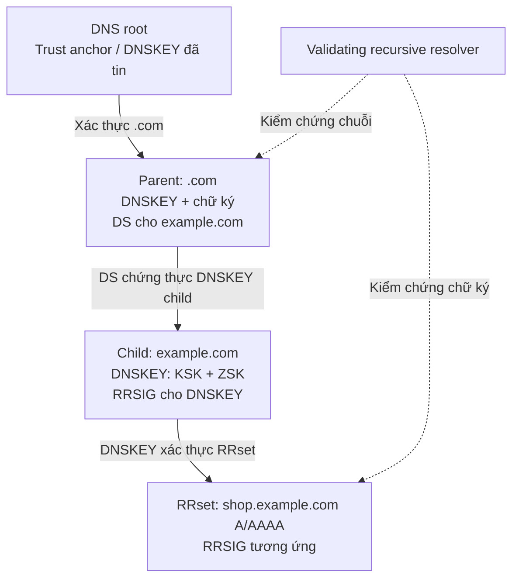
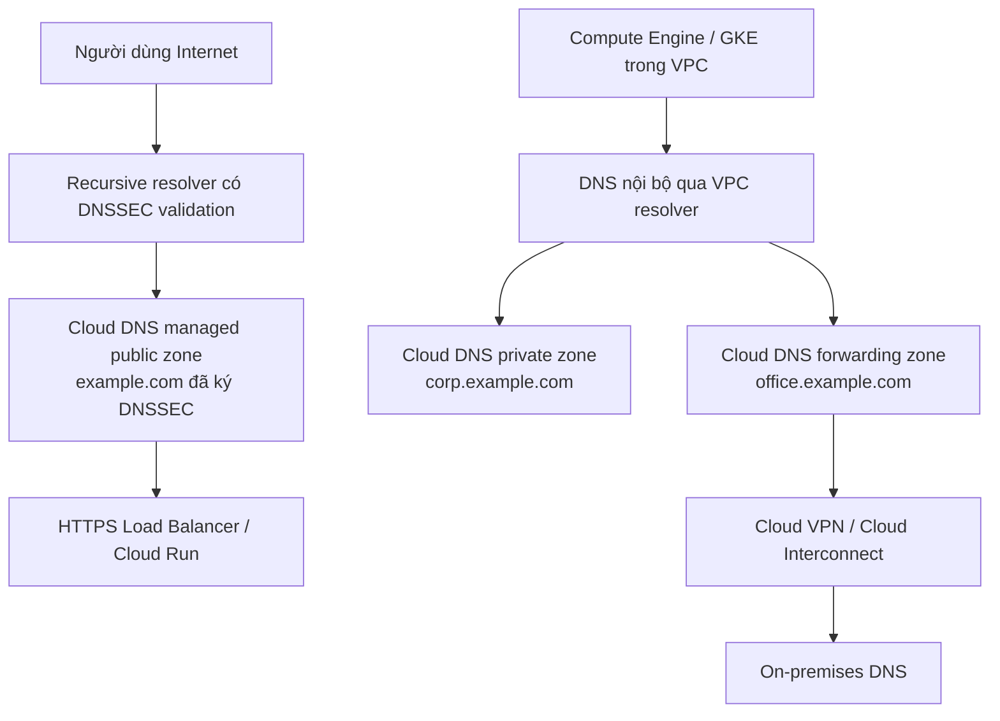

# DNSSEC và bảo vệ tính toàn vẹn DNS

## 1. Vì sao cần bảo vệ kết quả phân giải DNS?

Khi người dùng nhập tên miền `shop.example.com`, thiết bị phải tìm địa chỉ IP hoặc những bản ghi DNS khác để kết nối. Nếu kẻ tấn công khiến resolver nhận **bản ghi DNS giả**, trình duyệt hoặc một dịch vụ backend có thể chuyển lưu lượng tới máy chủ không mong muốn. Nguy cơ này thường được mô tả qua **DNS spoofing**, **cache poisoning** và tấn công vào quá trình phân giải tên miền.

**DNS Security Extensions (DNSSEC)** mở rộng giao thức DNS bằng **chữ ký số**. Resolver có hỗ trợ **DNSSEC validation** có thể kiểm tra dữ liệu nhận được có thực sự được ký bởi bên quản lý zone tương ứng, và dữ liệu có bị thay đổi trên đường truyền hay không. DNSSEC đặc biệt hữu ích khi ứng dụng Google Cloud công bố tên miền công khai cho **Cloud Run, GKE, Compute Engine, Cloud Load Balancing** hoặc một cổng truy cập tới hệ thống on-premises.

Trong module **CLOUD_PROVIDERS_GCP**, bài học này kết nối **Cloud DNS**, IAM và quản trị project với kiến trúc **VPC, kết nối hybrid, tính sẵn sàng và tự động hóa phát hành**. DNS đúng và an toàn là một điều kiện cần cho nhiều luồng ứng dụng, dù tài nguyên compute và database đã được thiết kế tốt.

Sau bài học, bạn có thể:

1. Giải thích điều DNSSEC **xác thực** và những việc DNSSEC **không bảo vệ**.
2. Phân biệt `DNSKEY`, `RRSIG`, `DS`, `KSK`, `ZSK` và bản ghi phủ định `NSEC`/`NSEC3`.
3. Mô tả **chain of trust** từ DNS root tới parent zone và child zone.
4. Bật DNSSEC cho **Cloud DNS managed public zone**, lấy DS record và phối hợp với domain registrar.
5. Kiểm chứng chữ ký bằng `dig`, `delv` hoặc công cụ phân tích DNSSEC, biết cách điều tra `SERVFAIL`.
6. Lập kế hoạch bật, thay đổi khóa, di chuyển DNS provider và vô hiệu hóa DNSSEC mà không làm gián đoạn hệ thống.
7. Phân biệt bảo vệ **public authoritative DNS** với phân giải **private DNS/hybrid DNS** trong VPC.

> **Quy ước ví dụ:** `example.com`, `shop.example.com` và các Project ID trong bài mang tính minh họa. `example.com` là tên miền mẫu được dành riêng cho tài liệu; không tự ý cập nhật registrar, nameserver hay zone đang phục vụ production. Các lệnh có tính thay đổi được trình bày để minh họa quy trình và cần được xem xét trước khi thực thi.

## 2. DNSSEC giải quyết bài toán nào?

DNS thông thường là một hệ thống phân giải phân tán. Khi hỏi bản ghi `A` hoặc `AAAA`, thiết bị thường tương tác với **recursive resolver**; resolver có thể truy vấn các **authoritative name servers** để tìm câu trả lời.

Nếu chỉ dựa vào DNS truyền thống, câu trả lời không mặc định được xác thực bằng chữ ký từ chủ zone. DNSSEC bổ sung cơ chế cho phép resolver **kiểm tra tính xác thực nguồn dữ liệu DNS và tính toàn vẹn bản ghi**.

| Thuộc tính | DNSSEC cung cấp? | Giải thích |
| --- | --- | --- |
| **Xác thực dữ liệu DNS** | Có, khi có chuỗi tin cậy và resolver xác minh | Giúp phát hiện dữ liệu không khớp chữ ký có thể kiểm tra |
| **Tính toàn vẹn DNS** | Có, cho dữ liệu DNS được ký hợp lệ | Ngăn việc thay đổi nội dung bản ghi mà vẫn qua được xác minh |
| **Chứng minh tên/bản ghi không tồn tại** | Có, bằng signed denial-of-existence | `NSEC` hoặc `NSEC3` cho phép kiểm chứng câu trả lời phủ định |
| **Mã hóa truy vấn DNS** | Không | Người quan sát vẫn có thể nhìn thấy truy vấn/đáp ứng nếu giao thức truyền không mã hóa |
| **Ẩn IP của ứng dụng** | Không | Bản ghi `A`/`AAAA` công khai vẫn chứa địa chỉ công khai |
| **Xác thực máy chủ HTTPS hoặc mã hóa HTTP** | Không | Vẫn cần TLS, chứng chỉ và kiểm soát ứng dụng |
| **Chặn mọi kiểu domain hijacking** | Không | Quyền quản lý registrar, IAM, DNS provider và tài khoản vẫn phải được bảo vệ |
| **Chống DDoS/đảm bảo uptime** | Không | Cần kiến trúc dự phòng, giám sát và bảo vệ hạ tầng riêng |

**DNSSEC không thay thế TLS.** DNSSEC giúp một resolver xác minh bản ghi DNS; TLS bảo vệ kết nối ứng dụng và xác minh danh tính máy chủ qua cơ chế chứng chỉ phù hợp. **DNS over HTTPS (DoH)** và **DNS over TLS (DoT)** mã hóa kênh giữa client và resolver, nhưng riêng chúng không thay thế **chữ ký DNSSEC** trên dữ liệu authoritative.

## 3. Các thành phần của DNSSEC

| Thành phần | Vai trò | Đối chiếu thực tế |
| --- | --- | --- |
| **DNSKEY** | Bản ghi mang **khóa công khai** dùng kiểm tra chữ ký | Được công bố trong zone đã ký |
| **KSK (Key Signing Key)** | Khóa dùng ký tập `DNSKEY`, làm cơ sở liên kết trust từ parent | Khóa công khai KSK là đầu vào để tạo/đối chiếu `DS` |
| **ZSK (Zone Signing Key)** | Khóa dùng ký phần lớn các record sets của zone | Các `A`, `AAAA`, `MX`, `TXT`… có chữ ký tương ứng |
| **RRSIG** | Chữ ký số của một RRset (tập bản ghi cùng tên và loại) | Có loại, thuật toán, khoảng hiệu lực và key tag |
| **DS (Delegation Signer)** | Bản ghi tại **parent zone** tham chiếu khóa của child zone | Thường được gửi qua domain registrar để ghi vào TLD registry |
| **NSEC / NSEC3** | Bằng chứng có chữ ký về việc tên hoặc loại record không tồn tại | Giúp chống giả mạo `NXDOMAIN` hoặc no-data |
| **NS** | Bản ghi ủy quyền DNS tới authoritative nameservers | Quyết định nơi resolver truy vấn authoritative zone |
| **TTL** | Thời gian cache bản ghi | Phải phối hợp với DS/DNSKEY/RRSIG khi thay đổi hoặc rollover |

### 3.1. KSK và ZSK phối hợp như thế nào?

Để tránh dùng một khóa duy nhất cho tất cả thao tác, DNSSEC thường chia trách nhiệm:

1. **ZSK** ký các RRset trong zone, tạo `RRSIG`.
2. **KSK** ký DNSKEY RRset để xác thực những DNSKEY được zone công bố.
3. **Parent zone** công bố `DS` liên kết với một DNSKEY của child zone, thường là KSK.
4. **Validating resolver** đi theo liên kết từ trust anchor tới parent/child và xác nhận chữ ký của bản ghi cần tra.

**Cloud DNS quản lý khóa riêng và việc ký dữ liệu** của managed public zone khi bật DNSSEC. Quản trị viên có thể xem DNSKEY công khai, DS và trạng thái DNSSEC; thông thường không cần tải khóa bí mật để tự ký từng bản ghi.

Theo tài liệu Cloud DNS, **ZSK được tự động xoay vòng**; **KSK không có cơ chế xoay vòng tự động hoàn toàn** vì thay KSK cần phối hợp với registrar/parent DS. Khi có thay đổi KSK hoặc DNS provider, bắt buộc lập kế hoạch đồng bộ chain of trust. Không diễn giải cụm từ “tự động quản lý DNSSEC” thành “mọi khóa đều tự đổi mà không cần thao tác”.

### 3.2. Bản ghi DS có bốn trường cơ bản

Một DS record thường được thể hiện như sau (đây là **chuỗi giả định**, không dùng để cấu hình tên miền thật):

```text
<key-tag> <algorithm> <digest-type> <digest>
12345     13          2             A1B2C3D4... (minh họa)
```

- **Key tag:** định danh ngắn giúp tìm DNSKEY liên quan.
- **Algorithm:** thuật toán khóa/chữ ký, phải tương thích với DNSKEY.
- **Digest type:** thuật toán băm tạo digest.
- **Digest:** giá trị băm của DNSKEY tương ứng.

Không tự sửa hoặc đoán digest. Hãy **sao chép DS được Cloud DNS cung cấp**, kiểm tra chính xác cả bốn trường, và chỉ gửi vào parent zone thông qua registrar khi đủ điều kiện.

## 4. Chain of trust: điều kiện để chữ ký có ý nghĩa

Một zone có `RRSIG` **chưa đủ** để mọi resolver tin tưởng zone đó. Resolver cần xây dựng **chuỗi tin cậy** (*chain of trust*) từ một **trust anchor** mà nó đã tin (thường là DNS root) tới zone chứa tên miền đích.



Đối với `example.com`, chuỗi đi qua root → `.com` → `example.com`; với `api.sub.example.com` được **ủy quyền như một zone độc lập**, còn phải xét riêng NS/DS và DNSKEY của `sub.example.com`.

### Ba điều kiện để có bảo vệ end-to-end

1. **Child zone được ký:** DNSSEC trong Cloud DNS ở trạng thái `on` và authoritative nameservers công bố DNSKEY, RRSIG thích hợp.
2. **Parent có DS hợp lệ:** registrar/registry phải hỗ trợ DNSSEC và DS của child zone phải được công bố chính xác trong parent zone. Tên miền con được ủy quyền thì DS nằm trong parent zone tương ứng.
3. **Resolver có xác minh:** resolver được client sử dụng phải thực sự thực hiện **DNSSEC validation**; chỉ nhận bản ghi có `RRSIG` nhưng không kiểm tra thì chưa có bảo vệ đầy đủ.

Nếu **không có DS ở parent**, zone có thể đã ký nhưng resolver thường **không có chuỗi tin cậy đầy đủ** để xác thực dữ liệu như một zone bảo mật. Nếu **DS có nhưng không khớp DNSKEY/chữ ký**, resolver validating thường xem zone là **bogus** và có thể trả `SERVFAIL`.

Đừng nhầm `SERVFAIL` với `NXDOMAIN`: `NXDOMAIN` nghĩa là tên không tồn tại theo kết quả phân giải, còn `SERVFAIL` cho biết quá trình phân giải thất bại vì nhiều nguyên nhân, một trong số đó là DNSSEC validation.

## 5. Phạm vi hỗ trợ DNSSEC trong Cloud DNS

Cloud DNS hỗ trợ nhiều loại managed zones, nhưng **không phải loại nào cũng dùng DNSSEC**.

| Loại DNS zone / luồng | Có thể bật DNSSEC trực tiếp ở Cloud DNS? | Ghi chú |
| --- | --- | --- |
| **Managed public zone** | **Có** | Cloud DNS ký dữ liệu, quản lý DNSKEY/ZSK; cần DS parent và resolver validating |
| **Managed private zone trong VPC** | **Không** | Private zone không hỗ trợ DNSSEC theo Cloud DNS; phạm vi truy cập phụ thuộc authorized VPC và chính sách |
| **Forwarding zone cho DNS on-premises** | Không ký zone thay máy chủ đích | Cloud DNS chuyển truy vấn; việc DNSSEC validation thuộc thành phần resolver có hỗ trợ trong đường đi |
| **Peering / internal Compute Engine DNS** | Không thể mặc định xem là zone ký DNSSEC | Cơ chế phân giải nội bộ/peering có hành vi riêng |
| **Public subdomain được ủy quyền thành zone mới** | Có, nếu zone public được ký và DS được đặt đúng tại parent | Cần kiểm tra cả NS delegation và chain of trust |

Một hệ thống **hybrid** có thể đồng thời có **public DNSSEC-signed zone** cho tên miền ngoài internet, **private zones** cho tên nội bộ và **forwarding zones** nối DNS on-premises. Không nên hứa rằng bật DNSSEC cho public zone sẽ tự ký tất cả tên nội bộ qua Cloud VPN/Interconnect.

### Giới hạn thao tác trên zone lớn

Theo tài liệu Cloud DNS, **không thể bật hoặc tắt DNSSEC trên managed zone đang có hơn 3.000 resource record sets**. Với zone lớn như vậy, cần cân nhắc tạo zone mới cùng DNS suffix với trạng thái ký phù hợp, chuyển dữ liệu DNS và cập nhật delegation một cách có kiểm soát. Đây là quy trình di chuyển DNS thực sự, có thể ảnh hưởng người dùng nếu thiếu bước đồng bộ NS, DS và thời gian cache.

### Các trạng thái DNSSEC

| Trạng thái | Ý nghĩa | Trường hợp thường gặp |
| --- | --- | --- |
| `off` | Cloud DNS không ký zone | Zone chưa dùng DNSSEC hoặc đã vô hiệu hóa đúng quy trình |
| `on` | Cloud DNS ký zone và quản lý khóa theo chế độ thông thường | Public zone hoạt động bình thường với DNSSEC |
| `transfer` | Chế độ cho quy trình chuyển zone đã ký; dừng xoay khóa tự động và hỗ trợ thao tác migration | Di chuyển DNS operator khi cần giữ chain of trust |

**`transfer` không phải lựa chọn mặc định để bật DNSSEC cho mọi zone.** Dùng `on` cho triển khai thông thường và theo hướng dẫn migration riêng khi cần `transfer`.

## 6. Quy trình bật DNSSEC cho managed public zone

Giả sử bạn sở hữu tên miền công khai `example.com` và có project Cloud DNS là `acme-dns-prod`. Một quy trình an toàn gồm **đánh giá zone, bật ký, lấy DS, cấu hình registrar và kiểm chứng end-to-end**.

### Bước 1: Kiểm tra zone và quyền truy cập

```bash
# Lệnh chỉ đọc: liệt kê các zone trong project
gcloud dns managed-zones list --project=acme-dns-prod

# Lệnh chỉ đọc: kiểm tra zone cụ thể
gcloud dns managed-zones describe public-example \
  --project=acme-dns-prod

# Lệnh chỉ đọc: xem các record sets hiện có
gcloud dns record-sets list \
  --zone=public-example \
  --project=acme-dns-prod
```

Kiểm tra `visibility=public`, `dnsName` và `dnssecConfig`. Nếu `public-example` chưa tồn tại, chỉ tạo zone sau khi xác định đúng tên miền, project và quyền quản trị.

Các quyền cần thiết thường thuộc vai trò `roles/dns.admin` trên project phù hợp; đồng thời phải có **quyền quản lý DNS delegation/DS tại registrar**. IAM trên Google Cloud **không tự cấp** quyền vào domain registrar.

### Bước 2: Tạo zone mới có bật DNSSEC (nếu chưa có zone)

```bash
# Minh họa lệnh tạo zone: không chạy trên tên miền chưa được cấp phép
gcloud dns managed-zones create public-example \
  --project=acme-dns-prod \
  --dns-name=example.com. \
  --description="Public zone co DNSSEC" \
  --visibility=public \
  --dnssec-state=on
```

Lưu ý: `public-example` là **managed zone name trong project**; `example.com.` là **DNS suffix**. Chúng không phải cùng một định danh. Tên có dấu chấm cuối (`example.com.`) là dạng **fully qualified domain name**.

Nếu bạn đã có public managed zone hợp lệ và số record sets không vượt giới hạn liên quan, có thể bật DNSSEC trên zone hiện hữu:

```bash
# Minh họa thao tác thay đổi trạng thái
gcloud dns managed-zones update public-example \
  --project=acme-dns-prod \
  --dnssec-state=on
```

Khi chỉ cần tra cứu, dùng Console → **Cloud DNS → Zones → Zone details** và xem DNSSEC; khi muốn bật/tắt, chọn **Edit** và thay đổi trạng thái sau quy trình duyệt.

### Bước 3: Kiểm tra các DNSKEY được Cloud DNS sinh ra

```bash
# Chỉ đọc: xem các khóa công khai DNSSEC
gcloud dns dns-keys list \
  --zone=public-example \
  --project=acme-dns-prod
```

Kết quả có thể thể hiện các khóa loại `KEY_SIGNING` và `ZONE_SIGNING`. Với zone chưa ký, danh sách DNSKEY có thể trống. Không dùng public DNSKEY để thay thế **private key**: công cụ cung cấp các thông tin khóa công khai và metadata để xác minh.

### Bước 4: Lấy bản ghi DS cho registrar

Google Cloud có thể xuất DS dựa trên KSK:

```bash
# Chỉ đọc: trả về DS record của KSK
gcloud dns dns-keys list \
  --project=acme-dns-prod \
  --zone=public-example \
  --filter='type=keySigning' \
  --format='value(ds_record())'
```

Bạn cũng có thể vào **Cloud DNS → Zone details → Registrar setup** để sao chép DS. Kết quả gồm key tag, algorithm, digest type và digest; toàn bộ phải khớp với DNSKEY đang được công bố bởi zone.

### Bước 5: Tạo DS trong parent zone qua registrar

Đối với một domain như `example.com`, thao tác điển hình là:

1. Đăng nhập registrar đang quản lý đăng ký tên miền.
2. Mở chức năng **DNSSEC/DS records** (tên giao diện có thể khác).
3. Nhập đúng DS được Google Cloud hiển thị, đảm bảo registrar và TLD hỗ trợ cấu hình DS.
4. Kiểm tra cặp **NS delegation**: parent phải trỏ đến authoritative nameservers thực tế của Cloud DNS zone đang được sử dụng.
5. Chờ bản ghi parent, cache resolver và delegation lan truyền; quá trình này có thể mất **24 giờ hoặc lâu hơn** tùy TTL.

**Không tự tạo một DS record trong chính child zone để thay DS ở parent**. Với domain đăng ký tại registrar, DS cần xuất hiện ở **parent zone**; registrar là nơi thường yêu cầu/điều phối bản ghi này. Với một **subdomain được ủy quyền** (ví dụ `api.example.com`), parent zone `example.com` có thể cần cả `NS` và `DS` cho subdomain.

### Bước 6: Xác minh cả authoritative data và recursive validation

Không nên dừng sau khi Console hiển thị `DNSSEC: On`. Cần kiểm tra bằng resolver DNSSEC validating và xác nhận DS ở parent thực sự liên kết với khóa ký của zone.

## 7. Kiểm chứng bằng dig, delv và công cụ trực quan

Những lệnh dưới đây **chỉ đọc DNS** và không tạo tài nguyên Google Cloud. Chúng yêu cầu cài `dig` (thường có trong gói dnsutils/BIND tools) hoặc `delv` trên máy thực hành.

### 7.1. Xem bản ghi DNSKEY và RRSIG

```bash
# Tra DNSKEY công khai của zone, yêu cầu dữ liệu DNSSEC
dig @8.8.8.8 example.com. DNSKEY +dnssec

# Tra A record cùng chữ ký nếu có
dig @8.8.8.8 shop.example.com. A +dnssec

# Tra bản ghi DS do parent công bố
dig @8.8.8.8 example.com. DS +dnssec
```

**Giải thích nhanh:**

- `+dnssec` đặt cờ **DO** để yêu cầu DNSSEC records khi phù hợp; **dig tự nó không xác minh** toàn bộ chuỗi tin cậy.
- Thấy `RRSIG` và `DNSKEY` cho biết zone có xuất dữ liệu ký, **không tự chứng minh** chữ ký hợp lệ.
- `DS` phải được công bố tại parent đúng với KSK; một resolver có thể cache dữ liệu cũ.
- Nếu output có cờ `ad` từ **resolver validating đáng tin** và cấu hình truy vấn phù hợp, đó là tín hiệu resolver đánh giá dữ liệu là authenticated. `AD` không thay thế kiểm chứng độc lập nếu bạn không tin resolver trung gian.

### 7.2. Thử phân giải có xác minh

```bash
# delv tự thực hiện xác minh DNSSEC theo cấu hình trust anchor
delv shop.example.com. A

# Với dig, kiểm tra trạng thái response/flags từ resolver validating
dig @8.8.8.8 shop.example.com. A +dnssec
```

Với `delv`, hãy xem kết quả xác thực và lỗi chứng thực. Khi thử `dig`, xem `status: NOERROR` hoặc `SERVFAIL`, flag `ad`, bản ghi trả về và tình trạng DNSSEC của zone thực. Một domain chưa có DS ở parent có thể vẫn phân giải DNS bình thường nhưng chưa có chain of trust đến child zone.

### 7.3. Kiểm tra theo authoritative nameserver

```bash
# Xem parent đang ủy quyền cho NS nào
dig example.com. NS

# Thay NS_THUC_TE bằng một authoritative NS lấy từ zone details
dig @NS_THUC_TE example.com. DNSKEY +dnssec
dig @NS_THUC_TE shop.example.com. A +dnssec
```

Truy vấn trực tiếp authoritative NS xác nhận nơi dữ liệu được phục vụ nhưng **không tương đương** phân giải qua validating recursive resolver. Cần kiểm tra cả hai đường đi.

### 7.4. Công cụ xác minh đồ thị

Các công cụ như **DNSViz**, **Zonemaster** hoặc **Verisign DNSSEC debugger** có thể biểu diễn parent DS, DNSKEY, thuật toán, RRSIG và các điểm gãy chain of trust. Nên dùng trên zone thử nghiệm trước khi công bố DS của production.

## 8. TTL, thời gian hiệu lực chữ ký và các điều kiện vận hành

**TTL** điều khiển thời gian cache DNS record, còn **RRSIG** có mốc **bắt đầu/kết thúc hiệu lực tuyệt đối**. Nếu cấu hình TTL quá dài so với chữ ký, resolver có thể phải làm mới dữ liệu hoặc gặp trục trặc khi chữ ký hết hạn.

Cloud DNS khuyến nghị tránh TTL **dài hơn 259.200 giây (3 ngày)** cho DNSSEC-signed zones. Thời lượng ký, làm mới và các tham số thời gian nhất định do Cloud DNS quản lý. Không giả định rằng bạn có thể tự chỉnh mọi khoảng thời gian RRSIG.

Trong quy trình đổi NS, thêm/xóa DS hoặc chuyển DNS provider, cần xét đồng thời:

- TTL của `NS`, `DS` và `DNSKEY` tại parent/child.
- Thời gian caching của recursive resolvers.
- Chữ ký của record sets còn hiệu lực.
- Thời điểm các authoritative nameservers cũ/mới cùng phục vụ dữ liệu.
- Kịch bản rollback nếu xác minh DNSSEC bắt đầu thất bại.

**Một thay đổi DNS có vẻ đã hoàn tất ở Console vẫn có thể chưa hoàn tất đối với mọi resolver trên internet.** Thông tin cấu hình Cloud DNS, registrar và trạng thái cache ngoài hệ thống là ba phạm vi cần được kiểm tra riêng.

## 9. Thuật toán ký, NSEC/NSEC3 và quản lý khóa

Cloud DNS cho phép chọn một số thuật toán ký và kiểu chứng minh không tồn tại được hỗ trợ. Ví dụ, tài liệu nâng cao minh họa cấu hình **ECDSAP256SHA256** cho cả KSK và ZSK, cùng **NSEC**:

```bash
# Chỉ dùng khi đã review khả năng tương thích, DS và kế hoạch thay đổi
gcloud dns managed-zones update public-example \
  --project=acme-dns-prod \
  --dnssec-state=on \
  --ksk-algorithm=ECDSAP256SHA256 \
  --ksk-key-length=256 \
  --zsk-algorithm=ECDSAP256SHA256 \
  --zsk-key-length=256 \
  --denial-of-existence=NSEC
```

Lệnh chỉ để **minh họa cú pháp**: các thông số thuật toán phải được đặt **trước khi bật ký** hoặc phải theo quy trình tắt/đổi/bật lại đúng cách. **Không chạy trực tiếp** trên một zone production đã kích hoạt DS chỉ để đổi thuật toán; tắt ký sai thứ tự có thể khiến validating resolvers trả `SERVFAIL`. Nếu chỉ thay đổi tùy chọn ký trong một zone đang ký, phải phối hợp registrar và kiểm tra ảnh hưởng trước khi thay đổi.

### 9.1. NSEC và NSEC3 khác nhau ở đâu?

- **NSEC** công bố các bản ghi kề nhau theo thứ tự DNS để chứng minh tên không tồn tại. Cơ chế này có thể tạo điều kiện cho một bên quan sát **liệt kê các tên** trong zone.
- **NSEC3** dùng tên dạng băm để giảm mức dễ dàng liệt kê tên, nhưng **không phải tính năng che giấu tuyệt đối** và có đánh đổi về xử lý, kích thước/hiệu năng.

**Không coi DNSSEC là công cụ giữ bí mật hostname.** Tên trong public DNS là dữ liệu được công bố; nếu có yêu cầu giữ bí mật hostname nội bộ, hãy thiết kế private DNS/đường kết nối phù hợp.

### 9.2. Xoay khóa và chuyển nhà cung cấp DNS

| Hoạt động | Cloud DNS xử lý gì? | Người vận hành cần làm gì? |
| --- | --- | --- |
| **Ký bản ghi và cập nhật RRSIG** | Cloud DNS quản lý cho zone DNSSEC bật | Giám sát DNS, TTL, DNSKEY/DS và chất lượng phân giải |
| **ZSK rollover** | Cloud DNS tự động xoay ZSK | Giám sát, tránh tùy tiện sửa dữ liệu ký |
| **KSK rollover** | Không tự động hoàn toàn theo tài liệu Cloud DNS | Phối hợp registrar để cập nhật DS và quy trình trust chain |
| **Chuyển DNS operator** | Hỗ trợ `transfer` mode cho những trường hợp migration tương thích | Đồng bộ DNSKEY/DS/NS, dừng rotation khi cần, chờ TTL, thử trên zone ít quan trọng |
| **Đổi thuật toán** | Có tập thuật toán được hỗ trợ và ràng buộc về trạng thái zone | Đánh giá thuật toán, resolver compatibility và kế hoạch tắt/đổi/bật/DS |

Với migration **giữ liên tục DNSSEC**, cả nhà cung cấp cũ/mới và registrar phải hỗ trợ quy trình, bao gồm khả năng công bố nhiều DS, trao đổi **DNSKEY công khai** và phối hợp thời điểm cập nhật NS. Chế độ `transfer` dùng khi cần thay DNS operator; không được tự coi đây là cách “copy zone” an toàn cho mọi trường hợp.

Nếu nhà cung cấp mới **không hỗ trợ DNSSEC migration** theo yêu cầu, tài liệu Cloud DNS hướng dẫn **gỡ kích hoạt DNSSEC ở registrar trước**, thực hiện migration, rồi **bật và kích hoạt lại**. Trong khoảng này, zone không có chain of trust DNSSEC; cần xem xét rủi ro và các record types phụ thuộc DNSSEC trước khi quyết định.

## 10. Vô hiệu hóa DNSSEC đúng thứ tự

Đây là thao tác nhạy cảm vì **parent DS trỏ tới một zone không còn ký** có thể làm quá trình phân giải thất bại ở các resolver validating.

Quy trình cho một managed public zone cần tiếp tục phục vụ tên miền:

1. **Đọc cấu hình hiện tại:** xác định registrar, NS delegation, DNSKEY và DS tại parent.
2. **Gỡ DS tại registrar/parent** theo quyền quản trị được phê duyệt, rồi chờ DS cũ hết hiệu lực trong cache. Quá trình này có thể mất **24 giờ hoặc lâu hơn**.
3. **Xác minh** rằng DS đã được gỡ từ parent và các resolver không còn dựa vào DS cũ trước khi tắt ký.
4. **Tắt DNSSEC trong Cloud DNS**:

```bash
# Minh họa thao tác thay đổi sau khi DS đã được gỡ an toàn
gcloud dns managed-zones update public-example \
  --project=acme-dns-prod \
  --dnssec-state=off
```

5. Kiểm tra phân giải từ nhiều validating resolvers và giám sát lỗi người dùng.

**Không đảo thứ tự** bằng cách tắt `dnssec-state` trước khi gỡ DS ở parent. Không coi `dnssec-state=off` là cách sửa nhanh một lỗi `SERVFAIL` mà chưa hiểu chain of trust.

## 11. DNSSEC trong kiến trúc hybrid: phần nào được bảo vệ?

Giả sử doanh nghiệp có:

- **Public DNS:** `shop.example.com` công bố ứng dụng trên Cloud Load Balancing hoặc Cloud Run.
- **Private DNS ở Google Cloud:** `db.corp.example.com` trỏ tới dịch vụ nội bộ trong VPC.
- **On-premises DNS:** `erp.office.example.com` được phân giải bằng máy chủ DNS trong trung tâm dữ liệu.
- **Cloud VPN/Cloud Interconnect:** cung cấp kết nối IP tới hệ thống on-premises.



### Ba đường phân giải có đặc tính khác nhau

| Luồng | Có DNSSEC do Cloud DNS ký không? | Lớp bảo vệ/phụ thuộc |
| --- | --- | --- |
| Người dùng → resolver validating → `shop.example.com` | **Có**, nếu public zone có DS chain đầy đủ | DNSSEC validation; HTTPS/TLS vẫn bảo vệ ứng dụng |
| Workload trong VPC → Cloud DNS private zone | **Không**, vì private zone không hỗ trợ DNSSEC | Authorized networks, IAM, quyền quản trị zone, VPC, DNS policies |
| Workload trong VPC → forwarding zone → DNS on-premises | **Không tự động** từ tính năng DNSSEC của public zone | Chọn và cấu hình resolver validating, forwarding, đường VPN/Interconnect, firewall |

Trong hybrid DNS, **Cloud DNS forwarding** gửi truy vấn tới máy chủ upstream theo cấu hình, chứ không tự biến zone nội bộ thành một authoritative DNSSEC-signed zone. Nếu cần xác minh DNSSEC cho **tên miền public** qua đường forwarding, phải kiểm tra resolver nào thực hiện validation và khả năng chuyển các record DNSSEC đi kèm; không mặc định việc có Cloud VPN đã bảo vệ tính toàn vẹn DNS.

### Vai trò của private DNS và quyền IAM

Cloud DNS private zones chỉ hiển thị với các VPC được ủy quyền. Điều này **giới hạn phạm vi truy vấn**, nhưng khác về mặt mật mã so với DNSSEC. Đội mạng và bảo mật cần:

1. Phân quyền tạo/sửa record với IAM tối thiểu, ví dụ vai trò Cloud DNS phù hợp.
2. Bảo vệ quyền quản trị VPC, DNS server policies và forwarding zones.
3. Giám sát thay đổi bản ghi DNS qua Cloud Audit Logs và truy vấn DNS qua cơ chế logging được hỗ trợ.
4. Kiểm soát cả UDP và TCP port **53** trên đường hybrid khi vận hành forwarding.
5. Thiết kế DNS server và kết nối dự phòng để giảm ảnh hưởng khi DNS on-premises không sẵn sàng.

Không nên lấy sự khác biệt “private zone không hỗ trợ DNSSEC” làm lý do để công bố dữ liệu nội bộ lên public DNS. Hai loại zone giải quyết **những bài toán bảo mật khác nhau**.

## 12. Các lỗi thường gặp và cách điều tra

| Triệu chứng | Nguyên nhân có thể | Cách xác minh/khắc phục |
| --- | --- | --- |
| `DNSSEC: On` trong Cloud DNS nhưng `dig DS` không có DS | Registrar/parent chưa được cấu hình hoặc chưa lan truyền | Lấy DS KSK, xác minh ở registrar và parent authoritative NS |
| Resolver trả `SERVFAIL` sau khi thêm DS | DS sai, KSK/DNSKEY không khớp, RRSIG không hợp lệ hoặc chain bị gãy | So DS parent với Cloud DNS, chạy DNSViz/`delv`, xem thay đổi khóa gần đây |
| Resolver trả `NOERROR` nhưng không thấy `ad` | Resolver không xác minh, chưa có chain of trust hoặc cờ truy vấn khác | Kiểm tra validating resolver độc lập, DS và DNSKEY/RRSIG |
| `dig +dnssec` hiển thị RRSIG nhưng ứng dụng vẫn bị chuyển sai địa chỉ | Có thể DNSSEC không được xác minh, registrar/zone bị thay đổi hợp lệ bởi tài khoản bị xâm nhập, hoặc lỗi tầng ứng dụng | Kiểm tra validation, log DNS changes, registrar security và TLS |
| Domain mất phân giải sau khi tắt DNSSEC | Parent vẫn còn DS trong cache | Khôi phục chain of trust theo quy trình đã duyệt; gỡ DS đúng thứ tự |
| Domain lỗi sau khi đổi registrar/NS | NS/DS/DNSKEY của nhà cung cấp cũ/mới không đồng bộ | Đối chiếu parent NS/DS, child DNSKEY, TTL và kế hoạch migration |
| Không bật được DNSSEC trên private zone | Loại zone không hỗ trợ DNSSEC | Giữ private DNS theo thiết kế, dùng phân quyền/VPC/DNS policies |
| Không bật/tắt được DNSSEC trên public zone lớn | Số RRsets vượt giới hạn thao tác | Thiết kế zone mới/di chuyển với NS và DS có kiểm soát |
| DNS nội bộ qua VPN trả `SERVFAIL` | Forwarding target không sẵn sàng, routing/firewall hoặc timeout | Kiểm tra Cloud DNS forwarding, UDP/TCP 53, DNS upstream và đường VPN/Interconnect |
| Một số resolver hoạt động, một số thất bại sau thay đổi | Cache TTL, chậm lan truyền, định dạng/thuật toán hoặc chain chưa nhất quán | Kiểm tra nhiều validating resolvers, parent NS và authoritative servers |

### Quy trình điều tra có hệ thống

1. **Khoanh phạm vi:** public domain hay private DNS? lỗi xảy ra với mọi client hay chỉ một mạng/resolver?
2. **Kiểm tra authoritative:** Cloud DNS zone ở project nào? `visibility`, `dnssecConfig.state`, `NS`, `DNSKEY` và `RRSIG` có đúng không?
3. **Kiểm tra parent:** `NS` delegation và `DS` có khớp zone đang phục vụ không?
4. **Kiểm tra validating resolver:** chạy `delv` hoặc công cụ phân tích DNSSEC; phân biệt `SERVFAIL` với `NXDOMAIN`.
5. **Đối chiếu thay đổi:** có vừa đổi KSK, thuật toán, registrar, NS hoặc DNS provider không? TTL đã hết chưa?
6. **Nếu là hybrid:** kiểm tra forwarding target, ACL, firewall, UDP/TCP 53, route và khả năng đáp ứng của DNS on-premises.
7. **Ghi nhận và sửa có kiểm soát:** khôi phục chain of trust, xác minh từ nhiều resolver; không tắt ký tùy tiện.

### Một bài kiểm tra nâng cao với dig

```bash
# Kết quả từ validating resolver khi yêu cầu DNSSEC
dig @8.8.8.8 shop.example.com. A +dnssec

# Chỉ dùng để chẩn đoán: bật Checking Disabled (CD) trong truy vấn
dig @8.8.8.8 shop.example.com. A +dnssec +cdflag
```

Nếu yêu cầu thông thường trả `SERVFAIL` còn truy vấn với **CD flag** lấy được dữ liệu, **DNSSEC validation failure là một giả thuyết đáng kiểm tra**. Đây không phải phép chứng minh duy nhất: cần xem DNSViz/`delv` và so sánh DS/DNSKEY. **Không cấu hình ứng dụng bỏ qua validation lâu dài để che lỗi.**

## 13. Vận hành, IAM, chi phí và độ tin cậy

DNSSEC là thành phần của **kiểm soát hạ tầng**, không phải cấu hình chỉ bật một lần rồi quên.

### 13.1. Tách trách nhiệm

| Vai trò | Quyền và trách nhiệm |
| --- | --- |
| **DNS administrator** | Quản lý Cloud DNS public zones/record sets, bật ký, đọc DNSKEY/DS theo IAM |
| **Domain registrar administrator** | Sửa NS delegation, công bố/gỡ DS ở parent, quản lý quyền tài khoản đăng ký domain |
| **Security team** | Chính sách duyệt thay đổi, audit, xác minh ký và theo dõi chain of trust |
| **SRE/Platform** | Giám sát độ trễ, sự cố DNS, runbook/rollback, phối hợp deploy với Cloud Run/GKE/LB |
| **Application team** | Quản lý hostname và HTTPS/TLS; không sửa DNSSEC/registrar ngoài quyền đã cấp |

`roles/dns.admin` có thể cho phép quản lý tài nguyên Cloud DNS theo phạm vi IAM, nhưng **không tương đương quyền thao tác ở domain registrar**. Nếu một principal bị lộ tài khoản registrar, attacker có thể đổi delegation hoặc DS; DNSSEC không tự bảo vệ khỏi một thay đổi **hợp lệ về mặt chữ ký nhưng do tài khoản bị chiếm quyền**.

### 13.2. Thêm các lớp bảo vệ

- Bật **MFA** và quản lý chặt tài khoản registrar, Cloud Console và pipeline cập nhật DNS.
- Dùng **IAM tối thiểu** cho quản trị zone và quyền sửa record; tách dev/prod bằng project hoặc chính sách tổ chức thích hợp.
- Theo dõi **Cloud Audit Logs** khi zone/record bị thay đổi; theo dõi ngoài hệ thống sự khác biệt giữa NS/DS/DNSKEY kỳ vọng và dữ liệu authoritative.
- Dùng HTTPS/TLS cho Cloud Run, GKE ingress hoặc load balancer; DNSSEC không thay TLS.
- Trước thay đổi lớn, lập runbook và thực hành trên domain thử nghiệm để bảo vệ **SLO** của ứng dụng.
- Đánh giá chi phí Cloud DNS, truy vấn, logging và những dịch vụ liên quan theo **bảng giá hiện hành**; DNSSEC không đồng nghĩa miễn phí hoàn toàn hoặc làm mọi truy vấn rẻ hơn.

### 13.3. Tình huống thực tế: cửa hàng trực tuyến

Một cửa hàng dùng `checkout.example.com` trỏ tới HTTPS Load Balancer, backend gồm GKE/Cloud Run và Cloud SQL. Đội vận hành định chuyển authoritative public zone sang Cloud DNS và bật DNSSEC.

**Mục tiêu:** người dùng truy cập đúng địa chỉ DNS đã được ký; dịch vụ không bị `SERVFAIL` tại các validating resolvers khi chuyển NS.

Một kế hoạch triển khai có thể gồm:

1. Kiểm kê toàn bộ DNS records cần giữ: `A`, `AAAA`, `CNAME`, `MX`, `TXT`, `CAA`, `NS` và các record quan trọng khác; xác minh TTL.
2. Tạo Cloud DNS public zone và chuyển records, bật DNSSEC ở zone mới.
3. So sánh bản ghi cũ/mới và xác minh DNSKEY/RRSIG; chuẩn bị NS/DS tại registrar.
4. Chọn phương án migration DNSSEC được nhà cung cấp cũ/mới hỗ trợ; nếu phải gián đoạn chain of trust, đánh giá rủi ro trước khi gỡ DS.
5. Cập nhật delegation/DS theo đúng thứ tự, chờ TTL và kiểm tra trên nhiều validating resolvers.
6. Giám sát request lỗi, truy vấn DNS và endpoint HTTPS; có phương án rollback.

**Điểm thiết kế:** hệ thống vẫn cần dự phòng load balancer/backend, database HA/backup và runbook. DNSSEC chỉ giải quyết **xác thực và toàn vẹn dữ liệu DNS**, không tự đảm bảo checkout luôn sẵn sàng.

## 14. Bài thực hành không làm thay đổi production

### Bài 1: Phân tích một chuỗi tin cậy

Giả sử public zone `example.com` có DNSKEY, RRSIG hợp lệ nhưng parent `.com` **không có DS**.

1. Resolver validating có thể xây dựng chain of trust hoàn chỉnh tới `example.com` không?
2. `dig example.com DNSKEY +dnssec` hiển thị bản ghi có tự chứng minh zone được bảo vệ end-to-end không?
3. Cần thực hiện thao tác gì tại registrar?

**Gợi ý:** (1) Không đủ chain of trust; (2) Không; (3) Công bố DS chính xác, chờ lan truyền và kiểm chứng qua validating resolver.

### Bài 2: Đọc metadata zone bằng gcloud

Với quyền đọc một project Cloud DNS được phép:

```bash
gcloud dns managed-zones list --project=PROJECT_ID
gcloud dns managed-zones describe ZONE_NAME --project=PROJECT_ID
gcloud dns dns-keys list --zone=ZONE_NAME --project=PROJECT_ID
```

Hãy trả lời:

- Zone là public hay private?
- `dnssecConfig.state` có giá trị gì?
- Có DNSKEY nào đang được công bố? KSK và ZSK được phân biệt ra sao?
- Thao tác gì nữa cần làm nếu public zone đã ký nhưng registrar chưa có DS?

### Bài 3: Điều tra hai kiểu lỗi

**Trường hợp A:** `delv shop.example.com A` báo lỗi validation sau khi đổi DS tại registrar. Hãy lập danh sách cần kiểm tra: parent DS, zone DNSKEY, RRSIG, authoritative NS, TTL và lịch sử thay đổi KSK.

**Trường hợp B:** VM trong VPC không phân giải được `erp.office.example.com` qua VPN. Cloud DNS public zone của `example.com` vẫn ký DNSSEC bình thường. Hãy chỉ ra vì sao cần kiểm tra forwarding zone, DNS on-premises, route và firewall UDP/TCP 53 thay vì sửa DS của public zone.

### Bài 4: Chọn đúng thứ tự khi vô hiệu hóa

Đặt lại thứ tự các hành động để tránh ngắt dịch vụ:

1. Tắt `dnssec-state` trong Cloud DNS.
2. Gỡ DS ở registrar/parent.
3. Chờ DS cũ hết hiệu lực trong cache và kiểm tra.
4. Xác minh phân giải sau thay đổi.

**Đáp án:** **2 → 3 → 1 → 4**. Không đi theo `1 → 2` vì validating resolver có thể vẫn tin DS cũ trong khi child zone đã ngừng ký.

### Bài 5: Thiết kế chính sách vận hành

Một nhóm chỉ có quyền deploy Cloud Run, còn nhóm khác quản lý registrar và Cloud DNS. Viết runbook ngắn cho ba trường hợp: **mở tên miền công khai mới**, **chuyển authoritative DNS operator**, **điều tra `SERVFAIL`**. Trong runbook phải thể hiện chủ sở hữu quyết định, trách nhiệm DS/NS, kiểm tra chữ ký, thời gian cache và phương án rollback.

## 15. Checklist kiểm tra DNSSEC cho hệ thống Google Cloud

- [ ] Xác định **public authoritative zone** đang phục vụ tên miền và đúng Project ID.
- [ ] Kiểm tra phạm vi: DNSSEC được hỗ trợ cho managed **public zone**, không áp dụng trực tiếp cho private zone.
- [ ] Xác nhận registrar/TLD có hỗ trợ DNSSEC và có quyền cập nhật **DS**.
- [ ] DNSSEC của child zone ở trạng thái `on`, có DNSKEY KSK/ZSK và RRSIG hợp lệ.
- [ ] Parent zone công bố **DS khớp DNSKEY**; NS delegation trỏ đúng authoritative zone.
- [ ] Đã kiểm tra bằng ít nhất một **validating resolver** và công cụ phân tích chain of trust.
- [ ] Có tài liệu rõ về TTL, RRSIG validity, KSK/ZSK rotation và chính sách thay đổi NS/DS.
- [ ] Không gỡ/tắt DNSSEC tại Cloud DNS trước khi DS cũ hết hiệu lực tại parent/caches.
- [ ] Nếu là hybrid DNS, kiểm tra private zone/forwarding riêng với VPN/Interconnect, đường DNS và resolver validation.
- [ ] IAM Cloud DNS và quyền registrar được bảo vệ, có phân tách nhiệm vụ, MFA và audit.
- [ ] Có kế hoạch monitoring, xử lý `SERVFAIL`, thử nghiệm migration và rollback.
- [ ] Đã cân nhắc giới hạn zone lớn, chi phí, nguy cơ gián đoạn và mục tiêu SLO của ứng dụng.

## 16. Tài liệu chính thức Google Cloud

Các liên kết sau là nguồn tra cứu kỹ thuật khi triển khai. Hãy đối chiếu trạng thái hỗ trợ và lệnh `gcloud` tại thời điểm vận hành:

1. [Cloud DNS – DNS Security Extensions (DNSSEC) overview](https://cloud.google.com/dns/docs/dnssec)
2. [Manage DNSSEC configuration](https://cloud.google.com/dns/docs/dnssec-config)
3. [Activate DNSSEC at your registrar](https://cloud.google.com/dns/docs/registrars)
4. [View DNSSEC keys](https://cloud.google.com/dns/docs/dnskeys)
5. [Use advanced DNSSEC](https://cloud.google.com/dns/docs/dnssec-advanced)
6. [Migrate or transfer DNSSEC-enabled zones](https://cloud.google.com/dns/docs/dnssec-migrate)
7. [Cloud DNS – Key terms and private zones](https://cloud.google.com/dns/docs/key-terms)
8. [Cloud DNS – Best practices for hybrid DNS](https://cloud.google.com/dns/docs/best-practices)
9. [Cloud DNS – Troubleshooting](https://cloud.google.com/dns/docs/troubleshooting)
10. [Cloud DNS – Managed zones CLI reference](https://cloud.google.com/sdk/gcloud/reference/dns/managed-zones)

**Ghi nhớ:** DNSSEC chỉ bảo vệ dữ liệu DNS đầy đủ khi **zone có chữ ký**, **parent có DS khớp** và **recursive resolver thực sự xác minh**. Với Google Cloud, cần triển khai phần này trên **public Cloud DNS**, phối hợp quyền tại **domain registrar** và thiết kế riêng DNS nội bộ/hybrid. Bảo vệ chain of trust quan trọng không kém việc bật một tùy chọn trong Console.
