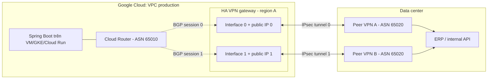
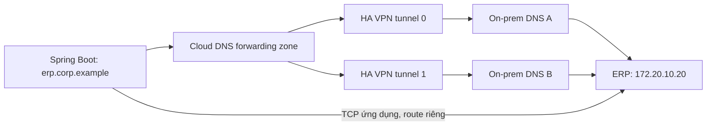
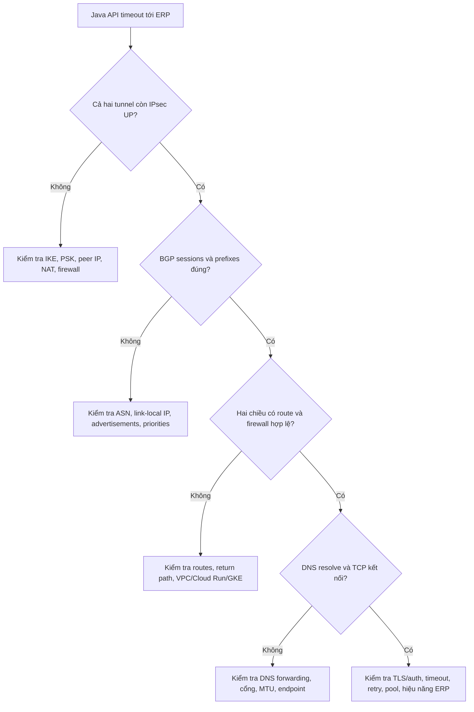

# HA VPN và thiết kế kết nối dự phòng

## 1. Bài toán kết nối hybrid cho hệ thống Java

Một doanh nghiệp đang chuyển dần các ứng dụng Java từ trung tâm dữ liệu riêng (**on-premises**) lên **Google Cloud**. API Spring Boot chạy trên **Cloud Run** hoặc **GKE** cần gọi một hệ thống ERP vẫn đặt tại văn phòng; ứng dụng trên **Compute Engine** phải truy vấn dịch vụ nội bộ; đội vận hành cần truy cập bằng địa chỉ riêng để kiểm tra sự cố. Kết nối Internet thông thường không đem lại một đường mạng riêng có mã hóa giữa hai địa điểm, còn một VPN tunnel duy nhất trở thành điểm gián đoạn khi thiết bị, phiên IPsec hoặc tuyến truyền bị lỗi.

**High Availability VPN (HA VPN)** của Google Cloud cung cấp các gateway được thiết kế để có khả năng sẵn sàng cao, với **hai interface** và các **IPsec tunnel** dùng **định tuyến động BGP** qua **Cloud Router**. Khi thiết kế đầy đủ cả phía Google Cloud và phía đối tác, hệ thống có thể duy trì đường truyền khi một tunnel hoặc thiết bị bị hỏng. Tuy nhiên, “có HA VPN” không đồng nghĩa toàn bộ ứng dụng được bảo đảm luôn hoạt động: mạng doanh nghiệp, ISP, DNS, firewall, dịch vụ đích và phần mềm Java đều tham gia vào chuỗi độ tin cậy.

Trong chương **DNS và kết nối hybrid** thuộc mô-đun **CLOUD_PROVIDERS_GCP**, bài học này tập trung vào **HA VPN và thiết kế kết nối dự phòng**: cấu trúc hai tunnel, thiết kế đầu đối tác, BGP failover, định tuyến hai chiều, DNS nội bộ, giám sát, thử nghiệm sự cố và cân bằng giữa độ tin cậy với chi phí.

### Kết quả học tập

Sau bài này, bạn có thể:

1. Mô tả thành phần **HA VPN gateway, external peer VPN gateway, VPN tunnel, Cloud Router, BGP session** và các mạng nguồn/đích.
2. Vẽ được ít nhất hai topology kết nối dự phòng và giải thích điều kiện **SLA 99,99%** của HA VPN phía Google Cloud.
3. Chọn giữa **active-active** và **active-passive**, hiểu vai trò **BGP route priority/MED**, ECMP và sự khác nhau giữa tunnel status với application health.
4. Thiết kế các dải CIDR, ASN, BGP link-local IP, đường truyền dự phòng, firewall, DNS forwarding và kịch bản failover.
5. Thực hiện lab tạo gateway/Cloud Router, cấu hình hai tunnel và kiểm tra trạng thái bằng Console hoặc `gcloud`.
6. Xác định các cảnh báo, thử nghiệm chuyển tuyến và chi phí cần theo dõi trước khi đưa hệ thống hybrid vào production.

## 2. Nền tảng: vì sao một VPN tunnel chưa đủ?

### 2.1. Các lớp cần có trong một kết nối

Kết nối giữa VPC Google Cloud và doanh nghiệp bao gồm nhiều lớp, mỗi lớp có thể hỏng độc lập:

| Lớp | Thành phần | Khi xảy ra sự cố |
| --- | --- | --- |
| Địa chỉ và đường Internet | Public IP gateway, ISP, nhà mạng, NAT nếu có | Hai điểm kết thúc không trao đổi được gói tin IPsec |
| Bảo mật tunnel | IKE/IPsec security association, shared secret, cipher | Handshake thất bại, tunnel không hình thành |
| Định tuyến | Cloud Router, BGP peers, routes được quảng bá/nhận | Tunnel có thể còn hoạt động nhưng không có route tới subnet |
| Chính sách truy cập | Firewall GCP/on-premises, NetworkPolicy | Route đúng nhưng TCP/UDP bị chặn |
| Phân giải tên | Cloud DNS, DNS on-premises, forwarding | Ping IP được nhưng hostname thất bại |
| Ứng dụng | Spring Boot, JDBC, timeout, retry, connection pool | Network phục hồi nhưng request vẫn lỗi hoặc đứt phiên |

HA VPN tạo dự phòng ở những phần được cấu hình đúng; không tự động cung cấp dự phòng cho mọi thành phần còn lại.

### 2.2. HA VPN, Classic VPN và Cloud Interconnect

| Phương án | Đặc điểm | Khi nào nên cân nhắc |
| --- | --- | --- |
| **HA VPN** | IPsec, hai interface trên gateway, **BGP động** qua Cloud Router | Kết nối on-premises ↔ Google Cloud cần tính sẵn sàng cao, có thiết bị hỗ trợ BGP |
| **Classic VPN** | Mô hình VPN cũ, có thể dùng định tuyến tĩnh hoặc BGP tùy cấu hình | Hệ thống tồn tại hoặc thiết bị không đáp ứng mô hình HA VPN; cần đánh giá nâng cấp |
| **Dedicated/Partner Interconnect** | Kết nối chuyên dụng qua nhà mạng/đối tác, tùy kiến trúc | Nhu cầu truyền dữ liệu lớn, latency ổn định hoặc yêu cầu đường riêng |
| **HA VPN over Cloud Interconnect** | IPsec bảo vệ traffic chạy qua Interconnect | Cần kết hợp kết nối chuyên dụng và mã hóa IPsec |

**Cloud VPN truyền IPsec qua mạng Internet**, dù mã hóa dữ liệu trong tunnel. Với yêu cầu đường vật lý chuyên dụng hoặc băng thông lớn, cần so sánh **Cloud Interconnect**. Với hệ thống nhỏ và vừa, HA VPN thường là điểm bắt đầu hợp lý nếu thiết bị doanh nghiệp hỗ trợ IKE/IPsec và BGP. Thông tin giá, tính năng và giới hạn cần kiểm tra theo region và kiểu kết nối.

## 3. Thành phần kiến trúc HA VPN

### 3.1. HA VPN gateway

Gateway HA VPN là tài nguyên **regional**, gắn với một **VPC network** và có **hai interface**, đánh số `0` và `1`. Khi tạo gateway IPv4 thông thường, Google Cloud cấp **hai external IP**, một cho mỗi interface; những IP này là đầu cuối **IPsec tunnel**, không phải địa chỉ IP nội bộ của VM.

HA VPN hỗ trợ các kiểu IP stack IPv4 và IPv6 theo cấu hình gateway và các điều kiện sản phẩm. Bài thực hành bên dưới dùng **IPv4** để dễ quan sát; nếu cần IPv6, phải chọn stack type, tunnel/BGP session và IPv6 routes phù hợp thay vì chỉ thay các địa chỉ IPv4 bằng IPv6.

### 3.2. Peer gateway và IPsec tunnel

**Peer VPN gateway** là thiết bị VPN ở data center hoặc ở mạng đối tác. Google Cloud biểu diễn đầu đối tác bằng một tài nguyên **external VPN gateway**, với một hoặc nhiều interface công khai được khai báo. Mỗi **VPN tunnel** liên kết một interface của HA VPN tới một interface bên peer; hai đầu phải khớp các tham số IKE/IPsec và khóa xác thực.

Một cặp tunnel có thể cùng vận chuyển traffic đến một nhóm subnet. Việc định tuyến một flow đi qua tunnel nào do **BGP và các ưu tiên route** quyết định. Đường IPsec đã `ESTABLISHED` chỉ chứng minh tunnel có phiên hoạt động, chưa chứng minh toàn bộ route và ứng dụng phía sau đã sẵn sàng.

### 3.3. Cloud Router và BGP sessions

Cloud Router trao đổi thông tin route với **BGP router** của peer VPN. Về phía Google Cloud, từng tunnel được kết nối tới một **Cloud Router interface** và một **BGP peer/session**. Cloud Router quản lý **control plane** để học và quảng bá route; **không phải máy chủ tự chuyển tiếp từng gói dữ liệu**.

Đối với IPv4 BGP, hai đầu tunnel thường dùng cặp địa chỉ **link-local** từ `169.254.0.0/16`; khi cấu hình thủ công, mỗi BGP interface dùng một mạng `/30` riêng, không được trùng với các BGP sessions khác trong cùng VPC. Chọn **ASN** riêng cho Google Cloud Router và phía đối tác, không trùng theo cách gây xung đột trong phiên BGP; các ví dụ ASN private là `65010` và `65020`.



Mũi tên BGP mô tả **trao đổi route**; đường dữ liệu của ứng dụng thực sự đi qua IPsec tunnel chứ không đi xuyên Cloud Router như một proxy. Sơ đồ dùng hai peer vật lý để minh họa **dự phòng đầu đối tác**.

## 4. Thiết kế topology và điều kiện SLA

### 4.1. Hai tunnel phải sử dụng cả hai interface

Để cấu hình đáp ứng điều kiện **SLA 99,99% phía Google Cloud** khi nối HA VPN đến peer phù hợp, phải có **ít nhất một tunnel trên mỗi interface** của HA VPN gateway. Hai tunnel cùng nối từ interface `0` nhưng bỏ trống interface `1` **không** đáp ứng yêu cầu này. Tunnel và BGP cũng phải cấu hình đúng theo topology được Google Cloud hỗ trợ.

**99,99% là điều kiện SLA của dịch vụ/cấu hình**, không phải cam kết hệ thống end-to-end sẽ luôn đạt đúng con số đó. Sự cố ISP, router peer, điện data center, DNS hoặc ứng dụng vẫn có thể làm hệ thống ngừng hoạt động.

### 4.2. Ba phương án đầu đối tác

| Topology HA VPN → peer | Cấu hình | Dự phòng peer thực tế |
| --- | --- | --- |
| **Hai peer VPN riêng biệt**, mỗi peer có một public IP | Tunnel 0: GCP interface 0 → Peer A; Tunnel 1: GCP interface 1 → Peer B | Tốt khi hai peer có nguồn điện, mạng và ISP thực sự độc lập |
| **Một peer VPN có hai public IP/interface** | Hai tunnel, mỗi interface Google Cloud tới một IP khác của peer | Dự phòng đường/interface; **một thiết bị vật lý** vẫn có thể là điểm lỗi chung |
| **Một peer VPN có một public IP** | Hai tunnel, mỗi interface Google Cloud tới cùng địa chỉ peer | Topology được hỗ trợ nếu gateway peer có **dự phòng nội bộ**; nguy cơ lỗi chung phụ thuộc thiết bị |

Google Cloud tài liệu hóa topology một hoặc hai thiết bị peer, kể cả trường hợp một public IP, có thể cấu hình đạt **99,99% SLA phía Google Cloud** khi đáp ứng yêu cầu. Nhưng để toàn bộ chuỗi có độ sẵn sàng cao, doanh nghiệp nên đánh giá **thiết bị, ISP, nguồn điện, routing và failover peer** thay vì chỉ kiểm tra điều kiện SLA GCP.

Nếu doanh nghiệp có hai phòng máy hoặc ISP, hãy xác định đúng failure domain: hai thiết bị nhưng cùng switch/đường cáp/nguồn điện vẫn chưa có dự phòng hoàn chỉnh. Có thể cần thêm gateway hoặc thiết kế kết nối ở địa điểm khác khi yêu cầu disaster recovery cao hơn một site.

### 4.3. HA VPN giữa hai VPC Google Cloud

Hai VPC có thể dùng một HA VPN gateway ở mỗi mạng để nối nhau. Với **hai gateway cùng region** và cặp tunnel `interface 0 ↔ interface 0`, `interface 1 ↔ interface 1` cấu hình đầy đủ, topology này có thể đạt **99,99% SLA**. Khi **hai HA VPN gateway ở hai region khác nhau**, tài liệu Google Cloud ghi mức **99,9% SLA** cho topology đó. Các VPC là tài nguyên global nên hai gateway cùng region vẫn có thể kết nối workload nằm ở region khác tùy dynamic routing mode.

Đây là điểm cần nhớ khi thiết kế mạng hub-spoke bằng HA VPN: **vị trí của gateway** ảnh hưởng trực tiếp đến SLA, không chỉ vị trí VM hoặc GKE cluster.

## 5. Active-active, active-passive và hành vi failover

### 5.1. Hai tunnel “đang hoạt động” khác với hai route “đang được sử dụng”

Với HA VPN, **cả hai tunnel và BGP session** có thể ở trạng thái `ESTABLISHED`, dù hệ thống được thiết kế **active-passive**. “Passive” thường chỉ có nghĩa route qua đường đó **ít được ưu tiên hơn**, chứ không có nghĩa tunnel bị tắt hoặc không có IPsec handshake.

| Cơ chế | Cấu hình route | Ưu điểm | Rủi ro |
| --- | --- | --- | --- |
| **Active-active** | Cùng prefix được quảng bá với ưu tiên tương đương; có thể dùng **ECMP** | Phân phối traffic qua nhiều tunnel, tăng tổng khả năng tải | Nếu một tunnel hỏng, lượng traffic dồn vào đường còn lại; phải có dư địa năng lực |
| **Active-passive** | Cùng prefix nhưng ưu tiên khác nhau, chọn đường ưu tiên hơn | Dễ đo năng lực sử dụng thông thường theo một đường; dự phòng sẵn | Có thể không tận dụng toàn bộ băng thông lúc bình thường |

Google Cloud khuyến nghị thường dùng **active-passive với một HA VPN gateway**, còn khi dùng **nhiều HA VPN gateway** nên cân nhắc **active-active**; thiết kế nào cũng phải đo băng thông sau failover theo nhu cầu ứng dụng. Không đặt active-passive tùy tiện trên nhiều gateway/tunnel vì cách chọn đường có thể khiến dung lượng dự phòng bị sử dụng kém hiệu quả.

### 5.2. BGP, MED và lựa chọn đường đi

Đối với một prefix đích như `172.20.0.0/16`, thiết bị peer có thể quảng bá đường đó trên cả hai BGP session. **MED/route priority** ảnh hưởng đường từ GCP về on-premises; **base advertised priority** trên Cloud Router ảnh hưởng việc peer ưu tiên hướng từ on-premises vào VPC. Trong hệ thống có nhiều ASN, chính sách BGP vendor hoặc tuyến BGP khác, cần kiểm tra các thuộc tính khác trong quy trình lựa chọn đường của peer.

Ví dụ ý tưởng (không phải cấu hình gcloud trực tiếp):

```text
Prefix on-premises: 172.20.0.0/16
Tunnel 0 / BGP 0: learned route priority 100 (ưu tiên hơn)
Tunnel 1 / BGP 1: learned route priority 200 (dự phòng)

GCP → on-premises: thường chọn tunnel 0 khi route/tunnel còn hợp lệ.
Khi tunnel 0 hỏng: route liên quan bị rút; tunnel 1 có thể được chọn.
On-premises → GCP: phải cấu hình ưu tiên chiều về tại router peer.
```

Trong Google Cloud, **số priority nhỏ hơn thường ưu tiên cao hơn** khi các route cùng độ dài prefix và cùng nhóm điều kiện chọn. Cần kiểm tra route selection cụ thể thay vì khẳng định một thông số MED đơn lẻ quyết định mọi tuyến. Với ECMP, **một flow đơn lẻ thường đi theo một đường** do băm theo flow; không giả định tổng băng thông của hai tunnel có thể cộng lại cho một kết nối TCP đơn.

### 5.3. Quá trình hội tụ sau lỗi

Khi tunnel mất kết nối, Cloud Router có thể **rút các dynamic routes học qua tunnel đó**; đường thay thế được lựa chọn theo route hiện có. Thời gian phát hiện và hội tụ phụ thuộc IKE/DPD, BGP keepalive/hold timer, thiết bị peer, mạng và route propagation. Một số gói tin hoặc kết nối TCP hiện hữu có thể lỗi trong lúc chuyển tuyến.

Với Spring Boot gọi ERP on-premises:

- Đặt **connect timeout**, **read timeout** và giới hạn tổng thời gian retry cho HTTP/JDBC client.
- Retry chỉ khi thao tác **an toàn/idempotent** hoặc có idempotency key; không tự gửi lại lệnh chuyển tiền hay tạo đơn nếu chưa đối soát.
- Dùng connection pool có kiểm tra connection hỏng và timeout phù hợp; các TCP connection qua tunnel cũ có thể không còn sử dụng được.
- Giám sát **p95 latency, error rate, timeout** của API cùng tunnel/BGP status; tunnel UP chưa đủ để đánh giá mục tiêu dịch vụ.

## 6. Quy hoạch mạng, BGP và ranh giới định tuyến

### 6.1. Bảng địa chỉ cho ví dụ thực hành

| Thành phần | Ví dụ | Vai trò |
| --- | --- | --- |
| Google Cloud VPC subnet | `10.20.0.0/16` | VM/GKE nodes/application egress |
| On-premises subnet | `172.20.0.0/16` | ERP và dịch vụ nội bộ |
| BGP tunnel 0 | `169.254.10.1/30` (GCP), `169.254.10.2` (peer) | Link-local BGP peering |
| BGP tunnel 1 | `169.254.11.1/30` (GCP), `169.254.11.2` (peer) | Link-local BGP peering dự phòng |
| Cloud Router ASN | `65010` | ASN bên Google Cloud |
| Peer router ASN | `65020` | ASN bên data center |

Đây là các giá trị **minh họa**, không phù hợp để copy nguyên vào mạng thực tế nếu có IP/ASN trùng. Hai BGP `/30` phải độc lập trong cùng VPC; IP của hai đầu mỗi tunnel nằm cùng link-local subnet. IP public của VPN gateway và IP bên peer là **địa chỉ kết thúc IPsec**, tách biệt các BGP link-local IP và IP ứng dụng.

### 6.2. Dynamic routing mode của VPC

VPC có thể cấu hình **regional** hoặc **global dynamic routing**. Trong **regional mode**, phạm vi học/quảng bá route theo region có thể giới hạn nơi dynamic routes có hiệu lực. Khi cần VM/GKE ở nhiều region truy cập on-premises qua một HA VPN, đánh giá **global mode** và điều chỉnh route priorities, firewalls/propagation phù hợp.

Không mặc định việc VPC global có nghĩa tất cả BGP routes được tự động quảng bá đến mọi vùng trong mọi trường hợp. Với **Shared VPC**, cần phân biệt **host project** sở hữu network/VPN/Cloud Router và **service project** chứa workloads.

### 6.3. Firewall, NAT, IKE/IPsec và MTU

Đường public giữa gateways phải cho phép trao đổi IKE/IPsec theo thiết bị và môi trường (thường có **UDP 500**, **UDP 4500 cho NAT-T**, và ESP trong trường hợp tương ứng). Cấu hình peer và firewall on-premises đúng các địa chỉ IP ngoài của hai HA VPN interface. Nếu peer ở sau NAT, kiểm tra các điều kiện **one-to-one NAT** được hỗ trợ; không giả định mọi kiểu port translation đều tương thích.

Trên VPC, firewall áp dụng cho workload; **việc có VPN tunnel không tự cấp quyền truy cập TCP/443, TCP/5432 hoặc bất kỳ cổng ứng dụng nào**. Mở ingress/egress theo source/destination cụ thể, ưu tiên nguyên tắc least privilege và phân biệt firewall VM/GKE với firewall trung tâm dữ liệu.

**MTU** cũng là yếu tố đáng lưu ý. Cloud VPN gateway MTU là **1460 byte** với Cloud VPN thông thường, nhưng **payload MTU thấp hơn** do bọc IPsec và phụ thuộc cipher, IP version, NAT-T. Nếu API Java truyền file lớn bị treo còn request nhỏ hoạt động, kiểm tra **Path MTU Discovery**, ICMP cần thiết và MSS clamping tại peer. Không chỉnh MTU bằng phỏng đoán mà không đo packet size và đường truyền.

## 7. Triển khai minh họa với gcloud

Các lệnh này dành cho **project học tập hoặc mạng test đã được phê duyệt**, chưa chạy trong bài học. Chúng chỉ thiết lập phía Google Cloud một phần kết nối; **bắt buộc phối hợp người quản trị peer** để cấu hình IKE/IPsec, BGP và ACL tương ứng. Các lệnh dùng cú pháp **Bash**, cần thay đúng tên project/region/network/IP, đồng thời có đủ IAM (thường là quyền quản trị mạng thích hợp) và bật **Compute Engine API**.

### Bước 1 — Xác minh VPC, region và tạo Cloud Router

```bash
gcloud config set project YOUR_PROJECT_ID
gcloud services enable compute.googleapis.com

# Dùng VPC đã có hoặc tạo trong lab được cho phép.
gcloud compute networks list
gcloud compute networks subnets list --regions=asia-southeast1

gcloud compute routers create java-hybrid-router \
  --network=YOUR_VPC \
  --region=asia-southeast1 \
  --asn=65010
```

Chọn ASN `65010` chỉ khi không xung đột với topology thực. Với Shared VPC, lệnh tạo network/router cần chạy trong **host project** hoặc bằng quyền truy cập vào host project.

### Bước 2 — Tạo HA VPN gateway và mô tả peer

```bash
gcloud compute vpn-gateways create java-ha-vpn \
  --network=YOUR_VPC \
  --region=asia-southeast1 \
  --stack-type=IPV4_ONLY

gcloud compute vpn-gateways describe java-ha-vpn \
  --region=asia-southeast1

# Ví dụ peer có hai public IP độc lập:
gcloud compute external-vpn-gateways create corp-vpn-peer \
  --interfaces 0=PEER_PUBLIC_IP_0,1=PEER_PUBLIC_IP_1
```

Đọc hai public IP được Google cấp cho **interface 0/1**, chuyển các IP này và cấu hình bảo mật cần thiết cho người quản trị peer. Nếu thực tế có **hai thiết bị VPN độc lập** hay **một thiết bị có một IP**, chọn kiểu external peer gateway phù hợp theo hướng dẫn Google Cloud; không khai báo hai IP giả nếu thiết bị chỉ có một.

### Bước 3 — Tạo hai tunnel trên hai interface

Ví dụ dưới đây nêu đúng các tham số cần thiết. `YOUR_STRONG_IKE_PSK` là **placeholder**, không phải một secret an toàn có thể sử dụng. **Không đưa PSK thật vào tài liệu, Git, ticket hoặc lịch sử shell**; vì flag `--shared-secret` chứa giá trị dòng lệnh, dùng quy trình quản lý secret và terminal bảo mật của tổ chức hoặc Console có kiểm soát quyền.

```bash
gcloud compute vpn-tunnels create java-tunnel-0 \
  --region=asia-southeast1 \
  --vpn-gateway=java-ha-vpn \
  --interface=0 \
  --peer-external-gateway=corp-vpn-peer \
  --peer-external-gateway-interface=0 \
  --router=java-hybrid-router \
  --ike-version=2 \
  --shared-secret=YOUR_STRONG_IKE_PSK

gcloud compute vpn-tunnels create java-tunnel-1 \
  --region=asia-southeast1 \
  --vpn-gateway=java-ha-vpn \
  --interface=1 \
  --peer-external-gateway=corp-vpn-peer \
  --peer-external-gateway-interface=1 \
  --router=java-hybrid-router \
  --ike-version=2 \
  --shared-secret=YOUR_STRONG_IKE_PSK
```

Có thể dùng **PSK khác nhau cho hai tunnel** theo chính sách an toàn, miễn mỗi cặp tunnel có giá trị trùng nhau ở hai đầu. Không thiết lập `--local-traffic-selector`/`--remote-traffic-selector` cho HA VPN định tuyến động theo cách của Classic VPN static/policy-based. Chú ý: hai tunnel sẽ chưa `ESTABLISHED` cho đến khi peer được cấu hình tương thích.

### Bước 4 — Gắn Cloud Router interfaces và BGP peers

```bash
# Tunnel 0: GCP 169.254.10.1 ↔ peer 169.254.10.2
gcloud compute routers add-interface java-hybrid-router \
  --interface-name=bgp-if-0 \
  --vpn-tunnel=java-tunnel-0 \
  --ip-address=169.254.10.1 \
  --mask-length=30 \
  --region=asia-southeast1

gcloud compute routers add-bgp-peer java-hybrid-router \
  --peer-name=peer-0 \
  --interface=bgp-if-0 \
  --peer-ip-address=169.254.10.2 \
  --peer-asn=65020 \
  --region=asia-southeast1

# Tunnel 1: GCP 169.254.11.1 ↔ peer 169.254.11.2
gcloud compute routers add-interface java-hybrid-router \
  --interface-name=bgp-if-1 \
  --vpn-tunnel=java-tunnel-1 \
  --ip-address=169.254.11.1 \
  --mask-length=30 \
  --region=asia-southeast1

gcloud compute routers add-bgp-peer java-hybrid-router \
  --peer-name=peer-1 \
  --interface=bgp-if-1 \
  --peer-ip-address=169.254.11.2 \
  --peer-asn=65020 \
  --region=asia-southeast1
```

Trên router peer, cấu hình **ASN 65020**, địa chỉ BGP link-local đối ứng, quảng bá prefix mạng on-premises và nhận prefix VPC đã được phép. Quy tắc quảng bá route của Cloud Router (default/custom) phải được kiểm tra theo dynamic routing mode. Nếu peer có nhiều ASN hoặc policy route đặc thù, cần điều chỉnh theo kiến trúc thật.

### Bước 5 — Kiểm tra trạng thái và route

```bash
gcloud compute vpn-tunnels list \
  --filter="region:(asia-southeast1)"

gcloud compute vpn-tunnels describe java-tunnel-0 \
  --region=asia-southeast1

gcloud compute vpn-tunnels describe java-tunnel-1 \
  --region=asia-southeast1

gcloud compute vpn-gateways get-status java-ha-vpn \
  --region=asia-southeast1

gcloud compute routers get-status java-hybrid-router \
  --region=asia-southeast1
```

Trên Console, xem **Hybrid Connectivity → VPN** và Cloud Router/BGP sessions. Xác minh **cả hai tunnel và cả hai BGP sessions**, prefixes học được, prefixes quảng bá và trạng thái HA. Một tunnel UP nhưng peer BGP DOWN vẫn có thể gây gián đoạn lưu lượng. Hoàn tất bằng test kết nối hai chiều từ workloads thật và ghi nhận độ trễ/tải trong lúc hoạt động bình thường.

## 8. Tích hợp HA VPN với DNS hybrid

**HA VPN vận chuyển gói IP**, không tự mang cơ chế phân giải DNS của doanh nghiệp. Nếu Spring Boot gọi `erp.corp.example`, kết nối có thể hoạt động theo IP nhưng thất bại theo tên do Cloud DNS không biết zone nội bộ; ngược lại, DNS trả đúng IP nhưng route/firewall ngăn TCP.

### 8.1. Từ Google Cloud truy vấn DNS on-premises

Thiết kế điển hình là **Cloud DNS forwarding zone** cho `corp.example.` tới IP của DNS server trong data center. Cloud DNS tiếp nhận truy vấn từ workload VPC và chuyển tiếp qua kết nối hybrid. Cần cấu hình DNS forwarding target, route về đúng máy DNS on-premises và **firewall UDP/TCP 53**.

Theo tài liệu Cloud DNS, truy vấn outbound-forwarded đến DNS on-premises có thể đến từ dải `35.199.192.0/19`. Do đó firewall/route phía doanh nghiệp phải hỗ trợ **đường đi về dải nguồn truy vấn đó**, thường cần **custom route advertisement từ Cloud Router** theo thiết kế, không chỉ route đến subnet VM/GKE.

### 8.2. Từ on-premises truy vấn private DNS trong Google Cloud

Cấu hình **Cloud DNS inbound forwarding policy** để hệ thống on-premises gửi truy vấn đến các inbound forwarding IP của Google Cloud được cấp trong VPC/subnet liên quan. Trên DNS on-premises, khai báo **conditional forwarder** cho `gcp.corp.example.` tới các IP đó. Cần route và firewall đến đúng inbound IP qua HA VPN; nếu muốn DNS có tính sẵn sàng cao, không trỏ duy nhất vào một máy DNS nội bộ hoặc một hướng truyền.

### 8.3. DNS và VPN dự phòng phải được kiểm thử cùng nhau



DNS forwarding và traffic ứng dụng không nhất thiết đi đúng cùng một tunnel theo từng flow. Sơ đồ minh họa **hai thành phần cần bảo vệ**, không phải gợi ý rằng DNS forwarding tự động cân bằng trên hai tunnel như hai load-balancer endpoints. Nếu DNS server chính hoặc tuyến IP đến DNS server lỗi, cần kiểm tra **DNS fallback, TTL/cache** và return routes, đồng thời kiểm tra traffic ứng dụng tới IP đích.

## 9. HA VPN với Compute Engine, GKE, Cloud Run và dịch vụ quản lý

### 9.1. Compute Engine

VM cùng VPC với HA VPN cần route đến on-premises được học qua Cloud Router, rule firewall phù hợp và không có route ưu tiên khác chặn đường. Không cần cấp external IP cho VM chỉ để truy cập on-premises qua VPN.

### 9.2. GKE

Với GKE, cần xem **node subnet**, **secondary IP ranges của Pod/Service** và **VPC dynamic routes** có được quảng bá/nhận phù hợp không. Kết nối VPN không tự cấp quyền cho pod; **Kubernetes NetworkPolicy**, VPC firewall, DNS của cluster và yêu cầu return route phía on-premises đều ảnh hưởng kết nối. Ứng dụng Java trong pod vẫn cần test hostnames, TCP, TLS và authentication.

### 9.3. Cloud Run

Cloud Run không mặc định gửi mọi lưu lượng private IP qua VPC. Muốn truy cập ERP qua HA VPN, cấu hình **Direct VPC egress** hoặc **Serverless VPC Access connector** theo kiến trúc hỗ trợ để lưu lượng tới prefix on-premises đi vào **đúng VPC** có Cloud Router/HA VPN. Với `private-ranges-only`, cần xác minh destination CIDR nằm trong nhóm được định tuyến qua VPC; nếu đích không thuộc các dải riêng được hỗ trợ, phải xem xét `all-traffic` và cấu hình route/NAT cho các luồng còn lại.

Đừng nhầm danh tính **runtime service account** (IAM khi gọi Google APIs) với route IP tới ERP: IAM không thay cho tunnel, và tunnel không thay xác thực của API.

### 9.4. Cloud SQL và managed services qua private network

Khi on-premises cần kết nối **Cloud SQL private IP** hoặc managed service bên trong producer VPC, có thể còn cần cấu hình **Private services access (PSA)**, Private Service Connect hoặc cơ chế riêng của dịch vụ. **VPC Peering không có transitive routing**, nên đường on-premises → VPN → consumer VPC → producer VPC cần kiểm tra chính sách **route import/export, Cloud Router advertisement và hỗ trợ hybrid connectivity** của từng sản phẩm. Không mặc định thiết lập HA VPN là đủ để truy cập mọi private endpoint trong Google Cloud.

## 10. Giám sát và xác nhận khả năng dự phòng

### 10.1. Theo dõi ở ba tầng

| Tầng | Tín hiệu kiểm tra | Công cụ |
| --- | --- | --- |
| VPN | Tunnel established, IPsec negotiation, bytes/packets sent/received, packet drops | Cloud VPN Console, **Cloud Logging**, **Cloud Monitoring** |
| BGP/routing | Session status, prefixes learned/advertised, HA configured status, thay đổi next hop | Cloud Router status, HA VPN gateway status, Network Intelligence Center khi hỗ trợ |
| Ứng dụng | Error rate, p95/p99 latency, timeout, retry, TCP connection failures, DNS resolution | Spring Boot/Micrometer, logs có correlation ID, synthetic checks |

Metric liên quan gateway như `vpn.googleapis.com/gateway/connections` có các nhãn kiểm tra **`configured_for_sla`**, **`gcp_service_health`** và **`end_to_end_health`** theo tài liệu Monitoring. Đừng xem một biểu đồ tunnel bytes bình thường là bằng chứng đầy đủ cho hai tunnel khỏe mạnh.

### 10.2. Runbook thử nghiệm failover

Trong môi trường test hoặc cửa sổ bảo trì đã được phê duyệt:

1. Xác nhận **hai tunnel/BGP peers UP**; ứng dụng Java gọi được endpoint on-premises và DNS resolve đúng.
2. Ghi lại đường route ưu tiên, bandwidth, latency và các lỗi nền.
3. **Vô hiệu hóa có kiểm soát một tunnel tại peer VPN** hoặc dùng quy trình kiểm thử vendor để mô phỏng sự cố; giữ tunnel còn lại hoạt động.
4. Quan sát BGP rút route/đổi next hop, test **GCP → on-premises** và **on-premises → GCP**, đo thời gian gián đoạn ở lớp ứng dụng.
5. Kiểm tra DNS forwarding, đặc biệt khi mất tuyến đang phục vụ DNS server chính.
6. Khôi phục tunnel, xác nhận hai phiên BGP UP và đường route trở lại theo chính sách; kiểm tra traffic không dao động bất thường.
7. Lưu kết quả, log, cảnh báo, nguyên nhân nếu failover chậm, và chỉnh cấu hình trong change review.

Không kiểm thử bằng cách xóa gateway hoặc reset toàn bộ connection production. **Mục tiêu là chứng minh đường dự phòng hoạt động thật sự** và đo tác động đến ứng dụng, kể cả khi bị lỗi DNS hoặc TCP session cũ.

### 10.3. Cảnh báo cần có

- Một tunnel hoặc BGP session mất trạng thái hoạt động, dù đường còn lại vẫn phục vụ được request.
- HA VPN gateway báo cấu hình không đủ SLA hoặc **end-to-end health** kém.
- Tunnel bandwidth/packet drops tăng và tiến gần ngưỡng thiết kế cho **trường hợp chỉ còn một đường**.
- Tỷ lệ timeout DNS, lỗi 5xx từ ERP, JDBC connection failures, p95 latency tăng sau khi route thay đổi.
- Cloud VPN/Cloud Router cấu hình bị thay đổi ngoài cửa sổ bảo trì; thay đổi IAM/firewall ảnh hưởng đường kết nối.

## 11. Chi phí, năng lực và lựa chọn dự phòng

**Dự phòng có chi phí thực**: hai tunnel, hai IP giao tiếp và thiết bị peer có thể kéo theo phí vận hành, bảo trì, địa chỉ, băng thông. Theo [Network Connectivity pricing](https://cloud.google.com/network-connectivity/pricing), Cloud VPN tính phí theo số tunnel và điều kiện gateway, **data transfer IPsec**, và một số tình huống địa chỉ public chưa được dùng; đơn giá cụ thể phụ thuộc loại tuyến và region. **Không** chỉ dự toán một tunnel rồi mặc định tunnel thứ hai là miễn phí.

Mô hình ước tính:

```text
Chi phí VPN tháng ≈ số tunnel tính phí × số giờ × đơn giá tunnel
                    + phí data transfer theo tuyến
                    + phí IP/managed networking khi áp dụng
                    + chi phí thiết bị và ISP phía doanh nghiệp
```

Khi tính **throughput sau failover**, giả sử bình thường hai tunnel active-active cùng chia 1,2 Gbps. Nếu một tunnel hỏng, tunnel còn lại cần chịu đến **1,2 Gbps** nếu muốn giữ nguyên năng lực. Nếu mỗi tunnel được thiết kế chỉ chịu 0,8 Gbps, hệ thống có thể quá tải sau khi chuyển tuyến. Đó là ví dụ giả định năng lực, **không phải giới hạn băng thông chính thức của Google Cloud**; tốc độ thực tế phụ thuộc thiết bị, packet size, RTT, packet loss và giới hạn sản phẩm.

Đối với bài toán chạy Java có traffic lớn hoặc yêu cầu đường truyền chuyên dụng, so sánh HA VPN với **Interconnect + phương án dự phòng** và cân nhắc mã hóa IPsec nếu cần. Kết luận dựa trên **SLO, RTO, RPO nếu có dữ liệu đồng bộ**, băng thông peak, chi phí và thời gian vận hành, không chỉ số lượng tunnel.

## 12. Lỗi thường gặp và cách chẩn đoán

| Hiện tượng | Nguyên nhân có thể | Cách kiểm tra |
| --- | --- | --- |
| Tạo một tunnel nhưng vẫn kỳ vọng 99,99% | Interface HA VPN thứ hai không có tunnel | `gcloud compute vpn-gateways get-status`, topology hai interface |
| IKE/IPsec không lên | Sai peer public IP, PSK, cipher, IKE version, NAT/firewall | Tunnel logs, security association, peer config, UDP 500/4500 |
| Tunnel UP nhưng BGP DOWN | Sai peer ASN, IP link-local/mask, BGP session hoặc chính sách | `gcloud compute routers get-status`, cấu hình peer |
| BGP UP nhưng không học prefix | Peer không quảng bá, import/export/filter sai | Xem learned/advertised routes và BGP policies |
| Chỉ chiều GCP → on-premises hoạt động | Thiếu route trở về hoặc firewall chiều ngược | On-prem route table, firewall hai bên, traceroute/flow logs |
| Khi tunnel chính hỏng, app timeout lâu | BGP hold time, route convergence, client timeout hoặc connection pool giữ socket cũ | So khớp tunnel/BGP timestamp với request logs |
| Tăng traffic làm tunnel nghẽn | Active-active không dự trữ công suất N-1 hoặc peer yếu | Per-tunnel bytes, drops, RTT, metrics ứng dụng |
| Lấy được IP nhưng không resolve DNS | Chưa có forwarding zone, firewall/route DNS, DNS server hỏng | `nslookup`/`dig`, inbound/outbound forwarding policy, UDP/TCP 53 |
| VM kết nối được, Cloud Run không | Chưa có VPC egress hoặc chọn sai network/subnet | Cloud Run revision VPC settings và routes |
| VM trong region khác không học route | VPC dynamic routing mode/region, scope quảng bá | Regional/global mode, Cloud Router advertised routes |
| Một tuyến BGP được ưu tiên bất thường | MED/priority/AS path hoặc prefix cụ thể hơn | BGP route selection cả hai đầu; kiểm tra longest-prefix-match |
| File lớn lỗi nhưng request nhỏ được | MTU/MSS/fragmentation hoặc timeout | ICMP Path MTU Discovery, TCP retransmits, peer MTU |

### Trình tự debug chuẩn



Nên lưu timeline sự cố: **tunnel xuống lúc nào, BGP rút route khi nào, request nào lỗi, DNS hết hạn cache khi nào, bao lâu app phục hồi**. Điều đó giúp phân biệt thời gian failover hạ tầng với thời gian khôi phục của Java client.

## 13. Bài thực hành

### Bài A — Thiết kế topology

Một doanh nghiệp có VPC `10.20.0.0/16` và ERP tại `172.20.0.0/16`. Vẽ hai sơ đồ: (1) hai tunnel tới **một peer hai public IP**, (2) hai tunnel tới **hai thiết bị peer độc lập**. Đánh dấu failure domain của gateway, ISP và nguồn điện. Với từng sơ đồ, giải thích điều kiện đạt SLA phía Google Cloud và rủi ro phía doanh nghiệp.

### Bài B — Phân tích BGP

Hai tunnel cùng học `172.20.0.0/16`, ban đầu ưu tiên 100 và 200. Hãy mô tả đường GCP đi khi cả hai UP; khi tunnel ưu tiên 100 DOWN; sau khi nó phục hồi. Nêu cần kiểm tra cấu hình gì ở peer để bảo đảm **đường trở về** tương ứng.

### Bài C — Thực hành CLI và quan sát

Trong project/lab có quyền phù hợp, tạo HA VPN gateway và Cloud Router ở cùng region, cấu hình hai tunnels và BGP tới peer test. Ghi lại hai external IP, hai BGP `/30` và kết quả `get-status` của VPN gateway/Cloud Router. Nếu không có thiết bị peer hoặc billing, chỉ cần xây bảng thiết kế và mô phỏng trạng thái; không phát sinh VPN resources thật.

### Bài D — Kiểm tra application failover

Một Spring Boot API gọi `https://erp.corp.example/api/inventory` qua HA VPN. Đặt timeout, log correlation ID và metric request. Trong lab có kiểm soát, thử làm một tunnel mất kết nối, đo số request lỗi và thời gian khôi phục; so sánh với BGP convergence, kiểm tra DNS và xác định retry nào an toàn với nghiệp vụ.

### Bài E — DNS hybrid

Thiết kế Cloud DNS forwarding zone cho `corp.example.` và inbound forwarding cho tên nội bộ `gcp.corp.example.`. Liệt kê route, firewall, DNS IP và tập tin cấu hình cần thay đổi ở cả hai phía. Giải thích vì sao hai tunnel UP không bảo đảm DNS hoạt động sau khi một DNS server on-premises lỗi.

### Checklist

- [ ] Tôi phân biệt được HA VPN, Classic VPN, Interconnect và HA VPN over Interconnect.
- [ ] Tôi mô tả được hai HA VPN interfaces, hai tunnels, Cloud Router và BGP sessions.
- [ ] Tôi biết SLA 99,99% phụ thuộc vào cấu hình hai interface, không bảo đảm uptime của peer/ứng dụng.
- [ ] Tôi giải thích được active-active, active-passive, ECMP, MED và route priority.
- [ ] Tôi có bảng subnet/CIDR, hai BGP `/30` không trùng, ASN và return routes.
- [ ] Tôi biết kiểm tra tunnel, BGP, learned/advertised routes và cấu hình đủ SLA.
- [ ] Tôi đã xem xét firewall, NAT-T, MTU, Cloud DNS forwarding và đường vào VPC của Cloud Run/GKE.
- [ ] Tôi có kịch bản failover một tunnel và kiểm tra kết nối **hai chiều**.
- [ ] Tôi theo dõi tunnel health cùng error rate, latency và DNS của ứng dụng Java.
- [ ] Tôi đã dự toán chi phí cho cả hai tunnels, traffic, ISP/peer devices và năng lực khi chỉ còn một tuyến.

HA VPN trở thành **kết nối dự phòng đáng tin cậy** khi cả hai interface của Google Cloud và hệ thống peer có đường truyền độc lập, BGP được cấu hình hai chiều, DNS và firewall đúng, và ứng dụng Java được thiết kế chịu được những gián đoạn ngắn trong lúc định tuyến hội tụ. Đối với môi trường production, hãy **kiểm thử failover thật sự** và đo kết quả trên ứng dụng trước khi dựa vào sơ đồ HA để khẳng định khả năng phục hồi.

## 14. Nguồn Google Cloud tham khảo

- [Cloud VPN overview](https://cloud.google.com/network-connectivity/docs/vpn/concepts/overview)
- [HA VPN topologies và điều kiện availability SLA](https://cloud.google.com/network-connectivity/docs/vpn/concepts/topologies)
- [Cloud VPN best practices](https://cloud.google.com/network-connectivity/docs/vpn/concepts/best-practices)
- [Create HA VPN to a peer VPN gateway](https://cloud.google.com/network-connectivity/docs/vpn/how-to/creating-ha-vpn)
- [Cloud Router: route priority](https://cloud.google.com/network-connectivity/docs/router/how-to/updating-priority)
- [Check Cloud VPN status and BGP](https://cloud.google.com/network-connectivity/docs/vpn/how-to/checking-vpn-status)
- [Cloud VPN logs and metrics](https://cloud.google.com/network-connectivity/docs/vpn/how-to/viewing-logs-metrics)
- [Cloud DNS best practices for hybrid DNS](https://cloud.google.com/dns/docs/best-practices)
- [Cloud VPN MTU considerations](https://cloud.google.com/network-connectivity/docs/vpn/concepts/mtu-considerations)
- [Network Connectivity pricing](https://cloud.google.com/network-connectivity/pricing)
