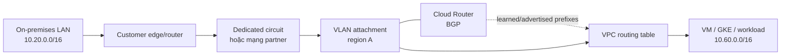
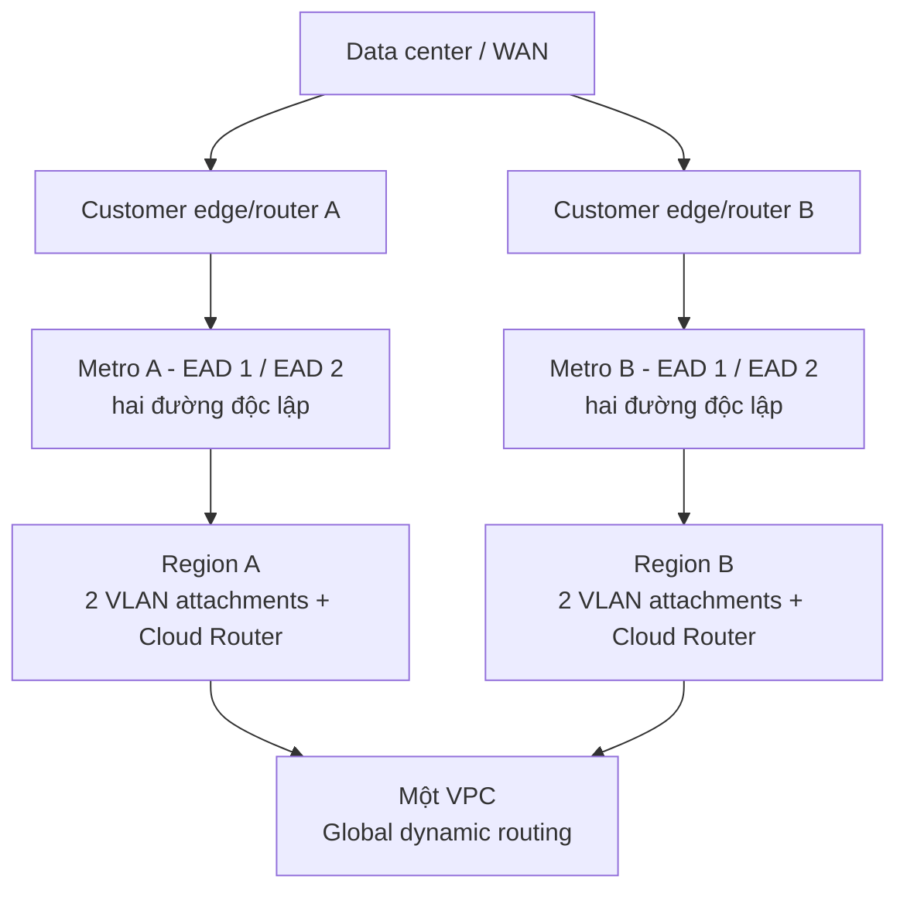
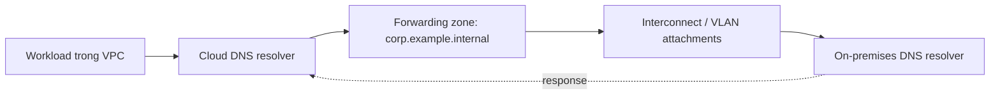

# Dedicated Interconnect và Partner Interconnect

Khi doanh nghiệp đặt một phần hệ thống tại trung tâm dữ liệu riêng (on-premises) và phần còn lại trên Google Cloud, các dịch vụ như Compute Engine, GKE, Cloud Run, Cloud SQL hoặc máy chủ DNS nội bộ cần trao đổi dữ liệu **ổn định, có khả năng dự phòng và được kiểm soát đường đi mạng**. Nếu lưu lượng lớn hoặc có yêu cầu độ trễ ổn định, dùng Internet công cộng làm đường kết nối duy nhất có thể không phù hợp. **Cloud Interconnect** cung cấp các đường kết nối giữa mạng doanh nghiệp và mạng Google để hỗ trợ kiến trúc hybrid.

Hai lựa chọn cốt lõi là **Dedicated Interconnect** và **Partner Interconnect**. Chúng cùng phục vụ kết nối riêng tư giữa on-premises và VPC nhưng khác cách cung cấp đường vật lý, điều kiện địa điểm, trách nhiệm vận hành và chi phí. Bài học thuộc chương **DNS và kết nối hybrid**, tập trung vào cách lựa chọn, thiết kế đường đi, cấu hình Cloud Router/BGP, tích hợp DNS, tăng tính sẵn sàng và điều tra sự cố.

> Tên project, subnet, địa chỉ IP, lưu lượng và sơ đồ trong bài chỉ là ví dụ học tập; không đại diện cho hệ thống thật. Những lệnh tạo kết nối hoặc thay đổi mạng cần được thực hiện trong môi trường đã được phê duyệt.

## Mục tiêu học tập

Sau bài này, bạn có thể:

1. Phân biệt Dedicated Interconnect, Partner Interconnect và HA VPN theo nhu cầu băng thông, vị trí, bảo mật, SLA và mô hình trách nhiệm.
2. Giải thích vai trò của **Cloud Interconnect connection**, **VLAN attachment**, **Cloud Router**, **BGP session**, **edge availability domain**, **region** và **VPC**.
3. Thiết kế luồng cấp phát cho Dedicated và Partner, bao gồm cross-connect, pairing key, L2/L3 và kích hoạt attachment.
4. Đọc tuyến đường được trao đổi qua BGP, phân biệt **regional/global dynamic routing** và phát hiện CIDR trùng lặp.
5. Lập mô hình dự phòng theo yêu cầu 99,9% hoặc 99,99%, kiểm tra khả năng chịu lỗi khi một đường kết nối mất.
6. Xác định các lớp bảo mật, mã hóa, DNS forwarding, firewall, IAM và chi phí cần xét trong kiến trúc hybrid.
7. Dùng Google Cloud console và `gcloud` để kiểm tra trạng thái kết nối, VLAN attachment, BGP và nguyên nhân lỗi.

## 1. Cloud Interconnect là gì?

**Cloud Interconnect** là nhóm dịch vụ kết nối mạng Google Cloud với mạng bên ngoài thông qua đường truyền riêng hoặc qua nhà cung cấp mạng được hỗ trợ. Trong hai mô hình được xét ở bài này, lưu lượng giữa mạng doanh nghiệp và VPC đi qua Cloud Interconnect **không đi qua Internet công cộng** như đường truyền của Cloud VPN thông thường.

Hai mô hình:

| Tiêu chí | **Dedicated Interconnect** | **Partner Interconnect** |
| --- | --- | --- |
| Đường kết nối | Kết nối vật lý trực tiếp từ thiết bị/router khách hàng đến mạng Google tại địa điểm colocation được hỗ trợ | Kết nối gián tiếp qua mạng của **supported service provider** có sẵn đường tới Google |
| Phù hợp | Doanh nghiệp có nhu cầu băng thông cao, kết nối được tới colocation và muốn kiểm soát đường vật lý | Doanh nghiệp ở xa colocation, cần ít băng thông hơn hoặc muốn nhà mạng quản lý kết nối |
| Ai cấp phát kết nối vật lý? | Khách hàng phối hợp nhà cung cấp colocation/cross-connect và Google | Nhà cung cấp Partner Interconnect |
| Băng thông | Đặt circuit 10/100/400 Gbps, có thể ghép nhiều circuit theo giới hạn hiện hành | Mua dung lượng **VLAN attachment** theo gói nhà cung cấp cung cấp; không phải mua cả circuit 10 Gbps |
| Thành phần phía Google Cloud | Interconnect connection + VLAN attachment + Cloud Router | VLAN attachment + Cloud Router; nhà cung cấp quản lý đường Partner |
| BGP | Cloud Router với router của doanh nghiệp | L2: Cloud Router ↔ router doanh nghiệp; L3: Cloud Router ↔ router của nhà cung cấp |
| Chi phí ngoài Google Cloud | Cross-connect, colocation, thiết bị và vận hành đường truyền | Phí dịch vụ từ partner, thiết bị/đường truy nhập theo hợp đồng |
| Điểm cần kiểm soát | Vị trí Google edge, port/circuit, thiết bị, LACP và khả năng dự phòng | Khả năng cung cấp tại địa điểm, loại L2/L3, SLA của partner, pairing và activation |

**Cả hai đều dùng VLAN attachment để gắn kết nối vào một VPC thông qua Cloud Router**. VLAN attachment không phải máy ảo, IP public hay một VLAN tự động xuất hiện trong toàn bộ mạng doanh nghiệp.

### So sánh với HA VPN

| Cơ chế | Đường truyền | Mã hóa mặc định | Khi nên cân nhắc |
| --- | --- | --- | --- |
| **HA VPN độc lập** | IPsec tunnel qua Internet công cộng | Có, IPsec | Bắt đầu nhanh, băng thông vừa phải, đường backup |
| **Dedicated Interconnect** | Đường riêng trực tiếp đến Google | Không tự mã hóa payload | Cần băng thông lớn và kiểm soát kết nối vật lý |
| **Partner Interconnect** | Đường riêng qua service provider | Không tự mã hóa payload | Xa colocation, cần dung lượng linh hoạt và partner vận hành |
| **HA VPN over Cloud Interconnect** | IPsec tunnel chạy **trên** VLAN attachments của Interconnect | Có, IPsec | Cần cả đường truyền riêng lẫn bảo mật lưu lượng bằng IPsec |

**Điểm quan trọng:** “Không đi qua Internet công cộng” **không có nghĩa là dữ liệu tự được mã hóa**. Nếu có yêu cầu mã hóa dữ liệu khi truyền, đánh giá **HA VPN over Cloud Interconnect** hoặc **MACsec** trên các kết nối được hỗ trợ, cùng các giải pháp TLS ở tầng ứng dụng. Bảo mật và topology SLA của mỗi giải pháp phải kiểm tra riêng.

## 2. Hiểu các thành phần trước khi đặt kết nối

### 2.1 Interconnect connection

Với **Dedicated**, đây là kết nối logic tới Google gồm một hoặc nhiều circuit vật lý cùng loại. Doanh nghiệp có thể đặt 10, 100 hoặc 400 Gbps/circuit, với giới hạn số circuit theo tài liệu hiện hành và địa điểm cung cấp. Phần cứng, chuẩn quang và LACP phải phù hợp yêu cầu Google.

Với **Partner**, khách hàng thường không tự tạo Dedicated Interconnect connection trong project của mình: nhà cung cấp có hạ tầng/kết nối tới Google và cấp dịch vụ cho khách hàng dựa trên pairing.

### 2.2 VLAN attachment

**VLAN attachment** (API resource type `interconnectAttachment`) là kết nối **logic, có region và bandwidth đã cấu hình**, giữa một đường Interconnect và Cloud Router. Một Interconnect connection có thể phục vụ nhiều VLAN attachments, nhưng **tổng bandwidth cấu hình lớn hơn bandwidth vật lý không tạo ra thêm công suất vật lý**.

VLAN attachment gắn với **một region**, một **Cloud Router** và một project. Nó gắn gián tiếp với **một VPC** vì mỗi Cloud Router thuộc một VPC. Các attachment khác nhau có thể phục vụ những VPC/project được tổ chức cấp phép phù hợp.

### 2.3 Cloud Router và BGP

**Cloud Router** là dịch vụ điều khiển tuyến đường (control plane) được Google quản lý, dùng **Border Gateway Protocol (BGP)** để trao đổi prefix giữa mạng ngoài và VPC. Cloud Router quản lý BGP session và tuyến động; **nó không phải thiết bị xử lý/chuyển tiếp gói dữ liệu**. Việc chuyển tiếp diễn ra trên hạ tầng mạng của Google Cloud.

Về mặt logic:



Các đường nét thể hiện luồng khái niệm. BGP trao đổi tuyến, còn luồng dữ liệu qua Google edge và VLAN attachment. Một BGP session **UP/ESTABLISHED** là điều kiện cần nhưng **không đủ** để khẳng định ứng dụng truy cập được: còn firewall, địa chỉ đích, routes, DNS và quyền dịch vụ.

### 2.4 Metro, edge availability domain và region

- **Metro** là khu vực đô thị nơi Google cung cấp điểm hiện diện kết nối.
- **Edge availability domain (EAD)** là miền khả dụng ở biên mạng Google; phân phối các kết nối qua những EAD khác nhau giảm rủi ro bảo trì/sự cố chung.
- **Region** là vị trí logic của VLAN attachment và Cloud Router trong VPC. Region của attachment **không đồng nghĩa** vị trí metro/colocation vật lý.
- **Zone** như `asia-southeast1-b` là zone điện toán; không được nhầm với EAD của Cloud Interconnect.

Việc chọn metro và region ảnh hưởng cả **độ trễ, tuyến đường, vùng được phép truy cập và chi phí truyền dữ liệu**.

## 3. Dedicated Interconnect: mô hình và quy trình cấp phát

### Kiến trúc cơ bản

```text
Doanh nghiệp/on-premises                 Google Cloud

LAN -- CE router -- cross-connect -- Google edge
                                       |
                                  Dedicated Interconnect
                                       |
                                  VLAN attachment (regional)
                                       |
                                  Cloud Router (BGP)
                                       |
                                  VPC + workload
```

Với một kết nối Dedicated, khách hàng đặt circuit đến một **colocation facility** được Google hỗ trợ; nếu router nội bộ không nằm trong facility đó, có thể cần một dịch vụ truyền dẫn tới colocation. Việc đặt circuit vật lý **khác** thao tác tạo VLAN attachment trong project.

### Trình tự triển khai

1. **Thiết kế:** Chọn metro/colocation, port capacity, tiêu chuẩn quang, kết nối dự phòng, nhu cầu lưu lượng và hợp đồng chỗ đặt/router.
2. **Yêu cầu Dedicated connection:** Đặt connection/circuit qua Google Cloud theo hướng dẫn sản phẩm. Google phát hành thông tin như **LOA-CFA (Letter of Authorization and Connecting Facility Assignment)** cho từng connection để đơn vị colocation bố trí cross-connect.
3. **Kết nối vật lý:** Đơn vị colocation nối cổng khách hàng với Google edge; cấu hình phần cứng/LACP, kiểm tra trạng thái link và các yêu cầu kiểm thử.
4. **Chuẩn bị VPC và Cloud Router:** Chọn region, VPC network và ASN thích hợp; đảm bảo CIDR on-premises không đè lên subnet VPC.
5. **Tạo Dedicated VLAN attachment:** Gắn connection vật lý với Cloud Router trong region của project.
6. **Thiết lập BGP on-premises:** Đọc thông tin VLAN tag, BGP peer IP, Google ASN và session từ attachment/Cloud Router, cấu hình router đối tác.
7. **Xác minh routes và end-to-end:** Kiểm tra trạng thái connection, attachment, BGP, prefixes và firewall; thử từ hai phía bằng ứng dụng được phép.
8. **Chuẩn hóa HA/monitoring:** Thêm kết nối độc lập tại EAD/metro khác theo SLO, đo utilization và kiểm tra failover.

### Lệnh minh họa tạo Dedicated VLAN attachment

Giả sử Dedicated connection đã được đặt và kích hoạt, Cloud Router đã tồn tại trong region mục tiêu:

```bash
# MINH HỌA: thay các tên bằng tài nguyên hợp lệ trước khi dùng.
# Lệnh này TẠO VLAN attachment, có thể phát sinh phí.
gcloud compute interconnects attachments dedicated create onprem-ded-a \
  --project=retail-net-prod \
  --region=asia-southeast1 \
  --router=cr-hybrid-sg \
  --interconnect=ded-connection-a
```

Sau lệnh, người vận hành cần đọc attachment và cấu hình BGP tương ứng trên router phía doanh nghiệp. **Không sao chép một VLAN tag hoặc IP BGP peer từ ví dụ** vì chúng phải đúng với attachment thực tế.

**Khả năng thay đổi dung lượng:** Link type Dedicated đã chọn khi tạo connection (10/100/400 Gbps) không thể đổi đơn giản tại chỗ sang một loại khác. Khi chuyển sang link type mới cần lập kế hoạch connection mới và cutover. Để dùng dung lượng lớn, có thể cần nhiều VLAN attachments.

### Yêu cầu mạng phía khách hàng

Đội network phải xác nhận cổng router, optics, LACP, dot1q VLAN, BGP, IP và cấu hình thiết bị hỗ trợ circuit theo loại link đã chọn. Đừng giả định chỉ cần mở firewall trong VPC là đường vật lý sẽ UP.

## 4. Partner Interconnect: mô hình và quy trình cấp phát

Partner Interconnect phù hợp khi doanh nghiệp **không có đường thuận tiện tới Google colocation** hoặc muốn dùng dung lượng nhỏ hơn cả circuit Dedicated. Khách hàng mua dịch vụ kết nối từ **supported service provider**. Provider có đường tới Google và chịu trách nhiệm phần dịch vụ đã cam kết cho khách hàng.

```text
Doanh nghiệp/on-premises          Nhà cung cấp Partner       Google Cloud

LAN -- CE router ----------> Mạng partner ------------> Google edge
                                     |                        |
                            Partner connection          VLAN attachment
                                                             |
                                                          Cloud Router
                                                             |
                                                            VPC
```

### Layer 2 và Layer 3

| Kiểu Partner | Ai thiết lập BGP với Cloud Router? | Đặc điểm |
| --- | --- | --- |
| **Layer 2 (L2)** | Router **on-premises** ↔ **Cloud Router** | Partner vận chuyển kết nối tầng 2; doanh nghiệp quản lý BGP ở thiết bị biên của mình |
| **Layer 3 (L3)** | Router **partner** ↔ **Cloud Router** | Partner quản lý BGP phía Google; cách kết nối/router on-premises ↔ partner tùy hợp đồng |

Với Partner Interconnect, Cloud Router được tạo với **ASN 16550** theo yêu cầu sản phẩm; phần kết nối và ASN ở đầu đối tác phải tuân theo mô hình L2/L3 của partner. **Không giả định mọi đường Partner đều dùng BGP trực tiếp giữa router on-premises và Google.**

### Các bước cấp phát

1. **Chọn partner:** Kiểm tra nhà cung cấp được Google hỗ trợ, địa điểm, kiểu L2/L3, bandwidth, SLA giữa doanh nghiệp–partner, thời gian cung cấp và các khoản phí riêng.
2. **Thiết kế region và HA:** Chọn VPC, Cloud Router, EAD, số lượng VLAN attachments và cách chia tuyến dự phòng.
3. **Tạo VLAN attachments Partner** trong Google Cloud. Mỗi attachment cấp **pairing key** dành riêng cho kết nối yêu cầu.
4. **Gửi pairing key cho đúng partner** cùng thông số capacity, location và thông tin hợp đồng. **Giữ pairing key ở kênh được bảo vệ** cho đến khi hoàn thành pairing.
5. **Chờ partner provision:** Attachment có thể ở trạng thái `PENDING_PARTNER`; sau cấu hình sẽ chuyển `PENDING_CUSTOMER` hoặc `ACTIVE` tùy cách kích hoạt.
6. **Xác minh provider và activate attachment:** Nếu chưa pre-activate, khách hàng xác nhận danh tính partner rồi chủ động kích hoạt để cho phép truyền dữ liệu.
7. **Xác minh BGP:** Với L2, cấu hình BGP trên router doanh nghiệp; với L3, partner quản lý BGP tới Cloud Router, doanh nghiệp phối hợp kiểm tra tuyến hai chiều.
8. **Thử failover, throughput và DNS** trước khi đưa ứng dụng quan trọng vào sử dụng.

### Lệnh minh họa tạo Partner VLAN attachment

```bash
# Cloud Router đã tồn tại ở region/VPC phù hợp (ASN 16550).
# Lệnh thay đổi tài nguyên và có thể phát sinh phí khi partner provision.
gcloud compute interconnects attachments partner create onprem-partner-a \
  --project=retail-net-prod \
  --region=asia-southeast1 \
  --router=cr-partner-sg \
  --edge-availability-domain=availability-domain-1

# Đọc attachment để lấy trạng thái và pairing key.
gcloud compute interconnects attachments describe onprem-partner-a \
  --project=retail-net-prod \
  --region=asia-southeast1
```

Thông tin `pairingKey` có thể có trong output: **không đưa key vào log công khai, ticket mở rộng hay ảnh chụp gửi sai người**. Chỉ bàn giao qua kênh an toàn với partner đã được xác thực.

**Activation:** Pre-activation có thể phù hợp cho kết nối **L3** khi đã tin tưởng provider và chấp nhận đường được kích hoạt ngay sau khi partner hoàn thành cấu hình. Nếu cần xác minh nhà cung cấp trước khi có lưu lượng, giữ bước kích hoạt thủ công. Với L2, pre-activation thường không đem lại lợi ích đáng kể vì doanh nghiệp vẫn phải cấu hình BGP.

### Dung lượng Partner

Partner Interconnect hỗ trợ nhiều mức capacity theo VLAN attachment, bắt đầu từ mức nhỏ như **50 Mbps**. Mức tối đa và bậc dung lượng được phép có thể thay đổi theo sản phẩm, khu vực và nhà cung cấp; **không phải mọi partner cung cấp mọi mức**. Cần đối chiếu trang **Cloud Interconnect limits/pricing** và báo giá thực tế của provider trước khi chốt thiết kế.

## 5. Các quyết định định tuyến với Cloud Router

Cloud Router dùng **BGP** để nhận các prefix từ on-premises và quảng bá các prefix của VPC (hoặc **custom advertised routes** được cấu hình). Ví dụ:

```text
On-premises: 10.20.0.0/16
VPC subnet: 10.60.10.0/24 (region A)
VPC subnet: 10.60.20.0/24 (region B)

On-prem router advertises: 10.20.0.0/16
Cloud Router advertises: 10.60.10.0/24 [and other eligible prefixes]
```

Khi BGP session thiết lập, VPC có thể nhận **custom dynamic routes** từ Cloud Router với next hop là attachment; phía doanh nghiệp nhận prefix do Cloud Router quảng bá. Tuyến chỉ đúng khi cả **đường đi và đường về** đều hợp lệ.

### 5.1 Regional và global dynamic routing

| VPC dynamic routing mode | Ý nghĩa khái quát | Tác động thiết kế |
| --- | --- | --- |
| **Regional** | Cloud Router learned routes có phạm vi vùng theo quy tắc regional | Cần xem workload ở region nào sử dụng được tuyến on-premises |
| **Global** | Learned routes được phân phối qua các region của VPC theo quy tắc global và có điều chỉnh ưu tiên/cost | Hữu ích cho đa vùng; cân nhắc đường đi xuyên region và phí liên vùng |

**Không nhầm** global dynamic routing với “mạng tự động đi đến mọi VPC” hoặc mọi dịch vụ Google Cloud. Nó vẫn nằm trong phạm vi VPC và các chức năng định tuyến được hỗ trợ, chịu giới hạn peering/NCC/Shared VPC tùy thiết kế.

### 5.2 CIDR không trùng nhau

Nếu on-premises và VPC cùng dùng `10.20.0.0/16`, việc quảng bá route có thể gây trùng lặp hoặc chọn tuyến sai. Trước khi provision:

- Lập IPAM cho các dải RFC1918/IPv6 giữa data center, VPC, GKE Pod/Service CIDR và mạng nhánh.
- Giữ subnet range ở hai phía **không chồng lấn**.
- Kiểm tra ranges được quảng bá, priority/advertisement và đường return.
- Nếu bắt buộc có overlapping CIDR, cần thiết kế NAT/translation phù hợp **theo tài liệu dịch vụ** trước khi kết nối.

### 5.3 Quảng bá tuyến và cân bằng đường

Với nhiều attachments, **ECMP (equal-cost multipath)** có thể cân bằng lưu lượng khi Google Cloud nhận các quảng bá cùng prefix và metric thích hợp. Phía on-premises cũng phải cấu hình định tuyến hai chiều và tiêu chí chọn đường phù hợp.

- **MED (Multi-Exit Discriminator):** Dùng BGP metric/route priority để điều hướng đường ưu tiên; điều chỉnh phải xem cả hướng đến VPC và hướng về on-premises.
- **AS path, prefix filtering:** Dùng theo chính sách router và giới hạn của Google Cloud; không quảng bá `0.0.0.0/0` hoặc các dải quá rộng khi không có yêu cầu và kiểm soát.
- **Capacity:** Nếu hai đường đều chạy 70% băng thông, mất một đường sẽ gây quá tải đường còn lại nếu không đủ headroom; thiết kế N-1 trước khi bật ECMP.
- **Dynamic routing ≠ forwarding policy:** Firewall, route priority, VPC peering hoặc policy-based routes vẫn có thể ảnh hưởng đường đi.

### 5.4 Kiểm tra Cloud Router, attachment và BGP

Các lệnh sau **chỉ đọc**:

```bash
PROJECT_ID="retail-net-prod"
REGION="asia-southeast1"
ROUTER="cr-hybrid-sg"
ATTACHMENT="onprem-ded-a"

gcloud compute routers describe "$ROUTER" \
  --project="$PROJECT_ID" \
  --region="$REGION"

gcloud compute routers get-status "$ROUTER" \
  --project="$PROJECT_ID" \
  --region="$REGION"

gcloud compute interconnects attachments describe "$ATTACHMENT" \
  --project="$PROJECT_ID" \
  --region="$REGION"

gcloud compute networks describe retail-vpc-prod \
  --project="$PROJECT_ID" \
  --format="yaml(name,routingConfig)"
```

Đọc `routers get-status` để xem **BGP peer status**, learned/advertised routes và dữ liệu định tuyến được công cụ trả về. Một lệnh `describe` thành công **không chứng minh** gói tin chạy được end-to-end.

## 6. Thiết kế sẵn sàng cao và SLA

Cloud Interconnect có **các topology được Google quy định để đủ điều kiện SLA**. Có một đường vật lý hoặc một VLAN attachment **không đủ** để đạt yêu cầu SLA ở mức cao, bất kể nhà cung cấp quảng cáo “đường riêng”.

### 6.1 Mục tiêu 99,9%

Với workload chấp nhận một số thời gian gián đoạn, topology **99,9%** thường dùng **hai kết nối/attachments dự phòng** trong một metro và đặt ở **hai edge availability domains khác nhau**, theo sơ đồ chính thức cho từng loại Dedicated/Partner. Đây không phải là “hai VLAN trên một đường vật lý”: cả hai đường cần tránh cùng một điểm lỗi mà tài liệu quy định.

### 6.2 Mục tiêu 99,99%

Với ứng dụng production quan trọng, Google khuyến nghị cấu hình **99,99%**. **Dedicated** và **Partner** có yêu cầu topology khác nhau:

| Phương án | Yêu cầu chính của cấu hình production 99,99% |
| --- | --- |
| **Dedicated Interconnect — đa vùng** | Ít nhất **4 Dedicated connections** phân bố trên **2 metros**, mỗi metro có hai edge availability domains; trong VPC có ít nhất **4 VLAN attachments** ở **2 regions**, tối thiểu một Cloud Router mỗi region, VPC dùng global dynamic routing |
| **Dedicated Interconnect — một vùng** | Có phương án được hỗ trợ với **4 Dedicated connections** trên hai tổ hợp facility/EAD hợp lệ **trong một metro**, 4 VLAN attachments ở một region low-latency tương ứng, theo connection group/topology Google quy định |
| **Partner Interconnect** | Ít nhất **4 VLAN attachments** trên **2 metros/2 regions**, hai EAD khác nhau mỗi metro; **2 Cloud Routers** (mỗi region một) và **global dynamic routing** |

**Lưu ý:** Các topology trên là bản tóm lược học thuật. Để yêu cầu SLA thực tế, phải đáp ứng **toàn bộ điều kiện** của tài liệu hiện hành, bao gồm topology, cấu hình router BGP, loại connection/attachment và các nghĩa vụ trong hợp đồng. SLA của Partner do Google cung cấp chỉ bao phủ **đoạn giữa VPC và mạng nhà cung cấp**, không tự bao phủ **last mile từ doanh nghiệp đến partner**. Cần xem SLA riêng của partner cho đường end-to-end.

### 6.3 Ví dụ mô hình dự phòng



Sơ đồ trên mô tả **mô hình đa vùng** nhằm làm rõ ý tưởng; nó không thay thế sơ đồ cấu hình chi tiết của Google. Với Dedicated, phải chọn connection/EAD, facility và attachment mapping đúng yêu cầu; với Partner, phải có hợp đồng/kết nối thực tới provider ở hai metros.

### 6.4 Failover chỉ đạt yêu cầu khi còn đủ công suất

Giả sử hai đường hoạt động cùng chia tải, mỗi đường có khả năng 2 Gbps. Tổng tải đỉnh là 3 Gbps:

```text
Khi cả hai đường hoạt động: 3 Gbps < tổng 4 Gbps
Khi một đường hỏng:      3 Gbps > 2 Gbps đường còn lại
                         => có nguy cơ nghẽn hoặc rớt gói
```

Thiết kế cho **N-1** phải giả định một đường mất và xác định đường còn lại cần xử lý bao nhiêu. Tính cả băng thông **thực sau overhead**, giới hạn traffic flow, packet-per-second và khả năng xử lý router/firewall tại on-premises.

## 7. Bảo mật khi dùng Cloud Interconnect

### 7.1 Đường riêng không đồng nghĩa đường đã mã hóa

Cloud Interconnect **không mã hóa lưu lượng mặc định**. Lựa chọn:

- **TLS/mTLS** ở tầng ứng dụng với dịch vụ hỗ trợ, bảo vệ payload từ nguồn đến đích ứng dụng.
- **HA VPN over Cloud Interconnect** khi muốn IPsec trên đường Interconnect, có chi phí/quota và topology riêng.
- **MACsec** khi cần mã hóa trên kết nối được sản phẩm hỗ trợ; MACsec bảo vệ **đoạn đường liên quan**, không tự cung cấp mã hóa đầu cuối xuyên mọi router/partner.

Nếu chính sách bắt buộc mã hóa trong quá trình truyền, hãy xác nhận rõ **điểm bắt đầu và kết thúc mã hóa**, khả năng hỗ trợ tại các địa điểm/vật lý, loại lưu lượng và trách nhiệm vận hành khóa.

### 7.2 Firewall và giới hạn truy cập

- Giữ **least privilege** bằng VPC firewall rules/Firewall Policies phù hợp, không mở toàn bộ từ `10.0.0.0/8` nếu chỉ một subnet quản trị cần tới một ứng dụng.
- Dùng **IAM** để giới hạn người có quyền tạo/sửa Interconnect attachments, Cloud Router và routes; quản lý tài khoản CI/IaC riêng.
- Sử dụng **Organization Policy** khi tổ chức cần hạn chế VPC nào được sử dụng Cloud Interconnect.
- Với hệ thống nhạy cảm, đánh giá **VPC Service Controls**, Private Google Access, và các hạn chế API phù hợp; các cơ chế này **không thay thế** định tuyến và firewall.
- Với partner, kiểm tra ranh giới trách nhiệm, access tới router, khả năng phân tách khách hàng và quá trình xử lý pairing key.

### 7.3 Phân tách mạng và vận hành

Trong hệ thống lớn, có thể tách project mạng Shared VPC host khỏi service projects, tổ chức routes và IAM tập trung. Khi đó cần phân biệt **project sở hữu Dedicated connection** với **project sở hữu VLAN attachment** để xác định quyền quản trị và phân bổ chi phí chính xác.

## 8. DNS hybrid đi qua Interconnect như thế nào?

Kết nối mạng IP ổn định chưa đủ cho ứng dụng nếu máy chủ **không phân giải được tên**. Ví dụ, ứng dụng trên Compute Engine/GKE cần gọi `db.corp.example.internal` do DNS on-premises quản lý; phía doanh nghiệp lại cần phân giải tên private của các dịch vụ trên Google Cloud.

Mô hình hai chiều có thể dùng **Cloud DNS forwarding zone, inbound DNS forwarding và DNS policies** theo nhu cầu:



**Đường tra cứu DNS** cần có đủ điều kiện:

1. Cloud DNS forwarding zone trỏ tới **IP DNS on-premises** (target address hợp lệ).
2. VPC/Cloud Router và đường Interconnect có **tuyến tới resolver**; nhiều cấu hình DNS hybrid cần **custom advertised routes** để lưu lượng DNS theo chiều ngược hoạt động.
3. Router/firewall cho phép lưu lượng DNS phù hợp, thường **UDP/TCP 53** và các địa chỉ/nguồn được sản phẩm sử dụng.
4. On-premises DNS resolver cho phép truy vấn từ nguồn tương ứng; chiều trả lời phải có tuyến về.
5. Các ứng dụng kiểm tra cả **DNS resolution** lẫn **TCP/HTTPS hoặc database connection** sau khi có IP.

Không giả định chỉ cần tạo VLAN attachment thì mọi tên nội bộ của Google Cloud và on-premises tự phân giải được. Với phân giải từ on-premises tới tên private trong VPC, cần thiết kế **inbound DNS server policy** và forwarder của doanh nghiệp đúng theo tài liệu Cloud DNS.

### DNS và Private Google Access

Truy cập **Google APIs** từ on-premises qua Cloud Interconnect là nhu cầu riêng với truy cập VM bằng private IP. Có thể cần cấu hình **Private Google Access for on-premises hosts**, DNS cho domain Google APIs và **custom advertised routes** phù hợp. Nó không có nghĩa toàn bộ endpoint Google được ánh xạ tới IP private của VPC. Phải xem danh sách API/địa chỉ được hỗ trợ và giới hạn VPC Service Controls nếu được sử dụng.

## 9. Chi phí và trách nhiệm thanh toán

Chi phí Cloud Interconnect gồm nhiều phần; chỉ so sánh “Mbps bao nhiêu tiền” thường không đủ.

| Thành phần | Dedicated Interconnect | Partner Interconnect |
| --- | --- | --- |
| Phí kết nối/circuit | Google tính phí theo giờ cho connection/circuit | Khách hàng thường trả phí dịch vụ đường kết nối cho **partner** |
| Phí VLAN attachment | Google tính phí theo capacity và thời gian attachment | Google tính phí theo capacity và thời gian attachment |
| Data transfer out | Google tính phí dữ liệu từ VPC đi qua attachment, phụ thuộc vị trí và điều kiện giá | Tương tự, phí theo Google Cloud; có thể thêm phí bandwidth từ partner |
| Data transfer in | Xem chính sách giá inbound của Google; các tài nguyên xử lý dữ liệu vẫn có thể tính phí | Tương tự |
| Colocation / cross-connect / last mile | Chi phí từ colocation/telco và thiết bị mạng | Chi phí từ nhà cung cấp, địa điểm, hợp đồng |
| HA VPN over Interconnect | Thêm các thành phần HA VPN/tunnel/IP theo loại triển khai | Tương tự |
| Tuyến liên vùng | Có thể phát sinh giá transfer giữa region | Có thể phát sinh giá transfer giữa region |

Phí **Dedicated connection** và phí **VLAN attachment** có thể thuộc **các project khác nhau**; phí **data transfer out** gắn với project sở hữu attachment theo quy tắc của Google Cloud. Với Shared VPC hoặc quản trị tập trung, nên ghi owner/billing project rõ ràng.

**Ví dụ phép tính dung lượng, không phải giá thực:**

```text
Hai attachments, mỗi attachment 1 Gbps.
Giả định vận hành 730 giờ/tháng.

Attachment-hours = 2 × 730 = 1.460 attachment-hours/tháng

Data transfer out = 5 TiB/tháng = 5.120 GiB/tháng
```

Để ra giá thực, nhập **location, capacity, số connections, số attachments, GiB outbound và thời gian** vào [Cloud Interconnect pricing](https://cloud.google.com/network-connectivity/docs/interconnect/pricing) hoặc calculator, rồi cộng giá partner/cross-connect và các dịch vụ mạng khác. Không dùng một đơn giá egress toàn cầu cho mọi region.

### Lập kế hoạch chi phí và rủi ro

- Mức băng thông được đặt có thể tính phí ngay cả khi ứng dụng chưa tạo traffic; đừng xem connection/attachment idle là miễn phí.
- Partner có thể có phí dịch vụ, thiết bị, lắp đặt, hỗ trợ hoặc cam kết riêng **ngoài hóa đơn Google Cloud**.
- Network egress giữa region nơi workload chạy và region của VLAN attachment có thể tính phí liên vùng; cần tối ưu vị trí.
- Dự phòng đủ SLA có thể **nhân số connection/attachment** và yêu cầu headroom, do đó tổng chi phí cao hơn thiết kế một đường.
- Sử dụng Cloud Billing budgets/alerts theo project, gắn labels khi được hỗ trợ và theo dõi công suất thực tế để tối ưu sau triển khai.

## 10. Chẩn đoán lỗi kết nối hybrid theo từng lớp

**Nguyên tắc:** Đừng kết luận “Google Cloud networking hỏng” khi chưa xác định lớp lỗi. Hãy đi từ vật lý → attachment → BGP → route → firewall → DNS → ứng dụng.

| Triệu chứng | Lớp kiểm tra | Hướng xác minh |
| --- | --- | --- |
| Dedicated connection không lên | Physical/optics/LACP | Cross-connect, LOA-CFA, port, transceiver, provider/colocation và link status |
| Partner attachment `PENDING_PARTNER` | Provisioning | Partner đã nhận đúng pairing key, location và capacity chưa |
| Partner attachment `PENDING_CUSTOMER` | Activation | Đã xác minh provider và activate attachment chưa |
| Attachment `ACTIVE` nhưng BGP DOWN | BGP/control plane | ASN, peer IP, VLAN tag, BGP session, firewall/router on-premises hoặc trách nhiệm partner L3 |
| BGP UP nhưng không thấy route on-premises | Route advertisement | On-premises có quảng bá đúng prefix không; lọc prefix, chính sách BGP và dynamic routing mode |
| Có route nhưng kết nối TCP thất bại | Data plane/firewall | Return route, firewall rules, network ACL, MTU, đúng đích/port |
| Một chiều truyền được, chiều kia không | Asymmetric routing | MED/route priority, tuyến về và thiết bị stateful firewall |
| Ứng dụng gọi IP được nhưng tên DNS lỗi | DNS | Forwarding zone, inbound policy, UDP/TCP 53, custom advertised routes, resolver |
| Mất một đường thì độ trễ tăng mạnh | HA/capacity | Đường N-1 có đủ capacity không; ECMP, BGP failover và thiết bị biên |
| Link đang UP nhưng mất gói lớn | MTU/fragmentation | MTU trên VPC, VLAN attachment, router, firewall; PMTUD |
| Data transfer cost tăng bất thường | Billing/routing | Region của workload/attachment, outbound GiB, cross-region transfer và partner fees |

### 10.1 Các lệnh kiểm tra chỉ đọc

```bash
PROJECT_ID="retail-net-prod"
REGION="asia-southeast1"

# Liệt kê VLAN attachments (Ded/Partner) trong project.
gcloud compute interconnects attachments list \
  --project="$PROJECT_ID"

# Xem attachment đã biết.
gcloud compute interconnects attachments describe onprem-ded-a \
  --project="$PROJECT_ID" \
  --region="$REGION"

# Với Dedicated: xem tình trạng connection vật lý đã đặt.
gcloud compute interconnects list \
  --project="$PROJECT_ID"

# Xem Cloud Router / BGP learned routes.
gcloud compute routers get-status cr-hybrid-sg \
  --project="$PROJECT_ID" \
  --region="$REGION"

# Xác minh VPC dynamic routing mode.
gcloud compute networks describe retail-vpc-prod \
  --project="$PROJECT_ID"
```

**Phân biệt trạng thái:** Attachment `ACTIVE` chỉ nghĩa kết nối logic đã được provision/activate; BGP session có thể chưa thiết lập. BGP `UP` cũng không chứng minh dữ liệu ứng dụng đến được server đích. Phải kiểm tra từng lớp và có phép thử nghiệp vụ phù hợp.

### 10.2 MTU và ứng dụng

Cloud Interconnect VLAN attachments có các giá trị MTU được hỗ trợ như **1440, 1460, 1500 hoặc 8896 bytes**, tùy kiểu attachment và cấu hình. Giá trị **8896 (jumbo frame)** chỉ hỗ trợ với một số loại VLAN attachment không mã hóa. Đội network nên cấu hình MTU tương thích trên VPC, VLAN attachment và thiết bị hai phía, thử **path MTU** để tránh lỗi “ping nhỏ được, chuyển gói lớn bị treo”.

### 10.3 Quan sát và cảnh báo

Theo dõi một số chỉ số:

- Trạng thái connection/attachment và thay đổi cấu hình.
- BGP session state, số prefix learned/advertised, lỗi flapping.
- Inbound/outbound throughput, mức sử dụng so với capacity, packet drops.
- RTT/latency, packet loss và thời gian chuyển tuyến khi failover.
- DNS latency, SERVFAIL/NXDOMAIN, timeout và tỉ lệ ứng dụng kết nối thất bại.
- Cảnh báo thiết bị biên, LACP/optics, partner ticket và bảo trì ở EAD/metro.

Lưu ý Cloud Router là **control plane**; chỉ nhìn số routes không cung cấp đầy đủ thông tin về packet forwarding. Sử dụng network observability, telemetry ở router và các log/dịch vụ tương ứng.

## 11. Case study: Kết nối data center với dịch vụ đặt hàng trên GCP

Doanh nghiệp bán lẻ có ERP và DNS nội bộ ở trung tâm dữ liệu. API đặt hàng chạy trên Google Cloud, dữ liệu nghiệp vụ được đồng bộ giữa ERP và một lớp dịch vụ trong VPC. Đội kiến trúc cần đường riêng, độ trễ ổn định và khả năng vận hành khi một đường bị gián đoạn.

### Yêu cầu giả định

| Yêu cầu | Giá trị minh họa |
| --- | --- |
| On-premises CIDR | `10.20.0.0/16` |
| Google Cloud VPC CIDR | `10.60.0.0/16` |
| Region workload chính | `asia-southeast1` |
| Region dự phòng | Region thứ hai theo thiết kế và tính sẵn có |
| Egress từ GCP về on-premises | Đỉnh 1,2 Gbps, trung bình thấp hơn |
| Dữ liệu nhạy cảm | Bắt buộc mã hóa trên đường truyền |
| SLO kết nối | Mục tiêu production 99,99% |
| DNS | Cần phân giải `corp.example.internal` trong VPC |

### Lựa chọn A: Dedicated Interconnect

Thích hợp nếu doanh nghiệp có khả năng kết nối đến địa điểm colocation được Google hỗ trợ, sở hữu/thuê đường truyền tốc độ cao và muốn quản trị thiết bị mạng trực tiếp. Nhưng mức tải 1,2 Gbps chưa chắc biện minh cho chi phí **circuit Dedicated tối thiểu** cùng các đường dự phòng; cần tính cả cross-connect và khả năng mở rộng trong vài năm.

Nếu chọn Dedicated, đội mạng phải thiết kế topology 99,99% đúng quy định, đảm bảo đủ circuit/attachment/EAD/metro. Vì có yêu cầu mã hóa, cần chọn **HA VPN over Cloud Interconnect** hoặc lớp mã hóa tương đương được hỗ trợ với scope rõ ràng.

### Lựa chọn B: Partner Interconnect

Thích hợp khi địa điểm không thuận tiện tới Google colocation hoặc doanh nghiệp muốn một provider cung cấp đường riêng với mức dung lượng theo nhu cầu. Cần chọn partner hỗ trợ **đủ metros/regions, L2 hoặc L3, dung lượng N-1 và cam kết SLA trên last mile**. Sau khi tạo pairing keys, chờ provider provision và activate từng attachment.

Cho mục tiêu 99,99%, phải có **4 attachments trên 2 regions và 2 metros**, với 2 EAD khác nhau mỗi metro, theo tài liệu topology. Kết nối private không mặc định mã hóa nên vẫn thiết kế HA VPN over Interconnect khi bắt buộc bảo vệ payload.

### Kiểm thử trước cutover

1. Đối chiếu CIDR và dải quảng bá giữa hai mạng; chặn quảng bá sai hoặc dải chồng lấn.
2. Kiểm tra tất cả BGP peers đều UP và số prefix learned/advertised đúng.
3. Thử truy cập bằng IP từ ERP tới workload và chiều trả lời; kiểm tra firewall và latency.
4. Kiểm tra Cloud DNS forwarding zone cho `corp.example.internal` và đường UDP/TCP 53.
5. Chạy thử upload/download theo kích thước gói và tốc độ khác nhau, đo MTU, throughput và packet loss.
6. **Diễn tập failover:** rút một đường hoặc mô phỏng bảo trì trong cửa sổ được duyệt; ghi thời gian phục hồi và công suất đường còn lại.
7. Xác minh payload được mã hóa theo yêu cầu bảo mật; xem audit log, alert và quyền IAM của nhóm vận hành.
8. So sánh chi phí thực/ước tính: phí attachment, dữ liệu outbound, partner/cross-connect, VPN và khả năng quan sát.

### Bàn giao sơ đồ vận hành

Tài liệu handoff phải ghi: project/VPC, region/metro/EAD, connection IDs/attachment IDs, ASN/BGP peers, tuyến quảng bá, dải CIDR, DNS zones, firewall, đầu mối provider, số hợp đồng/ticket và runbook failover. Giữ pairing key hoặc các thông tin nhạy cảm trong hệ thống bí mật phù hợp, tránh chèn vào tài liệu phổ biến rộng.

## 12. Các lỗi thiết kế thường gặp

| Nhầm lẫn | Điều cần sửa |
| --- | --- |
| “Đường Interconnect là IPsec VPN” | Không mặc định mã hóa; cần HA VPN over Interconnect hoặc cơ chế mã hóa phù hợp |
| “Có một đường 10 Gbps là đáp ứng 99,99%” | SLA phụ thuộc topology và số đường/EAD/metro/region theo tài liệu |
| “Partner chỉ khác Dedicated về giá” | Partner thay đổi trách nhiệm, khả năng L2/L3, cách provision, last mile và SLA |
| “Cứ BGP UP là truy cập ứng dụng được” | Còn routes hai chiều, firewall, DNS, ACL và sức khỏe dịch vụ |
| “Một VLAN attachment tự kết nối mọi VPC” | Attachment gắn gián tiếp với một VPC qua Cloud Router |
| “Router trong Google Cloud chuyển tiếp mọi gói” | Cloud Router là dịch vụ điều khiển tuyến BGP; không phải data-plane router |
| “Partner pairing key có thể đăng công khai” | Key phải bàn giao đúng partner qua kênh an toàn trước khi provision |
| “Không cần xét region của attachment” | Region ảnh hưởng dynamic routing, latency và phí dữ liệu liên vùng |
| “Tổng attachment bandwidth luôn bằng băng thông thực” | Bị giới hạn bởi circuit/partner, flow/PPS, router và các yếu tố hạ tầng |
| “DNS hybrid tự chạy khi có route” | Cần thiết kế forwarding, inbound policy, resolver, return routes và firewall |
| “Có hai attachments là luôn đủ khi một đường mất” | Phải đảm bảo **failure domain độc lập và công suất N-1** |
| “Mọi chi phí nằm trong hóa đơn Google Cloud” | Partner, colocation, cross-connect và thiết bị có hóa đơn riêng |

## 13. Bài tập thực hành

### Bài 1: Chọn Dedicated hay Partner?

Data center không có đường thuận tiện tới Google colocation; nhu cầu kết nối ban đầu 300 Mbps và muốn dùng nhà mạng quản trị kết nối. Chọn phương án nào, vì sao?

<details>
<summary>Gợi ý đáp án</summary>

**Partner Interconnect** thường phù hợp hơn: provider cung cấp kết nối từ địa điểm doanh nghiệp tới Google và hỗ trợ mức dung lượng nhỏ hơn một Dedicated circuit. Cần kiểm tra dịch vụ được cung cấp tại địa điểm, L2/L3, giá, SLA end-to-end và lộ trình tăng bandwidth.
</details>

### Bài 2: Nhận diện các thành phần

Một Dedicated connection có hai VLAN attachments ở hai region trong cùng một VPC. Cloud Router có vai trò gì? Một attachment thuộc bao nhiêu region và VPC?

<details>
<summary>Gợi ý đáp án</summary>

Cloud Router trao đổi BGP routes, không chuyển tiếp packet. Mỗi attachment thuộc **một region**, gắn một Cloud Router và gián tiếp gắn **một VPC**; connection vật lý có thể hỗ trợ nhiều attachments theo điều kiện sản phẩm.
</details>

### Bài 3: BGP UP nhưng ứng dụng không truy cập được

On-premises quảng bá `10.20.0.0/16`; VPC có `10.60.0.0/16`. BGP UP nhưng không kết nối TCP 443 được tới ứng dụng. Nêu tối thiểu năm điểm cần kiểm tra.

<details>
<summary>Gợi ý đáp án</summary>

Kiểm tra learned/advertised routes hai chiều, dynamic routing mode, resource IP/region, VPC firewall policy, on-premises firewall/ACL, return path, asymmetric routing, MTU và tình trạng ứng dụng. Nếu gọi bằng hostname, kiểm tra thêm DNS.
</details>

### Bài 4: Tính công suất khi failover

Hai đường dự phòng mỗi đường 2 Gbps; tải giờ cao điểm 3 Gbps, cùng hoạt động chia đều. Khi mất một đường, hệ thống có đảm bảo giữ được 3 Gbps không?

<details>
<summary>Đáp án</summary>

Không. Đường còn lại chỉ đạt công suất danh định 2 Gbps trước khi trừ overhead/các giới hạn khác, thấp hơn tải 3 Gbps. Cần tăng capacity, thêm đường độc lập hoặc có chính sách giảm tải phù hợp. SLA topology không thay thế thiết kế capacity N-1.
</details>

### Bài 5: Chọn topology 99,99%

Một hệ thống production dùng **Partner Interconnect**, có hai attachments cùng region và cùng metro nhưng khác EAD. Đây có phải topology 99,99% theo hướng dẫn Google không?

<details>
<summary>Đáp án</summary>

Không. Với **Partner 99,99%**, cần ít nhất **4 VLAN attachments trên hai regions/hai metros**, hai EAD khác nhau mỗi metro, hai Cloud Routers và global dynamic routing theo tài liệu chính thức. Hai attachments trong một metro thường phù hợp topology dự phòng cấp thấp hơn khi đáp ứng đầy đủ điều kiện.
</details>

### Bài 6: Bảo mật và DNS

Doanh nghiệp cần query `db.corp.example.internal` từ VM trong VPC qua Interconnect, đồng thời dữ liệu truyền qua kết nối phải được mã hóa. Hãy nêu các cơ chế cần thiết.

<details>
<summary>Gợi ý đáp án</summary>

Thiết kế Cloud DNS forwarding zone tới on-premises DNS server, tuyến hai chiều và firewall UDP/TCP 53. Với payload cần mã hóa, dùng HA VPN over Cloud Interconnect hoặc cơ chế được chấp thuận (có thể kết hợp TLS/mTLS), rồi kiểm chứng phạm vi mã hóa. Không cho rằng Interconnect tự mã hóa.
</details>

### Bài 7: Điều tra Partner chưa truyền dữ liệu

Attachment Partner chuyển từ `PENDING_PARTNER` sang `PENDING_CUSTOMER` sau khi partner hoàn thành cấu hình. Bước tiếp theo là gì?

<details>
<summary>Gợi ý đáp án</summary>

Xác minh attachment ghép đúng **nhà cung cấp** rồi **activate** nếu chưa pre-activate. Sau đó kiểm tra BGP theo mô hình L2/L3, routes và kết nối end-to-end. Không lấy `PENDING_CUSTOMER` làm bằng chứng BGP đã UP.
</details>

### Bài 8: Dự toán chi phí

Một Dedicated connection phục vụ ba attachments trong hai project và phát sinh 8 TiB outbound/tháng. Hãy liệt kê các thành phần Google Cloud và ngoài Google Cloud cần xác định trước khi ước tính.

<details>
<summary>Gợi ý đáp án</summary>

Phí connection/circuits theo giờ, phí từng VLAN attachment theo capacity/thời gian, data transfer out (**8 TiB = 8.192 GiB**) theo vị trí/region, các khoản liên vùng/HA VPN nếu có; ngoài Google Cloud là colocation, cross-connect, telco, thiết bị và vận hành. Xác định project sở hữu connection và attachment để phân bổ chi phí.
</details>

## 14. Checklist cho kiến trúc hybrid production

- [ ] Đã chọn Dedicated hay Partner dựa trên băng thông, địa điểm, mô hình vận hành, timeline và chi phí.
- [ ] Đã lập danh mục VPC/project, region, metro, EAD, Cloud Router, VLAN attachments và provider/cross-connect.
- [ ] Không có CIDR IPv4/IPv6 overlap và đã xác nhận prefix quảng bá/return routes.
- [ ] Đã đối chiếu BGP ASN, peer IP, VLAN tag, route priority/MED và dynamic routing mode.
- [ ] Topology đáp ứng SLO/SLA cần thiết theo tài liệu của đúng loại Interconnect.
- [ ] Công suất đủ cho failover N-1, bao gồm router/firewall và giới hạn traffic flow/PPS.
- [ ] Đã thiết kế encryption (nếu bắt buộc), firewall, IAM, Organization Policy và nhật ký vận hành.
- [ ] Đã thử DNS hybrid, Private Google Access (nếu dùng), TCP/UDP 53 và đường đi hai chiều.
- [ ] Đã xác nhận MTU/PMTUD, latency, packet loss và thông lượng bằng kiểm thử thực tế.
- [ ] Đã có alert cho link/attachment/BGP/throughput, lịch kiểm thử failover và liên hệ nhà cung cấp.
- [ ] Đã dự toán phí Google Cloud, partner/colocation và các khoản mạng liên vùng.
- [ ] Có change/rollback plan, sơ đồ, runbook, chủ sở hữu và tài liệu bàn giao bảo mật.

## Tài liệu tham khảo chính thức

- [Cloud Interconnect overview](https://cloud.google.com/network-connectivity/docs/interconnect/concepts/overview): các phương thức kết nối, BGP, MTU và mã hóa.
- [Dedicated Interconnect overview](https://cloud.google.com/network-connectivity/docs/interconnect/concepts/dedicated-overview): kết nối vật lý, port capacity, thiết bị và VLAN attachments.
- [Partner Interconnect overview](https://cloud.google.com/network-connectivity/docs/interconnect/concepts/partner-overview): provider, L2/L3, pairing và activation.
- [Cloud Interconnect key terms](https://cloud.google.com/network-connectivity/docs/interconnect/concepts/terminology): Cloud Router, metro, edge availability domain và VLAN attachment.
- [Create VLAN attachments for Dedicated Interconnect](https://cloud.google.com/network-connectivity/docs/interconnect/how-to/dedicated/creating-vlan-attachments): lệnh gcloud, router/BGP và giới hạn.
- [Create VLAN attachments for Partner Interconnect](https://cloud.google.com/network-connectivity/docs/interconnect/how-to/partner/creating-vlan-attachments): pairing key, activation và cấu hình provider.
- [Cloud Router overview](https://cloud.google.com/network-connectivity/docs/router/concepts/overview): trao đổi BGP và tuyến động.
- [99.99% availability for Dedicated Interconnect](https://cloud.google.com/network-connectivity/docs/interconnect/tutorials/dedicated-creating-9999-availability): topology đa vùng và một vùng.
- [99.99% availability for Partner Interconnect](https://cloud.google.com/network-connectivity/docs/interconnect/tutorials/partner-creating-9999-availability): topology hai regions/hai metros.
- [Cloud Interconnect SLA](https://cloud.google.com/network-connectivity/docs/interconnect/sla): điều kiện SLA và ranh giới trách nhiệm.
- [HA VPN over Cloud Interconnect overview](https://cloud.google.com/network-connectivity/docs/interconnect/concepts/ha-vpn-over-interconnect): kết hợp mã hóa IPsec với Interconnect.
- [Cloud DNS overview](https://cloud.google.com/dns/docs/overview): DNS forwarding, inbound và outbound policies.
- [Cloud Interconnect pricing](https://cloud.google.com/network-connectivity/docs/interconnect/pricing): phí connections, VLAN attachments, outbound và partner.
- [Cloud Interconnect troubleshooting](https://cloud.google.com/network-connectivity/docs/interconnect/support/troubleshooting): trạng thái và quy trình điều tra lỗi.

