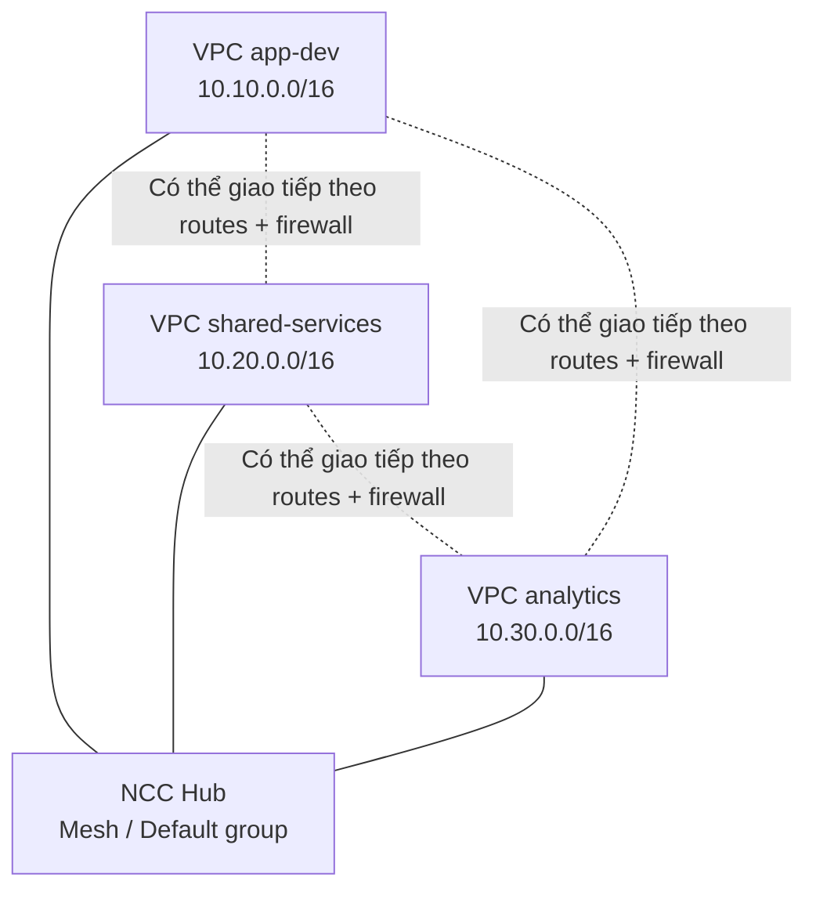
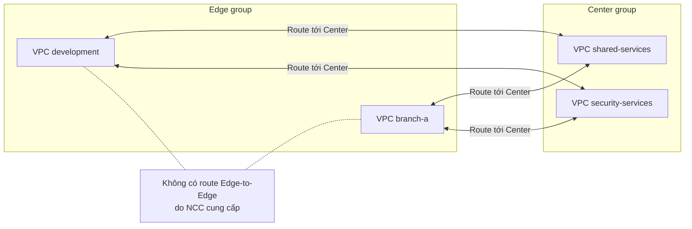
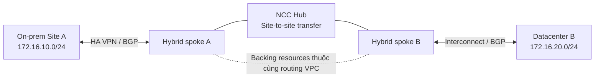
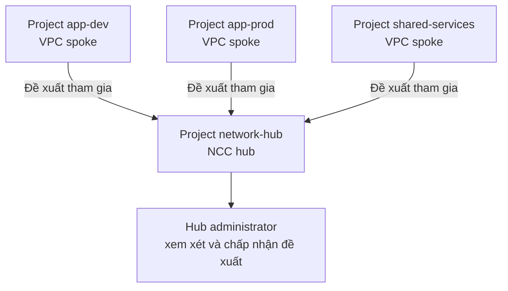
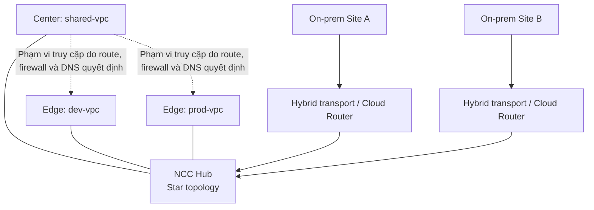

# Network Connectivity Center và tổ chức mạng hub-and-spoke

Khi hệ thống trên Google Cloud phát triển từ một VPC trong một project thành hàng chục VPC và nhiều địa điểm on-premises, bài toán kết nối không còn là “tạo thêm một đường VPN”. Đội hạ tầng phải quyết định **mạng nào được biết route tới mạng nào**, ai phê duyệt việc tham gia kết nối, địa chỉ IP có xung đột không, truy cập có bị chặn bởi firewall không và sự cố một đường truyền ảnh hưởng đến các ứng dụng nào. **Network Connectivity Center (NCC)** là dịch vụ Google Cloud hỗ trợ tổ chức các kết nối này theo mô hình **hub-and-spoke**.

Bài học thuộc chương **DNS và kết nối hybrid** của mô-đun `CLOUD_PROVIDERS_GCP`. Trong hành trình từ tổ chức project, IAM và VPC đến Compute Engine, GKE, Cloud Run, lưu trữ, cơ sở dữ liệu, tự động hóa phát hành và giám sát độ tin cậy cùng chi phí, NCC giúp bạn xây dựng một lớp kết nối có thể quản trị tập trung cho nhiều mạng. NCC không tự cấp quyền IAM, không tự mở firewall và không tự chia sẻ DNS; các lớp đó vẫn phải được thiết kế cùng nhau.

## 1. Kết quả học tập

Sau bài này, bạn có thể:

1. Giải thích **hub**, **spoke**, **backing resource**, **spoke group** và đường đi của route trong NCC.
2. Phân biệt **VPC spoke**, **producer VPC spoke**, **hybrid spoke** và các khả năng nâng cao như **NCC Gateway spoke**.
3. So sánh topology **mesh** và **star**; nhận diện tính phân đoạn mạng của nhóm `Center` và `Edge`.
4. Hiểu các kịch bản **VPC-to-VPC**, **site-to-cloud** và **site-to-site data transfer**, gồm điều kiện của Cloud VPN, Cloud Interconnect, Cloud Router/BGP.
5. Giải thích rõ **route propagation không đồng nghĩa có kết nối ứng dụng**, vì DNS, firewall, return route, IAM, độ trễ và quota là các lớp độc lập.
6. Lập sơ đồ IP, luồng kết nối, quyền quản trị và khả năng dự phòng trước khi tạo hub/spoke.
7. Thực hành khảo sát, tạo **mesh hub với hai VPC spoke** trong môi trường lab được phép; đọc lại trạng thái, route table và chuẩn bị rollback.
8. Xác định các số liệu vận hành, sự cố định tuyến và thành phần chi phí khi đưa NCC vào môi trường thật.

## 2. Vì sao cần hub-and-spoke?

Giả sử một tổ chức có các project:

- `app-dev`: VPC phục vụ ứng dụng phát triển.
- `app-prod`: VPC phục vụ ứng dụng sản xuất.
- `shared-services`: VPC dùng cho dịch vụ quản trị nội bộ.
- Hai văn phòng và một trung tâm dữ liệu sử dụng IP riêng, cần truy cập tới tài nguyên Google Cloud.

Nếu chỉ xây dựng từng kết nối VPC-to-VPC hoặc đường kết nối đến site theo từng cặp, số lượng quan hệ phải quản lý tăng nhanh. Với \(n\) mạng mà mỗi mạng cần kết nối trực tiếp tới mọi mạng khác, số cặp kết nối lý thuyết là:

\[
\frac{n(n-1)}{2}
\]

Ở \(n=6\), có 15 cặp; ở \(n=12\), có 66 cặp. Đây chỉ là minh họa độ phức tạp quản lý, **không phải** số kết nối mà NCC bắt buộc tạo ra hay giới hạn thực tế của VPC Network Peering.

NCC cho phép đăng ký các mạng hoặc tài nguyên hybrid dưới các **spoke** cùng một **hub**. Hub quản lý quan hệ kết nối và trao đổi route theo topology/chính sách được cấu hình. Thay vì vận hành từng cặp peering độc lập, đội mạng tập trung vào:

- Mạng nào được tham gia hub?
- Route nào được xuất/nhập và tới spoke group nào?
- Mạng nào phải cách ly với mạng nào?
- Tài nguyên hybrid có HA và BGP phù hợp không?
- Ai phê duyệt spoke từ project khác?

**Hiểu đúng:** NCC hub là tài nguyên **quản lý và điều phối route**, không phải một máy chủ router ảo tự nằm trên mọi đường đi dữ liệu. Lưu lượng VPC-to-VPC vẫn đi trên hạ tầng mạng Google Cloud theo route được lập trình; không nên thiết kế hub như một VM transit bắt buộc phải đi qua. Nếu yêu cầu kiểm tra gói tin bằng thiết bị bảo mật, cần chọn kiến trúc và sản phẩm inspection có khả năng hỗ trợ riêng.

## 3. Các thành phần cốt lõi của NCC

| Thành phần | Vai trò | Phạm vi/đặc điểm |
| --- | --- | --- |
| **Hub** | Điểm quản lý các spoke, topology và route exchange | Tài nguyên **global** của NCC, thuộc một project |
| **Spoke** | Đại diện cho tài nguyên kết nối với hub | Có spoke **global** (VPC) và spoke **regional** (hybrid/gateway tùy loại) |
| **Backing resource** | Tài nguyên mạng thực được spoke tham chiếu | VPC network, HA VPN tunnel, VLAN attachment, Router appliance VM… |
| **Spoke group** | Nhóm định tuyến bên trong hub | `Default` (mesh); `Center`/`Edge` (star); nhóm khác với topology nâng cao |
| **Route table của hub/group** | Lưu các route NCC học và trao đổi | Do NCC quản lý; dùng để kiểm tra điều gì được công bố |
| **Cloud Router** | Thiết lập BGP, học/quảng bá route cho kết nối hybrid | Thành phần điều khiển route cho HA VPN/Interconnect/Router appliance |
| **Firewall và DNS** | Kiểm soát lưu lượng, phân giải tên | Cơ chế riêng; **không tự được cấu hình chỉ vì gắn NCC spoke** |

Một hub có thể gắn spoke ở nhiều region. Một VPC có thể đặt subnet ở nhiều region; vì vậy VPC spoke là tài nguyên global dù các máy ảo hoặc subnet cụ thể có vị trí regional/zonal.

### 3.1. Các loại spoke

| Loại spoke | Backing resource | Dùng khi nào | Lưu ý |
| --- | --- | --- | --- |
| **VPC spoke** | Một VPC network | Kết nối VPC này với những VPC thuộc các spoke khác của hub | Xuất **subnet routes** được chọn; không xuất tùy ý mọi static/peering route |
| **Producer VPC spoke** | VPC consumer và kết nối peering tới producer | Làm dịch vụ trong producer VPC có thể tiếp cận từ các spoke thích hợp | Có quy tắc riêng về VPC peering; không coi NCC hỗ trợ mọi kiểu transit peering |
| **Hybrid spoke – HA VPN** | Một hoặc nhiều HA VPN tunnel cùng loại | Site-to-cloud hoặc site-to-site qua kết nối mã hóa | BGP/Cloud Router và cấu hình HA quyết định route và dự phòng |
| **Hybrid spoke – Interconnect** | VLAN attachments của Cloud Interconnect | Kết nối private tốc độ cao hoặc liên kết hybrid được hỗ trợ | Cần Cloud Router/BGP và hạ tầng Interconnect tương ứng |
| **Hybrid spoke – Router appliance** | VM thiết bị mạng bên thứ ba | Định tuyến qua network virtual appliance và các trường hợp đặc thù | Phải vận hành, cấp quyền, dự phòng và giám sát VM appliance |
| **NCC Gateway spoke** | Tài nguyên NCC Gateway | Kịch bản kết nối liên đám mây và kiểm tra lưu lượng bằng SSE | Chức năng/topology chuyên biệt; kiểm tra mức hỗ trợ và yêu cầu sản phẩm |

**Hybrid spoke** có thể liên kết nhiều backing resources **cùng loại** trong một spoke; không trộn HA VPN tunnels với VLAN attachments vào cùng một hybrid spoke. Theo mô hình NCC được hỗ trợ, hybrid spoke thuộc **cùng project với hub**. VPC spoke có thể nằm ở project khác, thậm chí khác organization, nhưng việc chấp nhận kết nối phải được quản lý.

## 4. Hai cấu trúc kết nối phổ biến: mesh và star

### 4.1. Mesh topology: các spoke được phép trao đổi route qua cùng nhóm

**Mesh** là topology mặc định của hub khi không chỉ định topology khác. Mọi spoke của mesh thuộc nhóm `Default`; những VPC spoke hợp lệ có thể xuất subnet routes và nhận route của các spoke cùng nhóm theo các filter và quy tắc áp dụng.



Sơ đồ biểu diễn **quan hệ quản lý/trao đổi route**, không thể hiểu các gói tin đi qua một host chạy “Hub”. Trong mô hình mesh, nếu ứng dụng dev **không nên** truy cập được mọi hệ thống khác, phải dùng topology/filter phù hợp và firewall/IAM; chỉ vẽ ba spoke quanh một hub chưa tạo ra cách ly.

### 4.2. Star topology: tách nhóm Center và Edge

Với **star**, NCC tạo hai spoke groups có route table riêng:

- `Center`: các spoke trung tâm có thể có route để giao tiếp với spoke thuộc Center **và** Edge.
- `Edge`: các spoke biên có route tới nhóm Center, nhưng NCC **không** cấp route trực tiếp cho các Edge spoke khác nhau giao tiếp với nhau qua nhóm Edge.



Star hữu ích khi cần các môi trường biên truy cập dịch vụ trung tâm nhưng không muốn tự động mở đường tới nhau. Tuy nhiên, **star không phải firewall** và **không tự tạo một hop kiểm tra gói tin qua Center**. Nếu muốn mọi luồng được inspection, cần thiết kế dịch vụ/mạng kiểm tra lưu lượng cụ thể và kiểm chứng dữ liệu thật sự đi qua nơi đó.

Một số cấu hình hybrid đặc thù có yêu cầu chọn group; ví dụ hybrid spoke bật **site-to-site data transfer** trong star phải nằm ở nhóm `Center`. Với hệ thống đã chọn preset topology, không thể đổi trực tiếp từ mesh sang star sau khi tạo hub; vì thế cần quyết định phân đoạn ngay ở giai đoạn thiết kế. Ngoài mesh/star còn có topology kiểm tra hybrid với NCC Gateway cho mục đích chuyên biệt, không phải cấu hình mặc định cho bài lab.

### 4.3. Bảng quyết định

| Nhu cầu | Mesh | Star |
| --- | --- | --- |
| Nhiều VPC ứng dụng cần liên lạc theo nhóm chung | Thường đơn giản hơn | Có thể không cần thiết |
| Mỗi branch/dev VPC chỉ được phép dùng dịch vụ dùng chung | Phải thiết kế filter/firewall cẩn thận | Center/Edge thể hiện mục tiêu phân đoạn rõ ràng |
| Tách Edge spoke với các Edge spoke khác | Không có phân đoạn bằng spoke group | Có rule route table hỗ trợ |
| Trung tâm kết nối hybrid cần trao đổi route | Có thể dùng hybrid spokes được hỗ trợ | Có hạn chế nhóm và tùy chọn data transfer |
| Thay đổi topology khi đang vận hành | Phải lập migration phù hợp | Cũng phải lập migration; preset topology không đổi trực tiếp |

## 5. NCC trao đổi route như thế nào?

**Route** cho biết destination prefix (ví dụ `10.20.0.0/16`) được tiếp cận theo next hop nào. NCC quản lý một phần của **control plane**, phân phối các route phù hợp giữa spoke group và VPC/hybrid. Lệnh gọi API thành công chưa chứng minh gói tin đã tới được destination.

### 5.1. VPC spoke: chủ yếu xuất subnet route

Giả sử:

| Mạng | Subnet IP | Loại |
| --- | --- | --- |
| `vpc-app` | `10.10.10.0/24` | VPC spoke A |
| `vpc-shared` | `10.20.20.0/24` | VPC spoke B |
| Site nội bộ | `172.16.100.0/24` | Prefix được Cloud Router học từ hybrid spoke |

Luồng route dự kiến khi topology/filter phù hợp:

1. `vpc-app` **xuất subnet route** của nó tới hub.
2. `vpc-shared` xuất subnet route của nó tới hub.
3. Hub cung cấp route subnet từ A cho B và ngược lại theo spoke group.
4. Nếu có hybrid spoke phù hợp, dynamic route học qua BGP từ site nội bộ có thể được NCC phân phối tới VPC spokes.
5. VPC sử dụng route hiệu lực để chọn next hop, sau đó firewall và kết nối ở hai đầu quyết định gói tin có đi được không.

**Giới hạn quan trọng:** VPC spoke không xuất các loại route như static routes, peering subnet routes hoặc dynamic routes của chính VPC một cách tùy ý qua hub. Nếu có VPC Network Peering khác, không mặc định rằng subnet route nhập qua peering sẽ tiếp tục được NCC quảng bá. Các trường hợp producer VPC spoke và cấu hình static next hop được NCC hỗ trợ riêng phải được đọc theo tài liệu tính năng đó.

### 5.2. Export filters và import filters

NCC cho phép chọn CIDR được xuất/nhập, nhưng khả năng áp dụng khác nhau theo loại spoke:

- **VPC spoke** dùng **include/export** hoặc **exclude/export** filters cho các subnet ranges của nó. Khi không đặt include filter, mặc định xuất các **private IPv4 subnet ranges** (`ALL_PRIVATE_IPV4_RANGES`); không mặc định xuất mọi IPv6 hoặc dải IPv4 đặc thù.
- **Hybrid spoke** có thể xuất các dynamic routes học qua BGP, và **import filters** để điều khiển route nào được đưa ngược tới hybrid peer. Giá trị mặc định của hybrid import thay đổi theo chế độ site-to-site, nên không nên suy đoán.
- **VPC spoke import** route từ nhóm hub theo cơ chế NCC; không sử dụng cùng loại import filters như hybrid spoke để lựa chọn từng prefix.
- Filter định tuyến kiểm soát reachability theo prefix. Nó **không phân biệt được** user nào, TCP port nào hoặc dữ liệu nào đang được truy cập; muốn kiểm soát đó cần firewall, IAM và các lớp bảo mật khác.

```text
VPC app                 NCC Hub               VPC shared
10.10.10.0/24  --export--> Route table --import--> 10.10.10.0/24
10.20.20.0/24  <--import-- Route table <--export-- 10.20.20.0/24
```

Trước khi tạo spoke, lập bảng CIDR và kiểm tra xung đột **primary và secondary ranges**, kể cả ranges của GKE Pod/Service, database và IP dùng ở hybrid site. NCC không phải công cụ tự động NAT mọi dải địa chỉ bị trùng. Một số tính năng NAT riêng có thể tồn tại theo thiết kế sản phẩm, nhưng không nên dùng chúng như lý do bỏ qua quy hoạch IP.

### 5.3. Route priority và trạng thái động

Khi nhiều tuyến có cùng destination, VPC routing xem xét loại route, tính áp dụng, độ dài prefix, priority và cấu hình vùng theo các quy tắc của VPC/Cloud Router. Với BGP, MED, ASN và cách quảng bá prefix ảnh hưởng đến việc chọn tuyến. Không kết luận “đường có ping thấp nhất sẽ luôn thắng”.

NCC có **hub route tables** theo spoke group và route được quản lý bởi NCC. Cùng lúc, VPC có bảng route hiệu lực riêng. Muốn xử lý lỗi, cần kiểm tra cả route trên hub lẫn route thực sự được lập trình vào VPC, đặc biệt khi có VPN/Interconnect và nhiều region.

Quota route của NCC và quota VPC có thể gây thiếu route trong những cấu hình lớn. Việc thiếu một route trong hub có thể làm **cả một tập destination không thể tiếp cận**, kể cả khi BGP tunnel vẫn báo UP; vì thế giám sát số prefix không được bỏ qua.

## 6. Kết nối hybrid: site-to-cloud và site-to-site là hai mục tiêu khác nhau

### 6.1. Site-to-cloud

**Site-to-cloud** là trường hợp một văn phòng hoặc datacenter kết nối tới workload chạy trên Google Cloud. Ví dụ: on-premises `172.16.100.0/24` cần gọi API nội bộ trên VPC `10.20.20.0/24`.

Các khối hạ tầng thường cần:

1. **Transport:** HA VPN hoặc Cloud Interconnect cùng các tunnel/VLAN attachments được tạo và hoạt động.
2. **Routing:** Cloud Router/BGP học prefix từ on-premises và quảng bá prefix GCP cần thiết.
3. **NCC spoke:** nếu cần phân phối đường hybrid tới các VPC spokes khác của hub.
4. **Network access:** firewall, routing ở phía on-premises, DNS và security policy.
5. **Reliability:** đường dự phòng, hai giao tiếp/tunnel hợp lệ và phép thử failover.

NCC không thay thế bước thiết lập kết nối vật lý/VPN; một hybrid spoke chỉ đại diện cho **backing resource đã tồn tại và hoạt động đúng**.

### 6.2. Site-to-site data transfer

**Site-to-site data transfer** dùng mạng Google Cloud làm một phần của WAN để site A liên lạc với site B qua các hybrid spokes. Đây là một tùy chọn riêng, **không tự động bật chỉ vì cả hai site đã là spoke**.



Những ràng buộc phải kiểm tra:

- Các **hybrid spokes có bật data transfer** trong cùng hub phải tham chiếu backing resources ở **cùng một VPC network**.
- Để trao đổi tuyến site-to-site giữa các **region khác nhau**, dynamic routing mode của VPC liên quan phải là **global**; cùng region có thể không cần điều kiện này.
- Route từ site A phải được học bằng BGP và được **re-advertise** tới site B theo cấu hình NCC/Cloud Router.
- Prefix/ASN/BGP session phải đúng yêu cầu của NCC; route từ các site phải không gây xung đột/định tuyến vòng.
- Chế độ này hoạt động theo khả năng và vùng được dịch vụ hỗ trợ; lưu lượng truyền giữa site theo mô tả dịch vụ mang tính **best effort**, không có cam kết băng thông/độ trễ cho từng luồng site-to-site.

**Phân biệt:** việc VPC có global dynamic routing giúp route học từ vùng khác có phạm vi thích hợp trong VPC; nó không làm Cloud Router hoặc NCC mặc nhiên quảng bá tất cả subnet của mọi VPC tới on-premises.

### 6.3. Một số hạn chế theo loại hybrid spoke

| Spoke | Điểm phải nhớ |
| --- | --- |
| HA VPN | Sử dụng **HA VPN tunnel**, không phải Classic VPN tunnel, làm backing resource NCC |
| Interconnect | Tham chiếu VLAN attachment; không trỏ trực tiếp một cổng vật lý vào hub |
| Router appliance | VM phải được cấu hình network/BGP/HA; là thành phần tự vận hành |
| Hybrid spoke ở star + data transfer | Theo tài liệu topology, phải nằm trong nhóm `Center` |
| IPv6 hybrid | Một số tính năng ở trạng thái Preview hoặc có hạn chế theo sản phẩm; kiểm tra trước khi dùng production |

Trong thiết kế nhiều site, nên lựa chọn region hỗ trợ, số tunnel hoặc attachment dự phòng và bố trí thiết bị on-premises phù hợp với yêu cầu HA của Cloud VPN/Interconnect. Không xem sự tồn tại của hai spoke là bằng chứng đã đạt SLA.

## 7. Một hub, nhiều project: quản trị kết nối tập trung

Một tổ chức thường đặt hub trong project mạng trung tâm như `network-hub`, còn mỗi đội sở hữu một project VPC riêng:



Với **VPC spoke khác project** so với hub, người quản trị spoke tạo đề xuất; **hub administrator** phải chấp nhận để spoke chuyển sang hoạt động, trừ trường hợp cơ chế auto-accept được cấu hình phù hợp. VPC spoke **cùng project với hub** thường được NCC chấp nhận tự động.

Điều này tạo ranh giới vận hành giữa:

- **Hub admin:** quyết định topology, quản lý nhóm route và chấp nhận/reject kết nối.
- **Spoke/network admin:** quản lý VPC network, subnet và spoke của ứng dụng.
- **Security/Platform:** thiết kế kiểm soát CIDR, firewall, DNS, quy định môi trường và khả năng quan sát.

Các role tham khảo gồm `roles/networkconnectivity.hubAdmin`, `roles/networkconnectivity.spokeAdmin`, `roles/networkconnectivity.groupUser` và `roles/compute.networkAdmin` theo thao tác và phạm vi tài nguyên. Chỉ dùng quyền tối thiểu; không cấp Owner xuyên organization để nối một spoke.

**Shared VPC** có thể tham gia NCC bằng VPC spoke tương ứng. Tuy nhiên, host project, service project, chủ sở hữu subnet và quyền IAM có quan hệ riêng; cần xác định rõ ai sở hữu VPC backing resource và chính sách nào áp dụng. Kết nối VPC sang hub không tạo IAM grant tới máy chủ hoặc database của project khác.

### Khi nào chọn NCC thay cho VPC Network Peering hoặc Shared VPC?

| Cơ chế | Ý tưởng | Thường thích hợp |
| --- | --- | --- |
| **VPC Network Peering** | Liên kết trực tiếp hai VPC theo các quy tắc peering | Ít mạng, quan hệ truy cập đơn giản, đã hiểu rõ giới hạn route |
| **Shared VPC** | Một VPC host được chia cho service projects | Các ứng dụng cùng dùng chung một domain mạng do đội trung tâm quản lý |
| **NCC VPC spokes** | Nhiều VPC riêng tham gia hub và route exchange | Nhiều project/mạng cần điều phối và phân đoạn kết nối |
| **Cloud VPN/Interconnect** | Transport từ site bên ngoài tới Google Cloud | Kết nối hybrid thực tế, có thể kết hợp với NCC để chia sẻ reachability |
| **NCC + hybrid spokes** | Điều phối route tới các kết nối hybrid và, khi cấu hình, giữa các site | Mạng enterprise có nhiều site, VPC và quản trị tập trung |

Các cơ chế có thể phối hợp. **NCC không phải là một VPC mới**, cũng không tự biến tất cả VPC thành một VPC chung. Một VPC spoke cũng chỉ tham gia **một hub tại một thời điểm**. VPC Network Peering giữa hai VPC đã được kết nối với nhau qua cùng hub có các hạn chế riêng; không mặc định hỗ trợ cấu hình song song để “dự phòng”.

## 8. Quy hoạch IP và phân đoạn trước khi nối spoke

Ví dụ cần ba mạng có dải địa chỉ không chồng lấn:

| Thành phần | Ví dụ IP | Ghi chú |
| --- | --- | --- |
| VPC `vpc-app` | `10.10.0.0/16` | Subnet ứng dụng có thể ở các region khác nhau |
| VPC `vpc-shared` | `10.20.0.0/16` | Dịch vụ dùng chung |
| VPC `vpc-analytics` | `10.30.0.0/16` | Kho dữ liệu/phân tích |
| Datacenter A | `172.16.10.0/24` | Quảng bá bằng BGP nếu được phê duyệt |
| Datacenter B | `172.16.20.0/24` | Cần đường dự phòng và return route |
| GKE secondary IP ranges | Ví dụ `10.40.0.0/16` | Phải kiểm tra theo thiết kế Pod/Service thực tế |

**Kiểm tra cả primary lẫn secondary ranges**; không chỉ nhìn tên VPC. Nếu hai spoke cùng công bố một dải không tương thích, NCC có thể từ chối, không cài route hoặc tạo vấn đề route priority, tùy trường hợp. Thay đổi dải IP sau khi nhiều hệ thống phụ thuộc thường tốn công hơn nhiều so với hoạch định lúc đầu.

### Một ma trận reachability cho star

| Nguồn | Đích | Mong muốn | Kiểm soát |
| --- | --- | --- | --- |
| Edge `dev` | Center `shared-services` | Có, giới hạn port | NCC route + firewall |
| Edge `branch-a` | Center `shared-services` | Có, giới hạn subnet | NCC route + on-prem firewall |
| Edge `dev` | Edge `branch-a` | Không qua NCC | Star group; rà thêm đường mạng khác |
| Center `shared-services` | Edge `dev` | Theo ứng dụng | NCC route + firewall |
| Dev | Prod | Chặn theo chính sách | Không route được phép, firewall, IAM; kiểm tra peering/VPN đường vòng |

Star giới hạn NCC route, nhưng nếu hai mạng có một **đường khác** (VPN, peering hoặc appliance), NCC không tự chặn đường đó. Khi yêu cầu cách ly mạnh, cần kiểm kê mọi đường kết nối.

## 9. NCC và Cloud DNS: kết nối IP không đồng nghĩa phân giải được tên

Chương này thuộc nhóm **DNS và kết nối hybrid** nên cần phân biệt hai mặt:

- **Lớp IP routing:** NCC, Cloud Router, VPC routes, BGP giúp gói tin tới được destination IP.
- **Lớp name resolution:** Cloud DNS private zone, DNS policies, DNS forwarding/peering và DNS on-premises xác định hostname biến thành IP nào.

Giả sử một VM ở `vpc-app` cần gọi `db.internal.example` trong `vpc-shared`. Dù NCC đã trao đổi route `10.20.20.0/24`, VM vẫn không tự biết `db.internal.example` là địa chỉ nào. Muốn dùng hostname, phải:

1. Xác định **zone DNS** nào là nguồn sự thật của hostname.
2. Cấp quyền/ủy quyền truy vấn đúng VPC hoặc triển khai forwarding/peering theo cơ chế Cloud DNS hỗ trợ.
3. Với hybrid, thiết lập **đường truy vấn DNS** từ on-premises tới Google Cloud và ngược lại nếu cần, cùng firewall cho resolver.
4. Kiểm tra DNS answer là IP có route hợp lệ và dịch vụ thật sự lắng nghe ở IP/port đó.
5. Tính tới split-horizon DNS, TTL, cache và việc sử dụng tên khi chuyển vùng dự phòng.

```text
Ứng dụng -> DNS query -> IP đích
         -> Routing NCC/VPC/BGP -> Next hop
         -> Firewall/security rules -> Dịch vụ
         -> Return path -> Ứng dụng
```

**Không mặc định** Cloud DNS private zone của VPC A tự xuất hiện trong VPC B chỉ vì hai VPC là NCC spokes. Cũng không tự mở firewall cổng TCP/UDP 53 do tạo spoke; cách xử lý luồng resolver phụ thuộc thiết kế DNS.

## 10. Các lớp bảo mật và độ tin cậy không thể bỏ qua

### 10.1. Firewall, IAM và kết nối thực tế

Một tuyến tồn tại trong NCC không có nghĩa traffic được cho phép:

- **VPC firewall rules hoặc network firewall policies** có thể chặn ingress/egress.
- **Service identity/IAM** của Cloud Run, GKE hoặc database có thể từ chối API dù mạng đã thông.
- **Route chiều về** phải có và phù hợp; đường một chiều hoặc route bất đối xứng có thể làm TCP timeout.
- **NAT, load balancer, Private Service Connect và proxy** có những ranh giới riêng, không tự đạt được chỉ từ subnet route NCC.
- **Subnet/region** của source và destination có thể ảnh hưởng tới tuyến động được áp dụng.

### 10.2. Thiết kế HA

NCC hub là tài nguyên global ở cấp điều phối, nhưng chất lượng hệ thống vẫn phụ thuộc backing resources. Với hybrid, cần:

1. Nhiều tunnel/attachment khi sản phẩm và bài toán yêu cầu.
2. Cloud Router/BGP peer dự phòng đúng kiến trúc.
3. Router tại on-premises và đường truyền đủ đa dạng.
4. Route advertisements nhất quán, priority có chủ đích.
5. Theo dõi health và thử tình huống mất một đường.

Với VPC-to-VPC, route exchange có thể hoạt động nhưng ứng dụng chỉ chạy trên một VM hoặc database một zone; điều này vẫn là **single point of failure của ứng dụng**. HA mạng không thay thế thiết kế HA của Compute Engine, GKE, Cloud Run hoặc Cloud SQL.

## 11. Mô hình lab: hai VPC cùng một project, một mesh hub

Để học cơ chế tối thiểu trước khi nối hybrid, ta sử dụng các tài nguyên **đã tồn tại** trong project lab được phép:

| Thành phần | Giá trị ví dụ | Điều kiện |
| --- | --- | --- |
| Project | `my-ncc-lab-project` | Billing và Network Connectivity API đã được quản trị viên bật |
| Mesh hub mới | `ncc-lab-hub` | Tên chưa dùng trong project |
| VPC spoke A | `vpc-app` | **Custom mode VPC**, có subnet private IPv4 không trùng với VPC B |
| VPC spoke B | `vpc-shared` | Custom mode, subnet private IPv4 không trùng |
| Region để kiểm tra | `asia-southeast1` | Có subnet/VM thử nghiệm ở vùng này nếu cần kiểm tra traffic |
| Mục đích | Xem cách subnet routes được trao đổi | Không đụng production hoặc kết nối site thật |

**Không tạo VPC, subnet, VM mới chỉ để chạy bài này**. Hướng dẫn dùng hai VPC lab đã có; nếu chưa có, hãy chuẩn bị trong quy trình hạ tầng riêng và tính trước phí. Các lệnh từ phần tạo hub/spoke là **lệnh ghi**, có thể đổi reachability và phát sinh phí NCC.

### 11.1. Preflight: xác minh project, VPC và địa chỉ (chỉ đọc)

Bash trong Cloud Shell hoặc máy đã cấu hình Google Cloud CLI:

```bash
HUB_PROJECT_ID="my-ncc-lab-project"
HUB_NAME="ncc-lab-hub"
VPC_A="vpc-app"
VPC_B="vpc-shared"
CHECK_REGION="asia-southeast1"

gcloud auth list

gcloud projects describe "$HUB_PROJECT_ID" \
  --format="yaml(projectId,projectNumber,lifecycleState)"

# Hai VPC đã tồn tại và có routing mode/cấu hình như dự kiến?
gcloud compute networks describe "$VPC_A" \
  --project="$HUB_PROJECT_ID" \
  --format="yaml(name,autoCreateSubnetworks,routingConfig)"

gcloud compute networks describe "$VPC_B" \
  --project="$HUB_PROJECT_ID" \
  --format="yaml(name,autoCreateSubnetworks,routingConfig)"

# Xem subnet và các dải IP để phát hiện overlap.
gcloud compute networks subnets list \
  --project="$HUB_PROJECT_ID" \
  --format="table(name,network.basename(),region.basename(),ipCidrRange)"
```

Phải kiểm tra thêm secondary IP ranges nếu mạng dùng GKE và các IP ranges đã dành cho hybrid. **Auto mode VPC không được dùng trực tiếp làm VPC spoke**; dựa trên chính sách và tài nguyên, đội quản trị cân nhắc mạng custom mode. Đổi auto mode sang custom mode là quyết định khó đảo ngược, không làm chỉ để chạy lab.

**Quyền:** người tạo hub/spoke cần quyền NCC và quyền trên VPC tương ứng. Những quyền tham khảo là `roles/networkconnectivity.hubAdmin`, `roles/networkconnectivity.spokeAdmin`, `roles/compute.networkAdmin` theo thao tác. Xác minh IAM ở project lab; không xin Owner nếu chỉ cần làm việc với NCC.

### 11.2. Đọc hub/spoke hiện có (chỉ đọc)

```bash
gcloud network-connectivity hubs list \
  --project="$HUB_PROJECT_ID"

gcloud network-connectivity spokes list \
  --global \
  --project="$HUB_PROJECT_ID"

# Nếu hub đã tồn tại, xem cụ thể trước khi quyết định có sử dụng.
gcloud network-connectivity hubs describe "$HUB_NAME" \
  --project="$HUB_PROJECT_ID"
```

Lệnh `describe` cuối có thể trả `NOT_FOUND` nếu chưa tạo hub. Đó là kết quả kiểm tra trạng thái ban đầu, không phải lý do để tạo hub trùng tên hoặc ghi đè tài nguyên có sẵn. Với hub đang hoạt động, phải xem spoke và người sở hữu trước khi sửa.

### 11.3. Tạo hub mesh (thao tác ghi)

Sau khi có project lab, đảm bảo không xung đột tên và được ủy quyền tạo NCC:

```bash
gcloud network-connectivity hubs create "$HUB_NAME" \
  --project="$HUB_PROJECT_ID" \
  --policy-mode=PRESET \
  --preset-topology=MESH \
  --description="Lab NCC VPC route exchange"
```

Lệnh tạo **global NCC hub** mới. Mesh là mặc định nhưng ở đây chỉ rõ để người học hiểu topology. Ghi trạng thái ban đầu để có thể dọn dẹp tài nguyên khi kết thúc.

Readback:

```bash
gcloud network-connectivity hubs describe "$HUB_NAME" \
  --project="$HUB_PROJECT_ID"

gcloud network-connectivity hubs groups list \
  --hub="$HUB_NAME" \
  --project="$HUB_PROJECT_ID"
```

Với mesh, cần tìm nhóm `Default`. Đừng tự suy ra rằng mọi network trong project đã kết nối chỉ vì hub tồn tại: chưa có VPC spokes thì hub chưa có backing networks.

### 11.4. Tạo hai VPC spokes (thao tác ghi)

Ở lab này hub và VPC cùng project, nên tạo VPC spoke cho từng VPC. Dùng cú pháp `--global` và URI mạng tường minh:

```bash
gcloud network-connectivity spokes linked-vpc-network create \
  "spoke-app" \
  --project="$HUB_PROJECT_ID" \
  --hub="$HUB_NAME" \
  --vpc-network="https://www.googleapis.com/compute/v1/projects/$HUB_PROJECT_ID/global/networks/$VPC_A" \
  --include-export-ranges=ALL_PRIVATE_IPV4_RANGES \
  --global

gcloud network-connectivity spokes linked-vpc-network create \
  "spoke-shared" \
  --project="$HUB_PROJECT_ID" \
  --hub="$HUB_NAME" \
  --vpc-network="https://www.googleapis.com/compute/v1/projects/$HUB_PROJECT_ID/global/networks/$VPC_B" \
  --include-export-ranges=ALL_PRIVATE_IPV4_RANGES \
  --global
```

**Lệnh trên có thể làm hai VPC trao đổi subnet routes**, do đó chỉ chạy trong project lab với CIDR không xung đột và firewall đã được kiểm tra. Nó không thêm rule ingress cho VM và không tự đặt Cloud DNS private zone cho VPC còn lại.

Readback:

```bash
gcloud network-connectivity spokes describe "spoke-app" \
  --project="$HUB_PROJECT_ID" \
  --global

gcloud network-connectivity spokes describe "spoke-shared" \
  --project="$HUB_PROJECT_ID" \
  --global

gcloud network-connectivity hubs list-spokes "$HUB_NAME" \
  --project="$HUB_PROJECT_ID"
```

Quan sát `ACTIVE` của spoke và backing VPC. Nếu spoke ở project khác với hub, cần quy trình **proposal/acceptance**; cùng project thường tự được chấp nhận. Một API call thành công mà spoke chưa `ACTIVE` thì chưa thể kết luận hai mạng đã nối.

### 11.5. Xem hub route tables và route thật

```bash
gcloud network-connectivity hubs route-tables list \
  --hub="$HUB_NAME" \
  --project="$HUB_PROJECT_ID"

# Với mesh, route table thường có tên default-route-table.
gcloud network-connectivity hubs route-tables routes list \
  --hub="$HUB_NAME" \
  --route_table="default-route-table" \
  --effective-location="$CHECK_REGION" \
  --project="$HUB_PROJECT_ID"
```

Khi xem route, đối chiếu:

- Destination prefix của subnet trong `vpc-app` và `vpc-shared`.
- Route type, spoke/source và next hop nếu công cụ trả về.
- Effective location của route; kết quả có thể khác giữa các vùng khi có hybrid dynamic route.
- Trạng thái, filter và việc route thực sự có trong bảng route của VPC đích hay chưa.

**Nếu không thấy một subnet**: kiểm tra subnet thực có tồn tại, nó có thuộc loại private IPv4 được export hay không, spoke có `ACTIVE` không, có xung đột IP không và hub/group route table có đúng không. Đừng thêm static route thủ công để che một vấn đề chưa hiểu.

### 11.6. Thử reachability (đọc/kiểm thử ứng dụng, khi đã có VM lab)

Nếu cả hai VPC có VM test ở đúng subnet, có thể kiểm tra kết nối bằng công cụ phù hợp (TCP connection hoặc ứng dụng test). Không tự mở port rộng hoặc cấp external IP chỉ để chạy `ping`. Một VM có thể chặn ICMP theo firewall dù route hợp lệ. Kết quả kiểm thử nên gồm:

1. Hostname được phân giải ra IP đúng hay không.
2. Route tới IP đích có tồn tại từ nguồn và chiều về.
3. Firewall/ứng dụng ở đích cho phép protocol và port nào.
4. Kết nối ứng dụng trả thành công hay timeout/refused.
5. Nếu có sự cố, log/flow logs liên quan có đủ dữ liệu để phân biệt route với firewall hay không.

## 12. Bài mở rộng: star topology và cách ly Edge

Để phân đoạn theo role mạng, xét một **hub mới** có star topology, khác hub mesh vừa thực hành. Chỉ là ví dụ thiết kế: không chạy trên cùng tên hub ở phần lab.

```bash
# Ví dụ CREATE một hub STAR MỚI trên project lab đã được phê duyệt.
gcloud network-connectivity hubs create "ncc-star-lab" \
  --project="$HUB_PROJECT_ID" \
  --policy-mode=PRESET \
  --preset-topology=STAR
```

Khi thêm VPC spoke, dùng `--group=Center` hoặc `--group=Edge` tương ứng với thiết kế và tên group được trả về bởi lệnh xem groups; tài liệu có thể hiển thị định danh groups theo cách chuẩn hóa khác nhau. Với star, việc chọn group là **bắt buộc** cho VPC spoke.

Ví dụ không thực thi:

```bash
# CHỈ MINH HỌA: tham khảo đúng hub và group trước khi dùng.
gcloud network-connectivity spokes linked-vpc-network create \
  "spoke-center" \
  --project="$HUB_PROJECT_ID" \
  --hub="ncc-star-lab" \
  --vpc-network="https://www.googleapis.com/compute/v1/projects/$HUB_PROJECT_ID/global/networks/$VPC_B" \
  --group="Center" \
  --global
```

Để kiểm tra phân đoạn, đặt các spoke ứng dụng không được phép kết nối nhau ở `Edge` và spoke dịch vụ chung ở `Center`. Sau đó quan sát **route table của hai groups** và thử traffic theo ma trận reachability. NCC star không tự ngăn kết nối qua những đường khác mà VPC có thể đang sử dụng.

## 13. Mở rộng hybrid thực tế: HA VPN, Interconnect, Cloud Router

Bài lab VPC-to-VPC chỉ chứng minh một phần của NCC. Khi thêm on-premises, cần chuẩn bị **transport và BGP trước** rồi mới đưa backing resources vào hybrid spoke.

### 13.1. Các bước thiết kế cho HA VPN

1. Xác định peer/on-premises router và dải IP site.
2. Tạo **HA VPN gateway, tunnels** và cấu hình external peer gateway theo yêu cầu.
3. Thiết lập **Cloud Router** và BGP sessions, xác định ASN, advertised prefixes và nhận route.
4. Kiểm tra tunnel/BGP khỏe bằng công cụ quản trị mạng của Google Cloud và on-premises.
5. Tạo hybrid spoke trỏ tới **HA VPN tunnels** hợp lệ ở cùng region và project yêu cầu.
6. Chọn site-to-cloud hoặc bật site-to-site data transfer nếu kiến trúc đã đáp ứng các ràng buộc.
7. Kiểm tra route export/import filters, hub route table, Cloud Router learned/advertised routes và luồng traffic.
8. Diễn tập failover từng tunnel, xác nhận ứng dụng khôi phục trong RTO/RPO mục tiêu nếu có.

**Không copy lệnh tạo tunnel trong tài liệu mẫu mà không có địa chỉ peer, ASN, key và phương án kết nối cụ thể.** Các yếu tố này do bộ phận mạng quản lý và có thể tạo chi phí, downtime hoặc cấu hình khó khôi phục.

### 13.2. Những tuyến BGP cần thấy

| Tuyến | Nguồn | Mong đợi |
| --- | --- | --- |
| Site A → Google Cloud | On-prem router quảng bá `172.16.10.0/24` | Cloud Router học prefix đúng |
| Google Cloud → Site A | Cloud Router quảng bá subnet GCP được phê duyệt | On-prem router học route, không thiếu return path |
| Site A → Site B qua NCC | Hybrid spoke A/B và site-to-site đúng điều kiện | Site B học prefix A và ngược lại |
| VPC spoke → site A | NCC hub có dynamic route hợp lệ từ hybrid spoke | VPC có tuyến tới `172.16.10.0/24` và firewall cho phép |
| Site A → VPC spoke | Route từ VPC spoke được quảng bá qua Cloud Router theo cấu hình hỗ trợ | On-prem có route tới subnet GCP; không mặc định tự nhận |

Một lỗi thường gặp là **VPC đã học tuyến on-prem** nhưng on-prem **chưa học tuyến quay về VPC**. NCC và Cloud Router cần cấu hình route advertisement hợp lệ, nhất là khi kết hợp VPC spoke với hybrid spokes trong routing VPC.

## 14. Chia vai trò quản trị và kiểm soát quyền

Một topology đa project thường có nhiều nhóm người tham gia. Nên có phân định:

| Vai trò vận hành | Được quyết định | Bằng chứng cần kiểm tra |
| --- | --- | --- |
| **Network architecture** | Mesh/star, CIDR plan, hybrid transport, routing policies | Sơ đồ mạng, ma trận reachability |
| **NCC hub admin** | Hub, groups, accept/reject spoke proposal | Hub policy, spoke states, audit logs |
| **VPC spoke admin** | Chọn VPC, tạo spoke, subnet ranges export | VPC details, export filters, route table |
| **Cloud Router/BGP owner** | ASN, MED, peers, advertisements | BGP session status, learned/advertised routes |
| **Security** | Firewall, network segmentation, threat inspection | Firewall policies, deny flows, review |
| **Platform/application owner** | DNS, ports, service identity, application health | DNS tests, logs, endpoint health |
| **FinOps** | Budget, cost allocation, data egress | Billing reports, project mapping, alerts |

Quản trị viên của spoke có thể thao tác VPC của mình nhưng không nhất thiết được chấp nhận spoke vào một hub từ project khác. Quyền truy cập NCC **không tự mở quyền xem dữ liệu nghiệp vụ** ở các dự án còn lại.

## 15. Theo dõi hoạt động và chi phí

### 15.1. Những chỉ số cần giám sát

- **Hub/spoke state:** spoke hoạt động hay chờ duyệt/không hoạt động.
- **NCC route tables:** số subnet/dynamic prefixes, route không mong đợi, route bị drop do quota.
- **Hybrid health:** trạng thái VPN tunnels, VLAN attachments, Cloud Router BGP sessions.
- **Traffic:** lượng kết nối và chất lượng mạng từ log/metrics được hỗ trợ; VPC Flow Logs nếu được bật đúng nơi.
- **Policy/IAM changes:** ai thêm spoke, cập nhật route filters, chuyển group, chấp nhận đề xuất.
- **Application-level:** latency, connection timeout, lỗi DNS và lỗi firewall ở nguồn/đích.

Cloud Monitoring, Cloud Logging, audit logs và Connectivity Tests có thể giúp kiểm tra từng lớp. **Connectivity Tests** mô phỏng/đánh giá đường kết nối trong phạm vi hỗ trợ, nhưng không thay thế bài thử lưu lượng ứng dụng thực tế và phép thử chiều về.

### 15.2. Những khoản phí có thể phát sinh

| Thành phần | Chi phí cần xem | Ghi chú |
| --- | --- | --- |
| **NCC spokes** | Giờ sử dụng spoke khi hoạt động | Phụ thuộc loại, trạng thái và bảng giá NCC |
| **NCC data transfer** | Lưu lượng outbound/traffic xử lý theo mô hình | Chú ý nguồn phát traffic và tuyến liên vùng |
| **HA VPN** | Tunnel và data transfer | Tính ngoài giá NCC nếu áp dụng |
| **Cloud Interconnect** | Cổng, attachment, truyền dữ liệu | Giá phụ thuộc loại kết nối, vị trí, đối tác |
| **Router appliance** | Compute Engine VM, disk, traffic/licensing | Appliance cần HA và vận hành |
| **Logs/Monitoring** | Thu thập, lưu giữ và phân tích dữ liệu quan sát | Cấu hình retention phù hợp |
| **Cross-region traffic** | Phí truyền dữ liệu theo tuyến | Đừng mặc định traffic qua hub luôn miễn phí |

**Không có một con số giá chung** cho mọi topology. Dùng bảng giá chính thức theo loại spoke và vị trí; kết hợp Cloud Billing budgets/alerts theo project sở hữu spoke. Nhắc lại: budget alert không tự động tắt NCC hoặc chặn chi tiêu.

## 16. Dọn dẹp lab có kiểm soát

Nếu chỉ tạo một mesh hub và hai VPC spokes mới trong bài lab, **xóa spoke trước, sau đó mới xóa hub**. Không xóa VPC, VPN hoặc attachment đã tồn tại trước lab.

Trước khi xóa, kiểm tra lại tài nguyên và kết nối có ai đang sử dụng hay không:

```bash
gcloud network-connectivity hubs list-spokes "$HUB_NAME" \
  --project="$HUB_PROJECT_ID"

gcloud network-connectivity spokes describe "spoke-app" \
  --project="$HUB_PROJECT_ID" --global

gcloud network-connectivity spokes describe "spoke-shared" \
  --project="$HUB_PROJECT_ID" --global
```

**Chỉ khi có quyền dọn lab và đã xác nhận không ảnh hưởng workload**, các lệnh sau mới được thực hiện (đều là thao tác phá kết nối/ghi):

```bash
# LỆNH XÓA CÓ TÁC ĐỘNG THẬT - CHỈ CHẠY TRÊN LAB ĐÃ DUYỆT.
gcloud network-connectivity spokes delete "spoke-app" \
  --global --project="$HUB_PROJECT_ID"

gcloud network-connectivity spokes delete "spoke-shared" \
  --global --project="$HUB_PROJECT_ID"

gcloud network-connectivity hubs delete "$HUB_NAME" \
  --project="$HUB_PROJECT_ID"
```

Nếu có spoke của project khác còn gắn vào hub, quản trị viên hub có thể cần reject hoặc phối hợp với spoke owner thay vì giả định có quyền xóa nó. Xóa hub thường yêu cầu đã tháo hoặc từ chối các spoke liên quan. Thay đổi kết nối mạng có thể gián đoạn luồng ứng dụng ngay cả khi dữ liệu VM/database không bị xóa.

## 17. Khắc phục sự cố theo từng lớp

| Triệu chứng | Nguyên nhân khả dĩ | Bước kiểm tra |
| --- | --- | --- |
| Tạo hub thất bại | Network Connectivity API chưa bật, thiếu IAM, quota hoặc tên trùng | Project ID, API, role NCC, `hubs list` |
| VPC spoke không ACTIVE | Spoke khác project chưa được hub admin chấp nhận, quyền/điều kiện chưa đáp ứng | `hubs list-spokes`, trạng thái proposal |
| VPC spoke bị từ chối khi tạo | VPC auto mode, overlap CIDR, đã nối hub khác hoặc giới hạn sản phẩm | Loại VPC, toàn bộ subnet ranges, hiện trạng spoke |
| Có route từ A sang B nhưng TCP timeout | Firewall, ứng dụng chưa lắng nghe, thiếu return route | NCC/VPC routes, firewall, DNS, health |
| Cloud Router UP nhưng site không đến VPC spoke | Missing import/export, custom advertisement, wrong routing mode | BGP learned/advertised routes, hybrid filters, hub routes |
| Site A thấy site B nhưng không nhận dữ liệu | Firewall on-prem, asymmetric routing, MTU, ứng dụng hoặc security appliance | End-to-end test, log hai đầu và đường chiều về |
| Không phân giải hostname private giữa hai VPC | Private zone không được chia sẻ/forwarded đúng | Cloud DNS private zone, DNS policy/forwarding |
| Edge spoke vẫn kết nối tới một Edge khác | Có đường kết nối khác ngoài NCC hoặc kiểm tra không đúng đích | VPC Peering, VPN, proxy, firewall, route path |
| Route đột ngột biến mất khi tăng số lượng prefix | Quota limit, filter hoặc thay đổi BGP | Quota, hub route tables, Cloud Router logs |
| Chi phí tăng sau khi thêm spokes | Phí spoke hours, data transfer, VPN/Interconnect | Billing breakdown theo project/sku/traffic |

**Thứ tự chẩn đoán nên nhất quán:**

1. Kiểm tra **spoke/hub** và project/group.
2. Kiểm tra **route được xuất**, **route được nhập** và bảng route hiệu lực.
3. Với hybrid, kiểm tra **tunnel/attachment/BGP** và advertised routes.
4. Kiểm tra **firewall**, DNS, route chiều về và cổng ứng dụng.
5. Kiểm tra logs, quota, phiên thay đổi gần đây và tình trạng region.

Không nên sửa firewall thành `0.0.0.0/0` hoặc nâng IAM lên Owner chỉ để “thử cho được”. Sửa lỗi phải giải quyết đúng lớp đang chặn.

## 18. Tình huống thiết kế: hệ thống bán hàng đa môi trường

Một doanh nghiệp có đội dev tại Việt Nam, hệ thống ứng dụng trên GKE/Cloud Run tại Google Cloud và hai cơ sở on-premises. Dev cần vào dịch vụ dùng chung, production cần kết nối hệ thống ERP trong datacenter, hai môi trường không được tự do truy cập lẫn nhau.

Giả định:

- `shared-vpc` chứa các dịch vụ quản trị, DNS, monitoring.
- `dev-vpc` chứa môi trường phát triển.
- `prod-vpc` chứa hệ thống production.
- On-premises A có mạng `172.16.10.0/24`, B có `172.16.20.0/24`.
- Các địa chỉ VPC đều không trùng, thuộc plan IP được kiểm chứng.

Một thiết kế sơ bộ:



**Lưu ý:** sơ đồ là minh họa tổ chức logic; hybrid spokes có yêu cầu group riêng khi bật site-to-site data transfer. Muốn dev và prod hoàn toàn cách ly, còn phải kiểm tra mọi đường kết nối và điều kiện route exchange ngoài hub. Thiết kế thực tế có thể cần **hai hub riêng** cho hai miền tin cậy hoặc topology khác, thay vì ghép mọi thứ vào một star hub.

### Ra quyết định theo nhu cầu

| Câu hỏi | Quyết định cần ghi |
| --- | --- |
| Dev có được gọi API trong prod không? | Nếu không, tránh route trực tiếp và chặn tại firewall/IAM; kiểm tra đường khác |
| Hai on-prem site có cần liên lạc trực tiếp qua Google Cloud không? | Nếu có, nghiên cứu site-to-site data transfer và routing VPC duy nhất |
| Data center dự phòng ở đâu? | Chọn region/đường truyền/BGP và chính sách failover |
| DNS tên nội bộ nào cần phân giải từ site và VPC? | Tách DNS private zones, forwarding/peering và resolver controls |
| Có cần inspection lưu lượng liên đám mây không? | Đánh giá NCC Gateway/chức năng SSE hoặc kiến trúc appliance riêng |
| Chủ sở hữu hub/spoke là ai? | Role và quy trình duyệt giữa network team và application teams |
| Mức chi phí được chấp nhận là bao nhiêu? | Dự toán spoke hours, traffic và transport, đặt budget alerts |

## 19. Bài tập tự luyện

### Bài tập 1 – NCC có thay firewall không?

Có hai VPC spokes đang `ACTIVE` trong một mesh hub. `vpc-a` có subnet `10.10.1.0/24`, `vpc-b` có subnet `10.20.1.0/24`. VM ở A không truy cập TCP 5432 tới database ở B, dù route đã xuất hiện trong hub.

*Đáp án định hướng:* NCC chỉ giải quyết reachability ở lớp route. Kiểm tra bảng route hiệu lực của A/B, firewall ingress/egress, port database, ACL, authentication và return path. Không coi sự tồn tại của NCC route là chứng minh traffic được phép.

### Bài tập 2 – chọn topology

Có ba VPC: `app-dev`, `app-staging`, `shared-services`. Dev và staging được phép dùng DNS/monitoring từ shared-services nhưng không được tự động có route tới nhau.

*Đáp án định hướng:* Xem xét **star** với shared-services ở `Center` và app-dev/app-staging ở `Edge`, kết hợp firewall và DNS. Phải kiểm tra không có VPC peering/VPN khác nối trực tiếp giữa dev và staging.

### Bài tập 3 – lỗi peering/transit

VPC A peer với VPC X. A tham gia NCC cùng VPC B. Người quản trị mong B tự đọc toàn bộ subnet của X thông qua A.

*Đáp án định hướng:* Không được suy luận tính transit. VPC spoke không xuất peering subnet routes của A. Nếu dịch vụ producer cần được chia sẻ theo mô hình hỗ trợ, đánh giá producer VPC spoke; các đường kết nối khác cần thiết kế riêng.

### Bài tập 4 – site-to-site qua hai region

Hai hybrid spokes của cùng hub kết nối các site qua hai region, cùng bật data transfer. BGP UP nhưng route site-to-site không hoạt động như mong đợi.

*Đáp án định hướng:* Kiểm tra backing resources của các data-transfer hybrid spokes có **cùng VPC** không, dynamic routing mode **global**, ASN/BGP peer và route advertisements/import filters, khả năng hỗ trợ region, Cloud Router learned/advertised routes và firewall chiều về.

### Bài tập 5 – cross-project approval

Team ứng dụng ở project A đề xuất VPC spoke tham gia hub ở project mạng B. Spoke chưa `ACTIVE` dù lệnh create báo thành công.

*Đáp án định hướng:* Với spoke khác project, hub admin thường phải **accept proposal**, trừ khi đã cấu hình auto-accept hợp lệ. Kiểm tra `hubs list-spokes`, quyền và trạng thái liên kết; không thử tạo lại spoke liên tục.

### Bài tập 6 – DNS qua NCC

Sau khi kết nối VPC A và B bằng NCC, máy ở A ping được IP trong B nhưng `api.b.internal` không phân giải được.

*Đáp án định hướng:* NCC không tự chia sẻ Cloud DNS private zone. Kiểm tra private zone authorization, DNS peering/forwarding, resolver, đường port DNS, split-horizon và TTL; chỉ khi name giải được mới kiểm tra tầng ứng dụng.

### Bài tập 7 – route filter

Một VPC spoke chỉ xuất private IPv4 subnet ranges. Mạng có thêm IPv6-only subnet và một dải IPv4 không thuộc nhóm private RFC 1918.

*Đáp án định hướng:* Không mặc định các subnet này được xuất. Xem `include-export-ranges`/`exclude-export-ranges`, khả năng hỗ trợ IPv6 của dịch vụ liên quan, quota và ảnh hưởng khi thay filter.

### Bài tập 8 – dọn lab

Lab tạo hub và hai VPC spokes, muốn xóa tất cả mà không làm mất VM/subnet có sẵn.

*Đáp án định hướng:* Xác nhận các spoke do lab tạo và ứng dụng không còn dùng route; xóa spokes trước, sau đó xóa hub. Không xóa VPC/subnet/VM vốn đã tồn tại; kiểm tra lại trạng thái và log thay đổi.

## 20. Checklist trước khi triển khai NCC

- [ ] Chọn được mục đích: VPC-to-VPC, site-to-cloud hay site-to-site.
- [ ] Đã chọn topology **mesh/star** phù hợp và hiểu không đổi trực tiếp topology của hub đã tạo.
- [ ] Có sơ đồ organization, project sở hữu hub, project sở hữu spoke và người quản trị.
- [ ] Xác định được loại spoke, backing resource và phạm vi global/regional.
- [ ] Kiểm tra tất cả primary/secondary CIDR, không có overlap ngoài thiết kế cho phép.
- [ ] Phân loại prefix được xuất/nhập, biết default filters của VPC/hybrid spokes.
- [ ] Biết rõ những route không được xuất như peering routes, static routes và giới hạn VPC spoke.
- [ ] Kiểm tra đề xuất spoke cross-project và trạng thái `ACTIVE`.
- [ ] Với hybrid: có VPN/Interconnect/Cloud Router/BGP, route advertisements và HA hợp lệ.
- [ ] Với site-to-site: các backing resources cùng VPC khi cần; global dynamic routing cho liên vùng.
- [ ] Đã kiểm tra DNS, firewall, return path, access control và health của ứng dụng.
- [ ] Có cách kiểm tra hub route table, VPC routes, logs và quota.
- [ ] Có dự toán phí spoke hours, traffic, hybrid transport và budget alerts.
- [ ] Có kịch bản failover, thay đổi có review và rollback/dọn lab được chuẩn bị.

## 21. Tài liệu chính thức

Khi xây dựng môi trường thực tế, luôn kiểm tra mức hỗ trợ và cú pháp phiên bản Google Cloud hiện hành:

- [NCC overview](https://cloud.google.com/network-connectivity/docs/network-connectivity-center/concepts/overview): thành phần hub, các loại spoke và giới hạn cơ bản.
- [NCC use cases](https://cloud.google.com/network-connectivity/docs/network-connectivity-center/concepts/use-cases): VPC-to-VPC, site-to-cloud và site-to-site.
- [Preset connectivity topologies](https://cloud.google.com/network-connectivity/docs/network-connectivity-center/concepts/connectivity-topologies): mesh, star và nhóm route.
- [VPC spokes overview](https://cloud.google.com/network-connectivity/docs/network-connectivity-center/concepts/vpc-spokes-overview): route exchange, peering, filter, quota.
- [Work with hubs and spokes](https://cloud.google.com/network-connectivity/docs/network-connectivity-center/how-to/working-with-hubs-spokes): lệnh tạo và quản trị spoke.
- [Configure a hub](https://cloud.google.com/network-connectivity/docs/network-connectivity-center/how-to/vpc-configure-hub): tạo hub mesh/star và quản lý nhóm.
- [Spoke filters](https://cloud.google.com/network-connectivity/docs/network-connectivity-center/concepts/spoke-filters-overview): include/export, exclude/export và import filters.
- [Site-to-site data transfer](https://cloud.google.com/network-connectivity/docs/network-connectivity-center/concepts/data-transfer): điều kiện data transfer qua Google Cloud.
- [View hub route tables and routes](https://cloud.google.com/network-connectivity/docs/network-connectivity-center/how-to/vpc-view-hub-route-table): kiểm tra route.
- [Cloud DNS private zones](https://cloud.google.com/dns/docs/zones): DNS private zone, DNS peering và forwarding.
- [NCC pricing](https://cloud.google.com/network-connectivity/docs/network-connectivity-center/pricing): chi phí dùng spoke và truyền dữ liệu.
- [NCC troubleshooting](https://cloud.google.com/network-connectivity/docs/network-connectivity-center/support/troubleshooting): phân tích các lỗi NCC.

Để thiết kế mạng hub-and-spoke bền vững, hãy đi từ **ai cần nói chuyện với ai**, sang **route nào phải tồn tại**, rồi mới chọn hub, spoke, filters và hybrid transport. Cuối cùng xác minh ở **cả hai chiều** rằng DNS phân giải đúng, firewall cho phép, ứng dụng khỏe và chi phí nằm trong mức dự kiến. Đó là điều biến một topology NCC trên sơ đồ thành hệ thống kết nối thực sự vận hành được.
