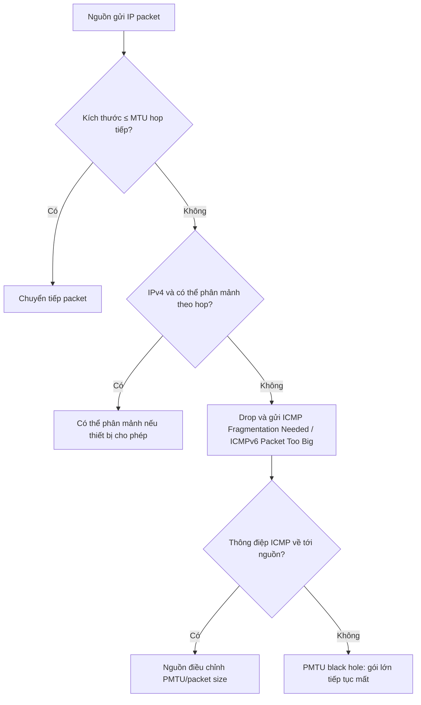
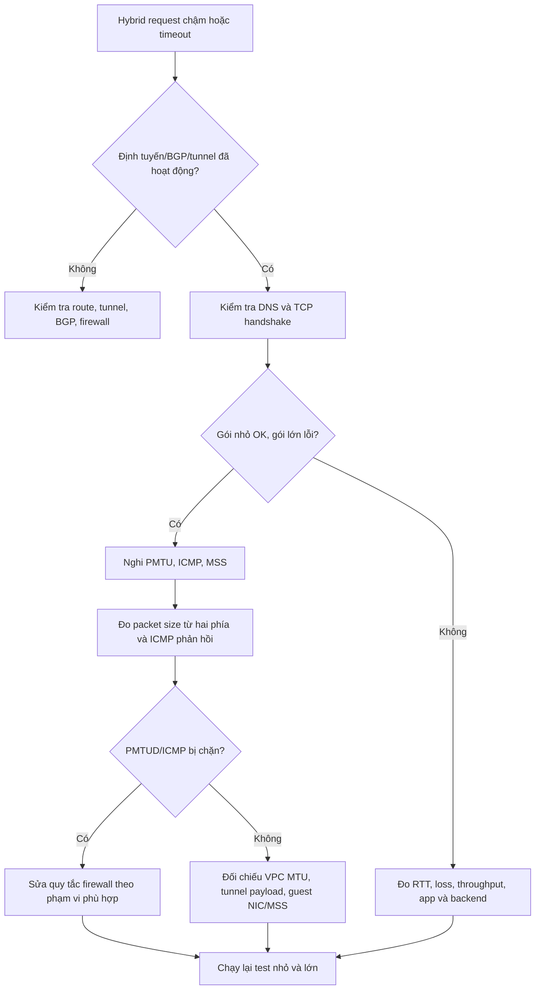
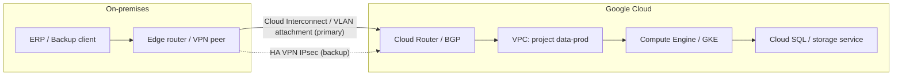

# MTU, phân mảnh và băng thông trên kết nối hybrid

Một hệ thống triển khai kết hợp **trung tâm dữ liệu tại chỗ (on-premises)** và Google Cloud có thể gặp tình huống khó hiểu: kết nối Cloud VPN hoặc Cloud Interconnect đã hoạt động, BGP báo các tuyến đường đúng, ping gói nhỏ thành công, nhưng tải file lớn, truy vấn cơ sở dữ liệu hoặc đồng bộ backup lại treo hay chạy rất chậm. Nguyên nhân có thể nằm ở **MTU không tương thích, Path MTU Discovery (PMTUD) bị chặn, TCP MSS không phù hợp, giới hạn packet-per-second hoặc nút thắt băng thông trên một đoạn đường truyền**.

Bài học thuộc chương **DNS và kết nối hybrid** của module `CLOUD_PROVIDERS_GCP`. Những kiến thức về VPC, Cloud VPN, Cloud Interconnect và Cloud Router dưới đây giúp người học triển khai kết nối an toàn cho Compute Engine, GKE, Cloud Run, dịch vụ lưu trữ và cơ sở dữ liệu; đồng thời đánh giá độ tin cậy, hiệu năng và chi phí truyền dữ liệu trước khi đưa hệ thống vào production.

> **Tư duy quan trọng:** Một phiên BGP hoạt động hoặc kết nối TCP thiết lập được chỉ chứng minh một phần đường truyền. Muốn xác nhận hệ thống sẵn sàng, cần kiểm tra kích thước gói, luồng dữ liệu, độ trễ, packet loss, tốc độ truyền thực tế và khả năng hoạt động sau failover.

## 1. Mục tiêu học tập

Sau bài học, bạn có thể:

1. Giải thích sự khác biệt giữa **MTU của interface/VPC**, **path MTU**, **payload MTU của tunnel**, **TCP MSS** và **băng thông (bandwidth)**.
2. Phân biệt gói IPv4 có thể phân mảnh trong những điều kiện nhất định với IPv6 vốn yêu cầu phía nguồn xử lý kích thước gói; hiểu tác động của cờ IPv4 `DF`.
3. Xác định vai trò của ICMP *Fragmentation Needed* và ICMPv6 *Packet Too Big* đối với PMTUD và hiện tượng *PMTU black hole*.
4. Chọn MTU khả thi cho VPC, Cloud VPN, HA VPN over Cloud Interconnect và VLAN attachment, dựa trên giá trị thiết bị thực tế.
5. Phân tích tại sao kết nối 10 Gbps chưa chắc đẩy được một luồng TCP 10 Gbps, hoặc vì sao nhiều gói nhỏ có thể chạm giới hạn pps trước giới hạn Gbps.
6. Thực hiện quy trình đo và chẩn đoán từng bước từ Compute Engine VM đến on-prem; ghi nhận kết quả trước khi sửa cấu hình.

## 2. Phân biệt các đại lượng dễ nhầm

| Khái niệm | Định nghĩa thực hành | Ví dụ |
| --- | --- | --- |
| **Interface/VPC MTU** | Kích thước tối đa của **IP packet** có thể đi qua một interface/đoạn mạng theo cấu hình, gồm IP header và phần bên trong | VPC mặc định `1460` byte; Ethernet thông thường `1500` byte |
| **Path MTU (PMTU)** | Kích thước IP packet lớn nhất đi được **trên toàn bộ đường từ nguồn tới đích**, xét các đoạn trung gian | VPC 1500, nhưng tunnel IPsec chỉ mang được packet nội bộ 1406 → PMTU hiệu dụng không vượt 1406 |
| **Tunnel gateway MTU** | Mức MTU phía cổng tunnel được Google công bố; cần phân biệt với kích thước packet nguyên bản có thể chở bên trong | Cloud VPN gateway MTU `1460` byte |
| **Tunnel payload MTU** | IP packet **trước khi được bọc/mã hóa** lớn nhất mà tunnel có thể chuyên chở trong một cấu hình | Với một số cipher AEAD trên Cloud VPN IPv4, có thể là `1406` byte trước NAT-T |
| **TCP MSS** | Số byte **dữ liệu TCP** lớn nhất trong một segment (không tính IP/TCP header) | IPv4 TCP không có options: MSS xấp xỉ `PMTU - 40` |
| **Throughput / goodput** | Tốc độ thực tế ở tầng mạng / dữ liệu hữu ích ở tầng ứng dụng | Link 1 Gbps nhưng tải backup đạt 600 Mbps hoặc 55 MB/s |
| **PPS** | Số packet mỗi giây; có thể là giới hạn riêng của thiết bị/tunnel | VPN có thể chạm giới hạn pps dù số Gbps chưa cao |
| **RTT** | Thời gian một vòng gửi yêu cầu/nhận đáp ứng; ảnh hưởng TCP, ứng dụng nhiều round-trip | RTT 60 ms cho đường hybrid |

**MTU tính bằng byte, băng thông tính bằng bit/giây và dung lượng file thường tính bằng byte.** Vì `1 byte = 8 bit`, đường 1 Gbps có mức tối đa lý thuyết 125 MB/s trước khi trừ overhead, mất gói và các giới hạn khác. Trong thực tế, cần phân biệt Mbps (megabit/s) và MB/s (megabyte/s); cũng không nên đồng nhất giá trị MTU với mức MSS của ứng dụng.

### 2.1. Gói tin được bọc như thế nào?

Một packet TCP qua Cloud VPN thường có các lớp như sau:

```text
Ứng dụng: dữ liệu nghiệp vụ
   |
   v
TCP segment: [TCP header | application data]    <-- MSS chỉ tính application data
   |
   v
Inner IP packet: [Inner IP header | TCP segment] <-- PMTU của IP packet gốc
   |
   v
IPsec/ESP: [Outer IP | ESP + padding/auth ... | Inner IP packet]
   |
   v
Liên kết truyền: giới hạn MTU cho outer packet
```

IPsec thêm outer IP header, ESP header, IV, authentication tag, padding và đôi khi UDP header nếu dùng NAT Traversal (NAT-T). Overhead phụ thuộc cipher, IP version của gateway và NAT-T. Vì vậy **tunnel gateway MTU không bằng payload MTU**; không thể lấy MTU 1460 rồi mặc định mọi TCP payload 1420 đều đi qua VPN.

### 2.2. Công thức nhanh cho IPv4 TCP

Với IPv4 cơ bản (20 byte IP header) và TCP header cơ bản (20 byte), không tính IP/TCP options:

\[
\mathrm{MSS}_{\mathrm{IPv4}}\ \approx\ \mathrm{PMTU} - 20 - 20
= \mathrm{PMTU} - 40
\]

Ví dụ một đường có PMTU 1406 byte:

\[
\mathrm{MSS}_{\mathrm{IPv4}}\ \approx\ 1406 - 40 = 1366\ \mathrm{byte}
\]

Với IPv6 cơ bản (40 byte IPv6 header) và TCP header cơ bản (20 byte), phép tính gần đúng là `PMTU - 60`. Header mở rộng, options và encapsulation khác có thể làm kích thước hữu ích thấp hơn; hãy đo thực tế và đối chiếu tài liệu thiết bị thay vì dùng công thức như một giá trị luôn đúng.

## 3. Phân mảnh IPv4 và IPv6: điều gì xảy ra nếu packet quá lớn?

**IP fragmentation** là quá trình chia một IP datagram thành các mảnh nhỏ để phù hợp với đường truyền; nó không phải cơ chế tối ưu băng thông. Khi một mảnh mất, việc ráp lại datagram có thể thất bại, dẫn đến retransmission ở tầng cao hơn và tăng CPU/độ trễ.

### 3.1. IPv4 và cờ Don't Fragment (DF)

- Với IPv4 `DF=1`, router không được chia datagram. Nếu packet lớn hơn MTU hop tiếp theo, router có thể drop và trả ICMP *Destination Unreachable – Fragmentation Needed* (type 3, code 4), thường kèm MTU phù hợp.
- Với IPv4 `DF=0`, giao thức cho phép một số router phân mảnh; nhưng **không có nghĩa mọi thành phần Google Cloud đều sẽ phân mảnh**. Ví dụ, Cloud VPN có ràng buộc riêng về việc phân mảnh trước/sau encapsulation.
- Nếu các thông báo ICMP về MTU bị chặn, nguồn có thể tiếp tục phát packet quá lớn; những kết nối truyền ít dữ liệu vẫn chạy, còn request/response lớn bị timeout.

### 3.2. IPv6 yêu cầu nguồn thích nghi

Router trung gian không phân mảnh packet IPv6. Nếu một hop không chuyên chở được gói, nó thông báo ICMPv6 **Packet Too Big** để nguồn giảm kích thước hoặc sử dụng cơ chế xử lý ở nguồn. Vì vậy chặn vô điều kiện ICMPv6 có thể phá PMTUD và nhiều chức năng mạng cơ bản.

### 3.3. Sơ đồ quyết định khi đi qua một hop



Không suy ra rằng firewall luôn phải mở mọi ICMP từ mọi nguồn. Cần cho phép **đúng các ICMP/ICMPv6 cần cho PMTUD** theo mô hình quản trị, nguồn/đích và chính sách bảo mật của doanh nghiệp.

## 4. Giá trị MTU cần nhớ trên Google Cloud

Theo tài liệu Google Cloud, VPC có MTU mặc định 1460 byte và cho phép cấu hình từ **1300 đến 8896 byte** khi không bị giới hạn bởi cấu hình chuyên biệt. Các giá trị 1500 và 8896 thường được dùng cho workload tương thích. Khi dùng VPN hoặc Interconnect, MTU hiệu dụng trên đường hybrid phụ thuộc **loại kết nối và cấu hình từng đầu**.

| Công nghệ / phạm vi | Mức được tài liệu mô tả | Điều cần kiểm tra |
| --- | --- | --- |
| **VPC network** | Mặc định `1460`; có thể tùy chỉnh từ `1300` tới `8896` | MTU VM NIC, GKE Pod CNI, mạng peering, tunnel và dịch vụ liên quan |
| **Cloud VPN (Classic/HA), gateway MTU** | `1460` byte | **Payload MTU nhỏ hơn** vì IPsec; phụ thuộc cipher, gateway IPv4/IPv6 và NAT-T |
| **HA VPN over Cloud Interconnect, gateway MTU** | `1440` byte | Không hỗ trợ jumbo frame trên encrypted VLAN attachment |
| **Cloud Interconnect VLAN attachment** | `1440`, `1460`, `1500`, `8896` | Chỉ dùng MTU lớn hơn khi VPC, VM, on-prem và nhà cung cấp hỗ trợ tương ứng |
| **Google APIs qua VPC** | Không hỗ trợ jumbo frame end-to-end tới Google Front Ends | Để TCP MSS negotiation hoạt động; đừng mong GFE tiếp nhận packet 8896 |
| **Compute Engine NIC** | Nên khớp MTU của VPC có chứa NIC | Linux image chuẩn thường nhận DHCP Option 26; Windows image chuẩn có thể cần chỉnh thủ công |

Đây là **các giới hạn cấu hình**, không phải bảo đảm mọi tuyến thực tế đều hỗ trợ MTU ấy. Chỉ cần một hop có MTU thấp hơn, PMTU phải giảm hoặc nguồn phải xử lý kích thước gói thích hợp.

Tham khảo: [VPC MTU](https://cloud.google.com/vpc/docs/mtu), [Cloud VPN MTU considerations](https://cloud.google.com/network-connectivity/docs/vpn/concepts/mtu-considerations), [Cloud Interconnect overview](https://cloud.google.com/network-connectivity/docs/interconnect/concepts/overview).

## 5. Cloud VPN: IPsec overhead và giới hạn payload

Với Cloud VPN, **gateway MTU** là 1460 byte nhưng **payload MTU** của tunnel thấp hơn do mã hóa/encapsulation. Đây là điểm thường gây lỗi khi một phía on-prem cho phép packet inner 1500 còn đường VPN chỉ chở được packet nhỏ hơn.

Các giá trị minh họa từ tài liệu Cloud VPN:

| Đường VPN và cấu hình mẫu | Gateway MTU | Payload MTU (IP packet gốc) | Nhận xét |
| --- | ---: | ---: | --- |
| Cloud VPN qua IPv4 gateway, một số tổ hợp AES-GCM AEAD, không NAT-T | 1460 | **1406** | Giá trị dành cho tổ hợp cipher cụ thể; không dùng chung cho mọi encryption suite |
| Cấu hình trên nhưng có NAT-T | 1460 | **1398** | UDP encapsulation tiêu tốn thêm 8 byte |
| Cloud VPN qua IPv6 gateway, một số tổ hợp AES-GCM AEAD, không NAT-T | 1460 | **1386** | Outer IPv6 tăng 20 byte so với outer IPv4 |
| HA VPN over Cloud Interconnect, IPv4 gateway, một số AEAD | 1440 | **1386** | Không dùng MTU jumbo của unencrypted attachment |

Các cipher không thuộc nhóm AEAD có thể cho payload MTU **khác**; tham khảo bảng theo cipher trong [Cloud VPN MTU considerations](https://cloud.google.com/network-connectivity/docs/vpn/concepts/mtu-considerations). Cần biết IKE/IPsec proposal và có NAT-T hay không, rồi mới quyết định MSS/PMTU.

### 5.1. Prefragmentation và MSS clamping

Cloud VPN dùng **MSS clamping** để TCP SYN/SYN-ACK quảng bá MSS thích hợp khi đi qua tunnel. Với những traffic khác TCP, thiết bị nguồn/peer cần phát packet phù hợp payload MTU. Tài liệu Google nêu phía **peer VPN gateway** cần hỗ trợ *prefragmentation*: thực hiện việc phân mảnh khi cần **trước khi mã hóa và bọc IPsec**. Cloud VPN **không hỗ trợ phân mảnh sau encapsulation**.

Trường hợp packet không vừa đường truyền và `DF=1`, hệ thống có thể gửi ICMP Fragmentation Needed hoặc ICMPv6 Packet Too Big. Phải xem quy tắc ingress firewall tới VM gửi và chính sách firewall on-prem để bảo đảm thông báo quay về được.

### 5.2. Tính MSS theo payload MTU

Ví dụ Cloud VPN IPv4 với AEAD, không NAT-T:

```text
Tunnel gateway MTU              1460 bytes
IPsec tunnel payload MTU        1406 bytes
IPv4 header (không có options)   -20 bytes
TCP header (không có options)    -20 bytes
--------------------------------------------
TCP MSS lý thuyết                1366 bytes
```

Nếu NAT-T làm giảm payload MTU xuống 1398, MSS tương ứng cho IPv4 TCP cơ bản là **1358**. Giá trị này là **phép tính minh họa**; không áp dụng đồng loạt bằng tay lên mọi host hoặc peer vì TCP MSS clamping và cơ chế PMTUD đã có thể xử lý. Khi khắc phục sự cố cần ghi lại vị trí clamping hiện tại và thử nghiệm trước khi thay đổi.

### 5.3. Tại sao không tăng VPC MTU lên 8896 để “sửa VPN”?

MTU của VPC không thể nâng payload MTU của Cloud VPN vượt giới hạn IPsec. Nếu VM có NIC MTU 8896 nhưng đường tunnel chỉ chở được inner IP packet khoảng 1400, hệ thống vẫn phải thu nhỏ packet qua TCP MSS/PMTUD hoặc giảm MTU của interface nguồn trong trường hợp cụ thể. Cloud VPN **không hỗ trợ jumbo frame**, vì vậy tăng VPC MTU mà không thiết kế toàn đường truyền có thể làm lỗi khó phát hiện hơn.

## 6. Cloud Interconnect: lợi ích và giới hạn jumbo frame

Cloud Interconnect (Dedicated hoặc Partner) kết nối VPC với mạng ngoài qua **VLAN attachment**. Các attachment hiện hỗ trợ MTU **1440, 1460, 1500 hoặc 8896 byte** tùy loại và cấu hình. Để thực sự truyền gói 8896, VPC, endpoint VM/router tại chỗ, VLAN attachment và các thiết bị trung gian phải hỗ trợ kích thước ấy.

| MTU trên attachment | Tình huống cân nhắc | Cần kiểm tra |
| ---: | --- | --- |
| 1440 | Giá trị mặc định của nhiều VLAN attachments; sử dụng trong cấu hình encrypted HA VPN over Interconnect | Có thành phần nào trong mạng gửi lớn hơn 1440 hay không? |
| 1460 | Khớp VPC mặc định 1460 | VM NIC, hệ thống tại chỗ, partner connection cùng mức |
| 1500 | Khớp Ethernet tiêu chuẩn 1500 khi toàn đường hỗ trợ | VPC đã cấu hình 1500, router/VM cùng giá trị |
| 8896 | Jumbo frame trên **unencrypted** VLAN attachment phù hợp | VPC, on-prem, thiết bị/partner, khả năng giám sát loss và quota |

**Encrypted VLAN attachment dùng với HA VPN over Cloud Interconnect không hỗ trợ jumbo** và có MTU 1440 theo tài liệu. Đừng sao chép cấu hình 8896 của Interconnect không mã hóa sang encrypted attachment.

### 6.1. Tại sao jumbo frame có thể cải thiện throughput?

Với cùng lượng dữ liệu, packet lớn hơn có thể giảm số packet phải xử lý, từ đó giảm một phần overhead và áp lực **pps**. Điều này có thể giúp khi hệ thống bị giới hạn bởi xử lý gói hoặc CPU. Tuy nhiên nếu ứng dụng chịu giới hạn RTT, I/O, backend, congestion control, tốc độ attachment hoặc mất gói, MTU lớn không nhất thiết tạo cải thiện.

Ví dụ lý tưởng với 1 Gbps dữ liệu trên đường, không tính mọi overhead:

```text
Trường hợp A: mỗi packet chở ~1.4 KB -> ~89.000 packet/s
Trường hợp B: mỗi packet chở ~8.8 KB -> ~14.200 packet/s
```

Đây chỉ là phép chia ước lượng để thấy ảnh hưởng của kích thước gói lên packet rate; **không phải số liệu throughput được Google cam kết**. Khi lên kế hoạch jumbo, phải cân nhắc thêm memory, offload, firewall appliances, GKE/CNI và các đường có thể failover sang VPN không hỗ trợ jumbo.

### 6.2. Ghi nhận cấu hình VLAN attachment trước khi đổi

Lệnh chỉ đọc:

```bash
gcloud compute networks describe HYBRID_VPC \
  --project=PROJECT_ID \
  --format="yaml(name,mtu)"

gcloud compute interconnects attachments describe ATTACHMENT_NAME \
  --project=PROJECT_ID \
  --region=REGION \
  --format="yaml(name,mtu,bandwidth,operationalStatus,state,router)"
```

Với Partner Interconnect, nhà cung cấp có thể đặt giới hạn MTU/băng thông thực tế ngoài cấu hình Google Cloud. Bắt buộc xác nhận với partner và tài liệu loại attachment trước khi lên kế hoạch nâng MTU.

## 7. MTU thay đổi trên VPC, VM và GKE có thể gây gián đoạn

Việc sửa VPC MTU không giống tăng một biến ứng dụng. Google Cloud khuyến nghị cấu hình Compute Engine NIC cùng MTU với VPC; Linux VM từ public OS image thường nhận MTU qua DHCP Option 26, còn Windows VM từ public image có thể mặc định 1460 và cần điều chỉnh riêng. Image tùy biến có thể bỏ qua cấu hình DHCP.

Theo hướng dẫn thay đổi MTU của VPC, cần **dừng các Compute Engine instances trước khi thay MTU VPC**; reboot bên trong guest OS không đảm bảo NIC nhận lại MTU của VPC. Những workload nhiều NIC còn có các MTU khác nhau theo VPC tương ứng.

Với GKE, MTU của Pod phụ thuộc CNI, chế độ cluster và VPC MTU. GKE Autopilot kế thừa từ VPC theo tài liệu, nhưng một số cấu hình/phiên bản CNI của GKE Standard có thể dùng mức cố định hoặc kế thừa. Do đó, muốn tăng MTU cho traffic Pod, phải kiểm tra node interface, Pod interface, overlay/encapsulation (nếu có) và sự hỗ trợ của CNI.

**Không cập nhật MTU toàn bộ production chỉ để thử một giả thuyết.** Xem mức PMTU của luồng gặp lỗi, kiểm tra ICMP và MSS trước; nếu cần sửa cấu hình hệ thống, lên kế hoạch maintenance, canary và rollback có thể kiểm chứng.

## 8. Path MTU Discovery (PMTUD) và hiện tượng “black hole”

PMTUD giúp nguồn tìm kích thước packet lớn nhất có thể đi qua đường truyền. Với IPv4, nguồn có thể gửi packet có DF; nếu quá lớn, router báo *Fragmentation Needed*. Với IPv6, router gửi *Packet Too Big*. TCP và một số giao thức có thêm cơ chế phát hiện/điều chỉnh riêng; tuy nhiên lọc nhầm ICMP vẫn có thể khiến đường truyền hoạt động không ổn định.

### Dấu hiệu gợi ý lỗi PMTU

- TCP handshake thành công, `ping` nhỏ được, nhưng HTTP upload/download hoặc truy vấn trả nhiều dữ liệu bị treo.
- Kết nối tới Cloud SQL hoặc API nội bộ chậm khi phản hồi lớn, còn query nhỏ bình thường.
- Một chiều dữ liệu chạy, chiều còn lại timeout do **đường đi bất đối xứng** hoặc firewall ở một hướng.
- Sau chuyển route hoặc failover từ Interconnect sang VPN, những packet vốn đi trên jumbo path không còn vừa tunnel.
- Có retransmissions/timeout tăng nhưng bandwidth tổng vẫn thấp; ứng dụng báo thời gian chờ dài.

Những dấu hiệu này **không khẳng định** MTU là nguyên nhân duy nhất. Chúng cũng có thể do firewall, flow control, congestion, CPU, TLS, database hoặc lỗi ứng dụng. Cần đo và phân loại.

### 8.1. Tư duy kiểm tra không phá hủy



Không dùng việc tắt firewall hoặc hạ toàn bộ MTU xuống một số tùy ý làm bước chẩn đoán mặc định. Hãy kiểm tra từng giả thuyết, lưu số liệu trước và sau.

## 9. Đo MTU và PMTU bằng các lệnh quan sát

Ví dụ dùng VM Linux trong VPC consumer và máy Linux tại chỗ; thay các biến đích bằng **IP thuộc môi trường thử nghiệm được phép**.

### 9.1. Đọc MTU của NIC và đường đi từ Linux

```bash
# Tất cả interface và MTU trên VM Linux.
ip -brief link

# Chi tiết interface; thay ens4 bằng tên NIC thực tế.
ip link show dev ens4

# Xem route mà kernel chọn cho đích on-prem.
ip route get 10.40.1.20

# Thăm dò path MTU; kết quả phụ thuộc ICMP/thiết bị trung gian.
tracepath -n 10.40.1.20
```

Ở Compute Engine, VPC MTU là một cấu hình của **VPC**; MTU guest NIC có thể khác nếu đã tùy chỉnh OS. Do đó đọc `ip link` trên VM và đọc `gcloud compute networks describe` từ môi trường quản trị để đối chiếu.

### 9.2. Dùng ping IPv4 với DF để thăm dò

Trên nhiều bản Linux có `iputils ping`:

```bash
# IPv4: ping -s là số byte dữ liệu ICMP.
# 1378 + 8 byte ICMP header + 20 byte IPv4 header = 1406 byte.
ping -4 -M do -s 1378 -c 4 10.40.1.20

# Thử kích thước nhỏ hơn để khoanh vùng nguyên nhân.
ping -4 -M do -s 1300 -c 4 10.40.1.20
```

**Không có ping reply chưa chứng minh PMTU sai:** máy đích có thể chặn ICMP Echo. Thông báo `Frag needed and DF set` là tín hiệu khác với `Request timed out`. Nếu tunnel dùng cipher/encapsulation khác, số 1378 chỉ là thử nghiệm minh họa dựa trên payload MTU 1406 — không coi là giá trị chuẩn cho mọi tunnel.

Trên Windows:

```powershell
# Hiển thị MTU thực tế của các interface Windows.
Get-NetIPInterface | Select-Object InterfaceAlias, AddressFamily, NlMtu

# IPv4: -f đặt DF, -l là số byte ICMP payload.
ping -4 -f -l 1378 10.40.1.20
```

Không dùng `-f` (DF) cho IPv6: cơ chế PMTU và fragmentation của IPv6 khác. Muốn xác minh IPv6, cần kiểm tra ICMPv6 Packet Too Big và công cụ hỗ trợ phù hợp.

### 9.3. Đo cả hai chiều

Giả sử TCP upload từ on-prem lên Cloud Storage thông qua proxy trong VPC bị timeout, nhưng tải xuống bình thường. Phải đo:

1. Nguồn on-prem → VM GCP.
2. VM GCP → nguồn on-prem.
3. Mỗi đường TCP handshake và ICMP lỗi kích thước gói.
4. Mỗi attachment/tunnel đang được chọn thực tế (active/active, ECMP, failover).

Một chiều có thể đi Cloud Interconnect, chiều kia đi Cloud VPN. Chỉ kiểm tra từ VM lên on-prem dễ bỏ sót đường bất đối xứng. Cũng cần xem firewall rules đến **ICMP lỗi quay về nguồn**, không chỉ quyền gửi `ping` đến server.

### 9.4. Bắt gói khi có bằng chứng phù hợp

Tại host do bạn quản lý, có thể dùng `tcpdump` để quan sát kích thước packet, TCP SYN MSS, ICMP và retransmission:

```bash
# Tập trung vào một đích, lượng capture đủ nhỏ để tránh lộ dữ liệu.
sudo tcpdump -ni ens4 'host 10.40.1.20 and (tcp or icmp)' -c 100
```

Nếu guest dùng TSO/GSO/GRO, packet thấy trong capture **có thể lớn hơn MTU trên dây** vì offload. Đừng kết luận mạng đang gửi jumbo packet chỉ từ một capture tại host. Không ghi payload nhạy cảm vào file capture chia sẻ công khai; có thể dùng header-only capture/filter trong quy trình vận hành.

## 10. Băng thông khác throughput: vì sao không đạt tốc độ danh nghĩa?

**Bandwidth** là năng lực lý thuyết hoặc cấu hình, còn **throughput** là tốc độ đo được của các packet đi qua, và **goodput** chỉ phần dữ liệu ứng dụng hữu ích đã nhận thành công. Các yếu tố giới hạn thường là:

| Nút thắt | Tác động | Ví dụ đo và khắc phục |
| --- | --- | --- |
| Capacity của tunnel/attachment | Tổng throughput không vượt capacity đoạn yếu nhất | Đối chiếu băng thông VLAN, tunnel metrics, giới hạn partner |
| Packet rate (pps) | Gói nhỏ chạm pps trước khi chạm giới hạn Gbps | Đo packets/s, phân bố packet size, tránh phát quá nhiều packet nhỏ |
| RTT + TCP window | Một luồng không giữ đủ dữ liệu đang truyền để lấp đường dài | Đo RTT, TCP window/autotuning, BDP và kiểm tra TCP metrics |
| Loss/retransmission | TCP giảm cửa sổ, ứng dụng bị timeout | Đo loss, retransmission, queue drops, interface errors |
| CPU/crypto | Mã hóa IPsec hoặc xử lý packet trên gateway/router/VM thành nút thắt | Quan sát CPU, interrupt, offload, cipher, packet size |
| Một luồng/ECMP | Nhiều tunnel hoặc attachment không đồng nghĩa một flow được chia đều | Thử nhiều flow độc lập; xác minh đường đi bằng 5-tuple |
| Ứng dụng và storage | Database, disk, API quota hoặc process đơn luồng giới hạn tốc độ | Đo storage throughput, DB latency, số concurrent requests |
| Chi phí/an toàn | Dồn mọi traffic qua đường đắt hoặc không dự phòng | Thiết kế traffic engineering, cảnh báo, năng lực failover |

### 10.1. Băng thông Cloud VPN và giới hạn pps

Tài liệu Cloud VPN công bố mỗi tunnel hỗ trợ tối đa **250.000 packets/s cho tổng ingress và egress**, tương đương khoảng **1–3 Gbps tùy kích thước packet trung bình**. Đó là mức giới hạn trên của tunnel theo điều kiện công bố, không phải cam kết một TCP flow luôn đạt 3 Gbps. 

Ví dụ tính thông lượng IP packet gần đúng nếu đạt 250.000 pps:

\[
\text{bit/s} \approx \text{packet/s} \times \text{bytes/packet} \times 8
\]

Với trung bình **1.400 byte/packet**: `250.000 × 1.400 × 8 = 2,8 Gbps` trước khi trừ overhead. Với **500 byte/packet**, chỉ khoảng `1,0 Gbps`. Vì vậy khi giám sát, luôn xem **cả bytes/s và packets/s**. Đừng cố tăng MTU lên mức không được hỗ trợ để vượt giới hạn tunnel.

Nếu cần throughput cao hơn, có thể cân nhắc nhiều HA VPN tunnels/gateways và thiết kế định tuyến thích hợp; việc phân phối traffic phụ thuộc BGP/ECMP, cấu trúc flow và thiết bị peer. Cần dành capacity cho failover, tránh tính toàn bộ giới hạn của các tunnel là bandwidth có thể dùng khi mất một tuyến.

### 10.2. Băng thông Cloud Interconnect và giới hạn mỗi flow

VLAN attachment có capacity riêng với đường vật lý, giới hạn bandwidth theo flow và packet rate. Tài liệu Network Connectivity nêu **tối đa 10 Gbps và 1.000.000 pps cho một flow trên VLAN attachment** trong điều kiện hỗ trợ; flow thực tế còn bị giới hạn bởi capacity attachment thấp hơn, packet size, source/destination và các thành phần khác. 

Một attachment có capacity 20 Gbps không tự giúp một luồng TCP đạt 20 Gbps. Để dùng tổng capacity, có thể cần nhiều flows và đủ nguồn/đích chạy song song. Không “benchmark một file copy” rồi kết luận VLAN attachment chỉ có hiệu năng bằng đúng số liệu một flow.

### 10.3. RTT và bandwidth-delay product (BDP)

BDP biểu diễn lượng dữ liệu phải đang nằm trên đường truyền để tận dụng bandwidth khi có RTT:

\[
\mathrm{BDP\ (bytes)} \approx \frac{\mathrm{bandwidth\ (bit/s)} \times \mathrm{RTT\ (s)}}{8}
\]

Ví dụ đường có thể cung cấp **1 Gbps** và RTT **60 ms**:

\[
\mathrm{BDP} = \frac{1.000.000.000 \times 0,06}{8}
= 7.500.000\ \mathrm{bytes} \approx 7,5\ \mathrm{MB}
\]

Nếu TCP window thực tế nhỏ hơn nhiều so với BDP, một flow khó lấp đường truyền dù link còn trống. Nhưng tăng window cũng không giải quyết packet loss, giới hạn pps, giới hạn CPU hoặc PMTU black hole.

## 11. Đo throughput có kiểm soát

Có thể dùng `iperf3` giữa **hai host do đội kỹ thuật kiểm soát**, một phía on-prem và một VM thử nghiệm trong VPC. Đặt thời gian thử đủ ngắn, xác định cổng/firewall và thời điểm không làm ảnh hưởng production; không hướng bài test tới dịch vụ bên thứ ba.

Trên host được phép làm server:

```bash
iperf3 --server --port 5201
```

Trên host client:

```bash
# Một TCP flow trong 15 giây.
iperf3 --client 10.40.1.20 --port 5201 --time 15

# Bốn flow đồng thời, hữu ích khi đánh giá flow bottleneck.
iperf3 --client 10.40.1.20 --port 5201 --parallel 4 --time 15

# Đổi chiều dữ liệu mà vẫn khởi tạo từ cùng client.
iperf3 --client 10.40.1.20 --port 5201 --reverse --time 15
```

Quan sát đồng thời Cloud Monitoring và router on-prem: throughput ingress/egress, pps, drops, retransmissions, CPU, VPN tunnel metrics và VLAN attachment utilization. Chạy nhiều luồng có thể tạo traffic rất lớn; phối hợp với người quản trị liên kết để không gây nghẽn các dịch vụ khác.

### Bảng kết quả thử nghiệm minh họa

| Phép thử | Kết quả giả định | Nhận định cần xác minh |
| --- | --- | --- |
| TCP 1 flow, Interconnect | 3,2 Gbps | Có thể do RTT/window, endpoint CPU, một flow limit hoặc backend |
| TCP 4 flows, Interconnect | 11,8 Gbps | Hệ thống có thể bị giới hạn theo flow hoặc client, cần so với attachment capacity |
| TCP 1 flow, VPN dự phòng | 0,8 Gbps | Xem tunnel pps, crypto CPU, MTU và loss |
| Ping nhỏ qua VPN | Thành công | Chưa chứng minh gói lớn hoặc traffic nghiệp vụ chạy tốt |
| Ping DF kích thước lớn | `Frag needed` | Có thể có PMTU thấp hơn cấu hình guest NIC, đo đúng ngưỡng |

Các con số trên **không phải benchmark hoặc SLA của Google Cloud**. Chúng giúp người học đặt câu hỏi và lên phép đo: nếu bốn flows nhanh hơn đáng kể một flow, cần điều tra giới hạn flow/window; nếu giảm packet size cải thiện timeout nhưng làm throughput giảm, cần xác minh MTU lẫn pps.

## 12. Case study: đồng bộ dữ liệu on-prem tới Google Cloud

Một doanh nghiệp có hệ thống ERP tại trung tâm dữ liệu, Cloud SQL cho ứng dụng nội bộ và Compute Engine/GKE xử lý dữ liệu trong project GCP. Kết nối hybrid hiện dùng **Cloud Interconnect chính** và **HA VPN dự phòng**; Cloud Router trao đổi tuyến đường qua BGP. Mục tiêu là chuyển dữ liệu theo lô mỗi đêm, đồng thời bảo đảm API nội bộ không bị treo sau chuyển tuyến.

### 12.1. Kiến trúc và đường đi



Sơ đồ thể hiện logic định tuyến; Cloud Router là thành phần BGP quản lý và quảng bá route, không phải thiết bị xử lý mọi packet ở data plane. Đường tới Cloud SQL/storage phải dùng phương thức kết nối phù hợp với từng dịch vụ, không mặc định mọi endpoint ứng dụng nằm trên chính tuyến hybrid.

### 12.2. Sự cố sau failover

Trong vận hành bình thường, một nhóm VM on-prem gửi gói IP 1500 byte qua Interconnect và chạy tốt. Khi tuyến chính gặp sự cố, BGP chuyển traffic sang HA VPN. Tunnel VPN có **payload MTU thấp hơn 1500**. Nếu nguồn/peer không xử lý PMTUD hoặc ICMP lỗi bị chặn, packet lớn bị drop và luồng đồng bộ dừng, dù BGP đã học route dự phòng.

Điểm cần làm:

1. Xác minh route đổi sang HA VPN thật sự qua Cloud Router status và router on-prem.
2. Đọc gateway MTU/payload MTU theo tunnel cipher và NAT-T; đối chiếu MTU NIC/router.
3. Thử packet nhỏ và packet DF tăng dần từ hai phía; ghi nhận ICMP báo MTU.
4. Kiểm tra MSS clamping và prefragmentation trên peer trước khi thay hàng loạt MTU máy chủ.
5. Đo lại TCP throughput, packet loss, và ứng dụng đồng bộ sau chuyển tuyến.
6. Thiết kế cảnh báo và runbook cho lần failover tiếp theo.

### 12.3. Lập ngân sách băng thông cho backup

Giả sử cần chuyển **500 GB dữ liệu hữu ích** trong cửa sổ 2 giờ; bỏ qua compression và overhead để ước tính thấp nhất:

\[
\mathrm{Required\ goodput}
= \frac{500 \times 10^9 \times 8}{2 \times 3600}
\approx 556\ \mathrm{Mbps}
\]

Muốn có dự phòng 30% cho overhead, retry và biến thiên, có thể **lập ngân sách thử nghiệm** khoảng `0,8 Gbps` goodput mục tiêu, rồi đo thực tế theo loại ứng dụng. Con số không suy ra được số tunnel từ mỗi phép chia đơn giản vì phụ thuộc pps, packet size, số flows, RTT và năng lực on-prem.

Nếu phải tiếp tục backup khi failover sang VPN, hãy đo **capacity khả dụng của VPN**, không chỉ capacity Interconnect chính. Kiểm tra còn đủ bandwidth cho transaction API, telemetry và các ứng dụng ưu tiên cao khác. Độ tin cậy phải được đánh giá theo đường dự phòng yếu nhất vẫn phải đáp ứng yêu cầu.

## 13. Quy trình chẩn đoán theo thứ tự

| Bước | Cần kiểm tra | Công cụ/gợi ý | Khi nào dừng suy đoán về MTU |
| --- | --- | --- | --- |
| 1. Phạm vi lỗi | Endpoint nào, thời điểm, hướng on-prem → GCP hay ngược lại? | Logs, traces, flow logs, ticket, deployment change | Nếu chỉ một endpoint lỗi ứng dụng, điều tra ứng dụng song song |
| 2. Kết nối nền tảng | VPN tunnels, VLAN attachment, BGP routes và firewall | `gcloud compute vpn-tunnels describe`, attachment describe, Cloud Router status | Nếu route/tunnel down thì xử lý routing trước |
| 3. NIC và cấu hình mạng | VPC MTU, guest NIC, peer router MTU, overlay GKE | `gcloud compute networks describe`, `ip link` | Nếu không có đường tới IP đích, sửa route/firewall |
| 4. PMTU | Kích thước lớn nhất đi được, ICMP errors | `ping -M do`, `tracepath`, packet capture | Nếu gói lớn/nhỏ đều mất như nhau, có thể là lỗi khác |
| 5. TCP và tunnel | SYN/SYN-ACK MSS, IPsec cipher/NAT-T, MSS clamping | Packet capture, VPN peer config | Nếu PMTU phù hợp nhưng vẫn chậm, đo loss/RTT |
| 6. Capacity | Bps, pps, flow count, CPU, bandwidth, RTT, BDP | Monitoring, iperf3 giới hạn tải | Nếu bottleneck ở disk/DB, tăng MTU không giúp |
| 7. Failover | Đường chính và dự phòng có cùng hành vi? | Test chuyển tuyến có kiểm soát, SLO/alert | Nếu tuyến dự phòng thiếu capacity, cập nhật thiết kế |

Các lệnh chỉ đọc sau giúp người học đối chiếu hạ tầng:

```bash
# VPC MTU.
gcloud compute networks describe HYBRID_VPC \
  --project=PROJECT_ID --format="yaml(name,mtu)"

# VLAN attachment MTU, capacity và trạng thái.
gcloud compute interconnects attachments describe ATTACHMENT_NAME \
  --project=PROJECT_ID --region=REGION \
  --format="yaml(name,mtu,bandwidth,operationalStatus)"

# VPN tunnel và bộ mã hóa / trạng thái.
gcloud compute vpn-tunnels describe VPN_TUNNEL_NAME \
  --project=PROJECT_ID --region=REGION

# BGP peer và tuyến đường động Cloud Router.
gcloud compute routers get-status CLOUD_ROUTER_NAME \
  --project=PROJECT_ID --region=REGION
```

Không đưa pre-shared keys, credentials, dữ liệu từ packet capture hoặc thông tin mạng nội bộ nhạy cảm vào tài liệu chia sẻ công khai. Lệnh đo traffic thực tế cần môi trường kiểm thử/ủy quyền, vì có thể tác động tới production và sinh chi phí network.

## 14. Các sai lầm thường gặp

1. **Cho rằng MTU VPC 1460 là payload MTU của Cloud VPN:** IPsec có overhead nên tunnel chở IP packet gốc nhỏ hơn.
2. **Tăng VPC MTU lên jumbo để tăng tốc VPN:** Cloud VPN không hỗ trợ jumbo; cần kiểm tra PMTU end-to-end.
3. **Chặn ICMP/ICMPv6 lỗi vì nghĩ không liên quan dữ liệu:** phá PMTUD và gây timeout với packet lớn.
4. **Nhầm IPv4 fragmentation với IPv6:** router IPv6 không chia packet giống IPv4; nguồn phải xử lý thông báo Packet Too Big.
5. **Dùng một ngưỡng ping DF cho mọi đường:** kết quả khác nhau theo IP version, cipher, NAT-T, encapsulation, đường failover.
6. **Đọc MTU của interface rồi kết luận toàn đường hỗ trợ:** PMTU là giới hạn của hop nhỏ nhất.
7. **Tin rằng TCP handshake chứng minh throughput tốt:** dữ liệu lớn vẫn có thể bị loss, queue, PMTU black hole hoặc bottleneck khác.
8. **Chỉ đo Mbps mà bỏ pps:** packet nhỏ có thể đạt giới hạn xử lý gói trước khi đầy link.
9. **Đo một flow rồi suy ra capacity toàn Interconnect:** flow có giới hạn riêng và chịu tác động RTT/window.
10. **Thiết kế dự phòng bằng số Gbps của đường chính:** đường VPN failover có MTU và capacity khác; phải test tải thực.
11. **Chỉnh MTU trên VM/GKE/attachment không có kế hoạch:** có thể làm gián đoạn các luồng vốn đang hoạt động.
12. **Chỉ đo một chiều:** đường đi bất đối xứng, firewall hoặc BGP chọn tuyến khác làm kết quả không đại diện.

## 15. Bài tập thực hành

### Bài A — Tính TCP MSS và thử DF

Một tunnel Cloud VPN có payload MTU 1406 byte, inner traffic là IPv4/TCP không có options. Hãy tính MSS cơ bản, sau đó tính payload cho lệnh Linux `ping -M do -s SIZE` nếu muốn IP packet đúng 1406 byte. Nếu có NAT-T làm payload MTU còn 1398 byte, cả hai số thay đổi thế nào?

**Gợi ý kiểm tra:** với IPv4/TCP, trừ 40 byte; với IPv4/ICMP Echo, trừ 28 byte. Các số không thay thế phép đo thực trên tunnel và chính sách ICMP.

### Bài B — So sánh Cloud Interconnect và Cloud VPN

VPC đang có MTU 1500, VLAN attachment 1500 và backup HA VPN có payload MTU 1406. Một ứng dụng on-prem gửi gói IPv4 lớn với DF=1. Hãy lập ma trận khi đi đường chính và đường dự phòng: hop hạn chế MTU, thông báo ICMP cần thiết, cách xử lý MSS và hành động khi gặp PMTU black hole.

### Bài C — Giải thích throughput không đạt băng thông

VLAN attachment cấu hình 20 Gbps nhưng một luồng iperf3 chỉ đạt 4 Gbps, chạy 8 flow đạt 15 Gbps. Liệt kê các giả thuyết: RTT/BDP, TCP window, giới hạn per-flow, CPU, packet rate, loss và congestion. Đề xuất phép đo tối thiểu để phân biệt từng nguyên nhân.

### Bài D — Bài toán VPN packet rate

Một tunnel có giới hạn công bố 250.000 pps cho tổng ingress/egress. Tính lưu lượng IP packet gần đúng nếu packet trung bình 500 byte và 1400 byte. Tại sao không thể coi cả hai kết quả là goodput ứng dụng hoặc SLA chắc chắn?

### Bài E — Triển khai an toàn

Doanh nghiệp muốn nâng VPC MTU từ 1460 lên 8896 để tối ưu backup. Hãy xác định các nhóm cần kiểm tra: Compute Engine NIC/guest OS, GKE, VLAN attachments/partner, VPN dự phòng, thiết bị on-prem, firewall endpoints, Google APIs, giới hạn dịch vụ, maintenance window, phép thử trước/sau và rollback.

### Câu hỏi tự kiểm tra

1. Phân biệt interface MTU, path MTU, Cloud VPN gateway MTU và payload MTU.
2. Vì sao một packet nhỏ đi được không chứng minh packet lớn cùng đường sẽ đi được?
3. ICMP Fragmentation Needed và ICMPv6 Packet Too Big phục vụ PMTUD như thế nào?
4. Cloud VPN có hỗ trợ fragmentation **sau** IPsec encapsulation và jumbo frame không?
5. HA VPN over Interconnect có thể dùng VLAN attachment MTU 8896 không?
6. Vì sao dùng nhiều tunnel hoặc nhiều VLAN attachment chưa chắc làm một TCP flow nhanh hơn?
7. Vì sao cần kiểm tra cả packet rate, throughput và RTT khi tối ưu kết nối hybrid?
8. Đâu là bằng chứng cần lưu trước khi thay đổi MTU trong production?

**Quy trình ghi nhớ:** đọc VPC/guest/attachment/tunnel MTU → xác định PMTU của đường chính và dự phòng → kiểm tra ICMP/PMTUD, MSS và encapsulation → đo RTT/loss/pps/throughput hai chiều → đối chiếu giới hạn service và application → chỉ điều chỉnh cấu hình sau khi có phép đo và phương án kiểm chứng.

## 16. Tài liệu chính thức

- [Google Cloud VPC Maximum transmission unit](https://cloud.google.com/vpc/docs/mtu)
- [Change the MTU setting of a VPC network](https://cloud.google.com/vpc/docs/change-mtu-vpc-network)
- [Cloud VPN MTU considerations](https://cloud.google.com/network-connectivity/docs/vpn/concepts/mtu-considerations)
- [Cloud VPN overview and network bandwidth](https://cloud.google.com/network-connectivity/docs/vpn/concepts/overview)
- [Cloud VPN quotas and limits](https://cloud.google.com/network-connectivity/docs/vpn/quotas)
- [Cloud Interconnect overview](https://cloud.google.com/network-connectivity/docs/interconnect/concepts/overview)
- [Create Dedicated Interconnect VLAN attachments](https://cloud.google.com/network-connectivity/docs/interconnect/how-to/dedicated/creating-vlan-attachments)
- [Cloud Interconnect quotas and limits](https://cloud.google.com/network-connectivity/docs/interconnect/quotas)
- [HA VPN topologies for higher bandwidth](https://cloud.google.com/network-connectivity/docs/vpn/concepts/topologies-increase-bandwidth)
- [HA VPN over Cloud Interconnect](https://cloud.google.com/network-connectivity/docs/interconnect/concepts/ha-vpn-interconnect)

MTU hỗ trợ, payload MTU theo cipher, quota và throughput theo flow có thể thay đổi theo loại dịch vụ hoặc phiên bản cấu hình. Khi thực hiện trong môi trường thật, đối chiếu số liệu ở console/API, hồ sơ thiết bị peer và tài liệu Google Cloud đang áp dụng cho chính kết nối đó.
