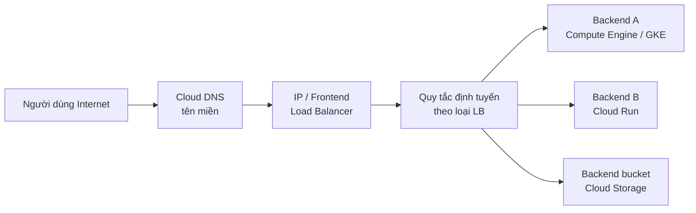
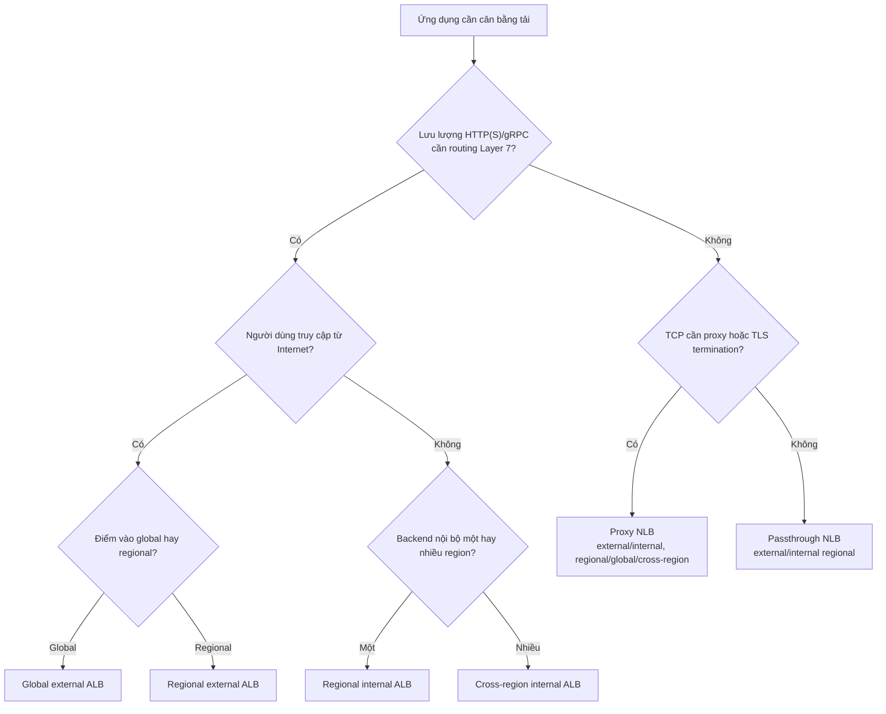
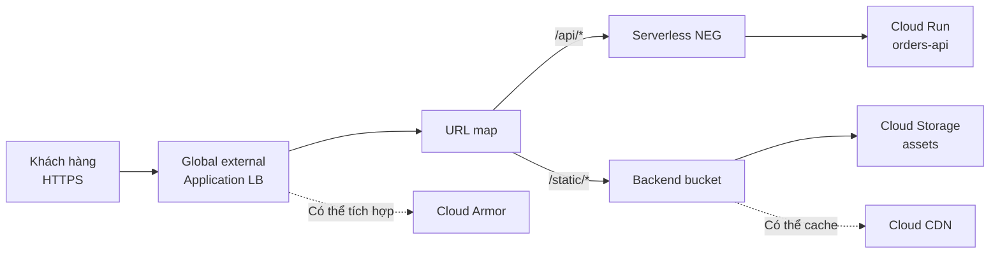

# Danh mục Cloud Load Balancing và tiêu chí lựa chọn

Khi đưa một ứng dụng lên Google Cloud, câu hỏi không chỉ là **chạy trên Compute Engine, GKE hay Cloud Run** mà còn là **người dùng đi vào ứng dụng qua đâu**. Một hệ thống thương mại điện tử phải phục vụ HTTPS từ Internet, một API nội bộ chỉ cho phép mạng doanh nghiệp truy cập, còn ứng dụng trò chơi thời gian thực có thể sử dụng UDP. Các yêu cầu khác nhau dẫn đến lựa chọn **Cloud Load Balancing** khác nhau.

Bài học thuộc chương **Cân bằng tải và phân phối nội dung** của module `CLOUD_PROVIDERS_GCP`. Trong lộ trình học Google Cloud từ project, IAM, VPC đến Compute Engine, GKE, Cloud Run, dịch vụ lưu trữ và cơ sở dữ liệu, người học cần biết chọn bộ cân bằng tải, bảo vệ tài nguyên, tự động hóa phát hành và theo dõi **độ tin cậy, độ trễ và chi phí**. Bài này tập trung vào **danh mục Cloud Load Balancing và cách ra quyết định**, làm nền tảng cho những bài cấu hình và vận hành chuyên sâu.

## 1. Mục tiêu học tập

Sau bài học, bạn có thể:

1. Phân biệt **Application Load Balancer**, **proxy Network Load Balancer** và **passthrough Network Load Balancer**.
2. Giải thích các trục lựa chọn: **Layer 7/Layer 4, external/internal, global/regional/cross-region, proxy/passthrough**.
3. Nhận diện vai trò của **frontend, forwarding rule, target proxy, URL map, backend service, health check, backend và network endpoint group (NEG)**.
4. Chọn loại load balancer phù hợp cho các tình huống **HTTP(S), gRPC, TCP, UDP**, public/private, một vùng/nhiều vùng, có/không cần giữ IP nguồn của client.
5. Cân nhắc tương thích backend **Compute Engine, GKE, Cloud Run**, phân phối nội dung qua **Cloud CDN** và bảo mật bằng các cơ chế được hỗ trợ như **Cloud Armor**.
6. Đặt câu hỏi về **high availability, latency, địa điểm dữ liệu, logging, hạn mức và chi phí** trước khi quyết định.

## 2. Load balancer nằm ở đâu trong kiến trúc?

**Load balancer** tiếp nhận lưu lượng ở một điểm vào (frontend) và phân phối tới các backend có thể phục vụ yêu cầu. Tùy loại, bộ cân bằng tải có thể **đọc và định tuyến theo HTTP** hoặc chỉ xử lý **thông tin kết nối/gói tin Layer 4**.

Ví dụ một website:



Sơ đồ chỉ minh họa các loại backend **có thể** được sử dụng trong những cấu hình load balancer tương thích; không phải một LB bất kỳ hỗ trợ đồng thời mọi backend trong sơ đồ. DNS phân giải tên thành địa chỉ frontend, còn **load balancer mới thực hiện phân phối traffic**. Cloud DNS tự nó không phải load balancer Layer 7.

### 2.1. Khái niệm trong một cấu hình load balancing

| Thành phần | Vai trò | Lưu ý |
| --- | --- | --- |
| **Frontend / IP address** | Địa chỉ và cổng mà client kết nối. | Có thể là IP công khai hoặc IP nội bộ; phạm vi global/regional tùy loại LB. |
| **Forwarding rule** | Liên kết IP, giao thức, cổng và thành phần điều khiển lưu lượng theo kiến trúc LB. | Global hay regional là thuộc tính quan trọng của rule. |
| **Target proxy** | Kết thúc kết nối phía client và mở kết nối tới backend trong mô hình proxy. | Loại HTTP(S), TCP hay SSL proxy phụ thuộc sản phẩm. |
| **URL map** | Điều hướng HTTP(S) theo host, path và những điều kiện được hỗ trợ. | Có ở Application Load Balancer; không phải khả năng của passthrough LB. |
| **Backend service** | Tập trung chính sách chọn backend và các tham số dịch vụ. | Có thể dùng instance group, NEG hoặc loại backend được hỗ trợ. |
| **Health check** | Kiểm tra trạng thái backend để tránh gửi traffic tới điểm lỗi. | Quy tắc hỗ trợ khác nhau giữa nhóm backend; ví dụ serverless NEG không dùng health check theo cách của VM instance group. |
| **Instance group / NEG / backend bucket** | Nơi chứa endpoint hoặc đối tượng phục vụ traffic. | Hỗ trợ phụ thuộc loại LB; backend bucket thường phục vụ phân phối nội dung từ Cloud Storage qua loại ALB phù hợp. |

**Cloud Load Balancing là dịch vụ phân phối lưu lượng**, không tự triển khai hay tự tăng số VM/Pod theo ý muốn. Đối với Compute Engine, Managed Instance Group (MIG) hoặc GKE autoscaler mới thực hiện các cơ chế điều chỉnh số lượng tài nguyên theo cấu hình riêng.

## 3. Bốn câu hỏi phân loại quan trọng nhất

### 3.1. Layer 7 hay Layer 4?

**Application Load Balancer (Layer 7)** hiểu ngữ nghĩa HTTP/HTTPS (và các giao thức ứng dụng được hỗ trợ như HTTP/2, gRPC trong cấu hình phù hợp). Nó có thể sử dụng hostname, đường dẫn URL, header hoặc các quy tắc nâng cao được hỗ trợ để chọn backend.

Ví dụ:

```text
https://shop.example.com/api/orders  → backend orders-api
https://shop.example.com/api/pay    → backend payments-api
https://shop.example.com/assets/*   → backend nội dung tĩnh
```

**Network Load Balancer (Layer 4)** phù hợp với kết nối TCP, UDP hoặc những giao thức mạng được sản phẩm cụ thể hỗ trợ. Nó không cung cấp định tuyến theo URL path như ALB. Một NLB có thể là **proxy** hoặc **passthrough**: hai mô hình có đặc điểm kết nối và IP nguồn khác nhau.

### 3.2. External hay internal?

- **External:** frontend để client truy cập từ Internet theo thiết kế của dịch vụ, với chính sách firewall, authentication và cơ chế bảo vệ phù hợp. “External” **không có nghĩa** toàn bộ backend phải sở hữu IP công khai.
- **Internal:** frontend là địa chỉ riêng phục vụ kết nối trong VPC hoặc từ các mạng được phép truy cập qua kết nối phù hợp, tùy khả năng global access/cross-region của sản phẩm. Một internal LB không tự biến thành public endpoint.

**Ví dụ:** website cho khách hàng nên xem xét external ALB; API quản trị chỉ dùng giữa các dịch vụ nội bộ nên xem xét internal ALB hoặc internal NLB tùy giao thức.

### 3.3. Global, regional hay cross-region?

- **Global:** điểm vào và phân phối tải theo cơ chế toàn cầu của sản phẩm, có thể sử dụng IP frontend global và backends ở các region được hỗ trợ. Thích hợp nhiều ứng dụng public đa vùng.
- **Regional:** frontend và thành phần xử lý được triển khai theo một region, thường đi kèm backend trong vùng theo yêu cầu của sản phẩm. Thích hợp ràng buộc khu vực hoặc nhu cầu nội bộ một vùng.
- **Cross-region internal:** nhóm LB nội bộ hỗ trợ phân phối giữa các region theo kiến trúc được hỗ trợ. Cần thiết kế connectivity, quyền truy cập, region, kiểm soát dữ liệu và chi phí riêng.

**Phạm vi của frontend không quyết định vị trí dữ liệu một cách tự động.** Một frontend global vẫn có thể đưa yêu cầu tới backend trong một region, hoặc nhiều region nếu đã cấu hình. Cũng không thể coi việc chọn một LB toàn cầu là bảo đảm failover đa vùng khi mới chỉ có một backend.

### 3.4. Proxy hay passthrough?

| Đặc tính | **Proxy LB** | **Passthrough LB** |
| --- | --- | --- |
| Kết nối | LB kết thúc kết nối client và tạo kết nối tới backend. | Lưu lượng được chuyển tới backend mà không tạo hai kết nối proxy tương tự. |
| Quan sát giao thức | ALB proxy có thể hiểu HTTP; proxy NLB xử lý TCP/TLS ở mức tương ứng. | Phân phối theo địa chỉ, cổng, giao thức và cơ chế chọn backend. |
| IP nguồn client tại backend | Thường thấy địa chỉ phía proxy; HTTP có thể chuyển thông tin qua header như `X-Forwarded-For`, tùy cấu hình. | Thường bảo toàn địa chỉ IP nguồn client ở mức gói tin khi kiến trúc hỗ trợ. |
| HTTP host/path routing | Có với ALB phù hợp. | Không. |
| Giao thức | HTTP(S), TCP/TLS tùy loại proxy. | TCP/UDP và những giao thức được loại passthrough cụ thể hỗ trợ. |
| Tình huống | Web/API, TLS termination, định tuyến L7 hoặc TCP proxy. | Ứng dụng UDP, yêu cầu bảo toàn source IP, xử lý trực tiếp kết nối L4. |

Khi chọn, nên xác định **server cần nhìn thấy IP nguồn gốc ở layer nào**. Với ALB, ứng dụng thường lấy client IP từ header do hệ thống proxy đáng tin cậy thêm vào. Không nên tin trực tiếp mọi header `X-Forwarded-For` do client gửi nếu chưa có cấu hình proxy và quy tắc xử lý chống giả mạo.

## 4. Danh mục Cloud Load Balancing

Google Cloud phân loại bộ cân bằng tải theo **Application Load Balancer**, **proxy Network Load Balancer** và **passthrough Network Load Balancer**. Trong mỗi họ lại có các biến thể public/private và phạm vi triển khai. Các tên “classic” tồn tại để chỉ thế hệ cấu hình cũ cần được phân biệt với những sản phẩm hiện hành.

### 4.1. Application Load Balancer (ALB) — HTTP(S) Layer 7

| Biến thể | Phạm vi frontend | Khi nào cân nhắc |
| --- | --- | --- |
| **Global external Application Load Balancer** | External, global | Website/API công khai cần điểm vào toàn cầu, cấu hình host/path routing, nhiều vùng hoặc tích hợp khả năng edge theo hỗ trợ. |
| **Regional external Application Load Balancer** | External, regional | Ứng dụng HTTP(S) công khai có yêu cầu vận hành theo một region hoặc cần các đặc tính regional. |
| **Regional internal Application Load Balancer** | Internal, regional | API/web nội bộ có HTTP routing trong một region. |
| **Cross-region internal Application Load Balancer** | Internal, đa region theo thiết kế | Ứng dụng HTTP(S) nội bộ cần backend ở nhiều region và cơ chế phân phối/failover nội bộ được hỗ trợ. |
| **Classic Application Load Balancer** | External, kiến trúc classic | Hệ thống hiện có cần duy trì/tìm hiểu khả năng tương thích; không nên mặc định classic và global external ALB mới có tập tính năng giống nhau. |

**Khả năng đặc trưng:** HTTP host/path routing, TLS termination, hỗ trợ HTTP/2/gRPC/HTTP/3/WebSocket theo từng biến thể và yêu cầu cấu hình, tích hợp các backend HTTP được hỗ trợ. Không giả định mọi ALB hỗ trợ mọi tính năng edge, mọi NEG hay mọi hình thức session affinity.

Với **Cloud Run**, một lựa chọn phổ biến là **external Application Load Balancer** kết nối qua **serverless NEG**. Cách này có thể đưa nhiều dịch vụ serverless dưới một tên miền, kết hợp các tính năng edge phù hợp và quản lý truy cập từ Internet ở tầng trước Cloud Run. Việc giới hạn ingress của Cloud Run để tránh truy cập ngoài đường đi dự kiến vẫn phải cấu hình riêng.

### 4.2. Proxy Network Load Balancer — TCP/TLS qua proxy

| Biến thể | Phạm vi | Khi nào cân nhắc |
| --- | --- | --- |
| **Global external proxy Network Load Balancer** | External, global | Dịch vụ TCP cần proxy ở điểm vào toàn cầu và có thể phân phối theo khả năng backend được hỗ trợ. |
| **Regional external proxy Network Load Balancer** | External, regional | Dịch vụ TCP public cần điểm vào/proxy theo region. |
| **Regional internal proxy Network Load Balancer** | Internal, regional | TCP nội bộ cần mô hình proxy trong region. |
| **Cross-region internal proxy Network Load Balancer** | Internal, đa region theo thiết kế | TCP nội bộ cần phân phối giữa các region theo tính năng được hỗ trợ. |
| **Classic proxy Network Load Balancer** | External, classic | Cấu hình TCP/SSL proxy đời trước cần duy trì hoặc đánh giá nâng cấp. |

Proxy Network Load Balancer xử lý **TCP** ở mức kết nối. Các cấu hình proxy TLS/SSL được hỗ trợ có thể kết thúc TLS tại frontend, nhưng **không trở thành HTTP URL router** chỉ vì lưu lượng chạy trên cổng 443. Muốn định tuyến theo hostname/path HTTP, hãy đánh giá ALB.

**Hạn chế quan trọng:** proxy NLB không phải lựa chọn cho UDP. Nếu ứng dụng đòi IP nguồn trực tiếp tại backend hoặc không muốn proxy kết thúc kết nối, cần xem passthrough NLB.

### 4.3. Passthrough Network Load Balancer — Layer 4 không proxy

| Biến thể | Phạm vi | Khi nào cân nhắc |
| --- | --- | --- |
| **External passthrough Network Load Balancer** | External, regional | Dịch vụ TCP/UDP public, cần phân phối gói/kết nối tới backend và bảo toàn thông tin nguồn theo cơ chế được hỗ trợ. |
| **Internal passthrough Network Load Balancer** | Internal, regional | Dịch vụ TCP/UDP hoặc giao thức được hỗ trợ trong mạng riêng, có yêu cầu routing Layer 4 trực tiếp. |

Đây là nhóm phù hợp với nhiều hệ thống **TCP/UDP không phải HTTP**: ví dụ máy chủ game dùng UDP, hệ thống telemetry TCP hoặc service nội bộ cần kết nối Layer 4. Hãy kiểm tra chính xác danh sách giao thức, cách chọn backend, hỗ trợ health check và giới hạn địa chỉ/cổng cho biến thể đang định triển khai.

**Không nhầm internal passthrough NLB với regional internal ALB:** cả hai đều có IP nội bộ nhưng ALB hiểu request HTTP, còn passthrough NLB không định tuyến theo `/api/orders` hoặc header.

## 5. Bảng so sánh nhanh cho quyết định kiến trúc

| Yêu cầu chính | Lựa chọn bắt đầu đánh giá | Vì sao |
| --- | --- | --- |
| Website HTTPS công khai, host/path routing, client ở nhiều khu vực | **Global external ALB** | Layer 7 và điểm vào toàn cầu. |
| Website/API HTTPS công khai nhưng frontend/backend cần thiết kế regional | **Regional external ALB** | Điều khiển traffic HTTP(S) ở phạm vi region. |
| API HTTP chỉ dùng trong mạng riêng một region | **Regional internal ALB** | HTTP routing nội bộ theo region. |
| API HTTP nội bộ phải hỗ trợ nhiều region | **Cross-region internal ALB** | Có cơ chế phân phối nội bộ đa vùng theo thiết kế được hỗ trợ. |
| Dịch vụ TCP public cần proxy hoặc TLS termination tại frontend | **External proxy NLB** phù hợp phạm vi | Chức năng proxy TCP/TLS, không yêu cầu URL routing. |
| Dịch vụ TCP nội bộ cần proxy | **Internal proxy NLB** | Mô hình proxy trong mạng nội bộ, chọn regional/cross-region theo yêu cầu. |
| Ứng dụng UDP public | **External passthrough NLB** | Phân phối UDP ở Layer 4 trong cấu hình được hỗ trợ. |
| TCP/UDP nội bộ cần bảo toàn địa chỉ nguồn | **Internal passthrough NLB** | Kết nối Layer 4 trực tiếp với backend. |
| Cloud Run public dưới domain riêng, cần routing nhiều API | **External ALB + serverless NEG** | Tích hợp HTTP(S) với backend serverless. |
| Phân phối ảnh/video/static assets, cần cache edge | **ALB hỗ trợ + Cloud CDN + backend phù hợp** | Giảm yêu cầu tới backend và rút ngắn đường đi cho nội dung có thể cache. |

Bảng chỉ là **điểm bắt đầu**, chưa thay thế đánh giá các giới hạn sản phẩm. Ví dụ một giải pháp HTTP trên Compute Engine có thể cần cân nhắc cả Cloud CDN, Cloud Armor, vùng dữ liệu, loại NEG và budget.

### 5.1. Cây quyết định tối giản



Những nhánh cuối vẫn cần kiểm tra **protocol hỗ trợ**, yêu cầu IP nguồn, đường mạng, capacity và hỗ trợ backend. Chẳng hạn gRPC không có nghĩa mọi sản phẩm L7 tự động tương thích với mọi chế độ HTTP/2 và health check; phải đọc yêu cầu giao thức tại frontend/backend của ALB được chọn.

## 6. Chọn theo giao thức và hành vi kết nối

### 6.1. HTTP(S), gRPC, WebSocket và định tuyến ứng dụng

Với website và REST API, ALB thường phù hợp nếu bạn cần:

- **TLS termination** tại frontend để quản lý chứng chỉ và chính sách TLS ở điểm vào.
- **Host/path routing**, ví dụ cùng domain phục vụ `/api/*`, `/images/*` và `/admin/*` từ các backend khác nhau.
- **HTTP-based observability**, log request và các metric HTTP được hỗ trợ.
- **Edge security** và **CDN** khi biến thể LB/backend cho phép.

Đối với **gRPC**, phải xác nhận các phiên bản HTTP/2, TLS và chế độ giao tiếp tới backend mà ALB hỗ trợ. WebSocket và kết nối dài cần xem timeout, giới hạn kết nối, khả năng graceful shutdown và hành vi khi backend thay đổi.

**Không dùng ALB để định tuyến một giao thức UDP tùy ý**. Tên “Application” không có nghĩa hỗ trợ mọi protocol ở lớp ứng dụng.

### 6.2. TCP và nhu cầu kết nối đầu cuối

Một giao thức TCP riêng có thể chọn **proxy NLB** khi cần mô hình proxy, IP frontend global hoặc các khả năng kết thúc TLS mà biến thể đó hỗ trợ.

Nếu ứng dụng cần backend thấy **IP client gốc** và xử lý giao tiếp TCP ở mức gói tin theo cơ chế Layer 4, hãy đánh giá **passthrough NLB**. Với proxy NLB, backend thường nhìn thấy kết nối đến từ proxy; một số cấu hình có thể chuyển thông tin client qua **PROXY protocol** khi được hỗ trợ và bật đúng. Backend phải có khả năng hiểu PROXY protocol nếu sử dụng.

Tình huống UDP như voice/game/telemetry thường dẫn tới passthrough NLB, nhưng cần kiểm tra backend, phương pháp health check và các giới hạn giao thức cụ thể.

### 6.3. Cơ chế giữ phiên (session affinity)

Load balancing không bảo đảm mọi request của cùng một người luôn vào một backend, nhất là khi scale, thay đổi backend hoặc mất health. Một số sản phẩm hỗ trợ các lựa chọn session affinity riêng, nhưng:

- **Session affinity không thay cho thiết kế stateless**.
- Với web app, nên để session/token và trạng thái chia sẻ trong kho phù hợp (nếu cần), thay vì chỉ dựa vào bộ nhớ RAM của một Pod/VM.
- Với TCP dài hạn, thay đổi backend hay deploy có thể ngắt kết nối. Cần retry/reconnect ở client, timeout hợp lý và graceful draining theo khả năng nền tảng.

## 7. Chọn theo mức độ công khai, mạng và vị trí

### 7.1. Phân biệt public entrypoint với public backend

External ALB có thể dùng **external frontend IP** trong khi backend VM/GKE chỉ nằm trong mạng riêng theo mô hình được hỗ trợ. Bảo vệ backend phải dựa trên firewall, kiến trúc VPC và cấu hình LB; không nên gán public IP trực tiếp cho mọi VM chỉ vì trang web cần public.

Trong Cloud Run, nếu thiết kế bắt buộc lưu lượng public đi qua ALB để áp dụng chính sách edge, cấu hình **ingress phù hợp** cho service và kiểm thử đường gọi trực tiếp để tránh bypass không mong muốn. Đừng giả định tạo ALB tự động chặn mọi con đường khác vào backend.

### 7.2. Internal LB vẫn cần thiết kế đường kết nối

Một internal LB có frontend trong VPC hoặc phạm vi mạng riêng được hỗ trợ. Client ở cùng VPC, VPC khác hoặc on-premises **chỉ truy cập được** khi routing/connectivity, firewall và các yêu cầu của loại internal LB cho phép.

Các thành phần cần kiểm tra:

- VPC, subnet, IP range, Shared VPC nếu sử dụng.
- **Proxy-only subnet** với các internal/regional proxy load balancer khi kiến trúc đó yêu cầu.
- Firewall tới backend và các luồng health check/proxy theo hướng dẫn của từng sản phẩm.
- Cloud VPN, Cloud Interconnect, VPC Network Peering hoặc giải pháp kết nối thích hợp nếu client nằm ở mạng khác.
- Bật **global access** hoặc dùng biến thể cross-region khi yêu cầu truy cập khác region và sản phẩm hỗ trợ.

**Cẩn trọng:** tên “internal” không đồng nghĩa toàn bộ nguồn trong tổ chức đều tự kết nối được. Địa chỉ private, định tuyến giữa mạng và IAM là các lớp khác nhau.

### 7.3. Global LB và dữ liệu phải ở một region

Giả sử doanh nghiệp yêu cầu dữ liệu đơn hàng chỉ được xử lý trong `asia-southeast1`. Một global frontend có thể vẫn chuyển request đến backend ở region đó, nhưng cần kiểm tra toàn bộ **đường đi dữ liệu**, logs, caching, TLS, các dịch vụ phụ trợ và chính sách residency.

Chọn **regional external ALB** có thể làm mô hình location dễ kiểm soát hơn trong một số trường hợp. Tuy nhiên, chính lựa chọn LB **không tự chứng minh** toàn bộ ứng dụng đáp ứng yêu cầu lưu trú dữ liệu; phải xem nơi chạy backend, Cloud Storage/Cloud SQL, backup, log và các yêu cầu tuân thủ cụ thể.

## 8. Khả năng tương thích backend: Compute Engine, GKE, Cloud Run, Storage

| Backend/workload | Mô hình thường gặp | Điều cần xác minh |
| --- | --- | --- |
| **Compute Engine MIG** | VM trong managed instance group được gắn vào backend service của LB phù hợp. | Named ports nếu cần, health check, autohealing, autoscaling, backend capacity, firewall. |
| **GKE** | GKE Ingress/Gateway hoặc cấu hình tương thích tạo và quản lý các đối tượng LB, thường dùng NEG cho Pod. | Ingress/Gateway class, controller, readiness, service/NEG, policy, quyền và phạm vi LB. |
| **Cloud Run** | **Serverless NEG** làm backend cho ALB hỗ trợ. | Region, loại ALB hỗ trợ, ingress restrictions, domain/TLS, cách health và scaling của serverless backend. |
| **Cloud Storage** | **Backend bucket** qua ALB hỗ trợ; có thể phối hợp Cloud CDN. | Nội dung công khai hay cần bảo vệ, cacheability, invalidation và tính năng LB/CDN hỗ trợ. |
| **Dịch vụ TCP/UDP trên VM** | Instance group hoặc endpoint hợp lệ của proxy/passthrough NLB. | Giao thức, ports, IP nguồn, health check và phiên kết nối. |
| **Cloud SQL** | Database service có điểm kết nối và mô hình HA riêng. | Không mặc định đặt trực tiếp Cloud SQL phía sau một HTTP ALB; ứng dụng/backend nên kết nối bằng cơ chế Cloud SQL hỗ trợ. |

### 8.1. Cloud Run và serverless NEG

Một kiến trúc phổ biến:



Để dùng đúng, kiểm tra serverless NEG và backend bucket có được hỗ trợ trong biến thể ALB đã chọn, cấu hình URL map, chứng chỉ, chính sách ingress của Cloud Run và việc truy cập Cloud Storage. **Không thể áp health check của VM nguyên xi cho serverless NEG**: Cloud Run có cơ chế sức khỏe, scale và quản lý instance riêng.

### 8.2. GKE và quyền sở hữu cấu hình LB

Với GKE, một **Ingress** hoặc **Gateway** có thể được controller chuyển thành các thành phần Load Balancing của Google Cloud. Nếu người vận hành đồng thời chỉnh thủ công những resource do controller quản lý, cấu hình có thể bị ghi đè hoặc lệch trạng thái.

Quy tắc vận hành:

1. Chọn trước lớp quản lý: **manifest GKE + controller** hay **infrastructure-as-code quản lý LB ngoài GKE**.
2. Xác định đúng Ingress/Gateway class và LB được triển khai; không coi mọi Ingress đều tạo cùng một biến thể ALB.
3. Kiểm tra NEG, backend policy, health/readiness và quy tắc định tuyến.
4. Đặt quyền IAM hẹp cho những principal quản lý LB, chứng chỉ, mạng và tài nguyên GKE.

## 9. Cloud CDN, Cloud Armor và các dịch vụ liên quan

### 9.1. Cloud CDN: cache đúng nội dung

**Cloud CDN** lưu nội dung có thể cache gần người dùng, phối hợp với những cấu hình **external Application Load Balancer** và loại backend được hỗ trợ. Nó hữu ích cho ảnh sản phẩm, CSS/JS, tài liệu công khai và các nội dung ít thay đổi.

Lợi ích có thể đạt được:

- Giảm số request tới backend và giảm tải Cloud Run/VM.
- Hạ độ trễ với đối tượng được phục vụ từ cache.
- Tiết kiệm một phần năng lực backend khi cache hit cao, nhưng vẫn phát sinh **chi phí CDN**.

Trước khi bật:

- Xác định chính sách **cache-control, TTL, cache key, invalidation**.
- Kiểm tra nội dung nào mang cookie, token hoặc dữ liệu riêng tư.
- Tránh cache nhầm response cá nhân, dữ liệu thanh toán hoặc API không có thiết kế cache an toàn.
- Theo dõi **cache hit ratio**, độ trễ, lượng egress và chi phí.

**Cloud CDN không phải một load balancer độc lập**. Nó là khả năng phân phối nội dung có thể kết hợp với loại LB/backend phù hợp.

### 9.2. Cloud Armor: bảo vệ lớp edge

**Cloud Armor** cung cấp các chính sách bảo vệ, ví dụ lọc traffic theo quy tắc và phòng vệ trước một số lớp tấn công theo năng lực sản phẩm. Tùy **loại LB, backend và phạm vi**, nó có thể hỗ trợ WAF, rate limiting và các chức năng khác.

Khi đánh giá Cloud Armor cần trả lời:

1. Biến thể LB/backends đã chọn hỗ trợ kiểu **security policy** nào?
2. Chính sách cần áp dụng ở đâu và cho traffic nào?
3. Có nguy cơ bypass qua địa chỉ trực tiếp của backend không?
4. Đã có kịch bản thử nghiệm để tránh chặn nhầm khách hàng hợp lệ chưa?

Không giả định mọi passthrough/proxy/internal LB đều có cùng tính năng WAF như global external ALB. Cũng không nên xem Cloud Armor là giải pháp thay thế hoàn toàn IAM, xác thực ứng dụng hoặc firewall VPC.

### 9.3. Cloud DNS, chứng chỉ và identity

- **Cloud DNS**: cung cấp bản ghi trỏ domain tới frontend phù hợp; bản thân DNS không kiểm tra health backend ở mức HTTP của LB.
- **TLS certificates**: frontend HTTPS cần chứng chỉ có miền hợp lệ, cấu hình quản lý/gia hạn và phiên bản TLS được hỗ trợ.
- **IAM/Identity-Aware Proxy (IAP)**: những trường hợp ứng dụng nội bộ hoặc quản trị cần xác thực người dùng có thể đánh giá IAP ở các loại ALB/backend được hỗ trợ. IAP không được bật tự động chỉ vì chọn internal ALB.
- **Cloud NAT**: phục vụ nhu cầu kết nối outbound của tài nguyên private, không thay thế frontend load balancer nhận inbound request.

## 10. Ba ví dụ chọn load balancer

### 10.1. Ví dụ A — Thương mại điện tử toàn cầu

**Yêu cầu:** người dùng từ nhiều quốc gia truy cập HTTPS; các API `/orders`, `/payments` và ảnh sản phẩm dùng chung tên miền; ứng dụng Cloud Run có thể mở rộng, cần bảo vệ web và cache asset.

**Lựa chọn khởi đầu:** **global external Application Load Balancer**.

**Giải thích:**

1. HTTP(S) và host/path routing là nhu cầu Layer 7.
2. Frontend global phù hợp nhóm người dùng phân tán; cấu hình backend theo các region được phép.
3. Cloud Run có thể tích hợp qua **serverless NEG** tương ứng.
4. Nội dung tĩnh có thể dùng **backend bucket và Cloud CDN**, sau khi xác nhận policy cache an toàn.
5. **Cloud Armor** có thể bảo vệ các luồng hỗ trợ; cần kiểm tra ingress Cloud Run để traffic đi theo đường dự kiến.

**Cần kiểm tra thêm:** user data residency, Cloud SQL region/HA, chi phí egress giữa các vùng, chứng chỉ, URL map, CDN cache policy, điều kiện roll back và quan sát 4xx/5xx.

### 10.2. Ví dụ B — API nhân sự nội bộ

**Yêu cầu:** API HTTP chỉ dành cho ứng dụng nội bộ tại `asia-southeast1`, không cần public IP; các backend là GKE service hoặc MIG.

**Lựa chọn khởi đầu:** **regional internal Application Load Balancer**.

**Giải thích:** cần HTTP host/path routing, kết nối private và phạm vi một region. VPC/subnet, proxy-only subnet khi yêu cầu, firewall/proxy traffic, health check và định tuyến từ client phải cấu hình đúng.

Nếu sau này muốn một điểm vào nội bộ có backend ở nhiều region, đánh giá **cross-region internal ALB** và khả năng kết nối giữa các mạng/region; không tự suy ra regional internal ALB hiện tại có failover đa vùng.

**Sai lầm thường gặp:** chọn external ALB rồi chỉ giấu domain trong DNS nội bộ. Domain khó đoán **không phải** hàng rào mạng; nếu điểm vào là external, vẫn phải kiểm soát truy cập và phơi bày dịch vụ theo thiết kế public.

### 10.3. Ví dụ C — Game multiplayer dùng UDP

**Yêu cầu:** client Internet kết nối UDP tới máy chủ chuyên dụng; server cần thông tin nguồn và xử lý packet nhanh; không cần URL map HTTP.

**Lựa chọn khởi đầu:** **external passthrough Network Load Balancer**.

**Giải thích:** UDP và yêu cầu Layer 4 loại trừ Application LB hoặc proxy NLB TCP. Cần xem cơ chế bảo toàn IP nguồn, phương pháp phân phối flow, health check và xử lý khi backend bị thay thế.

**Cần kiểm tra thêm:** số cổng hỗ trợ, khả năng mở rộng VM, timeout/flow affinity, firewall, hạn mức mạng, DDoS protection phù hợp và quan sát packet loss/latency. Nếu game phục vụ nhiều châu lục, một passthrough NLB regional không tự trở thành hệ thống global; kiến trúc phân vùng người chơi hoặc DNS/routing đa vùng cần thiết kế riêng.

### 10.4. Ví dụ D — Dịch vụ TCP nội bộ nhiều vùng

**Yêu cầu:** ứng dụng TCP riêng cho các backend nội bộ ở hai region, không dùng HTTP, chấp nhận mô hình proxy và muốn triển khai điểm vào nội bộ cho nhu cầu đa vùng.

**Lựa chọn để đánh giá:** **cross-region internal proxy Network Load Balancer**.

**Lý do:** đặc tính TCP và proxy, kết hợp yêu cầu internal/cross-region. Cần xác nhận khả năng backend, kết nối VPC, proxy-only subnet/region, certificate nếu dùng TLS, timeout, connection handling và chi phí giữa vùng theo tài liệu cụ thể.

Nếu yêu cầu quan trọng nhất là **giữ IP nguồn client tại backend** hoặc cần UDP, quay lại đánh giá **internal passthrough NLB** và thiết kế địa lý phù hợp.

## 11. Tính sẵn sàng, failover và khả năng mở rộng

Chọn loại LB chỉ là phần đầu của thiết kế độ tin cậy.

### 11.1. Health check và lựa chọn backend

Với **VM/MIG/NEG dạng endpoint**, health check được cấu hình để đánh giá backend có phục vụ được hay không theo giao thức và đường kiểm tra phù hợp. Một health check chỉ kiểm tra một cổng trả `200 OK` có thể bỏ sót lỗi sâu hơn, ví dụ ứng dụng mất kết nối Cloud SQL.

Vì vậy nên:

- Xác định probe nên kiểm tra **liveness** hay **readiness**.
- Cho phép health check/proxy traffic qua firewall theo hướng dẫn.
- Chọn ngưỡng thành công/thất bại, interval và timeout phù hợp.
- Quan sát trạng thái backend khi rollout, autoscaling và failover.
- Kiểm tra riêng phương án backend **serverless NEG**, vốn không hoạt động hệt health check của MIG.

### 11.2. Global frontend không đồng nghĩa multi-region resilience

Một global external ALB có thể có điểm vào global, nhưng nếu backend duy nhất ở `asia-southeast1` thì sự cố của backend/region vẫn có thể gây gián đoạn. Muốn giảm phụ thuộc một vùng:

1. Thiết kế backend ở nhiều region **được loại LB và dịch vụ hỗ trợ**.
2. Xác nhận health/failover/traffic policy hoạt động như mong muốn.
3. Giải quyết tính nhất quán dữ liệu, vùng lưu trữ, session state và database replication.
4. Thực hiện diễn tập bằng tải thử và kịch bản mất backend có kiểm soát.

Không coi “global” là bằng chứng tự động đạt SLA hay RTO/RPO. Những cam kết đó phụ thuộc cả backend, mạng, dữ liệu, quy trình vận hành và kiến trúc dự phòng.

### 11.3. Connection draining và rollout

Thay phiên bản VM, Pod hay service khi người dùng đang kết nối có thể làm mất request/phiên. Tùy loại LB và backend, cần thiết kế **connection draining, graceful shutdown, readiness, retry, idempotency** và giới hạn thời gian xử lý.

Với HTTP API, retry có thể tạo **yêu cầu trùng lặp**; hệ thống ghi dữ liệu cần idempotency key hoặc cơ chế chống xử lý hai lần. Với TCP/UDP dài hạn, client nên có chiến lược reconnect.

## 12. Quan sát, bảo mật và chi phí khi đưa vào vận hành

### 12.1. Điều cần đo

| Nhóm quan sát | Ví dụ metric/tín hiệu | Ý nghĩa |
| --- | --- | --- |
| **Frontend** | Requests, connections, bytes, latency theo khả năng của LB. | Người dùng có gặp nghẽn ở điểm vào không? |
| **HTTP ALB** | Tỉ lệ `4xx`, `5xx`, backend latency, routing errors. | Phân biệt lỗi do client, ứng dụng và đường proxy. |
| **Backend health** | Backend healthy/unhealthy, số endpoint sẵn sàng. | Có đủ backend để phục vụ hay không? |
| **Bảo mật** | Kết quả Cloud Armor, số request bị chặn và false positives. | Chính sách bảo vệ có đúng mục tiêu không? |
| **CDN** | Cache hit/miss, egress, request và độ trễ. | Caching có giúp giảm tải và cải thiện trải nghiệm không? |
| **Chi phí** | Lưu lượng qua LB, egress, CDN, dịch vụ edge, logging. | Tổng chi phí có tương xứng với lợi ích không? |

Thực tế metric, log và chi tiết dimension khác nhau giữa ALB, proxy NLB và passthrough NLB. Không giả định một cấu hình Layer 4 có đầy đủ request log HTTP giống ALB.

### 12.2. Những khoản chi phí cần đưa vào thiết kế

Ngoài giá backend Compute Engine/GKE/Cloud Run, có thể phát sinh:

- **Forwarding rule / thành phần load balancing** và mức sử dụng theo mô hình định giá sản phẩm.
- Dữ liệu qua LB, traffic giữa vùng hoặc đi ra Internet; network service tier nếu áp dụng.
- **Cloud CDN**: số request, cache egress, cache fill và các hạng mục liên quan.
- **Cloud Armor**, xử lý chính sách, logging và các dịch vụ bảo mật khác khi sử dụng.
- Chi phí lưu trữ log/metrics và resource phụ trợ.

Không lấy “global” hay “regional” làm tiêu chí chi phí duy nhất. Hãy dựng mô hình lưu lượng thực tế (request/s, kích thước response, tỉ lệ cache, tỉ lệ traffic qua vùng) và tra **trang giá của loại LB cụ thể**. Với hệ thống nhiều môi trường, ghi chi phí theo project và bộ phận sở hữu.

### 12.3. Bộ câu hỏi bảo mật trước khi mở public endpoint

1. Frontend có phải **public** theo yêu cầu nghiệp vụ không?
2. Backend có thể bị truy cập trực tiếp và bypass WAF/routing không?
3. Chứng chỉ TLS, chính sách phiên bản TLS, rotation và domain đã được quản lý chưa?
4. IAM, xác thực ứng dụng, Cloud Armor, firewall và ingress đã phối hợp đúng chưa?
5. Các route `/admin`, `/internal` hoặc API riêng có vô tình bị public không?
6. Có log và cảnh báo đủ để phát hiện tấn công, lỗi route và tăng chi phí không?

## 13. Thực hành đọc cấu hình Cloud Load Balancing

Ví dụ các lệnh **chỉ đọc** bằng `gcloud`. Người thực hiện cần quyền xem Compute Engine và tài nguyên load balancing trong project:

```bash
PROJECT_ID="orders-prod"
REGION="asia-southeast1"

# Xem những điểm vào đã khai báo
gcloud compute forwarding-rules list --project="$PROJECT_ID"

# Xem chi tiết một forwarding rule global
gcloud compute forwarding-rules describe FRONTEND_RULE \
  --global \
  --project="$PROJECT_ID"

# Hoặc nếu rule thuộc region
gcloud compute forwarding-rules describe FRONTEND_RULE \
  --region="$REGION" \
  --project="$PROJECT_ID"

# Các thành phần có thể gặp ở Application Load Balancer
gcloud compute url-maps list --project="$PROJECT_ID"
gcloud compute backend-services list --project="$PROJECT_ID"
gcloud compute health-checks list --project="$PROJECT_ID"
gcloud compute network-endpoint-groups list --project="$PROJECT_ID"
```

**Không chạy đồng thời hai lệnh describe** với cùng tên rule nếu chưa xác định scope. Chọn `--global` hoặc `--region` theo kết quả lệnh `list`. Mỗi LB có mô hình resource khác nhau; một passthrough NLB không nhất thiết có URL map hoặc target HTTP proxy.

Khi đọc cấu hình hiện có, hãy ghi lại theo mẫu:

| Câu hỏi | Dữ liệu cần tìm |
| --- | --- |
| Frontend public hay private? | IP, forwarding rule, scheme. |
| Global, regional hay cross-region? | Scope của forwarding rule và loại LB. |
| Giao thức/port nào? | IP protocol, port range, target proxy nếu có. |
| Có HTTP routing? | URL map, host/path rules và backend service. |
| Backend thực sự là gì? | MIG, zonal NEG, serverless NEG, backend bucket... |
| Traffic có được kiểm soát? | TLS, ingress, IAM, firewall, Cloud Armor theo mô hình hỗ trợ. |
| Backend có sẵn sàng? | Health/readiness và số backend healthy theo loại backend. |
| Chi phí và hành vi hệ thống? | Log, metrics, CDN, lưu lượng/egress. |

### 13.1. Hai lỗi thường gặp khi xem cấu hình

**Lỗi A — “Có forwarding rule nhưng không thấy URL map.”** Điều này có thể bình thường nếu đó là **Network Load Balancer**, vì không phải mọi sản phẩm dùng kiến trúc HTTP proxy và URL map. Hãy xác định loại LB trước.

**Lỗi B — “LB healthy nhưng ứng dụng vẫn trả 500.”** Một backend có thể vượt health check đơn giản nhưng lỗi logic, truy vấn Cloud SQL hoặc dependency. Cần đối chiếu request log, application log, backend latency, database và đường routing. Đừng chỉ sửa health check để che lỗi ứng dụng.

## 14. Bài tập chọn load balancer

**Tình huống 1.** Website bán hàng phục vụ người dùng toàn cầu qua HTTPS, muốn route `/api/*` vào Cloud Run và `/static/*` vào Cloud Storage, có kế hoạch dùng CDN. Bạn chọn loại LB nào để bắt đầu? Vì sao?

**Tình huống 2.** Một API HTTP chỉ dùng bởi hệ thống nội bộ ở region `asia-southeast1`, với backend GKE. Không được public IP. Chọn loại nào?

**Tình huống 3.** Một game server nhận kết nối UDP từ Internet, cần giữ thông tin địa chỉ nguồn. Có nên dùng external proxy NLB vì nó hỗ trợ TCP proxy không?

**Tình huống 4.** Hệ thống TCP nội bộ cần phân phối tới backends ở hai region, không có yêu cầu URL routing và có thể sử dụng proxy. Loại nào cần nghiên cứu?

**Tình huống 5.** Nhóm triển khai global external ALB nhưng chỉ cấu hình một backend region. Có thể tuyên bố hệ thống đã chịu lỗi đa region chưa?

**Tình huống 6.** Backend HTTP không nhận thấy IP client ở trường IP source của kết nối, nhưng cần log IP người dùng. Trong kiến trúc ALB nên kiểm tra gì?

**Tình huống 7.** Nhóm thiết kế muốn dùng Cloud CDN để cache response API chứa dữ liệu thanh toán riêng của từng người. Cần đánh giá điều gì trước khi triển khai?

### Đáp án và giải thích

1. **Global external Application Load Balancer** là lựa chọn khởi đầu hợp lý vì HTTP(S) host/path routing và điểm vào toàn cầu. Xác minh tương thích **serverless NEG**, **backend bucket** và Cloud CDN; thiết kế cache an toàn.
2. **Regional internal Application Load Balancer**: định tuyến HTTP trong mạng riêng một region; còn phải cấu hình VPC, subnet, firewall, backend và controller GKE.
3. **Không.** Proxy NLB phục vụ TCP/TLS theo hỗ trợ, không phải UDP. Đánh giá **external passthrough NLB** và các giới hạn UDP/source IP.
4. Đánh giá **cross-region internal proxy Network Load Balancer**, sau đó xác minh connectivity, phạm vi backend, hoạt động proxy và chi phí.
5. **Chưa.** Global frontend không tự tạo backend ở region thứ hai, replication dữ liệu hay chính sách failover; cần thiết kế và diễn tập đầy đủ.
6. Xem **header do proxy đáng tin cậy quản lý**, như `X-Forwarded-For` trong mô hình HTTP phù hợp, và cấu hình phân tích header chống giả mạo. Proxy có thể là source IP của kết nối tới backend.
7. Xác định cacheability, `Cache-Control`, cache key, token/cookie, dữ liệu cá nhân, invalidation và chính sách CDN. Không cache dữ liệu riêng tư nếu chưa có thiết kế ngăn rò rỉ giữa người dùng.

## 15. Checklist ra quyết định cho dự án

Trước khi mở ticket tạo load balancer, hãy hoàn thành checklist:

- [ ] Ghi rõ **HTTP(S)/gRPC, TCP hay UDP**; cần routing Layer 7 hay chỉ Layer 4.
- [ ] Chọn **external/internal** dựa trên người được phép truy cập.
- [ ] Chọn **global/regional/cross-region** theo topology, location và yêu cầu dữ liệu.
- [ ] Quyết định **proxy/passthrough** dựa trên TLS termination, IP nguồn, giao thức và kết nối dài.
- [ ] Xác minh LB **hỗ trợ backend dự kiến** (MIG, NEG, serverless NEG, backend bucket).
- [ ] Xác định DNS, TLS, URL routing, firewall, VPC, ingress và IAM.
- [ ] Đánh giá Cloud CDN, Cloud Armor, IAP theo **biến thể LB** có hỗ trợ.
- [ ] Thiết kế health/readiness, scaling, timeout, draining và kế hoạch multi-region nếu cần.
- [ ] Có dashboard, alert, logging, kiểm tra 4xx/5xx, backend health và ứng cứu sự cố.
- [ ] Dự trù giá LB, network egress, edge services, CDN, log và chi phí backend.
- [ ] Kiểm tra quota, giới hạn kỹ thuật và quyền quản trị resource.
- [ ] Diễn tập failover/rollback và xác minh đường truy cập backend không mong muốn.

## 16. Ghi nhớ

**Chọn Cloud Load Balancing bắt đầu từ giao thức và đối tượng truy cập**, sau đó xét phạm vi mạng và vị trí:

- **Application Load Balancer** cho HTTP(S)/routing Layer 7.
- **Proxy Network Load Balancer** cho kết nối TCP/TLS qua proxy khi không cần URL routing.
- **Passthrough Network Load Balancer** cho nhu cầu Layer 4 trực tiếp, đặc biệt là UDP hoặc khi cần giữ IP nguồn.
- Trong mỗi nhóm, lựa chọn tiếp **external/internal** và **global/regional/cross-region** theo sản phẩm hỗ trợ.
- Khả năng tích hợp với **GKE, Compute Engine, Cloud Run, Cloud Storage, Cloud CDN, Cloud Armor** là tiêu chí thực tế, không chỉ là tên loại LB.
- **Một frontend global không tự bảo đảm hệ thống đa vùng có khả năng chịu lỗi**; availability còn phụ thuộc backend, dữ liệu, health checks, autoscaling và vận hành.
- Chọn đúng loại load balancer giúp tối ưu độ trễ, bảo vệ ứng dụng và kiểm soát chi phí ngay từ thiết kế.

### Tài liệu tham khảo Google Cloud

- [Cloud Load Balancing overview](https://cloud.google.com/load-balancing/docs/load-balancing-overview)
- [Application Load Balancers](https://cloud.google.com/load-balancing/docs/application-load-balancer)
- [Proxy Network Load Balancers](https://cloud.google.com/load-balancing/docs/proxy-network-load-balancer)
- [Passthrough Network Load Balancers](https://cloud.google.com/load-balancing/docs/passthrough-network-load-balancer)
- [Load balancing health checks](https://cloud.google.com/load-balancing/docs/health-checks)
- [Cloud CDN overview](https://cloud.google.com/cdn/docs/overview)
- [Cloud Armor overview](https://cloud.google.com/armor/docs/cloud-armor-overview)
- [Cloud Run with load balancing](https://cloud.google.com/run/docs/integrating/load-balancing)
