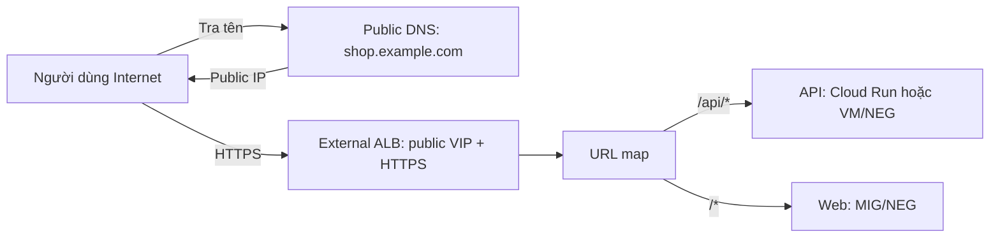
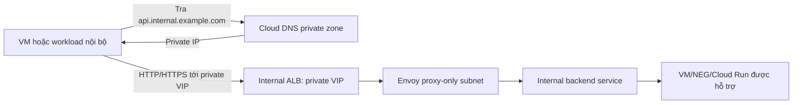

# Application Load Balancer bên ngoài và bên trong

> **Chương:** Cân bằng tải và phân phối nội dung  
> **Module:** CLOUD_PROVIDERS_GCP  
> **Phạm vi module:** Khám phá Google Cloud từ tổ chức project, IAM và VPC đến Compute Engine, GKE, Cloud Run, dịch vụ lưu trữ và cơ sở dữ liệu. Qua các tình huống triển khai, người học biết lựa chọn dịch vụ, bảo vệ tài nguyên, tự động hóa phát hành và theo dõi độ tin cậy cùng chi phí.

Một hệ thống có thể cần một địa chỉ HTTPS công khai để khách hàng đặt hàng, nhưng cũng cần một API riêng chỉ cho ứng dụng và nhân viên bên trong mạng truy cập. Google Cloud cung cấp **Application Load Balancer (ALB)** để tiếp nhận và phân phối các request HTTP/HTTPS ở **tầng 7**. Tùy nguồn client và cách triển khai backend, bạn chọn **External Application Load Balancer** (hướng ra Internet) hoặc **Internal Application Load Balancer** (địa chỉ nội bộ trong VPC).

Sự khác biệt không chỉ nằm ở việc dùng public IP hay private IP. Loại ALB còn quyết định **phạm vi địa lý**, khả năng chọn backend ở nhiều region, cách triển khai proxy, quyền truy cập từ các VPC hoặc mạng hybrid, các tính năng hỗ trợ và cách tính phí.

## Mục tiêu học tập

Sau bài này, bạn có thể:

1. Giải thích ALB tầng 7 và phân biệt với Network Load Balancer tầng 4.
2. Nhận diện các chế độ **global external**, **regional external**, **regional internal**, **cross-region internal** và phân biệt chế độ **classic**.
3. Mô tả đường đi request qua **forwarding rule, target proxy, URL map, backend service/backend bucket, health check**.
4. Hiểu proxy-only subnet, địa chỉ VIP, TLS, host/path routing và các giới hạn truy cập nội bộ.
5. Chọn ALB phù hợp cho website công khai, API doanh nghiệp, kiến trúc nhiều region và các backend Compute Engine, GKE, Cloud Run.
6. Thực hành kiểm tra cấu hình bằng Console/`gcloud`, xác minh kết nối từ vị trí phù hợp và xây dựng kế hoạch dọn tài nguyên.

## 1. ALB là gì và giải quyết vấn đề nào?

Application Load Balancer nhận **HTTP hoặc HTTPS**, kết thúc kết nối client tại proxy, đọc thông tin ở tầng ứng dụng như hostname, đường dẫn, header và chuyển request tới backend theo cấu hình. Đây là **proxy load balancer**, không phải thiết bị chuyển tiếp nguyên vẹn packet từ client đến server.

```text
Client
  │ HTTP/HTTPS
  ▼
Frontend VIP + port (forwarding rule)
  │
  ▼
Target HTTP(S) proxy
  │
  ▼
URL map (host/path/routing rules)
  │
  ├── /api/*    ──> Backend service: API
  ├── /images/* ──> Backend service hoặc backend bucket phù hợp
  └── /*        ──> Backend service: web
                       │
                       ▼
                Instance group / NEG / backend được hỗ trợ
```

Chức năng thường dùng:

- **Một frontend ổn định:** người dùng truy cập một DNS name/IP ngay cả khi các VM hoặc endpoint phía sau thay đổi.
- **Phân phối request:** lựa chọn backend theo cơ chế load balancing, tình trạng sức khỏe và cấu hình sản phẩm.
- **Host/path routing:** `api.example.com` hoặc `/api/*` được xử lý bởi backend khác `/static/*`.
- **TLS termination:** ALB có thể xử lý HTTPS và sử dụng certificate được cấu hình; kết nối từ proxy đến backend là kết nối khác, có giao thức và bảo mật riêng.
- **Khả năng mở rộng/khôi phục:** hỗ trợ nhiều backend và các phương án failover trong phạm vi được từng mode cho phép.
- **Bảo vệ/quan sát/tăng tốc:** tích hợp một số tính năng như Cloud Armor, logging, Cloud CDN theo **loại ALB, backend và điều kiện hỗ trợ cụ thể**.

**ALB so với Network Load Balancer:** ALB thích hợp khi cần logic HTTP/HTTPS và định tuyến theo URL. Network Load Balancer phù hợp khi yêu cầu chính nằm ở TCP/UDP hoặc các giao thức/kiểu kết nối tầng 4 được sản phẩm hỗ trợ. Không chọn ALB để phân phối UDP chỉ vì tên “load balancer”.

## 2. Có những chế độ Application Load Balancer nào?

Google Cloud phân biệt **external/internal** với **global/regional/cross-region**. Thuật ngữ **classic** chỉ một chế độ external riêng còn được hỗ trợ cho các triển khai tương ứng.

| Mode | VIP cho client | Phạm vi backend | Cơ chế proxy và yêu cầu nổi bật | Trường hợp phù hợp |
|---|---|---|---|---|
| **Global external ALB** | Public IP toàn cục, sử dụng Premium Tier | Backend có thể ở nhiều region | Google Front Ends (GFEs) trên mạng toàn cầu; `EXTERNAL_MANAGED` | Website, API công khai phục vụ người dùng ở nhiều khu vực |
| **Regional external ALB** | Public IP regional | Backend thuộc một region | Envoy proxy được quản lý, **proxy-only subnet** trong region; `EXTERNAL_MANAGED` | HTTP(S) công khai cần cấu hình tài nguyên theo region |
| **Classic ALB** | Public frontend; chế độ cũ có các quy tắc tier/phạm vi riêng | Tùy Premium/Standard Tier và cấu hình | GFE; load balancing scheme `EXTERNAL` | Chủ yếu khi duy trì kiến trúc classic hiện có hoặc tính năng tương thích |
| **Regional internal ALB** | Private VIP trong subnet tại một region | Backend thuộc cùng region của ALB | Envoy, **proxy-only subnet** với purpose `REGIONAL_MANAGED_PROXY`; `INTERNAL_MANAGED` | API nội bộ cùng region, ứng dụng trong VPC hoặc mạng kết nối |
| **Cross-region internal ALB** | Private VIP regional; có thể cấu hình frontend ở nhiều region | Backend có thể thuộc nhiều region | Envoy; proxy-only subnet purpose `GLOBAL_MANAGED_PROXY` ở các region cần dùng; `INTERNAL_MANAGED` | Dịch vụ nội bộ nhiều region, failover liên vùng |

### 2.1. Chế độ global external

Global external ALB thường là lựa chọn cho hệ thống cần địa chỉ công khai và backend trải nhiều region. GFE nhận request tại hạ tầng mạng của Google và phân phối tới backend phù hợp theo cấu hình, health/capacity và khả năng cung cấp.

Một **global public VIP** không có nghĩa toàn bộ dữ liệu ứng dụng được lưu ở mọi nơi. Backend, cơ sở dữ liệu và chính sách nơi lưu trữ dữ liệu vẫn phải được thiết kế riêng. Nếu chỉ có một backend region và region đó bị sự cố, ALB toàn cục **không tự tạo** backend dự phòng ở region khác.

### 2.2. Chế độ regional external

Regional external ALB nhận request Internet qua public frontend gắn với một region và dùng **Envoy proxy** để chuyển tới backend trong region đó. Đây là ALB HTTP(S) regional; nó **không tự failover** đến backend ở region khác như một global external ALB có backend nhiều region.

Regional external ALB có thể sử dụng **Premium hoặc Standard Network Service Tier** theo các cấu hình được hỗ trợ. Vì dùng Envoy, nó cần **proxy-only subnet** tại region và VPC tương ứng.

### 2.3. Regional internal so với cross-region internal

Regional internal ALB dùng **private VIP** từ subnet; mặc định client truy cập theo phạm vi region áp dụng. Nếu muốn client ở region khác trong VPC gửi request tới regional internal ALB, có thể bật tùy chọn **global access** khi kiến trúc hỗ trợ. Tuy nhiên, bật global access **không biến backend regional thành backend đa region**.

Cross-region internal ALB cho phép backend ở nhiều region và client từ nhiều region trong VPC theo mô hình được hỗ trợ. Mỗi frontend VIP của nó vẫn là **địa chỉ nội bộ regional**, không phải một IP anycast công khai. Nếu cấu hình nhiều VIP tại các region khác nhau, có thể kết hợp **Cloud DNS routing policies** để điều hướng client tới VIP phù hợp; failover backend cũng cần được cấu hình và thử nghiệm.

**Cần nhớ:** “internal” mô tả khả năng truy cập qua mạng riêng theo cấu hình, không có nghĩa chỉ một project duy nhất được phép gọi. VPC, Shared VPC, kết nối hybrid và chính sách dịch vụ quyết định các nguồn client hợp lệ.

## 3. Những thành phần của một ALB

### 3.1. Frontend: địa chỉ, cổng và forwarding rule

**Forwarding rule** khai báo địa chỉ IP, giao thức/cổng và target proxy của ALB.

- External: IP công khai global hoặc regional theo mode.
- Internal: private IP trong subnet ở region tương ứng và gắn với VPC.
- HTTP thường dùng port `80`, HTTPS thường dùng `443`; sản phẩm có thể hỗ trợ các cổng khác theo ràng buộc forwarding rule.
- DNS public/private ánh xạ tên thân thiện đến VIP tương ứng. **Tạo forwarding rule không tự tạo bản ghi DNS**.

**VIP (Virtual IP)** là địa chỉ client kết nối vào. Không lấy IP từ **proxy-only subnet** làm VIP; proxy-only subnet dành riêng cho các proxy của Google.

### 3.2. Target proxy và chứng chỉ TLS

**Target HTTP proxy** xử lý request HTTP; **Target HTTPS proxy** xử lý HTTPS và cần cấu hình certificate hợp lệ theo sản phẩm/mode. Với HTTPS:

1. Client xác thực tên miền và kết nối TLS tới VIP.
2. Proxy xử lý TLS và request HTTP đã giải mã.
3. Proxy chuyển request tới backend qua giao thức được backend service hỗ trợ.

Kết nối **client → ALB** và **ALB → backend** là hai chặng khác nhau. HTTPS phía frontend **không tự bảo đảm** backend cũng dùng HTTPS; nếu workload cần mã hóa end-to-end, hãy thiết kế protocol/backend TLS và kiểm tra khả năng hỗ trợ, certificate/trust thích hợp.

### 3.3. URL map: host và path routing

**URL map** quyết định request được gửi đến backend nào. Ví dụ logic:

```text
Host: shop.example.com
  /api/*       -> api-backend-service
  /assets/*    -> static-backend (nếu loại backend được mode hỗ trợ)
  /*           -> web-backend-service

Host: admin.example.com
  /*           -> admin-backend-service
```

Thứ tự rule, quy tắc khớp host/path và các tính năng nâng cao như header/action/rewrite tùy mode. Khi cấu hình thực tế, cần kiểm tra **default service** để request không khớp vẫn nhận kết quả có chủ ý; không để một đường dẫn quản trị vô tình rơi vào backend công khai.

### 3.4. Backend service và loại backend

**Backend service** mô tả cách ALB giao tiếp và phân phối request tới các backend theo phạm vi/tính năng. Một số backend được hỗ trợ:

- **Managed instance group (MIG):** VM chạy ứng dụng; có thể kết hợp autoscaling và health checks.
- **Zonal network endpoint group (NEG):** nhóm các endpoint IP:port, phù hợp với workload/container và kiến trúc yêu cầu quản lý endpoint.
- **Serverless NEG:** kết nối tới backend serverless được hỗ trợ như Cloud Run; hành vi health check, quyền và scaling khác so với VM.
- **Hybrid/Internet/PSC NEGs:** phục vụ những mô hình kết nối đặc thù, chỉ khi mode ALB và kiểu NEG tương thích.
- **Backend bucket:** dùng Cloud Storage cho nội dung tĩnh trong những **external ALB mode** hỗ trợ; không mặc định có trên internal ALB.

**Không phải tất cả backend loại trên đều hỗ trợ ở mọi mode.** Trước khi quyết định, xem bảng hỗ trợ backend của sản phẩm, region và Network Service Tier cụ thể. Nếu backend service dùng instance groups hoặc NEGs, cần chọn đúng loại và quy tắc kết hợp; không ghép tùy ý các kiểu backend vào cùng service.

### 3.5. Health check và trạng thái backend

Với các backend VM/endpoint cần health check, ALB dùng cơ chế kiểm tra để xác định endpoint có đáp ứng yêu cầu trước khi chuyển traffic.

Ví dụ:

```text
GET /healthz  ->  HTTP 200  -> healthy
GET /healthz  ->  HTTP 500  -> unhealthy
Connection timeout          -> unhealthy
```

Đây là minh họa, kết luận healthy còn phụ thuộc giao thức, ngưỡng và cấu hình health check. URL `/healthz` nên phản ánh khả năng phục vụ request thật ở mức hợp lý; đừng cấu hình health check trên một endpoint luôn trả 200 trong khi mọi dependency thiết yếu đã hỏng.

**Serverless NEG không dùng health check dạng VM/backend instance group theo cùng cách.** Không yêu cầu người học tạo health check cho Cloud Run serverless NEG chỉ vì một sơ đồ ALB tổng quát có health check.

## 4. Đường đi traffic: external và internal khác nhau thế nào?

### 4.1. External ALB cho website công khai



**Luồng:** DNS trả public IP; client kết nối tới frontend; target proxy và URL map xử lý request; backend service chọn endpoint. Với global external, Google Front Ends nhận request theo hạ tầng toàn cầu; với regional external, Envoy proxy xử lý ở mode regional.

### 4.2. Internal ALB cho API riêng



**Luồng:** client có đường mạng đến private VIP truy vấn tên nội bộ; forwarding rule chuyển request tới Envoy; Envoy mở kết nối mới đến backend. Quyền truy vấn Cloud DNS private zone, khả năng đến VIP, firewall và quyền ứng dụng là **những điều kiện riêng biệt**.

### 4.3. External frontend có thể kết nối backend không public không?

Có thể. Trong nhiều kiến trúc, backend VM **không cần gắn external IP** chỉ để nhận lưu lượng từ external ALB. ALB là điểm công khai, proxy kết nối đến backend theo cơ chế sản phẩm; backend vẫn cần firewall thích hợp và route/health check hợp lệ. Điều này giúp giảm việc mở trực tiếp cổng ứng dụng ra Internet.

Đối với **Cloud Run**, hãy chú ý ingress settings và quyền invoke. Serverless NEG tích hợp ALB không đồng nghĩa mọi Cloud Run service phải cho phép truy cập trực tiếp từ Internet. Cấu hình ingress và authentication phải theo mô hình serverless load balancing được hỗ trợ.

## 5. Proxy-only subnet: điểm khác biệt vận hành

Với các ALB dùng **Envoy proxy** theo mode regional/cross-region, GCP cần **proxy-only subnet**: một dải IP dành cho các proxy do Google quản lý. Các địa chỉ từ subnet này trở thành **địa chỉ nguồn** khi proxy tạo kết nối tới backend VM/endpoint, giúp xác định rule firewall cần thiết.

| Mode dùng Envoy | Purpose của proxy-only subnet | Phạm vi |
|---|---|---|
| Regional external ALB | `REGIONAL_MANAGED_PROXY` | Mỗi network/region cần một proxy-only subnet hoạt động cho mục đích này |
| Regional internal ALB | `REGIONAL_MANAGED_PROXY` | Chia sẻ với những regional Envoy-based load balancers tương thích trong network/region |
| Cross-region internal ALB | `GLOBAL_MANAGED_PROXY` | Cần ở những region có proxy của kiến trúc cross-region |
| Global external ALB / Classic ALB | Không dùng proxy-only subnet theo mô hình GFE | GFE quản lý ingress/proxy theo hạ tầng toàn cầu |

**Đừng nhầm proxy-only subnet với subnet backend hoặc frontend.**

```text
VPC: app-vpc
├── app-subnet: 10.10.0.0/24
│   ├── Internal ALB VIP: 10.10.0.50
│   └── VM backend:       10.10.0.10
└── proxy-only-subnet: 10.129.0.0/23
    └── IP của Envoy proxy do Google quản lý
```

Khi proxy gửi request đến VM backend, traffic có thể mang **source IP từ `10.129.0.0/23`**. Vì vậy firewall backend cần cho phép đúng dải này tới đúng cổng ứng dụng, đồng thời thường cần rule cho health check theo tài liệu. Mở port backend từ `0.0.0.0/0` chỉ để “chữa” lỗi health check là lựa chọn quá rộng.

### Ví dụ lệnh tạo proxy-only subnet (chỉ trong project lab)

Các lệnh sau chỉ là ví dụ cho **regional internal ALB** hoặc **regional external ALB**, với custom VPC đã có sẵn. **Không chạy nếu VPC/region đã có proxy-only subnet đang được các dịch vụ khác dùng chung**.

```bash
# Chỉ nhập project, network, region và CIDR đã được phê duyệt
PROJECT_ID="my-gcp-lb-lab"
NETWORK_NAME="app-vpc"
REGION="asia-southeast1"

# Kiểm tra mạng, subnet và các purpose hiện có trước khi tạo
gcloud compute networks subnets list \
  --project="$PROJECT_ID" \
  --regions="$REGION"

# Chỉ tạo khi chưa có subnet purpose REGIONAL_MANAGED_PROXY phù hợp
gcloud compute networks subnets create proxy-only-lab \
  --project="$PROJECT_ID" \
  --network="$NETWORK_NAME" \
  --region="$REGION" \
  --range="10.129.0.0/23" \
  --purpose=REGIONAL_MANAGED_PROXY \
  --role=ACTIVE
```

CIDR mẫu phải được thay nếu trùng với subnet, mạng hybrid hoặc dự án thật. **Không dùng purpose này để dựng cross-region internal ALB**: mode cross-region yêu cầu `GLOBAL_MANAGED_PROXY` theo thiết kế tương ứng. Proxy-only subnet là hạ tầng chia sẻ; nếu đã có ALB sử dụng, **không xóa subnet đó** khi dọn một bài lab.

## 6. Bảo mật: TLS, firewall, Cloud Armor và IAP

### 6.1. TLS và kết nối đến backend

Nếu phục vụ HTTPS:

1. Có **DNS name** và certificate hợp lệ cho tên miền frontend.
2. Chọn phương thức cấp/quản lý certificate được mode ALB hỗ trợ, chẳng hạn certificate của Google quản lý hoặc tự quản lý theo yêu cầu.
3. Cấu hình target HTTPS proxy và TLS policy phù hợp.
4. Xác định giao thức ALB → backend và chính sách bảo vệ/chứng thực của backend.
5. Thử từ client thực, kiểm tra handshake, hostname và certificate chain.

**HTTP → HTTPS redirect** có thể được cấu hình theo các cơ chế được mode hỗ trợ; đừng giả định cứ bật HTTPS listener sẽ tự chuyển mọi request HTTP sang HTTPS.

### 6.2. Firewall và health checker

Loại proxy quyết định **source IP của kết nối đến backend VM**:

- **Global external/Classic dùng GFE:** backend VM/NEG cần rule cho nguồn GFE và health checking theo tài liệu; những dải IPv4 thường gặp là `35.191.0.0/16` và `130.211.0.0/22` trong các trường hợp được hỗ trợ.
- **Regional external/internal dùng Envoy:** backend VM cần rule từ **proxy-only subnet**, cộng với nguồn health check theo yêu cầu loại backend/mode.
- **Serverless NEG:** traffic tới serverless backend sử dụng cơ chế riêng; các rule firewall VM không áp dụng nguyên xi như với instance group.

Các dải nguồn, đặc biệt với IPv6 và backend đặc thù, có thể khác; kiểm tra bảng chính thức **Firewall rules for load balancing** trước khi cấu hình. Thêm một rule quá rộng có thể vô tình mở backend mà bạn muốn giữ riêng tư.

### 6.3. Cloud Armor, IAP và truy cập API

**Cloud Armor** cung cấp tính năng bảo vệ L7 như chính sách lọc lưu lượng và một số khả năng bảo vệ DDoS/WAF cho những sản phẩm, backend và mode hỗ trợ. Nó không thay thế xác thực người dùng hay authorization trong ứng dụng.

**Identity-Aware Proxy (IAP)** có thể thêm lớp kiểm soát truy cập người dùng cho những cấu hình ALB/backend tương thích. **Cloud CDN và IAP không cùng bật trên một backend service** khi sản phẩm quy định xung đột tính năng này. Luôn đọc feature matrix trước khi thiết kế một backend vừa cần cache công khai vừa cần IAP.

Đối với API nội bộ, private VIP giúp hạn chế phạm vi kết nối mạng, nhưng vẫn cần xác thực và phân quyền ở lớp ứng dụng. Internal ALB không tự thay thế chính sách Identity and Access Management của Cloud Run, GKE hoặc các service phía sau.

## 7. ALB và phân phối nội dung với Cloud CDN

Một website thương mại điện tử thường gồm trang/API động và nội dung tĩnh:

```text
https://shop.example.com/
  /api/orders       -> backend ứng dụng
  /api/products     -> backend ứng dụng
  /assets/logo.webp -> nội dung cache được
  /images/item.jpg  -> nội dung cache được
```

**Cloud CDN** có thể lưu nội dung tại edge cache khi gắn vào **external Application Load Balancer và backend được hỗ trợ**, giảm độ trễ và giảm request lặp tới origin cho những object có chính sách cache thích hợp. Cloud CDN **không phải tính năng mặc định của internal ALB**.

Các điểm cần phân biệt:

- **Load balancing:** chọn backend hoặc xử lý traffic.
- **CDN caching:** lưu bản sao response phù hợp ở edge, điều khiển bởi cache mode, Cache-Control, TTL và các quy tắc liên quan.
- **Cloud Storage backend bucket:** thường dùng cho file tĩnh với external ALB ở mode hỗ trợ; không tự giả định backend bucket khả dụng ở regional internal ALB.
- **Cloud Armor:** bảo vệ request theo chính sách; có thể tích hợp với các dịch vụ L7 theo khả năng sản phẩm.

Không cache nhầm nội dung riêng tư, cookie/phiên người dùng, dữ liệu đơn hàng hoặc phản hồi chứa thông tin nhạy cảm. Dữ liệu có `Cache-Control: private` hoặc `no-store` cần được xem xét theo chính sách cache và mode đang chọn. Các phản hồi sau thay đổi cần kế hoạch TTL/invalidation khi thích hợp.

## 8. Hai bài toán thiết kế cùng một ứng dụng

Giả sử hệ thống có frontend web công khai và dịch vụ báo cáo chỉ dành cho nhân viên.

### Phần A — Web/App công khai

**Yêu cầu:** khách hàng ở nhiều khu vực gửi HTTPS đến `shop.example.com`; trang tĩnh được cache, `/api/*` chuyển đến backend API, ưu tiên dự phòng nhiều region.

**Giải pháp cân nhắc:**

1. **Global external ALB** với public VIP và DNS public.
2. Target HTTPS proxy, certificate cho `shop.example.com` và URL map theo host/path.
3. Backend service tới các endpoint API/web ở những region có triển khai thực; static asset sử dụng cơ chế backend được ALB/CDN hỗ trợ.
4. Health checking với backend VM/NEG khi được yêu cầu; Cloud Run serverless NEG xử lý khác.
5. Cloud Armor, Cloud CDN cho phần nội dung có thể cache, logging và cảnh báo.

**Rủi ro còn lại:** nhiều region backend không tự làm database trở thành multi-region hay bảo đảm tính nhất quán; cần thiết kế dữ liệu, phiên người dùng, retry và failover end-to-end.

### Phần B — API nội bộ

**Yêu cầu:** ứng dụng trong VPC gọi `reports.internal.example.com`; không muốn frontend public; backend ở một region; có thể cần client từ region khác.

**Giải pháp cân nhắc:**

1. **Regional internal ALB** với private VIP trong subnet của VPC.
2. Proxy-only subnet `REGIONAL_MANAGED_PROXY` cho region đó.
3. Backend VM/NEG hoặc serverless tương thích cùng region; URL map và health check phù hợp.
4. **Cloud DNS private zone** cho hostname nội bộ; chỉ VPC/mạng được cho phép mới nhận record tương ứng.
5. Bật **global access** nếu client trong những region khác cần đến private VIP và sản phẩm/kiến trúc hỗ trợ.

Nếu sau này cần backend chủ động hoạt động ở nhiều region và tự động chuyển traffic tới region còn khỏe, đánh giá **cross-region internal ALB** cùng proxy-only subnet `GLOBAL_MANAGED_PROXY` ở các region của kiến trúc.

## 9. Thực hành chọn ALB bằng Console

Phần này hướng dẫn thiết kế và xem cấu hình. Việc tạo ALB thật có thể tính phí forwarding rule, traffic xử lý, backend, data transfer, health checking, Cloud Armor/CDN và các tài nguyên liên quan. **Chỉ tạo trên project sandbox được phép và đã dự trù chi phí**. Không cần tạo ALB mới nếu mục tiêu buổi học chỉ là đọc cấu hình và chọn mode.

### 9.1. Chuẩn bị trước khi tạo

1. Xác định **client đến từ Internet hay mạng riêng**.
2. Xác định backend là **MIG, zonal NEG, serverless NEG, backend bucket hoặc loại khác được hỗ trợ**.
3. Xác định backend nằm **một hay nhiều region**; client nằm một hay nhiều region.
4. Chọn VPC/subnet nếu dùng internal hoặc Envoy regional, kiểm tra proxy-only subnet.
5. Chuẩn bị **health check endpoint** cho VM/NEG khi cần và rule firewall vừa đủ.
6. Chuẩn bị DNS/certificate nếu dùng hostname HTTPS.
7. Xác nhận quyền IAM, quota, trạng thái Billing và ngân sách/cảnh báo trước khi tạo.

### 9.2. Tạo external ALB qua Console (quy trình tổng quan)

1. Mở **Network services → Load balancing → Create load balancer**.
2. Chọn **Application Load Balancer (HTTP/HTTPS)** và **External/Public facing**.
3. Chọn **Global** hoặc **Regional** theo bảng ở phần 2; ưu tiên mode phù hợp với backend thực có. Nếu hệ thống hiện có đang dùng classic, xác nhận yêu cầu tương thích trước khi thay mode.
4. Đặt tên ALB; chọn **frontend** với IP, port và protocol. Với HTTPS, chọn certificate.
5. Tạo/chọn **backend service** và backend tương ứng. Thiết lập health check nếu loại backend yêu cầu.
6. Chọn **host and path rules**, default backend, logging và các tính năng Cloud Armor/CDN được mode hỗ trợ.
7. Nếu là **regional external**, đảm bảo proxy-only subnet đã được tạo hoặc cung cấp qua luồng Console.
8. Xem lại toàn bộ resource, tạo ALB; mở trang chi tiết để đọc forwarding rule, frontend IP, backend health.
9. Khi frontend ổn định, thêm bản ghi DNS public trỏ tới VIP, cấu hình chứng chỉ và kiểm tra request qua domain.

**Thử kết nối:** từ client Internet được phép, chạy:

```bash
curl -I https://shop.example.com/
curl -v https://shop.example.com/healthz
```

Đây là lệnh minh họa; `shop.example.com` chưa phải ứng dụng thật của bài lab. Trả về `200` hay `404` phụ thuộc URL map và ứng dụng. Quan sát TLS, HTTP status, redirect, header và backend health thay vì kết luận chỉ từ một mã phản hồi.

### 9.3. Tạo internal ALB qua Console (quy trình tổng quan)

1. Mở **Network services → Load balancing → Create load balancer**.
2. Chọn **Application Load Balancer**, **Internal**.
3. Chọn **Regional** nếu backend chỉ ở một region; chọn **Cross-region** nếu cần backend nhiều region và đã thiết kế phù hợp.
4. Chọn VPC, region, subnet dùng cho **frontend private VIP** và, nếu cần, chứng chỉ/protocol.
5. Đảm bảo **proxy-only subnet** phù hợp: `REGIONAL_MANAGED_PROXY` cho regional internal; `GLOBAL_MANAGED_PROXY` cho cross-region internal.
6. Tạo backend service đúng phạm vi, backend và health check; cấu hình URL map, target proxy, forwarding rule.
7. Kiểm tra firewall từ dải proxy-only subnet đến cổng backend và từ health checker nếu backend cần.
8. Tạo record Cloud DNS **private** cho hostname nếu cần. Kiểm tra authorized VPC và quy tắc phân giải tên.
9. Dùng một VM/workload **có đường mạng đến VIP** để gửi request; có thể dùng client ở region khác khi global access hoặc cross-region mode được cấu hình phù hợp.

Ví dụ truy vấn từ **VM trong authorized VPC**, không thực hiện từ laptop Internet nếu không có đường kết nối riêng:

```bash
# Chạy từ VM/host có kết nối đến private VIP
dig reports.internal.example.com. A
curl -v http://reports.internal.example.com/healthz
```

Nếu dùng HTTPS và DNS riêng, certificate/TLS trust cũng phải được thiết kế cho tên miền nội bộ. Không thêm `-k` vào `curl` để bỏ qua xác thực chứng chỉ như một “giải pháp triển khai”.

## 10. Thực hành đọc cấu hình ALB bằng gcloud (không tạo tài nguyên)

Các lệnh sau là **read-only**; chúng phù hợp cho project đã có ALB hoặc project lab do người quản trị cho phép xem.

```bash
PROJECT_ID="my-gcp-lb-lab"        # Thay project ID thực tế
REGION="asia-southeast1"         # Thay region đang triển khai ALB

# Kiểm tra danh tính và project
gcloud auth list --filter="status:ACTIVE"
gcloud projects describe "$PROJECT_ID" \
  --format="table(projectId,name,lifecycleState)"

# Liệt kê frontend forwarding rules của project
gcloud compute forwarding-rules list --project="$PROJECT_ID"

# Liệt kê cấu hình route/backend và trạng thái health checks đã định nghĩa
gcloud compute url-maps list --project="$PROJECT_ID"
gcloud compute backend-services list --project="$PROJECT_ID"
gcloud compute health-checks list --project="$PROJECT_ID"

# Xem các subnet, bao gồm proxy-only subnet nếu có
gcloud compute networks subnets list --project="$PROJECT_ID"
```

### 10.1. Xác định mode từ forwarding rule

Sau khi đã biết **tên và scope** của forwarding rule từ kết quả `list`, dùng lệnh `describe` tương ứng:

```bash
# Ví dụ một frontend GLOBAL
gcloud compute forwarding-rules describe GLOBAL_RULE_NAME \
  --global \
  --project="$PROJECT_ID" \
  --format="yaml(name,IPAddress,IPProtocol,portRange,loadBalancingScheme,target)"

# Ví dụ một frontend REGIONAL
gcloud compute forwarding-rules describe REGIONAL_RULE_NAME \
  --region="$REGION" \
  --project="$PROJECT_ID" \
  --format="yaml(name,IPAddress,IPProtocol,ports,portRange,loadBalancingScheme,target,network,subnetwork)"
```

Giá trị `GLOBAL_RULE_NAME` và `REGIONAL_RULE_NAME` là placeholder; không chạy nguyên văn. Đối chiếu:

| Trường | Cách đọc |
|---|---|
| `loadBalancingScheme: EXTERNAL_MANAGED` | External ALB mới, cần xem scope global/regional để xác định mode |
| `loadBalancingScheme: EXTERNAL` | Có thể là classic ALB hoặc loại load balancing khác; kiểm tra target/protocol |
| `loadBalancingScheme: INTERNAL_MANAGED` | Internal managed proxy; scope/resources quyết định regional hay cross-region |
| `region`/`--global` | Cho biết forwarding rule mang phạm vi regional hay global |
| `IPAddress` | VIP; cần xem public/private và mạng tương ứng |
| `target` | Target HTTP(S) proxy gắn với forwarding rule |

**Chỉ nhìn loadBalancingScheme chưa đủ kết luận.** Một project có thể dùng forwarding rule cho Network Load Balancer hoặc sản phẩm khác, và cross-region internal cũng dùng `INTERNAL_MANAGED`. Hãy theo đường `forwarding rule → target proxy → URL map → backend service` để nhận diện chính xác.

### 10.2. Truy vết backend và kiểm tra tình trạng

Sau khi biết backend service và scope, dùng:

```bash
# Backend service GLOBAL - chỉ chạy khi resource thực sự global
gcloud compute backend-services describe GLOBAL_BACKEND_NAME \
  --global --project="$PROJECT_ID"

# Backend service REGIONAL - chỉ chạy khi resource thực sự thuộc region
gcloud compute backend-services describe REGIONAL_BACKEND_NAME \
  --region="$REGION" --project="$PROJECT_ID"
```

Trong kết quả, kiểm tra `protocol`, `backends`, `healthChecks` (nếu áp dụng), balancing settings và logging. Với instance group/NEG backend có health checking, tiếp tục dùng chức năng **backend health** trong Console hoặc lệnh phù hợp với loại backend. Trường `healthChecks` trống **không nhất thiết là lỗi** nếu đó là serverless NEG backend.

**Không chỉnh sửa backend service của production chỉ để thử routing**. Một thay đổi URL map, health check, timeout hay cache có thể ảnh hưởng toàn bộ traffic dù lệnh sửa có vẻ nhỏ.

## 11. Quan sát vận hành, độ tin cậy và chi phí

### 11.1. Những tín hiệu cần theo dõi

| Tín hiệu | Điều có thể suy ra | Việc cần làm |
|---|---|---|
| Tăng `5xx` từ ALB | Backend không khỏe, timeout, không có backend phục vụ hoặc lỗi ứng dụng | Đọc LB logs, backend health và logs ứng dụng |
| Tăng `4xx` | Sai URL/host, xác thực hoặc chính sách truy cập | Phân biệt 403/404 từ ALB và ứng dụng |
| Độ trễ request tăng | Backend chậm, mạng, database hoặc tải cao | Theo dõi p95/p99 latency, CPU, DB, network |
| Healthy backend giảm | Health check lỗi hoặc quá ít endpoint phục vụ | Kiểm tra endpoint, firewall, probe, autoscaling |
| Regional ALB gặp sự cố region | Kiến trúc chỉ có một region | Đánh giá global external hoặc cross-region internal theo mục tiêu HA |
| CDN cache hit thấp | Nội dung không cache được hoặc TTL/rule chưa phù hợp | Kiểm tra cache key, Cache-Control, tỷ lệ hit/miss |
| Chi phí LB/egress tăng | Traffic, số request, cross-region transfer, CDN/logging hoặc backend tăng | Đọc Billing Reports theo service/SKU và đo traffic thực |

Google Cloud Monitoring và Cloud Logging giúp theo dõi request, lỗi, độ trễ và backend tùy sản phẩm/config. Cần thiết lập alert phù hợp mục tiêu người dùng, chẳng hạn tỷ lệ `5xx` hoặc độ trễ p95 vượt ngưỡng liên tục, kết hợp cảnh báo Billing budgets.

### 11.2. Khả năng chịu lỗi

Đối với external toàn cầu hay internal cross-region, khả năng có backend ở nhiều region là **điều kiện để thiết kế** failover, không phải cam kết tự động an toàn dữ liệu.

Cần thiết kế thêm:

- Backend ở nhiều region với health checks hoặc trạng thái endpoint phù hợp.
- Dữ liệu được sao chép/đồng bộ theo yêu cầu nghiệp vụ và mục tiêu **RPO/RTO**.
- Session state, retry và idempotency khi request được gửi đến backend khác.
- Capacity dự phòng đủ tiếp nhận traffic khi một region lỗi.
- Quy trình kiểm thử failure/failover và rollback.

Nếu workload thực chất chỉ có một database tại một region, multi-region ALB có thể vẫn phụ thuộc vào database đó. Kiểm tra khả năng chịu lỗi **từ frontend đến dữ liệu**, không chỉ nhìn nhãn “global”.

### 11.3. Chi phí

Một ALB có thể phát sinh phí từ **forwarding rules, dữ liệu xử lý, lưu lượng truyền, backends và tính năng đi kèm**, tùy sản phẩm và mức sử dụng. Các VM, GKE node, Cloud Run, Cloud Storage, Cloud Armor, Cloud CDN, Cloud Logging cũng có cơ chế tính phí riêng.

Trước khi thực hành:

1. Dùng **Google Cloud Pricing Calculator** và bảng giá Load Balancing để ước tính mức tải.
2. Xác định region, Network Service Tier, lưu lượng qua các region và chi phí egress.
3. Đặt **Cloud Billing budget và alert thresholds**, nhưng nhớ budget không chặn chi phí.
4. Nếu chỉ cần học khác biệt mode và cấu trúc, ưu tiên thao tác **read-only** với tài nguyên đã được cấp thay vì dựng đủ LB + VM + chứng chỉ rồi bỏ quên.

## 12. Lỗi thường gặp và cách chẩn đoán

| Triệu chứng | Nguyên nhân có thể | Cách xử lý |
|---|---|---|
| Không tạo được regional internal ALB | Thiếu proxy-only subnet phù hợp trong network/region | Kiểm tra subnet purpose `REGIONAL_MANAGED_PROXY`, CIDR và IAM |
| Không tạo được cross-region internal ALB | Dùng nhầm proxy-only subnet của regional mode hoặc thiếu subnet vùng cần dùng | Xác minh `GLOBAL_MANAGED_PROXY` và kiến trúc nhiều region |
| Frontend hoạt động nhưng backend unhealthy | Health check sai đường dẫn/cổng, firewall chặn health checks | Kiểm tra endpoint, rule nguồn health checker và trạng thái instance group/NEG |
| Backend VM chỉ nhận traffic sau khi mở firewall rất rộng | Thiếu rule cho GFE/proxy-only subnet | Xác định đúng mode và source IP, tạo rule đủ hẹp |
| Public HTTPS lỗi certificate | Sai hostname, certificate chưa hợp lệ/chưa provision hoặc DNS chưa trỏ đúng VIP | Kiểm tra DNS, TLS certificate status, target proxy |
| Client ở region khác không gọi được regional internal VIP | Global access chưa bật hoặc route/firewall không phù hợp | Kiểm tra chế độ global access, VPC và kết nối client |
| Internet client không đến internal ALB | Internal VIP không phải frontend public | Dùng external ALB nếu thực sự cần Internet-facing; hoặc kết nối private được phép |
| `404` dù backend đang khỏe | URL map/host/path không khớp hoặc ứng dụng tự trả 404 | Xem default route và access logs, thử đúng hostname/path |
| `502`/`503` tăng | Không có backend healthy, backend timeout, lỗi TLS/protocol hoặc ứng dụng | Đối chiếu LB error reason, backend health và logs |
| Cloud Run phía sau ALB bị 403 | Ingress hoặc authentication/authorization không phù hợp | Kiểm tra cấu hình serverless NEG, Cloud Run ingress/IAM |
| Người dùng thấy nội dung cũ | Cloud CDN/client cache theo TTL/cache key | Kiểm tra cache rules và invalidation phù hợp |
| Sau xóa ALB vẫn có phí | Còn frontend IP, VM/NEG, CDN traffic đã phát sinh hoặc dữ liệu billing chưa cập nhật | Kiểm kê resource phụ thuộc và xem Billing Reports |

**Quy trình chẩn đoán theo luồng:**

1. **DNS:** hostname đã trỏ tới đúng VIP chưa?
2. **Frontend:** VIP, port, scheme, mode và certificate có đúng không?
3. **URL map:** request match route nào, default backend nào?
4. **Backend:** loại backend, endpoint và health state có hợp lệ không?
5. **Network:** proxy-only subnet/GFE health-check range và firewall phù hợp chưa?
6. **Application:** backend có trả response đúng, authentication/TLS/timeout có hợp lý không?
7. **Logging/Billing:** có dấu vết request, thay đổi config và chi phí liên quan không?

## 13. Dọn tài nguyên ALB trong project lab

Một ALB được cấu thành từ **nhiều resource**. Khi xóa, cần kiểm kê cả những phần dùng riêng và phần dùng chung; không mặc định xóa nút load balancer trong Console sẽ dọn toàn bộ VM, IP, bucket hoặc proxy-only subnet còn liên quan.

### Kiểm kê trước khi xóa

```bash
PROJECT_ID="my-gcp-lb-lab"   # Project sandbox thật

gcloud compute forwarding-rules list --project="$PROJECT_ID"
gcloud compute target-http-proxies list --project="$PROJECT_ID"
gcloud compute target-https-proxies list --project="$PROJECT_ID"
gcloud compute url-maps list --project="$PROJECT_ID"
gcloud compute backend-services list --project="$PROJECT_ID"
gcloud compute health-checks list --project="$PROJECT_ID"
gcloud compute networks subnets list --project="$PROJECT_ID"
gcloud compute addresses list --project="$PROJECT_ID"
```

### Nguyên tắc xóa

1. **Xác nhận sở hữu:** tên project, ALB, frontend IP, backend service, URL map, proxy, health check, NEG, instance group và mọi resource dùng chung.
2. **Ngừng sử dụng frontend:** điều chỉnh DNS/traffic theo quy trình nếu đang phục vụ người dùng; tránh xóa một VIP production còn lưu lượng.
3. **Xóa forwarding rule** thuộc ALB lab và tiếp tục gỡ target proxy, URL map, backend service hoặc backend bucket **chỉ khi không có ALB khác tham chiếu**.
4. **Xóa health checks và NEGs** do lab tạo, nếu chúng không được workload khác sử dụng.
5. **Xử lý VM/instance group, certificate, static IP, Cloud Armor/CDN, DNS record** theo vòng đời và quyền sở hữu riêng; không coi chúng là tài nguyên tự xóa cùng ALB.
6. **Giữ proxy-only subnet** nếu được các load balancer hoặc sản phẩm Envoy khác chia sẻ; chỉ xóa subnet lab riêng khi đã kiểm tra mọi phụ thuộc.
7. **Xác minh read-only** bằng danh sách resource và Billing Reports. Chi phí có thể hiển thị trễ sau khi dọn.

**Không áp dụng một lệnh xóa hàng loạt** cho mọi resource của project. Chế độ global/regional khác nhau khiến lệnh `delete` cần đúng scope; xóa nhầm URL map hoặc backend service có thể gián đoạn ứng dụng khác.

## 14. Tình huống áp dụng

### Tình huống A — Website bán hàng có khách ở nhiều quốc gia

Khách truy cập `shop.example.com` qua HTTPS, website phục vụ toàn cầu và có API ở hai region. **Global external ALB** là ứng viên phù hợp nếu yêu cầu phân phối đa region và chính sách dữ liệu cho phép. Nhóm cấu hình public DNS/VIP, certificate, URL map, backend đa region và cân nhắc Cloud CDN cho asset tĩnh. Vẫn cần thiết kế replication dữ liệu, retry và giám sát thực tế.

### Tình huống B — Trang quản trị chỉ sử dụng trong VPC

Admin app trên VM trong region `asia-southeast1`, chỉ cho phép client trong mạng công ty đã kết nối. **Regional internal ALB** với private VIP, proxy-only subnet và firewall phù hợp có thể đáp ứng. Cloud DNS private zone giúp đặt tên `admin.internal.example.com`. Xác thực ứng dụng vẫn cần có; không tự cho rằng biết IP nội bộ là đủ quyền.

### Tình huống C — Dịch vụ nội bộ dự phòng hai region

Một API nội bộ phục vụ các ứng dụng trong nhiều region; đội muốn khi region A sự cố có thể chuyển request sang backend region B. **Cross-region internal ALB** phù hợp hơn regional internal về phạm vi backend. Nhóm triển khai backend và proxy-only subnet ở các region cần thiết, private frontend VIP/DNS routing thích hợp, đồng thời kiểm tra dữ liệu và failover.

### Tình huống D — Cloud Run chỉ muốn một cửa HTTPS công khai

Nhóm có Cloud Run API và muốn frontend domain riêng, URL routing, certificate, Cloud Armor. Có thể cân nhắc **external ALB với serverless NEG** theo mode hỗ trợ. Việc này khác bài toán VM: không áp các health check và firewall proxy-to-VM một cách máy móc cho serverless NEG; chú ý Cloud Run ingress và authentication.

## 15. Câu hỏi tự kiểm tra

**1. Vì sao ALB được gọi là load balancer tầng 7?**  
**Trả lời:** vì xử lý HTTP(S) và có thể định tuyến theo hostname, path và các thông tin tầng ứng dụng, thay vì chỉ xem địa chỉ IP/cổng của kết nối.

**2. Có cần public IP cho regional internal ALB không?**  
**Trả lời:** không. Frontend dùng private VIP; client cần có đường mạng và điều kiện truy cập phù hợp.

**3. Bật global access cho regional internal ALB có làm backend tự động trải nhiều region không?**  
**Trả lời:** không. Global access mở phạm vi region của client có thể truy cập; backend regional vẫn thuộc một region.

**4. Cross-region internal ALB có dùng một global anycast public VIP như global external ALB không?**  
**Trả lời:** không. Cross-region internal dùng private VIP mang phạm vi regional, có thể cấu hình nhiều frontend và DNS routing để điều hướng client.

**5. Tại sao proxy-only subnet không được dùng làm subnet chứa IP của VM backend?**  
**Trả lời:** subnet này dành riêng cho managed Envoy proxies; địa chỉ nguồn của proxy đến backend lấy từ đó, còn VIP/backend dùng địa chỉ từ subnet khác phù hợp.

**6. Một backend Cloud Run serverless NEG có buộc phải tạo VM health check giống managed instance group không?**  
**Trả lời:** không. Health-check behavior phụ thuộc loại backend; serverless NEG có cơ chế khác.

**7. Bật Cloud CDN có phù hợp để cache mọi phản hồi `/api/orders` chứa thông tin người dùng không?**  
**Trả lời:** không. Phải bảo vệ dữ liệu cá nhân và tuân theo cache policy; thường tránh cache các phản hồi riêng tư.

**8. Có global external ALB nhưng chỉ chạy một backend ở một region thì toàn bộ hệ thống có HA đa region chưa?**  
**Trả lời:** chưa. Phải triển khai backend và phụ thuộc dữ liệu ở nhiều region, đồng thời kiểm thử failover.

**9. Khi nhận 503 từ ALB, nên kiểm tra những gì trước?**  
**Trả lời:** forwarding rule/URL map, backend health, health check, firewall và logs ứng dụng; sau đó xem timeout, capacity và những thay đổi gần đây.

**10. Sau khi xóa forwarding rule, có thể kết luận không còn khoản phí nào không?**  
**Trả lời:** không. Còn có thể có IP được giữ, backend VM/NEG, các tính năng khác hoặc dữ liệu billing cập nhật trễ; cần kiểm kê và xem báo cáo chi phí.

## Ghi nhớ

- **External ALB** nhận HTTP(S) từ Internet; **Internal ALB** dùng private VIP trong VPC và phạm vi mạng được phép.
- **Global external** phân phối backend đa region; **regional external** và **regional internal** giới hạn backend theo region; **cross-region internal** hỗ trợ backend nhiều region.
- **Forwarding rule → target proxy → URL map → backend service/endpoint** là chuỗi thành phần cần hiểu để thiết kế và chẩn đoán.
- **Proxy-only subnet** dành cho các ALB Envoy theo mode tương ứng: `REGIONAL_MANAGED_PROXY` khác `GLOBAL_MANAGED_PROXY`.
- **TLS, firewall, Cloud Armor, Cloud CDN, IAM và health checks** có vai trò khác nhau; phải kiểm tra feature compatibility và bảo vệ từng chặng truyền tải.
- **HA và chi phí là trách nhiệm thiết kế**: nhiều backend/region cần được tạo, cấu hình, giám sát và diễn tập; tài nguyên ALB và các thành phần liên quan phải được dọn theo quyền sở hữu.

## Tài liệu tham khảo chính thức

- [Google Cloud — Application Load Balancer overview](https://cloud.google.com/load-balancing/docs/application-load-balancer)
- [Google Cloud — External Application Load Balancer overview](https://cloud.google.com/load-balancing/docs/https)
- [Google Cloud — Internal Application Load Balancer overview](https://cloud.google.com/load-balancing/docs/l7-internal)
- [Google Cloud — Choose a load balancer](https://cloud.google.com/load-balancing/docs/choosing-load-balancer)
- [Google Cloud — Proxy-only subnets for Envoy-based load balancers](https://cloud.google.com/load-balancing/docs/proxy-only-subnets)
- [Google Cloud — Firewall rules for load balancing](https://cloud.google.com/load-balancing/docs/firewall-rules)
- [Google Cloud — Cloud CDN overview](https://cloud.google.com/cdn/docs/overview)
- [Google Cloud — Cloud Load Balancing pricing](https://cloud.google.com/vpc/network-pricing#lb)
