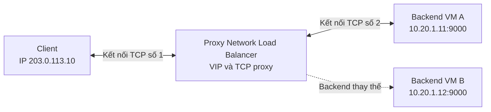
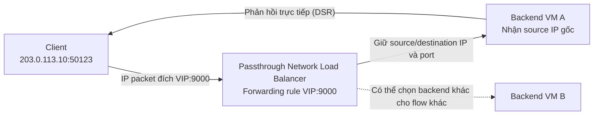
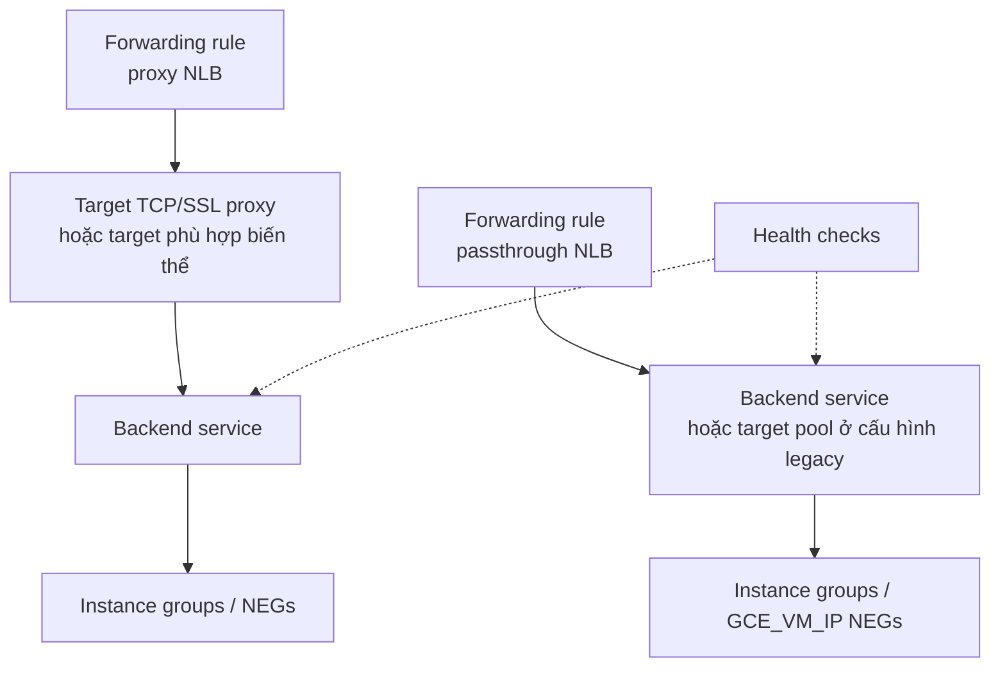
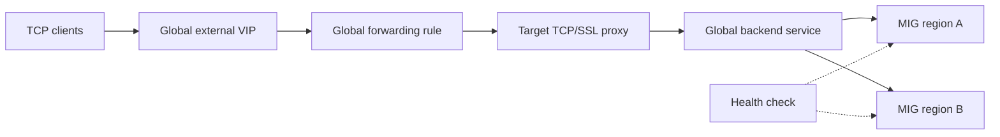

# Proxy Network Load Balancer và passthrough Network Load Balancer

## 1. Bài toán cân bằng tải ở tầng mạng

Giả sử một doanh nghiệp triển khai ứng dụng trên Google Cloud: một dịch vụ TCP phục vụ giao dịch, một cụm máy chủ nhận dữ liệu UDP, một hệ thống quản trị nội bộ truy cập qua VPN và một website chạy Cloud Run. Các hệ thống này đều cần khả năng tiếp nhận nhiều kết nối, phân phối tải và tránh gửi lưu lượng tới máy chủ không còn sẵn sàng. Nhưng **cân bằng tải ở đâu, cho giao thức nào và giữ nguyên thông tin kết nối tới mức nào?** sẽ quyết định loại load balancer cần dùng.

Google Cloud có hai họ **Network Load Balancer** chủ yếu ở **Layer 4**:

- **Proxy Network Load Balancer:** triển khai một **reverse proxy TCP**. Kết nối từ client kết thúc ở proxy; proxy mở kết nối TCP mới tới backend.
- **Passthrough Network Load Balancer:** phân phối các **gói tin IP tới backend mà không làm reverse proxy**. Backend trực tiếp kết thúc kết nối và nhận địa chỉ IP nguồn ban đầu của client.

Hai mô hình đều có lựa chọn **external** (phục vụ kết nối từ internet) và **internal** (phục vụ kết nối trong VPC hoặc mạng kết nối tới VPC), nhưng hỗ trợ giao thức, vùng triển khai và cách bảo vệ backend khác nhau. Trong module **CLOUD_PROVIDERS_GCP**, kiến thức này liên hệ với cấu trúc Project/IAM, VPC/subnet/firewall, Compute Engine, GKE, Cloud Run, database, quan sát hệ thống, độ tin cậy và chi phí.

**Sau bài học, người học có thể:**

1. Mô tả luồng TCP của proxy và luồng gói tin của passthrough bằng sơ đồ.
2. So sánh khả năng giữ nguyên **client source IP**, **TLS termination**, **TCP/UDP**, phạm vi region và cơ chế health check.
3. Phân biệt các biến thể **global, cross-region, regional, internal, external** theo bảng sản phẩm hiện hành.
4. Chọn load balancer cho tình huống TCP công khai, UDP công khai, dịch vụ TCP nội bộ và các hệ thống cần TLS.
5. Hiểu vai trò của **forwarding rule, target proxy, backend service, instance group/NEG, health check và firewall**.
6. Đọc cấu hình bằng `gcloud`, phân tích lỗi kết nối và lập kế hoạch vận hành an toàn.

> **Phạm vi:** Đây là bài so sánh kiến trúc và ví dụ triển khai học tập. Khả năng hỗ trợ của từng kiểu Network Load Balancer thay đổi theo chế độ và giai đoạn phát hành. Các lệnh tạo tài nguyên chỉ dùng trong project được phép và có thể phát sinh chi phí.

## 2. Hiểu trước hai đường đi của lưu lượng

### 2.1. Proxy Network Load Balancer: hai kết nối TCP



Ví dụ client kết nối tới IP công khai và TCP port 9000 của load balancer. Proxy chấp nhận kết nối này, chọn backend khỏe mạnh và mở **kết nối khác** tới backend. Từ góc nhìn network socket của backend, **peer IP thường là proxy**, không phải IP client ban đầu. Với các biến thể hỗ trợ, **PROXY protocol** có thể truyền metadata địa chỉ và port client cho ứng dụng ở backend; ứng dụng phải hiểu giao thức này.

Lợi ích quan trọng là proxy có thể thực hiện **TCP termination**, chuyển port frontend/backend khi hỗ trợ và, với biến thể external phù hợp, **TLS/SSL offload** tại load balancer. Tuy nhiên, nó **không tự hiểu URL path, cookie, HTTP header** như Application Load Balancer.

### 2.2. Passthrough Network Load Balancer: gói tin tới backend



Passthrough **không chấp nhận rồi tạo lại** một kết nối TCP. Gói tin tới VM backend giữ **source IP của client** và **destination IP của forwarding rule**, cùng protocol và port (với protocol có port). Backend tự xử lý kết nối, bắt tay TLS nếu có, rồi phản hồi **trực tiếp** tới client (*direct server return*, DSR).

Điều này làm passthrough phù hợp khi **ứng dụng cần thấy IP nguồn ở mức gói tin**, muốn xử lý UDP hoặc cần một số giao thức IP ngoài TCP. Đổi lại, backend phải tự xử lý TLS và ứng dụng phải lắng nghe ở **VIP hoặc địa chỉ wildcard**, không chỉ ở IP nội bộ gắn trực tiếp với NIC.

### 2.3. Bảng so sánh trọng tâm

| Tiêu chí | Proxy Network Load Balancer | Passthrough Network Load Balancer |
| --- | --- | --- |
| Mô hình | L4 **reverse proxy**, hai kết nối TCP | L4 **pass-through**, không tạo kết nối mới |
| Giao thức chính | **TCP** (có/không SSL/TLS tùy biến thể) | **TCP, UDP**, cùng một số IP protocols khác theo từng biến thể |
| Client source IP ở backend | Backend nhìn IP proxy; có thể nhận metadata qua **PROXY protocol** nếu hỗ trợ | **Giữ nguyên IP nguồn** trong gói đến backend |
| Destination IP nhận ở backend | Kết nối tới địa chỉ backend | **VIP của forwarding rule** |
| TLS termination | Có thể ở **global/classic external SSL proxy**; không phải mọi proxy NLB đều hỗ trợ | **Không**; backend tự kết thúc TLS |
| SSL certificate tại LB | Có ở biến thể external SSL proxy phù hợp | Không gắn chứng chỉ để TLS offload tại LB |
| Thay port frontend → backend | Có hỗ trợ port remapping | Protocol và port được chuyển tới backend không đổi |
| Cơ chế trả lời | Qua kết nối proxy ↔ backend; proxy trả cho client | Backend phản hồi trực tiếp tới client (**DSR**) |
| Phân phối đa region | Có biến thể external global và internal cross-region | Có **global external passthrough** theo trạng thái sản phẩm; regional external/internal thường giới hạn backend trong region |
| Backend | Instance groups, NEGs và loại backend phù hợp biến thể | Thường instance groups hoặc zonal `GCE_VM_IP` NEGs |
| Firewall trên VM backend | Cho phép health checker và **IP proxy/GFE/proxy-only subnet** | Cho phép health checker và **IP client thực tế** |
| Ứng dụng tiêu biểu | TCP service muốn dùng proxy, frontend TLS hoặc chuyển tải đa region | UDP, lưu IP nguồn gốc, ứng dụng mạng cần xử lý packet trực tiếp |

**Hai điểm dễ nhầm:** “Proxy NLB là Layer 4” không đồng nghĩa hỗ trợ UDP; “Passthrough NLB có external IP” không đồng nghĩa Google Cloud giải mã TLS ở frontend. Cần chọn dựa vào **giao thức và đường đi thực**, không chỉ dựa vào chữ “Network”.

## 3. Bản đồ các biến thể trên Google Cloud

### 3.1. Các kiểu proxy NLB

| Biến thể | Frontend | Phạm vi backend | Đặc điểm quan trọng |
| --- | --- | --- | --- |
| **Global external proxy NLB** | External anycast IP, Premium Tier | Có thể có backend nhiều region theo cấu hình | GFE-based; hỗ trợ TCP proxy và **SSL proxy**; load-balancing scheme `EXTERNAL_MANAGED` |
| **Classic proxy NLB** | External; global trong Premium, regional trong Standard | Tùy network tier/cấu hình | GFE-based; target TCP proxy hoặc target SSL proxy; scheme `EXTERNAL` |
| **Regional external proxy NLB** | External, region được chọn | Regional | Envoy-based, **TCP only** ở frontend (không SSL offload); scheme `EXTERNAL_MANAGED` |
| **Regional internal proxy NLB** | Internal VIP trong region | Backend regional | Envoy-based; TCP proxy; có thể bật **global access** cho client theo điều kiện; scheme `INTERNAL_MANAGED` |
| **Cross-region internal proxy NLB** | Internal VIP đặt theo region, có thể dùng nhiều VIP | Backend tại nhiều region | Envoy-based; tự động chuyển tới backend khỏe mạnh tại region khác theo cấu hình; scheme `INTERNAL_MANAGED` |

**GFE** là *Google Front End*, tầng proxy được Google quản lý ở các vị trí mạng thích hợp. **Envoy-based** dùng proxy Envoy do Google quản lý với **proxy-only subnet** trong VPC. Không thể áp dụng một bộ quy tắc firewall chung cho mọi dòng trong bảng.

Ví dụ, proxy NLB regional internal không mặc nhiên gửi traffic ra nhiều region chỉ vì client có thể truy cập từ region khác khi bật global access; **phạm vi backend regional** vẫn là giới hạn của loại load balancer đó. Cross-region internal có khả năng backend multi-region khác.

### 3.2. Các kiểu passthrough NLB

| Biến thể | Frontend | Phạm vi backend | Giao thức/ghi chú |
| --- | --- | --- | --- |
| **Regional external passthrough NLB** | External regional IP | Backend cùng region | TCP, UDP, ESP, GRE, ICMP, ICMPv6; hỗ trợ Premium/Standard Tier theo cấu hình; scheme `EXTERNAL` |
| **Internal passthrough NLB** | Internal regional IP | Backend cùng region | TCP, UDP và các IP protocols khác được hỗ trợ như SCTP, ESP, AH, GRE; scheme `INTERNAL` |
| **Global external passthrough NLB** | External global IP | Có thể backend nhiều region | Premium Tier; scheme `EXTERNAL_PASSTHROUGH`; **kiểm tra trạng thái Preview/GA và điều kiện sử dụng** trước khi triển khai |

Các tài liệu cũ có thể gọi **external TCP/UDP Network Load Balancer**, hoặc chỉ mô tả regional external passthrough; tên sản phẩm và tính năng đã phát triển theo thời gian. Tại thời điểm biên soạn, tài liệu tổng quan Google Cloud đã liệt kê **global external passthrough NLB** với mức phát hành cần xác nhận trực tiếp khi sử dụng.

**Không suy diễn rằng passthrough luôn chỉ có regional**, nhưng cũng không giả định tất cả biến thể hỗ trợ toàn cầu, cùng protocol, cùng health check hoặc cùng quota. Phải chọn đúng hàng trong bảng trước khi viết IaC.

### 3.3. External và internal: ai có thể kết nối?

- **External:** cho phép client trên internet gửi traffic tới frontend IP theo cấu hình; ứng dụng vẫn cần firewall, bảo mật và xác thực thích hợp.
- **Internal:** frontend IP nằm trong phạm vi mạng riêng; thường phục vụ client trong VPC hoặc mạng được kết nối qua VPC Peering, Cloud VPN, Cloud Interconnect và các khả năng được hỗ trợ.
- **Regional internal passthrough:** mặc định client cùng region; có thể bật **global access** cho client từ region khác, trong khi backend vẫn ở region của load balancer.
- **Internal proxy cross-region:** frontend internal và khả năng phân phối tới backend ở nhiều region, phục vụ mục tiêu HA và quản trị đa vùng.

Một IP riêng không có nghĩa dịch vụ tự xác thực người dùng. IAM quyết định việc quản lý cấu hình Google Cloud; còn giao thức nội bộ, TLS/mTLS, ACL ứng dụng và firewall quyết định ai sử dụng dịch vụ.

## 4. TCP, UDP và TLS: chọn ở lớp phù hợp

### 4.1. TCP proxy khác với HTTP proxy

Một TCP proxy có thể chuyển byte của một giao thức ứng dụng chạy trên TCP mà không cần hiểu ý nghĩa các HTTP request. Nếu cần **route theo hostname, URL path, header, cookie, HTTP method**, hãy xem **Application Load Balancer (ALB)**. Đối với website dùng **Cloud Run**, lựa chọn phổ biến là **external Application Load Balancer với serverless NEG** khi cần một frontend load balancer có tính năng HTTP(S).

Proxy Network Load Balancer phù hợp hơn khi yêu cầu là **cân bằng kết nối TCP** cho một giao thức không cần các quy tắc HTTP/HTTPS ở tầng 7.

### 4.2. TLS offload chỉ có ở biến thể hỗ trợ

Ví dụ client truy cập dịch vụ TCP tùy biến qua TLS:

```text
Client --TLS--> Global/classic external SSL proxy NLB
                  --TCP hoặc TLS (theo backend protocol hỗ trợ)--> Backend
```

Khi sử dụng **SSL proxy** phù hợp, load balancer làm việc với chứng chỉ frontend, thực hiện TLS handshake với client và sau đó chuyển lưu lượng trên kết nối mới tới backend. Backend có thể sử dụng một kết nối có bảo vệ TLS nếu sản phẩm/cấu hình hỗ trợ; không coi việc offload TLS đồng nghĩa an toàn end-to-end nếu phía backend để plaintext trên đường mạng không được kiểm soát.

Ngược lại:

```text
Client --TLS packets--> Passthrough NLB --TLS packets--> Backend
Backend tự giữ certificate/private key và thực hiện TLS handshake.
```

**Regional external proxy NLB chỉ xử lý TCP**, không có frontend SSL offload như global/classic SSL proxy. Internal proxy NLB cũng được thiết kế cho TCP proxy; đừng mặc định thêm certificate tại frontend của nó sẽ biến thành SSL proxy.

### 4.3. UDP hoặc các IP protocols khác

Với traffic **UDP** (ví dụ một số hệ thống gaming, telemetries hoặc DNS tự quản), chọn biến thể **passthrough** có hỗ trợ UDP. Với **ESP/GRE/ICMP**, phải kiểm tra bảng hỗ trợ protocol của biến thể external/internal được chọn. Một TCP proxy không chấp nhận UDP chỉ vì cả hai đều thuộc Layer 4.

### 4.4. Nhu cầu thấy IP nguồn client

Nếu ứng dụng dùng source IP để kiểm soát gian lận, tạo nhật ký hoặc giới hạn truy cập, cần phân biệt:

- **Passthrough:** IP nguồn có trong **gói tin nhận trực tiếp**, có thể quan sát bằng packet capture.
- **Proxy:** backend thấy peer là proxy; **PROXY protocol** ở biến thể hỗ trợ có thể truyền IP/port ban đầu trong header riêng. Không phải HTTP `X-Forwarded-For` nếu đang dùng TCP proxy thuần.
- **Application Load Balancer:** metadata HTTP thường truyền theo HTTP headers, phù hợp ứng dụng web nhưng không phải mặc định của Network Load Balancer.

Chỉ bật PROXY protocol khi phần mềm backend đã cấu hình hiểu header này; nếu backend đang chờ payload ứng dụng ngay từ byte đầu, header PROXY có thể khiến giao thức bị lỗi.

## 5. Các thành phần cấu hình cần phân biệt

Một Network Load Balancer thường gồm những tài nguyên sau. Sự hiện diện và phạm vi của từng thành phần thay đổi theo kiểu load balancer.

| Tài nguyên | Chức năng | Khi review phải kiểm tra |
| --- | --- | --- |
| **Frontend IP address** | IP được client kết nối tới | Internal/external, global/regional, IPv4/IPv6, static/ephemeral |
| **Forwarding rule** | Ghép IP + giao thức + port với đường xử lý backend/target | `loadBalancingScheme`, scope, protocol, port(s), target/backend |
| **Target TCP/SSL proxy** | Điểm kết thúc TCP/TLS của **proxy NLB** khi dùng cơ chế đó | `targetTcpProxy` hay `targetSslProxy`, certificate nếu SSL, proxy header |
| **Backend service** | Gom backend, health check và nhiều chính sách phân phối | Scope global/regional, backend protocol, balancing/affinity |
| **Instance group / NEG** | Nhóm VM hoặc endpoints thực sự chạy dịch vụ | Loại endpoint, network, region/zone, named ports nếu áp dụng |
| **Health check** | Đánh giá backend có thể nhận traffic hay không | Protocol, port, path, timeout, threshold, vùng và firewall |
| **Firewall rule / firewall policy** | Cho phép hoặc chặn gói tới backend theo nguồn/port | Source thực tế là client, GFE hay proxy-only subnet |
| **Proxy-only subnet** | Cấp IP cho **Envoy proxies** trong các biến thể managed regional/cross-region | CIDR, purpose phù hợp, region, firewall tới backend |
| **Cloud DNS record** | Trỏ tên miền tới frontend IP | TTL, DNSSEC nếu là public zone, kế hoạch đổi IP |

### 5.1. Proxy và passthrough tham chiếu khác nhau



Đối với proxy NLB, proxy thực hiện **load balancing logic** ở giữa client và backend. Với backend-service-based passthrough, forwarding rule gắn trực tiếp tới backend service; không có target TCP proxy. **Target pool-based regional external passthrough** là cấu hình đời trước có mô hình thành phần riêng; khi học hệ thống mới nên ưu tiên hiểu **backend service-based** trừ khi có yêu cầu duy trì hệ thống cũ.

### 5.2. Health check không đồng nghĩa kiểm thử nghiệp vụ

Một **TCP health check** có thể xác nhận một cổng chấp nhận kết nối nhưng không chứng minh giao dịch đặt hàng thành công. Một HTTP/HTTPS health check có thể kiểm tra endpoint trả mã phù hợp, nếu phần mềm cung cấp. Với workload UDP dùng passthrough, health check **không gửi gói UDP để thử**; backend thường cần endpoint **TCP/HTTP** để báo trạng thái của dịch vụ UDP.

Nếu load balancer không tìm được backend khỏe mạnh, khả năng phục vụ traffic bị ảnh hưởng; hành vi xử lý khi tất cả backend lỗi có thể khác theo sản phẩm. Hãy thiết kế readiness probe gắn với năng lực phục vụ thật, tránh chỉ kiểm tra hệ điều hành còn chạy.

## 6. Firewall và nguồn lưu lượng: khác biệt thiết yếu

### 6.1. Proxy NLB

Đối với **GFE-based** global/classic external proxy NLB, lưu lượng tới backend đến từ các dải IP của hạ tầng proxy Google. Đối với **Envoy-based** regional external/internal/cross-region internal proxy NLB, kết nối từ proxy tới backend thường bắt nguồn từ **proxy-only subnet** của VPC. Health check có dải nguồn riêng theo loại backend/checker.

Do đó các firewall rules cho backend có thể cần:

1. Cho phép TCP tới **backend serving port** từ **GFE proxy ranges** hoặc **proxy-only subnet** (tùy chế độ).
2. Cho phép **health check probes** tới đúng health check port từ dải nguồn được tài liệu quy định.
3. Giới hạn destination bằng target tags, service accounts hoặc cơ chế firewall phù hợp, tránh mở rộng không cần thiết.

Firewall trên **VM backend** không giống cơ chế chặn client ngay trước **external proxy frontend**. Với loại LB cụ thể, có thể có các cơ chế bảo vệ frontend hay policy riêng; không tự suy luận rằng một ingress firewall rule trên VM ngăn được mọi request chạm đến load balancer.

### 6.2. Passthrough NLB

Backend của passthrough **nhận IP nguồn thực của client**. Vì vậy để chấp nhận lưu lượng hợp lệ, firewall ingress phải cho phép nguồn client theo chính sách, đồng thời cho phép riêng **health check probes**. Nếu chỉ cho dải health checker mà không cho client, health check có thể xanh nhưng kết nối thật vẫn thất bại.

Với external passthrough, mở nguồn `0.0.0.0/0` có nghĩa cho phép tất cả IPv4 client tới port được nêu; chỉ dùng khi dịch vụ thực sự phải phục vụ công khai và có biện pháp bảo vệ thích hợp. Với internal passthrough, nên giới hạn theo CIDR nội bộ hoặc nhu cầu kết nối qua VPN/Interconnect và xem cả quy tắc egress.

### 6.3. Dải health check phụ thuộc biến thể

Các dải nguồn health check **không giống nhau hoàn toàn** giữa global external passthrough, regional external passthrough, internal passthrough và proxy NLB. Một số cấu hình dùng Google health checkers, một số dùng Envoy-proxied health checks. Vì dải IP và điều kiện hỗ trợ có thể được cập nhật, hãy tra trực tiếp tài liệu [Health checks overview](https://cloud.google.com/load-balancing/docs/health-check-concepts) thay vì sao chép rule từ loại LB khác.

Ví dụ, **internal passthrough IPv4 VM backends** thường dùng `35.191.0.0/16` làm dải nguồn health check; với **global external passthrough**, Google Cloud công bố **dải khác**. Không dùng một dải mẫu cho toàn bộ hệ thống.

## 7. Phân phối kết nối, affinity và backend

### 7.1. Phân phối load không phải “round robin cho từng packet”

Network Load Balancer có thuật toán và cấu hình phân phối kết nối/flow phù hợp sản phẩm. Với **passthrough**, một flow TCP/UDP được gán cho backend theo cơ chế chọn backend và **connection tracking**; không chuyển từng packet ngẫu nhiên sang VM khác, vì như vậy trạng thái kết nối sẽ hỏng.

Với **proxy NLB**, proxy quyết định lựa chọn backend cho kết nối mới và có thể sử dụng điều kiện về health, địa lý, mức tải hoặc cấu hình traffic management tùy biến thể. Các tùy chọn balancing mode/session affinity không giống nhau trên mọi dòng sản phẩm.

### 7.2. Session affinity

Nếu ứng dụng phụ thuộc trạng thái phiên trên một VM, session affinity có thể giữ các kết nối liên quan gần cùng backend, nhưng **không bảo đảm state sống sót khi VM lỗi hoặc bị thay**. Thiết kế tốt thường lưu session dùng chung hoặc hỗ trợ khôi phục.

Với passthrough, cần hiểu connection tracking và cơ chế failover. Với proxy, cần hiểu thời hạn kết nối và behavior khi backend không khỏe. Không nên coi mỗi kiểu affinity là cam kết “mọi kết nối từ cùng IP luôn tới cùng VM mãi mãi”.

### 7.3. Độ tin cậy không tự có từ một load balancer

Một load balancer có health check nhưng chỉ có **một VM backend** không giải quyết lỗi VM. Để đạt SLO thực tế:

- Dùng nhiều backend, cân nhắc trải trên nhiều **zone** trong region.
- Với yêu cầu chống mất region, chọn **loại LB có backend đa region**, triển khai database/dữ liệu và failover tương ứng.
- Cấu hình health checks phản ánh readiness, timeout phù hợp và capacity của backend.
- Dùng managed instance groups/autoscaling nơi phù hợp; giám sát lỗi và độ trễ từ phía client.
- Kiểm thử rolling deployment, mất backend, mất zone và kịch bản tất cả backend không khỏe.

**Đừng nhầm multi-region TCP routing với khả năng khôi phục toàn bộ giao dịch.** Load balancer chỉ là một thành phần; database, storage, queue, DNS, xác thực và kết nối on-premises cũng phải có kế hoạch phục hồi.

## 8. Quy tắc chọn load balancer cho từng ứng dụng

Một quy trình ra quyết định thực tế:

1. **Giao thức nào?** Nếu HTTP(S) cần routing theo path/header/cookie, ưu tiên xem **Application Load Balancer**. Nếu UDP/ESP/GRE cần passthrough, chọn **passthrough NLB** phù hợp. Nếu TCP thuần muốn proxy, xem **proxy NLB**.
2. **Ứng dụng cần IP nguồn ở tầng packet?** Nếu có, passthrough thường phù hợp. Nếu chỉ cần log IP client và backend hỗ trợ PROXY protocol, proxy có thể đáp ứng theo biến thể.
3. **TLS kết thúc ở đâu?** Cần offload tại LB → đánh giá **external global/classic SSL proxy** hoặc ALB; cần TLS đến thẳng ứng dụng → passthrough.
4. **Client đến từ đâu?** Internet → external; VPC/hybrid → internal, theo routing và connectivity được hỗ trợ.
5. **Backend ở một hay nhiều region?** Chọn kiểu global/cross-region phù hợp, hoặc regional nếu đủ.
6. **Các ràng buộc khác:** IP version, network tier, subnet, IAM, quota, backend type, firewall, health checks, logging, cost và mức phát hành.

### Ma trận chọn nhanh

| Tình huống | Phương án nên đánh giá đầu tiên | Vì sao |
| --- | --- | --- |
| Ứng dụng TCP tùy biến công khai, backend đa region | **Global external proxy NLB** | TCP proxy và backend ở nhiều region; cân nhắc SSL proxy nếu cần TLS offload |
| Dịch vụ TCP trong VPC, backend chỉ ở một region | **Regional internal proxy NLB** hoặc **internal passthrough NLB** | Chọn proxy nếu muốn TCP proxy; passthrough nếu cần IP nguồn/packet |
| Dịch vụ TCP nội bộ cần failover sang region khác | **Cross-region internal proxy NLB** | Backend multi-region và internal VIP theo thiết kế |
| Game server dùng UDP, cần IP nguồn thực | **External passthrough NLB** | UDP và giữ nguyên gói tin; chọn regional/global theo hỗ trợ và yêu cầu |
| Hệ thống truyền UDP trong VPC/hybrid | **Internal passthrough NLB** | Backend nhận UDP trực tiếp, dùng internal IP |
| Ứng dụng TLS trên VM phải tự giữ private key | **Passthrough NLB** | TLS kết thúc tại VM, không offload ở LB |
| Website HTTPS dùng Cloud Run và route theo URL | **Application Load Balancer** | Tính năng HTTP(S)/L7 và serverless NEG |
| Traffic chỉ cần IP cố định, không cần nhiều backend | Cân nhắc trực tiếp endpoint phù hợp | Không mặc định thêm LB nếu không có nhu cầu phân phối/HA |

**Không có một loại tốt nhất cho mọi trường hợp.** Proxy thêm một tầng xử lý và tính năng quản lý kết nối; passthrough giữ đường đi packet gần ứng dụng hơn nhưng đẩy trách nhiệm TLS/cấu hình giao thức xuống backend.

## 9. Tình huống 1: dịch vụ TCP công khai có nhiều backend

Một nhà cung cấp phần mềm có giao thức TCP riêng trên port `9000`, phục vụ khách hàng ở nhiều khu vực. Dịch vụ dùng các VM trong managed instance groups ở hai region; đội vận hành muốn người dùng kết nối qua một IP ổn định và có thể chuyển sang backend khỏe mạnh.

### 9.1. Đánh giá giải pháp

Nếu **backend có thể dùng TCP proxy** và không bắt buộc giữ nguyên IP nguồn ở tầng packet, **global external proxy NLB** đáng đánh giá. Nhóm có thể chọn:

- **Target TCP proxy** nếu muốn proxy kết nối TCP thông thường và ứng dụng kiểm soát TLS nếu có.
- **Target SSL proxy** của biến thể hỗ trợ nếu muốn TLS termination tại frontend.
- **Backend service** với instance groups/NEGs phù hợp, health checks và chính sách phân phối.
- **Forwarding rule + global external IP** và Cloud DNS record theo tên miền.

Không nhầm với HTTP load balancer: nếu payload là một giao thức TCP binary, URL path routing không liên quan.

### 9.2. Quan sát ở backend

Nếu không dùng PROXY protocol, log socket tại VM có thể ghi source IP của **proxy**, không phải khách hàng. Để chống spam theo client IP, cần metadata được bảo đảm và ứng dụng được cấu hình đọc đúng trường. Nếu lựa chọn load balancer cho một ứng dụng legacy không hỗ trợ PROXY protocol, hãy kiểm tra khả năng thay đổi ứng dụng trước khi quyết định.

### 9.3. Triển khai qua thành phần



Một số lệnh **chỉ đọc** để kiểm tra cấu hình hiện có:

```bash
# Thay PROJECT_ID và tên đối tượng bằng giá trị thực
gcloud compute forwarding-rules list --project=PROJECT_ID
gcloud compute target-tcp-proxies list --project=PROJECT_ID
gcloud compute target-ssl-proxies list --project=PROJECT_ID
gcloud compute backend-services list --project=PROJECT_ID
gcloud compute health-checks list --project=PROJECT_ID
```

Lệnh `list` không bảo đảm người dùng có quyền thấy mọi project, mọi tài nguyên hoặc mọi biến thể; khi cần chi tiết hãy dùng `describe` với đúng `--global` hoặc `--region` của tài nguyên.

## 10. Tình huống 2: internal passthrough NLB cho dịch vụ TCP

Một ứng dụng thanh toán trong VPC cần gọi service TCP port `9000`, chỉ sử dụng nội bộ. Đội phát triển yêu cầu backend VM thấy IP nguồn thật để kiểm soát mạng; không cần TLS termination ở load balancer.

**Internal passthrough Network Load Balancer** phù hợp để đánh giá. Ví dụ tổ chức có:

```text
Project:             acme-lb-lab
Region:              asia-southeast1
VPC:                 demo-vpc
Subnet:              demo-subnet
Subnet CIDR:         10.20.10.0/24
Internal VIP:        10.20.10.50
Instance group:      demo-ig (asia-southeast1-a)
Service port:        9000/TCP
```

### 10.1. Điều kiện trước khi chạy

- Đã tạo VPC/subnet và dành sẵn VIP trong phạm vi subnet; không dùng IP trùng tài nguyên khác.
- Đã có VM backend trong instance group, application **lắng nghe port 9000** ở `0.0.0.0` hoặc VIP theo cấu hình.
- Principal thực thi có IAM để tạo Compute Engine load balancing, health checks và sửa firewall; Compute Engine API đã bật.
- Backend đáp ứng traffic hợp lệ và một TCP health check trên port 9000; project có quota và billing thích hợp.

**Đây là ví dụ minh họa có thể phát sinh chi phí.** Không tạo tài nguyên production chỉ bằng cách thay tên project.

### 10.2. Health check và backend service

```bash
# Tạo regional TCP health check
gcloud compute health-checks create tcp demo-hc \
  --region=asia-southeast1 \
  --port=9000 \
  --project=acme-lb-lab

# Tạo regional backend service cho internal passthrough
gcloud compute backend-services create demo-be \
  --region=asia-southeast1 \
  --load-balancing-scheme=INTERNAL \
  --protocol=TCP \
  --health-checks=demo-hc \
  --health-checks-region=asia-southeast1 \
  --project=acme-lb-lab

# Gắn instance group đã được chuẩn bị
gcloud compute backend-services add-backend demo-be \
  --region=asia-southeast1 \
  --instance-group=demo-ig \
  --instance-group-zone=asia-southeast1-a \
  --project=acme-lb-lab
```

### 10.3. Tạo frontend internal forwarding rule

```bash
gcloud compute forwarding-rules create demo-fr \
  --region=asia-southeast1 \
  --load-balancing-scheme=INTERNAL \
  --ip-protocol=TCP \
  --ports=9000 \
  --network=demo-vpc \
  --subnet=demo-subnet \
  --address=10.20.10.50 \
  --backend-service=demo-be \
  --backend-service-region=asia-southeast1 \
  --project=acme-lb-lab
```

Frontend IP `10.20.10.50` nằm trong subnet nội bộ. Backend VM nhận packet có **source IP client** và **destination IP là VIP**. Application phải lắng nghe đúng IP/port; chỉ lắng nghe ở địa chỉ nội bộ riêng của NIC mà không chấp nhận VIP có thể khiến kết nối thất bại.

### 10.4. Firewall cho client và health checks

Mô hình cần **hai luồng được phép**: client → backend để phục vụ ứng dụng, và Google health checker → backend để đánh giá readiness. Ví dụ dành riêng cho VM có network tag `demo-lb-backend`:

```bash
# Ví dụ: chỉ cho client từ dải nội bộ được quy định
gcloud compute firewall-rules create allow-demo-ilb-clients \
  --network=demo-vpc \
  --direction=INGRESS \
  --action=ALLOW \
  --rules=tcp:9000 \
  --source-ranges=10.20.0.0/16 \
  --target-tags=demo-lb-backend \
  --project=acme-lb-lab

# Ví dụ cho health checker IPv4 của internal passthrough;
# kiểm tra lại dải nguồn hiện hành trong tài liệu trước khi triển khai
gcloud compute firewall-rules create allow-demo-ilb-health \
  --network=demo-vpc \
  --direction=INGRESS \
  --action=ALLOW \
  --rules=tcp:9000 \
  --source-ranges=35.191.0.0/16 \
  --target-tags=demo-lb-backend \
  --project=acme-lb-lab
```

Các VM backend phải thực sự có tag `demo-lb-backend`. Với Shared VPC, firewall nằm trong **host project sở hữu mạng**, trong khi forwarding rule/backend hoặc VM có thể thuộc project theo quy tắc triển khai được hỗ trợ; cần điều chỉnh quyền và `--project` cho đúng. Đừng dùng ví dụ một project để suy ra mọi sơ đồ nhiều project đều cấu hình giống nhau.

### 10.5. Kiểm tra sau triển khai

```bash
# Chỉ đọc: xem VIP, scheme, backend service của forwarding rule
gcloud compute forwarding-rules describe demo-fr \
  --region=asia-southeast1 \
  --project=acme-lb-lab

# Chỉ đọc: xem backend và trạng thái health
gcloud compute backend-services describe demo-be \
  --region=asia-southeast1 \
  --project=acme-lb-lab

gcloud compute backend-services get-health demo-be \
  --region=asia-southeast1 \
  --project=acme-lb-lab
```

Từ một client VM **được phép truy cập internal VIP**, có thể kết nối qua công cụ TCP thích hợp, ví dụ:

```bash
# Chỉ chạy tại client test trong mạng được phép
nc -vz 10.20.10.50 9000
```

Kết quả `nc` thành công chỉ chứng minh mở kết nối, **chưa chứng minh giao dịch nghiệp vụ chạy đúng**. Cần thử payload ứng dụng thực, xem server log/source IP, quan sát lỗi/độ trễ và giả lập một backend unhealthy.

## 11. Tình huống 3: UDP công khai và giữ IP nguồn

Giả sử một dịch vụ game tự quản chạy trên UDP port `27015`. Phần mềm cần thấy IP/port của client ở mức network socket và lưu trạng thái theo flow. **Regional external passthrough NLB** là điểm xuất phát tự nhiên; nếu yêu cầu thực sự là đa region với một frontend IP, hãy xem xét **global external passthrough** và kiểm tra trạng thái phát hành/tính năng tại thời điểm triển khai.

Kiến trúc gồm **external forwarding rule UDP**, backend service hỗ trợ loại traffic đó, instance group/zonal NEG phù hợp và health check TCP/HTTP riêng. VM phải xử lý UDP thật, còn endpoint health check phải báo readiness dựa trên tình trạng server game.

**Không nên dùng TCP proxy** cho traffic UDP; cũng không nên chọn passthrough chỉ vì “hiệu năng chắc chắn cao hơn” mà chưa đo throughput, CPU, latency, network cost và yêu cầu bảo mật. Mỗi kiểu phân phối có thuật toán, giới hạn và chi phí khác.

Nếu phần mềm còn sử dụng TCP điều khiển và UDP dữ liệu, cần cấu hình **các forwarding rules và backend protocols phù hợp** theo loại passthrough. Không tự gộp nhiều protocol vào một rule khi sản phẩm không hỗ trợ.

## 12. Đo độ tin cậy, bảo mật, hiệu năng và chi phí

### 12.1. Bộ chỉ số cần theo dõi

| Chỉ số | Vai trò | Ví dụ câu hỏi |
| --- | --- | --- |
| **Backend health** | Biết backend nào có thể nhận traffic | Có bao nhiêu backend healthy theo zone? |
| **New/active connections** | Đánh giá mức tải TCP | Kết nối đồng thời có vượt giới hạn backend? |
| **Throughput và bytes** | Theo dõi mạng và chi phí | Ingress/egress tăng từ đâu? |
| **Connection errors/resets/timeouts** | Phát hiện lỗi mạng và backend | Client hay proxy đang đóng kết nối? |
| **Latency ở phía client** | Chất lượng cảm nhận thực | p95/p99 bị ảnh hưởng khi tăng tải hoặc failover? |
| **Firewall drops / VPC Flow Logs** | Điều tra gói bị chặn | Nguồn là GFE, proxy-only subnet hay client? |
| **Chi phí theo SKU/project** | Đảm bảo ngân sách và dự toán | Load balancing, data processing, egress, VM, NAT tiêu thụ bao nhiêu? |

Google Cloud Monitoring hỗ trợ các metrics theo loại LB và tài nguyên, nhưng tên metric và mức độ logging khác nhau giữa các biến thể. Không mặc định mọi loại Network LB có **per-request HTTP logs** như Application Load Balancer. Với passthrough, thường cần thêm **VPC Flow Logs, firewall logging và logs ứng dụng** để hiểu luồng TCP/UDP.

### 12.2. IAM và phạm vi quản trị

Đội mạng có thể quản trị IP, forwarding rules và cấu hình load balancing; đội ứng dụng quản lý instance groups, backend VM; đội security quản lý firewall/policies. Quyền IAM cần được phân phối theo **project** và **Shared VPC host/service projects** khi có nhiều project.

Khi mở internet-facing load balancer, cần xác định chính xác các principal được sửa frontend/backend và đánh giá IAM trước khi thay đổi. **Network Load Balancer không tự xác thực client như một hệ thống login**, và không thay thế TLS, mTLS hoặc authentication ở ứng dụng.

### 12.3. Chi phí không chỉ là phí load balancer

Tổng chi phí có thể gồm:

- Forwarding rules hoặc những thành phần load balancing theo mô hình giá và network tier.
- Dữ liệu xử lý/traffic và **network egress** giữa các vùng hoặc ra internet.
- Instance group VM compute, persistent disks, health check/monitoring/logging khi có phí.
- Proxy-only subnet không nhất thiết có một dòng phí subnet riêng, nhưng lưu lượng và dịch vụ liên quan vẫn có thể tính phí.
- Cloud NAT, Cloud VPN, Cloud Interconnect hoặc load balancer bổ sung nếu kiến trúc có dùng.

Đọc [Cloud Load Balancing pricing](https://cloud.google.com/load-balancing/pricing) và **Cloud Billing SKU** tại thời điểm triển khai. Không dùng đơn giá của Application Load Balancer để ước tính Network Load Balancer. Không tự giả định Premium Tier, Standard Tier, global và regional có cùng giá.

### 12.4. Kiểm thử trước production

Một đợt kiểm thử nên bao gồm: 1 backend khỏe, N backend khỏe, một backend mất kết nối, một zone lỗi, tải tăng nhanh, firewall chặn health checks, backend quá tải và thay đổi DNS frontend. Ghi lại thời gian phát hiện, tỷ lệ lỗi và khả năng phục hồi so với **SLO, RTO/RPO** của workload (nếu áp dụng). Nếu sản phẩm có backend nhiều region, kiểm tra failover region thật trước khi khẳng định độ tin cậy.

## 13. Troubleshooting: từ triệu chứng tới nguyên nhân

| Triệu chứng | Nguyên nhân có thể | Hướng kiểm tra |
| --- | --- | --- |
| Không kết nối được frontend VIP | Sai IP, network tier, protocol/port, routing, firewall hoặc thiếu backend healthy | `forwarding-rules describe`, DNS, backend health và firewall |
| Backend **unhealthy** | Chưa mở health check source, endpoint lắng nghe sai port, process lỗi | Health check config, firewall, VM service/OS logs |
| Health check xanh nhưng client không vào được | Firewall chỉ mở health check, không mở client (passthrough); sai application bind | So nguồn gói thực, client CIDR, VIP, listen address |
| Proxy NLB backend chỉ ghi IP proxy | Đây là đặc tính reverse proxy | Xem khả năng bật **PROXY protocol** và điều chỉnh parser ứng dụng |
| Passthrough backend không thấy gói | VM chỉ bind IP của NIC, không bind VIP/wildcard; firewall/routing | Kiểm tra socket bind `0.0.0.0` hoặc VIP, tcpdump và target tags |
| TCP có thể dùng nhưng UDP không thể | Chọn TCP proxy NLB hoặc forwarding rule chỉ TCP | Chọn passthrough NLB hỗ trợ UDP; đọc đúng scheme |
| TLS handshake thất bại | Sai điểm terminate TLS, certificate/protocol/backend mode | Phân biệt target SSL proxy với TLS trên VM; kiểm tra cert và logs |
| Kết nối nội bộ từ region khác thất bại | Internal LB chưa bật global access hoặc scope backend/client chưa phù hợp | Kiểm tra mode regional/cross-region và thiết lập global access |
| Envoy proxy NLB không tới backend | Thiếu firewall cho **proxy-only subnet**, thiếu subnet purpose phù hợp | Xem VPC/subnet, Envoy ranges, serving port và health check |
| Không chuyển được traffic sang region khác | Dùng regional LB hoặc backend ở region khác không hợp lệ | Xem scope frontend/backend, global/cross-region mode |
| Không thấy traffic trong log LB | Một số biến thể không cung cấp request logging như HTTP LB | VPC Flow Logs, firewall logs, backend application logs |
| Chi phí bất thường | Egress, regional/cross-region transfer, VM, NAT, LB SKU | Billing reports theo service/SKU/project và traffic thực tế |

### Quy trình điều tra

1. **Xác định biến thể chính xác** từ forwarding rule: scheme, global/regional, external/internal, protocol, frontend port.
2. **Xem target và backend service**; xác định instance groups/NEGs và health check.
3. **Kiểm tra source IP dự kiến**: client thật đối với passthrough; GFE/Envoy đối với proxy.
4. **Kiểm tra firewall**, health checker, proxy-only subnet nếu cần và OS/app listener.
5. **Dùng client ở đúng mạng** (internet hay VPC/hybrid) để thử TCP/UDP với payload phù hợp.
6. **Kiểm tra logs/metrics**, so sánh thời điểm lỗi với thay đổi deployment, IAM hoặc firewall.
7. Thay đổi nhỏ nhất có thể giải quyết nguyên nhân, xác minh cả kết nối được phép lẫn kết nối phải bị từ chối.

Không tự khắc phục lỗi bằng cách mở `0.0.0.0/0` trên mọi port hoặc cấp IAM Owner cho toàn project. Những thay đổi đó có thể che triệu chứng mà làm tăng rủi ro hệ thống.

## 14. Các ngộ nhận thường gặp

| Ngộ nhận | Cách hiểu đúng |
| --- | --- |
| “L4 load balancer nào cũng hỗ trợ cả TCP lẫn UDP.” | **Proxy NLB dùng TCP**; UDP cần **passthrough NLB** hoặc phương án khác hỗ trợ. |
| “Proxy NLB giữ IP nguồn ở socket backend như passthrough.” | Backend thấy IP proxy; dùng **PROXY protocol** nếu biến thể và ứng dụng hỗ trợ. |
| “Passthrough NLB có thể offload TLS ở frontend.” | TLS kết thúc tại backend VM. |
| “Regional external proxy NLB cũng là SSL proxy.” | Regional external proxy xử lý TCP; SSL offload thuộc external global/classic SSL proxy phù hợp. |
| “Có VIP, request chắc chắn tới được VM.” | Phải có backend healthy, routing/firewall đúng và application listener đúng port/IP. |
| “Chia backend làm hai project sẽ tự ngăn traffic giữa chúng.” | Project là ranh giới quản trị; traffic phụ thuộc mạng/firewall và cấu hình ứng dụng. |
| “Health check TCP thành công nghĩa là mọi giao dịch thành công.” | Health check phải thiết kế theo readiness; lỗi nghiệp vụ vẫn có thể xảy ra. |
| “Internal regional LB hỗ trợ client đa region thì backend cũng đa region.” | Global access của client khác với khả năng backend multi-region. |
| “Passthrough luôn là regional.” | Có thêm global external passthrough theo tài liệu hiện hành; phải kiểm tra tình trạng phát hành/tính năng. |
| “Network Load Balancer tự tăng độ tin cậy mọi phụ thuộc.” | Dữ liệu, database, identity, DNS và các thành phần khác vẫn cần HA/DR riêng. |

## 15. Bài tập và câu hỏi kiểm chứng

### Bài 1: Chọn kiến trúc

Với bốn yêu cầu sau, hãy chọn loại LB và giải thích:

1. TCP riêng trên port 9200, client internet, backend hai region, muốn TLS offload tại LB.
2. UDP game port 27015, cần IP nguồn client nguyên vẹn tại VM.
3. Dịch vụ TCP quản trị nội bộ, chỉ dùng một region, client từ VPC và Cloud VPN.
4. Website HTTPS chạy Cloud Run, cần routing theo URL path.

**Gợi ý:** (1) Global/classic external SSL proxy NLB nếu giao thức/TLS phù hợp; (2) external passthrough NLB; (3) internal passthrough hoặc regional internal proxy tùy yêu cầu IP nguồn; (4) Application Load Balancer.

### Bài 2: Đọc packet path

Một client `198.51.100.10:54000` truy cập VIP `203.0.113.50:9000`.

- Với **passthrough NLB**, backend thấy IP nguồn nào? Địa chỉ đích nào?
- Với **proxy NLB**, tại socket backend peer IP thường là gì?
- Nếu backend cần biết client IP qua **PROXY protocol**, ứng dụng phải thay đổi điều gì?

**Đáp án:** Passthrough giữ source `198.51.100.10` và destination VIP `203.0.113.50`; proxy tạo kết nối khác với IP nguồn của proxy. Ứng dụng dùng proxy phải phân tích header PROXY do LB gửi, khi biến thể hỗ trợ.

### Bài 3: Chẩn đoán lỗi

Internal passthrough LB có hai VM; cả hai đều được health check đánh giá healthy nhưng client không thể kết nối. Hãy tìm ít nhất bốn nguyên nhân có thể kiểm chứng.

**Gợi ý:** firewall chỉ mở nguồn health checker, chưa mở client; VM chỉ bind IP NIC; frontend protocol/port sai; client ngoài scope VPC/region; routing hoặc policy chặn; ứng dụng chưa xử lý payload thực.

### Bài 4: Dùng lệnh chỉ đọc trong project được cấp phép

```bash
gcloud compute forwarding-rules list --project=PROJECT_ID
gcloud compute backend-services list --project=PROJECT_ID
gcloud compute health-checks list --project=PROJECT_ID
```

Chọn một Network Load Balancer mà bạn có quyền xem, ghi lại **scheme, scope, protocol, port, target/backend, loại instance group/NEG, health check và source IP mà backend dự kiến nhìn thấy**. Không cần tạo hoặc xóa tài nguyên để hoàn thành bài này.

### Bài 5: Lập kế hoạch giảm downtime

Một ứng dụng TCP đang chạy trên VM duy nhất, cần nâng cấp để chịu lỗi một zone. Hãy phác thảo:

- Cách đặt ít nhất hai backend ở nhiều zone và health checks.
- Khi nào chọn proxy hay passthrough dựa trên yêu cầu IP nguồn/TLS.
- Quy tắc firewall phải mở đúng nguồn nào.
- Cách đo connection error rate, thời gian failover và chi phí.
- Quy trình chuyển DNS/front-end IP, rollback và thử lỗi trước khi đưa vào production.

## 16. Checklist trước khi triển khai Network Load Balancer

- [ ] Biết rõ **giao thức ứng dụng**: HTTP(S) cần L7 hay TCP/UDP thuần cần L4.
- [ ] Đã chọn đúng **proxy** hay **passthrough** dựa trên TCP connections và client source IP.
- [ ] Đã xác định điểm **TLS termination** và quản lý chứng chỉ.
- [ ] Đã kiểm tra **external/internal**, **global/cross-region/regional**, network tier và trạng thái phát hành.
- [ ] Đã chọn IP/port, forwarding rule, target proxy/backend service đúng **load-balancing scheme**.
- [ ] Đã kiểm tra loại backend được hỗ trợ và vị trí region/zone của backend.
- [ ] Đã thiết kế health check sát với readiness và biết dải nguồn probe đúng biến thể.
- [ ] Đã mở firewall đúng **client source** (passthrough) hoặc **GFE/proxy-only subnet** (proxy), kèm health check.
- [ ] Backend passthrough lắng nghe VIP hoặc wildcard; backend proxy xử lý PROXY header nếu bật.
- [ ] Đã kiểm tra IAM và quyền với Shared VPC, firewall, compute, backend service/NEG.
- [ ] Có load testing, failover drill, rollback, monitoring và định nghĩa SLO.
- [ ] Đã dự toán phí LB, compute, data processing, internet/inter-region egress, logging/NAT theo billing account và SKU thực tế.
- [ ] Có đường truy cập quản trị và phương án điều tra khi frontend/health check hoặc mạng thất bại.

## 17. Tài liệu Google Cloud chính thức

Những trang sau hỗ trợ kiểm tra lựa chọn, thuật ngữ và lệnh trước khi triển khai:

1. [Choose a load balancer](https://cloud.google.com/load-balancing/docs/choosing-load-balancer)
2. [Proxy Network Load Balancer overview](https://cloud.google.com/load-balancing/docs/proxy-network-load-balancer)
3. [Passthrough Network Load Balancer overview](https://cloud.google.com/load-balancing/docs/passthrough-network-load-balancer)
4. [External proxy Network Load Balancer overview](https://cloud.google.com/load-balancing/docs/tcp)
5. [Internal proxy Network Load Balancer overview](https://cloud.google.com/load-balancing/docs/tcp/internal-proxy)
6. [Regional external passthrough NLB – backend service overview](https://cloud.google.com/load-balancing/docs/network/networklb-backend-service)
7. [Internal passthrough Network Load Balancer overview](https://cloud.google.com/load-balancing/docs/internal)
8. [Global external passthrough Network Load Balancer](https://cloud.google.com/load-balancing/docs/network/global-networklb-architecture)
9. [Health checks overview – probe ranges, backend health](https://cloud.google.com/load-balancing/docs/health-check-concepts)
10. [Firewall rules for load balancing](https://cloud.google.com/load-balancing/docs/firewall-rules)
11. [Set up an internal passthrough NLB](https://cloud.google.com/load-balancing/docs/internal/setting-up-internal)
12. [Cloud Load Balancing pricing](https://cloud.google.com/load-balancing/pricing)

**Điểm cốt lõi:** **Proxy NLB** phù hợp khi cần **reverse proxy TCP**, có thể có TLS offload ở biến thể external hỗ trợ; **passthrough NLB** phù hợp khi cần **giữ packet/IP nguồn**, hỗ trợ UDP và để backend trực tiếp xử lý kết nối. Quyết định cuối cùng phải kiểm tra thêm **kiểu frontend, vùng backend, firewall/health check, dữ liệu, độ tin cậy và chi phí** của chính workload.
