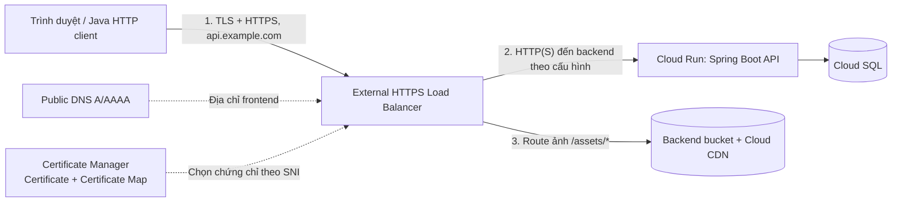
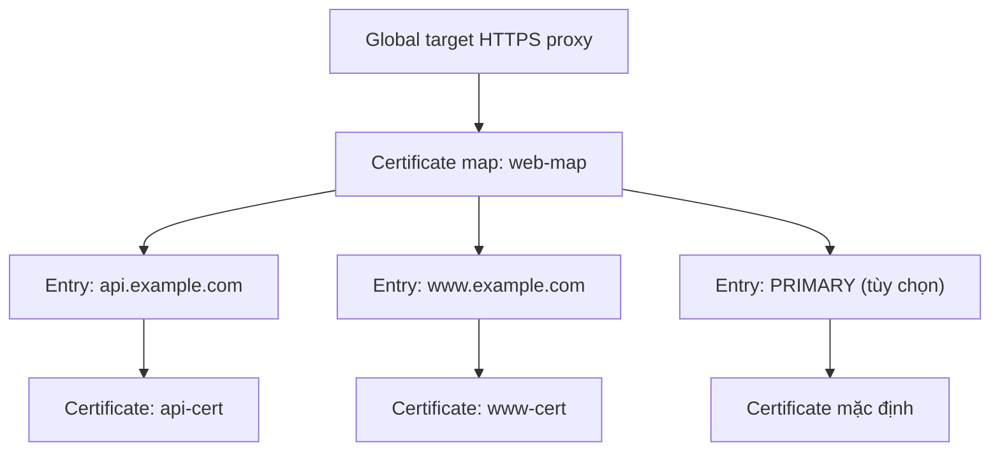
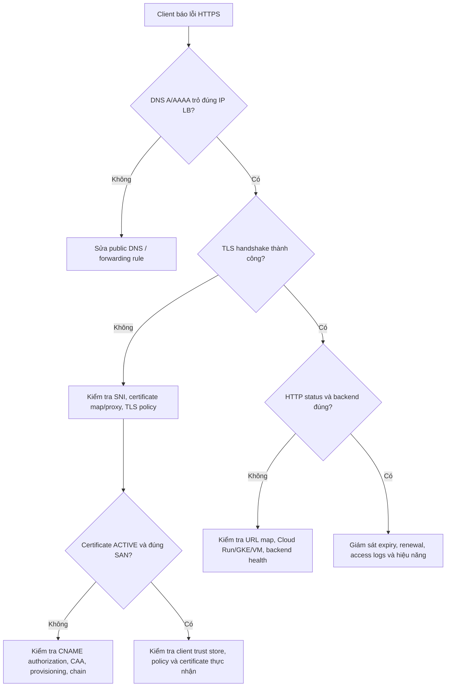

# Certificate Manager và quản lý chứng chỉ TLS

## 1. Vì sao ứng dụng Java cần quản lý chứng chỉ TLS?

Giả sử nhóm phát triển có một REST API viết bằng **Spring Boot** chạy trên **Cloud Run**, một frontend tĩnh phục vụ qua **Cloud Storage + Cloud CDN** và một dịch vụ nội bộ trên **GKE**. Người dùng truy cập `https://api.example.com` hoặc `https://www.example.com`. Để trình duyệt và Java HTTP client tin tưởng kết nối, hệ thống cần trình bày **chứng chỉ TLS hợp lệ** cho đúng tên miền, được ký bởi Certificate Authority (CA) mà client tin cậy và chưa hết hạn.

Chứng chỉ không chỉ được cấp một lần. Nó có vòng đời: **chứng minh quyền kiểm soát domain → cấp chứng chỉ → triển khai trên endpoint → xác minh → gia hạn/luân chuyển → thu hồi hoặc xóa**. Khi nhiều project, load balancer, môi trường và domain cùng tồn tại, quản lý thủ công dễ gây lỗi hết hạn chứng chỉ, lộ private key hoặc ngừng phục vụ do sửa cấu hình HTTPS proxy.

**Google Cloud Certificate Manager** tập trung hóa việc tạo, nhập, gắn và quản lý chứng chỉ TLS cho các điểm cuối Google Cloud được hỗ trợ, đặc biệt là **Cloud Load Balancing**. Chương **Cân bằng tải và phân phối nội dung** của mô-đun **CLOUD_PROVIDERS_GCP** sử dụng Certificate Manager để giải thích cách bảo vệ API Java, chọn nơi kết thúc TLS, điều phối chứng chỉ cho nhiều hostname và vận hành dịch vụ với độ tin cậy, bảo mật và chi phí phù hợp.

### Kết quả học tập

Sau bài này, bạn có thể:

1. Hiểu quan hệ giữa **TLS, X.509 certificate, SAN, SNI, private key, CA** và HTTPS load balancer.
2. Chọn **Google-managed public**, **Google-managed private** hoặc **self-managed** certificate theo yêu cầu.
3. Phân biệt **DNS authorization** với **load balancer authorization** và cách dùng **certificate map**, **map entry**, **target HTTPS proxy**.
4. Triển khai Google-managed certificate cho **global external Application Load Balancer** theo quy trình DNS authorization, kiểm tra trạng thái và chứng chỉ thực tế được phục vụ.
5. Giải thích khác biệt cấu hình certificate giữa **global, regional, cross-region** load balancers và dịch vụ **Cloud Run/GKE/Cloud CDN**.
6. Thiết lập chính sách TLS, giám sát gia hạn, luân chuyển chứng chỉ và điều tra lỗi TLS mà không nhầm với lỗi backend Java.

## 2. TLS hoạt động ở đâu trong đường đi của request?

Một HTTPS load balancer thường **kết thúc TLS ở frontend**: client và load balancer thực hiện TLS handshake; load balancer chọn backend theo URL map/routing rule. Phần **load balancer → backend** là một kết nối riêng, có thể HTTP, HTTPS hoặc giao thức khác tùy backend service và loại load balancer. Chứng chỉ frontend **không tự bật TLS end-to-end** đến mọi backend.



Sơ đồ minh họa kiến trúc có **global external Application Load Balancer**, serverless NEG cho Cloud Run và backend bucket cho nội dung tĩnh; routing thực tế còn yêu cầu URL map, backend service, forwarding rule, DNS và quyền truy cập. **Certificate Manager chỉ xử lý một phần của hệ thống:** tài nguyên chứng chỉ và việc triển khai chứng chỉ trên điểm kết thúc TLS.

### 2.1. Một phiên TLS handshake cơ bản

1. Client resolve tên miền thành địa chỉ IP rồi kết nối tới endpoint HTTPS (thường cổng 443).
2. Client gửi **ClientHello**, thường kèm **Server Name Indication (SNI)** là hostname cần truy cập.
3. HTTPS proxy chọn chứng chỉ phù hợp với SNI và cấu hình certificate, gửi chuỗi chứng chỉ.
4. Client kiểm tra **hostname trong SAN**, thời hạn hiệu lực, chuỗi chữ ký tới CA tin cậy và chính sách TLS; hai bên thiết lập khóa phiên.
5. Khi handshake thành công, HTTP request/response được truyền trong kết nối đã mã hóa đến frontend.

**TLS không tự xác định người dùng được phép gọi API.** Sau handshake, Spring Security, Identity-Aware Proxy (nếu triển khai), IAM, Cloud Armor và cơ chế authorization của ứng dụng vẫn có vai trò riêng.

### 2.2. Những khái niệm dễ nhầm

| Khái niệm | Nghĩa | Lỗi thường gặp |
| --- | --- | --- |
| **Common Name (CN) / Subject Alternative Name (SAN)** | Danh sách hostname mà certificate được phép đại diện; client hiện đại kiểm tra SAN | Chứng chỉ còn hạn nhưng không chứa `api.example.com` |
| **SNI** | Hostname client đưa vào TLS handshake để server chọn certificate | Nhiều domain dùng một IP nhưng map không có entry đúng |
| **Private key** | Khóa mật dùng để chứng minh quyền sở hữu certificate | Lưu key vào Git, image hoặc log |
| **Certificate chain** | Leaf và intermediate certificates liên kết đến CA được tin cậy | Thiếu intermediate khiến một số client xác minh thất bại |
| **Wildcard** | Ví dụ `*.example.com` thường bao phủ `api.example.com`, không bao phủ `example.com` hay `a.b.example.com` | Tưởng một wildcard bảo vệ mọi cấp subdomain |
| **TLS policy** | Quy tắc phiên bản TLS/cipher mà HTTPS proxy cho phép | Client cũ không còn bắt tay được sau khi siết policy |
| **Certificate status** | Trạng thái cấp/gia hạn trong Certificate Manager | Certificate `ACTIVE` nhưng không được gắn vào proxy đang nhận traffic |

## 3. Chọn loại chứng chỉ trong Certificate Manager

### 3.1. Google-managed certificate

Google Cloud chịu trách nhiệm **yêu cầu cấp, lưu private key cho certificate được quản lý, triển khai và tự gia hạn** theo khả năng/tình trạng authorization của dịch vụ. Với endpoint HTTPS công khai, đây thường là lựa chọn ưu tiên vì giảm vận hành thủ công. Nhà cung cấp CA, thời hạn hiệu lực và chi tiết gia hạn có thể thay đổi theo sản phẩm; không xây lịch vận hành dựa trên giả định mọi certificate đều có tuổi thọ 90 ngày.

**Điều kiện không được quên:** Google chỉ có thể cấp/gia hạn public certificate nếu còn chứng minh được quyền kiểm soát tên miền. Xóa sai DNS authorization, cấu hình CAA chặn CA, đổi DNS ngoài dự kiến hoặc làm mất khả năng xác thực domain có thể khiến certificate gia hạn thất bại, dù workload Java vẫn chạy bình thường.

### 3.2. Self-managed certificate

Doanh nghiệp **tự lấy chứng chỉ** từ CA và tải cả **certificate chain + private key** vào Certificate Manager. Hình thức này phù hợp khi cần CA/tên miền/chính sách cấp đặc thù, nhưng đội vận hành phải quản lý **ngày hết hạn, luân chuyển certificate/key, quy trình xử lý sự cố và hạn chế quyền đọc key**.

Google Cloud không tự thay thế một self-managed certificate đã hết hạn bằng một certificate do bên ngoài cấp. Không để private key nằm trong kho mã nguồn, artifact CI, chat hoặc tài liệu. Khi chạy lệnh import, phải đánh giá nguy cơ lộ key qua tệp, log và quyền truy cập trên môi trường thực thi.

### 3.3. Google-managed privately trusted certificate

Với một số kết nối nội bộ, yêu cầu có thể là certificate do **private CA** của doanh nghiệp cấp. Certificate Manager có thể kết hợp với **Certificate Authority Service (CA Service)** để quản lý những certificate riêng tư trên tài nguyên hỗ trợ. Client phải tin cậy root/intermediate CA riêng đó; trình duyệt công cộng **không tự tin** một private CA như public CA.

| Yêu cầu | Loại certificate nên xét | Ai chịu trách nhiệm chính? |
| --- | --- | --- |
| API/web công khai, domain hợp lệ, muốn tự động gia hạn | **Google-managed public** | Google xử lý khóa/cấp/gia hạn; đội vận hành duy trì DNS, IAM và kết nối |
| Có quy trình PKI riêng, chứng chỉ từ CA cụ thể | **Self-managed** | Đội PKI/devops bảo vệ key và tự luân chuyển |
| Endpoint nội bộ cần tin cậy qua CA của tổ chức | **Google-managed private + CA Service**, nếu mô hình hỗ trợ | CA Service/cấu hình trust của tổ chức và Certificate Manager |

**Lưu ý về phiên bản:** tài liệu Google Cloud hiện phân biệt Certificate Manager truyền thống và **Certificate Manager (2nd gen)** với những chức năng quản lý rộng hơn. Ở thời điểm biên soạn, một số tính năng 2nd gen còn ở giai đoạn **Pre-GA/Preview**. Các lệnh và ví dụ trong bài sử dụng luồng Certificate Manager truyền thống cho load balancing; khi triển khai cần đọc tài liệu đúng thế hệ và đúng phạm vi tính năng.

## 4. Các thành phần cấu hình Certificate Manager

### 4.1. Certificate resource

Đại diện một certificate X.509 cùng phương thức quản lý tương ứng. Thông tin thường cần kiểm tra: **tên resource, location/scope, danh sách domain, trạng thái cấp, ngày hết hạn, issuer, authorization**. Một certificate có thể bao gồm nhiều domain SAN, nhưng việc gom quá nhiều hostname của nhiều ứng dụng vào một certificate có thể khiến rủi ro lỗi gia hạn hoặc thay đổi DNS lan rộng.

### 4.2. Domain authorization

Dùng cho **Google-managed public certificates**. Có thể chọn hai cơ chế:

- **Load balancer authorization**: CA xác minh domain qua cấu hình DNS và đường phục vụ của load balancer; **không cần bản ghi CNAME dành riêng cho authorization**. Load balancer và DNS phải phục vụ đúng cấu hình được yêu cầu. Không hỗ trợ wildcard, chỉ dành cho các cấu hình global được hỗ trợ.
- **DNS authorization**: Certificate Manager cung cấp bản ghi **CNAME để chứng minh quyền kiểm soát domain**, người quản trị đặt đúng bản ghi ở authoritative public DNS. Có thể xin certificate **trước khi load balancer tiếp nhận traffic**, hỗ trợ wildcard và các trường hợp phức tạp như CDN trung gian.

Không dùng DNS authorization cho self-managed certificate: quyền kiểm soát domain đã được kiểm tra theo quy trình phát hành bên ngoài.

### 4.3. Certificate map và certificate map entry

Với các load balancer tương thích **certificate map**, một **certificate map** chứa các entry định nghĩa **hostname → certificate(s)**. Một target HTTPS proxy có thể tham chiếu certificate map; proxy dựa vào SNI để chọn certificate khi nhận kết nối.



Theo logic chọn certificate của Certificate Manager: **exact hostname** được ưu tiên hơn wildcard; nếu không có exact match thì kiểm tra wildcard; nếu không có khớp thì có thể dùng entry **PRIMARY** nếu đã cấu hình. PRIMARY không phải giấy phép phục vụ sai domain: client vẫn kiểm tra SAN của certificate và có thể từ chối kết nối.

Một certificate map entry có thể liên kết **nhiều certificate** (theo giới hạn hiện hành) để hỗ trợ key type khác nhau hoặc luân chuyển từng bước. Nếu một target HTTPS proxy được gắn cả certificate map và certificate riêng trực tiếp trong cấu hình tương thích, **certificate map sẽ được ưu tiên**. Điều này quan trọng khi di chuyển từ cấu hình cũ sang map.

### 4.4. Target HTTPS proxy, forwarding rule và SSL policy

**Forwarding rule** nhận traffic trên frontend IP/port, **target HTTPS proxy** kết thúc TLS và dùng URL map/backend để định tuyến. **SSL policy** là tài nguyên khác certificate: nó quy định mức TLS tối thiểu và cipher/profile khi client bắt tay với proxy.

Khi HTTPS trả lỗi do chứng chỉ, cần kiểm tra **certificate đang được proxy phục vụ**, không chỉ sự tồn tại của certificate trong Console. Một certificate `ACTIVE` chưa chắc đã được gắn đúng target proxy, certificate map entry hoặc frontend mà DNS trỏ đến.

## 5. Global, regional và cross-region load balancers sử dụng certificate khác nhau

Không phải mọi load balancer đều gắn certificate theo một kiểu. Dưới đây là **mô hình triển khai chính** theo tài liệu hỗ trợ hiện hành; cần kiểm tra lại bảng tương thích khi chọn sản phẩm hoặc phiên bản:

| Điểm kết thúc TLS | Cách dùng Certificate Manager thường gặp | Ghi nhớ |
| --- | --- | --- |
| **Global external Application Load Balancer** | Gắn **global certificate map** vào global target HTTPS proxy | Có thể dùng Google-managed hoặc self-managed theo cấu hình hỗ trợ |
| **Classic Application Load Balancer** | Gắn certificate map vào global HTTPS proxy | Kiểm tra khác biệt thế hệ LB khi nâng cấp |
| **Regional external Application Load Balancer** | Gắn **regional certificate trực tiếp** vào regional target HTTPS proxy | Không dùng global certificate map như ví dụ global |
| **Regional internal Application Load Balancer** | Gắn **regional certificate trực tiếp** vào regional target HTTPS proxy | Private frontend vẫn cần certificate phù hợp với client |
| **Cross-region internal Application Load Balancer** | Gắn certificate được hỗ trợ **trực tiếp** vào global HTTPS proxy | Kiểm tra location/scope đặc thù và cơ chế DNS authorization |
| **Global external proxy Network Load Balancer** | Certificate map được hỗ trợ cho trường hợp TLS proxy tương ứng | Khác cấu hình HTTPS routing L7 |
| **Media CDN** | Global certificates theo cấu hình Media CDN | Quy trình endpoint/CDN riêng, không đồng nhất với Application LB |

**Ví dụ Java:** API Spring Boot ở Cloud Run phía sau **global external Application Load Balancer** có thể sử dụng **certificate map** của global HTTPS proxy. Cùng API đó nếu chuyển sang **regional external Application Load Balancer**, đội vận hành phải xem lại **regional certificate và cách gắn trực tiếp**, không chỉ thay `--global` bằng `--region` trong mọi lệnh.

### 5.1. Cloud CDN và HTTPS

Cloud CDN phân phối nội dung qua các điểm cache liên quan đến load balancing; với kiến trúc **Cloud CDN + external Application Load Balancer**, certificate cho `assets.example.com` được cấu hình tại **HTTPS frontend của load balancer**. Việc CDN cache ảnh không tự tạo và không thay thế certificate TLS. Khi có một CDN bên thứ ba đặt **trước** load balancer, nên đánh giá DNS authorization vì phương pháp load balancer authorization có thể không kiểm chứng domain đúng qua proxy trung gian.

### 5.2. Cloud Run, GKE và Compute Engine

- **Cloud Run:** nếu sử dụng hostname riêng qua một external Application Load Balancer với **serverless NEG**, certificate thuộc HTTPS frontend của load balancer. Cloud Run còn có những cơ chế custom domain/managed HTTPS riêng theo tính năng được hỗ trợ; tránh áp dụng máy móc lệnh Certificate Manager vào endpoint `run.app`.
- **GKE:** nếu ứng dụng Spring Boot chạy trong pod, certificate trên frontend được quản lý theo **Ingress/Gateway controller** và loại load balancer được tạo. Xác định controller có hỗ trợ certificate map/reference hay không; tránh gắn tài nguyên thủ công rồi để controller ghi đè cấu hình.
- **Compute Engine:** nếu VM chạy Spring Boot phía sau HTTPS load balancer, Java không nhất thiết cần tự load certificate frontend vào JVM. Nếu ứng dụng cũng mở cổng HTTPS trực tiếp, certificate của ứng dụng là **một cấu hình TLS khác** với certificate của load balancer.

## 6. Chọn DNS authorization hay load balancer authorization?

| Câu hỏi | DNS authorization | Load balancer authorization |
| --- | --- | --- |
| Có cần thêm DNS record chuyên biệt? | **Có**: CNAME do Certificate Manager cung cấp | **Không** cho authorization riêng, nhưng domain vẫn phải trỏ đúng LB |
| Xin certificate trước khi frontend phục vụ traffic? | **Có thể** | Thường phải hoàn tất LB/DNS và cho phép xác minh từ Internet |
| Có hỗ trợ wildcard? | **Có** theo điều kiện tên domain | **Không** |
| Dùng cho regional certificate? | **Có**, loại DNS authorization phù hợp | **Không** |
| Có CDN bên thứ ba hoặc proxy trung gian trước LB? | Thường phù hợp hơn | Có thể xác minh thất bại |
| Vấn đề hay gặp | CNAME sai/chưa phổ biến, CAA, thiếu quyền DNS | A/AAAA trỏ nhầm IP, port 443 không phục vụ, LB chưa gắn certificate |

### 6.1. Hai loại DNS authorization

Certificate Manager hỗ trợ những kiểu DNS authorization như **`FIXED_RECORD`** và **`PER_PROJECT_RECORD`**. Loại **per-project** giúp việc xác minh domain gắn rõ hơn với project và là yêu cầu của một số đường triển khai, gồm **regional Google-managed certificates**. Mỗi loại có quy tắc tạo CNAME riêng; **không tự đoán tên CNAME là `_acme-challenge.example.com`**. Hãy lấy chính xác `dnsResourceRecord.name` và `dnsResourceRecord.data` từ Certificate Manager, rồi tạo record tại DNS provider.

### 6.2. Wildcard, apex, SAN và CAA

Một certificate chứa `*.example.com` có thể bảo vệ `api.example.com` và `www.example.com`, nhưng không tự bảo vệ **`example.com`**. Nếu cần cả root/apex và wildcard, certificate phải chứa tên tương ứng và certificate map entries phải khớp hostname được phục vụ.

**CAA (Certificate Authority Authorization)** record giới hạn CA nào được phép phát hành certificate cho domain. Certificate Manager có thể dùng **Google Trust Services (`pki.goog`)** và **Let's Encrypt (`letsencrypt.org`)** trong các cấu hình public hỗ trợ. Với **per-project DNS authorization** và regional certificates, tài liệu nêu CA phát hành là **Google Trust Services**, vì vậy CAA phải cho phép `pki.goog` khi cấu hình CAA. Một bản ghi CNAME đúng nhưng CAA chặn CA vẫn khiến phát hành hoặc gia hạn thất bại.

**Quyền kiểm soát DNS là quyền bảo mật quan trọng.** Người được chỉnh CNAME authorization có thể ảnh hưởng việc cấp và gia hạn public TLS certificate cho domain. Tách trách nhiệm DNS operator, Certificate Manager operator và load balancer operator khi hệ thống lớn.

## 7. Lab: Google-managed certificate cho global HTTPS Load Balancer

Mục tiêu: triển khai certificate public cho `api.example.com` trên **global external Application Load Balancer** đã có frontend HTTPS và **global target HTTPS proxy**. Đây là ví dụ cho **môi trường thử nghiệm**; cần **thay tên miền bằng domain bạn thực sự quản lý**. `example.com` chỉ là tên minh họa, không thể dùng để nhận certificate cho domain của người khác.

Các bước **không tự tạo backend/forwarding rule/load balancer mới**. Để hoàn thành end-to-end, bạn cần một load balancer phù hợp với global target HTTPS proxy đã tạo, domain có thể chỉnh public DNS, billing account và quyền phù hợp.

### Bước 1 — Chuẩn bị IAM, API và thông tin môi trường

Cần quyền để quản lý Certificate Manager (ví dụ `roles/certificatemanager.editor` theo tác vụ), quản lý HTTPS proxy/load balancing và quản lý DNS zone. Dùng **IAM ít quyền nhất**: tài khoản automation phát hành certificate không nhất thiết phải là Owner của cả project.

```bash
gcloud config set project YOUR_PROJECT_ID
gcloud services enable certificatemanager.googleapis.com compute.googleapis.com

# Xác định đúng global HTTPS proxy đang nhận request:
gcloud compute target-https-proxies list
```

Ở các lệnh sau, thay `api.example.com` bằng tên thuộc quyền kiểm soát của bạn; thay `EXISTING_GLOBAL_HTTPS_PROXY` bằng tên proxy thật. Nếu load balancer đang phục vụ production, không sửa certificate map khi chưa có kế hoạch triển khai, thử nghiệm và rollback.

### Bước 2 — Tạo DNS authorization

Ví dụ chọn **`PER_PROJECT_RECORD`** và location `global`:

```bash
gcloud certificate-manager dns-authorizations create api-dns-auth \
  --domain=api.example.com \
  --type=PER_PROJECT_RECORD \
  --location=global

gcloud certificate-manager dns-authorizations describe api-dns-auth \
  --location=global \
  --format="yaml(dnsResourceRecord)"
```

Kết quả `describe` chứa record type `CNAME`, `dnsResourceRecord.name` và `dnsResourceRecord.data`. **Sao chép nguyên tên và giá trị thực tế** vào authoritative **public DNS** của domain (Cloud DNS hoặc nhà cung cấp DNS đang quản lý domain). Bản ghi minh họa sau chỉ là *hình thức*, không phải record thực mà hệ thống của bạn sẽ cấp:

```text
<dnsResourceRecord.name từ Certificate Manager>  CNAME  <dnsResourceRecord.data>
```

Đợi DNS được cập nhật và kiểm tra bằng `dig CNAME RECORD_NAME_FROM_DESCRIBE` hoặc công cụ DNS tương đương. Thời gian phổ biến DNS phụ thuộc TTL, cache và nhà cung cấp DNS. CNAME authorization cần duy trì **trong suốt vòng đời** của Google-managed certificate để phục vụ gia hạn.

### Bước 3 — Tạo Google-managed certificate

```bash
gcloud certificate-manager certificates create api-cert \
  --domains=api.example.com \
  --dns-authorizations=api-dns-auth \
  --location=global

gcloud certificate-manager certificates describe api-cert \
  --location=global
```

Kiểm tra **`managed.state`** cùng phần **`managed.authorizationAttemptInfo`** nếu có. Những trạng thái cần hiểu:

| Trạng thái | Ý nghĩa và hành động |
| --- | --- |
| **`PROVISIONING`** | Đang phát hành/gia hạn; kiểm tra DNS, CAA, authorization và để hệ thống có thời gian xử lý |
| **`ACTIVE`** | Certificate đã được cấp; **chưa tự chứng minh** certificate đang gắn đúng frontend |
| **`FAILED`** | Có lỗi khiến hệ thống dừng thử phát hành; cần đọc nguyên nhân, sửa cấu hình và tạo resource mới theo hướng dẫn khắc phục |

Không xóa/recreate certificate liên tục khi đang chờ DNS cập nhật; điều đó có thể gây vấn đề về giới hạn CA. Với nhiều SAN, **tất cả domain cần được xác minh** trước khi certificate có thể hoạt động đầy đủ.

### Bước 4 — Tạo certificate map và hostname entry

Các bước này dành cho **global HTTPS proxy hỗ trợ certificate map**:

```bash
gcloud certificate-manager maps create java-web-map

gcloud certificate-manager maps entries create api-entry \
  --map=java-web-map \
  --hostname=api.example.com \
  --certificates=api-cert

gcloud certificate-manager maps entries describe api-entry \
  --map=java-web-map
```

Đợi `api-entry` sẵn sàng phục vụ (kiểm tra state của map entry). Có thể thêm `www.example.com` bằng certificate/entry tương ứng; **URL routing rules** vẫn phải được cấu hình riêng trong URL map/backend service.

### Bước 5 — Gắn map vào global target HTTPS proxy

Sau khi certificate là `ACTIVE` và map entry đã sẵn sàng:

```bash
gcloud compute target-https-proxies update EXISTING_GLOBAL_HTTPS_PROXY \
  --certificate-map=java-web-map \
  --global

gcloud compute target-https-proxies describe EXISTING_GLOBAL_HTTPS_PROXY \
  --global
```

Đổi certificate map trên proxy có thể tác động đến **mọi hostname đang được proxy đó phục vụ**. Trước khi cập nhật, kiểm tra các domain hiện hữu đã có entry tương ứng hoặc phương án fallback phù hợp. Khi map được gắn, certificate cũ gắn trực tiếp vào proxy không nhất thiết còn được dùng vì map có độ ưu tiên cao hơn.

### Bước 6 — Trỏ DNS phục vụ HTTP(S) và kiểm tra thực tế

**CNAME dùng cho DNS authorization** khác với bản ghi **A/AAAA** giúp người dùng đến đúng IP của load balancer. Sau khi đã có frontend IP/forwarding rule, cấu hình public DNS cho hostname của ứng dụng theo kiến trúc frontend. Đối với **DNS authorization**, quá trình cấp certificate có thể thành công **trước** bước trỏ A/AAAA; nhưng request thật vẫn cần đúng địa chỉ của frontend.

```bash
# Kiểm tra chính xác hostname và chứng chỉ được frontend phục vụ:
openssl s_client \
  -connect LOAD_BALANCER_IP:443 \
  -servername api.example.com \
  -showcerts

# Kiểm tra request HTTPS đến IP đích mà vẫn giữ Host/SNI:
curl -v --resolve api.example.com:443:LOAD_BALANCER_IP \
  https://api.example.com/health
```

Khi đọc output, xem **SAN, issuer, thời hạn, chain**, hostname và khả năng verify TLS. Nếu `/health` không tồn tại hoặc cần authentication, request có thể trả HTTP 401/404 dù TLS hoàn toàn hợp lệ. Không sử dụng `curl -k` như cách “sửa” lỗi certificate; flag đó chỉ bỏ xác minh TLS và che mất nguyên nhân.

## 8. Nếu dùng regional/cross-region HTTPS load balancer

Quy trình regional **không phải** bản sao nguyên si của ví dụ global. Với regional external/internal Application Load Balancer, Certificate Manager hỗ trợ **regional certificate** được **gắn trực tiếp** vào **regional target HTTPS proxy**, thay vì certificate map global. Regional Google-managed public certificate cần **per-project DNS authorization** ở location phù hợp.

Ví dụ minh họa cho trường hợp **đã có regional HTTPS proxy** tại `asia-southeast1` (điều chỉnh theo DNS authorization, resource và LB thật):

```bash
gcloud certificate-manager dns-authorizations create regional-api-auth \
  --domain=regional.example.com \
  --type=PER_PROJECT_RECORD \
  --location=asia-southeast1

# Tạo CNAME từ dnsResourceRecord.name/data trước khi xin certificate.
gcloud certificate-manager dns-authorizations describe regional-api-auth \
  --location=asia-southeast1

gcloud certificate-manager certificates create regional-api-cert \
  --domains=regional.example.com \
  --dns-authorizations=regional-api-auth \
  --location=asia-southeast1

# Chỉ sau khi certificate sẵn sàng, gắn vào proxy thích hợp:
gcloud compute target-https-proxies update EXISTING_REGIONAL_HTTPS_PROXY \
  --region=asia-southeast1 \
  --certificate-manager-certificates=regional-api-cert
```

**Cross-region internal Application Load Balancer** dùng cơ chế certificate attachment riêng với global proxy và certificate scope được hỗ trợ; hãy tra hướng dẫn **cross-region** thay vì sử dụng `--region` theo thói quen. Tên location của certificate, scope, loại LB, target proxy và DNS authorization phải **phù hợp nhau**.

## 9. Tự quản lý certificate: khi nào và cách luân chuyển?

Nếu chính sách doanh nghiệp buộc dùng certificate do CA bên ngoài cấp, luồng **self-managed** thường gồm:

1. Tạo CSR/private key trên môi trường quản lý khóa được phê duyệt; yêu cầu CA cấp certificate chứa đúng SAN.
2. Lưu **leaf certificate + intermediate chain** theo định dạng PEM phù hợp, lưu private key tách biệt và phân quyền chặt.
3. Import thành **Certificate Manager resource** mới; xác minh tên miền, ngày hết hạn, private key khớp certificate.
4. Cập nhật map entry hoặc direct attachment theo mô hình LB; kiểm tra TLS handshake thực tế.
5. Chỉ xóa certificate cũ sau khi đã xác minh mọi frontend và khả năng rollback.

Ví dụ lệnh import cho tài nguyên global:

```bash
gcloud certificate-manager certificates create enterprise-cert-v2 \
  --certificate-file=PATH_TO_CHAIN_PEM \
  --private-key-file=PATH_TO_PRIVATE_KEY_PEM \
  --location=global
```

Chỉ chạy trên máy/runner bảo mật, tránh đưa private key thật vào transcript, Git hoặc artifact chung. Trên hệ thống lớn, **deploy certificate mới song song certificate cũ**, đo TLS handshake thành công rồi mới gỡ certificate cũ; kiểm tra giới hạn số certificate trên một map entry và cách lựa chọn thuật toán khóa.

**Certificate hết hạn và private key bị lộ là hai tình huống khác nhau.** Hết hạn cần luân chuyển kịp thời; lộ key có thể yêu cầu phát hành mới, thu hồi certificate theo quy trình CA, đổi key và điều tra các nơi key từng được dùng.

## 10. TLS policy, hostname routing và giới hạn bảo mật

### 10.1. SSL policy không phải certificate

Certificate chứng minh tên miền và khóa công khai; **SSL policy** điều khiển TLS negotiation như **minimum TLS version** và các cipher suite/profile. Khi cấu hình, ưu tiên profile đáp ứng chính sách bảo mật của tổ chức (ví dụ **MODERN** hoặc **RESTRICTED** nếu client tương thích), cân nhắc TLS 1.2/1.3 và test thiết bị/người dùng thật.

Ví dụ tạo policy global để nghiên cứu:

```bash
gcloud compute ssl-policies create java-api-tls-policy \
  --profile=MODERN \
  --min-tls-version=1.2
```

Chính sách mới chỉ có hiệu lực khi được gắn vào **HTTPS/SSL target proxy tương ứng** theo loại load balancer. Nếu siết mức TLS mà client Java cũ đột ngột lỗi handshake, xem khả năng hỗ trợ **JDK/HTTP client**, cipher và trust store; không mặc định lỗi do Spring Boot code.

### 10.2. HTTP to HTTPS và HSTS

Một certificate chỉ bảo vệ kết nối HTTPS khi client thật sự dùng HTTPS. Để hạn chế gửi dữ liệu qua HTTP không mã hóa, cấu hình **HTTP → HTTPS redirect** tại frontend được hỗ trợ, HTTPS-only links và **HSTS** khi đã chứng minh mọi hostname liên quan đều sử dụng HTTPS đúng. Trước khi bật HSTS với `includeSubDomains` hoặc `preload`, cần kiểm tra toàn bộ subdomain; cấu hình sai có thể khiến người dùng không truy cập được các dịch vụ chưa có HTTPS.

### 10.3. mTLS, Cloud Armor và authentication

Nếu cần **xác thực chứng chỉ client** (mTLS) tại Application Load Balancer, Google Cloud có các tính năng trust config/Frontend mTLS được hỗ trợ tùy loại LB. Cần **trust anchor và chính sách xác minh client**; một **Google-managed public server certificate** không tự trở thành certificate client.

**Cloud Armor** giải quyết một phần bảo vệ HTTP(S) ở lớp mạng/ứng dụng; **IAM/IAP** và Spring Security giải quyết danh tính và phân quyền truy cập theo những mô hình khác nhau. TLS đảm bảo kênh truyền và danh tính endpoint, không tự giới hạn quyền `POST /admin/users` của một client đã kết nối.

## 11. Spring Boot phía sau HTTPS load balancer

### 11.1. TLS offloading và forwarded headers

Khi HTTPS được kết thúc tại load balancer, Spring Boot có thể nhận **HTTP** trên hop đến backend, tùy backend protocol. Ứng dụng có thể cần biết request gốc là HTTPS để xây URL tuyệt đối hoặc redirect chính xác. Chỉ tin các header như `X-Forwarded-Proto` khi chúng đi qua **proxy đã được tin cậy** và kiến trúc ingress được kiểm soát.

Một cấu hình Spring Boot minh họa:

```yaml
server:
  forward-headers-strategy: native
  servlet:
    session:
      cookie:
        secure: true
        http-only: true
```

Chi tiết hỗ trợ phụ thuộc Spring Boot/embedded server và đường request. Không bật nhận forwarded headers từ các client Internet tùy ý vì có thể gây lỗi redirect hoặc làm ứng dụng tin sai scheme/host. Với Cloud Run phía sau external Application Load Balancer, đánh giá **ingress chỉ cho internal và Cloud Load Balancing**, đồng thời cấu hình **xác thực/ngăn truy cập trực tiếp** theo yêu cầu nghiệp vụ.

### 11.2. Một vài trường hợp chứng chỉ không nằm trong JVM

| Tình huống | Điểm quản lý server TLS certificate | Lưu ý Java |
| --- | --- | --- |
| Client → Global Application LB → Cloud Run | Certificate Manager trên LB frontend | Spring Boot nhận scheme gốc phù hợp, bảo vệ app/API |
| Client → Regional HTTPS LB → GKE/VM | Regional certificate gắn HTTPS proxy | Kiểm tra ingress controller/URL map, firewall backend |
| Java service → API HTTPS bên ngoài | **Server đích** trình bày certificate | Java client kiểm tra trust store, hostname, TLS versions |
| LB → backend dùng HTTPS | TLS **phía backend** theo chính sách LB | Xác định cách backend certificate được xác minh trong mô hình LB |
| Java endpoint HTTPS trực tiếp không qua LB | Certificate/keystore trên Java server hoặc proxy trực tiếp | Quản lý cert/key và renewal tại chính endpoint đó |

Một lỗi `javax.net.ssl.SSLHandshakeException` trên **Java client outbound** có thể liên quan CA/trust store của JDK, hostname hoặc giao thức đích; sửa certificate tại HTTPS frontend load balancer **không khắc phục** nếu client đang gọi một endpoint TLS khác.

## 12. Vận hành vòng đời chứng chỉ và tự động hóa

### 12.1. Kiểm kê và quyền

Duy trì danh sách **hostname → owner → project → certificate resource → location → type → target proxy → cách authorization → ngày hết hạn/rotation**. Quy định ai được chỉnh DNS, CA, certificate và LB. Phân quyền IAM theo nhiệm vụ; ví dụ role quản lý Certificate Manager không mặc định trao luôn quyền cấu hình tất cả load balancers.

Với các môi trường `dev`, `staging` và `prod`, nên tách certificate theo trách nhiệm và phạm vi lỗi. Tránh một certificate khổng lồ chứa mọi domain: lỗi authorization của một tên miền có thể làm ảnh hưởng luồng cấp/gia hạn của certificate có nhiều SAN.

### 12.2. Gia hạn tự động vẫn cần giám sát

Google-managed certificate được **tự gia hạn**, nhưng cần theo dõi:

- **`managed.state`**, `managed.authorizationAttemptInfo`, các lỗi authorization và thay đổi trạng thái.
- **Tên miền và bản ghi CNAME** dùng để chứng minh quyền kiểm soát domain có còn đúng không.
- **CAA** có cho phép CA hiện được sử dụng và các thay đổi DNS giữa các đợt renewal không.
- Certificate có đang thực sự phục vụ traffic, còn phù hợp với map/entry/proxy, và chuỗi certificate client nhận được có ngày hết hạn hợp lệ không.
- Log thay đổi cấu hình IAM, Certificate Manager, DNS và HTTPS proxy; tạo cảnh báo theo năng lực giám sát hiện hành.

Nếu self-managed, tự theo dõi ngày hết hạn với ngưỡng cảnh báo đủ sớm để có thời gian xin cấp mới và triển khai. Dùng công cụ inventory, Cloud Monitoring và **kiểm tra TLS từ bên ngoài** để có hai nguồn tín hiệu độc lập.

### 12.3. Infrastructure as Code và CI/CD

Terraform hoặc hệ thống cấu hình tương đương có thể quản lý **DNS authorization, certificate, certificate map, map entries, proxy attachment** theo tài nguyên hỗ trợ. Trong pipeline:

1. Kiểm tra danh sách domain, location, IAM và bản ghi DNS sẽ tạo.
2. Tạo DNS authorization/certificate; để quá trình provisioning diễn ra và **kiểm tra trạng thái**.
3. Chuẩn bị certificate map entries cho mọi hostname trên proxy, xem thay đổi của infrastructure plan.
4. Chuyển proxy sang map/certificate mới theo **quy trình có rollback**.
5. Test certificate thật bằng `openssl`/HTTP client và xác nhận backend hoạt động; không dừng ở “Terraform apply thành công”.

Certificate Manager/CA có quota và giới hạn phát hành; tránh tự động delete/recreate cùng một certificate mỗi lần build ứng dụng. **Phát hành Java revision mới** và **luân chuyển TLS certificate ở frontend** thường là hai vòng đời độc lập.

## 13. Chẩn đoán lỗi: từ DNS đến backend Java

| Hiện tượng | Lớp cần xem | Kiểm tra cụ thể |
| --- | --- | --- |
| Certificate mãi `PROVISIONING` | Domain authorization | `dnsResourceRecord`, CNAME public, CAA, trạng thái `authorizationAttemptInfo` |
| Certificate `FAILED` | Certificate Manager/CA | `managed.provisioningIssue` và `authorizationAttemptInfo.failureReason`; sửa nguyên nhân, tạo lại theo hướng dẫn |
| Lỗi `CNAME_MISMATCH` | DNS authorization | So khớp chính xác CNAME name/data, authoritative zone, TTL |
| CAA failure | Chính sách CA | Kiểm tra `pki.goog` hoặc `letsencrypt.org` tùy loại auth; chú ý per-project |
| LB authorization không thành công | Public DNS và endpoint | A/AAAA trỏ đúng forwarding IP, port 443 mở, proxy phục vụ, không bị CDN khác che |
| Certificate `ACTIVE` nhưng client nhận certificate cũ | Certificate map/target HTTPS proxy | Map đã attach chưa? Entry có hostname đúng? Có nhiều IP/LB không? |
| SNI `api.example.com` nhận cert của `www.example.com` | SNI selection / map entry | Exact/wildcard/PRIMARY entry, hostname và SAN, proxy nhận traffic |
| Trình duyệt báo `ERR_CERT_COMMON_NAME_INVALID` | Hostname/SAN | Tên domain trong URL có khớp SAN không, wildcard có đúng cấp không |
| Java client báo `PKIX path building failed` | CA/trust chain | Intermediate chain, CA root trong JDK trust store, enterprise TLS interception |
| TLS handshake failure sau siết SSL policy | TLS version/cipher | JDK, client HTTP stack, minimum TLS và profile trên proxy |
| TLS OK nhưng HTTP 502/503 | Load balancing/backend | Health check, NEG/backend service, Cloud Run/GKE/VM logs, timeout |
| HTTPS OK nhưng redirect loop | Scheme/forwarded header | HTTPS redirect frontend, Spring forwarded headers, cookie/HSTS policy |
| Cert sắp hết hạn dù có auto-renew | Renewal/DNS/CA | DNS authorization còn đúng? CAA đổi? Public DNS nhất quán toàn cầu? |

### Quy trình gỡ lỗi gợi ý



### Bộ lệnh kiểm tra hữu ích

```bash
gcloud certificate-manager certificates list --location=global
gcloud certificate-manager certificates describe api-cert --location=global
gcloud certificate-manager dns-authorizations describe api-dns-auth --location=global
gcloud certificate-manager maps entries list --map=java-web-map
gcloud compute target-https-proxies describe EXISTING_GLOBAL_HTTPS_PROXY --global

# Chỉ đọc: dùng public domain và IP đúng của môi trường kiểm tra.
dig api.example.com A
dig api.example.com AAAA
openssl s_client -connect LOAD_BALANCER_IP:443 -servername api.example.com -showcerts
```

Ở môi trường lớn có nhiều IP/region, kiểm tra **tất cả frontend liên quan**. Một người dùng ở khu vực khác có thể nhận kết quả DNS không giống máy test do caching/GeoDNS hoặc cơ chế DNS không nhất quán; Google-managed certificate cũng cần vượt qua quá trình xác minh domain từ nhiều vị trí.

## 14. Bảo mật, độ tin cậy và chi phí

**Bảo mật:** ưu tiên Google-managed khi phù hợp, áp dụng IAM ít quyền nhất, bảo vệ private key của self-managed certificate, giới hạn quyền DNS, kiểm tra CAA và SSL policy. Bảo vệ API bằng authorization riêng; TLS/Cloud CDN không thay thế logic phân quyền trong Java.

**Độ tin cậy:** tách nhóm certificate theo domain/ứng dụng hoặc vùng lỗi phù hợp, duy trì certificate cũ khi chuyển đổi, giám sát renewal và kiểm tra certificate thật trên TLS endpoint. Không xóa map, entry hoặc DNS authorization còn được dùng, đặc biệt khi nhiều load balancers chia sẻ tài nguyên.

**Chi phí:** Certificate Manager có **bảng giá theo số lượng certificate** và có trường hợp tính phí theo loại key/kết nối; Cloud Load Balancing, Cloud CDN, Cloud DNS, Network Egress và các backend vẫn có bảng giá riêng. Có mức miễn phí theo lượng certificate trong một project theo chính sách hiện hành, nhưng không nên coi toàn bộ hệ thống HTTPS là miễn phí. Đối chiếu [Certificate Manager pricing](https://cloud.google.com/certificate-manager/pricing) và giá của từng load balancer trước khi chọn kiến trúc.

**Giới hạn vận hành:** quota certificate, SAN, map/entry, loại key và tính năng hỗ trợ khác nhau theo scope/loại load balancer. Kiểm tra giới hạn và release stage của 2nd gen trước khi xây pipeline nhiều domain hoặc yêu cầu tính năng mới.

## 15. Bài thực hành theo ba mức

### Bài A — Phân biệt các lớp TLS (cơ bản)

Một Spring Boot API trên Cloud Run được phục vụ tại `api.example.com` qua external HTTPS load balancer. Vẽ đường đi **client → frontend TLS → backend**; xác định nơi quản lý certificate, ai kiểm tra hostname/SAN, nơi bắt buộc xác thực người dùng và vì sao TLS phía backend có thể cần thiết riêng. Giải thích khác nhau giữa HTTP 401, TLS handshake failure và HTTP 503.

### Bài B — Google-managed certificate (trung bình)

Với domain thử nghiệm thực sự sở hữu, thực hiện **DNS authorization → certificate → map/entry → global HTTPS proxy**, rồi kiểm tra:

1. Record DNS authorization `CNAME` có tên/giá trị chính xác từ Certificate Manager.
2. `managed.state=ACTIVE`; giải thích trạng thái `PROVISIONING` và `FAILED`.
3. Certificate map entry cho hostname có trạng thái sẵn sàng phục vụ và map được gắn vào proxy đúng.
4. `openssl s_client` trình bày SAN/issuer/chain đúng khi dùng SNI.
5. `curl` tới endpoint trả kết quả HTTP mong đợi; backend vẫn được bảo vệ bằng IAM/authorization phù hợp.

Nếu không có domain/billing, dùng bản ghi DNS mẫu và sơ đồ quy trình để làm **bài thiết kế**, không cần tạo resource có phí.

### Bài C — Chuyển certificate và kiểm tra rollback (nâng cao)

Giả sử một load balancer có hai hostname `api.example.com` và `assets.example.com`; frontend phục vụ API Spring Boot và ảnh từ Cloud CDN. Hãy lập kế hoạch **đổi từ self-managed sang Google-managed**:

- Tạo certificate/map entries cho **đủ hai hostname**; giữ certificate cũ trong giai đoạn song song.
- Quy định cửa sổ thay đổi, test SNI của cả hai domain, đo TLS errors và lập điều kiện rollback.
- Kiểm tra `assets` và `api` có đúng URL/backend route, certificate và HSTS khác nhau nếu cần.
- Thử mô phỏng **CNAME authorization bị gỡ**, phân tích vì sao có thể chưa lỗi ngay nhưng lần gia hạn sau có rủi ro.
- Ghi chủ sở hữu DNS, IAM, lịch kiểm tra certificate và chi phí phát sinh.

### Checklist tự đánh giá

- [ ] Tôi phân biệt certificate, private key, SAN, SNI, CA, HTTPS proxy và SSL policy.
- [ ] Tôi biết lúc nào chọn Google-managed public, private CA hoặc self-managed certificate.
- [ ] Tôi hiểu DNS authorization, load balancer authorization và CAA; biết wildcard có giới hạn.
- [ ] Tôi phân biệt certificate map trên global LB với regional direct attachment.
- [ ] Tôi tạo/đọc được DNS authorization, certificate, map, entry và HTTPS proxy qua `gcloud`.
- [ ] Tôi kiểm tra được trạng thái `ACTIVE` **và** chứng chỉ thực sự được trình bày ở frontend.
- [ ] Tôi biết Cloud CDN, Cloud Run và GKE có thể có đường gắn certificate khác nhau.
- [ ] Tôi không để private key trong source code, log, CI artifact hoặc tập tin chia sẻ.
- [ ] Tôi có kế hoạch auto-renew monitoring, rotation/rollback và kiểm soát quyền DNS/IAM.
- [ ] Tôi tách được lỗi TLS handshake, hostname mismatch, client trust và lỗi backend HTTP.

Mục tiêu của việc quản lý TLS bằng Certificate Manager là bảo đảm **đúng danh tính endpoint, luồng cấp/gia hạn ổn định và khả năng kiểm chứng certificate thật** trên mỗi đường truy cập. Với ứng dụng Java trên Google Cloud, một cấu hình HTTPS tốt phải đi cùng routing chính xác, bảo mật ứng dụng, quan sát lỗi và quy trình thay đổi có thể rollback.

## 16. Tài liệu Google Cloud tham khảo

- [Certificate Manager overview và bảng load balancer hỗ trợ](https://cloud.google.com/certificate-manager/docs/overview)
- [Certificate Manager core components](https://cloud.google.com/certificate-manager/docs/core-components)
- [Domain authorization types](https://cloud.google.com/certificate-manager/docs/domain-authorization)
- [Deploy global Google-managed certificate with DNS authorization](https://cloud.google.com/certificate-manager/docs/deploy-google-managed-dns-auth)
- [Deploy regional Google-managed certificate](https://cloud.google.com/certificate-manager/docs/deploy-google-managed-regional)
- [How certificate selection and SNI work](https://cloud.google.com/certificate-manager/docs/certificate-selection-logic)
- [Certificate Manager troubleshooting](https://cloud.google.com/certificate-manager/docs/troubleshooting)
- [Certificate Manager best practices](https://cloud.google.com/certificate-manager/docs/certificate-manager-best-practices)
- [Use SSL policies on load balancers](https://cloud.google.com/load-balancing/docs/use-ssl-policies)
- [Certificate Manager pricing](https://cloud.google.com/certificate-manager/pricing)
- [Certificate Manager 2nd gen overview](https://cloud.google.com/certificate-manager/docs/v2/overview)
