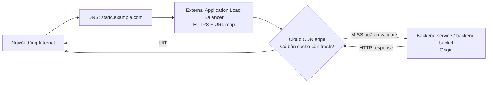
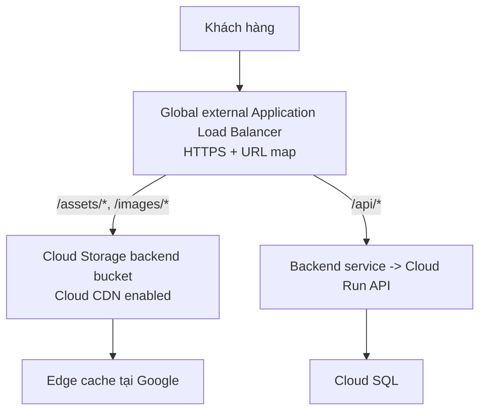

# Cloud CDN, cache keys và cache invalidation

Một ứng dụng bán hàng phục vụ hàng triệu lượt tải ảnh sản phẩm, CSS, JavaScript và trang giới thiệu mỗi ngày. Nếu mọi request đều đi tới Cloud Storage hoặc các instance chạy trên Compute Engine, GKE hay Cloud Run, hệ thống phải xử lý cùng một nội dung nhiều lần. Độ trễ tăng khi người dùng ở xa region triển khai, còn chi phí lưu lượng và tải origin có thể tăng theo. **Google Cloud CDN** giúp phân phối nội dung đủ điều kiện từ các **edge cache** gần người dùng, giảm những request lặp lại về origin.

Caching phải được thiết kế cẩn thận: hai URL khác nhau có thể vô tình dùng cùng **cache key**, một object đã được sửa có thể vẫn được phục vụ từ cache, và một thao tác **invalidation** quá rộng có thể làm origin nhận đột biến lưu lượng. Trong chương **Cân bằng tải và phân phối nội dung** của module **CLOUD_PROVIDERS_GCP**, bài này kết nối Cloud CDN với external Application Load Balancer, backend bucket/service, IAM, bảo vệ nội dung, tự động hóa phát hành, quan sát độ tin cậy và chi phí.

> Tên domain, URL map, backend, project và mọi số liệu lưu lượng trong bài chỉ là ví dụ. Các lệnh có tác dụng thay đổi cấu hình hoặc xóa cache phải được review và chạy trong đúng project của môi trường được phép quản lý.

## Mục tiêu học tập

Sau bài này, bạn có thể:

1. Mô tả đường đi của request qua **external Application Load Balancer → Cloud CDN edge cache → origin** và phân biệt cache hit, miss, fill, revalidation.
2. Chọn **cache mode** và HTTP response headers cho tài nguyên tĩnh, nội dung public có cập nhật và endpoint cá nhân hóa.
3. Thiết kế **cache key policy** với protocol, hostname, path, query string và hiểu sự khác nhau giữa **backend service** với **backend bucket**.
4. Chọn TTL, versioned URLs, negative caching và xử lý dữ liệu stale mà không ảnh hưởng tới bảo mật.
5. Thực hiện **cache invalidation** có mục tiêu bằng Console hoặc `gcloud`: file, prefix, hostname, cache tag và matcher nâng cao được hỗ trợ.
6. Giám sát cache hit ratio, cache fill, egress, lỗi, latency và đối chiếu với Google Cloud Billing.
7. Viết runbook phát hành, rollback và điều tra sự cố cache với bằng chứng đo lường.

## 1. Cloud CDN nằm ở đâu trong kiến trúc?

Cloud CDN tích hợp với các loại **external Application Load Balancer** được hỗ trợ; bạn bật caching cho **backend service** hoặc **backend bucket** tương ứng. Các backend có thể cung cấp nội dung từ dịch vụ chạy ứng dụng, như instance group, GKE qua backend thích hợp, serverless NEG/Cloud Run khi cấu hình được hỗ trợ, hoặc **Cloud Storage backend bucket** cho object tĩnh.



Sơ đồ rút gọn luồng HTTP. Cache không hoạt động độc lập như một máy ảo mà bạn SSH vào; nó được triển khai phân tán tại các edge location của Google. Tại một edge cụ thể, object có thể được **evict** trước khi TTL hết hạn, hoặc chưa được cache do request không đủ điều kiện.

### Các khái niệm cần phân biệt

| Khái niệm | Nghĩa | Tác động |
| --- | --- | --- |
| **Origin** | Backend gốc có dữ liệu/logic trả HTTP response | Bị gọi khi cache miss hoặc cần revalidate |
| **Cache lookup** | Tìm object tương ứng cache key | Có thể tính phí theo chính sách Cloud CDN |
| **Cache hit** | Edge có nội dung hợp lệ và phục vụ request | Thường giảm lượt gọi origin |
| **Cache miss** | Không có object thích hợp, hoặc không thể dùng object đó | Có thể đi tới origin và tạo cache fill |
| **Cache fill** | Đọc nội dung từ origin để đưa vào edge cache | Có thể phát sinh phí dữ liệu fill |
| **Revalidation** | Kiểm tra object cũ với origin dựa trên metadata như ETag | Có thể tiết kiệm tải lại toàn bộ body khi origin trả 304 |
| **TTL** | Thời gian object được xem là fresh theo chính sách cache | TTL không bảo đảm object vẫn tồn tại trong edge |
| **Invalidation** | Đánh dấu nội dung đã cache không còn được dùng | Request tiếp theo sẽ cần lấy lại nội dung khi phù hợp |
| **Eviction** | Cache chủ động loại object vì chính sách lưu trữ | Khác hết hạn và khác thao tác invalidation |

### Cloud CDN khác Cloud Storage và Cloud Run thế nào?

**Cloud Storage** giữ đối tượng gốc và metadata; **Cloud Run** hoặc backend ứng dụng tạo HTTP response; **Cloud CDN** cache những response đủ điều kiện trước khi người dùng cần tới origin. Cloud CDN **không phải cơ sở dữ liệu**, không thay thế authorization của ứng dụng và không đảm bảo mỗi request sẽ được phục vụ từ cache.

Ví dụ, một ảnh `/products/123.webp` có thể được cache tốt, trong khi endpoint `/api/me/orders` chứa đơn hàng của người đang đăng nhập nên phải tránh shared caching. Cùng load balancer vẫn có thể định tuyến hai nhóm tới các backend và cache policy khác nhau.

## 2. Một request đi qua cache như thế nào?

Giả sử client truy cập:

```text
GET https://static.example.com/images/shoe.webp?v=4
```

1. External Application Load Balancer nhận HTTPS request và URL map xác định backend thích hợp.
2. Edge tính **cache key** theo backend/cache key policy hiện hành.
3. Nếu có bản **fresh** của key, Cloud CDN trả response từ cache; origin không phải phục vụ body request này.
4. Nếu không có bản thích hợp, Cloud CDN chuyển request tới backend và đánh giá response có **cacheable** theo mode, header, phương thức, status và các điều kiện khác hay không.
5. Khi response được cache, những request tiếp theo có cache key tương ứng có thể dùng object đó.
6. Khi object stale, Cloud CDN có thể **revalidate** (ví dụ dùng `If-None-Match`/`ETag`) hoặc tải nội dung mới theo quy tắc và khả năng phục vụ stale.

Không nên dựa vào **đuôi file `.webp`** để kết luận response chắc chắn cache được. Cloud CDN xét loại nội dung (`Content-Type`), header, status và chính sách; origin có thể trả `private`, `no-store` hoặc `Set-Cookie` khiến response không được cache trong các mode bình thường.

### Một ví dụ cache hit ratio

Với **1.000.000 lượt request có lookup**, nếu 800.000 được phục vụ từ edge theo định nghĩa metric:

```text
Cache hit ratio = 800.000 / 1.000.000 × 100 = 80%
Cache miss hoặc các lookup không hit tương ứng = 200.000
```

Đây là ví dụ toán học, **không phải benchmark hay cam kết SLA**. Hit ratio cao không tự động chứng minh tốc độ và chi phí tối ưu: nội dung cá nhân hóa phải được bảo vệ ngay cả khi việc không cache làm tỷ lệ hit giảm.

## 3. Cache modes: Cloud CDN quyết định cache gì?

Cloud CDN hỗ trợ ba **cache modes** quan trọng:

| Mode | Hành vi chính | Tình huống tham khảo |
| --- | --- | --- |
| `CACHE_ALL_STATIC` | Tự cache các response thành công có content type tĩnh phù hợp nếu không có chỉ thị ngăn cache; tôn trọng cache headers và sử dụng default TTL cho trường hợp đủ điều kiện | Ảnh, CSS, JS và file tĩnh phổ biến |
| `USE_ORIGIN_HEADERS` | Dùng freshness metadata do origin cung cấp (như `Cache-Control`/`Expires`) để quyết định caching | Hệ thống tự quản lý TTL theo từng URL/loại nội dung |
| `FORCE_CACHE_ALL` | Áp TTL cấu hình thay cho một số chỉ thị cache của origin và có thể cache response thành công vốn được đánh dấu private/no-store | **Chỉ với nội dung public đã kiểm soát chặt**, cần rủi ro được đánh giá |

**`FORCE_CACHE_ALL` đặc biệt rủi ro** đối với API dùng cookie, token hoặc nội dung khác nhau theo người dùng. Mode này có thể bỏ qua `Cache-Control: private`/`no-store` của origin; vì vậy **không sử dụng** nó cho thông tin tài khoản, giỏ hàng, đơn hàng, hóa đơn hoặc nội dung riêng tư.

### Cache mode và type của response

Ở `CACHE_ALL_STATIC`, Cloud CDN tự nhận diện các MIME types tĩnh thông thường. **HTML** và **JSON** không mặc nhiên được cache như hình ảnh tĩnh; muốn cache nội dung public loại này cần response headers rõ ràng, đúng mode và kiểm tra không có yếu tố cá nhân hóa.

Ví dụ HTTP response phù hợp cho một ảnh tĩnh có versioned path:

```http
HTTP/1.1 200 OK
Content-Type: image/webp
Cache-Control: public, max-age=86400, s-maxage=86400
ETag: "shoe-v4"
```

Ví dụ response không được lưu vào shared cache:

```http
HTTP/1.1 200 OK
Content-Type: application/json
Cache-Control: private, no-store
Vary: Authorization
```

**`Cache-Control: private` không thay cho phân quyền.** Một endpoint chứa dữ liệu nhạy cảm vẫn phải xác thực và xác thực quyền từ backend. Đồng thời, không bật FORCE_CACHE_ALL trên backend chứa endpoint đó.

### Header điều khiển freshness

| Header/directive | Mục đích | Chú ý |
| --- | --- | --- |
| `Cache-Control: max-age=N` | Freshness cho các cache theo ngữ cảnh HTTP | Trình duyệt có thể cache riêng |
| `Cache-Control: s-maxage=N` | Freshness dành cho shared cache; thường ưu tiên hơn `max-age` | Dùng khi CDN cần thời lượng khác browser |
| `CDN-Cache-Control` | Header nhằm điều khiển CDN theo chuẩn hỗ trợ | Được Cloud CDN xét ưu tiên trước `Cache-Control` thông thường |
| `Cache-Control: public` | Chỉ thị response phù hợp với shared cache nếu các điều kiện khác cho phép | Không dùng để “mở quyền” dữ liệu riêng |
| `Cache-Control: private` | Tránh shared caching trong mode bình thường | FORCE_CACHE_ALL có thể bỏ qua |
| `Cache-Control: no-store` | Yêu cầu không lưu response trong cache theo HTTP | Không nên dựa riêng vào header nếu cấu hình FORCE_CACHE_ALL |
| `ETag`, `Last-Modified` | Metadata có thể phục vụ conditional revalidation | Revalidation vẫn phải được hỗ trợ ở origin |
| `Set-Cookie` | Response chứa cookie | Thường làm response không cacheable; điều kiện khác vẫn cần xét |
| `Vary` | Khác biệt response theo request headers | Giá trị không hỗ trợ hoặc chính sách key thiếu phân biệt có thể cản cache |

Cloud CDN có **client TTL** để tác động đến tuổi cache ở phía browser và **default/max TTL** dùng theo quy tắc của mode. Cần xem bảng tham số hiện hành trong tài liệu vì các giá trị mặc định và giới hạn có thể thay đổi; không suy luận việc tăng CDN TTL sẽ xóa được cache trình duyệt đã lưu.

### TTL, stale và origin outage

Object có TTL 1 giờ có thể bị evict trước 1 giờ. Sau TTL, Cloud CDN có thể liên hệ origin để làm mới. Khi bật **serve-while-stale** và origin tạm không khả dụng, edge có thể phục vụ bản cũ theo thời hạn được cấu hình trong điều kiện hỗ trợ. Việc phục vụ stale có thể tốt cho ảnh sản phẩm, nhưng **không nên áp dụng tùy tiện** cho tồn kho, giá thanh toán hoặc dữ liệu bắt buộc nhất quán.

## 4. Cache key: định danh nào quyết định hit hay miss?

Cache key là định danh logic để tìm object đã cache. Một URL có thể chứa:

```text
https://static.example.com/images/shoe.webp?width=640&utm_source=email
│       │                  │                └ query string
│       │                  └ path
│       └ hostname
└ protocol
```

Với **backend service**, cache key mặc định dựa trên **URI request đầy đủ**: protocol, host, path và query string. Với **backend bucket (Cloud Storage)**, mặc định **không lấy protocol/host** vào key và chỉ dùng các query parameters được Cloud Storage nhận biết (ví dụ `generation`); bạn có thể bổ sung danh sách query parameters theo khả năng hỗ trợ của backend bucket.

Vì vậy, **không lấy một quy tắc cache key của backend service áp nguyên sang backend bucket**.

### Bảng so sánh key

| Hai request | Backend service (key mặc định) | Backend bucket (key mặc định) |
| --- | --- | --- |
| `http://a.example.com/p.png` và `https://a.example.com/p.png` | Khác vì protocol | Thường cùng key nếu trỏ cùng bucket/object |
| `https://a.example.com/p.png` và `https://b.example.com/p.png` | Khác vì host | Thường cùng key nếu trỏ cùng bucket/object |
| `/p.png?v=1` và `/p.png?v=2` | Khác vì query | Với backend bucket, query `v` không mặc định là một thành phần key |
| `/p.png?generation=1` và `/p.png?generation=2` | Khác vì query | Query `generation` thuộc loại Cloud Storage nhận biết và có thể phân biệt key |

Với URL rewriting, nhiều hostname, nhiều backend và cấu hình route phức tạp, phải kiểm thử thực tế. Bảng mô tả **nguyên tắc mặc định** trước khi dùng policy tùy chỉnh.

### 4.1 Include/exclude protocol và host

Chỉ bỏ **protocol** khỏi key khi HTTP và HTTPS thật sự trả **cùng một nội dung** và chính sách bảo mật không yêu cầu phân biệt. Chỉ bỏ **host** khi nhiều hostname chắc chắn dùng cùng một response; hai tenant có thể có cùng path `/logo.png` nhưng **logo khác nhau**.

Ví dụ sai:

```text
tenant-a.example.com/logo.png -> logo A
tenant-b.example.com/logo.png -> logo B
Cache key bỏ hostname -> nguy cơ trả logo A cho tenant B
```

Đây có thể là lỗi nhận diện thương hiệu hoặc lỗi phân tách dữ liệu đa tenant. Với nội dung người dùng, rủi ro nghiêm trọng hơn.

### 4.2 Query string và cache fragmentation

Hệ thống có thể dùng `?width=640` để trả ảnh đã resize, còn `?utm_source=email` chỉ phục vụ phân tích chiến dịch. Nếu key mặc định gồm mọi query param thì:

```text
/shoe.webp?width=640&utm_source=email
/shoe.webp?width=640&utm_source=social
```

hai request tạo hai key dù body có thể giống hệt, gây **cache fragmentation**. Một policy hợp lý cho backend service có thể **chỉ giữ `width`** (và `format` nếu có) trong key, bỏ các tham số tracking.

Ngược lại, nếu origin tạo **nội dung khác theo `locale` hoặc `variant`**, không được loại những tham số đó khỏi key:

```text
/product-card?locale=vi -> tiếng Việt
/product-card?locale=en -> English
Nếu loại locale khỏi key -> có thể phục vụ sai ngôn ngữ
```

### 4.3 Include list và exclude list

- **Include list**: chỉ các query parameters đã liệt kê tham gia key; hữu ích khi biết chính xác yếu tố thay đổi response.
- **Exclude list**: hầu hết query parameters tham gia key, trừ các tham số tracking đã xác nhận không ảnh hưởng body.
- Không sử dụng hai danh sách trái ngược trên cùng cấu hình theo cách API không hỗ trợ.
- Khi thay đổi key policy, có thể làm hit ratio giảm đột ngột do key mới khác key cũ. Đổi cache key **không đồng nghĩa** đã xóa mọi entry trước đó.

### 4.4 HTTP headers và cookie

Chính sách cache key và quy tắc `Vary` có những hỗ trợ riêng cho response phụ thuộc request headers. Không giả định Cloud CDN tự phân tách theo mọi cookie hoặc mọi Authorization token. **Không dùng shared cache cho response cá nhân hóa** trừ khi có thiết kế riêng theo tài liệu, kiểm tra an ninh và bằng chứng mỗi principal chỉ nhận nội dung được phép xem.

## 5. Cấu hình cache keys qua Console và gcloud

Trên [Cloud CDN trong Google Cloud Console](https://console.cloud.google.com/net-services/cdn), chọn backend/origin → **Edit** → phần cấu hình **Cache key**. Với backend service, có thể chọn key mặc định hoặc **Custom**, bật/tắt thành phần Protocol/Host/Query string và dùng danh sách query parameters.

### Kiểm tra trước khi sửa

```bash
PROJECT_ID="retail-prod-01"
BACKEND_SERVICE="retail-image-backend"
BACKEND_BUCKET="retail-assets-backend"

# Xem backend service và policy CDN hiện có (chỉ đọc).
gcloud compute backend-services describe "$BACKEND_SERVICE" \
  --project="$PROJECT_ID" --global \
  --format="yaml(name,enableCDN,cdnPolicy)"

# Với Cloud Storage backend bucket, xem cấu hình hiện tại.
gcloud compute backend-buckets describe "$BACKEND_BUCKET" \
  --project="$PROJECT_ID" \
  --format="yaml(name,enableCdn,cdnPolicy)"
```

Tên và phạm vi `--global` áp dụng cho **global backend service**; với backend thuộc sản phẩm/region khác, cần dùng đúng scope và loại backend được Cloud CDN hỗ trợ.

### Ví dụ cấu hình query include list cho backend service

Đây là lệnh **thay đổi cấu hình**, chỉ dùng khi nhóm đã xác nhận body thay đổi theo `width`/`format` và **không** thay đổi theo những tham số bị loại:

```bash
gcloud compute backend-services update retail-image-backend \
  --project=retail-prod-01 --global \
  --cache-key-include-query-string \
  --cache-key-query-string-whitelist="width,format"
```

Trước khi áp dụng production, kiểm tra các URL ngoài ý muốn có query param làm thay đổi response, ví dụ `locale`, `token`, `tenant`, `generation`, `range` hoặc tên parameter do ứng dụng tạo. Nếu origin khác nhau theo tham số đã loại, cấu hình sẽ khiến **nhiều response hợp nhất vào một key**, có thể dẫn tới kết quả sai hoặc rò rỉ dữ liệu.

Với backend bucket, do key mặc định khác backend service, cần dùng tài liệu `gcloud compute backend-buckets update` và **query string include list** riêng nếu muốn cache-busting bằng `?v=123`. Để giảm rủi ro, thường nên dùng **versioned filename/path** thay cho query param khi phân phối object từ Cloud Storage.

## 6. Cache invalidation là gì và khi nào nên dùng?

**Invalidation** là yêu cầu Cloud CDN đánh dấu những cached responses phù hợp **không còn được dùng** trước khi chúng hết hạn thông thường. Khi có request mới, Cloud CDN sẽ phải tìm dữ liệu phù hợp từ origin/đường tái làm mới. Nó **không**:

- sửa hoặc xóa file trong Cloud Storage;
- chỉnh sửa response do Cloud Run/VM/GKE tạo;
- bảo đảm thay đổi cache trình duyệt đã lưu trước đó;
- thay thế việc quản trị quyền xem dữ liệu, xóa credentials hoặc rollback database;
- bảo đảm origin không bị quá tải khi cache vừa bị purge trên diện rộng.

### Ba chiến lược cập nhật nội dung

| Chiến lược | Cách hoạt động | Khi nào dùng |
| --- | --- | --- |
| **TTL/HTTP revalidation** | Chờ hết freshness hoặc xác nhận lại với origin | Nội dung thay đổi theo chu kỳ chấp nhận được |
| **Versioning URL** | Phát hành URL khác: `/assets/app.v42.js`, `/images/v5/shoe.webp` | **Ưu tiên** cho static assets có build/deploy rõ phiên bản |
| **Invalidation** | Purge key/path/tag tương ứng trước TTL | Cần thay ngay logo/banner, sửa nội dung lỗi, rollback hoặc thu hồi public content |

Tài liệu Google Cloud khuyến nghị **versioning** là chiến lược mặc định cho nội dung cacheable vì không cần invalidation rộng. Thay đổi filename hoặc path thường đáng tin cậy hơn `?v=...` nếu có backend bucket chưa cấu hình query string vào key.

### Invalidation khác đổi cache key

Đổi `cacheKeyPolicy` chỉ làm **cách tính key cho request mới** thay đổi. Một số entry cũ có thể không còn được dùng, nhưng cũng có trường hợp key mới vẫn trùng key cũ; không thể xem thay key là biện pháp **purge toàn bộ**. Khi cần loại cached content cũ vì sự cố bảo mật hoặc nội dung sai, phải thực hiện invalidation phù hợp và xác minh.

## 7. Cache invalidation theo path và hostname

Cloud CDN hỗ trợ thao tác qua **Cloud CDN console** hoặc **URL map**. Trước tiên xác định URL map thật, project và hostname:

```bash
# Chỉ đọc: liệt kê URL map trong project.
gcloud compute url-maps list --project=retail-prod-01

# Chỉ đọc: xem path matcher/host rules/backends.
gcloud compute url-maps describe retail-external-web-map \
  --project=retail-prod-01
```

### 7.1 Purge một file cụ thể

Lệnh sau làm thay đổi cache:

```bash
gcloud compute url-maps invalidate-cdn-cache retail-external-web-map \
  --project=retail-prod-01 \
  --host="static.example.com" \
  --path="/images/shoe.webp"
```

Nếu không truyền `--host`, invalidation theo path mặc định áp dụng cho **tất cả hostnames trên URL map**. Trường hợp nhiều website/tenant trên cùng load balancer, nên chỉ định hostname khi cần giới hạn tác động.

### 7.2 Purge thư mục/prefix

```bash
# Purge nội dung dưới /images/ trên đúng hostname.
gcloud compute url-maps invalidate-cdn-cache retail-external-web-map \
  --project=retail-prod-01 \
  --host="static.example.com" \
  --path="/images/*"
```

Ký tự `*` chỉ được hỗ trợ tại **cuối path pattern**. `/images/*` khớp các path bắt đầu bằng `/images/`. Cẩn trọng với `/image*` vì nó có thể khớp cả `/images/...`, `/image-old...` và những path khác bắt đầu bằng `/image`.

### 7.3 Purge mọi path

```bash
# CẢNH BÁO: purge rộng, có thể làm origin chịu lưu lượng lớn.
gcloud compute url-maps invalidate-cdn-cache retail-external-web-map \
  --project=retail-prod-01 \
  --path="/*"
```

Đây là lựa chọn cho tình huống khẩn cấp hoặc thay đổi kiến trúc lớn đã được phê duyệt. Ưu tiên **host + path cụ thể** để hạn chế origin thundering herd và thời gian cache warm-up.

### Path rule dễ nhầm

- Path phải bắt đầu bằng `/`; không dùng `?` hoặc `#` bên trong path invalidation.
- Với `/images.php?item=123` và `/images.php?item=456`, invalidation theo **path** `/images.php` ảnh hưởng các biến thể query của path đó; không chọn riêng `item=123` chỉ bằng path.
- Với URL rewrite trong load balancer, path invalidation cần khớp **đường dẫn trước rewrite mà client gửi**.
- Cờ `--async` có thể dùng khi hệ thống muốn tạo yêu cầu mà không đợi CLI hoàn tất; khi đó phải theo dõi trạng thái operation/log trước khi xác nhận thay đổi đã lan truyền.

## 8. Matcher nâng cao: host wildcard, cache tag, status, content type và backend

Tài liệu Cloud CDN hiện hành mô tả các bộ lọc invalidation ngoài `host + path`. Những lựa chọn này đặc biệt hữu ích khi nhiều URL cùng mang nhãn phát hành hoặc khi cần loại chỉ một nhóm response. Kiểm tra **phiên bản gcloud và API được hỗ trợ** vì các matcher nâng cao có thể yêu cầu phiên bản API cập nhật.

| Matcher | Cách dùng | Ví dụ |
| --- | --- | --- |
| **Host** | Chỉ một hostname | `static.example.com` |
| **Wildcard host** | Chỉ một cấp subdomain | `*.example.com` khớp `a.example.com`, không khớp `example.com` hay `x.a.example.com` |
| **Path / prefix** | Một file hoặc những path có cùng tiền tố | `/assets/app.js`, `/assets/*` |
| **Cache tag** | Match `Cache-Tag` của cached response | `release-2026-11` |
| **HTTP status** | Match mã status của cached response | `404` của negative cache |
| **Content type** | Match MIME type | `text/css`, `image/webp` |
| **Backend service / bucket** | Giới hạn purge vào một origin trong URL map | `retail-image-backend` |

Khi kết hợp nhiều loại matcher, chúng giúp **thu hẹp** đối tượng theo điều kiện đồng thời; với nhiều cache tags trong cùng một yêu cầu, tags được đánh giá theo logic **OR**. Giới hạn hiện hành cho một lần invalidation theo tag là **tối đa 10 tags**.

### 8.1 Cache tags

Origin có thể gắn nhãn trong response trước khi được cache:

```http
HTTP/1.1 200 OK
Content-Type: text/css
Cache-Control: public, max-age=86400
Cache-Tag: release-v42, frontend
```

Sau đó có thể invalidate theo tag:

```bash
# Thay đổi cache: purge các responses được gắn tag release-v42.
gcloud compute url-maps invalidate-cdn-cache retail-external-web-map \
  --project=retail-prod-01 \
  --host="static.example.com" \
  --tags="release-v42"
```

Tag chỉ có ích khi **origin thực sự gắn `Cache-Tag` vào response được cache**. Nó không được suy ra tự động từ filename hay Git commit. Nên dùng tag có phạm vi rõ ràng như đợt phát hành hoặc tập object; tránh chèn PII/token vào tag.

### 8.2 Purge chỉ negative cache 404

Khi origin tạm chưa có object và đã **negative cache 404**, sau lúc upload file, edge có thể còn giữ 404 một thời gian. Thay vì xóa mọi ảnh:

```bash
gcloud compute url-maps invalidate-cdn-cache retail-external-web-map \
  --project=retail-prod-01 \
  --host="static.example.com" \
  --path="/images/*" \
  --http-status=404
```

Lưu ý `negativeCaching` **không bật mặc định** trong cache policy thông thường; chỉ kiểm tra vấn đề 404 được cache sau khi xác nhận negative caching đang bật hoặc header/chính sách phù hợp.

### 8.3 Purge theo loại nội dung hoặc backend

```bash
# Purge CSS trong một prefix thay vì xóa mọi loại file.
gcloud compute url-maps invalidate-cdn-cache retail-external-web-map \
  --project=retail-prod-01 \
  --host="static.example.com" \
  --path="/assets/*" \
  --content-type="text/css"

# Chỉ purge cache của một backend bucket trên URL map.
gcloud compute url-maps invalidate-cdn-cache retail-external-web-map \
  --project=retail-prod-01 \
  --backend-bucket="retail-assets-backend" \
  --path="/images/*"
```

Nếu backend nằm **ở project khác** qua cross-project service referencing, matcher backend có thể cần **full resource path** với project number theo tài liệu. Đừng dùng tên backend trần nếu backend không thuộc project của URL map.

### 8.4 REST API và phiên bản matcher

Với invalidation cơ bản, API có dạng:

```http
POST https://compute.googleapis.com/compute/v1/projects/PROJECT_ID/global/urlMaps/URL_MAP_NAME/invalidateCache
Content-Type: application/json

{"host":"static.example.com","path":"/images/*"}
```

Tài liệu mới về matcher nâng cao dùng **API version 2026-11-01** thông qua query parameter `$apiVersion=2026-11-01` (cần URL-encode ký tự `$` thành `%24` khi gọi REST). Luôn dựa vào schema/matchers của phiên bản API đó khi tích hợp, và thử trên staging trước khi áp dụng production.

## 9. Negative caching, TTL và nội dung lỗi

**Negative caching** cho phép cache có thời hạn những response mang status lỗi hoặc redirect được hỗ trợ, thay vì cứ mỗi lượt request cho một URL sai đều tìm tới origin.

Ví dụ khi negative caching được bật, chính sách mặc định có thể cache:

| HTTP status | Nghĩa | Default negative TTL tham khảo |
| --- | --- | --- |
| `301`/`308` | Redirect vĩnh viễn | 10 phút |
| `404` | Không tìm thấy nội dung | 120 giây |
| `410` | Nội dung đã xóa | 120 giây |
| `405` | Method không cho phép | 60 giây |
| `501` | Chưa triển khai chức năng | 60 giây |

Các thời hạn là **giá trị policy tham khảo**, chỉ có ý nghĩa khi negative caching được bật. Cấu hình override và giới hạn hỗ trợ tùy mode/status; không cache 5xx tùy tiện nếu nó khiến lỗi sau khi origin phục hồi tiếp tục bị phục vụ từ edge.

### Tình huống: ảnh mới trả 404 rồi được upload

1. Người dùng request `/images/new-product.webp` trước khi file có trên origin; nếu 404 được negative-cache, edge có thể giữ 404.
2. Pipeline upload file vào Cloud Storage.
3. Kiểm tra object đã tồn tại và metadata/ACL đúng.
4. Nếu cần phục vụ ngay, invalidation theo **path và HTTP status 404**.
5. Gọi lại URL từ client thử nghiệm, quan sát log/cache lookup và xác minh nhận 200.

Sửa file ở origin **không tự xóa** negative cached response đã lưu tại edge.

## 10. Signed URLs, authenticated content và an toàn dữ liệu

Cloud CDN hỗ trợ các cơ chế như **signed URLs** và **signed cookies** cho những kịch bản kiểm soát truy cập nội dung qua URL/cookie ký. Tuy nhiên, **ký URL không đồng nghĩa response không được cache**: nội dung từ signed URL có thể đủ điều kiện caching ngay cả khi origin có chỉ thị cache hạn chế theo chính sách được hỗ trợ.

### Quy tắc bảo vệ dữ liệu

1. Phân biệt **public cacheable content** với **dữ liệu riêng**: giỏ hàng, tài khoản, đơn hàng, hóa đơn, token, profile và nội dung phân quyền theo user/tenant.
2. Tách backend/path policies khi có thể: `/assets/*` public và `/api/private/*` không cache.
3. Dùng `Cache-Control: private, no-store` cho response cá nhân và không sử dụng `FORCE_CACHE_ALL` cho backend đó.
4. Không loại `tenant`, `user` hoặc parameter quyết định nội dung khỏi cache key rồi hy vọng hệ thống phân quyền ở phía client sẽ bảo vệ dữ liệu.
5. Kiểm tra `Authorization`, `Set-Cookie` và `Vary` trong request/response, đồng thời kiểm chứng hành vi thực tế của mode.
6. Nếu dùng signed URL/cookie, xem đúng mô hình **quyền truy cập, key rotation, thời hạn chữ ký và khả năng cache**; không ký URL cho tài liệu thực sự riêng tư khi chính sách yêu cầu không có shared caching.
7. Thử nghiệm chéo nhiều account/tenant ở staging để phát hiện rò rỉ response.

Ví dụ nguy hiểm:

```text
GET /api/orders?user=alice -> dữ liệu Alice
GET /api/orders?user=bob   -> dữ liệu Bob

Nếu origin cache được và cache key bỏ "user",
hai request có thể dùng chung key -> rò rỉ dữ liệu.
```

Ở production, **giải pháp đúng** thường là không shared-cache endpoint cá nhân hóa và để backend kiểm soát authorization. Khi phát hiện sự cố rò rỉ, cần đồng thời **ngăn cache mới**, invalidation các đối tượng đã lưu, kiểm tra logs và triển khai quy trình xử lý sự cố bảo mật; invalidation riêng lẻ không giải quyết nguyên nhân.

## 11. Quan sát cache bằng Logging và Monitoring

Cloud CDN cung cấp metrics trên Console như **total requests**, **cache hit ratio**, **cache egress**, **cache fill**, **4xx/5xx error ratio**. Khi bật logging cho load balancer/backend được hỗ trợ, log có thể cho thấy:

| Trường log | Ý nghĩa |
| --- | --- |
| `httpRequest.cacheHit` | Có phục vụ từ cache hay không khi trường xuất hiện |
| `httpRequest.cacheLookup` | Có lookup cache hay không |
| `httpRequest.cacheFillBytes` | Dung lượng được lấy từ origin để fill khi có |
| `httpRequest.cacheValidatedWithOriginServer` | Cache hit có qua revalidation hay không |
| `jsonPayload.statusDetails` | `response_from_cache`, `response_from_cache_validated` hoặc `response_sent_by_backend`... |
| `jsonPayload.cacheId` | Edge cache instance/location phục vụ response |
| `httpRequest.requestUrl` | URL request để đối chiếu path, host, query |

Log có **sampling** hoặc không ghi mọi request theo cấu hình. Các trường boolean mang giá trị false có thể **không xuất hiện** trong entry, nên không suy luận “không có `cacheHit` nghĩa là không lookup”.

### Truy vấn Logs Explorer

Ví dụ để tìm cache hit từ load balancer (điều chỉnh project, scope và loại resource thực tế):

```text
resource.type="http_load_balancer"
httpRequest.cacheHit=true
httpRequest.cacheValidatedWithOriginServer!=true
```

Tìm request cache miss đã đi tới backend:

```text
resource.type="http_load_balancer"
httpRequest.cacheLookup=true
jsonPayload.statusDetails="response_sent_by_backend"
```

Tìm invalidation đã được gửi:

```text
protoPayload.serviceName="compute.googleapis.com"
protoPayload.methodName="v1.compute.urlMaps.invalidateCache"
```

Một yêu cầu invalidation thường tạo log khi được tiếp nhận và khi hoàn tất. Nếu dùng `--async`, hãy xác minh **kết quả cuối** thay vì chỉ xác nhận command đã được chấp nhận.

### Dashboard/SLO đề xuất

Theo dõi có phân nhóm **hostname, URL prefix, response status, origin/backend** để biết nguyên nhân:

- **Cache hit ratio** của static assets; chú ý so sánh theo cửa sổ trước/sau deploy và geography.
- **Origin request rate/CPU/latency** sau invalidation hoặc khi key fragmentation tăng.
- **Cache fill bytes** và **cache egress bytes** để kiểm tra mức tải và chi phí.
- **p95/p99 latency** và 4xx/5xx, tách lỗi edge, backend và tình huống origin timeout.
- **Invalidation events** và người thực thi theo IAM/audit.
- **Security checks**: request có Authorization, cookies, personalized responses và policy no-store.

**Đừng tối ưu bằng mọi giá để hit ratio = 100%**. Một hệ thống khỏe có thể cố tình cho các request quan trọng đi tới backend để bảo đảm dữ liệu mới và phân quyền đúng.

## 12. Chi phí Cloud CDN và bài toán cache efficiency

Chi phí Cloud CDN cần phân biệt **cache lookup requests**, **cache data transfer out** và **cache fill**. Với cache miss, có thể phát sinh thêm phí load balancing processing, Cloud Storage operations hoặc chi phí origin khác. Giá phụ thuộc vùng mạng, volume tier và SKU thực tế; không nên lấy một đơn giá cố định cho toàn thế giới.

Ví dụ nhu cầu giả định:

| Chỉ số | Giá trị tham khảo |
| --- | ---: |
| Số request tài nguyên tĩnh | 12.000.000/tháng |
| Dung lượng body trung bình | 100 KiB/request |
| Cache hit ratio | 80% |
| Lượt hit giả định | 9.600.000 |
| Lượt miss giả định | 2.400.000 |

Nếu đơn giản hóa rằng mỗi request có body 100 KiB và bỏ qua headers/compression:

```text
Tổng body được phát        = 12.000.000 × 100 KiB
                          ≈ 1.144,41 GiB
Body từ hit               = 9.600.000 × 100 KiB
                          ≈ 915,53 GiB
Body từ miss              = 2.400.000 × 100 KiB
                          ≈ 228,88 GiB
```

Phép tính trên chỉ mô phỏng lượng dữ liệu. **Cache fill thực tế không bằng mặc định “body từ miss”** do partial/range responses, revalidation, request coalescing, compression, eviction và những hạng mục khác. Network billing có thể tính cả response headers/trailers và các đơn vị SKU riêng. Để có dự toán:

1. Lấy số request, geography, response size, cache hit ratio, origin location, fill và các thao tác origin từ quan sát thực.
2. Sử dụng [Cloud CDN pricing](https://cloud.google.com/cdn/pricing) và [Google Cloud Pricing Calculator](https://cloud.google.com/products/calculator), giữ cùng kỳ/tiền tệ.
3. So sánh tổng **CDN + load balancer + origin + network egress + Cloud Storage operations**; tránh đếm trùng dữ liệu.
4. Tạo kịch bản 60%/80%/95% hit ratio để thấy độ nhạy của origin, fill và chi phí, không coi mọi request là byte-identical.
5. Theo dõi thực chi qua Cloud Billing, xem SKU và chênh lệch so với giả định.

Tối ưu cache key làm tăng hit ratio có thể giảm origin cost nhưng vẫn phải bảo toàn **đúng nội dung và bảo mật**.

## 13. Case study: phát hành website bán hàng có ảnh, JS và API

Một nhóm phát hành hệ thống bán hàng trên Google Cloud:



Sơ đồ thể hiện **định tuyến logic**; ở runtime request đến edge/CDN trước khi origin. `/api/*` trong phương án này **không bật Cloud CDN** vì phần lớn response chứa nội dung cá nhân hóa. Nếu có endpoint API public được chứng minh cacheable, nên tạo policy/backend riêng có thử nghiệm an ninh.

### Chính sách cache theo nhóm URL

| Nhóm URL | Nội dung | Chiến lược |
| --- | --- | --- |
| `/assets/app.v42.js` | JavaScript build có hash/version | Cache lâu, versioned filename |
| `/assets/styles.v42.css` | CSS versioned | Cache lâu, release tạo URL mới |
| `/images/products/123-v5.webp` | Ảnh sản phẩm public | Cache theo metadata và version path |
| `/campaign/banner.webp` | Banner thay đổi hằng ngày | TTL ngắn hơn hoặc invalidation chính xác khi cập nhật |
| `/api/catalog/public` | Danh mục public nếu không phụ thuộc user | Có thể cache theo headers/key được kiểm thử |
| `/api/me/orders` | Đơn hàng đã xác thực | `private, no-store` và **không shared-cache** |

### Kịch bản A — Release an toàn

1. Build sinh `app.v42.js` và `styles.v42.css`, upload lên Cloud Storage với content type và cache metadata phù hợp.
2. Xác nhận file mới tồn tại qua origin và HTTPS URL mới.
3. Cập nhật HTML public hoặc entrypoint để tham chiếu tới asset version 42.
4. Nếu HTML cũ còn cache, thay nó theo TTL ngắn hoặc invalidate **đúng path HTML**; không purge toàn bộ `/assets/*`.
5. Theo dõi cache fill/hit ratio. Asset version 41 có thể tạm còn để hỗ trợ browser/client đang dùng HTML cũ.
6. Nếu rollback, cho HTML trỏ lại tới asset version 41 còn lưu ở origin; kiểm tra đường tải nội dung trước khi chuyển traffic.

### Kịch bản B — Banner bị lỗi cần đổi ngay

Banner `/campaign/banner.webp` đã được cache với TTL dài nhưng hiển thị nội dung sai:

1. Upload ảnh đúng tại origin, kiểm tra object generation/content type/cache-control.
2. Kiểm tra URL map, backend bucket và hostname.
3. Invalidate `--host=static.example.com --path=/campaign/banner.webp`.
4. Đợi invalidation hoàn tất, request lại từ các vị trí thử nghiệm, quan sát `response_from_cache`/`response_sent_by_backend`.
5. Nếu người dùng vẫn thấy ảnh cũ, kiểm tra **browser cache/client TTL**, URL rewriting và đối tượng đích; cân nhắc URL versioned mới.

### Kịch bản C — Rủi ro cache key trộn tenant

Một tính năng mới đưa ảnh tùy biến theo `?tenant=...`, trong khi backend service đang dùng include list chỉ có `width`:

1. **Dừng triển khai** hoặc tách đường API khỏi cache trước khi phát hành.
2. Xác minh response có thay đổi theo tenant và chứa dữ liệu riêng hay không.
3. Nếu riêng tư: không shared-cache; nếu là public nhưng khác nhau giữa tenant, cache key phải phân biệt tenant và phải có cơ chế bảo mật độc lập.
4. Nếu key cũ có thể chứa dữ liệu sai, invalidate đúng phạm vi đã được đánh giá và ghi sự cố theo quy trình an ninh.
5. Thêm test 2–3 tenant với cùng path nhưng body khác để kiểm chứng không cross-serve.

## 14. Runbook kiểm tra khi cache không hoạt động như mong đợi

Đi theo thứ tự **đường đi → cacheability → key → freshness → invalidation → origin**:

| Triệu chứng | Giả thuyết cần kiểm tra | Bước xác minh |
| --- | --- | --- |
| Cache hit ratio gần 0% | CDN chưa enabled, traffic không qua đúng backend | Xem URL map/backend, `enableCDN` và logs |
| Chỉ cache ảnh, không cache HTML/JSON | Mode/mime/header chưa cho phép | Xem `Content-Type`, `Cache-Control` và mode |
| Nhiều URLs có body giống nhau nhưng hit thấp | Query tracking tham gia key gây phân mảnh | Xem `utm_*`, whitelist/blacklist và origin behavior |
| Nội dung của tenant khác xuất hiện | Key bỏ thành phần thay đổi response, cache dữ liệu riêng | Ngăn traffic/rò rỉ, tắt shared caching, purge, điều tra security |
| Object mới upload vẫn ra 404 | Negative cached 404 hoặc sai object path | Kiểm tra origin, negative caching, invalidate path + status |
| Sau đổi ảnh vẫn thấy ảnh cũ | Edge TTL, browser cache hoặc URL rewrite | Xem log, headers, invalidation scope và version URL |
| Sau purge, CPU origin tăng mạnh | Invalidation quá rộng làm cache cold | Kiểm tra rate, rate limits, coalescing, giảm phạm vi lần sau |
| Purge báo thành công nhưng nội dung không đổi | Origin vẫn đang trả nội dung cũ, wrong project/host/path | Kiểm tra origin trực tiếp, đúng URL map, pre-rewrite path |
| Phí CDN tăng | Egress tăng, request volume, fill hoặc region khác | Xem Cloud Billing SKU, metrics và dự toán mới |
| CDN vẫn trả dữ liệu stale | Serve-while-stale, origin không sẵn sàng, TTL/headers | Xem chính sách stale, tình trạng origin và log validation |

### Lệnh chỉ đọc phục vụ điều tra

```bash
PROJECT_ID="retail-prod-01"
URL_MAP="retail-external-web-map"
BACKEND_BUCKET="retail-assets-backend"

gcloud compute url-maps describe "$URL_MAP" \
  --project="$PROJECT_ID"

gcloud compute backend-buckets describe "$BACKEND_BUCKET" \
  --project="$PROJECT_ID" \
  --format="yaml(name,enableCdn,cdnPolicy)"

# Chỉ đọc response headers thực tế từ hostname thử nghiệm.
curl -I "https://static.example.com/images/shoe.webp?v=4"

# Chỉ đọc log invalidation gần đây; cần quyền xem Cloud Logging.
gcloud logging read \
  'protoPayload.methodName="v1.compute.urlMaps.invalidateCache"' \
  --project="$PROJECT_ID" --limit=10
```

`curl -I` gửi request **HEAD**, nên không đại diện hoàn toàn cho hành vi GET/response body; kiểm tra GET khi cần và so sánh `Cache-Control`, `Age`, `ETag`, `Content-Type`. Không coi thiếu header `Age` là bằng chứng duy nhất không có cache. Các logs/metrics có thể bị sampling.

## 15. Phân quyền IAM và kiểm soát thay đổi

Không cần mọi developer đều có quyền purge cache toàn project. Invalidation là thao tác có thể ảnh hưởng tới hiệu năng, chi phí và người dùng cuối.

| Tác vụ | Permission/role cần xem xét | Khuyến nghị |
| --- | --- | --- |
| Xem URL maps | `compute.urlMaps.get`, `compute.urlMaps.list` | Cấp vai trò chỉ đọc thích hợp |
| Thực hiện cache invalidation | `compute.urlMaps.invalidateCache` (cùng quyền đọc URL map) | Vai trò tùy chỉnh với quyền tối thiểu nếu dùng pipeline |
| Sửa backend service/CDN policy | Quyền cập nhật backend service tương ứng | Qua IaC/review, tách khỏi quyền deploy app |
| Sửa backend bucket/cache policy | Quyền cập nhật backend bucket tương ứng | Cần review vì ảnh hưởng caching toàn origin |
| Ghi file vào Cloud Storage origin | Quyền object storage thích hợp | Phân tách origin write khỏi CDN purge khi có thể |
| Xem logs/metrics | Quyền Cloud Logging/Monitoring | Chỉ nhóm vận hành và người điều tra phù hợp |

Các predefined roles như `roles/compute.networkAdmin` hoặc `roles/compute.loadBalancerAdmin` có thể chứa quyền invalidation, nhưng thường **rộng hơn** nhu cầu chỉ purge một path. Với CI/CD, thiết kế role đúng mức và kiểm soát project, URL map, host/path được pipeline sử dụng.

Một pipeline phát hành nên có **input validation** để tránh biến một release tài nguyên tĩnh nhỏ thành `--path="/*"` trên production. Nên log command, người duyệt, lý do, target, thời điểm và completion status vào ticket/release record.

## 16. Các nhầm lẫn cần tránh

| Nhận định sai | Điều chỉnh |
| --- | --- |
| “Bật Cloud CDN là mọi response tự được cache” | Chỉ response đáp ứng mode, header, type, method và quy tắc khác mới cache |
| “Cache key của backend bucket giống backend service” | Bucket mặc định bỏ host/protocol và xử lý query parameters khác |
| “Xóa query khỏi key chỉ giúp tăng cache hits” | Có thể gây trả nhầm nội dung hoặc rò rỉ dữ liệu |
| “`private, no-store` luôn an toàn dù FORCE_CACHE_ALL” | FORCE_CACHE_ALL có thể bỏ qua các chỉ thị này |
| “URL có `?v=5` luôn tạo cache key mới” | Backend bucket có thể bỏ query `v` khỏi key nếu chưa cấu hình |
| “Purge `/images/*` sẽ xóa file trong bucket” | Invalidation chỉ ảnh hưởng cached responses, không xóa origin object |
| “Purge 1 path có query có thể chọn riêng 1 giá trị query” | Path invalidation không phân biệt từng biến thể query |
| “Purge hoàn tất nghĩa browser phải thấy bản mới ngay” | Browser cache vẫn tồn tại theo client TTL; origin cũng phải có bản đúng |
| “Tất cả cache hits đều miễn phí” | Cloud CDN vẫn có phí lookup và egress theo cấu trúc giá |
| “Hit ratio cao chứng minh ứng dụng đúng” | Phải kiểm tra security, freshness, latency và availability |
| “Signed URL luôn ngăn cache” | Nội dung ký vẫn có thể cache theo cơ chế được hỗ trợ |
| “Invalidation rộng là cách deploy tốt nhất” | Ưu tiên versioned assets và purge có mục tiêu |

## 17. Bài tập thực hành

### Bài 1 — Phân tích cache key mặc định

Hai URL đi đến cùng backend service: `https://static.example.com/p.png?v=1` và `https://static.example.com/p.png?v=2`. Chúng có dùng cùng key không? Nếu chuyển sang Cloud Storage backend bucket mặc định thì sao?

<details>
<summary>Gợi ý đáp án</summary>

Với backend service mặc định: **khác** vì query string tham gia key. Với backend bucket mặc định: tham số `v` không thuộc tập query parameters Cloud Storage nhận biết, vì vậy **có thể dùng cùng key** nếu cùng path và cùng bucket. Để versioning chắc chắn, dùng `p.v1.png`/`p.v2.png` hoặc cấu hình query key được hỗ trợ.
</details>

### Bài 2 — Thiết kế include list

Ảnh API trả size theo `width` và `format`, nhưng tham số `utm_campaign` không đổi body. Hãy đề xuất query include list và một kiểm tra bắt buộc trước khi áp dụng.

<details>
<summary>Gợi ý đáp án</summary>

Include list có thể là `width,format`. Trước khi sửa, kiểm tra **mọi query param thay đổi response** (như `tenant`, `locale`, `quality`), authorization và dữ liệu cá nhân; chạy test so sánh output ở nhiều trường hợp để tránh gộp nhầm key.
</details>

### Bài 3 — Chọn mode

Một backend chứa cả `/assets/*` public và `/api/me/*` cá nhân hóa. Vì sao bật FORCE_CACHE_ALL cho toàn backend nguy hiểm?

<details>
<summary>Gợi ý đáp án</summary>

Vì mode này có thể bỏ qua `private`/`no-store` do origin gửi, dẫn đến shared cache của response theo user. Nên tách backend/cache policy và không cache endpoint cá nhân; chỉ cache nội dung public đã kiểm chứng.
</details>

### Bài 4 — Invalidation theo path

Có `/image.php?id=1` và `/image.php?id=2`. Muốn purge chỉ `id=1` bằng `--path="/image.php?id=1"` có đúng không?

<details>
<summary>Đáp án</summary>

Không. Path pattern không chứa `?` và không chọn theo query string. Purge `/image.php` sẽ ảnh hưởng các biến thể path đó; nếu cần mức độ chính xác cao, có thể thiết kế cache tags riêng cho từng response hoặc versioned path.
</details>

### Bài 5 — 404 sau upload

Một ảnh chưa có trên origin được negative-cache thành 404. Sau khi upload đúng file, người dùng vẫn thấy 404. Bạn sẽ làm gì?

<details>
<summary>Gợi ý đáp án</summary>

Xác nhận object đúng path, đúng backend và có thể lấy được từ origin. Kiểm tra negative caching; invalidate có mục tiêu theo host/path và `--http-status=404` nếu hỗ trợ; đợi completion rồi thử lại từ client, kiểm tra logs/cache behavior.
</details>

### Bài 6 — Phí sau khi tăng hit ratio

Cache hit ratio tăng từ 60% lên 90% nhưng tổng hóa đơn Cloud CDN tăng. Có mâu thuẫn không?

<details>
<summary>Đáp án</summary>

Không. Tổng request và egress tới người dùng có thể tăng, geography hoặc traffic mix thay đổi, khiến phí lookup/egress cao hơn dù origin load giảm. Cần so sánh requests, cache egress, fill, origin cost và Billing SKU theo cùng kỳ.
</details>

### Bài 7 — Phát hành phiên bản mới

Một frontend gồm `app.js` và `styles.css` có TTL dài. Đề xuất chiến lược phát hành để tránh purge toàn CDN.

<details>
<summary>Gợi ý đáp án</summary>

Phát hành `app.v42.js` và `styles.v42.css` (hoặc content hash), cập nhật HTML tham chiếu tới URL mới, để các asset cũ phục vụ client cũ. Đặt TTL của HTML phù hợp, chỉ invalidate HTML/prefix nhỏ nếu cần; kiểm thử rollback và origin availability.
</details>

### Bài 8 — Phân biệt các lớp cache

Sau khi invalidation thành công và origin đã có banner mới, một nhóm người dùng vẫn thấy banner cũ. Nêu ít nhất bốn nguyên nhân cần kiểm tra.

<details>
<summary>Gợi ý đáp án</summary>

Browser cache/client TTL, service worker cache, URL map/hostname hoặc path invalidation sai, origin ở một backend khác vẫn trả bản cũ, URL rewriting, cache key khác, hoặc request đang tới load balancer khác. Dùng logs, headers và URL versioned để phân lập nguyên nhân.
</details>

## 18. Checklist vận hành Cloud CDN

- [ ] Sơ đồ external Application Load Balancer → URL map → backend service/bucket → origin đúng với thực tế.
- [ ] Biết rõ backend nào bật Cloud CDN và mode nào đang áp dụng.
- [ ] Tài nguyên tĩnh public có `Content-Type`, `Cache-Control` và TTL hợp lý.
- [ ] Nội dung cá nhân hóa/authenticated không bị shared-cache; đã thử với nhiều tài khoản/tenant.
- [ ] Cache key tính đúng protocol/host/path/query theo **loại backend**, tránh cache fragmentation và data leakage.
- [ ] Có chiến lược versioned URLs cho assets; thay đổi query version trên backend bucket đã được kiểm chứng.
- [ ] Đã đánh giá default/client/max TTL, stale behavior, negative caching và browser cache.
- [ ] Pipeline invalidation giới hạn đúng URL map, host, path, status/tag/backend khi có thể.
- [ ] Đã kiểm tra quyền IAM và review trước mọi purge có phạm vi lớn.
- [ ] Theo dõi cache hit ratio, cache fill, egress, origin load, latency và error rate.
- [ ] Có rollback plan, audit logs, incident runbook và thử nghiệm sau deploy.
- [ ] Đã dự toán chi phí Cloud CDN, load balancing, origin, Cloud Storage và kiểm tra thực chi qua Cloud Billing.

## Tài liệu tham khảo chính thức

- [Cloud CDN overview](https://cloud.google.com/cdn/docs/overview): kiến trúc, origins và cache hit ratio.
- [Caching overview](https://cloud.google.com/cdn/docs/caching): cache modes, HTTP headers, cacheability, TTL và cache keys.
- [Customize cache keys](https://cloud.google.com/cdn/docs/using-cache-keys): backend service/bucket, host/protocol/query và include/exclude lists.
- [Cache invalidation overview](https://cloud.google.com/cdn/docs/cache-invalidation-overview): nguyên tắc, matchers, đường dẫn và versioning.
- [Invalidate cached content](https://cloud.google.com/cdn/docs/invalidating-cached-content): Console/CLI/REST, host/path, tag, status, content type, backend và kiểm tra kết quả.
- [Use negative caching](https://cloud.google.com/cdn/docs/using-negative-caching): status codes và TTL cho các response lỗi/redirect.
- [Content delivery best practices](https://cloud.google.com/cdn/docs/best-practices): versioning, caching và invalidation có mục tiêu.
- [Logs and metrics for caching](https://cloud.google.com/cdn/docs/logging): cache hit/miss, validation, cacheId, cache fill và Monitoring.
- [Cloud CDN pricing](https://cloud.google.com/cdn/pricing): cache lookup, cache egress, cache fill và cách tính chi phí.
- [Cloud CDN signed URLs and signed cookies](https://cloud.google.com/cdn/docs/using-signed-urls): cơ chế bảo vệ nội dung và giới hạn khi cache signed content.
- [Google Cloud Pricing Calculator](https://cloud.google.com/products/calculator): ước tính chi phí kiến trúc trước khi triển khai.

