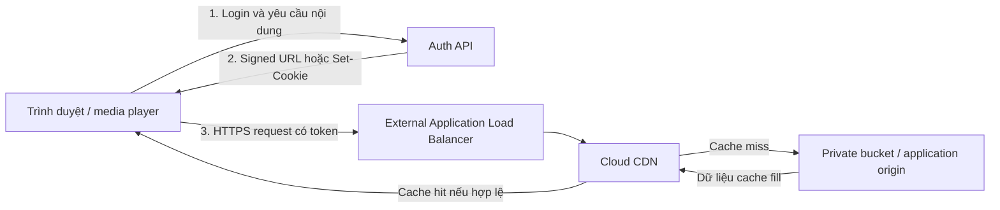
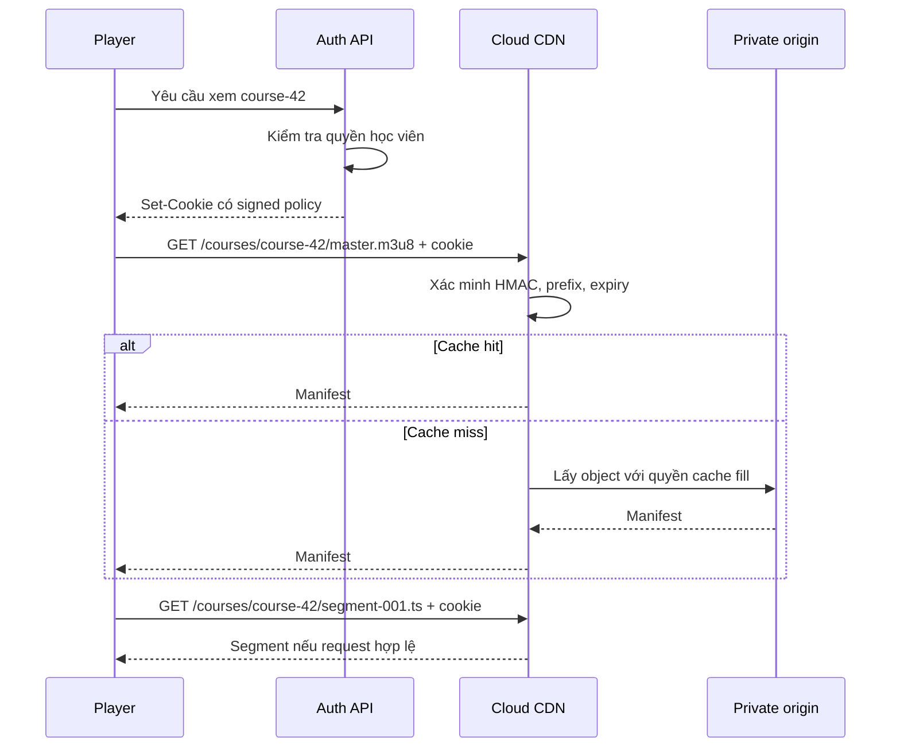

# Signed URLs, signed cookies và bảo vệ nội dung phân phối

Một nền tảng học trực tuyến có video dành riêng cho người đã mua khóa học. Nếu chỉ bảo vệ trang HTML bằng đăng nhập nhưng đặt file HLS, PDF hoặc ảnh gốc trong Cloud Storage public bucket, người xem có thể sao chép URL để chia sẻ nội dung. Nếu chỉ bật Cloud CDN mà không bảo vệ nguồn (origin), các request bỏ qua cơ chế cấp quyền cũng có thể lấy được file. Hệ thống cần **phân quyền nội dung ở ứng dụng, cấp quyền truy cập tạm thời tại lớp phân phối và kiểm soát origin**.

Trong Google Cloud, **Cloud CDN signed URLs** và **signed cookies** cho phép một backend đã xác thực người dùng phát hành quyền truy cập có thời hạn. Cloud CDN kiểm tra chữ ký trước khi phục vụ yêu cầu có thông tin ký hợp lệ. Bài này thuộc chương **Cân bằng tải và phân phối nội dung** của module `CLOUD_PROVIDERS_GCP`, nối kiến thức Cloud Load Balancing, IAM, VPC, Cloud Storage, Cloud Run, Compute Engine/GKE, tự động hóa phát hành, độ tin cậy và chi phí.

> **Nguyên tắc bảo mật:** Signed URL và signed cookie là **bearer credentials**: người nào có chúng đều có thể dùng trong phạm vi và thời hạn đã cấp. Chúng không thay thế đăng nhập, quyền nghiệp vụ, HTTPS, bảo vệ origin hoặc giải pháp thu hồi quyền.

## 1. Kết quả học tập

Sau bài học, bạn có thể:

1. Giải thích đường đi của một request từ trình duyệt qua Application Load Balancer, Cloud CDN đến origin.
2. Phân biệt **Cloud CDN signed URL**, **Cloud CDN signed cookie** và **Cloud Storage V4 signed URL**.
3. Chọn cơ chế thích hợp cho một file riêng lẻ, nhiều file cùng đường dẫn, video HLS/DASH và upload object.
4. Hiểu các trường `Expires`, `KeyName`, `Signature`, `URLPrefix` và cookie attributes như `Domain`, `Path`, `Secure`, `HttpOnly`, `SameSite`.
5. Thiết kế bucket private hoặc ứng dụng origin có xác thực để không lộ nội dung qua đường vòng.
6. Kiểm thử signed/unsigned requests, cache hit/miss, token hết hạn, sai prefix và quy trình xoay vòng khóa.

## 2. Kiến trúc phân phối nội dung được bảo vệ

Cloud CDN thường được bật trên **backend bucket** chứa Cloud Storage hoặc **backend service** của một external Application Load Balancer. Một auth API chạy trên Cloud Run, GKE hoặc hệ thống khác xác minh quyền của người dùng trước khi ký.



Mô hình này có **hai lần quyết định quyền**, với trách nhiệm khác nhau:

- **Auth API** quyết định *ai được xem nội dung gì*, dựa trên tài khoản, đăng ký học, giấy phép, giao dịch, thời gian mua hoặc quy định nghiệp vụ. Chỉ service tin cậy mới giữ signing key.
- **Cloud CDN** kiểm tra *yêu cầu hiện tại có chữ ký đúng, còn hạn và đúng phạm vi hay không*. CDN không tự biết người xem có trả tiền hay đã đăng xuất.
- **Origin** vẫn phải kiểm soát đường truy cập trực tiếp và các request không được CDN xác thực, đồng thời cấp quyền cache fill có giới hạn cho CDN.

Một người xem không nhất thiết phải có tài khoản Google: ứng dụng của bạn chịu trách nhiệm xác thực nghiệp vụ rồi cấp bearer credential có thời hạn. Khi có signed token hợp lệ, CDN có thể trả nội dung từ cache mà không cần gọi Auth API cho từng segment.

## 3. Ba cơ chế ký rất dễ bị nhầm

| Tiêu chí | Cloud CDN signed URL | Cloud CDN signed cookie | Cloud Storage V4 signed URL |
| --- | --- | --- | --- |
| Đích kiểm tra | Cloud CDN ở đúng backend | Cloud CDN ở đúng backend | Cloud Storage |
| Cách gửi | Query parameters trong URL | HTTP cookie tên `Cloud-CDN-Cookie` | Query parameters `X-Goog-*` |
| Phạm vi | URL cụ thể hoặc URLPrefix được ký | URLPrefix của một nhóm URL | Một yêu cầu tới một object, method xác định |
| Thuật toán | HMAC-SHA1 với signing key CDN | HMAC-SHA1 với signing key CDN | V4 canonical request với thuật toán Cloud Storage hỗ trợ |
| Phù hợp | Download PDF, file hoặc ảnh đơn lẻ | HLS/DASH nhiều segment, thư viện file | Upload/download trực tiếp tới Cloud Storage |
| Đánh đổi | Link chứa bearer token dễ bị chia sẻ/log | Browser cookie policy, domain/path/cross-site | Cơ chế riêng của Storage; không đồng nghĩa đã bật signed requests cho CDN |

**Hai loại URL không hoán đổi được.** Cloud CDN ký bằng các trường `Expires`, `KeyName`, `Signature`; Cloud Storage V4 dùng các tham số `X-Goog-*`. Cloud Storage V4 signed URL có giới hạn thời gian tối đa **604.800 giây (7 ngày)**. Một signed URL của Cloud Storage không tự biến thành CDN signed URL hợp lệ, cũng không thay thế quy tắc bảo vệ origin.

Nếu cần cấp quyền upload qua `PUT` vào Cloud Storage, xem Cloud Storage V4 signed URL hoặc luồng upload ứng dụng. Cloud CDN signed URL dùng phổ biến cho phân phối và đọc nội dung qua CDN.

## 4. Cloud CDN thực sự kiểm tra điều gì?

Cloud CDN xác minh signed requests khi backend đã bật Cloud CDN và có signed request key. Các trường hợp quan trọng:

| Viewer gửi gì? | CDN và origin xử lý thế nào? |
| --- | --- |
| Signed URL hợp lệ, còn hạn | CDN có thể trả từ cache hoặc lấy từ origin. |
| Signed cookie hợp lệ, path nằm trong URLPrefix | CDN có thể trả từ cache hoặc lấy từ origin. |
| Chữ ký hỏng, hết hạn, sai prefix | CDN từ chối, thường `403 Forbidden`, kể cả nếu object đã cache. |
| Không có `Signature` và không có `Cloud-CDN-Cookie` | CDN **không tự động chặn**; trên cache miss request có thể được chuyển đến origin. |
| Request unsigned và có cache entry unsigned hợp lệ | CDN có thể trả nội dung unsigned được cache. |
| Signed URL sai nhưng cookie hợp lệ cùng request | CDN ưu tiên xét signed URL vì có `Signature` query parameter; không fallback sang cookie. |

**Đây là điểm bảo mật cốt lõi:** Cloud CDN tách cache entries cho signed và unsigned requests; tuy nhiên nếu origin cho phép request unsigned rồi trả nội dung private, cơ chế ký không bảo vệ tài nguyên như dự kiến. Đối với web origin, phải từ chối unsigned/unauthorized requests; đối với bucket, không cấp public access.

Nếu backend không bật Cloud CDN hoặc một path được URL map đưa sang backend khác, việc cấu hình signing key ở một backend không giúp kiểm tra request ở đường đó. Bảo vệ cần bao phủ mọi đường tới cùng content.

## 5. Cloud CDN signed URL theo một tài nguyên

### 5.1. Định dạng và thời gian hết hạn

Signed URL đơn giản có dạng:

```text
https://media.example.com/files/manual.pdf?Expires=1790000000&KeyName=key-2026-11&Signature=BASE64URL_HMAC
```

| Trường | Vai trò |
| --- | --- |
| URL gốc | Đường truy cập qua CDN; hostname, scheme, path và query gốc ảnh hưởng tới chữ ký full URL. |
| `Expires` | Unix timestamp **tính bằng giây**; phải nằm trong tương lai. |
| `KeyName` | Tên key đã gắn đúng backend bucket hoặc backend service. |
| `Signature` | Kết quả HMAC-SHA1 bằng khóa bí mật raw 16 byte, encode base64url. |

Để ký URL này, hệ thống tính HMAC trên chuỗi **chưa chứa `Signature`**:

```text
https://media.example.com/files/manual.pdf?Expires=1790000000&KeyName=key-2026-11
```

Sau đó mới nối `&Signature=...`. Các trường và thứ tự có ý nghĩa, chữ hoa/thường cũng vậy. Nếu URL ban đầu đã có query, thêm `&Expires=...&KeyName=...`; nếu chưa có, bắt đầu bằng `?Expires=...`. Không tùy tiện đổi thứ tự tham số, re-encode path, thay hostname hoặc chèn `:443` sau khi ký.

Signed URL có thể được dùng bởi **bất kỳ người nào có link** cho đến khi hết hạn hoặc key bị thu hồi. Chọn TTL ngắn tương ứng rủi ro; đừng coi URL “khó đoán” là một biện pháp xác thực.

### 5.2. Ký URLPrefix

Cloud CDN cũng hỗ trợ một signed URL cho cả nhóm URL có chung prefix. Khi đó chữ ký chỉ bao phủ:

```text
URLPrefix=BASE64URL_PREFIX&Expires=1790000000&KeyName=key-2026-11
```

Ví dụ `BASE64URL_PREFIX` là base64url của:

```text
https://media.example.com/courses/course-42/
```

Với dạng này, một bộ ký có thể gắn vào nhiều URL khớp tiền tố mà không phải tính HMAC riêng cho mỗi path. Tuy nhiên các query parameters nghiệp vụ khác có thể nằm ngoài phần được ký, vì vậy phải xem ứng dụng/origin và cache key có phân biệt đúng các biến thể dữ liệu hay không.

**Lỗi prefix phổ biến:** prefix `https://media.example.com/videos` khớp cả `/videos-private` do so khớp theo chuỗi. Nếu muốn phạm vi thư mục `/videos/` thì **kết thúc prefix bằng dấu `/`**. Nên đặt prefix ở mức course/tenant/asset hẹp thay vì toàn bộ `/`.

### 5.3. Tạo signed URL qua gcloud

Nếu một signing key đã được cấu hình, lệnh sau tạo URL để thử mà không đổi hạ tầng:

```bash
gcloud compute sign-url \
  "https://media.example.com/files/manual.pdf" \
  --key-name=key-2026-11 \
  --key-file=./cdn-key.b64 \
  --expires-in=15m
```

Lệnh dùng file chứa giá trị key đã base64url encode và in signed URL có thể dùng với `GET`/`HEAD`. Không lưu output hoặc file khóa vào logs, Git, issue công khai hay shell history. Khi phát hành hàng loạt trong ứng dụng, nên ký trực tiếp ở backend tin cậy thay vì chạy CLI cho mỗi viewer.

## 6. Signed cookies cho nhiều URL và trình phát video

Một video HLS có `master.m3u8`, nhiều `variant.m3u8` và hàng trăm file `.ts`/`.m4s`. Ký riêng từng segment gây phức tạp khi phát, đổi rendition và quản lý cache. **Signed cookie** cho phép CDN xác minh cùng một policy cho nhiều đường dẫn khớp prefix.

Cookie HTTP có tên bắt buộc là **`Cloud-CDN-Cookie`** và giá trị gồm đúng bốn trường, phân cách bởi dấu **hai chấm**:

```text
URLPrefix=BASE64URL_PREFIX:Expires=1790000000:KeyName=key-2026-11:Signature=BASE64URL_HMAC
```

Để ký, tính HMAC-SHA1 trên đúng chuỗi **chưa có Signature**:

```text
URLPrefix=BASE64URL_PREFIX:Expires=1790000000:KeyName=key-2026-11
```

Cloud CDN kiểm tra `URLPrefix` là base64url của URL đầy đủ có scheme/hostname/path. Prefix nên kết thúc bằng `/` ở ranh giới thư mục. Một signed cookie cho `https://media.example.com/courses/course-42/` không cho phép tải `https://media.example.com/courses/course-43/`.

Ví dụ header (các chữ in hoa là placeholders):

```http
Set-Cookie: Cloud-CDN-Cookie=URLPrefix=BASE64URL_PREFIX:Expires=1790000000:KeyName=key-2026-11:Signature=BASE64URL_HMAC; Domain=media.example.com; Path=/courses/course-42/; Max-Age=900; Secure; HttpOnly; SameSite=Lax
```

| Thành phần | Ai sử dụng | Điều cần lưu ý |
| --- | --- | --- |
| `Expires` **bên trong cookie value** | Cloud CDN | Đến hạn thì CDN từ chối quyền, kể cả browser còn cookie. |
| `Max-Age` hoặc `Expires` **ngoài cookie value** | Trình duyệt | Quy định thời gian trình duyệt lưu/gửi cookie; khác thời hạn token. |
| `Domain` | Trình duyệt | Đúng hostname nội dung. Server phát cookie phải được phép thiết lập Domain theo quy tắc cookie. |
| `Path` | Trình duyệt | Hẹp theo course/asset nếu khả thi. |
| `Secure` | Trình duyệt | Chỉ gửi cookie qua HTTPS. |
| `HttpOnly` | Trình duyệt | JavaScript không thể đọc cookie bằng `document.cookie`; không chặn mọi rủi ro XSS/CSRF. |
| `SameSite` | Trình duyệt | Chọn `Lax`/`Strict` hoặc `None; Secure` tùy bối cảnh cross-site và chính sách browser. |

Nếu Auth API nằm ở `auth.example.com` còn media ở `media.example.com`, phải thiết kế cách phát cookie **hợp lệ về domain**, có thể qua endpoint ở host media hoặc parent domain khi phù hợp. Một subdomain không thể tự ý đặt cookie chỉ cho subdomain ngang hàng; cookie cũng không tự đi theo file từ hostname này sang hostname khác.

Signed cookie được gửi tự động theo cookie policy của browser; muốn dùng với HLS/DASH xuyên domain, kiểm tra player, CORS, credentials và hành vi third-party cookie thực tế. Một cookie chỉ cấp quyền theo URLPrefix đã ký, bất kể `Path` browser có rộng hơn.

## 7. Tự viết bộ ký để hiểu HMAC-SHA1

Đoạn Python dưới đây minh họa tạo **Cloud CDN signed URL** và **signed cookie value** từ một khóa bí mật raw 16 byte đã lưu trong biến môi trường dưới dạng base64url. Đoạn mã không thay đổi tài nguyên GCP.

```python
import base64
import hashlib
import hmac
import os
import time


def b64url(data: bytes) -> str:
    return base64.urlsafe_b64encode(data).decode("ascii")


def get_key(encoded: str) -> bytes:
    padded = encoded + "=" * (-len(encoded) % 4)
    key = base64.urlsafe_b64decode(padded)
    if len(key) != 16:
        raise ValueError("Cloud CDN signing key must be 16 bytes")
    return key


def signature(key: bytes, message: str) -> str:
    digest = hmac.new(key, message.encode("utf-8"), hashlib.sha1).digest()
    return b64url(digest)


key = get_key(os.environ["CDN_SIGNING_KEY_B64URL"])
name = os.environ["CDN_SIGNING_KEY_NAME"]
expiry = int(time.time()) + 15 * 60

# A: ký chính xác một file; URL ví dụ chưa có query parameters.
url = "https://media.example.com/files/manual.pdf"
to_sign = f"{url}?Expires={expiry}&KeyName={name}"
signed_url = f"{to_sign}&Signature={signature(key, to_sign)}"

# B: ký một policy cho toàn bộ các segments của một course.
prefix = "https://media.example.com/courses/course-42/"
encoded_prefix = b64url(prefix.encode("utf-8"))
policy = f"URLPrefix={encoded_prefix}:Expires={expiry}:KeyName={name}"
cookie_value = f"{policy}:Signature={signature(key, policy)}"

# Trong production, trả signed_url/Set-Cookie qua HTTPS,
# không log khóa, URL có chữ ký hoặc cookie_value.
```

Chú ý dấu `&` ở signed URL nhưng dấu `:` ở signed cookie policy. HMAC phải dùng **raw key bytes**, không dùng trực tiếp text base64url làm secret. Đừng thay thuật toán bằng SHA-256 theo suy đoán: Cloud CDN signed requests hiện sử dụng **HMAC-SHA1**, trong khi Cloud Storage V4 dùng quy tắc ký khác.

Đối với URL có query, mã thực tế phải chuẩn hóa chính xác cách nối, encode và thứ tự tham số như tài liệu Cloud CDN. Kiểm thử chữ ký bằng CLI trước khi phát hành trong ứng dụng production.

## 8. Quản lý signing keys tại Cloud CDN

Cloud CDN có **signed request keys** nằm trên backend bucket hoặc backend service. Tên lệnh `add-signed-url-key` không giới hạn khóa vào URLs: cùng loại key có thể kiểm tra **signed URLs và signed cookies**. Một key gồm tên và bí mật chia sẻ (16 raw bytes), không phải service account JSON key.

### 8.1. Tạo khóa ngẫu nhiên và lưu an toàn

Ví dụ trong sandbox Linux:

```bash
# LỆNH CÓ TẠO TỆP BÍ MẬT; chỉ chạy ở môi trường được phép.
umask 077
openssl rand 16 | openssl base64 -A | tr '+/' '-_' > cdn-key.b64
```

File trên chứa giá trị base64url của 16 bytes ngẫu nhiên, cần giữ quyền đọc tối thiểu. Không commit lên Git, đính vào issue, log CI, gửi qua chat hoặc đưa vào image/container public. Trong production, cân nhắc **Secret Manager** để signer đọc khóa có kiểm soát; cần có người sở hữu khóa và quy trình rotation.

### 8.2. Gắn key vào backend phù hợp

Ví dụ sau **làm thay đổi cấu hình** GCP, chỉ thực hiện khi đã chuẩn bị backend và được cấp quyền:

```bash
# Nếu origin là Cloud Storage backend bucket:
gcloud compute backend-buckets add-signed-url-key CDN_BACKEND_BUCKET \
  --project=PROJECT_ID \
  --key-name=key-2026-11 \
  --key-file=./cdn-key.b64

# Nếu origin là backend service (ví dụ NEG/MIG):
gcloud compute backend-services add-signed-url-key CDN_BACKEND_SERVICE \
  --project=PROJECT_ID \
  --key-name=key-2026-11 \
  --key-file=./cdn-key.b64
```

Signing keys được cấu hình ở **backend bucket/service**, không trực tiếp tại URL map. Cloud CDN phải bật trên backend để kiểm tra signatures; thêm key mà chưa bật CDN không tạo ra biện pháp hạn chế quyền như mong muốn. Nếu URL map đưa `/files/` và `/videos/` tới hai backends khác nhau, mỗi backend phải có cấu hình keys đúng.

Đọc tên keys/config mà không lấy được giá trị bí mật:

```bash
gcloud compute backend-buckets describe CDN_BACKEND_BUCKET \
  --project=PROJECT_ID

gcloud compute backend-services describe CDN_BACKEND_SERVICE \
  --project=PROJECT_ID --global
```

Giá trị key bí mật không được Google Cloud trả về trong API describe. Cloud CDN có giới hạn **tối đa ba signed request keys cho mỗi backend** theo tài liệu hiện hành; phải dành chỗ cho key mới khi rotation.

## 9. Bảo vệ origin để không bị truy cập vòng

### 9.1. Hai loại request mà origin phải tính đến

Một request có signature hợp lệ và cache miss được chuyển tới origin theo đường cache fill. Một request **không có signature** cũng có thể được CDN chuyển tới origin. Nếu web origin trả nội dung private với HTTP `200` cho cả hai request, bất cứ ai đều có thể truy cập nội dung từ đường unsigned.

Vì vậy:

- **Origin phải từ chối truy cập không hợp lệ**, bao gồm request unsigned nếu nội dung được bảo vệ.
- Đường truy cập trực tiếp tới origin (ngoài Cloud CDN/load balancer) không được công khai cùng file.
- Hành vi cache của response lỗi phải phù hợp; không trả nội dung nhạy cảm kèm header khiến unsigned response được cache như public.
- Phải kiểm tra cả **cache hit** và **cache miss**; một lần request signed thành công không chứng minh bucket đã private.

| Origin | Biện pháp bắt buộc | Sai lầm |
| --- | --- | --- |
| **Cloud Storage backend bucket** | Không public, cấp quyền đọc thích hợp cho Cloud CDN cache-fill service account | Đặt `allUsers` có quyền xem object rồi chỉ trông chờ CDN signature. |
| **Backend service trên GKE/Compute Engine/Cloud Run** | Xác thực request phù hợp tại origin, từ chối unsigned; hạn chế đường truy cập trực tiếp | Ứng dụng chấp nhận mọi request sau khi thấy IP load balancer. |
| **External origin** | Dùng origin authentication khi được sản phẩm/load balancer hỗ trợ, cùng cơ chế kiểm tra của origin | Host gốc public và trả nội dung dù không có credential. |

Với backend service, Cloud CDN có thể bỏ signed URL query parameters trước khi chuyển request về origin trên cache miss; tài liệu đề cập header `x-client-request-url` chứa URL viewer gốc trong trường hợp có URL signing. **Không tin một header có thể bị client tự gửi qua đường bypass** nếu chưa bảo vệ, xác thực và giới hạn đường tới origin. Với cookie, cookie được chuyển tiếp theo hành vi của CDN; origin cần biết cách kiểm tra ở tầng ứng dụng.

### 9.2. Private bucket cần cấp quyền cho cache fill

Nếu origin là Cloud Storage private bucket, Cloud CDN cần quyền lấy object. Sau khi thêm ít nhất **một signing key** vào backend bucket trong project, Cloud CDN tạo principal dành cho cache fill:

```text
service-PROJECT_NUMBER@cloud-cdn-fill.iam.gserviceaccount.com
```

Người quản trị bucket có thể cấp quyền đọc:

```bash
# CÓ SỬA IAM - yêu cầu duyệt quyền và bucket cụ thể.
gcloud storage buckets add-iam-policy-binding gs://PRIVATE_BUCKET \
  --member="serviceAccount:service-PROJECT_NUMBER@cloud-cdn-fill.iam.gserviceaccount.com" \
  --role="roles/storage.objectViewer"
```

Service account này thuộc Cloud CDN, không nhất thiết có trong danh sách service accounts của project. Thứ tự rất quan trọng: **thêm key trước để tạo cache-fill service account, rồi cấp quyền bucket**. Khi bật Domain Restricted Sharing/Organization Policy, quyền IAM của principal này có thể cần cơ chế ngoại lệ đã được tổ chức phê duyệt.

Không mở bucket public để “sửa tạm” lỗi `403` của cache fill. Hãy xác định đúng project number, backend bucket, principal và IAM binding, sau đó kiểm thử: request hợp lệ qua CDN thành công, còn request trực tiếp Cloud Storage không mang quyền phù hợp phải bị từ chối.

## 10. Phân biệt TTL chữ ký, cookie và cache

Một media segment có thể nằm trong cache một giờ, trong khi signed cookie chỉ có hiệu lực 15 phút. Nếu người dùng truy cập sau 20 phút, CDN phải kiểm tra signature/hạn và từ chối ngay cả khi object vẫn được cache. **Cache hit không bỏ qua kiểm tra signature**.

| Thời hạn | Ai sử dụng | Ý nghĩa |
| --- | --- | --- |
| `Expires` trong signed URL/cookie policy | Cloud CDN | Giới hạn quyền của request. |
| `Max-Age`/`Expires` của cookie HTTP | Browser | Giới hạn browser lưu và gửi cookie. |
| `signed-url-cache-max-age` | Cloud CDN cache | Thời gian tối đa cache signed response trước khi revalidation/cache fill. |
| `Cache-Control`/object versioning | Browser/origin/CDN theo chính sách liên quan | Tính mới của content và những biến thể được phép cache. |

Với signed requests, `signed-url-cache-max-age` mặc định **một giờ** và có thể chỉnh theo nhu cầu:

```bash
# CÓ SỬA CẤU HÌNH - ví dụ cache tối đa 15 phút.
gcloud compute backend-buckets update CDN_BACKEND_BUCKET \
  --project=PROJECT_ID \
  --signed-url-cache-max-age=15m
```

CDN có thể cache signed response bất kể `Cache-Control` của backend theo quy định signed request caching; không nên giả định header của ứng dụng luôn có thể ngăn cache signed content. Trước khi dùng signed access cho response theo người dùng, hãy kiểm tra **cache key**, URL path, query parameters và sự khác nhau giữa các response.

### 10.1. Quy tắc cache riêng cho nội dung theo người dùng

Giả sử GET `/statement.pdf` trả hóa đơn khác nhau theo cookie session. Nếu nhiều người cùng dùng một URL/path mà CDN dùng chung cache entry sau khi xác thực signed token, người dùng có thể nhận **nội dung của người khác**. Tránh cache kiểu response này dưới một đường dùng chung; tạo object key riêng và scope hẹp theo tài khoản hoặc phục vụ qua backend không cache khi thích hợp.

Với HLS, các segments bất biến có thể cache hiệu quả. Nhưng nếu manifest chứa signed URLs riêng theo học viên, không được cache chung manifest ấy dưới cùng cache key. Signed cookies thường giúp giữ URLs của segment ổn định mà không đưa token vào từng file.

### 10.2. Vì sao dấu query và URLPrefix ảnh hưởng tới cache?

Signed URL đầy đủ phụ thuộc cả query gốc khi ký. URLPrefix signing không ký các query nghiệp vụ bổ sung; nếu query này làm thay đổi nội dung trả về, cần cấu hình cache key đúng để không trộn các biến thể. Trong khi đó, các signatures khác nhau của cùng base URL có thể dùng chung signed cache entry theo cơ chế Cloud CDN. Đừng kỳ vọng mỗi chữ ký tạo ra một bản cache cô lập theo người dùng.

## 11. Xoay vòng khóa, hết hạn và thu hồi quyền

Một bearer token đã phát hành không thể tự thu hồi ở mức **một người dùng** chỉ bằng cách xóa session đăng nhập. Có thể:

1. **Ký với TTL ngắn:** thời hạn 5–15 phút cho nội dung nhạy cảm là một chính sách ví dụ, cần đối chiếu hành vi media player, độ dài video, độ trễ refresh và rủi ro chia sẻ.
2. **Gia hạn từ Auth API:** chỉ phát token mới sau khi kiểm tra quyền học viên vẫn còn hiệu lực.
3. **Rotation bình thường:** thêm key mới lên backend, chuyển signer sang key mới, đợi thời hạn token cũ hết và một khoảng đệm vận hành, sau đó xóa key cũ.
4. **Revoke khẩn cấp:** khi key bị lộ, xóa key trên backend để vô hiệu hóa mọi signed requests dùng key đó; các học viên hợp pháp cùng dùng key cũng bị ảnh hưởng.
5. **Thu hẹp phạm vi:** tách nội dung nhạy cảm theo backend/prefix hoặc thiết kế origin access control để giới hạn hậu quả lộ một key.

Minh họa rotation:

```text
Giai đoạn 1: backend có key-old (đang phát) và key-new (đã đăng ký)
Giai đoạn 2: signer phát tất cả URLs/cookies mới với key-new
Giai đoạn 3: đo tỉ lệ 403, xác nhận token cuối cùng dùng key-old đã hết hạn
Giai đoạn 4: xóa key-old; ghi nhận audit/change ID
```

Chỉ người/automation được phân quyền mới có thể thêm/xóa signing keys. Không đưa key vào file cấu hình công khai; dùng secret store và IAM tối thiểu. Một signing key không phải service account key và không có cơ chế “thu hồi mỗi người” riêng.

## 12. Case study: video khóa học trả phí và tài liệu

Giả sử hệ thống có:

- `learn.example.com`: website và Auth API (Cloud Run) xử lý đăng nhập, mua khóa học, quyền học viên.
- `media.example.com`: tên miền HTTPS qua load balancer + Cloud CDN.
- Cloud Storage private bucket chứa `/courses/course-42/master.m3u8`, segments, phụ đề và một số PDF.
- Cloud CDN backend bucket có signing key, bucket chỉ cho cache-fill service account đọc object.

### 12.1. Chọn signed access theo tài nguyên

| Nội dung | Lựa chọn | Giải thích |
| --- | --- | --- |
| Một file PDF hướng dẫn tải về | CDN signed URL theo đúng file, hạn ngắn | Client dùng URL trực tiếp; dễ cấp quyền một lần. |
| Bộ HLS manifest và hàng trăm segments cùng course | CDN signed cookie theo prefix `/courses/course-42/` | Không phải ký từng segment và sửa mọi manifest. |
| Banner, logo, thông tin public | CDN cache thông thường | Không cần ký nội dung công khai. |
| File bài làm chỉ quản trị viên xem | Backend kiểm tra IAM/session cụ thể hoặc mô hình phân phối riêng | Bearer signed URL có thể chưa đáp ứng mức kiểm soát theo từng người. |
| Browser upload nội dung | Cloud Storage V4 signed URL hoặc upload API riêng | Quyền write vào object khác quyền GET qua CDN. |

### 12.2. Trình tự phát video



Auth API phải kiểm tra **quyền truy cập chính xác course-42**. Nếu một học viên chỉ mua course-42 mà ứng dụng ký prefix `/courses/`, họ có thể truy cập các khóa học khác. Khi player xem lâu hơn TTL, ứng dụng cần quy trình refresh cookie và xử lý `403` có thể xảy ra giữa các segments.

### 12.3. Bảo vệ nhiều lớp

- **TLS:** mọi đường viewer và cấp token đi qua HTTPS; cookie có `Secure` và `HttpOnly`.
- **Bucket/IAM:** không dùng public `allUsers` cho nội dung trả phí; cấp `roles/storage.objectViewer` cho cache-fill principal với phạm vi bucket đúng.
- **Backend signer:** giữ key trong Secret Manager; chỉ phát URL/cookie sau quyền nghiệp vụ, không ghi token trong logs.
- **Cache:** segments tĩnh có thể chia sẻ cache an toàn; manifest hoặc response chứa dữ liệu riêng từng học viên phải tách cache key hoặc không cache.
- **Observability:** theo dõi playback errors, CDN hit ratio, token refresh failures, origin latency và billing.
- **Bảo vệ chống sao chép:** signed requests không ngăn người có quyền lưu file/screen recording; cân nhắc watermark hoặc DRM khi có yêu cầu rõ ràng.

## 13. Ma trận kiểm thử quyền và cache

| Phép thử | Input | Kết quả kỳ vọng |
| --- | --- | --- |
| Valid signed URL | URL đúng key/host/path, chưa hết hạn | Nội dung được trả, cache hit hoặc miss đều hợp lệ. |
| Valid signed cookie | Cookie đúng prefix và hostname | Nội dung trong phạm vi được trả. |
| Chữ ký bị sửa | Đổi một byte `Signature` | CDN trả `403`. |
| `Expires` quá hạn | Token cũ, cache vẫn có object | CDN trả `403`, không phục vụ chỉ vì cache hit. |
| Sai URLPrefix | Cookie `/course-42/` dùng cho `/course-43/` | CDN từ chối. |
| Thiếu chữ ký | Không token trong request | Origin phải từ chối private content; CDN không mặc định chặn unsigned miss. |
| Bypass CDN | Gọi trực tiếp bucket/backend không credential | Không truy cập được nội dung private. |
| Cookie hợp lệ, URL query có `Signature` sai | Signed URL malformed | CDN kiểm tra URL trước, không dùng cookie làm fallback. |
| Cache miss với private bucket | Token đúng nhưng CDN cần lấy object | Cache-fill principal có quyền đọc, không bị `403` ở origin. |
| Key bị thu hồi | Token ký bằng key đã xóa | Bị từ chối; theo dõi ảnh hưởng khách hàng. |

Các lệnh HTTP thử nghiệm (chỉ dùng với nội dung/URL do bạn được phép kiểm tra):

```bash
# Nội dung private không có signature phải bị từ chối.
curl --silent --show-error --output /dev/null \
  --write-out 'unsigned_http=%{http_code}\n' \
  "https://media.example.com/files/manual.pdf"

# Dùng signed URL do ứng dụng phát hành trong môi trường test.
# Đừng paste token thật vào logs/ticket hoặc shell history được chia sẻ.
curl --silent --show-error --output /dev/null \
  --write-out 'signed_http=%{http_code}\n' \
  "SIGNED_CDN_URL"

# Dùng signed cookie đã phát hành, không phải signing key.
curl --silent --show-error --output /dev/null \
  --write-out 'cookie_http=%{http_code}\n' \
  --cookie "Cloud-CDN-Cookie=SIGNED_COOKIE_POLICY" \
  "https://media.example.com/courses/course-42/master.m3u8"
```

Không dùng `curl -k` để bỏ qua xác minh chứng chỉ. Ghi HTTP status, cache status, timestamp và request ID nếu có; redaction đối với query signature hoặc HTTP cookie trong hệ thống logs.

### 13.1. Bảng chẩn đoán

| Hiện tượng | Giả thuyết | Cách kiểm tra |
| --- | --- | --- |
| `403` với token chưa hết hạn | Sai key name, URL/port/query order, clock, prefix hoặc chữ ký | Đối chiếu chuỗi ký exact bytes, key đúng backend, Unix time và scheme/hostname. |
| `403` chỉ trên cache miss | Origin không cho Cloud CDN cache fill | Kiểm tra cache-fill account và bucket IAM; không mở public để sửa. |
| File mở được khi bỏ chữ ký | Origin public, backend route khác, unsigned content được phép cache | Kiểm tra URL map/backend và origin direct path, sửa quyền. |
| Cookie không gửi tới `media.example.com` | Domain, Path, Secure, SameSite hoặc trình duyệt ngăn cookie | Xem browser DevTools Set-Cookie/Network và domain manifest/segments. |
| Video đang xem bị dừng | Token hết hạn, refresh lỗi, clock skew | Theo dõi lỗi `403` và thời điểm refresh trước hạn. |
| Người B thấy nội dung người A | Response cá nhân chung cache key | Tách object key, chỉnh cache strategy và rà soát dữ liệu riêng. |
| Signed URL lỗi nhưng signed cookie đúng | CDN ưu tiên signed URL query | Bỏ query sai; dùng đúng một cơ chế đối với request. |
| Cache hit ratio thấp | URLs biến thiên, TTL, query/key hoặc nội dung khó cache | Phân tích cache logs, variant URLs, object versions và traffic pattern. |

## 14. Kết hợp với Cloud Armor, IAM và giám sát

| Thành phần | Vai trò | Những gì vẫn cần ở tầng ứng dụng |
| --- | --- | --- |
| HTTPS Load Balancer / TLS | Mã hóa và định tuyến request | Đảm bảo URL ký và hostname/certificate chính xác. |
| Cloud CDN | Cache và xác minh signed requests | Auth API quyết định ai được nhận signed token. |
| Cloud Armor | WAF/rate limiting/kiểm soát lạm dụng theo khả năng hỗ trợ | Không dùng Cloud Armor thay thế quyền mua course. |
| IAM / Organization Policy | Quản lý quyền sửa CDN/bucket/backend/secrets | Không cấp signing key cho viewer; giữ phân quyền nội dung ở ứng dụng. |
| Secret Manager | Bảo vệ signing keys | Rotation, audit secret access, cập nhật backend keys theo quy trình. |
| Origin protection | Chặn request không được phép và đường bypass | Thử cả CDN và direct origin. |
| Monitoring/Logging/Billing | Đo lỗi, hit ratio, latency, egress và chi phí | Không lưu raw signatures/cookies; diễn giải `403` theo ngữ cảnh. |

Một chính sách bảo mật tốt ghi rõ: ai quản lý signing keys, ai phát hành token, token có scope nào, thời hạn tối đa, thủ tục revoke, cách test origin và cơ chế khôi phục khi hệ thống ký không hoạt động.

## 15. Chi phí và độ tin cậy

Signed requests không bị áp mức giá ký riêng, nhưng request bị từ chối vẫn có thể phát sinh **cache lookup charges**. Tổng chi phí nội dung gồm load balancing, egress, CDN, origin cache fill, storage, log ingestion và dịch vụ bảo mật. Nếu cache hit ratio thấp, origin có thể bị tăng tải hoặc tăng chi phí dù phần lớn người xem hợp lệ.

| Quyết định | Lợi ích | Rủi ro/điều cần đo |
| --- | --- | --- |
| Token ngắn | Giảm thời gian bị lợi dụng khi lộ | Tần suất refresh, tỷ lệ lỗi playback, tải Auth API. |
| Token dài | Ít lần gia hạn | Thời gian link/cookie có thể bị chia sẻ trái phép. |
| Cookie prefix rộng | Dễ cho phép nhiều segments | Quá quyền nếu prefix khớp nhiều courses/tenants. |
| Cache TTL dài | Giảm cache fill và latency | Nội dung thay đổi chậm, phải quản lý versioning, cache key và invalidation. |
| Cache TTL ngắn | Dễ cập nhật nội dung | Chi phí và latency origin tăng. |
| Khóa riêng theo nhóm backend | Hạn chế phạm vi sự cố lộ key | Tăng vận hành và quản lý quota/rotation. |

Khi auth API gặp lỗi, người xem đã có token hợp lệ có thể xem đến thời hạn, nhưng người dùng mới hoặc player cần refresh sẽ bị ảnh hưởng. Theo dõi SLO của cả Auth API, CDN, origin và bộ phát video; đo riêng lỗi token hết hạn với lỗi mạng và lỗi backend.

## 16. Bài tập thực hành

### Bài A — Chọn cơ chế đúng

Doanh nghiệp có PDF tài liệu riêng cho từng học viên, video HLS nhiều segments, ảnh banner public và chức năng upload bài tập vào Cloud Storage. Chọn **CDN signed URL**, **CDN signed cookie**, **Cloud Storage V4 signed URL** hoặc public caching cho mỗi tình huống. Nêu nơi kiểm tra chữ ký, phương thức HTTP, thời hạn và cách bảo vệ origin.

### Bài B — Điều tra lỗ hổng unsigned request

Trang web phát signed URL cho `private.pdf`, nhưng bỏ ba query parameters `Expires/KeyName/Signature` vẫn tải được file. Lập giả thuyết bucket public, web origin trả `200`, route sang backend khác hoặc nội dung unsigned được cache. Hãy viết quy trình kiểm tra và sửa lỗi mà không phá các object public hợp lệ.

### Bài C — URLPrefix nguy hiểm

Signer cấp cookie cho prefix `https://media.example.com/courses/42`. Vì sao `/courses/420/` có thể bị khớp? Đưa ra prefix đúng và ba URL kiểm tra (được phép, không được phép, biến thể query) để chứng minh.

### Bài D — Chữ ký sai sau khi thay đổi URL

Signer ký `https://media.example.com/files/doc.pdf?version=2` nhưng browser đổi thành `version=3`; một proxy tự thêm `:443` vào hostname. Giải thích những byte của full URL signature thay đổi và vì sao bị `403`. So sánh với URLPrefix signing (không ký query nghiệp vụ bổ sung).

### Bài E — Rotation không gián đoạn

Backend có một key đang dùng; signed cookie có TTL tối đa 30 phút. Lập kế hoạch thêm key mới, phát bằng key mới, quan sát `403`, chờ key cũ hết hạn rồi xóa. Nếu key bị lộ và phải xóa ngay, người học và vận hành chịu ảnh hưởng nào?

### Bài F — Ba loại thời hạn

Một segment có cache TTL còn 20 phút, signed cookie hết hạn 5 phút trước, browser vẫn giữ cookie thêm 30 phút. CDN có trả video không? Nếu request không gửi cookie, phần nào của hệ thống quyết định kết quả? Phân biệt `Expires` trong policy, `Max-Age` của cookie và `signed-url-cache-max-age`.

### Câu hỏi tự kiểm tra

1. Vì sao signed URL là bearer credential, không phải phiên đăng nhập?
2. CDN kiểm tra điều gì khi request có `Signature`?
3. Vì sao origin vẫn phải chặn request unsigned?
4. Signed cookie dùng tên nào và các trường được ký theo thứ tự nào?
5. Cloud CDN signed URL khác Cloud Storage V4 signed URL như thế nào?
6. Vì sao prefix nên kết thúc bằng dấu `/`?
7. Khi cache hit, CDN có bỏ qua `Expires` không?
8. Vì sao không log query signatures hoặc signed cookie?
9. Khi nào video player cần refresh cookie?
10. Thu hồi khẩn cấp signing key có tác động gì tới người xem hợp pháp?

**Quy trình ghi nhớ:** kiểm tra quyền nghiệp vụ → chọn một URL hay nhóm URL → ký bằng key được bảo vệ → cấu hình đúng Cloud CDN backend → bảo vệ origin → phát HTTPS token với thời hạn/prefix hẹp → thử hợp lệ/sai/hết hạn/bypass/cache → giám sát, xoay khóa và theo dõi chi phí.

## 17. Tài liệu tham khảo chính thức

- [Cloud CDN content access control](https://cloud.google.com/cdn/docs/authenticate-content)
- [Use signed URLs](https://cloud.google.com/cdn/docs/using-signed-urls)
- [Use signed cookies](https://cloud.google.com/cdn/docs/using-signed-cookies)
- [Cloud CDN overview](https://cloud.google.com/cdn/docs/overview)
- [Cloud CDN caching](https://cloud.google.com/cdn/docs/caching)
- [Cloud CDN with backend bucket](https://cloud.google.com/cdn/docs/setting-up-cdn-with-bucket)
- [Cloud Storage signed URLs](https://cloud.google.com/storage/docs/access-control/signed-urls)
- [Cloud Storage V4 signing](https://cloud.google.com/storage/docs/access-control/signing-urls-manually)
- [Cloud Armor overview](https://cloud.google.com/armor/docs/cloud-armor-overview)
- [Cloud CDN pricing](https://cloud.google.com/cdn/pricing)

Giới hạn keys, cache settings, tính năng của loại backend và quyền truy cập Cloud Storage có thể thay đổi theo sản phẩm. Trước khi triển khai production, đối chiếu tài liệu của **đúng load balancer, backend type, cơ chế ký và origin policy** cùng các yêu cầu quản trị của tổ chức.
