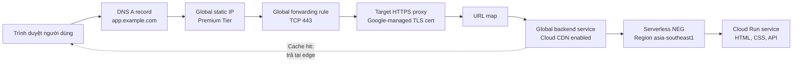
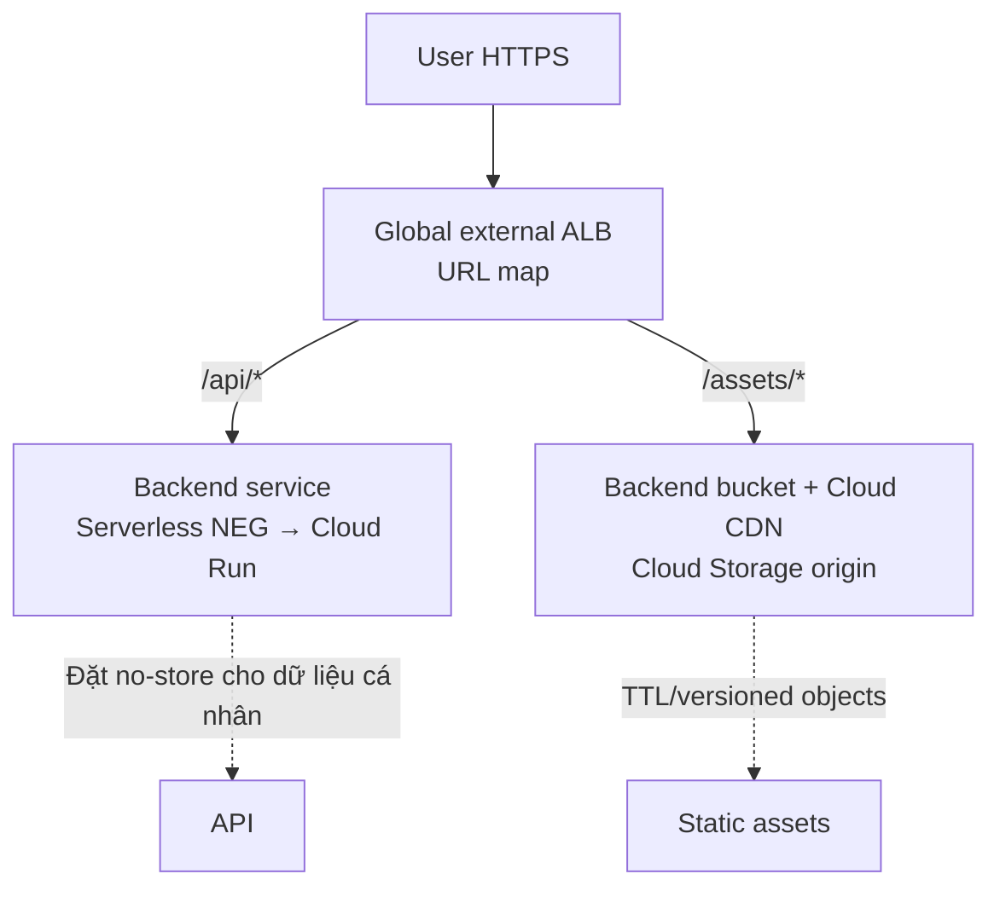

# Thực hành công bố ứng dụng HTTPS có CDN

Một ứng dụng web mới chạy tốt qua URL mặc định của Cloud Run chưa có nghĩa nó đã sẵn sàng công bố cho người dùng. Để đưa ứng dụng lên tên miền riêng, bạn cần chuẩn bị **điểm truy cập HTTPS**, **chứng chỉ TLS**, **DNS**, **định tuyến tới backend**, và nếu phục vụ ảnh, CSS, JavaScript cho nhiều người dùng, cần cân nhắc **Cloud CDN** để giảm độ trễ và số lần gọi về nguồn (*origin*).

Bài học thuộc chương **Cân bằng tải và phân phối nội dung** của mô-đun `CLOUD_PROVIDERS_GCP`. Trong phạm vi rộng từ tổ chức project, IAM và VPC tới Compute Engine, GKE, Cloud Run, lưu trữ, cơ sở dữ liệu, tự động hóa phát hành và giám sát chi phí/độ tin cậy, bài thực hành này tập trung vào một luồng hoàn chỉnh: **ứng dụng Cloud Run → serverless NEG → global external Application Load Balancer → HTTPS với chứng chỉ được quản lý → Cloud CDN**. Người học sẽ biết công bố dịch vụ, bảo vệ nội dung không được phép cache và xác minh từng lớp bằng công cụ thật.

## 1. Mục tiêu và sản phẩm cần hoàn thành

Sau bài học, bạn có thể:

1. Phân biệt nhiệm vụ của **Cloud Run**, **serverless Network Endpoint Group (NEG)**, **backend service**, **URL map**, **target HTTPS proxy**, **forwarding rule**, **chứng chỉ TLS** và **Cloud DNS**.
2. Thiết kế một **global external Application Load Balancer** với `EXTERNAL_MANAGED` để công bố ứng dụng tại tên miền riêng.
3. Kích hoạt **Cloud CDN** trên backend Cloud Run và chỉ cho phép cache những phản hồi công khai được chỉ định.
4. Hiểu sự khác biệt giữa **TLS termination**, HTTP routing, CDN edge caching và quyền IAM/runtime identity.
5. Triển khai một ứng dụng lab nhỏ phục vụ HTML, CSS tĩnh và endpoint API động; cấu hình `Cache-Control` khác nhau.
6. Dùng `gcloud` và `curl` để kiểm tra cấu hình, DNS, trạng thái chứng chỉ, cache hit/miss, HTTP status và đường truy cập ứng dụng.
7. Khóa đường truy cập trực tiếp qua URL mặc định `run.app` sau khi load balancer đã hoạt động, nếu phù hợp thiết kế.
8. Phân tích giới hạn an toàn của cache, log, budget và cách dọn tài nguyên sau lab.

**Kết quả cuối mong đợi:** truy cập `https://app.example.com` với tên miền thực mà bạn sở hữu sẽ hiển thị trang lab. Đường dẫn `/assets/app.css` được cache theo header từ origin, còn `/api/time` và nội dung HTML mang `private, no-store` không được lưu vào Cloud CDN. Chứng chỉ báo `ACTIVE`, đường HTTPS hoạt động, và log/CDN status có thể giải thích kết quả.

Các tên `YOUR_PROJECT_ID`, `app.example.com` và tên tài nguyên trong ví dụ là **placeholder**. Chỉ thực hiện các lệnh ghi trong một **project lab được cấp phép**, với **tên miền thật** mà bạn có quyền sửa bản ghi DNS. Lab sử dụng tài nguyên có thể phát sinh chi phí; bài học là hướng dẫn, không thực thi thay đổi trên project của người học.

## 2. Kiến trúc HTTPS và CDN trong Google Cloud



Điểm dễ nhầm trong sơ đồ là **CDN không phải một container hoặc máy chủ riêng mà bạn triển khai**. Khi backend service của external Application Load Balancer bật Cloud CDN, các response đáp ứng điều kiện cache có thể được phục vụ từ mạng edge của Google. Request không có cache entry phù hợp sẽ đi về backend Cloud Run.

### 2.1. Vai trò từng thành phần

| Thành phần | Công việc | Phạm vi trong bài |
| --- | --- | --- |
| **Cloud Run service** | Chạy ứng dụng, tạo HTTP response và cache headers | Regional |
| **Serverless NEG** | Tham chiếu Cloud Run service để backend service định tuyến tới nó | Regional, cùng region với Cloud Run |
| **Backend service** | Gom backend, chọn chính sách Cloud CDN, logging | Global |
| **URL map** | Chọn backend service theo host/path; lab dùng một backend mặc định | Global |
| **Target HTTPS proxy** | Kết thúc TLS bằng chứng chỉ và áp URL map | Global |
| **Forwarding rule** | Lắng nghe trên IP:443 và chuyển kết nối tới target proxy | Global |
| **Global static IP** | Địa chỉ cố định để DNS trỏ tới | Global, Premium Tier |
| **Google-managed SSL certificate** | Tự quản lý vòng đời chứng chỉ TLS sau khi domain validation thành công | Global trong cấu hình chứng chỉ Compute Engine của lab |
| **Cloud DNS hoặc DNS provider** | Chuyển tên miền sang IP của forwarding rule | Hệ thống DNS độc lập |

Từ “global” mô tả phạm vi tài nguyên/điểm vào của load balancer; **không đồng nghĩa** ứng dụng Cloud Run đã chạy đa region. Nếu chỉ có một Cloud Run service tại một region, lỗi toàn region vẫn có thể làm ứng dụng gián đoạn dù client kết nối tới global IP. Khi cần DR đa region, phải thiết kế thêm backend và dữ liệu dự phòng.

### 2.2. Luồng request thực tế

1. Trình duyệt hỏi DNS để nhận IP cho `app.example.com`.
2. Client kết nối HTTPS trên cổng 443; load balancer trình bày chứng chỉ cho hostname.
3. Target HTTPS proxy dùng URL map chọn backend service.
4. Cloud CDN xác định response phù hợp với cache key có đang có bản còn hiệu lực hay không.
5. **Cache hit:** nội dung đáp ứng từ edge, giảm lượt truy cập origin. **Cache miss:** request tiếp tục tới serverless NEG và Cloud Run.
6. Cloud Run tạo response; Cloud CDN xét HTTP headers, phương thức, response status, cache mode và những điều kiện khác để quyết định có lưu bản sao hay không.

Không phải mọi request đều đi qua origin. Vì vậy số lượt Cloud Run xử lý có thể thấp hơn tổng lượt client truy cập, nhưng **chi phí egress, cache fill và logging vẫn phải được tính**.

## 3. Chọn loại load balancer và CDN đúng bài toán

Google Cloud có nhiều sản phẩm cân bằng tải. Bài này chọn **global external Application Load Balancer**, thuộc tầng ứng dụng HTTP(S), dùng `EXTERNAL_MANAGED` và **Premium Network Service Tier**. Thiết kế này hỗ trợ serverless NEG tới Cloud Run, custom domain, chứng chỉ TLS, Cloud CDN và các tính năng bảo vệ như Cloud Armor.

| Lựa chọn | Đặc điểm | Khi nào cân nhắc |
| --- | --- | --- |
| **Global external Application Load Balancer** | Global VIP, hỗ trợ nhiều loại backend và Cloud CDN | Website/API công khai cần edge, TLS và định tuyến theo host/path |
| **Regional external Application Load Balancer** | Điểm vào và tài nguyên trong region, có đặc tính riêng về proxy-only subnet | Dịch vụ phục vụ một region, có yêu cầu địa phương hóa |
| **Internal Application Load Balancer** | Điểm truy cập nội bộ | API private giữa VPC/workload, không phải website công khai |
| **External proxy Network Load Balancer** | Cân bằng tải TCP ở tầng proxy | Giao thức không đi theo yêu cầu HTTP routing/CDN |
| **Cloud Run domain mapping trực tiếp** | Tên miền trỏ trực tiếp dịch vụ theo tính năng sản phẩm | Đường đơn giản, nhưng không tương đương đầy đủ với HTTPS load balancer và Cloud CDN |
| **Cloud CDN so với Media CDN** | Cloud CDN tích hợp Application Load Balancer; Media CDN tối ưu những kịch bản phân phối media riêng | Chọn theo nội dung, routing, yêu cầu phát video và mức hỗ trợ |

Với Cloud Run **serverless NEG**, load balancer không cấu hình health check Compute Engine như khi dùng instance group backend. Sức khỏe ứng dụng cần được theo dõi qua Cloud Run, metrics, logs và thử HTTP thật. Không tạo firewall rule cho health checker theo thói quen nếu backend của bạn chỉ có serverless NEG.

## 4. Điều kiện trước khi tạo tài nguyên

### 4.1. Quyền và hạ tầng

Cần:

- Một **Google Cloud project** có bật billing và đủ quyền tạo/cập nhật Cloud Run, Compute Engine load balancer, serverless NEG, IP và chứng chỉ.
- **Google Cloud CLI** đã cài hoặc dùng Cloud Shell, tài khoản đã được xác thực.
- API **Cloud Run**, **Compute Engine**, cùng **Cloud Build** và **Artifact Registry** nếu deploy Cloud Run bằng source; các service agent và permission cần thiết cũng phải sẵn sàng.
- Một **hostname dưới domain bạn sở hữu**, chẳng hạn `app.example.com`; bạn có quyền tạo hoặc cập nhật DNS record `A`. Không dùng một domain không thuộc quyền kiểm soát.
- Một ứng dụng Cloud Run cho phép request qua load balancer. Với app public, cấu hình truy cập public phải phù hợp chính sách IAM/organization; không làm bước này trên dữ liệu nhạy cảm.
- Quyền theo nguyên tắc tối thiểu: người deploy load balancer cần các quyền Compute Engine cần thiết, người deploy Cloud Run cần quyền trên service và `iam.serviceAccounts.actAs` nếu chọn runtime service account.

Việc tạo global IP, frontend forwarding rule, chứng chỉ, backend service, Cloud CDN và Cloud Run có thể phát sinh phí ngay cả khi lượt truy cập thấp. Hãy dùng project lab và **dọn tài nguyên khi kết thúc**.

### 4.2. Đặt biến Bash

Những ví dụ còn lại giả định shell Bash. PowerShell trên Windows có cú pháp biến và nối dòng khác.

```bash
# Thay trước khi chạy; phải là project/domain bạn sở hữu.
PROJECT_ID="YOUR_PROJECT_ID"
REGION="asia-southeast1"
DOMAIN="app.example.com"
RUN_SERVICE="cdn-demo-web"

IP_NAME="cdn-demo-ip"
NEG_NAME="cdn-demo-neg"
BACKEND_NAME="cdn-demo-backend"
URL_MAP="cdn-demo-map"
CERT_NAME="cdn-demo-cert"
HTTPS_PROXY="cdn-demo-https-proxy"
HTTPS_RULE="cdn-demo-https-rule"

gcloud --version
gcloud auth list
gcloud projects describe "$PROJECT_ID" \
  --format="yaml(projectId,projectNumber,lifecycleState)"
```

**Tránh dùng project mặc định một cách mơ hồ:** mọi lệnh có thể ghi trong bài sẽ truyền `--project` hoặc sử dụng tham số đã kiểm tra. Các tên trong ví dụ chỉ dành cho tài nguyên do bài lab tạo. Nếu bất kỳ tên nào đã tồn tại, hãy kiểm tra owner/trạng thái và chọn tên khác thay vì ghi đè.

### 4.3. Kiểm tra API và quyền trước khi deploy

```bash
# Chỉ đọc: kiểm tra các service đang được bật.
gcloud services list \
  --project="$PROJECT_ID" \
  --enabled \
  --format="value(config.name)"

# Chỉ đọc: kiểm tra xem Cloud Run service đã trùng tên hay chưa.
gcloud run services list \
  --project="$PROJECT_ID" \
  --region="$REGION"

# Chỉ đọc: xem IP và forwarding rules có tên tương tự.
gcloud compute addresses list \
  --project="$PROJECT_ID" \
  --global

gcloud compute forwarding-rules list \
  --project="$PROJECT_ID" \
  --global
```

Nếu API chưa bật hoặc IAM không đủ, cần người có thẩm quyền chuẩn bị quyền/dịch vụ trong project lab. Đừng tự nâng lên Owner/Editor hoặc chuyển sang project production để “lệnh chạy được”.

## 5. Tạo ứng dụng mẫu với asset public và API dynamic

Để người học đo được cache, ta chuẩn bị ứng dụng có ba URL:

| URL | Nội dung | HTTP cache header kỳ vọng | Cloud CDN |
| --- | --- | --- | --- |
| `/` | HTML chứa liên kết tới CSS | `private, no-store` | Không cache |
| `/assets/app.css` | CSS giống nhau cho mọi người | `public, s-maxage=300, max-age=60` | Được phép cache |
| `/api/time` | Thời gian server trả về cho từng request | `private, no-store` | Không cache |

Ứng dụng này không dùng database hay cookie cá nhân, nên phù hợp với thử nghiệm. Trong ứng dụng thật, API có đăng nhập, dữ liệu người dùng, giỏ hàng hoặc token phải được phân loại thận trọng **trước khi bật CDN**.

### 5.1. Các file mẫu trên máy học tập

Trong một thư mục riêng **ngoài repository bài học**, tạo `main.py`:

```python
from datetime import datetime, timezone

from flask import Flask, Response, jsonify

app = Flask(__name__)


@app.get("/")
def home():
    html = """<!doctype html>
<html lang="vi">
<head>
  <meta charset="utf-8">
  <title>Google Cloud HTTPS + CDN Lab</title>
  <link rel="stylesheet" href="/assets/app.css">
</head>
<body>
  <main>
    <h1>Xin chào từ Cloud Run</h1>
    <p>CSS của trang được cache tại Cloud CDN.</p>
    <p>Thời gian API: <code>/api/time</code></p>
  </main>
</body>
</html>"""
    response = Response(html, mimetype="text/html")
    response.headers["Cache-Control"] = "private, no-store"
    return response


@app.get("/assets/app.css")
def stylesheet():
    css = """
body { font-family: system-ui, sans-serif; margin: 3rem; }
main { max-width: 50rem; margin: auto; }
h1 { color: #155e75; }
"""
    response = Response(css, mimetype="text/css")
    response.headers["Cache-Control"] = (
        "public, s-maxage=300, max-age=60"
    )
    return response


@app.get("/api/time")
def current_time():
    response = jsonify({
        "utc": datetime.now(timezone.utc).isoformat()
    })
    response.headers["Cache-Control"] = "private, no-store"
    return response
```

Tạo `requirements.txt`:

```text
Flask>=3.0,<4
gunicorn>=22,<26
```

Tạo `Procfile` để Cloud Run source deployment biết cách chạy server:

```text
web: gunicorn --bind :$PORT main:app
```

Không tạo thêm file nguồn nào trong thư mục kiến thức của module; ba file trên chỉ là ví dụ dành cho project Cloud Run lab thực tế.

### 5.2. Deploy lên Cloud Run

Trong thư mục chứa ba file mẫu, sau khi kiểm tra project/region và quyền deploy, chạy **lệnh ghi tạo service và tài nguyên build**:

```bash
gcloud run deploy "$RUN_SERVICE" \
  --project="$PROJECT_ID" \
  --region="$REGION" \
  --source="." \
  --allow-unauthenticated \
  --ingress=all
```

Nếu tổ chức không cho phép public unauthenticated Cloud Run, **không cố bỏ policy đó**. Bạn có thể thực hành phần thiết kế/đọc cấu hình và phối hợp quản trị viên để có lab được phép; serverless NEG tới Cloud Run public theo mô hình này cần chính sách truy cập tương thích.

Deployment từ source có thể tạo image trong Artifact Registry và dùng Cloud Build; việc chạy lệnh không miễn trừ yêu cầu kiểm soát IAM/chi phí.

Kiểm tra sau deploy:

```bash
gcloud run services describe "$RUN_SERVICE" \
  --project="$PROJECT_ID" \
  --region="$REGION" \
  --format="yaml(metadata.name,status.url,spec.template.spec.serviceAccountName)"

RUN_URL="$(gcloud run services describe "$RUN_SERVICE" \
  --project="$PROJECT_ID" --region="$REGION" \
  --format='value(status.url)')"

# Chỉ đọc response; giai đoạn này Cloud Run còn cho ingress all.
curl -sSI "$RUN_URL/assets/app.css"
curl -sSI "$RUN_URL/api/time"
```

Tại bước này dự kiến có `Cache-Control: public, s-maxage=300, max-age=60` trên CSS và `Cache-Control: private, no-store` trên API. Không cần thấy dấu hiệu Cloud CDN vì load balancer chưa được tạo.

## 6. Tạo serverless NEG và global backend service

### 6.1. Tạo serverless NEG trỏ tới Cloud Run

Serverless NEG phải ở **cùng region** với Cloud Run service mà nó tham chiếu. Đây là thao tác ghi cấu hình mạng:

```bash
gcloud compute network-endpoint-groups create "$NEG_NAME" \
  --project="$PROJECT_ID" \
  --region="$REGION" \
  --network-endpoint-type=SERVERLESS \
  --cloud-run-service="$RUN_SERVICE"
```

Đọc lại:

```bash
gcloud compute network-endpoint-groups describe "$NEG_NAME" \
  --project="$PROJECT_ID" \
  --region="$REGION"
```

Không cần tạo thêm VM instance group, VPC firewall rule cho health check hoặc proxy-only subnet cho ví dụ **global external ALB với serverless NEG**.

### 6.2. Tạo backend service và bật Cloud CDN

Chọn `USE_ORIGIN_HEADERS`. Ở chế độ này, response thành công chỉ được cache khi origin cung cấp caching headers hợp lệ; HTML/API `no-store` không được dùng làm response cache công khai. Thao tác sau **tạo backend service và bật Cloud CDN**:

```bash
gcloud compute backend-services create "$BACKEND_NAME" \
  --project="$PROJECT_ID" \
  --global \
  --load-balancing-scheme=EXTERNAL_MANAGED \
  --enable-cdn \
  --cache-mode=USE_ORIGIN_HEADERS \
  --enable-logging \
  --logging-sample-rate=1.0 \
  --custom-response-header='Cache-Status: {cdn_cache_status}'
```

Header `Cache-Status` tùy chỉnh chỉ giúp quan sát quá trình cache; với production, cân nhắc có công bố thông tin debug ra client hay không. Sampling 100% giúp lab dễ quan sát nhưng có thể tạo lượng log và chi phí lớn khi tăng traffic.

Gắn serverless NEG vào backend service:

```bash
gcloud compute backend-services add-backend "$BACKEND_NAME" \
  --project="$PROJECT_ID" \
  --global \
  --network-endpoint-group="$NEG_NAME" \
  --network-endpoint-group-region="$REGION"
```

Readback:

```bash
gcloud compute backend-services describe "$BACKEND_NAME" \
  --project="$PROJECT_ID" \
  --global \
  --format="yaml(name,loadBalancingScheme,enableCDN,cdnPolicy,backends,logConfig)"
```

Cần thấy `EXTERNAL_MANAGED`, `enableCDN: true` và một backend tham chiếu tới serverless NEG của đúng region. Nếu không tìm thấy Cloud Run service, kiểm tra region, tên và quyền trước khi tạo lại NEG.

## 7. Tạo URL map

URL map chọn backend service từ request. Vì ứng dụng demo chỉ có một origin, mọi path có thể được điều hướng về cùng backend; chính **HTTP response headers** quyết định path nào được cache.

```bash
gcloud compute url-maps create "$URL_MAP" \
  --project="$PROJECT_ID" \
  --default-service="$BACKEND_NAME"
```

Đọc lại:

```bash
gcloud compute url-maps describe "$URL_MAP" \
  --project="$PROJECT_ID" \
  --global
```

Ứng dụng lớn có thể dùng URL map để chia:

- `/api/*` → backend service cho API động.
- `/assets/*` → backend service/Cloud Storage backend bucket chứa nội dung tĩnh và bật CDN.
- `/*` → backend mặc định cho website.

Đây là chiến lược **tách backend theo path** hữu ích khi API và asset có chính sách cache/IAM khác nhau. Trong lab, một backend Cloud Run vẫn an toàn nếu origin gửi đúng headers và sử dụng `USE_ORIGIN_HEADERS`. **Không bật `FORCE_CACHE_ALL` cho backend đang phục vụ dữ liệu riêng tư.**

## 8. Cấp global IP và tạo Google-managed certificate

### 8.1. Reserve một địa chỉ IPv4 global

Lệnh sau tạo **địa chỉ IP công khai tĩnh** ở Premium Tier:

```bash
gcloud compute addresses create "$IP_NAME" \
  --project="$PROJECT_ID" \
  --global \
  --ip-version=IPV4 \
  --network-tier=PREMIUM
```

Lấy IP để dùng khi kiểm tra DNS:

```bash
LB_IP="$(gcloud compute addresses describe "$IP_NAME" \
  --project="$PROJECT_ID" \
  --global \
  --format='value(address)')"

echo "$LB_IP"
```

Không đoán IP từ ví dụ và không ghi đè A record đang phục vụ hệ thống production. Nếu hostname hiện đã có lưu lượng, cần kế hoạch migration, kiểm tra TTL, cân nhắc certificate provisioning/downtime.

### 8.2. Tạo chứng chỉ do Google quản lý

Dùng **một hostname thực bạn sở hữu**:

```bash
gcloud compute ssl-certificates create "$CERT_NAME" \
  --project="$PROJECT_ID" \
  --global \
  --domains="$DOMAIN"
```

Chứng chỉ có thể có trạng thái `PROVISIONING` cho tới khi domain validation và DNS/IP được thiết lập đúng. Google-managed certificate ở đây là một **Compute Engine SSL certificate resource** của load balancer; không nhầm với Certificate Manager certificate map có quy trình và tài nguyên riêng.

Xem trạng thái:

```bash
gcloud compute ssl-certificates describe "$CERT_NAME" \
  --project="$PROJECT_ID" \
  --global \
  --format="yaml(name,managed.status,managed.domainStatus)"
```

Không gán chứng chỉ tự ký để “đạt HTTPS” khi công bố cho người dùng. Với managed certificate, hãy kiểm tra bản ghi DNS, CAA nếu có và trạng thái chứng chỉ trước khi coi ứng dụng có TLS hợp lệ.

## 9. Tạo frontend HTTPS trên cổng 443

Tạo target HTTPS proxy tham chiếu URL map và certificate:

```bash
gcloud compute target-https-proxies create "$HTTPS_PROXY" \
  --project="$PROJECT_ID" \
  --global \
  --url-map="$URL_MAP" \
  --ssl-certificates="$CERT_NAME"
```

Tạo global forwarding rule với địa chỉ IP đã reserve:

```bash
gcloud compute forwarding-rules create "$HTTPS_RULE" \
  --project="$PROJECT_ID" \
  --global \
  --load-balancing-scheme=EXTERNAL_MANAGED \
  --network-tier=PREMIUM \
  --address="$IP_NAME" \
  --target-https-proxy="$HTTPS_PROXY" \
  --ports=443
```

Readback:

```bash
gcloud compute target-https-proxies describe "$HTTPS_PROXY" \
  --project="$PROJECT_ID" \
  --global

gcloud compute forwarding-rules describe "$HTTPS_RULE" \
  --project="$PROJECT_ID" \
  --global
```

Nếu target proxy chưa tham chiếu chứng chỉ hoặc forwarding rule trỏ nhầm IP/port, sửa **đúng tài nguyên** theo review thay đổi. Lúc này phía client HTTPS đã có điểm vào, nhưng certificate có thể **chưa** active và hostname chưa trỏ đúng.

### 9.1. Có cần tạo HTTP port 80 không?

Bài lab **chỉ tạo HTTPS 443**. Không mở thêm port 80 để tránh người học truy cập plaintext không chủ ý. Nếu production cần chuyển hướng `http://` sang `https://`, cấu hình **HTTP-to-HTTPS redirect** bằng forwarding rule/proxy/URL map thích hợp hoặc tính năng redirect do Console cung cấp. **Không** tạo forwarding rule HTTP 80 trỏ thẳng vào ứng dụng rồi cho rằng đó là redirect.

### 9.2. TLS kết thúc ở đâu?

Client thiết lập TLS tới HTTPS proxy của load balancer. Chứng chỉ dùng cho **đường client → load balancer**; điều đó không tự mô tả mọi kết nối từ load balancer tới backend và không thay thế IAM, ứng dụng, API authentication hay bảo mật dữ liệu. Đối với serverless NEG, Google Cloud quản lý đường tích hợp tới Cloud Run; bạn vẫn cần thiết kế quyền truy cập và ingress phù hợp.

## 10. Cấu hình DNS và chờ chứng chỉ ACTIVE

Tại DNS provider quản lý zone có thẩm quyền cho domain, thêm hoặc cập nhật:

```text
Name:   app.example.com.
Type:   A
Value:  <LB_IP lấy từ bước 8>
TTL:    300    (giá trị lab tham khảo)
```

Đây là **thay đổi DNS có tác động người dùng**. Chỉ thay DNS của hostname lab được ủy quyền. Nếu zone được quản lý tại Cloud DNS, quản trị viên có thể tạo A record bằng công cụ Cloud DNS; nếu zone nằm ở bên thứ ba, thay đổi tại nhà cung cấp đó. Tạo record trong một Cloud DNS zone **không có thẩm quyền** sẽ không làm Internet truy cập theo record ấy.

Kiểm tra:

```bash
# Kiểm tra câu trả lời DNS từ resolver đang dùng.
dig +short A "$DOMAIN"

# Đối chiếu với IP được cấp cho load balancer.
echo "$LB_IP"

# Đọc trạng thái chứng chỉ của LB.
gcloud compute ssl-certificates describe "$CERT_NAME" \
  --project="$PROJECT_ID" \
  --global \
  --format="yaml(managed.status,managed.domainStatus)"
```

Nếu môi trường chưa có `dig`, có thể dùng `nslookup "$DOMAIN"`. Kiểm tra cả bản ghi `AAAA` nếu hostname có IPv6: nếu AAAA vẫn trỏ hạ tầng cũ, một phần client sẽ không tới load balancer mới. Các bản ghi `CAA` có thể ảnh hưởng cấp chứng chỉ; hãy rà soát theo hướng dẫn Google Cloud.

**Chỉ xác nhận HTTPS hoàn tất khi certificate và domain status phù hợp, thường là `ACTIVE`.** Cấp chứng chỉ và lan truyền cấu hình/DNS có thể mất thời gian; không tắt xác minh TLS hay dùng `curl -k` để thay thế bước kiểm chứng. Không giả định thời điểm certificate active chỉ từ việc lệnh create thành công.

## 11. Thử HTTPS, routing và nội dung

Sau khi DNS tới đúng global IP và chứng chỉ active:

```bash
# Xác nhận TLS và trả HTML.
curl -sS -D - -o /dev/null "https://$DOMAIN/"

# Xác nhận CSS có caching header.
curl -sS -D - -o /dev/null "https://$DOMAIN/assets/app.css"

# Xác nhận API động trả no-store.
curl -sS -D - -o /dev/null "https://$DOMAIN/api/time"
```

Nên kiểm tra:

| Kiểm thử | Kết quả mong đợi |
| --- | --- |
| Tên miền phân giải | A record là IP của LB |
| TLS/HTTPS | Chứng chỉ hợp lệ cho hostname, không lỗi xác thực |
| `/` | `200 OK` và `Cache-Control: private, no-store` |
| `/assets/app.css` | `200 OK`, `Content-Type: text/css` và `Cache-Control: public, s-maxage=300...` |
| `/api/time` | `200 OK`, JSON với thời gian gần thời điểm gọi, `private, no-store` |
| LB backend | URL map → backend service → serverless NEG → đúng Cloud Run |
| HTTP port 80 | Không được triển khai trong lab; không đồng nghĩa một HTTP redirect đã tồn tại |

Khi cần thử VIP trước khi DNS đổi nhưng chứng chỉ đã đủ điều kiện, có thể dùng `curl --resolve "$DOMAIN:443:$LB_IP" "https://$DOMAIN/"` để chỉ định địa chỉ IP **mà vẫn gửi đúng hostname/SNI**. Với Google-managed certificate yêu cầu DNS/IP hợp lệ để provisioning, `--resolve` không thay thế thiết lập A record cho domain validation.

### 11.1. Phân biệt lỗi từng lớp

- `NXDOMAIN`: hostname chưa có DNS record hoặc zone delegation sai.
- `TLS handshake/certificate mismatch`: certificate không active, domain không khớp, DNS/IP/CAA chưa đúng.
- `404`: có thể do ứng dụng path không tồn tại hoặc routing URL map; cần đối chiếu log.
- `403`: có thể do Cloud Run ingress/IAM, Cloud Armor hoặc chính sách khác.
- `502/503`: backend/NEG/service không khả dụng hoặc lỗi routing; xem load balancer/Cloud Run logs.
- `200` nhưng HTML không đúng: URL map/backend service trỏ nhầm origin, cache object cũ hoặc deployment chưa cập nhật.

Khi xử lý lỗi, bắt đầu từ DNS/TLS, rồi frontend, backend, app; không cấp Owner hoặc bật public ingress bừa bãi để “cho chạy”.

## 12. Kiểm tra Cloud CDN cache hit/miss bằng response header

Với `USE_ORIGIN_HEADERS` và ứng dụng demo, CDN có thể cache `/assets/app.css`. Hãy gọi nhiều lần **cùng URL**, không thêm query ngẫu nhiên để khỏi tạo cache key mới:

```bash
# GET thật; không chỉ HEAD vì cách xác định cache có thể khác.
curl -sS -D - -o /dev/null \
  "https://$DOMAIN/assets/app.css"

curl -sS -D - -o /dev/null \
  "https://$DOMAIN/assets/app.css"

curl -sS -D - -o /dev/null \
  "https://$DOMAIN/assets/app.css"
```

Quan sát header `Cache-Status` nếu tùy chỉnh ở backend service có hiệu lực; Cloud CDN có thể trả trạng thái cache như hit hoặc miss. Tuy nhiên, **không nên coi ba lượt gọi đầu chắc chắn lần thứ hai đã hit**. Cache phân tán theo edge location, đối tượng có thể chưa được lưu, chưa đủ điều kiện cache hoặc đã bị eviction. Có thể cần nhiều request và xem log backend service để kết luận.

Thử API:

```bash
curl -sS "https://$DOMAIN/api/time"
curl -sS "https://$DOMAIN/api/time"

# Quan sát header thay vì chỉ nhìn nội dung.
curl -sS -D - -o /dev/null \
  "https://$DOMAIN/api/time"
```

Mỗi lần gọi API nên có timestamp từ origin mới và header `private, no-store`. Timestamp có thể giống nhau nếu gọi cực nhanh hoặc dữ liệu được làm tròn, vì vậy kiểm tra **caching headers và log** đáng tin cậy hơn một quan sát đơn lẻ.

## 13. Cloud CDN quyết định cache bằng những yếu tố nào?

### 13.1. Cache modes

| Cache mode | Cơ chế cơ bản | Dùng khi nào |
| --- | --- | --- |
| `CACHE_ALL_STATIC` | Mặc định trong nhiều cấu hình Cloud CDN qua CLI; có thể cache static MIME types theo quy tắc và tôn trọng cache directives | Website tĩnh có asset với cache headers hợp lý |
| `USE_ORIGIN_HEADERS` | Chỉ cache các response thành công có chỉ dẫn caching hợp lệ từ origin | **Lab này:** chỉ cache CSS, các endpoint khác tự kiểm soát header |
| `FORCE_CACHE_ALL` | Bỏ qua nhiều chỉ dẫn Cache-Control để cache response thành công | Chỉ dùng sau phân loại nội dung; **nguy hiểm cho API/dữ liệu cá nhân** |

Có thêm quy tắc về HTTP method, response status, `Authorization`, `Vary`, kích thước đối tượng, cookies/headers và cấu hình backend. Chỉ đặt `public` không bảo đảm mọi response luôn được lưu; ngược lại, bật `FORCE_CACHE_ALL` có thể vô tình cache cả response có dữ liệu riêng tư.

### 13.2. Hiểu `Cache-Control`, TTL và cache key

Ví dụ CSS:

```http
HTTP/2 200
Content-Type: text/css
Cache-Control: public, s-maxage=300, max-age=60
```

- `public`: nội dung có thể được chia sẻ cho nhiều người dùng.
- `s-maxage=300`: hướng dẫn cache dùng chung như Cloud CDN giữ response tối đa khoảng 300 giây theo các giới hạn sản phẩm.
- `max-age=60`: hướng dẫn browser/private cache giữ bản đáp ứng khoảng 60 giây.
- Sau TTL, edge có thể kiểm tra lại hoặc lấy bản mới từ origin; **TTL không bảo đảm object nằm trong cache** vì eviction có thể xảy ra sớm.

Ví dụ API:

```http
HTTP/2 200
Content-Type: application/json
Cache-Control: private, no-store
```

`no-store` yêu cầu không lưu response vào cache; `private` cho biết response chỉ dành cho client cụ thể và không nên cache ở shared cache. Đây là cặp header đơn giản cho endpoint động hoặc chứa dữ liệu nhạy cảm.

Một **cache key** có thể gồm host, scheme, path, query string theo chính sách backend. Nếu ảnh tạo ra nhiều URL query như `?tracking=...`, edge có thể lưu nhiều bản của cùng nội dung và giảm hit ratio. Nhưng bỏ query khỏi cache key cũng có thể gây **trộn biến thể** nếu query ảnh hưởng dữ liệu thực tế; phải thiết kế chính sách cache key sau khi hiểu ứng dụng.

### 13.3. Caching không đồng nghĩa tối ưu toàn bộ website

| Nội dung | Cách xử lý tham khảo |
| --- | --- |
| CSS/JS/ảnh công khai, có version trong tên | TTL dài phù hợp; đổi tên file khi phát hành mới |
| HTML công khai ít đổi | TTL ngắn, có quy trình purge khi đổi phiên bản |
| HTML người dùng đã đăng nhập | `private, no-store` trừ khi thiết kế rõ ràng hơn đã được kiểm chứng |
| API thông tin công khai, chấp nhận dữ liệu hơi cũ | Có thể cache với TTL phù hợp sau khi xem query và authorization |
| API hồ sơ, đơn hàng, token, giỏ hàng | Mặc định không cache trên shared CDN |
| 404/5xx | Kiểm tra **negative caching** và thời gian lỗi có thể tồn tại trong cache |

Một số sản phẩm còn cho phép route-specific cache policy và CDN-Cache-Control để điều khiển edge khác với browser. Bài lab cố ý dùng header chuẩn trước để người học hiểu cơ chế gốc.

## 14. Cloud Run ingress và ngăn bypass load balancer

Ở bước deploy ban đầu, `--ingress all` giúp kiểm tra app trực tiếp bằng `run.app`. Khi HTTPS load balancer đã hoạt động, nếu muốn đảm bảo người dùng Internet chỉ đi qua load balancer (để nhận CDN/Cloud Armor/quy tắc ingress), bạn nên **giới hạn ingress**:

```bash
# Thay đổi có tác động thật trên Cloud Run service.
gcloud run services update "$RUN_SERVICE" \
  --project="$PROJECT_ID" \
  --region="$REGION" \
  --ingress=internal-and-cloud-load-balancing
```

Sau đó kiểm tra lại:

```bash
gcloud run services describe "$RUN_SERVICE" \
  --project="$PROJECT_ID" \
  --region="$REGION" \
  --format="yaml(metadata.annotations,status.url)"

# Thử từ Internet qua hostname LB.
curl -sS -D - -o /dev/null "https://$DOMAIN/"
```

Cấu hình `internal-and-cloud-load-balancing` cho phép traffic qua external Application Load Balancer, trong khi request Internet trực tiếp tới URL `run.app` bị hạn chế theo đặc tính ingress. Nếu cần chặn thêm đường mặc định, Cloud Run còn có tùy chọn **disable default URL**; hãy kiểm tra tác động với công cụ nội bộ, scheduler, monitoring và các client đang gọi endpoint này.

**Không nhầm ingress với xác thực ứng dụng.** Giới hạn ingress giúp buộc traffic tới qua load balancer; nó không tự yêu cầu đăng nhập. Nếu ứng dụng phải private, cần thiết kế IAM/auth, Cloud Armor hoặc IAP theo khả năng sản phẩm. **IAP không tương thích với Cloud CDN trên cùng backend** trong mô hình được tài liệu mô tả; không bật cả hai mà không đối chiếu tính năng hiện hành.

## 15. Quan sát bằng Cloud Logging và Cloud Monitoring

### 15.1. Bật log cho backend service

Bước tạo backend đã dùng:

```text
--enable-logging
--logging-sample-rate=1.0
```

Khi dùng global external Application Load Balancer, request logs có thể có:

- `httpRequest.requestUrl` và `httpRequest.status`.
- `httpRequest.cacheLookup` hoặc `httpRequest.cacheHit`.
- `jsonPayload.statusDetails`, chẳng hạn `response_from_cache` hoặc `response_sent_by_backend`.
- Cache ID, latency, response bytes và backend information tùy loại request/log.

Đọc log gần đây bằng CLI:

```bash
gcloud logging read \
  'resource.type="http_load_balancer" AND httpRequest.requestUrl:"/assets/app.css"' \
  --project="$PROJECT_ID" \
  --limit=20 \
  --format="table(timestamp,httpRequest.status,httpRequest.cacheHit,jsonPayload.statusDetails)"
```

Nếu không thấy log, kiểm tra project, sampling, quyền xem Cloud Logging, bộ lọc và khoảng thời gian. Không có một dòng log không đủ để kết luận CDN không hoạt động.

### 15.2. Diễn giải cache status

| Log tín hiệu | Ý nghĩa thường gặp | Hướng kiểm tra |
| --- | --- | --- |
| `response_from_cache` hoặc `httpRequest.cacheHit=true` | Request được đáp ứng từ cache | Hit ratio, TTL và nội dung đã phù hợp |
| `response_sent_by_backend` với `cacheLookup=true` | Đã lookup nhưng cần trả từ origin | Header, chưa warm cache, cache key, status |
| `response_from_cache_validated` | Cache đã xác minh lại với origin | Conditional request, ETag/Last-Modified |
| Nhiều `403` | IAM/Cloud Armor/ingress hoặc xác thực app | Backend config, policy và request path |
| Nhiều `5xx` | Origin/NEG/LB/app có lỗi | Cloud Run logs, request latency, deploy gần nhất |

Cloud CDN cache hit ratio và cache egress là số liệu hữu ích, nhưng **cache hit cao không đồng nghĩa ứng dụng đúng**. Một API cá nhân bị cache sai có thể có hit ratio cao trong khi gây rò rỉ dữ liệu; trước hết phải xác minh nội dung được phép cache.

### 15.3. SLO, hiệu năng và vận hành

Tối thiểu theo dõi:

1. **TLS/certificate:** certificate `ACTIVE`, ngày hết hạn/managed status, hostname đúng.
2. **Traffic:** request count, tỷ lệ HTTP 4xx/5xx, latency.
3. **Cache:** hit ratio theo request/byte, số lượt cache fill, tỷ lệ miss và chi phí.
4. **Origin:** Cloud Run request count, startup latency, concurrency, instance scaling và lỗi ứng dụng.
5. **Bảo mật:** Cloud Armor rule matches nếu bật, hành vi bất thường, API authentication.
6. **Chi phí:** chi phí LB, CDN egress, cache fill, Cloud Run compute, build/image/logging.

Mục tiêu SLO phải dựa trên kỳ vọng người dùng và khả năng chịu lỗi của origin. Edge CDN có thể giảm tải nhưng **không thay thế backend dự phòng, database HA hoặc kế hoạch DR liên region**.

## 16. Cập nhật asset và invalidation

CDN có thể tiếp tục trả phiên bản CSS cũ trong thời gian TTL. Hai cách phát hành:

**Cách ưu tiên:** dùng tên file có version hoặc content hash như `/assets/app.v2.css` hoặc `/assets/app.a81f.css`. Mỗi bản mới có URL riêng, thuận lợi cho cache dài và rollback. Trang HTML tham chiếu file mới.

**Cách khác:** **invalidate** object cụ thể trên URL map sau khi cập nhật origin. Đây là thao tác có tác động đến CDN caches và có thể phát sinh thêm lượt cache fill.

```bash
# Chỉ dùng với URL map của lab và asset đã thay đổi.
gcloud compute url-maps invalidate-cdn-cache "$URL_MAP" \
  --project="$PROJECT_ID" \
  --path="/assets/app.css" \
  --host="$DOMAIN"
```

Kiểm tra lại HTTPS và response sau invalidation. **Không mặc định purge toàn bộ `/*`**: hành động đó làm nhiều object mất cache cùng lúc, tăng tải origin và có thể phát sinh chi phí. Invalidation không sửa được mã ứng dụng, không sửa lỗi DNS/TLS và không xóa object ở origin.

## 17. Cloud CDN, backend bucket và những lựa chọn mở rộng

Lab dùng **Cloud Run serverless NEG** để người học hiểu HTTPS frontend và cache cho một ứng dụng thực. Với website lớn, mô hình khác thường hiệu quả hơn:



**Backend bucket** có thể trỏ tới Cloud Storage bucket để phục vụ asset tĩnh; Cloud CDN được bật riêng cho backend bucket. Lựa chọn access control khác nhau giữa **public bucket** và **private bucket access** có cơ chế CDN được hỗ trợ. Không mặc định phải công khai mọi bucket và không tự bật `allUsers` trên bucket chứa dữ liệu nhạy cảm.

Ví dụ cú pháp tham khảo để tạo backend bucket **cho bucket lab đã có, có cấu hình truy cập phù hợp**:

```bash
# Ví dụ ghi: tạo backend bucket có CDN.
gcloud compute backend-buckets create "static-assets-backend" \
  --project="$PROJECT_ID" \
  --gcs-bucket-name="YOUR_ASSET_BUCKET" \
  --enable-cdn \
  --cache-mode=CACHE_ALL_STATIC
```

Để dùng đồng thời API và asset backend, cập nhật URL map bằng host/path rules phù hợp, rồi kiểm thử route. Nếu cấu hình Cloud Storage private origin, xem hướng dẫn riêng và cache mode yêu cầu; `FORCE_CACHE_ALL` có thể được dùng trong trường hợp private bucket được cấu hình tương ứng nhưng vẫn **không phù hợp để cache dữ liệu cá nhân**. Không dùng ví dụ này để thay đổi bucket thật khi chưa kiểm tra IAM và tính bảo mật.

## 18. Bảo mật khi công bố HTTPS

HTTPS chỉ bảo vệ một phần đường truyền, còn bảo mật ứng dụng cần nhiều lớp.

| Rủi ro | Biện pháp |
| --- | --- |
| Certificate chưa hoạt động hoặc hostname không khớp | Quan sát `managed.status` và DNS A/AAAA/CAA; không tắt TLS verification |
| Direct `run.app` bypass Cloud CDN/Cloud Armor | Sau khi xác minh LB, chọn `internal-and-cloud-load-balancing`; cân nhắc disable default URL |
| Cache dữ liệu cá nhân/token | `private, no-store`, `USE_ORIGIN_HEADERS`, phân tách backend/path khi cần |
| Traffic tấn công website/API | Cloud Armor WAF/rate limiting theo thiết kế và gói hỗ trợ |
| Không đủ IAM để deploy | Cấp đúng quyền Compute/Cloud Run; tách deployer và runtime service account |
| API cho người dùng chưa đăng nhập | Xác thực ứng dụng; không coi HTTPS là hệ thống đăng nhập |
| XSS/CSRF/SQL injection | Kiểm thử mã ứng dụng, headers bảo mật và lớp bảo vệ dữ liệu |
| Lộ thông tin trong logs | Lọc/tránh credential, token, email nhạy cảm; quản lý retention và quyền xem |
| Mất region Cloud Run | Thiết kế multi-region backend/data nếu RTO/RPO yêu cầu |

Khi ứng dụng có session/cookie, cần đặt flags `Secure`, `HttpOnly`, `SameSite` phù hợp và kiểm tra caching cho response liên quan. Hãy tránh biến `Authorization`, query string hay cookie thành cache key dùng chung nếu không hiểu nguy cơ tiết lộ dữ liệu.

## 19. Bài tập tính toán và đánh giá CDN

Giả sử website có 100.000 lượt tải một file CSS 100 KiB trong ngày. Nếu 80% lượt được edge đáp ứng và 20% đi về origin:

- Số lượt origin cho file này giảm từ 100.000 xuống **20.000**.
- Lượt cache hit ước tính là **80.000**.
- Lưu lượng phải fetch từ origin cho file này giảm lý thuyết từ khoảng **9,54 GiB** xuống khoảng **1,91 GiB**, nếu response sizes giống nhau, bỏ qua revalidation và overhead.

Đây là bài toán minh họa, **không phải dự báo hóa đơn**. Cloud CDN vẫn tính phí theo cách tính cước của dịch vụ, có cache egress và cache fill, LB processing, network egress, origin compute và những khoản khác. Hãy tính giá thật bằng bảng giá Google Cloud và dữ liệu Billing của project/region.

Những câu hỏi nên đặt trước khi chọn TTL:

1. Asset thay đổi bao lâu một lần?
2. Người dùng có cần nhìn thay đổi ngay hay có thể chấp nhận một phiên bản cũ trong vài phút?
3. URL đã versioned chưa, hoặc cần invalidation thủ công?
4. Response có bao giờ phụ thuộc cookie, tài khoản hay quyền truy cập?
5. Có chấp nhận cache một số mã lỗi như `404` không?
6. Có cách quan sát cache hit/miss và phát hiện nội dung sai không?

## 20. Xử lý lỗi theo từng lớp

| Hiện tượng | Tầng nghi vấn | Kiểm tra hữu ích |
| --- | --- | --- |
| DNS không phân giải | DNS/zone | A record, NS delegation, TTL, zone authoritative |
| DNS tới IP cũ | DNS migration | A/AAAA, CDN/proxy của DNS provider, cache resolver |
| TLS `PROVISIONING` lâu | Certificate/domain validation | A/AAAA, CAA, forwarding rule/proxy, managed.domainStatus |
| HTTPS trả 404 | URL map hoặc ứng dụng | URL map default backend, Cloud Run path, logs |
| HTTPS trả 403 | IAM/ingress/Cloud Armor | Cloud Run public access, policy, request route |
| HTTPS trả 502/503 | Backend hoặc deployment | NEG region, Cloud Run status, logs, rollout |
| CSS luôn miss | Cloud CDN/cache policy | `enableCDN`, `USE_ORIGIN_HEADERS`, Cache-Control, cache key, log |
| API time bị cache | Origin/cache mode sai | `no-store`, backend mode, bypass cache, response variants |
| Sau release vẫn thấy asset cũ | Browser/CDN cache | URL versioning, cache TTL, targeted invalidation |
| Origin request count tăng mạnh | Cache miss/invalidation/traffic | Headers, cache hit ratio, purge pattern |
| Direct `run.app` còn mở public | Cloud Run ingress | `internal-and-cloud-load-balancing`, default URL setting |
| Chi phí tăng không rõ lý do | Billing/CDN/LB/Cloud Run | Billing reports theo SKU, log sampling, cache fill và egress |

**Trình tự chẩn đoán:** DNS → TLS → forwarding rule/proxy → URL map → backend service/NEG → Cloud Run → cache policy và logs. Đối với lỗi tài nguyên private, cần thêm IAM/Cloud Armor cùng trạng thái ingress trước khi suy ra backend hỏng.

## 21. Dọn lab mà không làm gián đoạn ứng dụng khác

**Chỉ xóa những tài nguyên do bài lab tạo ra**, và chỉ sau khi chắc chắn hostname không còn phục vụ người dùng thật. Khi tháo load balancer, thứ tự nên đi từ tài nguyên phía trước tới phía sau, đồng thời xử lý DNS.

### 21.1. Kiểm kê trước khi xóa

```bash
gcloud compute forwarding-rules describe "$HTTPS_RULE" \
  --project="$PROJECT_ID" --global

gcloud compute target-https-proxies describe "$HTTPS_PROXY" \
  --project="$PROJECT_ID" --global

gcloud compute url-maps describe "$URL_MAP" \
  --project="$PROJECT_ID" --global

gcloud compute backend-services describe "$BACKEND_NAME" \
  --project="$PROJECT_ID" --global

gcloud compute network-endpoint-groups describe "$NEG_NAME" \
  --project="$PROJECT_ID" --region="$REGION"
```

Trong DNS provider, gỡ hoặc chuyển A record **theo quy trình thay đổi có kiểm soát**. Nếu vẫn cần truy cập trực tiếp Cloud Run sau khi xóa LB, hãy cân nhắc trạng thái ingress/URL và tác động bảo mật **trước khi gỡ frontend**.

### 21.2. Xóa các tài nguyên LB/CDN của lab

Các lệnh dưới đây đều **có tác động phá hủy đường truy cập HTTPS**, chỉ chạy sau khi xác minh tên project/resource chính xác:

```bash
gcloud compute forwarding-rules delete "$HTTPS_RULE" \
  --project="$PROJECT_ID" --global

gcloud compute target-https-proxies delete "$HTTPS_PROXY" \
  --project="$PROJECT_ID" --global

gcloud compute ssl-certificates delete "$CERT_NAME" \
  --project="$PROJECT_ID" --global

gcloud compute url-maps delete "$URL_MAP" \
  --project="$PROJECT_ID" --global

gcloud compute backend-services delete "$BACKEND_NAME" \
  --project="$PROJECT_ID" --global

gcloud compute network-endpoint-groups delete "$NEG_NAME" \
  --project="$PROJECT_ID" --region="$REGION"

gcloud compute addresses delete "$IP_NAME" \
  --project="$PROJECT_ID" --global
```

Cloud Run service và Artifact Registry image/build artifacts cần được đánh giá riêng vì có thể đang dùng chung hoặc còn lưu tài sản triển khai. **Không xóa bucket, database hoặc project** chỉ vì bạn đang dọn lab này. Nếu app Cloud Run thực sự chỉ do lab tạo và không còn phụ thuộc, có thể xóa theo quy trình riêng sau khi ghi nhận kết quả.

### 21.3. Xác nhận sau cleanup

- Forwarding rule, target proxy, certificate, URL map, backend service, NEG và static IP lab không còn trong danh sách.
- Không còn DNS record trỏ tới IP lab đã giải phóng.
- Billing/Monitoring không còn tài nguyên LB/CDN lab tiếp tục tạo phí theo chu kỳ sau khi thời gian hạch toán cập nhật.
- Nếu giữ Cloud Run, ingress và định tuyến tới service còn phù hợp với chủ đích.
- Lưu cấu hình/dữ liệu kiểm thử cần thiết cho review trước khi dọn log hoặc tài nguyên.

## 22. Bài tập vận dụng

### Bài 1 – chọn nơi cache

Một website có `/assets/logo.svg` công khai, `/api/products` là catalog giống nhau cho mọi người và `/api/orders` trả đơn hàng theo người dùng.

**Đáp án định hướng:** logo có thể cache dài, catalog có thể cache với TTL ngắn nếu chấp nhận độ trễ cập nhật và cache key đã kiểm soát, còn orders phải tránh shared caching, dùng `private, no-store` hoặc giải pháp được kiểm chứng tương đương. Đừng bật `FORCE_CACHE_ALL` cho backend hỗn hợp này.

### Bài 2 – SSL không active

Bạn đã tạo certificate nhưng `managed.status=PROVISIONING`, trong khi `curl https://app.example.com` báo lỗi TLS.

**Đáp án định hướng:** kiểm tra tên miền có thật và sở hữu hợp lệ, A/AAAA tới IP load balancer, proxy/forwarding rule gắn certificate, CAA, certificate domain status và thời gian lan truyền. Không dùng `curl -k` làm bằng chứng bài lab thành công.

### Bài 3 – phân biệt serverless NEG và VM backend

Một thành viên muốn tạo health check và rule firewall dành cho Google health checkers để load balancer có thể đến Cloud Run.

**Đáp án định hướng:** serverless NEG tới Cloud Run không dùng health checks kiểu instance group. Cần kiểm tra Cloud Run service/region, NEG, ingress/IAM và logs. Health check VM backend là trường hợp khác.

### Bài 4 – CDN luôn miss

`/assets/app.css` trả `Cache-Control: private, no-store` do cấu hình Flask sai, trong khi backend có `--enable-cdn`.

**Đáp án định hướng:** với `USE_ORIGIN_HEADERS` response không được lưu vào shared cache. Sửa origin trả `public, s-maxage=...` cho asset thực sự công khai rồi đo lại; không chuyển sang `FORCE_CACHE_ALL` để che lỗi.

### Bài 5 – thay CSS nhưng người dùng thấy màu cũ

Website đổi `/assets/app.css` giữa lúc TTL là 1 giờ.

**Đáp án định hướng:** cân nhắc asset versioning/content hash, cập nhật HTML tham chiếu file mới; nếu bắt buộc dùng cùng URL có thể targeted invalidate trên URL map. Kiểm tra cả cache trình duyệt lẫn CDN.

### Bài 6 – bypass Cloud Armor/CDN

Ứng dụng truy cập qua `https://app.example.com` đã có Cloud Armor nhưng ai đó vẫn gọi được URL public `run.app`.

**Đáp án định hướng:** dùng `internal-and-cloud-load-balancing` sau khi xác minh đường LB; xem xét tắt default URL và kiểm thử hệ thống nội bộ. LB security policies không tự áp vào request trực tiếp bypass load balancer.

### Bài 7 – tính lưu lượng origin

20.000 lượt request cho một ảnh, hit ratio 75%. Bao nhiêu lượt về origin nếu bỏ qua revalidation và các điều kiện khác?

*Đáp án:* 5.000 lượt origin, 15.000 lượt hit. Đây không phải ước tính tiền tiết kiệm nếu chưa biết kích thước dữ liệu và cơ cấu phí.

### Bài 8 – dọn tài nguyên đúng thứ tự

Một lab có forwarding rule, proxy, cert, URL map, backend service, serverless NEG và Cloud Run service đã có trước đó.

**Đáp án định hướng:** xác minh owner, DNS và phụ thuộc; gỡ rule → proxy → cert → URL map → backend → NEG → IP lab. Không xóa Cloud Run vốn có từ trước và không xóa các tài nguyên không thuộc lab.

## 23. Checklist trước khi công bố production

- [ ] Project, region, Cloud Run service và quyền deploy đã được xác minh.
- [ ] Domain thuộc quyền quản trị, DNS A/AAAA/CAA đúng, có kế hoạch chuyển đổi nếu đang phục vụ traffic.
- [ ] Global IP, forwarding rule 443, HTTPS proxy, chứng chỉ, URL map và backend liên kết đúng.
- [ ] Google-managed certificate `ACTIVE`, `curl` xác minh TLS hợp lệ, không dùng bypass verification.
- [ ] Serverless NEG cùng region với Cloud Run; backend service `EXTERNAL_MANAGED` đúng loại.
- [ ] Cloud CDN bật trên backend cần cache; cache mode được chọn có lý do.
- [ ] Nội dung public có `Cache-Control` phù hợp; API cá nhân và HTML private không cache.
- [ ] Đã thử cache hit/miss bằng GET thật, log và đường client đến backend.
- [ ] Cloud Run direct ingress không tạo đường bypass ngoài chủ đích.
- [ ] Authentication/IAM, Cloud Armor/WAF/rate limiting và chính sách ứng dụng được kiểm tra.
- [ ] Có logging, monitoring, alert về 5xx/latency/cache, bảo vệ dữ liệu nhạy cảm trong logs.
- [ ] Đã đánh giá khả năng chịu lỗi của **Cloud Run origin và database**, kể cả lỗi toàn region.
- [ ] Có kế hoạch versioning/invalidation/rollback cho asset.
- [ ] Có dự toán và cảnh báo chi phí load balancer, CDN, Cloud Run, egress và logging.
- [ ] Có runbook dọn dẹp/chuyển đổi DNS và tài nguyên nếu cần rollback.

## 24. Tài liệu Google Cloud chính thức

Các trang này mô tả cú pháp và hành vi cần đối chiếu theo phiên bản dịch vụ hiện hành:

- [Global external Application Load Balancer với Cloud Run](https://cloud.google.com/load-balancing/docs/https/setup-global-ext-https-serverless): serverless NEG, backend service, URL map, frontend.
- [Cloud CDN với backend serverless](https://cloud.google.com/cdn/docs/setting-up-cdn-with-serverless): bật Cloud CDN cho Cloud Run, App Engine và Cloud Run functions.
- [Cloud CDN caching overview](https://cloud.google.com/cdn/docs/caching): tính cacheable, response headers, cache key và cache modes.
- [Change Cloud CDN cache modes](https://cloud.google.com/cdn/docs/using-cache-modes): `CACHE_ALL_STATIC`, `USE_ORIGIN_HEADERS` và `FORCE_CACHE_ALL`.
- [Cloud CDN logging](https://cloud.google.com/cdn/docs/logging): cache hit/miss và trường log.
- [Invalidate cached content](https://cloud.google.com/cdn/docs/invalidating-cached-content): targeted invalidation theo path/host.
- [Google-managed SSL certificates](https://cloud.google.com/load-balancing/docs/ssl-certificates/google-managed-certs): DNS, domain validation và status.
- [Cloud Run ingress](https://cloud.google.com/run/docs/securing/ingress): `internal-and-cloud-load-balancing`, URL mặc định và quyền truy cập.
- [Cloud CDN backend bucket với Cloud Storage](https://cloud.google.com/cdn/docs/setting-up-cdn-with-bucket): kiến trúc phân phối static asset.
- [Cloud Load Balancing pricing](https://cloud.google.com/load-balancing/pricing): phần phí frontend/backend/load balancer.
- [Cloud CDN pricing](https://cloud.google.com/cdn/pricing): cache egress, cache fill và các khoản liên quan.
- [Cloud Run pricing](https://cloud.google.com/run/pricing): phí origin compute và request.

Một ứng dụng HTTPS có CDN chỉ thực sự sẵn sàng khi **người dùng phân giải đúng DNS, TLS hợp lệ, load balancer đưa request tới đúng origin, response chỉ được cache khi an toàn và hệ thống có đủ tín hiệu vận hành**. Hãy kiểm tra từng lớp và giữ đường rollback trước khi công bố lưu lượng thực tế.
