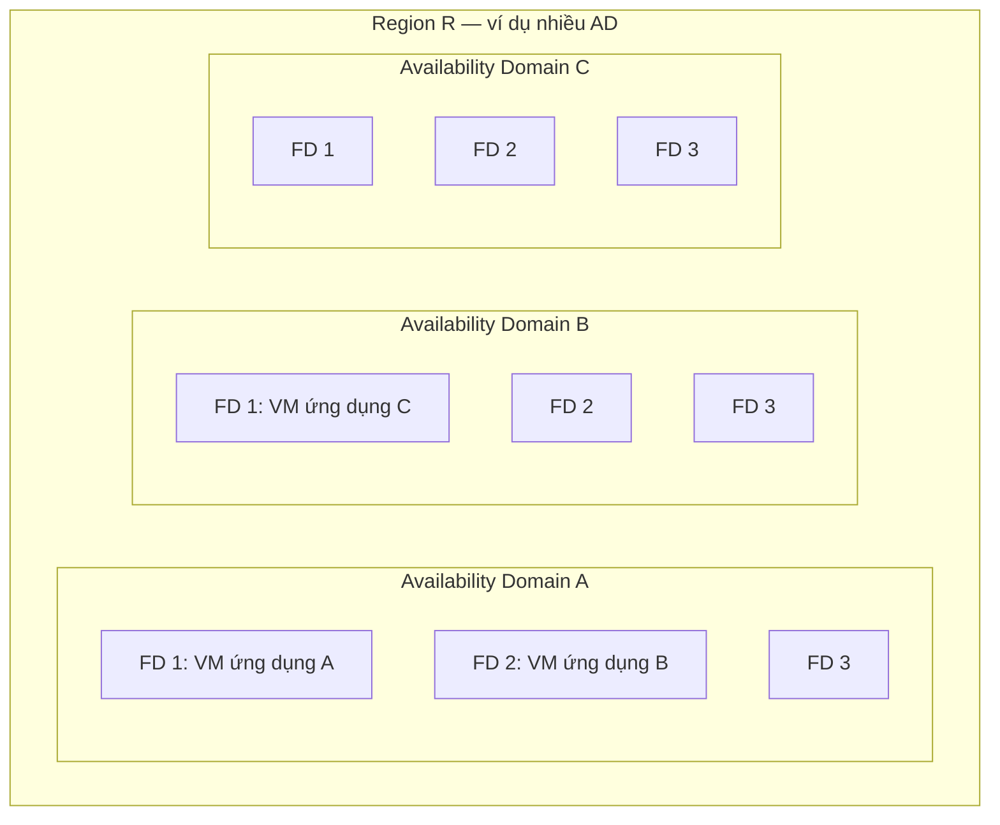

# Region, Availability Domain và Fault Domain

## Mục tiêu và phạm vi

Trong Oracle Cloud Infrastructure (OCI), vị trí triển khai quyết định những sự cố hạ tầng nào có thể ảnh hưởng đồng thời đến các thành phần của ứng dụng. Ba khái niệm cần phân biệt là **Region**, **Availability Domain (AD)** và **Fault Domain (FD)**. Biết tên của chúng là bước đầu; khi thiết kế, bạn còn phải xác định tài nguyên nằm ở đâu, dữ liệu được bảo vệ thế nào và lưu lượng chuyển sang đâu khi có lỗi.

Bài thuộc chương **Tổng quan Oracle Cloud Infrastructure**, làm nền cho các bài thực hành VCN, Compute, lưu trữ, cơ sở dữ liệu Oracle và tự động hóa hạ tầng. Sau bài học, bạn có thể:

- Mô tả quan hệ Region → AD → FD và giới hạn của từng phạm vi cô lập lỗi.
- Phân biệt vị trí vật lý của tài nguyên với phạm vi quản trị bằng tenancy, compartment và IAM.
- Giải thích vì sao hai VM chưa đủ chứng minh một ứng dụng có tính sẵn sàng cao.
- Kiểm tra AD, FD thực tế và lập phương án triển khai phù hợp cho một lab nhỏ.

Các thông tin về vùng và hành vi dịch vụ được đối chiếu với tài liệu Oracle ngày **20/11/2026**. Khi triển khai, kiểm tra danh sách vùng, số AD, dịch vụ và capacity hiện có của chính tenancy; không sao chép tên AD từ tài khoản khác.

## 1. Quan hệ giữa ba cấp vị trí

Theo [Physical Architecture Concepts](https://docs.oracle.com/en-us/iaas/Content/GSG/Concepts/concepts-physical.htm), region là một khu vực địa lý; AD gồm một hoặc nhiều trung tâm dữ liệu trong region; FD là một nhóm phần cứng và hạ tầng bên trong AD. Mỗi AD có ba FD.

| Cấp | Nằm trong | Ý nghĩa khi thiết kế |
| --- | --- | --- |
| Region | Một khu vực địa lý của OCI | Xác định địa điểm triển khai và phạm vi xem xét sự cố cấp vùng |
| Availability Domain | Một region | Tách các thành phần giữa những miền hạ tầng có mức độc lập lớn hơn trong cùng vùng |
| Fault Domain | Một AD | Phân tán tài nguyên để giảm ảnh hưởng đồng thời của lỗi phần cứng hoặc bảo trì Compute |

Sơ đồ sau minh họa một region nhiều AD. Tên `Region R`, `AD-A`, `AD-B`, `AD-C` chỉ là nhãn để học, không phải giá trị dùng trực tiếp trong API.



A và B trong hình cùng AD nhưng khác FD; C khác AD với cả hai máy đó. Nếu mục tiêu là còn một bản ứng dụng khi cả AD-A mất khả dụng, chỉ đặt A và B ở hai FD trong AD-A chưa đáp ứng mục tiêu.

Tên `FAULT-DOMAIN-1` có ý nghĩa trong AD cụ thể. Khi mô tả vị trí, ghi cả bộ **region, AD, FD**; chỉ ghi “máy ở FD 1” không xác định được miền lỗi của máy.

## 2. Region: lựa chọn địa lý và phạm vi dịch vụ

### 2.1. Không mặc định mọi region có ba AD

Một region có một hoặc nhiều AD. Tại mốc đối chiếu, bảng vùng của Oracle liệt kê `ap-singapore-1` có một AD, còn `eu-frankfurt-1` có ba AD. Danh sách và số AD cần lấy từ [Regions and Availability Domains](https://docs.oracle.com/en-us/iaas/Content/General/Concepts/regions.htm).

Ví dụ một hướng dẫn yêu cầu tạo hai VM ở AD 1 và AD 2. Nếu region đang dùng chỉ có một AD, bạn cần điều chỉnh mục tiêu lab: có thể thực hành phân tán theo FD trong AD hiện có, nhưng phải ghi rõ chưa kiểm tra khả năng chịu lỗi cả AD. Không đổi tên FD thành AD để khớp sơ đồ của hướng dẫn.

### 2.2. Chọn region theo yêu cầu của ứng dụng

Khi chọn vùng, đánh giá đồng thời vị trí người dùng, yêu cầu nơi lưu dữ liệu, dịch vụ cần sử dụng, số AD và quan hệ với hệ thống phụ thuộc. Oracle trình bày các tiêu chí này trong [Cloud Foundation — Selecting a Region for Deployment](https://docs.oracle.com/en/cloud/foundation/cloud_architecture/governance/regions.html).

Với một ứng dụng Java phục vụ người dùng ở Việt Nam, hãy đo độ trễ đến các vùng khả dụng thay vì chỉ nhìn khoảng cách trên bản đồ. Sau đó kiểm tra nơi đặt cơ sở dữ liệu và các dịch vụ mà ứng dụng gọi thường xuyên. Một VM gần người dùng nhưng truy vấn cơ sở dữ liệu ở vùng rất xa có thể vẫn phản hồi chậm.

Có thể dùng bảng quyết định trước khi triển khai:

| Tiêu chí | Thông tin cần thu thập |
| --- | --- |
| Người sử dụng | Vị trí truy cập chính, độ trễ chấp nhận được |
| Dữ liệu | Yêu cầu nơi lưu, nơi sao lưu và nơi được phép phục hồi |
| Dịch vụ | Dịch vụ, tính năng và shape cần dùng có trong vùng không |
| Chịu lỗi | Cần chịu lỗi một máy, một FD, một AD hay cả region |
| Vận hành | Đội vận hành có thể kiểm tra, chuyển đổi và dựng lại hệ thống ra sao |
| Chi phí | Chi phí tài nguyên dự phòng, lưu trữ và truyền dữ liệu của phương án |

Đây là các câu hỏi thiết kế. Việc một vùng có mặt trong danh sách OCI chưa chứng minh tenancy có quyền hoặc capacity để tạo mọi cấu hình tại đó.

### 2.3. Home region và region đang xem trên Console

Home region là nơi gắn với thông tin tài khoản và tài nguyên định danh ban đầu; không thể đổi sau khi tenancy được cấp. Tenancy có thể sử dụng các vùng đã đăng ký theo điều kiện và giới hạn tài khoản. Việc chọn region khác trên Console không chuyển các VM hay VCN đã có sang vùng đó. Xem [Managing Regions](https://docs.oracle.com/en-us/iaas/Content/Identity/Tasks/managingregions.htm).

Khi không thấy một tài nguyên, kiểm tra đúng region và compartment trước khi kết luận tài nguyên đã bị xóa. Đối với tài nguyên theo vùng, bộ lọc sai có thể khiến danh sách trống dù tài nguyên vẫn tồn tại ở vùng khác.

## 3. Availability Domain: phạm vi cô lập hạ tầng trong region

Các AD trong cùng region được thiết kế độc lập về những thành phần như nguồn điện, làm mát và mạng nội bộ của AD. Giữa các AD có kết nối băng thông cao, độ trễ thấp. Sự cố tại một AD ít có khả năng làm các AD khác cùng region mất khả dụng theo cùng nguyên nhân hạ tầng. Tham khảo [Cloud Foundation — Availability & Fault Domains](https://docs.oracle.com/en/cloud/foundation/cloud_architecture/governance/regions.html).

Từ đặc tính này, có thể thiết kế hai bản ứng dụng ở hai AD để giảm phụ thuộc vào một AD. Tuy nhiên, ứng dụng chỉ tiếp tục phục vụ nếu các tầng còn lại cũng hoạt động: điểm vào mạng, dữ liệu, xác thực, cấu hình và năng lực xử lý của bản còn sống.

### 3.1. Ví dụ hai VM nhưng một điểm lỗi dữ liệu

Giả sử hệ thống quản lý đơn hàng có:

```text
VM ứng dụng A: AD-A
VM ứng dụng B: AD-B
Cơ sở dữ liệu duy nhất: AD-A
```

Nếu AD-A mất khả dụng, B có thể vẫn chạy tiến trình Java nhưng không đọc hoặc ghi được đơn hàng. Kết luận phù hợp là **tầng ứng dụng có phân tán theo AD, tầng dữ liệu vẫn phụ thuộc AD-A**. Chưa có cơ sở để tuyên bố toàn bộ dịch vụ chịu được lỗi AD.

Khi lập sơ đồ, vẽ cả cơ sở dữ liệu, nơi giữ tệp và các dịch vụ phụ thuộc. Một sơ đồ chỉ có hai biểu tượng VM dễ che khuất điểm lỗi đơn còn lại.

### 3.2. Tên AD thuộc ngữ cảnh tenancy

Oracle dùng tên AD có tiền tố riêng theo tenancy. AD mang cùng số thứ tự trong hai tenancy không nhất thiết chỉ cùng trung tâm dữ liệu vật lý. Vì vậy, lấy tên AD từ chính tenancy bằng Console hoặc API; không coi một chuỗi tên trong bài hướng dẫn là giá trị dùng chung. Xem [Your Tenancy's Availability Domain Names](https://docs.oracle.com/en-us/iaas/Content/General/Concepts/regions.htm).

Trong mã tự động hóa, truyền tên AD đã xác định hoặc ánh xạ theo cấu hình triển khai. Tránh gắn logic nghiệp vụ với giả định “phần tử đầu tiên trong danh sách luôn là vị trí mong muốn”.

## 4. Fault Domain: phân tán phần cứng trong một AD

FD hỗ trợ **anti-affinity**: phân tán instance để chúng không cùng nằm trên phần cứng vật lý trong một AD. Mục tiêu là giảm ảnh hưởng đồng thời của lỗi phần cứng hoặc bảo trì Compute thuộc một FD. Đây vẫn là phạm vi bên trong AD, nên các máy khác FD tiếp tục cùng phụ thuộc AD đó. Tham khảo [Resilience and Availability FAQ — Fault Domains](https://www.oracle.com/cloud/iaas/faq.html).

Ví dụ trong một region chỉ có một AD:

```text
Region R
└── AD-A
    ├── FAULT-DOMAIN-1: app-01
    ├── FAULT-DOMAIN-2: app-02
    └── FAULT-DOMAIN-3: chưa dùng
```

Cách bố trí này có ích khi `app-01` và `app-02` phục vụ cùng chức năng và hệ thống có thể đưa lưu lượng đến máy còn khỏe. Nếu ứng dụng B chỉ làm báo cáo còn ứng dụng A nhận đơn hàng, đặt chúng khác FD không tạo ra bản thay thế cho chức năng nhận đơn hàng.

### 4.1. Tự chọn vị trí và để hệ thống phân bổ

Khi tạo Compute instance, có thể chỉ định FD; nếu không chỉ định, OCI chọn vị trí và cố gắng phân tán theo capacity. Với instance pool, mặc định cũng là phân bố theo khả năng đáp ứng; có thể yêu cầu phân bố đều giữa các FD đã chọn. Khi một FD thiếu capacity, yêu cầu phân bố bắt buộc có thể khiến thao tác tạo hoặc mở rộng thất bại. Xem [Regions and Availability Domains — Fault Domains](https://docs.oracle.com/en-us/iaas/Content/General/Concepts/regions.htm) và [Managing Instance Pools](https://docs.oracle.com/en-us/iaas/Content/Compute/Concepts/instance-pools.htm).

Hai lựa chọn phục vụ hai mục tiêu khác nhau:

- Với một lab tạo một máy, để OCI chọn FD có thể đủ cho mục tiêu quan sát và kết nối.
- Với bài thực hành yêu cầu hai bản ứng dụng ở hai FD, xác định placement cần có rồi kiểm tra kết quả sau khi tạo.

Không suy ra placement chỉ từ số lượng VM. Nếu cấu hình yêu cầu FD khác nhau nhưng tạo máy thất bại, hãy ghi nhận việc mục tiêu chưa được đáp ứng thay vì âm thầm đặt cả hai vào một FD.

### 4.2. Khác FD không sửa lỗi phần mềm dùng chung

Hai instance ở hai FD có thể cùng lỗi nếu đều nhận một bản phát hành sai, cùng hết hạn chứng chỉ hoặc cùng phụ thuộc một dịch vụ dữ liệu đang ngừng hoạt động. Cô lập phần cứng cần đi cùng cách phát hành, kiểm tra sức khỏe và xử lý trạng thái ứng dụng.

Trong lab Java, có thể thiết kế để mỗi VM chạy cùng phiên bản ứng dụng, dùng cấu hình được quản lý rõ ràng và không giữ phiên đăng nhập quan trọng chỉ trong bộ nhớ của một máy. Sau đó mới kiểm tra việc ngừng một bản ứng dụng ảnh hưởng đến người dùng thế nào.

Việc phân bố FD phải dựa trên các thành phần có thể thay thế cho nhau. Với cấu hình chỉ có một web server và một database, không có bản dự phòng, Oracle khuyến nghị đặt cả hai cùng FD để giảm số miền lỗi riêng có thể làm toàn ứng dụng ngừng hoạt động. Khuyến nghị này không biến hệ thống thành HA; muốn tăng khả năng duy trì dịch vụ, cần thêm dự phòng phù hợp. Xem [Best Practices for Your Compute Instances — Fault Domains](https://docs.oracle.com/en-us/iaas/Content/Compute/References/bestpracticescompute.htm).

## 5. Phạm vi tài nguyên ảnh hưởng trực tiếp đến thiết kế

### 5.1. Compartment là phạm vi quản trị

Compartment tổ chức tài nguyên và giúp áp dụng quyền truy cập. Nó không đại diện cho một trung tâm dữ liệu hoặc một miền lỗi vật lý. Chẳng hạn, bucket thuộc một compartment nhưng vẫn được tạo trong region cụ thể, như mô tả tại [Overview of Object Storage](https://docs.oracle.com/en-us/iaas/Content/Object/Concepts/objectstorageoverview.htm).

Do đó, chuyển cách tổ chức từ `lab-a` sang `lab-b` không phải phương án dự phòng hạ tầng. Hai VM cùng compartment vẫn có thể ở các AD khác nhau; hai VM khác compartment vẫn có thể nằm trong cùng một AD.

### 5.2. Compute cần vị trí AD và FD

AD là một thành phần được lựa chọn khi tạo Compute instance. Bạn có thể đặt các instance cùng AD hoặc khác AD theo yêu cầu hiệu năng và dự phòng. Xem [Overview of the Compute Service](https://docs.oracle.com/en-us/iaas/Content/Compute/Concepts/computeoverview.htm).

Một bảng kiểm kê phục vụ thiết kế nên tách các cột sau:

| Tài nguyên | Region | AD | FD | Compartment | Chức năng |
| --- | --- | --- | --- | --- | --- |
| `app-01` | R | AD-A | FD-1 | `lab` | Nhận yêu cầu HTTP |
| `app-02` | R | AD-A | FD-2 | `lab` | Cùng chức năng với `app-01` |
| `db-01` | R | AD-A | FD-3 | `data` | Cơ sở dữ liệu duy nhất trong ví dụ |

Các giá trị R và AD-A là ký hiệu minh họa. Bảng cho thấy phân tán theo FD nhưng cả ba thành phần vẫn cùng AD. Nó cũng cho thấy compartment `data` không tạo thêm mức độc lập vật lý cho cơ sở dữ liệu.

### 5.3. VCN và regional subnet

VCN được tạo trong một region. Subnet có thể thuộc một AD hoặc có phạm vi region; Oracle khuyến nghị regional subnet vì linh hoạt hơn khi thiết kế theo AD. Regional subnet cho phép VNIC của các instance ở nhiều AD trong cùng region sử dụng subnet đó. Nó không làm một VM tự có thêm bản sao ở AD khác. Xem [Overview of VCNs and Subnets](https://docs.oracle.com/en-us/iaas/Content/Network/Tasks/Overview_of_VCNs_and_Subnets.htm).

Ví dụ, có thể đặt `app-01` ở AD-A và `app-02` ở AD-B, cùng dùng một regional subnet cho tầng ứng dụng. Nếu dùng subnet chỉ thuộc AD-A, không thể dùng chính subnet đó cho instance ở AD-B.

Khi đổi placement, kiểm tra subnet tương thích, đường đi mạng và các quy tắc cho phép lưu lượng. Đổi AD mà bỏ qua mạng có thể tạo ra máy đang chạy nhưng không tham gia phục vụ.

### 5.4. Block volume và boot volume gắn với AD

Volume chỉ có thể được gắn với instance trong cùng AD. Không thể lấy nguyên một block volume ở AD-A rồi gắn trực tiếp vào VM ở AD-B. Bản sao lưu volume có thể được phục hồi thành volume mới ở AD khác trong cùng region; có thể sao chép backup sang region khác rồi phục hồi tại đó theo chức năng dịch vụ. Xem [Overview of Block Volume — Regions and Availability Domains](https://docs.oracle.com/en-us/iaas/Content/Block/Concepts/overview.htm).

Hệ quả thiết kế: nếu VM A dùng volume chứa dữ liệu ứng dụng, VM B ở AD khác không tự có dữ liệu chỉ vì đã cài cùng phần mềm. Bạn cần xác định cách sao chép hoặc phục hồi dữ liệu, thời gian cần để làm việc đó và trạng thái nhất quán của bản phục hồi.

Bản sao lưu còn phải được thử phục hồi. Một kế hoạch chỉ ghi “đã có backup” chưa cho biết ứng dụng có thể hoạt động lại trong bao lâu.

### 5.5. Dịch vụ regional có cơ chế sẵn sàng riêng

Object Storage là dịch vụ regional, không gắn với một Compute instance cụ thể. Phạm vi regional không tự có nghĩa dữ liệu đã được sao chép sang region khác. Xem [Overview of Object Storage](https://docs.oracle.com/en-us/iaas/Content/Object/Concepts/objectstorageoverview.htm).

Với OCI Load Balancer, cơ chế dự phòng còn phụ thuộc số AD và loại subnet. Trong region một AD, primary và standby vẫn cùng AD nên không có khả năng chuyển sang AD khác khi toàn bộ AD đó ngừng hoạt động. Tham khảo [Load Balancer Types](https://docs.oracle.com/en-us/iaas/Content/Balance/Concepts/load_balancer_types.htm).

Đối với các dịch vụ cơ sở dữ liệu Oracle, đọc riêng mô hình triển khai và cơ chế HA/DR của dịch vụ được chọn. Không áp dụng máy móc cách đặt hai VM cho mọi dịch vụ Database, cũng không mặc định dịch vụ được quản lý đã đáp ứng mọi mục tiêu phục hồi của ứng dụng.

## 6. Từ vị trí tài nguyên đến tính sẵn sàng của ứng dụng

**Tính sẵn sàng cao (HA)** hướng đến duy trì dịch vụ trước các lỗi nằm trong phạm vi thiết kế. **Khôi phục thảm họa (DR)** bổ sung cách phục hồi sau sự cố lớn. Tài liệu [Resiliency](https://docs.oracle.com/en-us/iaas/Content/cloud-adoption-framework/era-resiliency.htm) của Oracle trình bày việc dùng FD, AD và nhiều region trong các phương án này.

Bảng sau là phân tích thiết kế cho các ví dụ học tập, không phải cam kết rằng chỉ cần chọn đúng vị trí là ứng dụng tự hoạt động liên tục:

| Cách đặt các bản ứng dụng | Mức phân tán đạt được | Phần vẫn phải giải quyết |
| --- | --- | --- |
| Hai VM cùng FD, cùng AD | Có hai tiến trình phục vụ | Còn cùng miền lỗi phần cứng FD; cần xem lại placement |
| Hai VM khác FD, cùng AD | Giảm phụ thuộc một FD | Vẫn phụ thuộc AD; cần chuyển lưu lượng và bảo vệ dữ liệu |
| Hai VM khác AD, cùng region | Giảm phụ thuộc một AD | Vẫn phụ thuộc region và các dịch vụ dùng chung |
| Hai môi trường ở hai region | Có địa điểm phục hồi ngoài region chính | Cần sao chép dữ liệu, định tuyến, cấu hình và quy trình chuyển đổi |

### 6.1. Ví dụ lab trong region một AD

Giả sử bạn muốn thực hành một API Java có hai bản ứng dụng. Mục tiêu lab là khi một tiến trình ứng dụng dừng, người dùng vẫn truy cập được API qua điểm vào đã cấu hình.

Phương án học tập:

1. Đặt hai VM cùng chức năng ở hai FD khác nhau trong AD hiện có.
2. Cấu hình điểm vào phân phối lưu lượng đến cả hai bản và nhận biết bản không khỏe.
3. Giữ dữ liệu quan trọng ở nơi được quản lý rõ ràng; mô tả giới hạn của tầng dữ liệu.
4. Kiểm tra năng lực của một VM khi VM còn lại không phục vụ.
5. Ghi nhận thời gian phát hiện lỗi, tỷ lệ yêu cầu lỗi và thời gian phục hồi.

Kết quả chỉ chứng minh hành vi trước sự cố đã thử. **Dừng một tiến trình không mô phỏng đầy đủ mất cả FD hoặc AD.** Không sử dụng kết quả đó để tuyên bố đã xác minh khả năng chịu lỗi cấp AD.

### 6.2. Ví dụ thiết kế chịu lỗi một AD

Giả sử ứng dụng đặt hàng phải tiếp tục phục vụ khi một AD mất khả dụng. Bản thiết kế cần phân bổ bản ứng dụng sang AD khác và loại bỏ phụ thuộc duy nhất vào AD bị lỗi.

Các câu hỏi cần trả lời trước khi triển khai:

- Điểm vào dịch vụ có còn truy cập được khi AD đó không hoạt động?
- Dữ liệu đơn hàng có bản có thể sử dụng ở phạm vi còn sống không?
- Thành phần xác thực, tệp tải lên và hàng đợi có còn hoạt động?
- Bản ứng dụng còn lại có đủ sức nhận tải không?
- Cơ chế chuyển đổi có tự động hay cần người vận hành, và đã được kiểm tra chưa?

Đối với Compute, Oracle cũng khuyến nghị thiết kế node dự phòng ở các AD khác nhau và sao lưu dữ liệu trong [Best Practices for Your Compute Instances](https://docs.oracle.com/en-us/iaas/Content/Compute/References/bestpracticescompute.htm). Cấu hình cụ thể còn phụ thuộc dịch vụ và yêu cầu dữ liệu của hệ thống.

### 6.3. Khi cần thêm region cho DR

Hai AD trong cùng region vẫn cùng phạm vi địa lý cấp vùng. Nếu yêu cầu phục hồi bao gồm sự cố cả region, xem xét một môi trường ở region khác cùng với cơ chế giữ dữ liệu và chuyển dịch vụ.

Hai chỉ tiêu cần chốt là:

- **RTO (Recovery Time Objective):** thời gian mục tiêu để khôi phục dịch vụ sau sự cố.
- **RPO (Recovery Point Objective):** mức mất dữ liệu chấp nhận được biểu diễn theo khoảng thời gian.

Tham khảo [Disaster Recovery](https://docs.oracle.com/en-us/iaas/Content/cloud-adoption-framework/disaster-recovery.htm). Ví dụ, mục tiêu RTO 60 phút và RPO 15 phút là yêu cầu do nhóm vận hành đặt ra; phải dùng thử nghiệm phục hồi để đánh giá có đạt hay không. Việc đã tạo một VM ở region thứ hai chưa chứng minh đạt hai chỉ tiêu đó.

Đừng đồng nhất replication với backup. Ví dụ, Object Storage replication có thể truyền cả thao tác xóa sang đích theo chính sách dịch vụ, nên cần thiết kế riêng khả năng phục hồi khi xóa nhầm. Xem [Object Storage Replication](https://docs.oracle.com/en-us/iaas/Content/Object/Tasks/usingreplication.htm).

## 7. Quan sát vị trí thực tế bằng Console và CLI

### 7.1. Kiểm tra trên Console

Nếu đã có tài nguyên lab, thực hiện quan sát theo thứ tự:

1. Chọn đúng tenancy và region trên Console.
2. Chọn compartment chứa tài nguyên, mở chi tiết Compute instance.
3. Tìm thông tin Availability Domain và Fault Domain trong phần chi tiết hoặc placement.
4. Mở subnet của VNIC để xác định subnet có phạm vi regional hay AD-specific.
5. Mở boot volume hoặc block volume liên quan, đối chiếu AD với instance.
6. Ghi lại vị trí của các bản ứng dụng và mọi thành phần dữ liệu phụ thuộc.

Nếu chưa có VM, có thể xem lựa chọn AD trong biểu mẫu tạo instance để hiểu môi trường. Chưa cần gửi yêu cầu tạo tài nguyên để hoàn thành phần nhận biết này. Tên, vị trí nhóm trường trên Console có thể thay đổi; tìm theo nội dung AD, FD và placement.

### 7.2. Liệt kê AD bằng OCI CLI

Phần lệnh giả định OCI CLI đã được cài, cấu hình thông tin xác thực và có quyền đọc thông tin cần thiết. Thay các chuỗi giữ chỗ trước khi chạy; không đưa khóa riêng vào lệnh hoặc ghi chép chia sẻ.

Ví dụ PowerShell:

```powershell
$tenancyOcid = 'THAY_BANG_OCID_TENANCY_CUA_BAN'
$regionId = 'THAY_BANG_REGION_ID_DA_DANG_KY'

oci iam availability-domain list --compartment-id $tenancyOcid --region $regionId --all --query 'data[].name' --output json
```

Lệnh trả về các tên AD trong ngữ cảnh tenancy và region đang truy vấn. `--region` dùng region identifier, chẳng hạn `ap-singapore-1` nếu tenancy có thể sử dụng vùng đó. Sao chép đúng tên AD đầy đủ từ kết quả; không tự ghép tiền tố hoặc lấy theo tên minh họa trong bài.

Tài liệu CLI lưu ý thứ tự kết quả có thể thay đổi, vì vậy không dựa vào vị trí phần tử để gán cố định một AD cho kiến trúc. Tham khảo [OCI CLI — availability-domain list](https://docs.oracle.com/en-us/iaas/tools/oci-cli/latest/oci_cli_docs/cmdref/iam/availability-domain/list.html).

### 7.3. Liệt kê FD trong một AD

Dùng chính tên AD đầy đủ thu được ở bước trước:

```powershell
$adName = 'DAN_TEN_AD_DAY_DU_TU_KET_QUA_TREN'

oci iam fault-domain list --compartment-id $tenancyOcid --availability-domain $adName --region $regionId --all --query 'data[].name' --output json
```

Dạng kết quả mong đợi là danh sách tên FD:

```json
[
  "FAULT-DOMAIN-1",
  "FAULT-DOMAIN-2",
  "FAULT-DOMAIN-3"
]
```

Đây là thao tác liệt kê, không tạo hoặc di chuyển VM. Nếu bị từ chối truy cập, kiểm tra profile đang dùng, tenancy, region và quyền IAM tương ứng; không sửa placement để xử lý một lỗi xác thực. Tham khảo [OCI CLI — fault-domain list](https://docs.oracle.com/en-us/iaas/tools/oci-cli/latest/oci_cli_docs/cmdref/iam/fault-domain/list.html).

## 8. Thiết kế có kiểm soát chi phí và khả năng triển khai

Tăng số bản ứng dụng đồng nghĩa tăng lượng tài nguyên cần quản lý. Phương án nhiều AD hoặc nhiều region còn có thể thêm tài nguyên dữ liệu, lưu trữ, truyền dữ liệu, điểm vào mạng và công việc vận hành. Trước khi chọn, lập danh sách thành phần cùng số lượng, vị trí và thời gian cần giữ; đối chiếu giá và điều kiện tài khoản hiện tại.

Với bài lab nhập môn, có thể tách kết quả học tập thành hai mức:

- **Quan sát:** liệt kê AD/FD, đọc vị trí tài nguyên đã có và vẽ sơ đồ phụ thuộc.
- **Triển khai khi có điều kiện:** tạo các bản ứng dụng theo placement đã chọn, kiểm tra chuyển lưu lượng và dọn tài nguyên sau buổi học.

Không cần mở rộng lab sang nhiều region chỉ để ghi nhớ thuật ngữ. Nếu chưa có quyền hoặc ngân sách, một sơ đồ ghi đúng giới hạn của môi trường hiện có vẫn là kết quả hữu ích.

### 8.1. Capacity khác với mong muốn về placement

Cấu hình kiến trúc mô tả vị trí bạn muốn; khả năng cấp phát thực tế còn phụ thuộc capacity và các giới hạn áp dụng. Với instance pool, yêu cầu phân bố đều giữa FD có thể thất bại nếu một FD thiếu chỗ, như mô tả trong [Managing Instance Pools](https://docs.oracle.com/en-us/iaas/Content/Compute/Concepts/instance-pools.htm).

Khi gặp lỗi, ghi nhận:

```text
Region:
AD yêu cầu:
FD yêu cầu hoặc để hệ thống chọn:
Shape và số lượng instance:
Thông báo lỗi:
Placement thực tế của những instance đã tạo:
Mục tiêu chịu lỗi còn đạt hay không:
```

Nếu điều chỉnh placement để hoàn thành lab, cập nhật sơ đồ và kết luận tương ứng. Không giữ nguyên tuyên bố “hai FD khác nhau” khi kết quả cuối cùng không còn đáp ứng điều đó.

### 8.2. Giữ khả năng dựng lại và đo kết quả

Khi học tự động hóa, lưu tham số region, tên AD và yêu cầu FD trong cấu hình phù hợp với từng môi trường. Giữ cách dựng lại ứng dụng, cấu hình mạng và cách phục hồi dữ liệu. Kiểm kê placement sau triển khai giúp phát hiện khoảng cách giữa cấu hình dự kiến với tài nguyên đang chạy.

Khi kiểm tra tính sẵn sàng, đo từ góc nhìn người dùng: endpoint có phản hồi, dữ liệu có đúng và yêu cầu có hoàn tất không. Trạng thái `RUNNING` của một VM chỉ là một tín hiệu hạ tầng, chưa phải kết quả kiểm tra toàn bộ dịch vụ.

## 9. Những nhầm lẫn cần tránh

| Nhận định dễ nhầm | Cách hiểu phù hợp |
| --- | --- |
| Mỗi region đều có ba AD | Số AD khác nhau giữa các region; kiểm tra vùng thực tế |
| Mỗi FD là một trung tâm dữ liệu độc lập | FD nằm trong AD và phục vụ cô lập ở phạm vi nhỏ hơn AD |
| Khác compartment là đã dự phòng | Compartment phục vụ tổ chức và quyền truy cập; phải xem vị trí vật lý riêng |
| Có hai VM là đã HA | Cần cùng chức năng, phân tán phù hợp, dữ liệu và chuyển lưu lượng hoạt động |
| Regional subnet làm VM chịu được lỗi AD | Subnet hỗ trợ phạm vi mạng; VM vẫn có vị trí AD cụ thể |
| Volume có thể gắn sang VM ở bất kỳ AD nào | Gắn volume trực tiếp yêu cầu cùng AD; phục hồi sang AD khác cần cơ chế phù hợp |
| Khác FD là chịu được mất cả AD | Các FD đó vẫn cùng AD |
| Có bucket là đã sao lưu ngoài region | Phải xác định nơi lưu và cấu hình sao chép hoặc backup thực tế |
| Dừng một VM chứng minh chịu được lỗi region | Kết quả thử nghiệm chỉ có giá trị trong phạm vi sự cố đã mô phỏng |

## 10. Thực hành: lập bản đồ miền lỗi cho một ứng dụng nhỏ

Bài thực hành ưu tiên quan sát và thiết kế; chỉ triển khai thêm khi có quyền, capacity và ngân sách phù hợp.

### Bước 1 — Xác định môi trường

Chọn một region đang sử dụng. Ghi region identifier, số AD quan sát được, tên đầy đủ từng AD và danh sách FD của một AD. Có thể dùng Console hoặc hai lệnh CLI ở trên.

### Bước 2 — Kiểm kê các thành phần của ứng dụng

Lập một bảng cho ứng dụng Java gồm các thành phần dự kiến hoặc đang có:

```text
Điểm vào HTTP:
Bản ứng dụng thứ nhất:
Bản ứng dụng thứ hai, nếu có:
Cơ sở dữ liệu:
Nơi lưu tệp và dữ liệu cần giữ:
Các dịch vụ bắt buộc phải truy cập:
```

Với mỗi thành phần, thêm region, AD/FD nếu dịch vụ có phạm vi tương ứng, compartment và cơ chế dự phòng. Ghi “không áp dụng” với trường không phù hợp; không tự gán FD cho bucket chỉ để điền đầy đủ bảng.

### Bước 3 — Chọn một mục tiêu chịu lỗi

Chọn mục tiêu cụ thể, chẳng hạn “API vẫn phục vụ khi một bản ứng dụng không hoạt động”. Sau đó đánh dấu thành phần nào phải còn sống để hoàn thành một yêu cầu đọc hoặc ghi.

Nếu muốn nâng mục tiêu lên “chịu lỗi một AD”, vẽ lại placement và chỉ rõ phương án dữ liệu, điểm vào, năng lực xử lý còn lại. Nếu region chỉ có một AD, ghi mục tiêu đó chưa thể kiểm tra bằng cách phân tán sang AD thứ hai trong region hiện tại.

### Bước 4 — Mô tả phép kiểm tra và giới hạn

Viết rõ thao tác mô phỏng, tín hiệu quan sát, tiêu chí thành công và cách phục hồi môi trường. Ví dụ, ngừng một tiến trình ứng dụng rồi đo yêu cầu HTTP qua điểm vào là phép kiểm tra chuyển lưu lượng trước lỗi tiến trình; nó không tương đương sự cố toàn AD.

### Bước 5 — Hoàn tất ghi nhận

Kết quả cần có gồm sơ đồ Region → AD → FD, bảng placement, mục tiêu chịu lỗi và danh sách phụ thuộc còn là điểm lỗi đơn. Nếu đã triển khai, thêm kết quả quan sát thực tế và dọn các tài nguyên không cần giữ.

Bạn hoàn thành bài khi có thể giải thích được **tài nguyên nằm ở đâu, sự cố nào đã được phân tán và phụ thuộc nào vẫn có thể làm ứng dụng ngừng phục vụ**. Đây là cơ sở để lựa chọn VCN, Compute, lưu trữ và cơ sở dữ liệu ở các bài tiếp theo.
