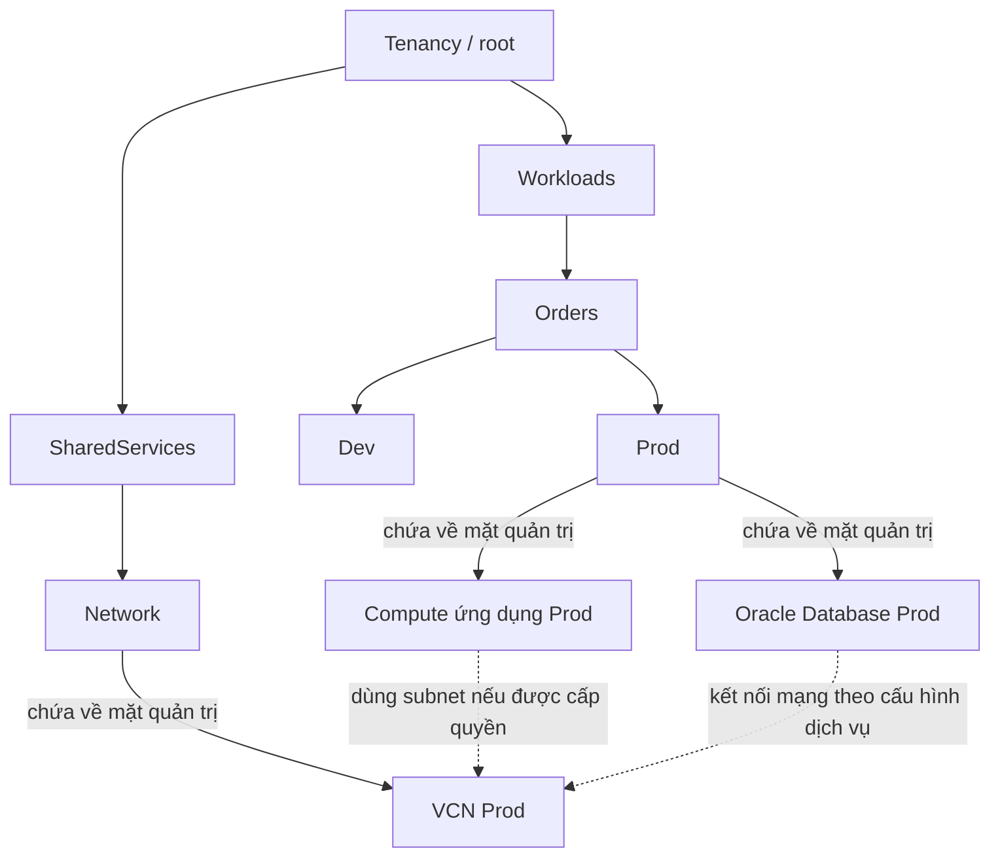

# Tenancy, compartment và mô hình phân cấp tài nguyên

## Mục tiêu và bối cảnh

Trước khi tạo VCN, Compute hoặc Oracle Database trên Oracle Cloud Infrastructure (OCI), người vận hành cần trả lời được: tài nguyên thuộc tổ chức nào, nhóm nào chịu trách nhiệm, ai có quyền quản lý và chi phí được theo dõi ở đâu?

Trong chương **Tổng quan Oracle Cloud Infrastructure** của module **CLOUD_PROVIDERS_ORACLE**, bài này giải thích tenancy, compartment và cây phân cấp tài nguyên. Đây là nền tảng để triển khai hạ tầng OCI có phân quyền, giám sát, tự động hóa và kiểm soát chi phí. Một cây compartment rõ ràng cũng giúp tổ chức môi trường phục vụ các phương án sẵn sàng cao; bản thân cây đó không tạo ra tính sẵn sàng cho ứng dụng.

Sau bài học, người học có thể:

- Phân biệt tenancy, root compartment, compartment con và tài nguyên dịch vụ.
- Đọc một cây compartment và xác định phạm vi quản trị.
- Giải thích quan hệ giữa compartment, region và quyền IAM kế thừa.
- Đề xuất cách tổ chức Dev/Prod, tài nguyên dùng chung và môi trường học tập.
- Tạo một cây compartment lab, kiểm tra đúng parent và nhận diện ảnh hưởng của thao tác di chuyển.

## 1. Tenancy là không gian quản trị cấp cao của OCI

Khi một tổ chức bắt đầu sử dụng OCI, tenancy là không gian quản trị chứa các tài nguyên và cấu hình liên quan của tổ chức đó. Tenancy có tên, OCID và home region; quản trị viên có thể xem những thông tin này trong trang chi tiết tenancy. [Thông tin tenancy trong OCI](https://docs.oracle.com/en-us/iaas/Content/General/tenancy/managingtenancy.htm).

Trong phạm vi bài này, hãy hình dung:

```text
Tenancy của tổ chức
  ├── Cấu hình quản trị và danh tính
  ├── Các compartment
  └── Tài nguyên của các dịch vụ OCI
```

Một tenancy có thể chứa nhiều môi trường, nhiều nhóm vận hành và tài nguyên ở nhiều region mà tenancy đã đăng ký sử dụng. Việc mọi thứ thuộc cùng tenancy không có nghĩa mọi người dùng được xem hoặc sửa mọi tài nguyên.

### Tenancy khác với người dùng và tài khoản đăng nhập

Một kỹ sư đăng nhập bằng danh tính được cấp quyền để làm việc trong tenancy. Người đó không phải là tenancy. Nhiều người dùng có thể làm việc trong cùng tenancy với các phạm vi quyền khác nhau.

Ví dụ:

- Nhóm mạng quản lý VCN và route table.
- Nhóm ứng dụng triển khai Compute cho môi trường Dev.
- Nhóm cơ sở dữ liệu quản lý database Prod.
- Nhóm tài chính xem thông tin sử dụng và chi phí theo phạm vi được cấp.

Không cần tạo một tenancy mới cho từng máy chủ hoặc từng thành viên. Với nhu cầu phân chia quản trị trong cùng tổ chức, compartment thường là một trong những công cụ đầu tiên cần xem xét.

### Home region không phải nơi bắt buộc đặt mọi tài nguyên

Home region là thông tin quan trọng của tenancy và một số thao tác quản trị danh tính. Nó không đồng nghĩa tất cả Compute, VCN hoặc database phải nằm trong region đó.

Ví dụ, một tổ chức có thể triển khai ứng dụng ở một region và tài nguyên phục hồi ở region khác đã đăng ký. Người học cần kiểm tra phạm vi của từng dịch vụ và thiết kế triển khai liên vùng riêng, thay vì suy ra vị trí tài nguyên chỉ từ home region.

## 2. Root compartment và compartment con

**Root compartment** là cấp gốc của cây compartment trong tenancy. Trong ngôn ngữ quản trị OCI, tenancy cũng được dùng để chỉ phạm vi root khi viết nhiều policy.

Bên dưới root, quản trị viên có thể tạo các compartment và tiếp tục tạo compartment con. Compartment dùng để tổ chức tài nguyên và xác định phạm vi áp dụng của nhiều cơ chế quản trị.

Ví dụ đơn giản:

```text
Tenancy / root compartment
├── SharedServices
│   ├── Network
│   └── Security
├── Workloads
│   └── Orders
│       ├── Dev
│       └── Prod
└── Sandbox
```

Trong cây này:

- `Dev` có parent trực tiếp là `Orders`.
- `Orders` nằm dưới `Workloads`.
- `Network` và `Security` là hai compartment ngang hàng.
- `Sandbox` tách riêng để thể hiện trách nhiệm với tài nguyên thử nghiệm.

Compartment có tên, mô tả, OCID và quan hệ parent. OCI hỗ trợ cây compartment lồng nhau tối đa sáu cấp bên dưới root theo giới hạn hiện hành; không nên dùng hết độ sâu chỉ vì hệ thống cho phép. [Quản lý và giới hạn compartment](https://docs.oracle.com/en-us/iaas/Content/Identity/Tasks/managingcompartments.htm).

### Vì sao không đặt tất cả tài nguyên vào root?

Nếu mọi máy chủ, VCN, database và công cụ thử nghiệm đều nằm ở root, việc phân quyền theo dự án và truy tìm chủ sở hữu sẽ khó hơn. Một thay đổi policy ở phạm vi tenancy cũng có thể ảnh hưởng rất rộng.

Một lựa chọn thiết kế hợp lý là dành root cho những đối tượng cần ở cấp đó và các cấu hình quản trị chung, rồi đặt workload vào compartment có mục đích rõ ràng.

Đây là lựa chọn tổ chức, không phải quy tắc rằng OCI cấm tạo tài nguyên dịch vụ ở root. Cũng không nên tự ý di chuyển các đối tượng hệ thống ra khỏi root chỉ để làm cây nhìn gọn hơn.

## 3. Compartment tổ chức tài nguyên theo logic

Compartment không phải một máy chủ, một subnet hoặc một thư mục chứa các tệp cấu hình. Nó là đối tượng quản trị của OCI.

Khi tạo một tài nguyên hỗ trợ compartment, người vận hành thường phải chỉ định compartment chứa tài nguyên đó. Với một tài nguyên như Compute instance, thuộc compartment nào là một phần thông tin quản trị của tài nguyên.

Bảng ví dụ cho hệ thống đặt hàng:

| Tài nguyên | Compartment quản trị dự kiến | Ý nghĩa |
| --- | --- | --- |
| VCN dành cho Dev | `SharedServices:Network` | Nhóm mạng chịu trách nhiệm |
| VCN dành cho Prod | `SharedServices:Network` | Cùng nhóm quản trị, nhưng là VCN riêng |
| Compute chạy ứng dụng Dev | `Workloads:Orders:Dev` | Nhóm Dev vận hành trong phạm vi được cấp |
| Compute chạy ứng dụng Prod | `Workloads:Orders:Prod` | Quyền production được quản lý riêng |
| Database của hệ thống Prod | `Workloads:Orders:Prod` | Đi cùng phạm vi môi trường ở thiết kế này |
| Tài nguyên thử nghiệm cá nhân | `Sandbox` | Có chủ sở hữu và thời hạn sử dụng |

Dấu hai chấm trong bảng mô tả đường đi qua cây compartment. Không phải tên một compartment có chứa toàn bộ chuỗi đó.

### Quan hệ compartment khác với quan hệ kỹ thuật

Compute instance có thể thuộc compartment ứng dụng nhưng dùng subnet thuộc VCN do nhóm mạng quản lý trong compartment khác, khi cấu hình dịch vụ và quyền truy cập cho phép.

Tương tự, việc Compute và database nằm chung compartment chưa bảo đảm hai bên liên lạc được. Kết nối còn phụ thuộc VCN, subnet, route, security rule, endpoint và dịch vụ đang chạy.



Trong sơ đồ, cạnh nét đứt thể hiện phụ thuộc kỹ thuật. Chúng không biến VCN thành compartment cha của instance hoặc database.

### Một tài nguyên không thuộc đồng thời hai compartment

Với tài nguyên dịch vụ thông thường có trường compartment, tại một thời điểm tài nguyên có một compartment chứa nó. Nếu cần báo cáo theo nhiều chiều như đội phụ trách, dự án và trung tâm chi phí, kết hợp cây compartment với tag thay vì cố đặt cùng tài nguyên vào nhiều nhánh.

Các đối tượng do dịch vụ quản lý có quy tắc sở hữu và phụ thuộc riêng. Không suy luận rằng mọi loại tài nguyên OCI đều được tạo, xem hoặc di chuyển giống Compute instance.

## 4. Compartment và region là hai chiều khác nhau

Compartment có phạm vi toàn tenancy và không bị giới hạn trong một region. Trong khi đó, nhiều tài nguyên dịch vụ như VCN hoặc Compute được tạo và xem theo region. [Làm việc với tài nguyên ở các region](https://docs.oracle.com/en-us/iaas/Content/GSG/Concepts/working-with-regions.htm).

Ví dụ:

```text
Compartment: Workloads:Orders:Prod
  ├── Instance A tại region thứ nhất
  └── Instance B tại region thứ hai
```

Hai instance có thể thuộc cùng compartment nhưng không cùng region. Khi mở trang Compute ở region thứ nhất, người dùng không nhất thiết thấy instance B.

| Thao tác | Điều thay đổi | Điều cần kiểm tra riêng |
| --- | --- | --- |
| Chuyển region đang xem trên Console | Phạm vi region của trang dịch vụ | Compartment đang chọn |
| Chọn compartment khác | Phạm vi quản trị của danh sách | Region đang xem |
| Di chuyển resource sang compartment khác | Nơi quản trị resource | Hành vi cụ thể của dịch vụ |
| Triển khai resource ở region khác | Vị trí triển khai tài nguyên mới | Mạng, dữ liệu, dự phòng và chi phí |

Không có thao tác “kéo một Compute instance sang compartment khác” nào tự biến nó thành bản sao liên vùng. Di chuyển nơi quản trị và di chuyển nơi triển khai là hai bài toán khác nhau.

### Tình huống thường gặp: không thấy tài nguyên

Một kỹ sư mở `Workloads:Orders:Prod` và không thấy instance đã tạo hôm trước. Trước khi kết luận tài nguyên đã bị xóa, cần kiểm tra:

1. Có đăng nhập đúng tenancy không?
2. Có chọn đúng region không?
3. Có chọn đúng compartment hoặc đúng phạm vi xem compartment con không?
4. Danh tính hiện tại có quyền xem loại tài nguyên đó không?
5. Bộ lọc tên, trạng thái hoặc thời gian có đang loại tài nguyên khỏi danh sách không?

Cách kiểm tra này giúp tránh tạo thêm một tài nguyên trùng mục đích chỉ vì đang xem sai phạm vi.

## 5. Compartment tạo phạm vi cho IAM

Việc tạo compartment mới không tự cấp quyền cho một nhóm phát triển cụ thể. Người dùng chỉ làm được thao tác khi danh tính của họ được policy phù hợp cho phép, kể cả quyền đã được cấp từ cấp cao hơn.

Một policy thường diễn đạt bốn thành phần:

```text
Cho ai → làm mức thao tác nào → trên loại tài nguyên nào → ở phạm vi nào
```

Ví dụ policy sau được giả định tạo ở root. Group `OrdersDevReaders` đã tồn tại trong identity domain `Default`:

```text
Allow group Default/OrdersDevReaders to read instance-family in compartment Workloads:Orders:Dev
```

Ý nghĩa mong muốn: nhóm được đọc các tài nguyên thuộc họ Compute instance trong compartment Dev đã chỉ định. Đây không phải policy cho phép tạo toàn bộ một môi trường Compute có mạng và volume.

Một policy khác dành cho nhóm mạng:

```text
Allow group Default/NetworkAdmins to manage virtual-network-family in compartment SharedServices:Network
```

Policy này có phạm vi tài nguyên mạng trong nhánh đã chỉ định. Nó không tự cấp quyền quản trị database trong `Workloads:Orders:Prod`.

Tên domain, group và đường dẫn compartment phải khớp môi trường thực tế. OCI hỗ trợ cách ghi group theo identity domain và cách chỉ định compartment bằng tên, đường dẫn hoặc OCID. [Các thành phần policy IAM](https://docs.oracle.com/en-us/iaas/Content/Identity/policieshow/Policy_Basics.htm), [cách chỉ định phạm vi compartment](https://docs.oracle.com/en-us/iaas/Content/Identity/policysyntax/location.htm).

### Vị trí lưu policy khác với phạm vi trong câu lệnh

Hai câu hỏi cần tách biệt:

- Policy được tạo và quản lý ở compartment nào?
- Câu lệnh trong policy cấp quyền trên tài nguyên ở phạm vi nào?

Ví dụ, policy nằm ở root vẫn có thể chỉ cấp quyền vào `Workloads:Orders:Dev`. Điều đó không biến quyền được cấp thành quyền toàn tenancy.

Vị trí policy liên quan đến quyền quản lý chính policy đó và phạm vi mà policy có thể áp dụng. Không nên giao quyền quản lý policy rộng cho một nhóm chỉ cần xem instance. [Policy attachment và cách hoạt động của policy](https://docs.oracle.com/en-us/iaas/Content/Identity/Concepts/policies.htm).

## 6. Quyền kế thừa đi từ cấp cha xuống cấp con

Nếu một policy cho phép quản lý một họ tài nguyên trong compartment cha, quyền đó cũng có thể áp dụng cho các compartment con trong nhánh. [Policy inheritance trong OCI](https://docs.oracle.com/en-us/iaas/Content/Identity/Concepts/policies.htm).

Xét policy tạo ở root:

```text
Allow group Default/OrdersOperators to manage instance-family in compartment Workloads:Orders
```

Với cây ví dụ, phạm vi này bao gồm cả `Dev` và `Prod` dưới `Orders`. Nếu mục tiêu chỉ là cho nhóm thao tác với Dev, việc đặt phạm vi tại `Orders` là quá rộng.

Ngược lại, cấp quyền tại `Workloads:Orders:Dev` không tự tạo quyền ở nhánh ngang hàng `Prod`.

### Ví dụ đánh giá quyền

Giả sử một kỹ sư thuộc nhóm `OrdersOperators` ở trên và thêm nhóm `OrdersDevReaders`:

| Vị trí tài nguyên | Quyền từ ví dụ | Giải thích |
| --- | --- | --- |
| Instance trong Orders:Dev | Có quyền manage từ policy cha | Policy read bổ sung không thu hẹp quyền manage |
| Instance trong Orders:Prod | Có quyền manage từ policy cha | Prod nằm trong nhánh Orders |
| VCN trong SharedServices:Network | Không được cấp bởi hai policy này | Khác nhánh và khác họ tài nguyên |

Bảng chỉ đánh giá hai policy của tình huống, không kết luận tổng quyền của người dùng trong một tenancy thật. Họ có thể còn thuộc group khác hoặc được cấp quyền qua policy khác.

### Vì sao thêm policy hẹp chưa đủ để thu hẹp quyền?

Nếu người dùng đã được cấp quyền rộng từ cấp cha hoặc từ nhóm khác, thêm một câu `read` trong Dev không thay thế quyền `manage` đang có.

Để đạt mục tiêu chỉ đọc Dev, cần xem toàn bộ nguồn cấp quyền liên quan rồi sửa nguồn cấp quá rộng. Không giả định compartment con có thể tự “che” quyền đã được cấp từ trên bằng một policy hẹp hơn.

Trong vận hành, người thử quyền nên dùng danh tính lab không có quyền quản trị toàn tenancy. Nếu kiểm thử bằng tài khoản quản trị, việc truy cập Prod thành công không chứng minh policy Dev đã vượt phạm vi.

## 7. Identity domain, group và compartment có vai trò khác nhau

Trong tenancy dùng IAM identity domains, domain tổ chức các đối tượng danh tính như người dùng và group. Compartment tổ chức tài nguyên và hỗ trợ xác định phạm vi quản trị.

Mỗi tenancy có Default identity domain tại root, chứa người dùng quản trị ban đầu và group Administrators theo mô hình mặc định của OCI. Quản trị một identity domain khác không đồng nghĩa có quyền quản trị toàn tenancy. [Default identity domain](https://docs.oracle.com/en-us/iaas/Content/Identity/domains/the_default_domain.htm).

| Khái niệm | Trách nhiệm chính |
| --- | --- |
| Identity domain | Quản lý danh tính, đăng nhập và các cấu hình nhận dạng liên quan |
| User | Danh tính người dùng |
| Group | Tập hợp danh tính để cấp quyền theo nhóm |
| Policy | Cấp quyền thực hiện thao tác ở phạm vi xác định |
| Compartment | Tổ chức tài nguyên và cung cấp phạm vi quản trị |

Tạo compartment `Orders` không tự tạo group cùng tên. Tạo group `OrdersDevelopers` cũng không tự tạo compartment hoặc cấp quyền vào dự án Orders.

Một thiết kế vận hành rõ ràng sẽ nối các khái niệm bằng policy: group nào làm được gì trong compartment nào. Đây là nền tảng cho việc phân quyền khi sau này triển khai mạng, database và công cụ tự động hóa.

## 8. Thiết kế cây compartment theo trách nhiệm và vòng đời

Không có một cây compartment phù hợp cho mọi tổ chức. Có thể bắt đầu bằng ba câu hỏi:

1. Ai chịu trách nhiệm vận hành tài nguyên?
2. Môi trường nào cần tách quyền và quy trình thay đổi?
3. Tài nguyên nào có vòng đời hoặc yêu cầu quản trị dùng chung?

### Mô hình theo dự án rồi đến môi trường

```text
Workloads
└── Orders
    ├── Dev
    ├── Test
    └── Prod
```

Mô hình này thuận tiện khi một nhóm sản phẩm chịu trách nhiệm toàn bộ vòng đời hệ thống. Muốn cấp quyền chỉ cho Dev, chọn đúng nhánh Dev; muốn giao quyền ở cấp dự án, đánh giá tác động đến cả Prod trước.

### Mô hình theo môi trường rồi đến dự án

```text
Environments
├── NonProd
│   ├── Orders
│   └── Inventory
└── Prod
    ├── Orders
    └── Inventory
```

Mô hình này có thể phù hợp khi tổ chức có nhóm production tập trung. Tuy nhiên, policy đặt tại `Prod` sẽ có phạm vi nhiều dự án hơn policy đặt tại một dự án con.

### Tài nguyên dùng chung và sandbox

Nhánh dùng chung có thể chứa mạng do nhóm nền tảng quản lý, công cụ bảo mật hoặc tài nguyên giám sát dùng chung. Mỗi dịch vụ vẫn cần được bố trí theo đặc điểm riêng; không phải mọi đối tượng đều phải gom vào một nhánh chỉ vì được nhiều đội sử dụng.

Sandbox nên có chủ sở hữu, giới hạn sử dụng và quy tắc dọn dẹp. Tách nhánh chỉ giúp thể hiện phạm vi; cần bổ sung IAM, quota, theo dõi chi phí và quy trình vận hành để đạt kết quả mong muốn.

### Tránh chia quá nhỏ quá sớm

Tạo một compartment cho mỗi instance khiến cây khó theo dõi khi instance được thay thế thường xuyên. Nếu hai nhóm tài nguyên có cùng người quản lý, cùng vòng đời và cùng quyền, có thể để chung compartment rồi dùng tag phân loại thêm.

Ngược lại, khi Dev và Prod cần quyền khác nhau, việc chỉ thêm tag `Environment=Prod` có thể chưa phản ánh đầy đủ ranh giới quản trị mà tổ chức mong muốn. Nên chọn cây và policy trước, rồi dùng tag để bổ sung các chiều báo cáo.

## 9. Compartment, tag, budget và quota phối hợp thế nào?

Bốn cơ chế này hỗ trợ những mục đích khác nhau:

| Cơ chế | Câu hỏi chính |
| --- | --- |
| Compartment | Tài nguyên nằm trong phạm vi quản trị nào? |
| Tag | Tài nguyên được phân loại theo các thuộc tính nào? |
| Budget | Chi tiêu đã hoặc có khả năng vượt ngưỡng cảnh báo chưa? |
| Quota | Mức tiêu thụ tài nguyên được phép trong phạm vi này là bao nhiêu? |

### Tag bổ sung nhiều chiều báo cáo

Ví dụ bộ tag cho tài nguyên lab:

```text
Owner = platform-training
Environment = dev
CostCenter = learning
Application = orders
```

Đây là quy ước minh họa, chưa phải một tag namespace được tạo sẵn. Khi triển khai defined tag, cần tạo namespace và quyền sử dụng phù hợp.

Không giả định gắn tag lên compartment sẽ tự gắn tag đó lên mọi tài nguyên đã có. Nếu cần giá trị mặc định cho tài nguyên mới, tìm hiểu tag defaults và kiểm tra hành vi thực tế. Với tài nguyên cũ, cần xác nhận tag hiện hữu thay vì suy ra từ vị trí trên cây.

### Budget dùng để theo dõi và cảnh báo

Budget có thể theo dõi chi phí theo compartment, gồm các compartment con, hoặc theo tag. Budget là ngưỡng mềm và hỗ trợ cảnh báo; không phải cơ chế tự động bảo đảm mọi dịch vụ dừng khi đạt một số tiền. [Cách hoạt động của OCI Budgets](https://docs.oracle.com/en-us/iaas/Content/Billing/Concepts/budgetsoverview.htm).

Ví dụ, ngân sách lab giúp nhóm nhận biết chi tiêu vượt kế hoạch. Người vận hành vẫn phải kiểm tra tài nguyên đang chạy và thực hiện quy trình xử lý phù hợp.

### Quota giới hạn mức sử dụng tài nguyên

Quota compartment cho phép quản trị viên phân bổ một số loại tài nguyên được hỗ trợ. Khi xác định quota, phải kiểm tra service family, tên quota và phạm vi region, availability domain hoặc toàn cục. Service limit vẫn có thể là giới hạn thấp hơn mà tài nguyên phải tuân theo. [Cú pháp và phạm vi quota](https://docs.oracle.com/en-us/iaas/Content/Quotas/Concepts/quota_policy_syntax.htm).

Quota không phải trần tiền tệ bao phủ mọi chi phí. Chẳng hạn, giới hạn một loại CPU không tự giới hạn tất cả volume, database, lưu trữ và log. Thiết kế kiểm soát chi phí nên phối hợp quota phù hợp, budget, theo dõi sử dụng và dọn tài nguyên.

## 10. Thực hành tạo cây compartment lab

Bài thực hành chỉ tạo cấu trúc quản trị, chưa yêu cầu tạo Compute hoặc database. Thực hiện trong tenancy và phạm vi lab mà người học đã được cấp quyền.

Cây mục tiêu:

```text
Tenancy / root
└── OCI-Lab
    ├── Dev
    └── Prod
```

`Prod` ở đây chỉ là tên nhánh mô phỏng để học phạm vi quyền, không phải môi trường production thực tế.

### Bước 1: Xác nhận phạm vi

Đăng nhập đúng tenancy, xem tenancy OCID và xác nhận quyền tạo compartment dưới parent dự kiến. Nếu tổ chức đã có parent dành cho đào tạo, dùng parent đó thay vì tự tạo một nhánh ở root.

Ghi nhận tên, OCID và parent của từng đối tượng trong quá trình thực hành. OCID giúp phân biệt các compartment có cùng tên ở những nhánh khác nhau.

### Bước 2: Tạo parent và hai compartment con

Trên Console, tìm mục Compartments trong phần Identity, chọn parent phù hợp rồi tạo `OCI-Lab`. Sau đó mở chi tiết `OCI-Lab` và tạo `Dev`, `Prod` bên dưới.

Kiểm tra trường parent trong từng lần tạo. Nếu chọn nhầm root khi tạo Dev, cây kết quả sẽ khác mục tiêu dù tên compartment vẫn đúng.

### Bước 3: Đọc lại cây

Xác nhận:

- Dev và Prod có cùng parent là OCID của OCI-Lab.
- OCI-Lab có parent đúng như phạm vi được cấp.
- Mô tả cho biết đây là tài nguyên đào tạo.
- Không tạo nhánh trùng mục đích với compartment lab đã có.

### Minh họa bằng OCI CLI trên PowerShell

Đoạn sau giả định CLI đã cài đặt, đã cấu hình xác thực và danh tính có quyền tạo compartment dưới root. Đây là mã để người học thực hành, không phải lệnh đã được chạy thay người học.

```powershell
$tenancyId = '<ocid-tenancy-cua-ban>'

$labCompartmentId = oci iam compartment create `
    --compartment-id $tenancyId `
    --name 'OCI-Lab' `
    --description 'Lab ve tenancy va compartment' `
    --query 'data.id' --raw-output

if ($LASTEXITCODE -ne 0) {
    throw 'Khong tao duoc compartment OCI-Lab.'
}

$devCompartmentId = oci iam compartment create `
    --compartment-id $labCompartmentId `
    --name 'Dev' `
    --description 'Nhanh Dev cua lab' `
    --query 'data.id' --raw-output

if ($LASTEXITCODE -ne 0) {
    throw 'Khong tao duoc compartment Dev.'
}

$prodCompartmentId = oci iam compartment create `
    --compartment-id $labCompartmentId `
    --name 'Prod' `
    --description 'Nhanh mo phong Prod cua lab' `
    --query 'data.id' --raw-output

if ($LASTEXITCODE -ne 0) {
    throw 'Khong tao duoc compartment Prod.'
}

oci iam compartment get --compartment-id $devCompartmentId
oci iam compartment get --compartment-id $prodCompartmentId
oci iam compartment list --compartment-id $labCompartmentId --all
```

Ở lệnh `create`, `--compartment-id` chỉ parent nơi compartment mới được tạo. Ở lệnh `get`, cùng tên tham số chỉ compartment cần đọc. Không điền tenancy OCID vào mọi lệnh chỉ vì đó là OCID đầu tiên người học nhìn thấy.

Ví dụ lệnh tạo compartment được Oracle giới thiệu trong [hướng dẫn bắt đầu với CLI](https://docs.oracle.com/en-us/iaas/Content/GSG/Tasks/gettingstartedwiththeCLI.htm). Nếu môi trường cần thao tác IAM tại home region, cấu hình profile hoặc chọn region theo hướng dẫn của quản trị viên.

Script không phải chương trình chạy lặp an toàn: nếu một lần chạy dừng sau khi tạo OCI-Lab, hãy kiểm tra tài nguyên đã tồn tại trước khi thực hiện tiếp, không đổi tên ngẫu nhiên rồi tiếp tục tạo thêm cây mới.

### Bước 4: Minh họa phạm vi policy

Giả sử group `LabDevReaders` thuộc domain `Default` đã được tạo. Người có quyền quản lý policy có thể dùng câu sau tại root cho cây lab đúng như ví dụ:

```text
Allow group Default/LabDevReaders to read instance-family in compartment OCI-Lab:Dev
```

Để kiểm thử quyền đọc tài nguyên, cần có instance lab thực tế trong Dev và một tài nguyên đối chứng phù hợp ở Prod, do người có quyền chuẩn bị. Không cần tạo các tài nguyên có phí chỉ để xác nhận cây compartment.

Dùng danh tính chỉ có các quyền cần kiểm tra, rồi xác nhận khả năng đọc ở Dev và phạm vi bị hạn chế tại Prod. Việc không thấy tài nguyên cũng có thể do sai region hoặc bộ lọc, nên luôn đối chiếu với một danh tính quản trị lab.

Không mở rộng policy sang `in tenancy` chỉ để làm một thao tác thử nghiệm hết báo lỗi.

## 11. Di chuyển resource và di chuyển compartment

Hai thao tác có tên gần giống nhưng ảnh hưởng khác nhau.

### Di chuyển một resource sang compartment khác

Ví dụ, chuyển một instance thử nghiệm từ Sandbox sang Dev là thay đổi nơi quản trị instance, nếu loại tài nguyên và điều kiện dịch vụ cho phép.

Không giả định mọi tài nguyên phụ thuộc sẽ di chuyển theo. Một số phụ thuộc có thể theo cùng resource, một số cần xử lý riêng; phải đọc quy định của dịch vụ trước khi thực hiện. Quyền tại compartment đích áp dụng sau khi chuyển. [Di chuyển resource giữa compartment](https://docs.oracle.com/en-us/iaas/Content/Identity/compartments/To_move_a_resource_to_a_different_compartment.htm).

Trước khi chuyển một resource, xác định người vận hành còn quyền ở đích không, tham chiếu tự động hóa nào dùng compartment cũ và các tài nguyên phụ thuộc đang ở đâu.

### Di chuyển cả một compartment sang parent khác

Ví dụ:

```text
Trước: Workloads:Orders:Dev
Sau:   Sandbox:Dev
```

Lúc này, cả nhánh Dev và nội dung của nó chuyển vị trí quản trị trong cây. Quyền kế thừa từ parent cũ và parent mới cần được đánh giá lại.

Một nhóm có quyền tại Workloads có thể mất đường cấp quyền kế thừa vào Dev; nhóm có quyền tại Sandbox có thể được quyền trên nhánh vừa chuyển. Những nguồn cấp quyền khác vẫn phải được xem xét. [Ảnh hưởng khi di chuyển compartment](https://docs.oracle.com/en-us/iaas/Content/Identity/compartments/Working_with_Compartments.htm).

Các policy có đường dẫn, quota, tag và công cụ báo cáo cũng cần được kiểm tra. Không suy ra rằng đổi parent chỉ là chỉnh một nhãn hiển thị và không ảnh hưởng hoạt động quản trị.

### Dọn compartment

Compartment cần được làm trống trước khi xóa. Kiểm tra tài nguyên ở các region, compartment con và các policy gắn tại compartment; việc một trang Compute đang rỗng chưa chứng minh compartment không còn tài nguyên. [Quản lý và xóa compartment](https://docs.oracle.com/en-us/iaas/Content/Identity/Tasks/managingcompartments.htm).

Trong lab, chỉ xóa những nhánh và tài nguyên do bài thực hành tạo ra, sau khi xác nhận không có người khác đang sử dụng. Không dùng thao tác xóa compartment thay cho việc kiểm kê tài nguyên.

## 12. Nhận diện và xử lý các hiểu nhầm phổ biến

| Hiểu nhầm | Cách hiểu đúng để vận hành |
| --- | --- |
| Mỗi region có một bản compartment riêng | Compartment là phạm vi toàn tenancy; tài nguyên dịch vụ có thể theo region |
| Tạo compartment là nhóm phát triển đã có quyền | Cần policy hoặc quyền phù hợp đã có từ trước |
| Dev và Prod ở hai compartment thì mạng đã bị chặn | Kết nối mạng còn phụ thuộc cấu hình VCN và các cơ chế bảo vệ |
| Cùng compartment thì dùng chung một VCN | Compartment không quyết định tài nguyên phải ở cùng mạng |
| Policy read tại Dev sẽ hạ quyền manage từ parent | Phải xử lý nguồn cấp quyền rộng đang tồn tại |
| Budget sẽ tự ngừng toàn bộ dịch vụ | Budget chủ yếu theo dõi và cảnh báo ngưỡng mềm |
| Đổi compartment sẽ tạo bản sao ở region khác | Đây là thay đổi quản trị, không phải sao chép liên vùng |
| Gắn tag cho compartment là mọi resource đã có tag | Cần kiểm tra tag defaults và tag thực tế của resource |
| Tên đúng là đủ để chọn compartment | Cần kiểm tra cả đường dẫn và OCID |

Một cách xử lý lỗi truy cập có trình tự là kiểm tra danh tính, tenancy, region, compartment, policy có hiệu lực và quyền trên các tài nguyên phụ thuộc. Ví dụ, người được phép tạo instance ở Dev vẫn có thể thiếu quyền sử dụng subnet nằm trong compartment mạng dùng chung.

Không khắc phục mọi lỗi bằng cách thêm `manage all-resources in tenancy`. Cần xác định thao tác đang thiếu quyền nào và phạm vi cần thiết để hoàn thành đúng công việc.

## 13. Tự kiểm tra mức hiểu

Hãy dùng cây `SharedServices`, `Workloads:Orders:Dev` và `Workloads:Orders:Prod` để trả lời:

1. Một instance thuộc Dev nhưng nằm ở region khác với region Console đang chọn có nhất thiết xuất hiện không?
2. Nếu nhóm được quản lý instance-family tại Orders, quyền đó tác động thế nào đến Prod?
3. Nếu database và Compute cùng compartment, còn cần kiểm tra những gì để kết nối được?
4. Nếu chuyển Dev sang một parent khác, vì sao phải xem lại cả quyền được mất và quyền được thêm?
5. Khi báo cáo chi phí cần nhóm theo dự án và trung tâm chi phí, compartment và tag có thể phối hợp thế nào?

Một câu trả lời đầy đủ cần nêu được phạm vi quản trị, vị trí triển khai và phụ thuộc kỹ thuật, thay vì chỉ dựa trên tên thư mục hoặc tên tài nguyên.

## 14. Điểm cần ghi nhớ

**Tenancy** là không gian quản trị cấp cao; **compartment** tạo cây tổ chức tài nguyên và phạm vi áp dụng của nhiều cơ chế quản trị. **Policy IAM** nối danh tính với quyền trên phạm vi đó, còn **region** xác định vị trí của nhiều tài nguyên dịch vụ.

Khi thiết kế hệ thống Oracle trên OCI, hãy bắt đầu bằng trách nhiệm của nhóm, môi trường và vòng đời tài nguyên. Sau đó phối hợp compartment với IAM, mạng, tag, quota, budget và giám sát. Cây rõ ràng giúp việc triển khai Compute, lưu trữ và database có căn cứ quản trị ngay từ đầu.