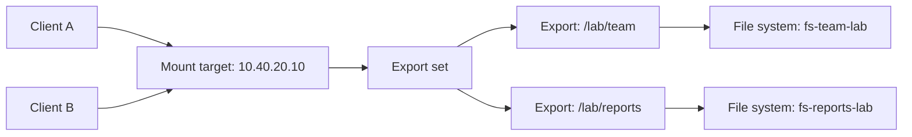

# File systems, mount targets và export paths

## 1. Bối cảnh và mục tiêu

Trong chương **File Storage** của module **CLOUD_PROVIDERS_ORACLE**, bài học này giải thích cách một ứng dụng truy cập hệ thống tệp dùng chung trên Oracle Cloud Infrastructure. Bạn sẽ nối các khái niệm lưu trữ với Compute, VCN, compartment và IAM, đồng thời nhận diện những quyết định ảnh hưởng đến khả năng vận hành, tính sẵn sàng và chi phí.

Giả sử hai instance chạy ứng dụng Java cần đọc cùng một tập tài liệu và trao đổi tệp đầu vào. Nếu mỗi máy lưu tệp trong boot volume riêng, chúng không tự nhìn thấy dữ liệu của nhau. OCI File Storage cung cấp một hệ thống tệp qua mạng để các client cùng truy cập theo quyền được cấp.

Sau bài này, bạn có thể:

- Phân biệt file system, mount target, export và export set.
- Đọc đúng một địa chỉ mount gồm endpoint và export path.
- Phân biệt export path, mount point trên client và đường dẫn bên trong file system.
- Triển khai một bài lab chia sẻ dữ liệu giữa hai client Linux.
- Tách lỗi mạng, lỗi export và lỗi quyền file; hiểu tác động khi unmount hoặc xóa tài nguyên.

Các lệnh là ví dụ cho môi trường OCI được phép quản trị, không phải yêu cầu thực thi trên máy đang chứa tài liệu. IP, OCID, tên tài nguyên và tài khoản minh họa phải được thay bằng giá trị của bài lab. Ví dụ NFS cơ bản bên dưới giả định dùng `AUTH_SYS`, chưa triển khai Kerberos hoặc TLS tunnel.

## 2. File Storage cung cấp điều gì?

OCI File Storage là dịch vụ hệ thống tệp mạng được quản lý. Dịch vụ hỗ trợ NFSv3 và NLM cho chức năng khóa tệp. Các client có kết nối mạng phù hợp có thể cùng truy cập cây thư mục; không cần tự dựng một máy ảo làm NFS server cho bài thực hành này. [Oracle: Overview of File Storage](https://docs.oracle.com/en-us/iaas/Content/File/Concepts/filestorageoverview.htm).

Để chọn đúng mô hình, hãy bắt đầu từ cách ứng dụng sử dụng dữ liệu:

| Mô hình truy cập | Cách ứng dụng nhìn dữ liệu | Ví dụ nhu cầu |
| --- | --- | --- |
| File storage | File và thư mục được mount vào hệ điều hành | Nhiều máy cùng đọc tài liệu hoặc chia sẻ thư mục xử lý |
| Block storage | Thiết bị khối để hệ điều hành hoặc phần mềm quản lý | Ổ dữ liệu của một máy hoặc thiết kế storage có cơ chế phối hợp riêng |
| Object storage | Object được truy cập qua API | Lưu đối tượng theo key, tích hợp qua HTTP hoặc SDK |

Một bucket không tự có cùng ngữ nghĩa với một filesystem được mount. Tương tự, gắn cùng block volume vào nhiều máy không tự tạo ra một filesystem chia sẻ an toàn. Cần chọn theo yêu cầu về truy cập, đồng thời kiểm tra điều kiện hỗ trợ của workload.

Đối với Oracle Database, không suy luận rằng cứ mount NFS thành công là cấu hình đã đáp ứng mọi yêu cầu database. Kiểu triển khai, phiên bản, support matrix, khóa, độ trễ và phương án backup vẫn phải được thiết kế riêng.

## 3. Bốn tài nguyên và một điểm mount trên client

### File system: nơi chứa cây dữ liệu

**File system** là tài nguyên chứa file, thư mục và metadata của chúng. Nó có OCID riêng và tồn tại độc lập với tên thư mục mà một client chọn để truy cập.

Ví dụ, file system `fs-team-lab` có thể chứa thư mục `incoming`, `processed` và `reports`. Đổi tên hiển thị của tài nguyên không phải là đổi tên từng file bên trong.

### Mount target: endpoint NFS trong mạng

**Mount target** là điểm truy cập mạng được quản lý, đặt trong subnet được chọn. Nó cung cấp IP hoặc tên DNS để client kết nối. Một mount target có thể phục vụ nhiều file system thông qua các export; không cần mặc định tạo một mount target mới cho mỗi file system. [Oracle: Managing Mount Targets](https://docs.oracle.com/en-us/iaas/Content/File/Tasks/managingmounttargets.htm).

Mount target là đường vào dữ liệu, không phải một thư mục và cũng không phải ổ đĩa cục bộ của client.

### Export: liên kết file system với một địa chỉ truy cập

**Export** liên kết file system với export set của mount target, có export path cùng các lựa chọn truy cập của client. Nó trả lời câu hỏi: client dùng đường dẫn nào tại endpoint này để truy cập file system nào, với quy tắc nào?

### Export set: tập export của mount target

**Export set** tập hợp các export do mount target cung cấp. Khi làm việc qua CLI hoặc API, cần phân biệt OCID của export set với OCID của mount target và OCID của file system.

Mô hình minh họa:



Các quy tắc export quyết định cách file system được đưa ra qua mount target. Một file system cũng có thể được export qua mount target khác phù hợp với điều kiện dịch vụ; việc có thêm endpoint không tự tạo thêm bản sao dữ liệu. [Oracle: NFS Exports and Export Options](https://docs.oracle.com/en-us/iaas/Content/File/Tasks/exportoptions.htm).

### Mount point: thư mục do client lựa chọn

**Mount point** là thư mục cục bộ nơi hệ điều hành gắn filesystem từ xa vào cây thư mục của client. Nó không phải tài nguyên OCI có OCID.

Client A có thể dùng `/mnt/team-share`, trong khi client B dùng `/srv/team-share` để truy cập cùng file system. Hai tên cục bộ khác nhau không làm dữ liệu bị tách thành hai bản.

## 4. Phân biệt ba loại đường dẫn

Xét lệnh:

```bash
sudo mount -t nfs -o vers=3,proto=tcp,hard \
  10.40.20.10:/lab/team /mnt/team-share
```

| Thành phần | Vai trò |
| --- | --- |
| `10.40.20.10` | IP của mount target |
| `/lab/team` | Export path tại mount target |
| `/mnt/team-share` | Mount point trên client |
| `/incoming/order-101.csv` | Ví dụ đường dẫn tính từ root bên trong file system |

Sau khi mount export ở trên, file ví dụ được truy cập trên client A tại:

```text
/mnt/team-share/incoming/order-101.csv
```

Nếu client B mount cùng export tại `/srv/team-share`, đường dẫn tương ứng là:

```text
/srv/team-share/incoming/order-101.csv
```

Export path không tự tạo các thư mục `lab/team` trong dữ liệu. Vì vậy, không tự nối nó thêm lần nữa thành `/mnt/team-share/lab/team/incoming/order-101.csv`.

Theo mô hình của OCI, export path định danh file system tại mount target và độc lập với đường dẫn trong file system cũng như mount point của client. [Oracle: Paths in File Systems](https://docs.oracle.com/en-us/iaas/Content/File/Concepts/filesystempaths.htm).

Hệ quả thiết kế: đặt hai tên export khác nhau không tự tạo hai vùng dữ liệu độc lập. Muốn tách dữ liệu, phải thiết kế file system, thư mục, quyền truy cập và cơ chế cấp phát tương ứng; tên đường dẫn chỉ là một phần của thiết kế đó.

## 5. Quy tắc đặt export path

Export path cần ổn định vì client và cấu hình triển khai sẽ tham chiếu đến nó. Chọn tên thể hiện mục đích, không chứa mật khẩu, token hoặc thông tin cần giữ bí mật.

Các quy tắc quan trọng gồm: bắt đầu bằng `/`, không có dấu `/` ở cuối, không chứa phần tử `.` hoặc `..`, và không tạo quan hệ đường dẫn cha/con xung đột trong cùng export set. [Oracle: Creating an Export](https://docs.oracle.com/en-us/iaas/Content/File/Tasks/create-export.htm).

| Các path trong cùng export set | Đánh giá |
| --- | --- |
| `/lab/team` và `/lab/reports` | Hai nhánh khác nhau, phù hợp cho ví dụ |
| `/team` và `/team2` | Hai phần tử tên khác nhau |
| `/lab` và `/lab/team` | Xung đột vì một path chứa đầy đủ chuỗi phần tử của path kia |
| `/` và `/lab/team` | Xung đột với root path |
| `/lab/team/` | Có dấu `/` cuối, không phù hợp |
| `/lab/../team` | Có phần tử `..`, không phù hợp |

Không nhầm quy tắc trên với việc tạo thư mục cha/con bên trong filesystem. Trong dữ liệu, bạn vẫn có thể thiết kế cây thư mục `incoming/2026/11` bình thường theo quyền được cấp.

Export path không chỉnh sửa trực tiếp sau khi export được tạo. Nếu cần đổi, phải lập kế hoạch tạo hoặc thay thế export theo ràng buộc tài nguyên hiện có và cập nhật client. Đây không phải thao tác rename một thư mục cục bộ. Trước thay đổi, thống kê các client, cấu hình mount tự động và ứng dụng phụ thuộc vào path cũ.

## 6. Placement: availability domain, subnet và compartment

File system được export qua mount target nằm trong cùng availability domain với nó. Client không bắt buộc nằm cùng availability domain chỉ để thực hiện truy cập NFS; điều kiện mạng và đặc tính đường truyền vẫn phải đáp ứng nhu cầu. [Điều kiện tạo export](https://docs.oracle.com/en-us/iaas/Content/File/Tasks/create-export.htm).

Khi thiết kế bài lab, có thể chọn:

| Thành phần | Giá trị minh họa |
| --- | --- |
| Client subnet | `10.40.10.0/24` |
| Client A | `10.40.10.11` |
| Client B | `10.40.10.12` |
| Mount target subnet | `10.40.20.0/24` |
| Mount target IP | `10.40.20.10` |
| Export path | `/lab/team` |

Đây là sơ đồ địa chỉ minh họa, không bảo đảm các IP đó đang trống trong VCN thật. Phải đọc IP đã được cấp cho mount target trước khi dùng trong lệnh.

Oracle khuyến nghị tách subnet của client và mount target để dễ kiểm soát địa chỉ và tránh ảnh hưởng tới lượng IP cần cho dịch vụ. Mount target cần nhiều địa chỉ IP; không chỉ tính một IP xuất hiện trong lệnh mount khi quy hoạch subnet. [Oracle: VCN Security Rules for File Storage](https://docs.oracle.com/en-us/iaas/Content/File/Tasks/securitylistsfilestorage.htm).

Compartment giúp tổ chức tài nguyên và phạm vi quyền quản trị. Đặt client và file system trong hai compartment khác nhau không tự tạo tường lửa giữa chúng. Ngược lại, cùng compartment không có nghĩa là NFS được phép truy cập.

Nếu client ở on-premises, phải có đường mạng như VPN hoặc FastConnect và định tuyến phù hợp. Không đưa NFS ra Internet công khai để thay thế cho kết nối riêng được thiết kế đúng.

## 7. Các lớp quyền độc lập

### IAM quản lý tài nguyên, NFS truy cập dữ liệu

IAM điều khiển thao tác quản trị như xem, tạo, cập nhật hoặc xóa tài nguyên File Storage. Quyền đọc file trên client còn phụ thuộc mạng, export và cơ chế quyền của filesystem. [Oracle: About File Storage Security](https://docs.oracle.com/en-us/iaas/Content/File/Concepts/securitylayers.htm).

Ví dụ policy cho nhóm chỉ quan sát tài nguyên trong compartment lab:

```text
Allow group FileStorageObservers to read file-family in compartment storage-lab
```

Tên group và compartment phải phù hợp tenancy, kể cả định danh identity domain nếu được sử dụng. Policy trên không phải quyền tạo hạ tầng hoặc cấu hình mạng đầy đủ, và không tự làm cho một tài khoản Linux đọc được mọi file qua NFS. [Oracle: File Storage policy reference](https://docs.oracle.com/en-us/iaas/Content/Identity/Reference/filestoragepolicyreference.htm).

### Mạng cần phục vụ đúng giao thức

NFSv3 có các thành phần RPC, MOUNT và khóa, nên chỉ mở TCP/2049 chưa phải cấu hình đầy đủ cho mọi trường hợp. Với kịch bản client và mount target ở hai subnet khác nhau, tài liệu OCI mô tả nhóm port thông thường sau:

| Giao thức | Destination port tại mount target |
| --- | --- |
| TCP | `111`, `2048`, `2049`, `2050` |
| UDP | `111`, `2048` |

Cần cấu hình ingress về mount target, egress từ client và các điều kiện stateful hoặc stateless theo kịch bản thật. Giới hạn nguồn vào IP hoặc CIDR của client được phép. Các quy tắc cho TLS, Kerberos hoặc mạng khác có thể khác bảng minh họa. [Mẫu security rules của OCI](https://docs.oracle.com/en-us/iaas/Content/File/Tasks/securitylistsfilestorage.htm).

### Export options giới hạn từng nguồn client

Export options có thể quy định nguồn IP/CIDR, read-only hay read/write, yêu cầu privileged source port và ánh xạ danh tính như root squash. Với lab hai client, một kế hoạch là chỉ cho hai IP `/32` đã chọn truy cập, thay vì mở toàn bộ nguồn.

| Client | Nguồn minh họa | Quyền dữ liệu cần dùng |
| --- | --- | --- |
| A | `10.40.10.11/32` | Read/write |
| B | `10.40.10.12/32` | Read/write cho bài kiểm tra chia sẻ |

Đọc thứ tự export options khi có các CIDR chồng lấp: OCI áp dụng mục khớp đầu tiên, không tự chọn mục có prefix dài nhất. Root squash có thể ánh xạ root của client thành danh tính ẩn danh, nên `sudo` trên client không đương nhiên vượt quyền trên file system. [Oracle: NFS Export Options](https://docs.oracle.com/en-us/iaas/Content/File/Tasks/exportoptions.htm).

### Quyền UNIX và định danh ứng dụng

Với `AUTH_SYS`, cần kiểm soát UID/GID số và các quyền file, thư mục. Cùng tên `appuser` nhưng UID khác trên hai máy không bảo đảm được coi là cùng chủ sở hữu dữ liệu. Ngược lại, chỉ nhìn tên hiển thị từ `ls -l` có thể che mất khác biệt số định danh.

Yêu cầu privileged source port và root squash là các lớp bảo vệ, không phải xác thực mật mã cho từng ứng dụng. Client được phép và quyền quản trị trên client vẫn thuộc phạm vi tin cậy của thiết kế. Với nhu cầu danh tính mạnh hơn, cần thiết kế Kerberos hoặc cơ chế hỗ trợ tương ứng.

NFS thông thường qua IP private không tự có mã hóa đường truyền. OCI có giải pháp TLS bằng `oci-fss-utils` hoặc stunnel, và có tùy chọn Kerberos bảo vệ dữ liệu. Ví dụ mount cơ bản của bài này chưa bật các cơ chế đó. [Oracle: In-transit TLS Encryption](https://docs.oracle.com/en-us/iaas/Content/File/Tasks/intransitencryption.htm).

## 8. Tạo và kiểm kê tài nguyên của bài lab

Một trình tự triển khai có thể tái lập là:

1. Chọn region, compartment, availability domain và hai subnet theo thiết kế.
2. Chuẩn bị NSG hoặc security list với nguồn client cụ thể.
3. Tạo file system `fs-team-lab`.
4. Tạo hoặc dùng lại mount target phù hợp; ghi lại IP thật và OCID của export set.
5. Tạo export `/lab/team` liên kết đúng file system, kiểm tra từng export option.
6. Lấy lệnh mount mẫu từ export và đối chiếu endpoint trước khi sử dụng.

Luồng tạo file system trong Console có thể tạo kèm mount target và export. Vì vậy, sau khi chạy wizard, đọc lại những tài nguyên thực tế đã được tạo trước khi tạo thêm bằng tay. Một bài lab không cần hai mount target trùng mục đích chỉ vì hai client cần mount cùng dữ liệu.

Từ môi trường quản trị có OCI CLI và quyền đọc phù hợp, có thể kiểm kê:

```bash
FILE_SYSTEM_OCID='ocid1.filesystem.oc1..EXAMPLE'
MOUNT_TARGET_OCID='ocid1.mounttarget.oc1..EXAMPLE'
EXPORT_SET_OCID='ocid1.exportset.oc1..EXAMPLE'

oci fs file-system get \
  --file-system-id "$FILE_SYSTEM_OCID" \
  --output json

oci fs mount-target get \
  --mount-target-id "$MOUNT_TARGET_OCID" \
  --output json

oci fs export list \
  --export-set-id "$EXPORT_SET_OCID" \
  --all \
  --output json
```

Các lệnh này chỉ đọc tài nguyên; không tạo file trong NFS. So sánh OCID, availability domain, export set, path và trạng thái lifecycle thay vì dựa vào tên hiển thị. [CLI: file-system get](https://docs.oracle.com/en-us/iaas/tools/oci-cli/latest/oci_cli_docs/cmdref/fs/file-system/get.html), [mount-target get](https://docs.oracle.com/en-us/iaas/tools/oci-cli/latest/oci_cli_docs/cmdref/fs/mount-target/get.html), [export list](https://docs.oracle.com/en-us/iaas/tools/oci-cli/latest/oci_cli_docs/cmdref/fs/export/list.html).

## 9. Mount trên client Linux

### Chuẩn bị NFS client và thư mục mount

Cài gói phù hợp với hệ điều hành. Ví dụ Oracle Linux có thể dùng:

```bash
sudo dnf install nfs-utils
```

Với Ubuntu:

```bash
sudo apt-get update
sudo apt-get install nfs-common
```

Sau đó tạo mount point mới dành riêng cho bài lab:

```bash
sudo mkdir -p /mnt/team-share
sudo ls -A /mnt/team-share
```

Nếu thư mục đã có nội dung hoặc đã được mount, xác định nguồn gốc trước khi tiếp tục. Mount lên một thư mục có file cục bộ không tự chuyển các file đó vào NFS; nó có thể làm chúng tạm thời bị che dưới điểm mount.

### Mount và xác minh nguồn thực tế

Sau khi xác nhận IP và export path thật:

```bash
sudo mount -t nfs -o vers=3,proto=tcp,hard \
  10.40.20.10:/lab/team /mnt/team-share

findmnt --mountpoint /mnt/team-share \
  -o TARGET,SOURCE,FSTYPE,OPTIONS
```

Dùng lệnh mẫu OCI cung cấp cho export và điều chỉnh theo yêu cầu đã thiết kế. Client phải có gói NFS và đường mạng đúng. [Oracle: Mounting File Systems From UNIX-Style Instances](https://docs.oracle.com/en-us/iaas/Content/File/Tasks/mountingunixstyleos.htm).

`vers=3` chọn NFSv3; `proto=tcp` chọn TCP cho NFS; `hard` giữ cơ chế retry khi server không phản hồi theo ngữ nghĩa hard mount. Hệ quả là thao tác I/O có thể chờ lâu khi mất kết nối. Không chuyển sang `soft` tùy tiện chỉ để hết chờ vì điều đó thay đổi cách ứng dụng nhận lỗi I/O.

Đừng chỉ kiểm tra thư mục tồn tại. Khi NFS chưa mount, ứng dụng vẫn có thể ghi vào thư mục local cùng tên, tạo dữ liệu trên boot volume thay vì vùng dùng chung. Kiểm tra `SOURCE` và `FSTYPE` trước khi chạy thử luồng ghi dữ liệu.

## 10. Kiểm tra chia sẻ file giữa hai client

### Chuẩn bị quyền cho tài khoản ứng dụng

Giả sử tài khoản thực hành có cùng UID/GID trên A và B. Quản trị viên cần chuẩn bị thư mục `incoming` trong file system và cấp quyền phù hợp cho nhóm ứng dụng.

Trên một client quản trị đã mount đúng file system và có danh tính được phép thực hiện thao tác, ví dụ UID/GID ứng dụng là `2001:2001`:

```bash
# Chỉ chạy khi đã xác nhận quyền quản trị dữ liệu và UID/GID thật.
sudo mkdir -p /mnt/team-share/incoming
sudo chown 2001:2001 /mnt/team-share/incoming
sudo chmod 2770 /mnt/team-share/incoming
```

Bit setgid giúp thư mục mới kế thừa group của thư mục cha; quyền file còn chịu ảnh hưởng của umask và cách ứng dụng tạo file. Nếu root squash đang chặn thao tác trên, phải dùng quy trình cấp quyền ban đầu được kiểm soát, chẳng hạn client quản trị giới hạn theo IP và quyền tạm đã được phê duyệt trong môi trường. Không tắt squash cho mọi client hoặc đổi thành `chmod 777` để che lỗi quyền.

### Tạo file nhỏ từ client A

Chạy bằng tài khoản ứng dụng có quyền ghi trong `incoming`, sau khi kiểm tra mount:

```bash
mountpoint -q /mnt/team-share || exit 1
id

test_file="$(mktemp /mnt/team-share/incoming/oci-lab.XXXXXX)"
printf 'Created by client A for the OCI File Storage lab.\n' > "$test_file"
printf 'Relative path: incoming/%s\n' "$(basename "$test_file")"
stat -c '%u:%g %a %n' "$test_file"
```

Ghi lại tên file ngẫu nhiên được trả về. `mktemp` thường tạo file chỉ chủ sở hữu đọc/ghi; nếu muốn thử bằng tài khoản khác hoặc chia sẻ theo group, phải cấp quyền đọc có chủ đích. Trong ví dụ này, client B dùng cùng danh tính UID ứng dụng.

### Đọc từ client B với mount point khác

Trên B, mount cùng endpoint và export tại `/srv/team-share`:

```bash
sudo mkdir -p /srv/team-share
sudo mount -t nfs -o vers=3,proto=tcp,hard \
  10.40.20.10:/lab/team /srv/team-share

findmnt --mountpoint /srv/team-share \
  -o TARGET,SOURCE,FSTYPE,OPTIONS
```

Sau đó, bằng tài khoản ứng dụng có UID phù hợp, đọc đúng tên file A vừa tạo. Trong ví dụ sau, `oci-lab.ABC123` là tên minh họa cần thay:

```bash
cat /srv/team-share/incoming/oci-lab.ABC123
stat -c '%u:%g %a %n' /srv/team-share/incoming/oci-lab.ABC123
```

Kết quả cần đạt là B đọc đúng nội dung A đã ghi sau khi file được đóng và mở lại, cùng owner số dự kiến. Không phải copy file qua SSH giữa hai máy.

Nhiều client nhìn cùng dữ liệu không tự tạo giao dịch nghiệp vụ an toàn. Nếu hai tiến trình cùng ghi một file, ứng dụng vẫn cần thiết kế locking, tên file duy nhất, cách xuất bản kết quả và xử lý lỗi. Một bài kiểm tra đọc/ghi nhỏ không phải benchmark hay chứng nhận tính đúng đắn của workload đồng thời.

## 11. Mount tự động và phụ thuộc của ứng dụng

Sau khi mount thủ công hoạt động, mới đưa cấu hình vào cơ chế khởi động. Ví dụ một dòng `/etc/fstab` cho mount NFS thông thường:

```fstab
10.40.20.10:/lab/team /mnt/team-share nfs defaults,_netdev,vers=3,proto=tcp,hard 0 0
```

Đối chiếu tùy chọn với hệ điều hành và yêu cầu ứng dụng. `_netdev` biểu thị filesystem phụ thuộc mạng; nó không tự kiểm tra dữ liệu đúng hoặc ứng dụng đã sẵn sàng.

Nếu mount là bắt buộc, ứng dụng phải chờ đúng filesystem trước khi ghi. Nếu mount là tùy chọn, ứng dụng cần hành vi rõ ràng khi storage chưa có. Thêm `nofail` để máy tiếp tục boot không giải quyết nguy cơ ứng dụng ghi nhầm vào thư mục local.

Kiểm tra một lần khởi động lại trong môi trường lab khi đã có đường quản trị dự phòng. Tiêu chí không chỉ là instance boot được mà còn là mount đúng nguồn và dịch vụ xử lý được dữ liệu. Đưa cấu hình client, UID/GID và đường dẫn ứng dụng vào tự động hóa để các máy thay thế giữ cùng hành vi.

## 12. Chẩn đoán theo lớp và quản lý vòng đời

### Khi truy cập thất bại

| Triệu chứng | Lớp cần kiểm tra trước | Bằng chứng hữu ích |
| --- | --- | --- |
| Mount timeout | Route, IP, NSG/security list, firewall client | IP thật của mount target, quy tắc đúng nguồn, trạng thái endpoint |
| Access denied khi mount | Export path và export options | Export đang hoạt động, source client, auth mode, yêu cầu source port |
| Mount được nhưng không ghi được | Read-only, squash, UID/GID và mode bits | `id`, `stat`, mount options và export options |
| A có file, B không thấy | Hai máy có mount cùng file system không | `findmnt`, export set, path và file system OCID |
| Thư mục có file nhưng không có NFS mount | Dữ liệu đã ghi vào local disk | Source/FSTYPE và thời điểm ứng dụng bắt đầu ghi |
| DNS mount lỗi nhưng IP hoạt động | Phân giải DNS hoặc loại công cụ mount | Tên DNS thật, resolver và điều kiện hỗ trợ của client |

Lấy lại lệnh mount mẫu từ export để giảm lỗi nhập path. Một export path đúng trên mount target này không bảo đảm tồn tại trên mount target khác. [Oracle: Mount Command Fails](https://docs.oracle.com/en-us/iaas/Content/File/Troubleshooting/exportpaths.htm).

### Unmount, xóa export và xóa mount target

Trước khi unmount, dừng luồng ghi của ứng dụng và xác nhận không còn tác vụ phụ thuộc. Với mount NFS thông thường của bài lab:

```bash
sudo umount /mnt/team-share
```

Không dùng force hoặc lazy unmount mặc định chỉ để bỏ qua thông báo busy. Nếu dùng TLS helper, phải theo cách unmount riêng của công cụ đó.

| Thao tác | Tác động cần hiểu |
| --- | --- |
| Unmount trên A | A ngừng gắn filesystem tại mount point đó; dữ liệu vẫn thuộc file system từ xa |
| Xóa export | Mất đường truy cập qua export đó; không xóa dữ liệu trong file system |
| Xóa mount target | Xóa các export của mount target và làm mất đường truy cập tương ứng; dữ liệu và snapshot vẫn còn |
| Xóa file system | Là thao tác xóa tài nguyên dữ liệu, phải kiểm tra quyền, dữ liệu và chính sách bảo toàn trước khi thực hiện |

Nguồn: [Oracle: Deleting an Export](https://docs.oracle.com/en-us/iaas/Content/File/Tasks/delete-export.htm), [Deleting a Mount Target](https://docs.oracle.com/en-us/iaas/Content/File/Tasks/delete-mount-target.htm).

Một mount target được nhiều file system dùng chung tạo quan hệ phụ thuộc chung. Trước khi thay endpoint hoặc đổi rules, thống kê toàn bộ export và client chịu ảnh hưởng. Xóa file bằng đường dẫn đang mount là thao tác lên dữ liệu dùng chung; không coi đó là “dọn thư mục mount cục bộ”.

## 13. Tính sẵn sàng, dung lượng và chi phí

Dịch vụ được quản lý giúp giảm việc tự vận hành NFS server, nhưng ứng dụng vẫn cần xử lý mạng gián đoạn và phụ thuộc storage. Tạo thêm mount target không tự biến một file system thành bản sao ở availability domain khác; phương án phục hồi cần xét dữ liệu, snapshot hoặc replication riêng theo mục tiêu.

Theo dõi đồng thời lỗi mount/I/O, độ trễ nghiệp vụ, số client và dung lượng thực tế. Không suy từ dung lượng lớn mà `df` hiển thị rằng bạn đã mua một ổ đĩa cục bộ cùng kích thước.

OCI cung cấp thông tin metering và quota với ý nghĩa khác nhau. `meteredBytes` phục vụ theo dõi dung lượng tính phí; dữ liệu live, metadata, snapshot và clone có thể làm các phép đo khác nhau. Các quota có phạm vi và cách tính riêng. [Oracle: File System Usage and Metering](https://docs.oracle.com/en-us/iaas/Content/File/Concepts/FSutilization.htm).

Bài lab chỉ cần ít file nhỏ và mức hiệu năng phù hợp. Không nâng mức hiệu năng hoặc tạo thêm filesystem chỉ để kiểm tra một lệnh mount. Khi kết thúc, kiểm kê dữ liệu thử, snapshot, filesystem, mount target và client phát sinh; chỉ dọn tài nguyên được xác nhận thuộc bài thực hành và không còn phụ thuộc.

## 14. Tiêu chí hoàn thành bài thực hành

Một kết quả thực hành có thể kiểm chứng cần thể hiện:

1. File system, mount target, export set và export liên kết đúng qua OCID.
2. Client dùng đúng endpoint, export path và mount point riêng của mình.
3. Rules mạng và export options chỉ cho các nguồn cần thiết.
4. Tài khoản ứng dụng có UID/GID và quyền dữ liệu được chuẩn bị rõ ràng.
5. Client B đọc được file do A tạo trên cùng file system, không qua sao chép giữa máy.
6. Ứng dụng phát hiện được tình trạng mount vắng mặt, tránh ghi nhầm vào local disk.
7. Có danh sách tài nguyên, cách dừng truy cập và kế hoạch dọn lab.

Biên bản nên ghi sơ đồ liên kết, cấu hình truy cập, kết quả `findmnt`, tên file thử và kết quả đọc từ client thứ hai. Che thông tin hạ tầng không cần thiết khi chia sẻ ra ngoài môi trường học.

Điểm cốt lõi là tách dữ liệu, endpoint và tên đường dẫn: file system chứa dữ liệu; mount target cung cấp đường vào mạng; export ánh xạ file system với export path và quyền truy cập; mount point là cách từng client gắn dữ liệu đó vào cây thư mục của mình.
