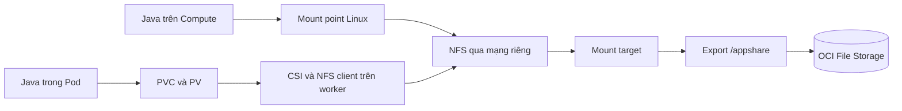

# Kết nối NFS từ compute instance và Kubernetes

Một API Java chạy trên nhiều máy có thể cần cùng truy cập các file tải lên hoặc tài liệu xử lý. Với Oracle Cloud Infrastructure File Storage, ứng dụng truy cập một filesystem dùng chung qua mạng bằng NFS. Trên Compute, hệ điều hành mount filesystem vào một thư mục. Trên Kubernetes, ứng dụng thường sử dụng đường dẫn đã được đưa vào container thông qua PersistentVolume và PersistentVolumeClaim.

Bài học hướng dẫn hai cách kết nối tới một filesystem OCI đã chuẩn bị, đồng thời chỉ ra những lớp phải kiểm tra khi mount thành công nhưng ứng dụng vẫn không ghi được dữ liệu. Các ví dụ Kubernetes tập trung vào OKE với managed worker nodes; cluster tự quản lý cần cài và cấu hình tích hợp lưu trữ tương ứng.

## 1. Đường đi từ ứng dụng tới File Storage

| Thành phần | Vai trò |
| --- | --- |
| File system | Chứa file, thư mục và metadata của dữ liệu dùng chung |
| Mount target | Cung cấp địa chỉ mạng để NFS client kết nối |
| Export và export path | Xác định filesystem được truy cập qua đường dẫn nào ở mount target |
| Export options | Điều khiển các nguồn client được phép truy cập, kiểu truy cập và ánh xạ danh tính |
| NFS client | Thành phần trong hệ điều hành thực hiện kết nối và thao tác filesystem |
| Mount point | Thư mục cục bộ nơi ứng dụng nhìn thấy filesystem đã mount |

Ví dụ giả định xuyên suốt bài:

```text
Mount target IP:      10.0.1.10
Export path:          /appshare
Mount point trên VM:  /mnt/oci-share
Thư mục ứng dụng:     order-api
Đường dẫn trong Pod:  /data/order-api
```

Các giá trị này phải được thay hoặc xác nhận theo môi trường thật. Export path trên máy chủ và thư mục mount trên client là hai đường dẫn khác nhau: `/appshare` có thể được mount vào `/mnt/oci-share` trên VM và `/data` trong container.



Sơ đồ mô tả đường truy cập dữ liệu. OCI IAM quản lý các thao tác tài nguyên qua API; quyền truy cập file còn phụ thuộc đường mạng, export và danh tính ở tầng filesystem.

## 2. Chuẩn bị và kiểm tra theo từng lớp

Trước khi mount, cần có filesystem, mount target và export đã được tạo; biết địa chỉ mount target và đúng export path; có client với tuyến mạng tới mount target. Nếu dùng Kubernetes, xác định loại node, driver lưu trữ và danh tính được tích hợp với OCI.

### 2.1. Quy tắc mạng

Với cấu hình NFS thông thường trong ví dụ, hướng dẫn OCI cho client và mount target ở hai subnet chỉ định các luồng sau:

| Hướng | Giao thức | Destination ports |
| --- | --- | --- |
| Client tới mount target | TCP | 111, 2048, 2049, 2050 |
| Client tới mount target | UDP | 111, 2048 |

Thiết lập ingress phía mount target và egress phía client phù hợp với nguồn/đích được phép. Các cổng phục vụ nhiều thành phần RPC/NFS; chỉ mở TCP 2049 có thể chưa đủ. Nếu dùng Kerberos, LDAP, DNS hoặc mô hình mạng khác, kiểm tra thêm các luồng tương ứng. [Oracle: Configuring VCN Security Rules for File Storage](https://docs.oracle.com/en-us/iaas/Content/File/Tasks/securitylistsfilestorage.htm)

Ưu tiên phạm vi nguồn cụ thể, chẳng hạn subnet hoặc nhóm client được quản lý. Đối chiếu cả NSG, security list, route và firewall trong hệ điều hành. Có thể đặt client và mount target ở subnet khác nhau nếu đường mạng được thiết kế đúng.

Trong OKE, thao tác mount trên managed node do thành phần lưu trữ phía node thực hiện. Phải xác định địa chỉ nguồn thực tế của luồng NFS; không mặc định rằng chỉ cần cho phép Pod CIDR. Khi workload được chuyển sang worker khác, worker đó cũng cần kết nối được tới mount target.

### 2.2. Export options và quyền filesystem

Export options có thể giới hạn source CIDR, read-only/read-write, cổng nguồn đặc quyền và identity squash. Với root squash, yêu cầu từ root có thể bị ánh xạ sang UID/GID khác; `sudo` trên client vì vậy không tự đảm bảo quyền quản trị mọi file trên server. [Oracle: Working with NFS Exports and Export Options](https://docs.oracle.com/en-us/iaas/Content/File/Tasks/exportoptions.htm)

Phân biệt các lớp quyền sau:

| Lớp | Ví dụ câu hỏi kiểm tra |
| --- | --- |
| IAM | Danh tính vận hành có được tạo hoặc xem filesystem, mount target và export không? |
| Network | Gói tin từ đúng client có tới được mount target không? |
| Export | Source có được cho phép và có quyền ghi không? |
| UID/GID và mode | Tài khoản chạy Java có quyền duyệt thư mục và tạo file không? |
| Ứng dụng | Đường dẫn cấu hình có trỏ tới đúng mount không? |

Trong ví dụ dùng `sec=sys`, UID/GID mà client trình bày là phần quan trọng của quyền file. Chuẩn hóa UID/GID giữa VM và container cần chia sẻ dữ liệu; tên tài khoản giống nhau trên hai máy chưa chứng minh các ID số giống nhau.

## 3. Mount từ Linux Compute instance

Các lệnh dưới đây dùng shell Linux trên một VM thử nghiệm được cấp quyền. Đây là hướng dẫn thực hành, chưa phải kết quả triển khai đã chạy. Cần quyền quản trị hệ điều hành để cài NFS client và mount; ứng dụng không cần chạy bằng root để sử dụng một thư mục đã được cấp quyền đúng.

### 3.1. Cài NFS client

Chọn lệnh phù hợp với bản phân phối đang dùng:

```bash
# Oracle Linux và các hệ thống phù hợp dùng dnf:
sudo dnf install -y nfs-utils

# Hoặc trên Ubuntu/Debian, dùng các lệnh này thay cho lệnh trên:
# sudo apt-get update
# sudo apt-get install -y nfs-common
```

Kiểm tra quyền truy cập package repository theo thiết kế mạng của VM. Khi sử dụng image tùy chỉnh, xác nhận công cụ NFS cần thiết đã có trong image hoặc quy trình bootstrap.

### 3.2. Tạo mount point và mount export

Kiểm tra thư mục đích trước để tránh che khuất file cục bộ đã có. Sau đó:

```bash
MT_IP='10.0.1.10'
EXPORT_PATH='/appshare'
MOUNT_DIR='/mnt/oci-share'

sudo mkdir -p "$MOUNT_DIR"
sudo mount -t nfs \
  -o vers=3,hard,nosuid,resvport,sec=sys \
  "${MT_IP}:${EXPORT_PATH}" "$MOUNT_DIR"

findmnt --mountpoint "$MOUNT_DIR"
```

Ví dụ dùng NFSv3 với AUTH_SYS. `nosuid` vô hiệu hóa tác dụng của set-user-ID/set-group-ID trên mount; `resvport` dùng cổng nguồn đặc quyền, cần thiết khi export yêu cầu loại cổng này. Không dùng `soft` cho workload ghi chỉ để tránh chờ I/O: OCI cảnh báo rủi ro hỏng dữ liệu với kiểu mount đó. [Oracle: Mounting File Systems From UNIX-Style Instances](https://docs.oracle.com/en-us/iaas/Content/File/Tasks/mountingunixstyleos.htm)

NFS đã cung cấp filesystem ở phía dịch vụ; không chạy `mkfs` như với một block volume mới. Để kiểm tra đúng nguồn dữ liệu, đọc kết quả `findmnt` thay vì chỉ kiểm tra rằng thư mục tồn tại.

### 3.3. Chuẩn bị thư mục cho tài khoản ứng dụng

Giả sử ứng dụng trong bài dùng UID/GID `1000:1000`. Một quản trị viên có quyền phù hợp trên filesystem chuẩn bị thư mục `order-api`, cho phép danh tính này duyệt và ghi. Nếu export ánh xạ UID/GID, sử dụng danh tính hiệu lực tương ứng khi thiết kế quyền.

Kiểm tra trên VM:

```bash
id
ls -ldn /mnt/oci-share /mnt/oci-share/order-api
```

Sau khi xác nhận tài khoản thử có đúng quyền, tạo file với tên riêng cho bài thực hành:

```bash
printf 'created from compute instance\n' \
  > /mnt/oci-share/order-api/probe-from-vm.txt

cat /mnt/oci-share/order-api/probe-from-vm.txt
```

Không dùng root làm danh tính kiểm tra duy nhất nếu Java chạy bằng tài khoản khác. Đồng thời, tránh mở quyền `0777` cho toàn bộ export để xử lý một lỗi chưa rõ nguyên nhân.

### 3.4. Tự mount sau reboot

Ví dụ một dòng `/etc/fstab` cho cấu hình thử nghiệm trên:

```fstab
10.0.1.10:/appshare /mnt/oci-share nfs vers=3,hard,nosuid,resvport,sec=sys,_netdev,nofail 0 0
```

Bảo toàn các dòng khác, kiểm tra cấu hình mới và thử trong thời điểm được phép. Nếu filesystem là dữ liệu bắt buộc của ứng dụng, service cần kiểm tra mount trước khi ghi; `nofail` không phải bằng chứng rằng dữ liệu đã sẵn sàng khi máy boot.

Nếu volume mạng chưa mount nhưng thư mục cục bộ vẫn tồn tại, ứng dụng có thể ghi nhầm vào boot filesystem. Thiết kế điều kiện khởi động/readiness để phát hiện tình huống này.

## 4. Kết nối trên OKE bằng PV và PVC

OKE hỗ trợ sử dụng File Storage qua tích hợp lưu trữ CSI. Có hai luồng: dùng filesystem hiện hữu bằng PV được tạo trước, hoặc dùng StorageClass để provision động tài nguyên mới. Bài thực hành chọn luồng tĩnh để VM và Pod cùng truy cập export đã xác định. [Oracle: Setting Up Storage for Kubernetes Clusters](https://docs.oracle.com/en-us/iaas/Content/ContEng/Tasks/contengcreatingpersistentvolumeclaim.htm)

| Đối tượng | Vai trò trong bài |
| --- | --- |
| PV | Đại diện filesystem/export mà cluster có thể sử dụng |
| PVC | Yêu cầu lưu trữ trong namespace, được bind với PV |
| Deployment | Chạy hai Pod thử đọc/ghi qua cùng PVC |
| CSI driver | Thực hiện tích hợp lưu trữ giữa Kubernetes và OCI |

`ReadWriteMany` mô tả khả năng mount đọc/ghi từ nhiều node. Nó không tự cấp quyền POSIX, không khóa file thay ứng dụng và không biến nhiều thao tác ghi nghiệp vụ thành một giao dịch. `Retain` giữ tài nguyên lưu trữ để xử lý thủ công sau khi claim được giải phóng. [Kubernetes: Persistent Volumes](https://kubernetes.io/docs/concepts/storage/persistent-volumes/)

### 4.1. Điều kiện trước khi áp dụng manifest

- Cluster thử nghiệm có tích hợp File Storage CSI phù hợp; trên managed nodes, kiểm tra driver đã đăng ký.
- Các worker có đường mạng và export access tới `10.0.1.10:/appshare`.
- Biết OCID của đúng filesystem, không dùng OCID mount target thay thế.
- Thư mục `order-api` có quyền cho UID/GID mà Pod sử dụng.
- Container image thử nghiệm có thể được tải từ registry mà cluster được phép truy cập.

Các lệnh kiểm tra trên cluster đích:

```bash
kubectl config current-context
kubectl get nodes -o wide
kubectl get csidriver fss.csi.oraclecloud.com
kubectl create namespace fss-lab
```

Nếu namespace đã tồn tại, sử dụng namespace thử nghiệm đã được phân công. Trong cluster không có driver OCI tương ứng, việc thêm tên driver vào PV chưa đủ để tạo ra tích hợp hoạt động.

### 4.2. Tạo PV và PVC cho filesystem hiện hữu

Trong môi trường thực hành, chuẩn bị file `fss-storage.yaml`:

```yaml
apiVersion: v1
kind: PersistentVolume
metadata:
  name: order-fss-lab-pv
spec:
  capacity:
    storage: 50Gi
  volumeMode: Filesystem
  accessModes:
    - ReadWriteMany
  persistentVolumeReclaimPolicy: Retain
  storageClassName: ""
  mountOptions:
    - vers=3
    - hard
    - nosuid
    - resvport
    - sec=sys
  csi:
    driver: fss.csi.oraclecloud.com
    volumeHandle: "ocid1.filesystem.oc1.REGION.REPLACE_ME:10.0.1.10:/appshare"
---
apiVersion: v1
kind: PersistentVolumeClaim
metadata:
  name: order-fss-lab-pvc
  namespace: fss-lab
spec:
  accessModes:
    - ReadWriteMany
  volumeMode: Filesystem
  storageClassName: ""
  volumeName: order-fss-lab-pv
  resources:
    requests:
      storage: 50Gi
```

Thay OCID, IP và export path bằng giá trị thật. Với driver File Storage của OCI, `volumeHandle` có dạng `<FileSystemOCID>:<MountTargetIP>:<ExportPath>`. PVC đặt `storageClassName: ""` để dùng PV tĩnh, tránh bị default StorageClass provision sang loại lưu trữ khác. Giá trị `50Gi` trong khai báo Kubernetes không tự áp một quota 50 GiB lên filesystem File Storage. [Oracle: Provisioning PVCs on the File Storage Service](https://docs.oracle.com/en-us/iaas/Content/ContEng/Tasks/contengcreatingpersistentvolumeclaim_Provisioning_PVCs_on_FSS.htm)

Áp dụng và kiểm tra binding:

```bash
kubectl apply -f fss-storage.yaml
kubectl get pv order-fss-lab-pv
kubectl -n fss-lab get pvc order-fss-lab-pvc
```

PVC cần chuyển sang `Bound`. Đây là bằng chứng binding ở tầng Kubernetes; nó chưa chứng minh một worker thực sự mount và ghi được NFS.

### 4.3. Chạy hai Pod thử nghiệm

File `fss-probe.yaml` dưới đây dùng hai container nhỏ để kiểm tra đường lưu trữ. Đây chưa phải manifest triển khai API Java. Có thể thay image bằng image thử nghiệm tương đương đã được tổ chức phê duyệt, có shell và các công cụ dùng trong lệnh.

```yaml
apiVersion: apps/v1
kind: Deployment
metadata:
  name: fss-probe
  namespace: fss-lab
spec:
  replicas: 2
  selector:
    matchLabels:
      app: fss-probe
  template:
    metadata:
      labels:
        app: fss-probe
    spec:
      securityContext:
        runAsNonRoot: true
        runAsUser: 1000
        runAsGroup: 1000
      containers:
        - name: probe
          image: busybox:1.37.0
          command: ["sh", "-ec"]
          args:
            - |
              test -d /data/order-api
              printf 'created by %s\n' "$HOSTNAME" \
                > "/data/order-api/probe-${HOSTNAME}.txt"
              cat /data/order-api/probe-from-vm.txt
              sleep 3600
          securityContext:
            allowPrivilegeEscalation: false
            capabilities:
              drop: ["ALL"]
          resources:
            requests:
              cpu: 10m
              memory: 16Mi
            limits:
              cpu: 100m
              memory: 64Mi
          volumeMounts:
            - name: shared-data
              mountPath: /data
      volumes:
        - name: shared-data
          persistentVolumeClaim:
            claimName: order-fss-lab-pvc
```

Ví dụ cố định UID/GID `1000:1000`, khớp điều kiện thư mục đã chuẩn bị. `runAsUser` và `runAsGroup` xác định danh tính tiến trình; chúng không tự đổi ownership của dữ liệu đang có. `fsGroup` cũng cần được đánh giá cùng hỗ trợ của driver và export, thay vì coi là cách sửa mọi lỗi permission. [Kubernetes: Configure a Security Context](https://kubernetes.io/docs/tasks/configure-pod-container/security-context/)

Chạy và xem kết quả:

```bash
kubectl apply -f fss-probe.yaml
kubectl -n fss-lab get pods -l app=fss-probe -o wide
kubectl -n fss-lab logs -l app=fss-probe --prefix=true
kubectl -n fss-lab exec deployment/fss-probe -- \
  sh -c 'id; ls -ln /data/order-api; cat /data/order-api/probe-from-vm.txt'
```

Trên VM, đọc các file do Pod tạo:

```bash
ls -ln /mnt/oci-share/order-api
cat /mnt/oci-share/order-api/probe-fss-probe-*.txt
```

Đối chiếu tên Pod và nội dung file để xác nhận các client đang dùng cùng dữ liệu. Nếu hai Pod nằm cùng worker, kết quả chưa kiểm tra được đường NFS từ worker thứ hai. Khi cần chứng minh truy cập qua nhiều node, bố trí Pod trên các worker khác nhau theo chính sách scheduling phù hợp rồi ghi lại vị trí thực tế.

## 5. Static provisioning và dynamic provisioning

Luồng tĩnh phù hợp với bài thực hành vì filesystem đã có sẵn và được chia sẻ với VM. Luồng động dùng StorageClass có provisioner `fss.csi.oraclecloud.com`; CSI tạo filesystem và PV cho PVC theo cấu hình đã chọn. Luồng này cần kiểm tra thêm quyền OCI của thành phần provisioner và vòng đời tài nguyên được tạo. [Oracle: Provisioning PVCs on the File Storage Service](https://docs.oracle.com/en-us/iaas/Content/ContEng/Tasks/contengcreatingpersistentvolumeclaim_Provisioning_PVCs_on_FSS.htm)

Trước khi chọn phương án trong hệ thống thật, xác định:

- Ai sở hữu filesystem: nhóm nền tảng hay vòng đời của một workload?
- Các ứng dụng có cần cùng một filesystem hay cần tài nguyên tách biệt?
- Export nào được chia sẻ và nhóm client nào có thể truy cập?
- Khi xóa PVC, reclaim policy và driver sẽ tác động tới tài nguyên nào?
- Có bản sao dữ liệu, quy trình phục hồi và người phê duyệt dọn dữ liệu chưa?

Ví dụ trong bài dùng `Retain`, nhưng đây không phải backup. Trước khi xóa hoặc tạo lại PVC/PV, kiểm tra liên kết với filesystem và tình trạng sử dụng thực tế. Một PV ở trạng thái `Released` cũng chưa tự trở thành tài nguyên sẵn sàng để tùy ý bind lại.

## 6. Tích hợp vào ứng dụng Java

Khi chuyển từ container probe sang API Java, mount cùng PVC vào đường dẫn dữ liệu mà ứng dụng được cấu hình sử dụng. Ví dụ `/data/order-api/uploads` là nơi ứng dụng lưu file; JAR và cấu hình triển khai vẫn được quản lý theo quy trình phát hành của hệ thống.

Các điểm cần thiết kế ở tầng ứng dụng:

| Nội dung | Cách kiểm tra |
| --- | --- |
| Danh tính | UID/GID của tiến trình Java có quyền đúng trên thư mục không? |
| Readiness | Ứng dụng có phát hiện mất khả năng truy cập dữ liệu bắt buộc không? |
| Ghi đồng thời | Hai replica có thể ghi cùng tên file hoặc sửa cùng một nội dung không? |
| Tính nhất quán | Ghi file và ghi metadata database được phối hợp hoặc đối soát thế nào? |
| Hiệu năng | Độ trễ và số thao tác metadata có phù hợp với workload thực tế không? |
| Phục hồi | Dữ liệu chia sẻ được snapshot/backup và thử khôi phục bằng cách nào? |

Nhiều replica cùng mount một filesystem không tự chia sẻ bộ nhớ Java hoặc đảm bảo một tác vụ batch chỉ chạy một lần. Với file chung, cần chiến lược tên file, quyền sở hữu tác vụ và phối hợp truy cập phù hợp.

Khi NFS hoặc mạng bị gián đoạn, thao tác I/O có thể chờ lâu, đặc biệt với hard mount. Cần giám sát thời gian xử lý, lỗi và trạng thái dịch vụ phụ thuộc; một timeout HTTP ở ứng dụng không tự đảm bảo thao tác filesystem bên dưới đã được hủy.

## 7. Mã hóa và giới hạn truy cập

Các lệnh trong bài dùng NFS với `sec=sys`; `nosuid` và `resvport` không bật mã hóa đường truyền. Khi yêu cầu bảo vệ dữ liệu trên mạng, cấu hình cơ chế mã hóa được OCI hỗ trợ cho loại client, chẳng hạn OCI File Storage TLS utilities hoặc cấu hình mã hóa trong tích hợp CSI. Không suy ra rằng đường private IP đồng nghĩa dữ liệu đã được mã hóa khi truyền. [Oracle: Using In-transit TLS Encryption](https://docs.oracle.com/en-us/iaas/Content/File/Tasks/intransitencryption.htm)

Khi triển khai, ghi rõ cơ chế xác thực, yêu cầu mã hóa, danh sách client và cách quản lý quyền file. Một thay đổi export options để phục vụ VM mới có thể đồng thời tác động tới các Pod đang dùng cùng export; cần đánh giá toàn bộ client trước khi thay đổi.

## 8. Chẩn đoán lỗi theo bằng chứng

| Hiện tượng | Kiểm tra trước | Hướng xử lý |
| --- | --- | --- |
| Mount timeout | IP, route, NSG/security list và firewall client | Xác nhận đủ luồng RPC/NFS tới đúng mount target |
| Access denied lúc mount | Export path, source thực tế và export options | Đối chiếu quyền client, kiểu xác thực và cổng nguồn |
| Mount được nhưng ghi bị từ chối | UID/GID, mode, squash và read-only | Kiểm tra bằng tài khoản ứng dụng, sửa đúng lớp quyền |
| PVC `Pending` | PV, `volumeName`, StorageClass, access mode và yêu cầu capacity | Đọc sự kiện binding và đối chiếu manifest |
| Pod `ContainerCreating`, có `FailedMount` | CSI, worker được chọn, mạng và export | Xem sự kiện Pod; xác định lỗi xảy ra ở mount, không chỉ ở PVC |
| Pod khởi động lại do lệnh probe lỗi | Log container, thư mục và file điều kiện | Phân biệt mount thất bại với thiếu file hoặc thiếu quyền |
| VM thấy file nhưng Pod không thấy | `volumeHandle`, export, mountPath và thư mục con | Xác nhận cả hai client thật sự dùng cùng filesystem/path |
| Chạy được trên một worker, lỗi trên worker khác | Nguồn IP, quyền export, mạng và cấu hình node | Kiểm tra từng worker có thể nhận workload |

Lệnh thu thập bằng chứng Kubernetes:

```bash
kubectl -n fss-lab describe pvc order-fss-lab-pvc
kubectl -n fss-lab describe pod REPLACE_WITH_POD_NAME
kubectl -n fss-lab get events --sort-by=.metadata.creationTimestamp
```

Trong VM, có thể kiểm tra `findmnt`, danh tính `id`, quyền bằng `ls -ln` và các thông báo NFS phù hợp trong log hệ điều hành. Một kiểm tra kết nối TCP thành công chỉ xác nhận được phần đường mạng, chưa chứng minh export và quyền file đều hợp lệ.

## 9. Dừng sử dụng và dọn thực hành

Trên Kubernetes, dừng workload sử dụng PVC trước. Để kubelet và CSI thực hiện tháo mount do chúng quản lý; không SSH vào worker rồi tùy tiện unmount đường dẫn mà Pod đang dùng.

```bash
kubectl -n fss-lab delete deployment fss-probe
```

Trên VM, dừng các tiến trình dùng dữ liệu, rời khỏi thư mục rồi unmount:

```bash
cd /
sudo umount /mnt/oci-share
```

Nếu mount bận, tìm tác vụ đang sử dụng thay vì force unmount để bỏ qua nguyên nhân. Khi ngừng mount lâu dài, cập nhật cấu hình tự mount tương ứng. Việc tháo mount trên một client không xóa filesystem và không ngăn các client khác tiếp tục sử dụng nó.

Kiểm kê PVC, PV, export, mount target và filesystem trước khi quyết định dọn thêm. Không xóa filesystem dùng chung chỉ vì Pod thử nghiệm đã dừng.

## 10. Bài tập vận dụng

Kết nối một Linux VM và hai Pod trên OKE tới cùng một export thử nghiệm. Tạo file riêng từ mỗi client và đọc lại từ những client còn lại. Nếu muốn kiểm chứng truy cập từ hai worker, ghi bằng chứng Pod thực sự chạy trên hai node khác nhau.

Lưu lại:

1. OCID filesystem, mount target IP và export path.
2. Mount source và mount point trên VM.
3. Nguồn client được export cho phép cùng các quy tắc mạng cần thiết.
4. PV, PVC, namespace, driver và worker thực tế của Pod.
5. UID/GID của các tiến trình đọc/ghi và quyền thư mục ứng dụng.
6. Nội dung file kiểm tra đối chiếu giữa VM và Pod.
7. Cách ứng dụng phản ứng khi thiếu mount hoặc bị từ chối quyền ghi.

Hoàn thành khi bạn giải thích được toàn bộ đường đi **ứng dụng → mount → NFS client → mạng → mount target → export → filesystem**, và phân biệt được lỗi mạng, lỗi binding Kubernetes cùng lỗi quyền dữ liệu mà không cần mở rộng quyền một cách tùy tiện.
