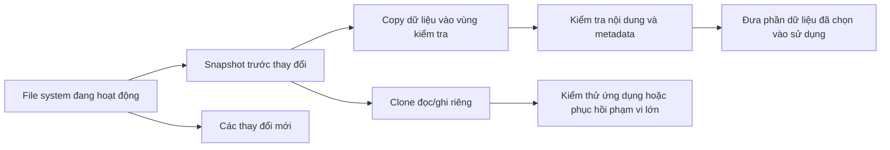

# Snapshots và phục hồi dữ liệu trên File Storage

Snapshot của Oracle Cloud Infrastructure (OCI) File Storage lưu lại trạng thái của một file system tại một thời điểm. Khi người dùng xóa nhầm file hoặc một lần triển khai ghi sai dữ liệu, snapshot có thể cung cấp phiên bản trước đó để phục hồi.

Một quy trình phục hồi hoàn chỉnh cần chọn đúng điểm dữ liệu, đọc được snapshot, kiểm tra nội dung và đưa dữ liệu trở lại ứng dụng theo cách kiểm soát được. Bài học thuộc chương **File Storage**, tập trung vào hai hướng: sao chép dữ liệu từ snapshot và tạo một file system clone để kiểm thử hoặc phục hồi.

## Mục tiêu học tập

Sau bài học, bạn có thể:

- Giải thích phạm vi và cách hoạt động của File Storage snapshot.
- Phân biệt snapshot với clone và bản sao phục vụ disaster recovery.
- Chuẩn bị tính nhất quán dữ liệu trước khi chụp.
- Tạo và tra cứu snapshot bằng Console hoặc OCI CLI.
- Truy cập dữ liệu lịch sử qua thư mục `.snapshot`.
- Phục hồi file hoặc thư mục vào vùng kiểm tra trước khi đưa vào sử dụng.
- Tạo clone từ snapshot và kiểm tra các phụ thuộc mạng, quyền và ứng dụng.
- Quản lý lịch, expiration, khóa bảo vệ snapshot, giám sát và chi phí.

## Snapshot ghi lại điều gì?

OCI File Storage snapshot là một điểm nhìn nhất quán của **toàn bộ file system**, sử dụng cơ chế copy-on-write. Khi tạo snapshot, dịch vụ tham chiếu dữ liệu hiện có; khi dữ liệu thay đổi, các phiên bản cần cho điểm lịch sử tiếp tục được giữ. File system và snapshot được mã hóa khi lưu trữ. Xem [Managing Snapshots](https://docs.oracle.com/en-us/iaas/Content/File/Tasks/managingsnapshots.htm).

Một snapshot không chỉ chụp thư mục đang mở trong terminal. Nếu file system có các thư mục `reports`, `uploads` và `config`, snapshot của file system bao quát dữ liệu tương ứng trong cả ba.

| Thành phần | Snapshot có ý nghĩa gì? |
|---|---|
| Nội dung file và cấu trúc thư mục trong file system | Có thể xem lại trạng thái tại điểm chụp |
| Dữ liệu ứng dụng chưa ghi ra NFS | Chưa được bảo vệ chỉ vì đã tạo snapshot |
| File ở local disk của Compute instance | Thuộc hệ lưu trữ khác |
| Dữ liệu ở database hoặc file system khác | Cần cơ chế bảo vệ và phối hợp riêng |
| Mount target, export và cấu hình kết nối của client | Cần kiểm kê như cấu hình hạ tầng |
| Session hoặc trạng thái trong RAM | Không phải nội dung được phục hồi từ snapshot |

Snapshot là nguồn dữ liệu lịch sử để đọc và phục hồi. Khi cần sửa dữ liệu lấy từ snapshot, sao chép ra nơi ghi được hoặc tạo clone; không sửa trực tiếp phiên bản lịch sử.

## Phân biệt snapshot, copy dữ liệu và clone

| Cơ chế | Kết quả | Tình huống phù hợp |
|---|---|---|
| Snapshot | Điểm nhìn dữ liệu tại một thời điểm | Tìm phiên bản cũ hoặc làm nguồn phục hồi |
| Copy từ snapshot | File và thư mục được sao chép tới nơi khác | Phục hồi một phần dữ liệu, kiểm tra trước khi ghi lại |
| Clone từ snapshot | File system mới có thể đọc và ghi | Kiểm thử một phiên bản dữ liệu hoặc phục hồi phạm vi lớn |
| Replication hoặc bản sao ở vị trí khác | Dữ liệu tại hệ thống hoặc địa điểm khác | Phục hồi khi không truy cập được nguồn |

Snapshot tại file system nguồn không tự tạo một bản sao độc lập ở region khác. Khi xóa file system, các snapshot liên quan cũng có thể mất theo thao tác đó; cần có bản sao bên ngoài phạm vi nguồn để xử lý loại sự cố này. Xem [Securing File Storage](https://docs.oracle.com/en-us/iaas/Content/Security/Reference/filestorage_security.htm).

Vì vậy, thiết kế cần phân biệt rõ:

- Phục hồi do lỗi logic: thường cần chọn dữ liệu trước khi sai.
- Phục hồi do mất nơi lưu trữ hoặc mất region: cần một nguồn dữ liệu còn truy cập được ở nơi khác.
- Kiểm thử: cần môi trường có thể ghi mà không tác động production.
- Chuyển đổi workload: cần thêm kế hoạch cutover, mạng và các dependency.

## Tính nhất quán của file system và ứng dụng

Một snapshot nhất quán ở cấp file system không đồng nghĩa một nghiệp vụ đang ghi nhiều file đã hoàn tất. Ví dụ, ứng dụng lưu một báo cáo và cập nhật một file chỉ mục:

```text
1. Ghi reports/monthly.csv
2. Cập nhật indexes/latest.json
3. Ghi nhận trạng thái hoàn tất trong database
```

Nếu snapshot được tạo giữa các bước, dữ liệu NFS có thể phản ánh một trạng thái mà ứng dụng cần tự kiểm tra hoặc phục hồi. Database nằm ở dịch vụ khác cũng không tự được chụp cùng thời điểm.

Đối với workload cần application consistency:

1. Xác định tất cả writer, kể cả worker, scheduler và các client NFS khác.
2. Tạm dừng tiếp nhận thao tác ghi hoặc dùng cơ chế quiesce của ứng dụng.
3. Chờ tác vụ đang chạy hoàn tất theo quy trình của ứng dụng.
4. Flush hoặc checkpoint theo hướng dẫn của phần mềm.
5. Tạo snapshot và xác nhận điểm dữ liệu.
6. Cho ứng dụng tiếp tục ghi khi đã đạt điều kiện trong kế hoạch.

Lệnh `sync` trên một client không thay cho việc điều phối mọi writer, transaction trong database hoặc bộ đệm ứng dụng trên client khác. Nếu ứng dụng chỉ hỗ trợ crash recovery, phải diễn tập chính cơ chế đó khi phục hồi.

Với dữ liệu nằm trên nhiều file system, không suy rằng hai snapshot riêng là một transaction nguyên tử bao trùm cả hai.

## Chuẩn bị trước khi tạo hoặc dùng snapshot

### Ghi nhận đúng tài nguyên

Một hồ sơ tối thiểu gồm:

| Nhóm | Thông tin |
|---|---|
| Định danh | File system OCID, region, AD và compartment |
| Truy cập | Mount target, IP hoặc tên truy cập, export path và mount point |
| Dữ liệu | Thư mục cần bảo vệ, writer và dữ liệu ngoài File Storage |
| Điểm khôi phục | Snapshot OCID, tên, thời điểm dữ liệu và loại snapshot |
| Lưu giữ | Expiration, policy liên quan và trạng thái lock |
| Phục hồi | Môi trường kiểm tra, người thực hiện và tiêu chí nghiệm thu |
| Chi phí | Chủ sở hữu, tag, tài nguyên clone và thời hạn thu hồi |

Không chọn snapshot chỉ theo display name của file system. Tên snapshot phải được đối chiếu với **đúng file system**, vì những file system khác nhau có thể có snapshot cùng tên.

### Phân biệt quyền API và quyền đọc dữ liệu

Có ba lớp cần xem xét:

| Lớp | Vai trò |
|---|---|
| IAM của OCI | Cho phép tạo, đọc metadata, cập nhật hoặc xóa tài nguyên snapshot |
| Mạng và export | Cho client tiếp cận mount target và export theo chính sách |
| Danh tính và quyền trên file | Quyết định client có thể đọc nguồn, ghi đích, giữ owner hoặc mode hay không |

Quyền gọi API tạo snapshot không tự cho phép đọc mọi file qua NFS. Ngược lại, client có thể đọc file theo quyền NFS nhưng không có quyền xóa snapshot trong OCI.

Các thao tác snapshot sử dụng quyền thuộc File Storage; tạo clone hoặc cấu hình snapshot policy có thêm quyền tương ứng. Cần cấp theo phạm vi công việc và compartment. Xem [Details for the File Storage Service](https://docs.oracle.com/en-us/iaas/Content/Identity/policyreference/filestoragepolicyreference.htm).

Nếu thao tác copy báo lỗi quyền, đối chiếu UID/GID, quyền thư mục, export options, cơ chế squash và kiểu xác thực đang dùng. Không mở rộng export cho mọi client hoặc tắt kiểm soát quyền để thử vượt lỗi.

## Mô hình thực hành

Giả sử một file system thử nghiệm được mount vào Linux tại `/mnt/teamshare`. Bài thực hành giả định mount này cung cấp root của file system để có thể truy cập `.snapshot`.



Bài lab sử dụng một thư mục mới dành riêng cho dữ liệu mẫu. Các lệnh Bash và OCI CLI dưới đây chỉ là ví dụ để người học thực hiện trong môi trường được phép; bài viết không tự chạy chúng.

Trước khi dùng lệnh:

- Thay OCID và region bằng giá trị thật.
- Xác nhận mount point và export đúng file system cần kiểm thử.
- Chỉ dùng thư mục lab mới, không dùng đường dẫn của dữ liệu production.
- Xác nhận có nơi chứa dữ liệu phục hồi và quyền phù hợp.

## Kiểm tra mount và tạo dữ liệu mẫu

Trên client Linux:

```bash
FSS_MOUNT='/mnt/teamshare'

mountpoint -q "$FSS_MOUNT"
findmnt -T "$FSS_MOUNT" -o TARGET,SOURCE,FSTYPE,OPTIONS
```

Nếu `mountpoint` không xác nhận đây là mount point, dừng lại để kiểm tra. Một thư mục local trùng tên không chứng minh NFS đang được mount. Đọc `SOURCE`, `FSTYPE` và các tùy chọn để đối chiếu mount thực tế.

Tạo dữ liệu chỉ trong một thư mục lab chưa tồn tại:

```bash
LAB_NAME='snapshot-lab-001'
LAB_DIR="$FSS_MOUNT/$LAB_NAME"

if [ -e "$LAB_DIR" ]; then
  printf '%s\n' 'Thu muc lab da ton tai; chon ten moi.'
  exit 1
fi

mkdir -- "$LAB_DIR"
printf '%s\n' 'revision=1' > "$LAB_DIR/config.ini"
printf '%s\n' 'manifest-for-revision-1' > "$LAB_DIR/.manifest"

cat -- "$LAB_DIR/config.ini"
sha256sum -- "$LAB_DIR/config.ini" "$LAB_DIR/.manifest"
```

Ghi lại nội dung hoặc checksum để đối chiếu. File `.manifest` giúp kiểm tra rằng cách copy phục hồi không bỏ sót file ẩn.

Trong bài lab này, chỉ có dữ liệu mẫu vừa tạo. Với workload thật, cần thực hiện bước nhất quán ứng dụng trước snapshot theo phần đã trình bày.

## Tạo snapshot bằng Console

Một quy trình điển hình:

1. Chọn đúng region và compartment.
2. Mở **File Storage → File Systems**.
3. Chọn file system và đối chiếu OCID.
4. Mở danh sách **Snapshots**, chọn **Create Snapshot**.
5. Đặt tên thể hiện mục đích và tránh thông tin nhạy cảm.
6. Chọn expiration nếu có kế hoạch lưu giữ hữu hạn.
7. Tạo và chờ trạng thái phù hợp.
8. Ghi lại snapshot OCID, tên, thời điểm dữ liệu và expiration thực tế.

Tên snapshot phải duy nhất trong phạm vi file system theo điều kiện của dịch vụ và không đổi được sau khi tạo. Xem [Creating a Snapshot](https://docs.oracle.com/en-us/iaas/Content/File/Tasks/create-snapshot.htm).

Nếu đã tạo bằng Console, dùng snapshot đó cho các bước sau; không chạy thêm lệnh tạo trong CLI để thực hiện lại cùng một thay đổi.

## Tạo và tra cứu bằng OCI CLI

Các lệnh sử dụng Bash trên máy đã có OCI CLI được xác thực. Nếu máy quản trị OCI và client NFS là hai máy khác nhau, khai báo lại các biến cần thiết trong đúng phiên shell; đặc biệt phải chuyển đúng tên snapshot sang client NFS để tạo đường dẫn đọc dữ liệu.

```bash
REGION='<region>'
FILE_SYSTEM_ID='ocid1.filesystem.oc1...'
SNAPSHOT_NAME='lab-before-change-001'

oci fs file-system get \
  --region "$REGION" \
  --file-system-id "$FILE_SYSTEM_ID"

oci fs snapshot list \
  --region "$REGION" \
  --file-system-id "$FILE_SYSTEM_ID" \
  --all
```

Đọc danh sách trước khi tạo để tránh nhầm với snapshot đã có. Sau khi dữ liệu đã ở trạng thái phù hợp:

```bash
oci fs snapshot create \
  --region "$REGION" \
  --file-system-id "$FILE_SYSTEM_ID" \
  --name "$SNAPSHOT_NAME" \
  --wait-for-state ACTIVE \
  --max-wait-seconds 1200
```

Ví dụ không cấu hình expiration. Nhóm thực hành cần chủ động đặt thời hạn hoặc thu hồi sau khi kiểm thử. Nếu muốn đặt ngay lúc tạo, dùng `--expiration-time` với mốc thời gian hợp lệ trong tương lai, có múi giờ rõ ràng.

`ACTIVE` là trạng thái cần đối chiếu trong quy trình này. Nếu lệnh timeout, tra cứu lại thay vì lập tức tạo thêm snapshot khác. Xem [OCI CLI snapshot create](https://docs.oracle.com/en-us/iaas/tools/oci-cli/latest/oci_cli_docs/cmdref/fs/snapshot/create.html).

Lấy snapshot OCID từ kết quả:

```bash
SNAPSHOT_ID='ocid1.snapshot.oc1...'

oci fs snapshot get \
  --region "$REGION" \
  --snapshot-id "$SNAPSHOT_ID"
```

Kiểm tra file system nguồn, tên, lifecycle state, thời điểm dữ liệu và expiration nếu có. Khi có các trường thời gian khác nhau, phân biệt thời điểm tạo tài nguyên với thời điểm dữ liệu mà snapshot đại diện; đừng chỉ suy từ chuỗi tên tự đặt.

Sau khi snapshot sẵn sàng, mới chuyển sang bước thay đổi dữ liệu lab.

## Truy cập phiên bản lịch sử qua .snapshot

Trong root của file system, snapshot được truy cập qua:

```text
<mount-point>/.snapshot/<snapshot-name>/<duong-dan-trong-file-system>
```

Với ví dụ:

```bash
SNAPSHOT_ROOT="$FSS_MOUNT/.snapshot/$SNAPSHOT_NAME"

ls -ld -- "$FSS_MOUNT/.snapshot"
ls -la -- "$SNAPSHOT_ROOT/$LAB_NAME"

cat -- "$SNAPSHOT_ROOT/$LAB_NAME/config.ini"
```

File `config.ini` trong snapshot phải có nội dung `revision=1`. Đường dẫn có một dấu chấm trước `snapshot`; dùng sai `snapshot` hoặc `.snapshots` sẽ dẫn tới thư mục khác hoặc lỗi không tồn tại.

OCI hỗ trợ khôi phục bằng cách copy nội dung từ `.snapshot`; có thể dùng các công cụ hỗ trợ NFS phù hợp. Xem [Restoring from a Snapshot on a Unix-style Instance](https://docs.oracle.com/en-us/iaas/Content/File/Tasks/restore-from-snapshot.htm).

Nếu mount đang trỏ vào một phần cây thư mục thay vì root theo giả định của lab, cần đối chiếu đường dẫn và cách truy cập của export đó. Không thay đổi export chỉ để cố làm một đường dẫn mẫu hoạt động.

Nếu API cho thấy snapshot tồn tại nhưng client chưa đọc được:

- Xác nhận mount thật sự thuộc file system chứa snapshot.
- Đối chiếu tên và trạng thái snapshot.
- Kiểm tra quyền đi qua các thư mục cha và quyền đọc file.
- Kiểm tra kết nối NFS, export và thông báo lỗi cụ thể.
- Chỉ kiểm tra đường dẫn liên quan, tránh quét toàn bộ các snapshot trên hệ thống lớn.

## Tạo thay đổi sau snapshot để quan sát

Trong đúng thư mục lab, thay nội dung file mẫu và tạo thêm một file:

```bash
printf '%s\n' 'revision=2' > "$LAB_DIR/config.ini"
printf '%s\n' 'created-after-snapshot' > "$LAB_DIR/new-file.txt"

cat -- "$LAB_DIR/config.ini"
cat -- "$SNAPSHOT_ROOT/$LAB_NAME/config.ini"
```

Kết quả mong đợi:

| Vị trí | Nội dung |
|---|---|
| File system đang hoạt động | `config.ini` có `revision=2` |
| Snapshot trước thay đổi | `config.ini` vẫn có `revision=1` |
| File mới sau snapshot | Có ở cây đang hoạt động, không có trong điểm snapshot trước đó |

Điều này minh họa snapshot giữ phiên bản lịch sử, còn cây đang hoạt động tiếp tục thay đổi. Nó cũng cho thấy việc copy một file cũ trở lại không tự xóa các file mới được tạo sau snapshot.

## Phục hồi vào vùng kiểm tra

### Chọn staging trước khi ghi lại dữ liệu

Một vùng kiểm tra riêng giúp xác minh:

- Đã chọn đúng snapshot chưa.
- Có đủ file, kể cả file ẩn không.
- Nội dung và checksum có đúng không.
- Owner, group, mode và metadata cần thiết có thể giữ được không.
- Dữ liệu có tương thích với phiên bản ứng dụng đang chạy không.

Staging có thể nằm trên storage local đủ dung lượng hoặc một file system thử riêng. Phải kiểm tra nơi lưu và quyền truy cập phù hợp với dữ liệu được phục hồi.

### Copy cả nội dung thư mục, bao gồm file ẩn

Ví dụ tạo một thư mục local tạm thời có tên duy nhất:

```bash
SOURCE_DIR="$SNAPSHOT_ROOT/$LAB_NAME"
STAGE_DIR="$(mktemp -d /var/tmp/fss-restore.XXXXXX)"

printf '%s\n' "$STAGE_DIR"

cp -a -- "$SOURCE_DIR/." "$STAGE_DIR/"
```

Dấu `/.` ở nguồn copy nội dung thư mục, bao gồm file ẩn, vào staging. Cách viết `"$SOURCE_DIR"/*` phụ thuộc glob của shell và thường bỏ sót file ẩn, nên không phù hợp nếu mục tiêu là lấy đủ nội dung.

`cp -a` yêu cầu giữ metadata theo khả năng công cụ, quyền và filesystem đích. Nó không chứng minh mọi UID/GID, ACL, extended attribute hoặc tính năng đặc thù đã được giữ nguyên. Đọc lỗi và kiểm tra những thuộc tính workload cần, thay vì chỉ nhìn file đã xuất hiện.

Ví dụ copy vào local filesystem có thể cần quyền phù hợp để giữ owner từ NFS. Root trên client cũng có thể bị giới hạn khi thao tác trên export. Không tự bỏ cơ chế bảo mật để làm cho lệnh copy hết báo lỗi.

### Kiểm tra nội dung phục hồi

```bash
ls -la -- "$STAGE_DIR"

cmp -- "$SOURCE_DIR/config.ini" "$STAGE_DIR/config.ini"
cmp -- "$SOURCE_DIR/.manifest" "$STAGE_DIR/.manifest"

sha256sum -- "$STAGE_DIR/config.ini" "$STAGE_DIR/.manifest"
```

`cmp` không phát hiện khác biệt và trả exit code 0 thì nội dung hai file được so sánh giống nhau. Điều đó chưa kiểm tra đầy đủ metadata hoặc tính đúng đắn nghiệp vụ.

Với dataset lớn, xác minh theo manifest, số file, tổng hợp checksum hoặc công cụ kiểm tra của ứng dụng. Phải biết phép kiểm tra nào bao phủ toàn bộ dữ liệu và phép nào chỉ là lấy mẫu.

### Nếu dùng rsync

Có thể xem trước thay đổi vào một staging riêng:

```bash
rsync -a --dry-run --itemize-changes \
  "$SOURCE_DIR/" "$STAGE_DIR/"
```

Sau khi đọc kết quả, thực hiện copy theo kế hoạch:

```bash
rsync -a -- "$SOURCE_DIR/" "$STAGE_DIR/"
```

Dấu gạch chéo cuối đường dẫn nguồn có ý nghĩa đối với cách bố trí dữ liệu ở đích. Không thêm `--delete` vào quy trình phục hồi chung khi chưa quyết định rõ dữ liệu mới nào cần giữ hoặc loại bỏ.

Archive mode không tự bao phủ mọi loại metadata trong mọi môi trường. Các yêu cầu về hard link, ACL hoặc extended attribute cần được xác định và kiểm thử theo tính năng thực sự được hỗ trợ.

## Đưa dữ liệu đã kiểm tra trở lại sử dụng

### Phục hồi một file dưới tên mới

Trong lab, giữ file hiện tại và tạo một file được khôi phục dưới tên khác để đối chiếu:

```bash
RECOVERED_FILE="$LAB_DIR/config.ini.recovered"

if [ -e "$RECOVERED_FILE" ]; then
  printf '%s\n' 'File phuc hoi da ton tai; dung de doi chieu.'
  exit 1
fi

cp -a -- "$STAGE_DIR/config.ini" "$RECOVERED_FILE"

cat -- "$RECOVERED_FILE"
cmp -- "$SOURCE_DIR/config.ini" "$RECOVERED_FILE"
```

File mới phải có `revision=1`; file hiện tại vẫn có `revision=2`. Đây là bằng chứng đã lấy lại được nội dung cũ mà vẫn giữ dữ liệu hiện có để đánh giá.

### Khi cần thay thế file đang phục vụ

Với ứng dụng thật, cần bổ sung các bước:

1. Xác nhận phiên bản dữ liệu phải khôi phục.
2. Dừng hoặc điều phối writer của phần dữ liệu liên quan.
3. Bảo quản phiên bản hiện tại nếu cần điều tra hoặc quay lại.
4. Kiểm tra quyền, ownership và tương thích định dạng.
5. Thực hiện thay thế theo cơ chế của ứng dụng.
6. Mở lại dữ liệu hoặc khởi động lại thành phần giữ file handle khi cần.
7. Kiểm thử nghiệp vụ và theo dõi sau phục hồi.

Thay tên file trên cùng filesystem có thể cung cấp tính nguyên tử ở mức một thao tác namespace, nhưng không biến việc thay nhiều file thành một transaction của ứng dụng. Những tiến trình còn giữ file handle cũng có thể tiếp tục thấy đối tượng cũ.

Nếu ứng dụng hiện tại đã thay schema hoặc định dạng file, dữ liệu cũ cần có quy trình tương thích. Khôi phục nội dung đúng thời điểm nhưng sai phiên bản ứng dụng vẫn có thể làm dịch vụ lỗi.

## Phục hồi phạm vi lớn bằng clone

Clone tạo ra một file system mới từ snapshot. Dữ liệu ban đầu tương ứng điểm snapshot; sau đó thay đổi trên clone và nguồn không tự đồng bộ với nhau. Clone ban đầu có thể tham chiếu dữ liệu chung với parent; detach là một thao tác riêng để tạo hệ thống độc lập về tham chiếu lưu trữ. Xem [Cloning File Systems](https://docs.oracle.com/en-us/iaas/Content/File/Tasks/cloningFS.htm).

Hướng này phù hợp khi cần:

- Kiểm thử cả cây dữ liệu với một phiên bản ứng dụng.
- Đánh giá điểm khôi phục mà không copy toàn bộ vào cây đang phục vụ.
- Chuẩn bị một môi trường phục hồi trước cutover.
- Tạo môi trường thử từ một điểm dữ liệu đã biết.

### Tạo clone từ snapshot đã chọn

Clone trực tiếp phải ở cùng AD với parent theo phạm vi hỗ trợ của File Storage. Không dùng clone trực tiếp như một thao tác copy sang region khác.

Ví dụ CLI:

```bash
CLONE_COMPARTMENT_ID='ocid1.compartment.oc1...'
SOURCE_AD='<availability-domain-cua-file-system-nguon>'

oci fs file-system create \
  --region "$REGION" \
  --availability-domain "$SOURCE_AD" \
  --compartment-id "$CLONE_COMPARTMENT_ID" \
  --display-name 'snapshot-recovery-test' \
  --source-snapshot-id "$SNAPSHOT_ID" \
  --clone-attach-status ATTACH \
  --wait-for-state ACTIVE \
  --max-wait-seconds 1200
```

`ATTACH` ở đây mô tả quan hệ clone với parent, không phải thao tác mount NFS vào Compute instance. `DETACH` có tác động sao chép dữ liệu và metering riêng; không đổi tham số chỉ vì tên nghe giống “tháo mount”. Xem [tham số tạo file system và clone](https://docs.oracle.com/en-us/iaas/tools/oci-cli/latest/oci_cli_docs/cmdref/fs/file-system/create.html).

Nếu cần customer-managed key, xác định khóa cho clone và các quyền tương ứng trước khi tạo. Không suy từ khóa của parent rằng mọi thuộc tính mã hóa của clone đã đúng yêu cầu.

### Export và mount clone trong môi trường riêng

Sau khi tạo:

1. Ghi lại clone OCID, source snapshot và parent.
2. Đọc trạng thái hydration và các thuộc tính liên quan.
3. Chuẩn bị mount target và export phù hợp.
4. Cấu hình quyền mạng và export chỉ cho client cần kiểm thử.
5. Mount clone vào một đường dẫn riêng, chẳng hạn `/mnt/teamshare-recovery`.
6. Kiểm thử dữ liệu và ứng dụng trước khi chuyển luồng sử dụng.

Các thuộc tính hạ tầng như export information không tự trở thành một endpoint thay thế production. Clone có thể được sử dụng trong khi hydration diễn ra, nhưng hiệu năng và các dependency vẫn cần được xác minh. Xem [Creating a Clone](https://docs.oracle.com/en-us/iaas/Content/File/Tasks/create-clone.htm).

Đừng mount chồng clone lên mount point đang dùng khi chưa có kế hoạch ngừng truy cập. Với nhiều client, phải điều phối việc chuyển từng client, trạng thái ứng dụng và các writer; đổi mount trên một máy không thay đổi các máy còn lại.

### Cutover và quay lại sau cutover

Trước khi chuyển sang clone, xác định:

- Mốc dữ liệu nào được chấp nhận.
- Những thay đổi mới trên nguồn sẽ bị bỏ qua, giữ lại hay hợp nhất.
- Khi nào nguồn ngừng nhận ghi.
- Các client nào phải chuyển và cách xác nhận chuyển xong.
- Điều kiện quay lại và nơi chứa dữ liệu mới phát sinh sau chuyển.

Sau khi clone đã nhận dữ liệu mới, quay về nguồn cũ không chỉ là đổi lại đường mount. Cần xử lý các thay đổi chỉ tồn tại trên clone để tránh mất dữ liệu hoặc tạo hai nhánh ghi không được quản lý.

## Lịch tự động và expiration

Snapshot policy có thể tạo snapshot theo lịch và đặt retention. Policy cần được liên kết đúng file system; tạo policy riêng lẻ không chứng minh dữ liệu đã được bảo vệ.

Một thiết kế minh họa:

| Lớp điểm khôi phục | Mục tiêu |
|---|---|
| Snapshot trước thay đổi | Quay lại trước một lần triển khai hoặc thao tác dữ liệu |
| Snapshot định kỳ ngắn hạn | Giảm lượng dữ liệu mất khi lỗi được phát hiện sớm |
| Snapshot lưu lâu hơn | Có thêm điểm lịch sử cho lỗi phát hiện muộn |
| Bản sao ở nơi khác | Phục hồi khi nguồn không truy cập được |

Cần đọc rõ múi giờ, effective time và retention của mỗi schedule. Snapshot theo policy không được bảo đảm bắt đầu đúng phút cấu hình; lịch trùng nhau hoặc yêu cầu bị xếp hàng có thể ảnh hưởng tập snapshot được tạo. Xem [Policy-Based Snapshots and Scheduling](https://docs.oracle.com/en-us/iaas/Content/File/Tasks/snapshot-policies-and-schedules.htm).

Khi cần giữ một snapshot cụ thể cho sự cố đang điều tra, kiểm tra expiration và điều chỉnh theo quyền được cấp. Sửa thời hạn của một snapshot không tự sửa schedule của các snapshot sau.

Snapshot trong bài lab được tạo thủ công không có expiration trong ví dụ. Cần ghi người chịu trách nhiệm và kế hoạch thu hồi, tránh giữ vô thời hạn chỉ vì không có tác vụ tự động xóa.

## Snapshot locks và bảo vệ khỏi xóa

Expiration và lock là các thuộc tính khác nhau. File Storage hỗ trợ resource-based locks và time-based locks với các chế độ, quyền và điều kiện thay đổi khác nhau.

Những điểm cần ghi nhớ:

- Đến expiration không có nghĩa dịch vụ có thể xóa khi snapshot còn bị lock bảo vệ.
- Lock đang hiệu lực có thể ngăn cả việc xóa file system liên quan.
- Compliance lock có tính bất biến sau giai đoạn cool-off theo cơ chế hỗ trợ.
- Lock của nguồn không tự được kế thừa sang clone hoặc replication target.

Xem [Snapshot Locks](https://docs.oracle.com/en-us/iaas/Content/File/Tasks/snapshot_lock_overview.htm).

Lab này không yêu cầu bật lock. Trong vận hành, việc dùng lock cần đi cùng yêu cầu lưu giữ, quyền quản trị và kế hoạch xử lý chi phí. Không nhầm khóa chống xóa với trạng thái chỉ đọc của nội dung snapshot.

## Đo RPO và RTO bằng kết quả phục hồi

Với lỗi logic xảy ra ở thời điểm T:

```text
Khoảng dữ liệu phải xem xét mất hoặc làm lại
  = T - thời điểm dữ liệu của snapshot phù hợp gần nhất
```

Phải chọn snapshot trước khi lỗi bắt đầu, không chỉ chọn snapshot mới nhất. Nếu dữ liệu đã sai từ nhiều giờ trước khi phát hiện, các snapshot mới hơn cũng có thể chứa lỗi.

Ví dụ:

| Thời điểm | Sự kiện |
|---|---|
| 08:00 | Snapshot S1 ghi nhận dữ liệu tốt |
| 08:20 | Một tác vụ bắt đầu ghi dữ liệu sai |
| 09:00 | Snapshot S2 chứa trạng thái đã bị ảnh hưởng |
| 09:30 | Nhóm vận hành phát hiện lỗi |

Nếu cần dùng S1, phải đánh giá lại dữ liệu hợp lệ phát sinh sau 08:00. Không kết luận S2 an toàn chỉ vì nó mới hơn.

RTO cần đo cả thời gian phát hiện, chọn snapshot, chuẩn bị staging hoặc clone, copy dữ liệu, kiểm tra, đưa ứng dụng trở lại và chuyển client. Tạo snapshot hoặc clone nhanh không có nghĩa toàn bộ dịch vụ phục hồi nhanh tương ứng.

Đối với cây có rất nhiều file nhỏ, thời gian duyệt và xử lý metadata có thể chiếm phần lớn. Đánh giá số file, kích thước, client và công cụ copy trong diễn tập thực tế.

## Giám sát và xử lý lỗi

OCI hỗ trợ Events cho các hoạt động tạo hoặc xóa snapshot, bao gồm các trường hợp policy-based snapshot bị skipped, rejected hoặc throttled. Dùng chúng để theo dõi hoạt động lịch bên cạnh việc kiểm kê tài nguyên thực tế. Xem [monitoring snapshot events](https://docs.oracle.com/en-us/iaas/Content/File/Tasks/managingsnapshots.htm).

Các câu hỏi vận hành cần trả lời:

- File system còn được liên kết với đúng policy không?
- Điểm dữ liệu phù hợp mới nhất bao nhiêu tuổi?
- Snapshot nào gần expiration nhưng đang cần giữ?
- Snapshot có đọc được từ client được phép không?
- Lần restore thử gần nhất chứng minh được điều gì?
- Clone nào còn tồn tại và ai quản lý?
- Có lỗi IAM, export, NFS hoặc key làm cản trở phục hồi không?

| Triệu chứng | Điều cần kiểm tra |
|---|---|
| Snapshot có trong API nhưng không thấy trên client | Mount point, file system nguồn, tên, trạng thái và quyền đường dẫn |
| `Permission denied` khi copy | Quyền đọc nguồn, ghi đích, UID/GID và export options |
| Thiếu file ẩn sau phục hồi | Có dùng glob `*` làm nguồn không |
| Copy thành công nhưng ứng dụng lỗi | Điểm dữ liệu, consistency, schema, metadata và dependency |
| Clone ACTIVE nhưng chưa truy cập được | Export, mount target, mạng, quyền và mount của client |
| Snapshot lịch không xuất hiện như dự kiến | Policy association, múi giờ, lịch trùng và event skipped/throttled |
| Snapshot quá hạn nhưng chưa xóa được | Lock, hold hoặc trạng thái thao tác theo dịch vụ |
| Live data giảm nhưng metered usage vẫn cao | Dữ liệu còn được snapshot hoặc clone tham chiếu |
| Client vẫn thấy nội dung cũ sau thay thế | File handle, cache và hành vi mở lại dữ liệu của ứng dụng |

Giữ nguyên bằng chứng và nguồn snapshot trong lúc điều tra. Không xóa các điểm khôi phục chỉ để làm lại một bước khi chưa xác nhận dữ liệu cần giữ đã ở nơi khác.

## Dung lượng, chi phí và thu hồi tài nguyên

Chi phí snapshot gắn với dữ liệu khác biệt cần được giữ, không phải phép nhân đơn giản “số snapshot × kích thước file system”. Khi live data bị sửa hoặc xóa, snapshot có thể tiếp tục giữ các block lịch sử. `meteredBytes` của dịch vụ là giá trị cần theo dõi cho metering; kết quả `du` có thể khác do cách duyệt dữ liệu được tham chiếu. Xem [File System Usage and Metering](https://docs.oracle.com/en-us/iaas/Content/File/Concepts/FSutilization.htm).

Để quản lý chi phí:

1. Đặt lịch và retention theo yêu cầu phục hồi.
2. Theo dõi workload có tốc độ thay đổi dữ liệu cao.
3. Gắn người sở hữu cho snapshot thủ công và clone thử nghiệm.
4. Đánh giá tác động của các thao tác copy dữ liệu ra staging.
5. Kiểm kê tài nguyên sau diễn tập.
6. Chỉ xóa khi đã xác nhận không còn phụ thuộc phục hồi hoặc lưu giữ.

Trước khi xóa snapshot, đối chiếu OCID, file system nguồn, loại snapshot và quan hệ clone hoặc replication nếu có. Snapshot do cơ chế khác quản lý cần được xử lý theo vòng đời của cơ chế đó.

Không coi việc xóa file trong cây đang hoạt động là cách chắc chắn giải phóng toàn bộ dung lượng khi dữ liệu cũ còn được tham chiếu. Cũng không lấy kết quả metering ngay sau thao tác làm kết luận cuối cùng vì cập nhật có thể bất đồng bộ.

## Snapshot trong phương án disaster recovery

Khi yêu cầu bao gồm sự cố AD hoặc region, đánh giá File Storage replication hoặc cơ chế sao lưu sang vị trí khác. Quy trình phải có dữ liệu ở đích, hạ tầng truy cập, quyền, khóa và phương án đưa workload lên đó.

Replication có snapshot phục vụ đồng bộ và phục hồi; chúng có vòng đời khác với snapshot người dùng tự tạo. Không xóa tùy ý các snapshot do replication quản lý.

Với File Storage replication, kế hoạch DR có thể cần clone, file system và mount target bổ sung để phục vụ failover. Cần đủ service limits và tài nguyên ở vị trí đích. Xem [Disaster Recovery cho File Storage](https://docs.oracle.com/en-us/iaas/Content/File/Tasks/replication-disaster-recovery.htm).

Một lần copy file thành công trong cùng file system chỉ kiểm chứng phục hồi lỗi logic ở phạm vi đó. Nó chưa kiểm chứng khả năng phục hồi khi toàn bộ nguồn không truy cập được.

## Tự động hóa quy trình có kiểm chứng

Một quy trình tự động nên thể hiện các mốc:

```text
Xác minh file system và phạm vi dữ liệu
  -> phối hợp writer khi cần
  -> tạo và xác nhận snapshot
  -> kiểm tra khả năng đọc
  -> chọn điểm phục hồi
  -> copy vào staging hoặc tạo clone
  -> kiểm tra dữ liệu và ứng dụng
  -> chuyển phần dữ liệu được chọn vào sử dụng
  -> quản lý retention và thu hồi tài nguyên thử
```

Các nguyên tắc thực tế:

- Dùng OCID cho thao tác API, đối chiếu tên với đường dẫn NFS.
- Kiểm tra trạng thái trước khi retry yêu cầu bị timeout.
- Không coi exit code của một lệnh tạo snapshot là kết quả restore.
- Giữ nguồn và đích rõ ràng, tránh đảo chiều copy.
- Không dùng lệnh đồng bộ có xóa dữ liệu nếu chưa xác định đúng tập dữ liệu cần loại bỏ.
- Ghi bằng chứng về nội dung, metadata, thời gian và kết quả kiểm thử.
- Quản lý writer và cutover ở cấp ứng dụng.
- Có người chịu trách nhiệm cho expiration, lock, clone và chi phí.

## Tiêu chí hoàn thành

| Tiêu chí | Bằng chứng |
|---|---|
| Đúng nguồn | File system, export và mount point được đối chiếu |
| Đúng điểm dữ liệu | Snapshot OCID, tên và thời điểm phù hợp với sự cố |
| Đúng tính nhất quán | Quy trình writer/checkpoint được ghi nhận khi cần |
| Đọc được snapshot | Truy cập đúng đường dẫn và các file cần phục hồi |
| Copy đầy đủ | Có file ẩn, nội dung và metadata cần thiết đã kiểm tra |
| Phục hồi sử dụng được | Ứng dụng đọc hoặc xử lý dữ liệu như mong đợi |
| Clone được quản lý | Quan hệ nguồn, export, môi trường thử và cutover rõ ràng |
| Vòng đời có kiểm soát | Expiration, lock, chi phí và tài nguyên thử có chủ sở hữu |

Snapshot giúp giữ lại lựa chọn khi dữ liệu thay đổi ngoài ý muốn. Giá trị của nó được xác nhận bằng khả năng lấy đúng dữ liệu, kiểm tra được kết quả và đưa dữ liệu trở lại workload theo một quy trình đã diễn tập.
