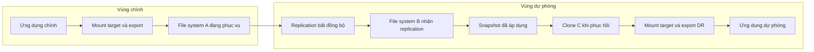
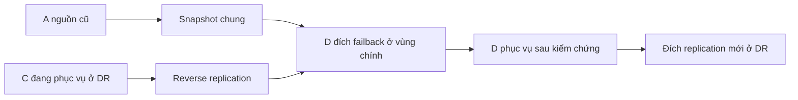

# Replication và thiết kế chia sẻ tệp dự phòng

Trong chương **File Storage** của module Oracle Cloud Infrastructure (OCI), replication giúp duy trì bản sao dữ liệu tệp ở vị trí khác. Để bản sao trở thành một dịch vụ chia sẻ tệp dự phòng dùng được, thiết kế còn phải bao gồm mạng, mount target, export, danh tính người dùng, ứng dụng và quy trình chuyển đổi.

Bài học sử dụng mô hình chủ động–dự phòng trong cùng tenancy: ứng dụng ghi ở vùng chính; một file system khác nhận replication để hỗ trợ phục hồi. Người học sẽ thiết kế RPO/RTO, tạo replication, quan sát tiến độ và lập quy trình failover/failback có phân quyền, kiểm chứng và kiểm soát chi phí.

## Mục tiêu và kiến thức cần có

Sau bài học, bạn có thể:

- Phân biệt replication, snapshot, clone và khả năng phục vụ NFS dự phòng.
- Xác định RPO/RTO cho dữ liệu tệp và đo bằng bằng chứng thực tế.
- Chuẩn bị file system đích hợp lệ và hạ tầng truy cập tại nơi dự phòng.
- Tạo replication và phân biệt trạng thái tài nguyên với độ mới của dữ liệu.
- Chuyển quyền ghi sang nơi dự phòng, rồi đồng bộ ngược trước khi trở về.
- Diễn tập bằng clone cô lập, ghi lại kết quả và dọn tài nguyên đúng quan hệ phụ thuộc.

Bạn nên biết cách tạo file system, mount target và export; cấu hình VCN/NSG; mount NFS trên Linux; đọc quyền POSIX và sử dụng OCI CLI. Các lệnh trong bài là ví dụ để thực hành trong môi trường riêng, không phải lệnh đã được thực thi trên tenancy của bạn.

## Xác định điều cần bảo vệ

Một ứng dụng quản lý tài liệu có thể lưu tệp đính kèm trong File Storage và metadata nghiệp vụ trong Oracle Database. Nếu vùng chính gặp sự cố, phục hồi máy ứng dụng mà thiếu tệp đính kèm chưa đủ để phục vụ người dùng. Ngược lại, có tệp nhưng thiếu metadata tương ứng cũng có thể làm ứng dụng không hoạt động đúng.

Hãy ghi rõ yêu cầu trước khi cấu hình:

| Câu hỏi | Quyết định thiết kế |
| --- | --- |
| Cần chịu lỗi ở mức nào? | Lỗi máy ứng dụng, AD, hay mất cả region |
| Chấp nhận mất bao nhiêu dữ liệu? | RPO theo thời gian và ảnh hưởng nghiệp vụ |
| Chấp nhận dừng phục vụ bao lâu? | RTO cho toàn bộ đường truy cập và ứng dụng |
| Ai được kích hoạt DR? | Vai trò điều phối và quyền thao tác |
| Nguồn nào được phép ghi? | Cơ chế ngăn hai nơi cùng xử lý dữ liệu độc lập |
| Dữ liệu nào phải phục hồi cùng nhau? | File system, database, hàng đợi và cấu hình ứng dụng |

Trong bài, ví dụ giả định **RPO 30 phút, RTO 45 phút** cho một hệ thống tài liệu nội bộ. Đây là yêu cầu giả định để đánh giá thiết kế, không phải cam kết hiệu năng hay SLA của OCI.

## Replication, snapshot và clone làm những việc khác nhau

OCI File Storage replication sao chép dữ liệu **bất đồng bộ** giữa các file system trong cùng hoặc khác AD/region. File system đích do replication cập nhật và ở trạng thái chỉ đọc trong quan hệ này. Một lần ghi được ứng dụng xác nhận ở nguồn chưa chứng minh bản ghi đó đã đến đích. Xem [File System Replication](https://docs.oracle.com/en-us/iaas/Content/File/Tasks/FSreplication.htm).

| Cơ chế | Mục đích | Cách dùng trong thiết kế dự phòng |
| --- | --- | --- |
| Replication | Chuyển thay đổi sang một file system đích | Duy trì điểm phục hồi ngoài vị trí nguồn |
| Snapshot | Giữ một góc nhìn dữ liệu tại thời điểm xác định | Chọn mốc dữ liệu để phục hồi hoặc đối chiếu |
| Clone | Tạo file system từ một snapshot | Cung cấp bản phục hồi hoặc môi trường diễn tập riêng |
| Export và mount target | Cấp đường truy cập NFS cho client | Đưa file system phục hồi vào sử dụng |
| Runbook DR | Điều phối các bước vận hành | Chuyển quyền ghi, mount, ứng dụng và lưu lượng |

Replication snapshot do dịch vụ quản lý; nó không phải lịch giữ vô hạn mọi phiên bản. Các snapshot khác ở nguồn cũng có thể được đưa sang đích theo cơ chế replication. Xem [Replication and Snapshots](https://docs.oracle.com/en-us/iaas/Content/File/Tasks/replication-managing-snapshots.htm).

Không dùng bản sao mới nhất làm phương án duy nhất cho việc xóa nhầm hoặc dữ liệu ứng dụng đã bị sửa sai. Thay đổi không mong muốn cũng có thể đi theo luồng sao chép. Kế hoạch phục hồi cần mốc dữ liệu phù hợp và chính sách lưu giữ được kiểm chứng riêng.

### Clone không tiếp tục nhận thay đổi như replica

Clone được tạo từ snapshot là một file system có dữ liệu tại mốc đó. Sau khi tạo, thay đổi của clone và file system gốc diễn ra độc lập; clone không trở thành subscriber tự động của replication nguồn.

Clone có thể dùng tham chiếu dữ liệu chung với parent, nên phải quản lý quan hệ parent/clone khi dọn tài nguyên. Các thuộc tính tài nguyên như export, key và tag cần được cấu hình theo quy trình clone. Xem [Cloning File Systems](https://docs.oracle.com/en-us/iaas/Content/File/Tasks/cloningFS.htm).

## Kiến trúc chia sẻ tệp dự phòng



Trong vận hành bình thường, A phục vụ ứng dụng và B dành cho replication. Khi phục hồi theo đường clone, C là file system được export để ứng dụng dự phòng sử dụng.

Chọn vị trí đích theo loại lỗi muốn chịu:

- **Cùng AD:** hỗ trợ một số nhu cầu sao chép dữ liệu nhưng vẫn cùng phạm vi lỗi vị trí.
- **Khác AD trong region có nhiều AD:** tách phạm vi lỗi AD, vẫn phụ thuộc cùng region.
- **Khác region:** phù hợp mục tiêu ứng phó sự cố vùng, đồng thời tăng yêu cầu mạng, vận hành và chi phí.

Khả năng chọn vị trí và điều kiện region đích phải được kiểm tra trong [File System Replication](https://docs.oracle.com/en-us/iaas/Content/File/Tasks/FSreplication.htm). Với cross-region trong bài, tenancy cần được đăng ký region đích.

### Bản sao dữ liệu chưa phải dịch vụ NFS sẵn sàng

Ở vùng dự phòng cần chuẩn bị hoặc có khả năng tạo:

1. File system phục hồi và đủ giới hạn cho clone.
2. Mount target, subnet và địa chỉ IP cần thiết.
3. Export path và export options phù hợp client DR.
4. Route, NSG/security list và DNS.
5. Compute, NFS client, cấu hình mount và tài khoản ứng dụng.
6. Các dependency như danh tính, bí mật và database đã phục hồi.

Nên có bảng ánh xạ rõ ràng:

| Thành phần | Vùng chính | Vùng dự phòng |
| --- | --- | --- |
| File system phục vụ | A | C sau failover |
| File system nhận replication | Không áp dụng cho A đang phục vụ | B |
| Endpoint NFS | Mount target chính | Mount target DR |
| Export path | Ví dụ `/documents` | Đường dẫn DR đã định trước |
| Tài khoản ứng dụng | UID/GID và cơ chế xác thực chính | Giá trị và cơ chế tương thích |
| Dependency dữ liệu | Database/queue chính | Điểm phục hồi tương ứng |

Không giả định việc replication tệp sẽ tự tái tạo toàn bộ bảng này.

## RPO: đo độ mới của dữ liệu có thể phục hồi

**RPO** là mức mất dữ liệu tối đa chấp nhận được, biểu diễn theo thời gian. Khi chọn điểm phục hồi, cần xét snapshot đã được sao chép đầy đủ và **áp dụng tại đích**, không chỉ thời điểm nguồn bắt đầu một cycle.

OCI có metric `ReplicationRecoveryPointAge` trong namespace `oci_filestorage`. Metric này phản ánh tuổi của snapshot nguồn đã được sao chép đầy đủ và áp dụng ở đích. Xem [File System Metrics](https://docs.oracle.com/en-us/iaas/Content/File/Reference/filemetrics.htm).

Mô hình quan sát:

```text
Tuổi điểm phục hồi tại thời điểm T
  = T - thời điểm dữ liệu của snapshot đã áp dụng gần nhất
```

Ví dụ minh họa:

| Mốc | Sự kiện |
| --- | --- |
| 14:00 | Dữ liệu tại nguồn được chụp vào snapshot |
| 14:09 | Snapshot đó áp dụng xong ở đích |
| 14:32 | Nguồn gặp sự cố; chưa có snapshot mới hơn áp dụng xong |

Điểm dữ liệu có thể dùng vẫn là mốc 14:00. Tuổi điểm phục hồi khoảng 32 phút, vượt yêu cầu giả định 30 phút. Không dùng 14:09 làm mốc dữ liệu mới nhất chỉ vì đó là lúc apply hoàn tất.

### Interval không phải RPO được bảo đảm

Theo tài liệu tạo replication, interval được nhập theo **phút**, giá trị tối thiểu cho phép là 15 phút. Interval quyết định lịch replication; thời gian capture, truyền và apply vẫn ảnh hưởng điểm phục hồi. Xem [Creating a Replication](https://docs.oracle.com/en-us/iaas/Content/File/Tasks/fsreplication-creating-a-replication.htm).

Một yêu cầu mất dữ liệu tối đa vài giây cần được đánh giá bằng giải pháp phù hợp với workload; không thể suy ra khả năng đó từ một thiết lập replication theo phút.

## RTO: tính cả đường truy cập và ứng dụng

**RTO** là thời gian dừng phục vụ tối đa chấp nhận được. Một clone tạo nhanh chưa chứng minh ứng dụng sẽ phục hồi trong cùng khoảng thời gian.

Ví dụ phân bổ ngân sách RTO, hoàn toàn mang tính thiết kế:

| Công việc | Ngân sách minh họa |
| --- | --- |
| Phát hiện và quyết định DR | 7 phút |
| Ngăn nguồn cũ tiếp tục ghi | 5 phút |
| Chọn snapshot và chuẩn bị file system phục hồi | 6 phút |
| Export, mount và kiểm tra quyền | 8 phút |
| Khởi động ứng dụng, kiểm tra và chuyển lưu lượng | 12 phút |
| Tổng | 38 phút |

Với mục tiêu 45 phút, ngân sách này có 7 phút dự phòng. Khi diễn tập, thay các con số giả định bằng thời gian đo được. Nếu tác vụ cấp mount target hoặc xử lý mount bị treo mất lâu hơn dự kiến, RTO phải phản ánh kết quả đó.

## Chuẩn bị nguồn và đích hợp lệ

Trước khi tạo replication, xác nhận:

- File system nguồn, compartment và vị trí đích đã được xác định.
- Region đích đã sẵn sàng và được dịch vụ cho phép với nguồn đó.
- Người hoặc pipeline có quyền cần thiết cho tài nguyên hai phía.
- Đích dành riêng cho replication, không bị dùng làm share thử nghiệm.
- Có đủ service limits/quota cho file system, clone và mount target khi DR.
- Đã xác định baseline dữ liệu và cách chứng minh lần sao chép đầu hoàn tất.

Một file system **đã từng export** không trở thành đích hợp lệ chỉ bằng cách xóa export. Snapshot policy hoặc lịch sử thay đổi snapshot ở đích cũng có thể làm nó không targetable hoặc không tương thích. Khi gặp điều kiện này, chọn file system mới hoặc clone hợp lệ theo hướng dẫn, thay vì sửa thử trực tiếp đích đang được bảo vệ. Xem [Creating a Replication Fails](https://docs.oracle.com/en-us/iaas/Content/File/Troubleshooting/troubleshooting-replication_create-fails.htm).

Vì vậy, không export B để “xem dữ liệu DR” như một bước kiểm tra thông thường. Dùng clone cô lập khi cần đọc kiểm chứng.

### Ước lượng lần sao chép đầu

Base copy có thể mất nhiều giờ tùy dữ liệu. Công cụ replication estimator sử dụng dữ liệu lịch sử; với file system mới, kết quả có thể chưa sát workload thực tế.

Ví dụ Bash dùng OCI CLI:

```bash
export PRIMARY_REGION='REPLACE_WITH_PRIMARY_REGION'
export SOURCE_FS_OCID='REPLACE_WITH_SOURCE_FILE_SYSTEM_OCID'

oci fs file-system estimate-replication \
  --region "$PRIMARY_REGION" \
  --file-system-id "$SOURCE_FS_OCID"
```

Xem khả năng replication, region đích cho phép, thời gian base copy và interval được ước lượng. Giá trị `-1` ở một số trường có thể cho biết không ước lượng chính xác được hoặc không được hỗ trợ; không hiểu đó là thời gian âm để bỏ qua. Xem [Estimating Replication Time](https://docs.oracle.com/en-us/iaas/Content/File/Tasks/fsreplication-estimating-replication-time.htm).

Đối chiếu thêm tốc độ thay đổi ở giờ cao điểm. Một kết quả đo khi không có người dùng không đại diện cho lúc ứng dụng liên tục sửa nhiều tệp.

## Tạo replication và ghi lại định danh

Trong Console, mở file system nguồn, chọn **Replications → Create replication**. Nhập tên, interval và chọn file system đích hợp lệ hoặc tạo mới theo quy trình. Đánh dấu hoàn tất cấu hình chỉ sau khi đã ghi nhận đúng nguồn/đích và quyền vận hành.

Ví dụ CLI cho trường hợp đích đã được tạo:

```bash
export REPLICATION_COMPARTMENT_OCID='REPLACE_WITH_COMPARTMENT_OCID'
export TARGET_FS_OCID='REPLACE_WITH_TARGET_FILE_SYSTEM_OCID'

oci fs replication create \
  --region "$PRIMARY_REGION" \
  --compartment-id "$REPLICATION_COMPARTMENT_OCID" \
  --source-id "$SOURCE_FS_OCID" \
  --target-id "$TARGET_FS_OCID" \
  --display-name 'documents-primary-to-dr-r1' \
  --replication-interval 60
```

Ở đây `60` là **60 phút**, chỉ là giá trị minh họa. Chọn interval thực tế dựa trên yêu cầu, estimator và quan sát; không coi ví dụ này đáp ứng sẵn RPO 30 phút. Tham số được mô tả trong [OCI CLI: fs replication create](https://docs.oracle.com/en-us/iaas/tools/oci-cli/latest/oci_cli_docs/cmdref/fs/replication/create.html).

Phân biệt bốn định danh:

| Định danh | Đối tượng |
| --- | --- |
| Source file system OCID | File system A |
| Target file system OCID | File system B |
| Replication OCID | Tài nguyên điều khiển ở phía nguồn |
| Replication target OCID | Tài nguyên nhận replication ở phía đích |

Việc tạo replication tự tạo replication target resource liên quan. Hai tài nguyên này khác với hai file system. Xem cấu trúc tài nguyên trong [Managing Replications](https://docs.oracle.com/en-us/iaas/Content/File/Tasks/fsreplication-managing-replications.htm).

### Xác minh hoạt động sau khi tạo

Theo dõi cycle, điểm phục hồi và lỗi. Một tài nguyên đã tồn tại hoặc ở trạng thái hoạt động chưa chứng minh base copy đã cung cấp được điểm phục hồi dùng cho DR.

Các trạng thái delta như **Capturing, Transferring, Applying, Idle** thể hiện giai đoạn xử lý. Cần kiểm tra thêm **Last Snapshot**, **Recovery Point Time** và lỗi liên quan. Các trường này được mô tả trong [Managing Replications](https://docs.oracle.com/en-us/iaas/Content/File/Tasks/fsreplication-managing-replications.htm).

Lấy chi tiết hai phía:

```bash
export DR_REGION='REPLACE_WITH_DR_REGION'
export REPLICATION_OCID='REPLACE_WITH_REPLICATION_OCID'
export REPLICATION_TARGET_OCID='REPLACE_WITH_REPLICATION_TARGET_OCID'

oci fs replication get \
  --region "$PRIMARY_REGION" \
  --replication-id "$REPLICATION_OCID"

oci fs replication-target get \
  --region "$DR_REGION" \
  --replication-target-id "$REPLICATION_TARGET_OCID"
```

Dùng region và loại OCID tương ứng với từng tài nguyên. Xem [Getting a Replication's Details](https://docs.oracle.com/en-us/iaas/Content/File/Tasks/get-replication-details.htm) và [Getting a Replication Target's Details](https://docs.oracle.com/en-us/iaas/Content/File/Tasks/get-replication-target-details.htm).

Trong lab, tạo một marker ứng dụng ở nguồn, ghi lại thời gian và chờ điểm dữ liệu chứa marker được áp dụng. Kiểm tra marker trên clone DR và đối chiếu nội dung thực tế trước khi tuyên bố hệ thống có thể phục hồi.

## Chuẩn bị đường truy cập và danh tính ở vùng dự phòng

Replication mang dữ liệu và quyền tệp sang đích nhưng không mang toàn bộ trạng thái tài nguyên. File locks, encryption keys và tag của file system không được sao chép như dữ liệu tệp. Quota rules được sao chép nhưng cần kiểm tra và bật lại theo yêu cầu. Xem [phạm vi replication của File Storage](https://docs.oracle.com/en-us/iaas/Content/File/Tasks/FSreplication.htm).

Điều đó dẫn đến các công việc riêng cho DR:

| Thành phần | Công việc chuẩn bị |
| --- | --- |
| IAM | Quyền tạo clone, quản lý replication, export, mount target và quan sát |
| Mạng | Subnet, route, NSG/security list và đường client đến endpoint DR |
| Export | CIDR client DR, quyền đọc/ghi và chính sách root access |
| Danh tính | UID/GID hoặc dịch vụ Kerberos/LDAP tương ứng |
| Mã hóa | Key và quyền sử dụng key tại vùng đích theo thiết kế |
| Ứng dụng | Cấu hình mount, endpoint dependency và kiểm tra dữ liệu |

IAM quản lý thao tác tài nguyên OCI; quyền đọc/ghi bên trong share thuộc các lớp NFS và quyền hệ điều hành. Cấp quyền quản trị file system trong Console không tự biến một tài khoản Linux thành chủ sở hữu mọi thư mục. Xem [About File Storage Security](https://docs.oracle.com/en-us/iaas/Content/File/Concepts/securitylayers.htm).

### Mạng và export phải theo client DR

Mount target là điểm truy cập mạng; file system phục hồi cần export qua mount target phù hợp. Export options có thể giới hạn theo IP/CIDR, quyền đọc/ghi và cách ánh xạ root. Kiểm tra thứ tự các rule vì export sử dụng lựa chọn khớp đầu tiên. Xem [Working with NFS Exports and Export Options](https://docs.oracle.com/en-us/iaas/Content/File/Tasks/exportoptions.htm).

Không chỉ mở một cổng NFS rồi coi thiết kế đã xong. File Storage cần các giao thức/cổng tương ứng cho NFS, rpcbind, mount và locking; cấu hình Kerberos/LDAP/DNS còn có yêu cầu riêng. Dùng CIDR thực của client DR và đối chiếu [Configuring VCN Security Rules for File Storage](https://docs.oracle.com/en-us/iaas/Content/File/Tasks/securitylistsfilestorage.htm).

Tách hai bài kiểm tra: replication có cập nhật dữ liệu không, và client DR có mount/đọc/ghi được không. Thành công ở một bài không thay thế bài còn lại.

## Kiểm soát nhất quán ứng dụng và quyền ghi

File system snapshot cung cấp mốc dữ liệu ở lớp storage. Không suy ra rằng một lần replication đồng thời tạo điểm phục hồi nhất quán cho mọi file system, database và hàng đợi của ứng dụng.

Với hệ thống tài liệu, hãy quyết định cách xử lý các tình huống sau:

- Database đã ghi metadata nhưng tệp chưa xuất hiện ở điểm phục hồi.
- Tệp đã đến DR nhưng giao dịch database tương ứng chưa được phục hồi.
- Một bộ hồ sơ gồm nhiều tệp chưa được ứng dụng hoàn tất công bố.
- Worker đang xử lý dở và phải chạy lại sau failover.

Có thể cần checkpoint ứng dụng, nhật ký nghiệp vụ hoặc cơ chế xử lý lặp an toàn. Ví dụ, hệ thống chỉ công bố hồ sơ sau khi ghi đủ tệp và lưu manifest hoàn tất. Khi phục hồi, nhóm đối chiếu manifest với database thay vì cho rằng mọi tệp có cùng thời gian sửa đều tạo thành một giao dịch.

### Giữ một nơi được phép ghi

Trong mô hình của bài, chỉ một vùng được quyền xử lý ghi nghiệp vụ tại một thời điểm. **Fencing** là bước ngăn môi trường cũ tiếp tục ghi khi môi trường mới được kích hoạt.

Fencing có thể cần dừng máy/worker, chặn đường ghi hoặc thu hồi khả năng truy cập theo thiết kế. Đổi DNS của giao diện web chưa chắc ngăn được cron job hoặc client NFS cũ.

Đặc biệt, xóa replication target chỉ tác động quan hệ replication; nó không phải lệnh dừng ứng dụng ở nguồn. Khi chưa chứng minh được quyền ghi đã được chuyển an toàn, phải xử lý điều kiện đó trước khi mở ghi nghiệp vụ ở DR.

## Failover khi nguồn không truy cập được

Dùng các ký hiệu đã định: **A** là nguồn chính, **B** là đích nhận replication, **C** là clone phục hồi tại DR.

### Chọn và ghi lại điểm phục hồi

Mở replication target ở vùng đích, tìm **Last Snapshot** đã áp dụng thành công. Ghi snapshot OCID, Provenance OCID, thời điểm dữ liệu và tuổi điểm phục hồi vào biên bản sự cố.

Provenance giúp nhận diện nguồn gốc snapshot khi đối chiếu hai phía; đừng chỉ dựa vào tên hoặc liên kết “Last Snapshot” được mở lại sau này. Cách nhận diện được mô tả trong [Replication and Snapshots](https://docs.oracle.com/en-us/iaas/Content/File/Tasks/replication-managing-snapshots.htm).

So sánh điểm phục hồi với RPO và quyết định xử lý nghiệp vụ nếu đã vượt ngưỡng. Việc DR có thể khởi động không làm những thay đổi chưa đến đích tự xuất hiện.

### Tạo file system phục hồi và dừng quan hệ cũ

Từ snapshot đã chọn trên B, tạo clone C tại nơi dự phòng. Ghi nhận OCID mới và cấu hình tài nguyên của C. Xem [Cloning a File System](https://docs.oracle.com/en-us/iaas/Content/File/Tasks/create-clone.htm).

Theo quy trình DR của OCI, sau khi chọn snapshot và tạo clone, xử lý replication target trên B để quan hệ cũ không tiếp tục luân chuyển snapshot khi nguồn trở lại. Khi nguồn không khả dụng, xóa replication target làm replication phía nguồn chuyển sang FAILED; đây không phải thao tác xóa file system B. Nếu nguồn vẫn khả dụng, dùng thao tác trên replication resource ở nguồn. Xem [Deleting a Replication Target](https://docs.oracle.com/en-us/iaas/Content/File/Tasks/delete-replication-target.htm).

Giữ nguyên thông tin snapshot đã chọn ngay từ đầu. Các chu kỳ đang xử lý hoặc việc nguồn phục hồi có thể làm “snapshot mới nhất” khác với snapshot đã dùng tạo C.

### Export, mount và mở ứng dụng DR

1. Hoàn tất fencing và xác định người chịu trách nhiệm mở ghi.
2. Tạo export cho C trên mount target DR, áp dụng đúng export options.
3. Mount C trên client DR bằng lệnh phù hợp hệ điều hành và xác thực.
4. Kiểm tra mốc dữ liệu, quyền tệp và các dependency đã phục hồi.
5. Khởi động ứng dụng trong chế độ kiểm chứng.
6. Chỉ chuyển lưu lượng và mở ghi khi các tiêu chí phục hồi đạt.

Tạo export cần chỉ rõ file system, export set và path; hãy đối chiếu [Creating an Export](https://docs.oracle.com/en-us/iaas/Content/File/Tasks/create-export.htm).

Đường clone, snapshot và thứ tự xử lý replication trong tình huống mất nguồn được trình bày tại [Disaster Recovery của File Storage](https://docs.oracle.com/en-us/iaas/Content/File/Tasks/replication-disaster-recovery.htm).

Bằng chứng mở phục vụ nên là một thao tác nghiệp vụ hoàn chỉnh: người dùng đọc được tài liệu đã có và tạo được tài liệu mới với metadata tương ứng. Một lệnh liệt kê thư mục thành công chưa đủ.

## Chuyển đổi có kế hoạch

Khi nguồn vẫn truy cập được, có thể dừng ghi có kiểm soát và hoàn tất một chu kỳ cuối để giảm khoảng thiếu dữ liệu.

Một trình tự vận hành:

1. Chặn request ghi mới, dừng worker và hoàn tất dữ liệu đang xử lý.
2. Ghi checkpoint hoặc marker ứng dụng, bảo đảm dữ liệu đã được đẩy xuống lớp lưu trữ.
3. Cho replication hoàn tất điểm dữ liệu cuối đã xác định.
4. Kết thúc replication bằng delete mode phù hợp; xác minh thao tác đã xong.
5. Chọn đúng snapshot cuối để tạo clone phục vụ, rồi export/mount và chuyển ứng dụng.
6. Giữ vùng cũ không ghi cho đến khi quyết định xong giai đoạn chuyển đổi.

OCI cung cấp ba delete mode:

| Mode | Hành vi chính |
| --- | --- |
| Graceful delete | Hoàn tất cycle đang capture/transfer/apply rồi xóa; idle thì xóa |
| Replicate and delete | Hoàn tất cycle hiện tại nếu có, rồi chạy thêm một cycle và xóa |
| Apply and delete | Hoàn tất phần đang transfer/apply; ở capture/idle thì xóa |

Tên API tương ứng là `finish_cycle_if_capturing_or_applying`, `one_more_cycle` và `finish_cycle_if_applying`. Xem [Deleting a Replication](https://docs.oracle.com/en-us/iaas/Content/File/Tasks/delete-replication.htm).

Chọn mode không thay thế bước dừng ghi. Nếu ứng dụng vẫn ghi sau điểm cuối, một lần chạy thêm cycle không tạo ra thời điểm chuyển đổi chung cho toàn bộ workload.

Có thể dùng quy trình tương tự cho nhu cầu di chuyển dữ liệu một lần; OCI mô tả riêng đường này tại [Using Replication for Data Transfer](https://docs.oracle.com/en-us/iaas/Content/File/Tasks/replication-copy-data.htm).

## Failback: đồng bộ dữ liệu mới trước khi trở về

Sau failover, C đã nhận ghi mới. A còn dữ liệu cũ nên không thể trở lại phục vụ bằng việc đổi endpoint ngay.

Luồng failback theo OCI:

1. Dọn replication cũ ở A khi nguồn đã phục hồi.
2. Dùng Provenance đã ghi để tìm snapshot chung với C.
3. Tạo **D** ở vùng chính: clone hợp lệ từ snapshot chung, hoặc file system mới nếu chấp nhận base copy.
4. Tạo reverse replication **C → D**, chờ dữ liệu cần thiết áp dụng.
5. Dừng ghi C, hoàn tất đồng bộ cuối và kết thúc quan hệ reverse phù hợp.
6. Export/mount D, kiểm chứng rồi chuyển ứng dụng về.
7. Thiết lập replication mới từ D đến một đích hợp lệ tại DR.

Xem [Disaster Recovery: Prepare to Failback](https://docs.oracle.com/en-us/iaas/Content/File/Tasks/replication-disaster-recovery.htm).



D phải đáp ứng điều kiện target trước khi nhận reverse replication. Không export D để kiểm tra như một share phục vụ trong khi nó vẫn là đích được bảo vệ.

Nếu dùng đích mới ở DR sau failback, cần tính lại thời gian base copy và khoảng thời gian chưa có điểm phục hồi mới. Việc ứng dụng đã trở về vùng chính chưa đồng nghĩa khả năng DR đã được tái lập.

Nếu hai phía đã phát sinh ghi độc lập, ghi nhận đó là dữ liệu phân kỳ. Nhóm ứng dụng cần đối soát và chọn cách hợp nhất theo nghiệp vụ; sao chép đè một phía có thể xóa các cập nhật còn giá trị.

## Client NFS và file locks sau chuyển đổi

C có file system identity và endpoint phục vụ theo cấu hình DR. Đổi bản ghi DNS có thể hỗ trợ phân phối cấu hình, nhưng không nên coi đó là bằng chứng mọi mount và tiến trình đang mở tệp đã chuyển đúng.

Quy trình client nên bao gồm:

- Dừng workload đang dùng mount cũ.
- Thực hiện unmount/remount hoặc phương án thay client đã được thử nghiệm.
- Lấy mẫu mount từ Console cho đúng export và phương thức xác thực.
- Kiểm tra mount source, export path và quyền của tài khoản ứng dụng.
- Khởi động lại tác vụ cần tái tạo lock hoặc khôi phục phiên làm việc.

Lấy và kiểm tra lệnh mount theo [Mounting File Systems](https://docs.oracle.com/en-us/iaas/Content/File/Tasks/mountingfilesystems.htm). OCI không hỗ trợ kết hợp mount `soft` với đọc/ghi vì có thể gây hỏng dữ liệu; không dùng thay đổi này như một cách rút ngắn thời gian failover.

Ví dụ lệnh quan sát trên Linux, giả sử mount point là `/srv/documents`:

```bash
findmnt --mountpoint /srv/documents
nfsstat -m
stat -c '%u:%g %a %n' /srv/documents
```

File locks không được replication như trạng thái phiên đang chạy. Thiết kế ứng dụng cần tái khởi tạo hoặc phục hồi lock theo cách phù hợp, không mặc định các worker sau DR tiếp tục đúng công việc dở của worker cũ.

Với AUTH_SYS, UID/GID ở client cần tương thích dữ liệu được phục hồi. Nếu dùng Kerberos/LDAP, kiểm tra dịch vụ danh tính và cấu hình DR trước khi sự cố xảy ra. Không chỉ thử bằng tài khoản quản trị rồi kết luận tài khoản ứng dụng cũng truy cập được.

## Diễn tập trên clone cô lập

Diễn tập đọc/ghi trên một clone riêng giúp kiểm chứng dữ liệu và đường truy cập mà không biến B thành share production.

Một kịch bản lab:

1. Chờ replication tạo được điểm phục hồi chứa marker đã biết.
2. Tạo clone thử nghiệm từ snapshot đã áp dụng tại B.
3. Export clone vào mạng thử nghiệm và chỉ cho client thử nghiệm truy cập.
4. Kiểm tra marker, quyền, đọc/ghi và hành vi ứng dụng với dependency thử nghiệm.
5. Ghi thời gian từng bước và kết quả.
6. Dừng workload thử nghiệm, unmount và dọn export/clone không cần giữ.

Ở bài kiểm chứng cô lập này, không cần cắt quan hệ replication production chỉ để thử đọc clone. Mọi thao tác ghi thử phải hướng vào clone và dependency thử nghiệm, tránh gửi job, email hoặc cập nhật database production.

Một cuộc diễn tập failover toàn luồng là phạm vi khác: nó cần thử cả fencing, dừng replication, chuyển quyền ghi, mount và failback. Ghi rõ loại diễn tập để không nhầm một bài kiểm tra dữ liệu với việc đã chứng minh toàn bộ RTO.

### Bộ tiêu chí nghiệm thu

| Tiêu chí | Bằng chứng |
| --- | --- |
| RPO đáp ứng yêu cầu | Snapshot đã áp dụng và tuổi điểm phục hồi |
| Dữ liệu đúng | Marker, manifest hoặc mẫu hồ sơ đã đối chiếu |
| Quyền đúng | Kiểm tra bằng tài khoản ứng dụng |
| Mạng đúng | Client thực sự dùng mount target/export DR |
| Ứng dụng đúng | Luồng đọc và ghi nghiệp vụ hoàn chỉnh |
| Quyền ghi được kiểm soát | Nguồn cũ không còn xử lý ghi khi DR mở |
| RTO đáp ứng | Thời gian đo từ sự cố giả lập đến mở phục vụ |
| Có đường quay về | Kết quả reverse replication hoặc bằng chứng đã thử failback |

Không ghi một bước là đã thử nếu mới chỉ có trong tài liệu runbook.

## Giám sát và điều kiện báo động

Theo dõi ít nhất độ mới điểm phục hồi, tiến độ cycle, lỗi, tốc độ sao chép và khả năng truy cập NFS. Ở mức ứng dụng, cần kiểm tra đọc/ghi qua endpoint phục vụ.

Các metric hữu ích gồm `ReplicationRecoveryPointAge`, `ReplicationThroughput` và `ReplicationEgressThroughput` trong `oci_filestorage`. Egress metric chỉ có ý nghĩa cho cross-region; đọc đúng đơn vị và phép tổng hợp của chart trước khi dùng cho tính toán. Xem [File System Metrics](https://docs.oracle.com/en-us/iaas/Content/File/Reference/filemetrics.htm).

Với RPO giả định 30 phút, có thể thiết kế cảnh báo sớm khi tuổi điểm phục hồi tiến gần ngưỡng. Ngưỡng và thời gian giữ cảnh báo phải dựa trên độ dao động đo được, để nhóm còn thời gian xử lý trước khi vượt yêu cầu.

Cũng cần phát hiện mất dữ liệu giám sát. Không có điểm metric mới không có nghĩa replication đang đạt RPO. Trong dashboard, tách rõ:

- Cấu hình replication tồn tại.
- Cycle đang tiến triển.
- Có điểm phục hồi mới đạt yêu cầu.
- Client/ứng dụng DR đã được kiểm chứng gần đây.

## Chi phí, giới hạn và vòng đời tài nguyên

Tính chi phí cho cả nguồn và đích, snapshot/dữ liệu khác biệt của clone, truyền dữ liệu liên vùng và tài nguyên ứng dụng DR. Metering của File Storage dựa trên `meteredBytes`; số liệu nhìn qua `du` không phải lúc nào cũng bằng dung lượng tính phí. Xem [File System Usage and Metering](https://docs.oracle.com/en-us/iaas/Content/File/Concepts/FSutilization.htm).

Một kế hoạch chi phí nên ghi:

| Khoản | Yếu tố làm tăng |
| --- | --- |
| File system nguồn và đích | Dữ liệu đang lưu, snapshot và thay đổi |
| Clone diễn tập/phục hồi | Metadata và dữ liệu khác biệt được giữ |
| Truyền liên vùng | Lượng dữ liệu sao chép ra khỏi region |
| Compute và mạng DR | Mức sẵn sàng được duy trì trước sự cố |
| Dữ liệu cũ sau failback | A/B/C và snapshot chưa có quyết định giữ/xóa |

Clone cũng tính vào giới hạn file system. Cần dự trữ khả năng tạo clone và mount target khi phục hồi; dọn dữ liệu đến sát giới hạn trong vận hành bình thường có thể làm runbook thất bại đúng lúc cần dùng.

Khi dọn, kiểm tra quan hệ parent/clone, snapshot chung dùng cho failback và trách nhiệm lưu giữ. Xóa replication resource, replication target và file system là những thao tác khác nhau. Runbook phải ghi đúng đối tượng, OCID, điều kiện trước thao tác và cách xác nhận kết quả.

## Chẩn đoán theo hiện tượng

| Hiện tượng | Kiểm tra trước |
| --- | --- |
| Không tạo được replication | Targetability, lịch sử export, snapshot policy, tương thích snapshot và quyền |
| Tuổi điểm phục hồi tăng | Tiến độ cycle, tốc độ thay đổi, lỗi và tình trạng dịch vụ |
| Có bản sao nhưng không tạo được clone | Giới hạn tài nguyên, quyền và snapshot đã chọn |
| Clone có dữ liệu nhưng mount thất bại | Export, endpoint, route, NSG/security list và xác thực |
| Mount được nhưng ứng dụng bị từ chối | UID/GID, mode bits, export options và tài khoản thực |
| Nguồn trở lại nhưng replication FAILED | Quan hệ target cũ đã bị xử lý trong failover hay chưa |
| Failback cần base copy ngoài dự kiến | Có snapshot chung hợp lệ và target chưa bị export hay không |
| Hai phía có tệp khác nhau | Lịch sử ghi, thời điểm fencing và quyết định dữ liệu nguồn có thẩm quyền |

Lưu mốc thời gian, OCID tài nguyên, snapshot/provenance và thông báo lỗi trước khi thay đổi. Tránh tạo thêm export hoặc sửa snapshot trên target để “thử nhanh”, vì điều đó có thể đổi tính hợp lệ cho lần replication tiếp theo.

## Bài thực hành tổng hợp

Xây một share tài liệu lab có marker theo phiên bản, một nhóm client chính và một client DR.

1. Xác định RPO/RTO giả định và dependency của ứng dụng.
2. Tạo nguồn, đích hợp lệ và replication; ghi đủ bốn loại OCID.
3. Chờ điểm phục hồi chứa marker và quan sát tuổi dữ liệu.
4. Chuẩn bị mạng, export options và tài khoản client DR.
5. Tạo clone cô lập, kiểm tra marker và quyền truy cập.
6. Đo thời gian phục hồi; so sánh với ngân sách RTO.
7. Nếu thực hiện failover toàn luồng, thử fencing và ghi mới ở DR.
8. Thử đồng bộ ngược trước khi chuyển về; tái lập replication bảo vệ nguồn mới.
9. Ghi tài nguyên phải giữ để phục hồi và dọn phần lab không còn dùng.

Kết quả cần có là sơ đồ, bảng ánh xạ tài nguyên, snapshot/provenance, bằng chứng dữ liệu và quyền, thời gian đo được cùng quy trình failback. Thiết kế đạt mục tiêu khi bản sao có thể trở thành một dịch vụ chia sẻ tệp dùng được trong thời gian yêu cầu, với điểm dữ liệu và nơi được quyền ghi được xác định rõ.
