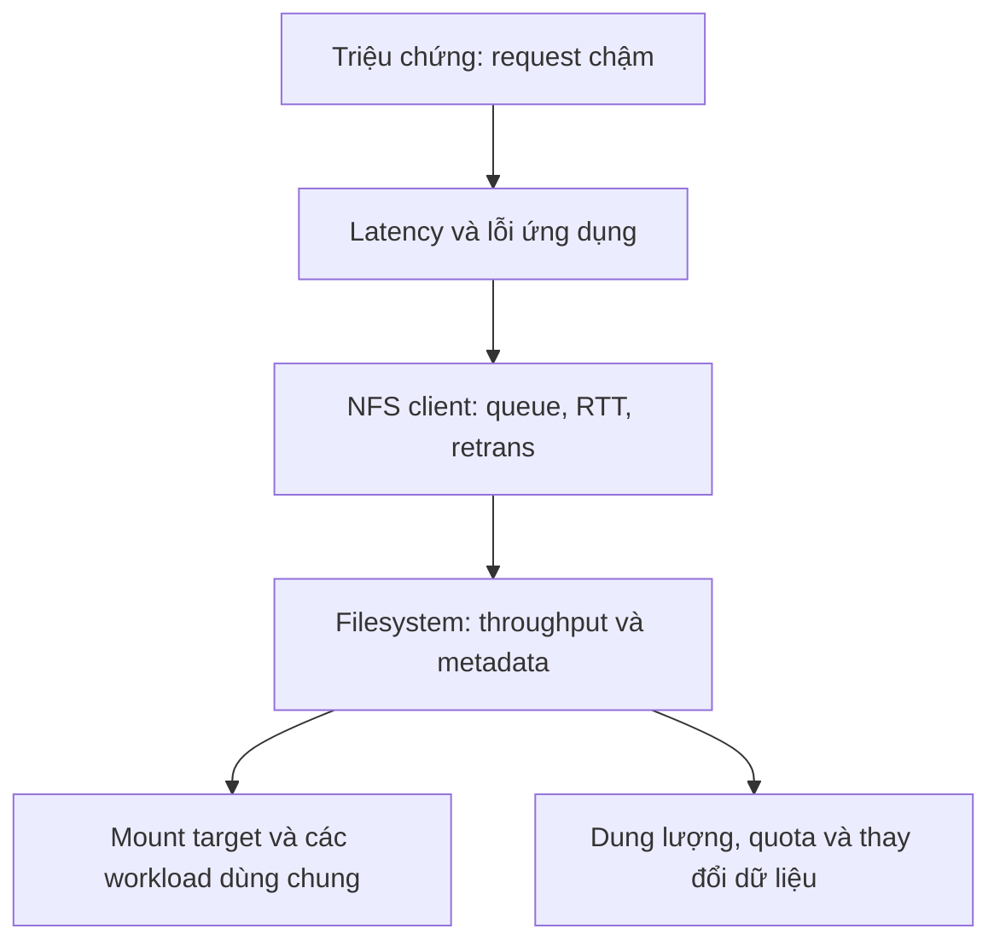

# Theo dõi dung lượng, throughput và tối ưu truy cập NFS

Một API Java có thể truy cập OCI File Storage thành công nhưng vẫn chậm khi tải file, quét thư mục hoặc xử lý nhiều tác vụ đồng thời. Cũng có trường hợp dữ liệu trong thư mục đã giảm nhưng dung lượng được dịch vụ báo cáo chưa giảm tương ứng. Những tình huống này cần được phân tích bằng số liệu ở nhiều tầng trước khi đổi cấu hình.

Bài học trình bày cách theo dõi dung lượng và hiệu năng của Oracle Cloud Infrastructure File Storage, kết hợp OCI Monitoring với thống kê NFS client và số liệu ứng dụng. Mục tiêu là xác định nút thắt, chọn thay đổi có cơ sở và kiểm tra tác động tới độ trễ, tính đúng đắn cùng chi phí.

## 1. Tách ba câu hỏi khi quan sát hệ thống

| Câu hỏi | Đại lượng chính | Ví dụ trong một API Java |
| --- | --- | --- |
| Đang giữ bao nhiêu dữ liệu? | Dung lượng, tốc độ tăng, quota và các điểm lưu dữ liệu | File tải lên tăng nhanh hoặc snapshot giữ các phiên bản dữ liệu |
| Đang chuyển dữ liệu nhanh đến đâu? | Throughput, số thao tác và kích thước I/O | Đọc một file lớn khác với đọc nhiều file rất nhỏ |
| Người dùng phải chờ bao lâu? | Latency, hàng đợi, tỷ lệ lỗi và thời gian hoàn tất nghiệp vụ | Download chậm do NFS, CPU, database hoặc luồng xử lý ứng dụng |

Throughput cao chưa chứng minh ứng dụng đáp ứng độ trễ mong muốn. Throughput thấp cũng chưa chứng minh dịch vụ lưu trữ yếu: workload có thể không phát sinh nhiều dữ liệu, bị giới hạn song song hoặc chủ yếu thực hiện thao tác metadata.

Đặt số liệu vào cùng một khoảng thời gian và cùng phạm vi tài nguyên. Nếu một mount target phục vụ nhiều filesystem, lưu lượng của toàn mount target và của một filesystem riêng không thể được coi là cùng một chuỗi đo.

## 2. Đọc đúng dung lượng sử dụng

OCI File Storage dùng thuộc tính `meteredBytes` để báo dung lượng được đo cho filesystem, cập nhật theo chu kỳ giờ. Các snapshot và clone có cách tính theo dữ liệu khác biệt, nên tổng kích thước file nhìn thấy không nhất thiết bằng số liệu được đo. `du` duyệt cây thư mục; `df` dùng thông tin dịch vụ trả về. Khi quota được bật, cách diễn giải số liệu `df` cần xét giới hạn và usage của quota. [Oracle: File System Usage and Metering](https://docs.oracle.com/en-us/iaas/Content/File/Concepts/FSutilization.htm)

### 2.1. Kiểm tra trên client

Các lệnh Linux dưới đây phục vụ thu thập bằng chứng, chưa được chạy trên tài nguyên của bạn. Thay mount point và thư mục bằng đường dẫn thật:

```bash
findmnt --mountpoint /mnt/oci-share
df -hT /mnt/oci-share
du -sh --exclude=.snapshot /mnt/oci-share/order-api
```

`findmnt` giúp xác nhận đang quan sát đúng mount. Chỉ chạy `du` trên phạm vi cần phân tích: việc duyệt hàng triệu file cũng tạo tải metadata. Một lệnh thống kê dung lượng không nên vô tình trở thành công việc quét toàn filesystem trong giờ cao điểm.

Ghi lại ít nhất bốn thông tin khi so sánh số liệu:

- Thời điểm lấy mẫu và múi giờ.
- Filesystem, export và mount point đang quan sát.
- Thư mục nào được `du` tính, có loại trừ snapshot hay không.
- Quota, snapshot hoặc clone nào liên quan tới cách đọc số liệu.

Nếu vừa xóa file nhưng số liệu dịch vụ chưa giảm, kiểm tra độ trễ cập nhật và các tham chiếu dữ liệu còn được snapshot/clone giữ. Không lấy một mẫu tức thời làm bằng chứng rằng thao tác xóa đã thất bại. [Oracle: File System Usage and Metering](https://docs.oracle.com/en-us/iaas/Content/File/Concepts/FSutilization.htm)

### 2.2. Lấy thông tin filesystem bằng OCI CLI

Ví dụ dùng Bash và OCI CLI đã cấu hình xác thực, đúng region và quyền đọc tài nguyên:

```bash
export FILE_SYSTEM_OCID='ocid1.filesystem.oc1.REGION.REPLACE_ME'

oci fs file-system get \
  --file-system-id "$FILE_SYSTEM_OCID" \
  --query 'data."metered-bytes"' \
  --raw-output
```

Lưu OCID cùng giá trị và thời điểm đọc để theo dõi xu hướng. Lệnh `get` truy vấn thông tin filesystem; tên trường JSON trong OCI CLI dùng dạng `metered-bytes`. [Oracle CLI: file-system get](https://docs.oracle.com/en-us/iaas/tools/oci-cli/latest/oci_cli_docs/cmdref/fs/file-system/get.html)

### 2.3. Phân biệt tăng dung lượng với chạm quota

File Storage có quota ở cấp filesystem, UID và GID. Soft quota cảnh báo; hard quota có thể từ chối ghi khi vượt mức. Khi nhiều quota cùng áp dụng, phải xét giới hạn hiệu lực của người ghi. Quota live data không đồng nghĩa toàn bộ dung lượng được đo có bao gồm snapshot. [Oracle: File System Quotas](https://docs.oracle.com/en-us/iaas/Content/File/Tasks/file-system-quotas.htm)

Ví dụ giả định: filesystem còn dư theo giới hạn chung, nhưng UID chạy Java đã tới hard quota riêng. Tăng số replica hoặc đổi cấu hình mount không giải quyết được việc ghi bị từ chối. Cần xác định đúng UID/GID, quota đang được thực thi và nhu cầu dữ liệu trước khi thay giới hạn.

Một biểu đồ dung lượng nên đi cùng tốc độ tăng. Nếu tổ chức đặt ngưỡng vận hành 2 TiB, hiện dùng 1,4 TiB và tăng khoảng 0,1 TiB/ngày, khoảng dự phòng tuyến tính là sáu ngày. Đây là phép dự báo minh họa cho ngưỡng đã chọn, không phải giới hạn mặc định của dịch vụ và không thay cho việc xem các đợt tăng đột biến.

## 3. Hiểu throughput, số thao tác và latency

### 3.1. Throughput là dữ liệu trên một khoảng thời gian

```text
Throughput = lượng dữ liệu được xử lý / thời gian
1 MiB = 1.048.576 byte
1 MB  = 1.000.000 byte
```

Ví dụ đọc 600 MiB trong 30 giây cho throughput trung bình 20 MiB/s. Phải ghi rõ số đo thuộc ứng dụng, NFS client hay dịch vụ. Một lần đọc được phục vụ từ cache có thể làm ứng dụng thấy throughput cao mà không tạo lượng NFS traffic tương ứng.

Đơn vị mạng thường là bit/s; đơn vị dữ liệu thường là byte/s. Đường mạng 1 Gbit/s có trần số học 125 MB/s trước overhead, nhưng không phải cam kết throughput ứng dụng. Với instance cụ thể, cần kiểm tra băng thông được hỗ trợ và mức sử dụng chung của mạng.

### 3.2. Cùng số thao tác chưa chắc cùng lượng dữ liệu

Hai tải giả định cùng thực hiện 1.000 thao tác dữ liệu mỗi giây:

| Kích thước mỗi thao tác | Lượng dữ liệu tính toán lý thuyết |
| --- | --- |
| 4 KiB | Khoảng 3,91 MiB/s |
| 1 MiB | 1.000 MiB/s |

Phép tính chỉ minh họa quan hệ kích thước và số thao tác, chưa xét overhead hoặc giới hạn hệ thống. Một thao tác Java cũng không nhất thiết ánh xạ thành đúng một NFS RPC hay một backend I/O; cache, buffering và cách triển khai filesystem có thể thay đổi quan hệ đó.

### 3.3. Latency và mức song song

Một luồng thực hiện tuần tự, mỗi I/O hoàn tất sau 2 ms, có trần số học khoảng 500 I/O/s nếu bỏ qua mọi thời gian khác. Với mỗi I/O 64 KiB, lượng dữ liệu tương ứng khoảng 31,25 MiB/s. Thêm năng lực phía dịch vụ chưa tự làm luồng này phát sinh nhiều request hơn.

Ngược lại, tăng số tác vụ song song vô hạn có thể làm hàng đợi dài và p95/p99 tăng. Đo mức song song cùng throughput, latency và tỷ lệ lỗi để chọn điểm vận hành phù hợp.

Không coi latency trung bình ở dịch vụ là p95 của request HTTP. Request ứng dụng còn gồm thời gian đợi thread, xử lý Java, truy vấn database, thao tác file và truyền phản hồi.

## 4. Chọn metric OCI và đúng phạm vi

Namespace của File Storage là `oci_filestorage`. Một tập metric hữu ích:

| Metric | Vai trò khi phân tích |
| --- | --- |
| `FileSystemUsage` | Xu hướng dung lượng |
| `FileSystemReadThroughput`, `FileSystemWriteThroughput` | Throughput dữ liệu đọc/ghi, byte/s |
| `FileSystemReadRequestsbySize`, `FileSystemWriteRequestsbySize` | Số request theo nhóm kích thước |
| `FileSystemReadAverageLatencybySize`, `FileSystemWriteAverageLatencybySize` | Latency trung bình theo nhóm kích thước, giây |
| `MetadataIOPS`, `MetadataRequestAverageLatency` | Hoạt động và latency metadata |
| `MountTargetConnections`, `MountTargetHealth` | Kết nối và tình trạng mount target |

Lọc đúng `resourceId`; khi cần, phân biệt `mountTargetId`, `size` hoặc `operation`. Dữ liệu được phát theo chu kỳ phút; chọn statistic và đơn vị theo định nghĩa từng metric. [Oracle: File System Metrics](https://docs.oracle.com/en-us/iaas/Content/File/Reference/filemetrics.htm)

Một dashboard nên đặt các chuỗi liên quan cạnh nhau thay vì chỉ chọn một con số tổng:



Nếu throughput đã được định nghĩa là byte/s, không lấy thêm đạo hàm của chuỗi đó rồi tiếp tục gọi kết quả là byte/s. Tương tự, cộng các mẫu dung lượng theo thời gian không tạo ra dung lượng hiện tại.

Đối với latency đã là giá trị trung bình, percentile tính trên các mẫu trung bình không khôi phục percentile của từng thao tác gốc. Muốn biết p95 của API hoặc của một thao tác ứng dụng, cần nguồn đo phù hợp tại tầng đó.

### 4.1. Truy vấn MQL

Ví dụ chọn filesystem cụ thể, lấy trung bình throughput đọc từng phút:

```text
FileSystemReadThroughput[1m]{resourceId = "ocid1.filesystem.oc1.REGION.REPLACE_ME"}.mean()
```

MQL kết hợp tên metric, interval, bộ lọc dimension và statistic. Thay OCID bằng tài nguyên thật; nếu có nhiều chuỗi theo mount target, kiểm tra các dimension trả về trước khi tổng hợp. [Oracle: Monitoring Query Language Reference](https://docs.oracle.com/en-us/iaas/Content/Monitoring/Reference/mql.htm)

Ví dụ đọc cùng truy vấn bằng CLI:

```bash
export COMPARTMENT_OCID='ocid1.compartment.oc1..REPLACE_ME'
export START_UTC='2026-11-20T01:00:00Z'
export END_UTC='2026-11-20T02:00:00Z'

MQL_QUERY="FileSystemReadThroughput[1m]{resourceId = \"${FILE_SYSTEM_OCID}\"}.mean()"

oci monitoring metric-data summarize-metrics-data \
  --compartment-id "$COMPARTMENT_OCID" \
  --namespace oci_filestorage \
  --query-text "$MQL_QUERY" \
  --start-time "$START_UTC" \
  --end-time "$END_UTC"
```

Thời gian trong ví dụ là UTC và cần thay theo lần điều tra. Kết quả là dữ liệu tổng hợp của phạm vi truy vấn; dữ liệu trống cần được kiểm tra về region, compartment, quyền và sự tồn tại của chuỗi metric. [Oracle CLI: summarize-metrics-data](https://docs.oracle.com/en-us/iaas/tools/oci-cli/latest/oci_cli_docs/cmdref/monitoring/metric-data/summarize-metrics-data.html)

## 5. Thu thập số liệu từ NFS client

Trong Linux, dùng công cụ NFS thay vì chỉ nhìn các thiết bị block cục bộ:

```bash
findmnt --mountpoint /mnt/oci-share
nfsstat -m
nfsiostat 1 10 /mnt/oci-share
```

`nfsiostat` báo số liệu theo mount. Mẫu đầu phản ánh thời gian từ lúc mount; các mẫu tiếp theo phản ánh từng khoảng lấy mẫu. Các trường cần chú ý gồm op/s, lượng dữ liệu, kích thước trung bình, retransmission, hàng đợi, `avg RTT` và `avg exe`. `avg exe` có phạm vi rộng hơn RTT vì gồm thời gian xử lý request ở client. [Linux NFS utilities: nfsiostat](https://man7.org/linux/man-pages/man8/nfsiostat.8.html)

Diễn giải theo giả thuyết, không coi một trường đơn lẻ là chẩn đoán cuối cùng:

| Quan sát | Giả thuyết cần kiểm tra tiếp |
| --- | --- |
| Queue tăng và `avg exe` tăng nhiều | Client hoặc mức song song đang tạo hàng đợi |
| RTT tăng trên nhiều client cùng lúc | Đường mạng, endpoint hoặc workload dùng chung cần được đối chiếu |
| Retransmission tăng | Kiểm tra đường mạng và phản hồi RPC; chưa kết luận nguyên nhân chỉ từ tỷ lệ này |
| Throughput thấp nhưng metadata tăng | Workload có thể đang quét, tạo hoặc kiểm tra nhiều file nhỏ |
| Một client chậm, client khác bình thường | So sánh shape, mount options, CPU, mạng và tiến trình trên client |

Kết hợp với số liệu CPU, bộ nhớ và mạng của instance. Nếu công cụ chưa có trong image, kiểm tra gói NFS utilities của hệ điều hành. Với Kubernetes managed nodes, lấy bằng chứng trên đúng worker của Pod trong phạm vi quản trị cho phép; số liệu NFS thuộc môi trường mount phía node cần được liên hệ với workload gây ra nó.

## 6. Tối ưu theo nút thắt đã quan sát

### 6.1. Giảm thao tác không cần thiết ở ứng dụng

Một API Java kiểm tra lại toàn bộ thư mục trong mỗi request có thể tạo nhiều thao tác metadata dù chỉ trả về vài kilobyte dữ liệu. Trước khi tăng băng thông, xem xét đường xử lý:

- Có gọi kiểm tra tồn tại hoặc đọc thuộc tính nhiều lần cho cùng một file không?
- Có liệt kê một thư mục rất lớn chỉ để tìm một tài liệu theo ID không?
- Có mở rồi đóng file liên tục thay vì đọc theo luồng với buffering phù hợp không?
- Batch có thể chia thành các tác vụ độc lập với mức song song được giới hạn không?
- Có nhiều replica cùng quét một tập dữ liệu mà không có phân công công việc không?

Ví dụ, nếu đã biết ID tài liệu và quy tắc ánh xạ ID thành đường dẫn, ứng dụng có thể truy cập trực tiếp thay vì duyệt toàn thư mục. Nếu thay đổi cách tổ chức thư mục, thiết kế cả quá trình chuyển dữ liệu và khả năng tìm lại file cũ; throughput tốt hơn không được đánh đổi bằng việc mất khả năng truy xuất dữ liệu.

Buffer Java và kích thước NFS request là hai lớp khác nhau. Tăng buffer có thể giảm số lần gọi ở ứng dụng, nhưng kết quả thực tế phải được xác nhận bằng RPC, throughput và độ trễ. Với nghiệp vụ yêu cầu xác nhận ghi bền vững, giữ nguyên các điều kiện flush/commit cần thiết trong lúc thử hiệu năng.

### 6.2. Kiểm tra mount options và mức song song phía client

Oracle khuyến nghị không cố định `rsize` và `wsize` nếu ứng dụng không có yêu cầu riêng, để client/server thương lượng kích thước phù hợp. `nconnect` có thể tăng số kết nối TCP phục vụ NFS trên client hỗ trợ, nhưng hiệu quả phụ thuộc workload và các giới hạn khác. [Oracle: File Storage Performance Characteristics](https://docs.oracle.com/en-us/iaas/Content/Resources/Assets/whitepapers/file-storage-performance-guide.pdf)

Một giả thuyết thử nghiệm có thể là so sánh cấu hình hiện tại với `nconnect=4` trên client thử có kernel tương thích. Đây là giá trị thử, không phải mặc định bắt buộc. Chuẩn bị lần mount phù hợp trong môi trường thử, sau đó kiểm tra tùy chọn thực tế bằng `nfsstat -m`; một số tùy chọn và kết nối có thể được dùng chung giữa các mount tới cùng server.

Các tùy chọn như `noac` hoặc `actimeo=0` ảnh hưởng việc cache thuộc tính và có thể làm tăng số RPC. Chỉ thay đổi khi đã xác định yêu cầu nhất quán cùng tác động tới workload. Giữ ngữ nghĩa an toàn dữ liệu khi chọn `hard`/`soft`: kiểu soft có thể tạo rủi ro hỏng dữ liệu trong một số tình huống, nên không dùng như một cách tăng tốc chung. [Linux NFS client: mount options](https://man7.org/linux/man-pages/man5/nfs.5.html)

Trong Kubernetes, kiểm tra mount options của PV và phiên bản CSI đang dùng. Việc sửa manifest chưa chứng minh các Pod đã chạy với cấu hình mount mới. Lập kế hoạch thay thế workload hoặc thao tác vòng đời phù hợp với driver, rồi thu lại bằng chứng trên node.

### 6.3. Xem giới hạn Compute và đường mạng

Nếu NFS client có CPU bận, mạng đã gần mức có thể sử dụng hoặc còn chia sẻ đường truyền với công việc khác, tăng năng lực mount target có thể chưa giúp ứng dụng. Thu thập:

| Thành phần | Bằng chứng |
| --- | --- |
| Instance | Shape, băng thông mạng hỗ trợ, CPU và bộ nhớ |
| Đường truy cập | Vị trí client/mount target, route và các thành phần trung gian |
| Network | Lưu lượng, drop, lỗi và dấu hiệu truyền lại trong khoảng điều tra |
| Workload chung | Backup, tác vụ sao chép hoặc các tiến trình khác cùng dùng tài nguyên |

So sánh client có cấu hình khác chỉ có ý nghĩa khi giữ được điều kiện dữ liệu và workload đủ tương đương. Một lần chạy đọc từ cache trên máy mới không chứng minh mạng hoặc storage đã được cải thiện.

### 6.4. Đánh giá năng lực và cách phân phối tải ở mount target

OCI có các lựa chọn mount target với đặc tính hiệu năng khác nhau; có thể xem xét đổi loại hoặc phân phối client qua nhiều mount target khi bằng chứng cho thấy endpoint là điểm giới hạn. Cần đánh giá điều kiện sử dụng, giới hạn tài nguyên và chi phí hiện hành trước khi chọn. Cách export qua nhiều mount target cũng có thể thay đổi lợi ích metadata caching. [Oracle: File Storage Performance Characteristics](https://docs.oracle.com/en-us/iaas/Content/Resources/Assets/whitepapers/file-storage-performance-guide.pdf)

Một mount target mới chưa tự phân phối lại các client đang mount bằng địa chỉ cũ. Kế hoạch thay đổi cần xác định client nào chuyển, export nào dùng, các quyền và đường mạng tương ứng, cùng cách quay lại cấu hình trước nếu kết quả không đạt.

Nếu chỉ một luồng Java phát sinh I/O tuần tự, hãy kiểm tra giới hạn tại luồng đó trước. Nếu nhiều ứng dụng dùng chung endpoint, phải nhìn cả tải của những ứng dụng còn lại để tránh quy toàn bộ lưu lượng cho một API.

## 7. Thiết kế cảnh báo có hành động đi kèm

Một cảnh báo hữu ích cần có nguồn số liệu, phạm vi, điều kiện kéo dài và người xử lý. Chọn ngưỡng từ mục tiêu dịch vụ và baseline đã đo, thay vì dùng một giá trị chung cho mọi filesystem.

| Nhóm cảnh báo | Điều kiện minh họa | Hành động đầu tiên |
| --- | --- | --- |
| Dung lượng | Usage hoặc tốc độ tăng vượt ngưỡng vận hành đã đặt | Xác định nguồn tăng, quota và các điểm giữ dữ liệu |
| Độ trễ | Latency cao kéo dài cùng ảnh hưởng tới ứng dụng | Đối chiếu client, metadata, throughput và thời điểm thay đổi |
| Ghi thất bại | Ứng dụng báo lỗi quota hoặc quyền | Kiểm tra danh tính, giới hạn và export trước khi điều chỉnh hiệu năng |
| Tình trạng endpoint | Metric health bất thường | Xem chuỗi lỗi, khả năng truy cập và phạm vi client bị ảnh hưởng |
| Dữ liệu giám sát | Metric cần thiết không xuất hiện trong khoảng mong đợi | Phân biệt không phát sinh hoạt động với lỗi thu thập hoặc chọn sai phạm vi |

MQL hỗ trợ điều kiện và phép kiểm tra vắng dữ liệu; cấu hình alarm cần đi cùng interval, thời gian chờ kích hoạt và kênh nhận phù hợp. Khi sử dụng một metric vốn không có mẫu lúc không phát sinh hoạt động, phải xem xét hành vi đó trước khi tạo absence alarm. [Oracle: Monitoring Query Language Reference](https://docs.oracle.com/en-us/iaas/Content/Monitoring/Reference/mql.htm)

Throughput bằng không có thể bình thường khi không có request. Nhưng throughput về không trong lúc hàng đợi nghiệp vụ tăng lại là tín hiệu khác. Kết nối cảnh báo lưu trữ với lượng công việc ứng dụng để nhận biết sự khác biệt.

Runbook cho cảnh báo nên ghi:

1. Region, compartment, OCID filesystem và mount target liên quan.
2. Dashboard và khoảng thời gian cần đối chiếu.
3. Workload hoặc nhóm client dùng chung tài nguyên.
4. Bằng chứng cần lấy trước khi thay đổi.
5. Phương án xử lý, người quyết định và điều kiện dừng/rollback.

## 8. Tình huống: API chậm nhưng throughput NFS thấp

Giả sử API tài liệu có p95 tăng từ 90 ms lên 320 ms sau khi số file tăng mạnh. CPU trên máy ứng dụng còn dư, throughput đọc dữ liệu chỉ vài MiB/s, còn số thao tác metadata tăng rõ rệt.

Các số trong tình huống là giả định phục vụ phân tích, không phải kết quả đo một tenancy. Một quy trình điều tra hợp lý:

1. Xác nhận p95 của đúng endpoint và khoảng thời gian xảy ra thay đổi.
2. Kiểm tra tracing hoặc thời gian từng công đoạn để xem request đang chờ ở đâu.
3. Đối chiếu metadata operations với luồng tìm tài liệu trong mã ứng dụng.
4. Xác định có thao tác liệt kê thư mục hoặc kiểm tra thuộc tính lặp lại hay không.
5. Thử giảm thao tác dư trên môi trường có dữ liệu đại diện.
6. Đo lại p95, tỷ lệ lỗi, metadata, throughput và tài nguyên client.

Những kết quả giả định dưới đây giúp chọn bước tiếp theo:

| Thử nghiệm | Kết quả quan sát | Kết luận trong phạm vi phép thử |
| --- | --- | --- |
| Tăng số thread | Queue và p95 tăng; tốc độ hoàn tất ít thay đổi | Mức song song này chưa đem lại lợi ích |
| Truy cập theo đường dẫn xác định thay vì quét thư mục | Metadata giảm, p95 giảm, dữ liệu trả về đúng | Có bằng chứng để tiếp tục đánh giá thay đổi ở ứng dụng |
| Chạy lại cùng file nhiều lần | Nhanh hơn nhưng NFS traffic giảm | Cache có ảnh hưởng; cần tách kết quả warm và cold |
| Thử workload đọc file lớn | Throughput cao hơn tải API nhiều file nhỏ | Hai workload có đặc điểm khác nhau; không thay thế kết quả của nhau |

Một trường hợp khác là batch đọc các file lớn, nhiều client đồng thời và endpoint có tải cao kéo dài. Khi đó, năng lực mount target hoặc phân phối tải có thể là giả thuyết phù hợp hơn. Phải dựa trên bằng chứng của tình huống cụ thể.

## 9. So sánh trước và sau thay đổi

Để một kết quả có thể được đánh giá lại, lưu điều kiện chạy:

| Nội dung | Thông tin cần ghi |
| --- | --- |
| Dữ liệu | Số file, phân bố kích thước, cấu trúc thư mục và tính đại diện |
| Cache | Các lần chạy đã warm tới mức nào; nguồn dữ liệu nào được đọc lại |
| Client | Shape, kernel, NFS options, vị trí và mức tải chung |
| Song song | Số client, số Pod, số thread và giới hạn hàng đợi |
| Lưu trữ | Filesystem, export, mount target và quota đang áp dụng |
| Kết quả | Throughput, thời gian hoàn tất, latency, lỗi và mức dùng tài nguyên |
| Tính đúng đắn | Nội dung đọc/ghi, quyền truy cập và yêu cầu lưu bền vững |
| Vận hành | Chi phí liên quan, cách áp dụng rộng và phương án quay lại |

Đổi một yếu tố chính mỗi lần và chạy đủ lâu để quan sát trạng thái ổn định. Chọn phạm vi thử có giới hạn trên tài nguyên thử nghiệm hoặc khung vận hành đã được cấp phép; dữ liệu benchmark không được lẫn vào thư mục nghiệp vụ.

Với workload ghi, phép đo kết thúc khi dữ liệu mới ở buffer ứng dụng không tương đương phép đo kết thúc sau các bước xác nhận ghi cần thiết. Ghi rõ mốc hoàn tất và giữ mốc đó nhất quán giữa các lần so sánh.

Nếu thử thêm replica trong OKE, ghi vị trí Pod thực tế. Hai Pod trên cùng worker có thể chia sẻ tài nguyên client theo cách khác với hai Pod trên hai worker. Khi quy mô thay đổi, theo dõi cả các dịch vụ phụ thuộc như database và hàng đợi.

## 10. Những nhận định dễ dẫn tới tối ưu sai

| Nhận định | Cách kiểm tra lại |
| --- | --- |
| Dung lượng `du` là dung lượng tính phí | Đối chiếu phạm vi cây thư mục, metering, quota và snapshot/clone |
| Xóa file thì dung lượng dịch vụ phải giảm ngay | Xem thời điểm cập nhật và các tham chiếu dữ liệu còn giữ |
| Nhiều byte/s nghĩa là API nhanh | Đọc cùng độ trễ, lỗi và lượng công việc hoàn tất |
| Ít byte/s nghĩa là storage không đủ mạnh | Xem kích thước I/O, metadata, cache và mức song song |
| Mọi giá trị IOPS đều cùng ý nghĩa | Phân biệt lời gọi ứng dụng, NFS RPC và I/O backend |
| Tăng thread hoặc Pod luôn cải thiện | Đo queue, p95/p99 và các giới hạn dùng chung |
| Đặt rsize/wsize lớn là xong | Kiểm tra thương lượng thực tế và workload thay vì chỉ nhìn giá trị cấu hình |
| Giá trị trung bình tốt đảm bảo không có request chậm | Đo phân bố latency tại tầng ứng dụng cần đánh giá |
| PVC có con số dung lượng là đủ cho mọi kiểm soát usage | Kiểm tra quota đang thực thi ở dịch vụ và danh tính ghi dữ liệu |

## 11. Bài tập vận dụng

Chọn một filesystem thử nghiệm đã có NFS client hoạt động. Thu thập một khoảng baseline cho ba nhóm: dung lượng, hiệu năng NFS và độ trễ/tốc độ hoàn tất của workload đại diện. Dùng ít nhất hai dạng truy cập, chẳng hạn đọc file lớn và đọc nhiều file nhỏ.

Thực hiện các phần sau:

1. Ghi đúng filesystem, mount target, mount source và khoảng thời gian đo.
2. Đọc `meteredBytes`, kiểm tra `df` và chạy `du` trên một thư mục giới hạn; giải thích những khác biệt có thể có.
3. Truy vấn throughput theo filesystem và đối chiếu với `nfsiostat` trên client.
4. Xác định workload thiên về dữ liệu, metadata, latency tuần tự hay mức song song.
5. Đặt một giả thuyết cải thiện và chọn đúng một thay đổi có thể kiểm chứng.
6. So sánh trước/sau với cùng mốc hoàn tất, điều kiện cache và tiêu chí đúng đắn.
7. Đề xuất một cảnh báo có ngưỡng, khoảng đánh giá, người nhận và hành động đầu tiên.

Đầu ra là một bản phân tích chỉ rõ **đang đo điều gì, nút thắt được chứng minh bằng bằng chứng nào, thay đổi nào đã cải thiện kết quả và giới hạn của kết luận đó**. Giữ cùng phương pháp đo khi áp dụng rộng để phát hiện trường hợp workload hoặc điểm giới hạn đã thay đổi.
