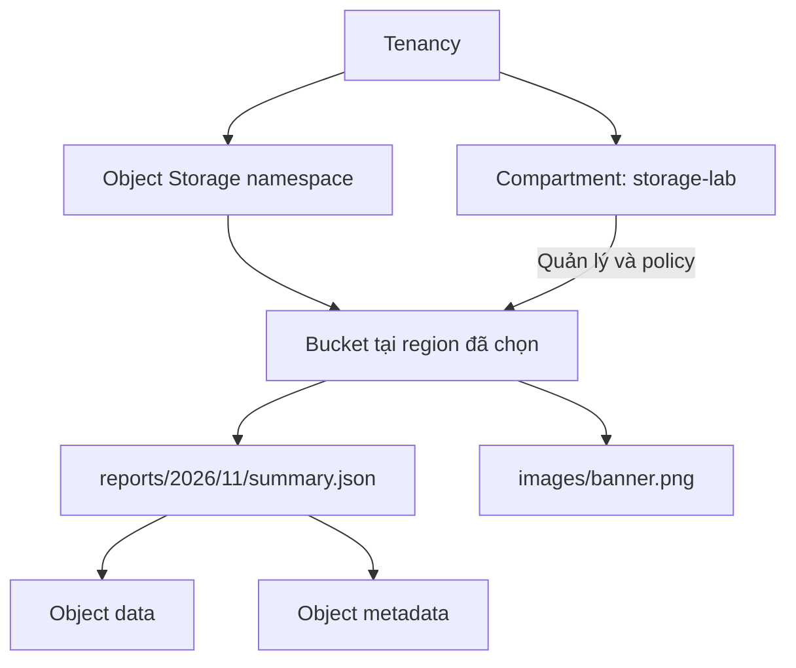

# Namespaces, buckets, objects và object metadata

## 1. Mục tiêu và bối cảnh

Trong chương **Object Storage và Archive Storage** của module **CLOUD_PROVIDERS_ORACLE**, bài học này xây dựng mô hình để lưu, định danh và đọc dữ liệu dạng object trên Oracle Cloud Infrastructure. Bạn sẽ liên hệ namespace, bucket và object với tenancy, compartment, region, IAM và cấu hình ứng dụng.

Giả sử một dịch vụ Java tạo báo cáo JSON, tài liệu PDF và bản xuất dữ liệu từ Oracle Database. Những đầu ra này cần được lưu bền vững, có thể tải xuống bằng API, phân quyền và chọn mức lưu trữ phù hợp. OCI Object Storage cung cấp mô hình lưu trữ object cho nhu cầu đó; Archive là một lựa chọn tier có đặc tính truy cập khác.

Sau bài này, bạn có thể:

- Phân biệt namespace, compartment, bucket, object name và object version.
- Xác định đầy đủ địa chỉ logic của một object.
- Hiểu prefix và “folder” trong giao diện Object Storage.
- Phân biệt thuộc tính do dịch vụ quản lý, HTTP response headers và custom metadata.
- Thực hành upload, HEAD, list và download một object nhỏ bằng OCI CLI.
- Đọc lỗi theo đúng lớp định danh, xác thực, quyền hoặc trạng thái lưu trữ.

Các lệnh Bash dành cho môi trường Linux thử nghiệm có OCI CLI và quyền phù hợp. Đây là ví dụ học tập, không phải yêu cầu chạy trên máy đang chứa tài liệu. Giá trị OCID, region, bucket và object minh họa phải được thay bằng thông tin của môi trường được phép quản trị.

## 2. Mô hình Object Storage

Một object gồm **nội dung dữ liệu** cùng những thuộc tính mô tả và điều khiển cách truy cập nội dung đó. Dịch vụ làm việc với object thông qua API, CLI hoặc SDK. Nó không yêu cầu ứng dụng nhìn dữ liệu như một ổ đĩa được gắn vào hệ điều hành. [Oracle: Overview of Object Storage](https://docs.oracle.com/en-us/iaas/Content/Object/Concepts/objectstorageoverview.htm).

Một báo cáo có thể được mô tả như sau:

```text
Nội dung: các byte của báo cáo JSON
Object name: reports/2026/11/summary.json
Content-Type: application/json
Custom metadata: schema-version=1, producer=report-service
```

Nội dung và metadata có vai trò khác nhau. Đặt `schema-version=1` không tự biến dữ liệu thành JSON hợp lệ. Đặt tên kết thúc bằng `.pdf` cũng không chứng minh nội dung là một tài liệu PDF an toàn hoặc đúng định dạng.

So sánh cách truy cập:

| Mô hình | Cách ứng dụng làm việc với dữ liệu | Ví dụ thao tác |
| --- | --- | --- |
| Object Storage | Gọi API theo bucket và object name | PUT, HEAD, GET, LIST |
| File Storage | Mở file qua filesystem đã mount | Đọc đường dẫn file, thao tác thư mục |
| Block Storage | Làm việc với thiết bị khối qua hệ điều hành hoặc phần mềm storage | Tạo filesystem, quản lý volume theo thiết kế |

Một lớp công cụ có thể mô phỏng filesystem trên object storage, nhưng ứng dụng vẫn phải kiểm tra ngữ nghĩa và giới hạn của lớp đó. Không mặc định rằng API object có mọi hành vi POSIX như một filesystem cục bộ.

## 3. Namespace, compartment và region

### Namespace gắn với tenancy

Object Storage namespace là không gian tên cấp cao cho bucket và object của tenancy. OCI cấp một tên namespace duy nhất và không cho đổi tùy ý; chuỗi namespace của tenancy được giữ giống nhau ở các region. Đừng tự suy namespace bằng cách viết thường display name hoặc lấy tenancy OCID. Hãy đọc giá trị từ OCI. [Oracle: Object Storage Namespaces](https://docs.oracle.com/en-us/iaas/Content/Object/Tasks/understandingnamespaces.htm).

Lệnh cơ bản:

```bash
oci os ns get
```

Kết quả có dạng minh họa:

```json
{
  "data": "namespace-from-oci"
}
```

Tên namespace không phải mật khẩu và không thay cho thông tin xác thực. Biết namespace của một tenancy không có nghĩa là được đọc các object riêng tư trong tenancy đó.

### Compartment tổ chức và phân quyền tài nguyên

Bucket thuộc một compartment. Compartment giúp phân chia trách nhiệm và áp dụng policy IAM, ví dụ tách tài nguyên báo cáo của môi trường lab khỏi production.

Namespace và compartment không phải cùng một khái niệm. Tạo compartment mới không tự tạo namespace Object Storage mới. Trong thao tác object, CLI thường cần namespace, bucket và object name; còn thao tác liệt kê bucket cần biết compartment phù hợp.

### Region vẫn là một phần của định danh triển khai

Cùng chuỗi namespace không có nghĩa mọi region có cùng bucket và dữ liệu. Khi cấu hình client, phải chọn đúng region hoặc endpoint của tài nguyên. Một lỗi “không tìm thấy bucket” có thể xuất phát từ region sai, không nhất thiết bucket đã bị xóa.

Mô hình khái niệm:



Sơ đồ thể hiện hai góc nhìn: namespace giúp định danh, compartment giúp tổ chức quyền quản trị. Region phải được lưu cùng cấu hình triển khai, dù không được biểu diễn thành một thư mục trong object name.

## 4. Bucket là container có cấu hình riêng

Bucket chứa object, đồng thời có cấu hình như public access, default storage tier, versioning và các chính sách vòng đời. Bucket có OCID của tài nguyên, nhưng trong nhiều thao tác Object Storage, ứng dụng sử dụng tên bucket cùng namespace.

Bucket không chứa bucket con. Bạn có thể chia dữ liệu thành nhiều bucket khi có khác biệt đáng kể về chủ sở hữu, quyền, vòng đời hoặc yêu cầu vận hành. Không cần tạo một bucket riêng cho từng ngày chỉ để mô phỏng thư mục.

### Phạm vi duy nhất của tên bucket

Cần xét **bucket scope** thay vì dùng một quy tắc tên cho mọi bucket:

| Bucket scope | Phạm vi tên cần duy nhất | Điểm cần hiểu |
| --- | --- | --- |
| `NAMESPACE` | Trong tenancy/namespace và region | Phù hợp mô hình path-style của bài lab |
| `REGION` | Trong toàn region, giữa các tenancy | Hỗ trợ thêm cách truy cập virtual-hosted style theo điều kiện dịch vụ |

Ví dụ với scope `NAMESPACE`, cùng tên bucket có thể xuất hiện trong hai namespace khác nhau hoặc hai region khác nhau. Đổi compartment trong cùng namespace và region không làm tên bucket tự có một không gian tên riêng. [Oracle: Creating an Object Storage Bucket](https://docs.oracle.com/en-us/iaas/Content/Object/Tasks/managingbuckets_topic-To_create_a_bucket.htm).

Bài thực hành sẽ chọn rõ `NAMESPACE` và tên riêng cho từng lần chạy. Khi đổi scope hoặc dùng API tương thích khác, cần kiểm tra quy tắc tên và cách tạo endpoint của giao diện đó.

### Chọn bucket theo ranh giới vận hành

Ví dụ một bucket cho dữ liệu báo cáo lab giúp kiểm kê và dọn bài thực hành. Trong hệ thống thật, có thể cần tách bucket có retention khác nhau hoặc thuộc nhóm vận hành khác nhau.

Một prefix thuận tiện để nhóm object nhưng không tự tạo ranh giới bảo mật. Muốn giới hạn theo bucket hoặc object pattern phải cấu hình quyền thực tế; không dựa vào việc Console hiển thị một hình thư mục.

## 5. Định danh object và ý nghĩa của object name

Trong OCI, object không có OCID riêng như bucket. Người dùng hoặc ứng dụng chọn object name khi upload. Object name phân biệt chữ hoa và chữ thường; mỗi tên xác định object hiện hành trong bucket, và versioning có thể bổ sung các phiên bản. [Oracle: Object Storage Objects](https://docs.oracle.com/en-us/iaas/Content/Object/Tasks/managingobjects.htm).

Để ghi lại tham chiếu đến một object, hãy lưu đủ:

```text
Region + namespace + bucket name + object name
Nếu cần một bản cố định: thêm version ID phù hợp
```

Ví dụ cấu hình ứng dụng:

```json
{
  "region": "ap-singapore-1",
  "namespace": "namespace-from-oci",
  "bucket": "team-reports-lab",
  "objectName": "reports/2026/11/summary.json"
}
```

Chỉ lưu `summary.json` làm định danh có thể gây nhầm giữa nhiều dataset, bucket hoặc môi trường. Ngược lại, không cần gắn trực tiếp một URL có thông tin truy cập tạm thời vào mọi bản ghi nghiệp vụ.

### Object name không phải local file path

Xét ba giá trị:

| Giá trị | Vai trò |
| --- | --- |
| `/tmp/report.json` | File nguồn trên máy upload |
| `reports/2026/11/summary.json` | Object name trong bucket |
| `/tmp/downloaded-report.json` | File đích khi download |

Chúng có thể khác nhau hoàn toàn. Upload một file không có nghĩa cấu trúc thư mục của máy nguồn được tự giữ nguyên. Nếu cần object name cụ thể, chỉ định rõ khi gọi API hoặc CLI.

Trong Java, một object name nên được truyền vào trường object name của request SDK. Không dùng quy tắc chuẩn hóa đường dẫn của hệ điều hành để tùy ý đổi dấu `/`, thêm ổ đĩa Windows hoặc loại bỏ các thành phần của key.

## 6. Prefix, delimiter và thư mục giả lập

Object Storage có cấu trúc tên phẳng bên trong bucket. Dấu `/` trong tên giúp công cụ tạo góc nhìn giống cây thư mục; không cần tạo một thư mục vật lý trước khi upload object có prefix.

Ví dụ các object name:

```text
reports/2026/11/summary.json
reports/2026/11/details.csv
reports/2026/12/summary.json
reports-old/summary.json
```

`reports/2026/11/` là một prefix phù hợp để chọn hai object đầu. Prefix `reports` rộng hơn và có thể khớp cả `reports-old/summary.json`. Vì vậy, dấu `/` cuối prefix là một quyết định về phạm vi, không phải chi tiết trang trí.

Khi liệt kê, **prefix** lọc phần đầu của object name; **delimiter** như `/` giúp nhóm các tên có phần đầu chung. Nhóm prefix được trả về không chứng minh có một object chứa dữ liệu ở đúng tên “thư mục” đó. [Oracle: Listing Objects in a Bucket](https://docs.oracle.com/en-us/iaas/Content/Object/Tasks/managingobjects_topic-To_list_objects_in_a_bucket.htm).

Hệ quả cho thiết kế:

- Chọn key ổn định, dễ lọc theo nhu cầu nghiệp vụ.
- Không đặt thông tin bí mật hoặc dữ liệu cá nhân không cần thiết vào tên.
- Không coi liệt kê prefix là một truy vấn database với điều kiện tùy ý.
- Kiểm tra toàn bộ phạm vi trước thao tác bulk theo prefix.

Việc ứng dụng xem một prefix là “thư mục của khách hàng” không tự cấp hoặc thu hồi quyền cho khách hàng đó. Ranh giới nghiệp vụ cần được kiểm tra bằng phân quyền và quy tắc sở hữu dữ liệu.

## 7. Ba nhóm object metadata

### Thuộc tính do dịch vụ quản lý

Đây là những thông tin giúp mô tả object và lần lưu hiện tại, chẳng hạn kích thước, thời gian sửa, ETag, storage tier hoặc version ID khi có. Một số giá trị nằm trong summary khi LIST, một số được trả qua HEAD hoặc GET.

Không phải mọi field đều xuất hiện với cùng tên và định dạng trong mọi giao diện. CLI có thể hiển thị JSON dùng dấu gạch ngang, trong khi SDK dùng các getter hoặc tên thuộc tính theo ngôn ngữ.

### HTTP headers mô tả cách diễn giải nội dung

Các header thường gặp gồm:

| Header | Vai trò | Không tự thực hiện |
| --- | --- | --- |
| `Content-Type` | Khai báo kiểu nội dung, ví dụ `application/json` | Parse hoặc xác thực schema JSON |
| `Content-Disposition` | Gợi ý cách trình bày hoặc tên file tải xuống | Đổi object name trong bucket |
| `Cache-Control` | Hướng dẫn client/cache xử lý response | Thay thế IAM hoặc làm object thành public/private |
| `Content-Encoding` | Mô tả encoding đã áp dụng, ví dụ gzip | Tự nén một payload chưa được nén |

Giá trị khai báo phải phản ánh nội dung thật. Nếu gửi dữ liệu nén nhưng mô tả sai encoding, bên đọc có thể xử lý lỗi dù upload thành công. Các lựa chọn này là header phục vụ client, không phải logic kiểm chứng nội dung của dịch vụ. [OCI CLI: object put](https://docs.oracle.com/en-us/iaas/tools/oci-cli/latest/oci_cli_docs/cmdref/os/object/put.html).

### Custom metadata do ứng dụng đặt

Custom metadata là các cặp tên/giá trị chuỗi gắn với object. Ví dụ:

```json
{
  "schema-version": "1",
  "producer": "report-service",
  "dataset": "monthly-summary"
}
```

Ở giao diện HTTP của OCI, tên custom metadata được trả với tiền tố `opc-meta-`, ví dụ `opc-meta-schema-version`. Khi dùng `--metadata` của CLI, cung cấp JSON key/value theo giao diện công cụ; không tự thêm tiền tố hai lần. [Oracle: Optional Response Headers and Metadata](https://docs.oracle.com/en-us/iaas/Content/Object/Tasks/managingobjects.htm#Optional).

Custom metadata nên ngắn, có quy ước tên và dùng cho việc mô tả hoặc định tuyến xử lý. Đặt `classification=internal` không tự cấm tải xuống; đặt `retention-days=90` cũng không tự tạo retention rule.

Không đặt API key, mật khẩu database hoặc URL mang quyền truy cập tạm thời vào metadata. Người có quyền HEAD có thể đọc metadata mà chưa cần tải nội dung object.

### Phân biệt với metadata và tags của tài nguyên khác

| Khái niệm | Ví dụ mục đích | Có tự truyền thành metadata của từng object không? |
| --- | --- | --- |
| Object metadata | Schema của một bản báo cáo | Chính nó gắn với object được ghi |
| Bucket metadata | Mô tả bucket | Không mặc định kế thừa xuống object |
| Tags của bucket | Nhóm dự án, môi trường, quản trị tài nguyên | Không tự trở thành các header `opc-meta-*` |
| Namespace metadata | Cấu hình namespace cho các giao diện được hỗ trợ | Không phải nhãn nghiệp vụ của mỗi file |

Nếu cần thay metadata bằng cách ghi hoặc copy object, phải xem semantics của thao tác và giữ đầy đủ giá trị cần thiết. Không mặc định rằng chỉ gửi một key mới luôn là cập nhật từng phần. Khi copy, OCI có lựa chọn xử lý metadata của đích; đó là một thao tác dữ liệu cần quyền và kế hoạch phù hợp. [Oracle: Copying Objects](https://docs.oracle.com/en-us/iaas/Content/Object/Tasks/copyingobjects.htm).

## 8. HEAD, LIST, GET và ETag

### Chọn thao tác theo câu hỏi

| Câu hỏi | Thao tác phù hợp |
| --- | --- |
| Trong bucket hoặc prefix có những tên nào? | LIST |
| Object cụ thể có metadata gì? | HEAD |
| Cần đọc nội dung object? | GET |
| Cần ghi nội dung mới? | PUT hoặc quy trình upload phù hợp |

HEAD giúp kiểm tra object mà không tải body. LIST không phải một phép HEAD cho từng object; đừng giả định summary của LIST chứa toàn bộ custom metadata. Nếu ứng dụng cần tìm kiếm theo nhiều trường nghiệp vụ ở quy mô lớn, hãy thiết kế index hoặc catalog phù hợp thay vì HEAD hàng loạt theo từng request người dùng.

### ETag là dấu nhận dạng biểu diễn tài nguyên

ETag là giá trị phục vụ nhận dạng trạng thái và các điều kiện request. Xem nó như giá trị opaque: lưu và so sánh theo giao thức, không tự diễn giải nó thành một thuật toán hash.

OCI có thể trả ETag và checksum thành các trường khác nhau. Không mặc định `ETag = MD5`, và không so một chuỗi MD5 dạng base64 với MD5 dạng hex rồi kết luận dữ liệu hỏng. [Oracle: Getting an Object's ETag](https://docs.oracle.com/en-us/iaas/Content/Object/Tasks/managingobjects_topic-head_objects.htm).

Với thao tác cập nhật có nguy cơ ghi đè đồng thời, điều kiện như If-Match có thể giúp phát hiện tài nguyên đã đổi kể từ lúc đọc. Nó không tạo giao dịch nguyên tử giữa Object Storage và một bảng dữ liệu Oracle Database.

Bài lab sẽ kiểm tra nội dung bằng cách tải lại rồi so byte của file nhỏ. Việc này trả lời trực tiếp câu hỏi “payload có khớp không”, độc lập với cách biểu diễn ETag.

## 9. Quyền truy cập và tính riêng tư

Quyền đọc thông tin bucket, xem metadata object, tải object và ghi/xóa object là các khả năng khác nhau. Trong mô hình IAM của OCI, `inspect objects` bao gồm LIST và HEAD; `read objects` bổ sung khả năng GET nội dung. [Oracle: Object Storage IAM policy reference](https://docs.oracle.com/en-us/iaas/Content/Identity/Reference/objectstoragepolicyreference.htm).

Ví dụ nhóm chỉ đọc object của một bucket lab đã tồn tại:

```text
Allow group ObjectStorageReaders to read objects in compartment storage-lab where target.bucket.name = 'team-reports-lab'
```

Tên group, identity domain nếu có, bucket và compartment phải khớp tenancy. Policy này không phải toàn bộ quyền để tạo bucket của bài thực hành; người tạo cần các quyền quản trị tương ứng. Chỉ cấp thêm thao tác cần dùng, không mở rộng ra toàn tenancy để giải quyết một lỗi đơn lẻ.

Ứng dụng có thể dùng danh tính workload phù hợp, chẳng hạn instance principals khi chạy trên Compute đã được cấu hình. Không nhúng private signing key hoặc mật khẩu vào source code và metadata chỉ để tiện chạy thử.

### Bucket private và đường dẫn HTTP

Một đường dẫn API native có dạng khái niệm:

```text
<ObjectStorageEndpoint>/n/<namespace>/b/<bucket>/o/<urlEncodedObjectName>
```

Endpoint phụ thuộc region và môi trường OCI. SDK hoặc CLI xử lý việc tạo request theo giao diện của chúng; khi tự tạo URL, phải encode object name đúng. Chuỗi có dấu cách, ký tự Unicode hoặc ký tự URL đặc biệt không nên được nối tùy ý.

Biết URL chuẩn không tự có quyền tải một object private. Public access và pre-authenticated request, viết tắt PAR, là những cơ chế riêng. PAR có thể cho người cầm URL truy cập mà không cần credential riêng, vì vậy URL đó phải được xử lý như dữ liệu mang quyền truy cập. Bài lab không cần tạo PAR. [Oracle: Pre-Authenticated Requests](https://docs.oracle.com/en-us/iaas/Content/Object/Tasks/usingpreauthenticatedrequests.htm).

## 10. Bài thực hành: một object nhỏ trong bucket riêng tư

### Chuẩn bị ngữ cảnh

Dùng compartment lab, tài khoản có quyền được cấp cho bài thực hành và một terminal Bash có OCI CLI đã cấu hình. Chọn đúng region được phép dùng. Các block dưới đây dùng chung một phiên shell và giữ lại biến giữa các bước.

```bash
REGION='ap-singapore-1'
COMPARTMENT_OCID='ocid1.compartment.oc1..EXAMPLE'

NAMESPACE="$(oci os ns get \
  --region "$REGION" \
  --query data \
  --raw-output)"

RUN_ID="$(date -u +%Y%m%dt%H%M%Sz)-$RANDOM"
BUCKET="oci-os-lab-$RUN_ID"
OBJECT_NAME="lab/$RUN_ID/reports/summary.json"
WORK_DIR="$(mktemp -d)"

printf 'Region: %s\nNamespace: %s\nBucket: %s\nObject: %s\n' \
  "$REGION" "$NAMESPACE" "$BUCKET" "$OBJECT_NAME"
```

Kiểm tra từng lệnh thành công và giá trị namespace không rỗng trước khi tiếp tục. Tên có hậu tố riêng giúp giảm khả năng đụng tài nguyên của lần chạy khác; nó không thay thế việc xác minh tài nguyên sẽ thao tác.

### Tạo bucket mới cho lab

```bash
oci os bucket create \
  --region "$REGION" \
  --namespace-name "$NAMESPACE" \
  --compartment-id "$COMPARTMENT_OCID" \
  --name "$BUCKET" \
  --bucket-scope NAMESPACE \
  --storage-tier Standard \
  --public-access-type NoPublicAccess
```

Đọc lại kết quả để xác nhận tên, compartment, namespace, scope và public access. Ví dụ dùng bucket mới, không bật versioning hoặc retention rule để tập trung vào mô hình cơ bản. Không đổi cấu hình một bucket đang có dữ liệu chỉ để làm bài này. [OCI CLI: bucket create](https://docs.oracle.com/en-us/iaas/tools/oci-cli/latest/oci_cli_docs/cmdref/os/bucket/create.html).

### Chuẩn bị payload và upload cùng metadata

```bash
printf '%s\n' \
  '{"reportId":"lab-001","status":"ready","recordCount":3}' \
  > "$WORK_DIR/report.json"

oci os object put \
  --region "$REGION" \
  --namespace-name "$NAMESPACE" \
  --bucket-name "$BUCKET" \
  --name "$OBJECT_NAME" \
  --file "$WORK_DIR/report.json" \
  --no-multipart \
  --no-overwrite \
  --content-type 'application/json' \
  --metadata '{"schema-version":"1","producer":"oci-cli-lab","dataset":"lesson-001"}'
```

Payload nhỏ nên ví dụ chọn single-part upload. `--no-overwrite` yêu cầu CLI không ghi đè object đã có; phải đọc kết quả thực tế để phân biệt upload mới với trường hợp được bỏ qua. Không coi lệnh kết thúc mà không có lỗi shell là bằng chứng rằng một object cũ đã được cập nhật đúng ý.

Tên file local là `report.json`, nhưng tên object đầy đủ là giá trị trong `OBJECT_NAME`. Các key metadata ở đây chưa có tiền tố `opc-meta-` vì CLI nhận tập tên/giá trị qua `--metadata`.

### HEAD để xem thuộc tính và custom metadata

```bash
oci os object head \
  --region "$REGION" \
  --namespace-name "$NAMESPACE" \
  --bucket-name "$BUCKET" \
  --name "$OBJECT_NAME"
```

Kiểm tra content type, content length, ETag và các header custom metadata được trả về. HEAD không tải body báo cáo. [OCI CLI: object head](https://docs.oracle.com/en-us/iaas/tools/oci-cli/latest/oci_cli_docs/cmdref/os/object/head.html).

Kết quả cần thể hiện các giá trị nghiệp vụ đã đặt, ví dụ `opc-meta-schema-version` tương ứng `1`. Tên field hiển thị có thể khác giữa CLI và SDK; so theo giao diện được sử dụng thay vì coi một layout JSON minh họa là định dạng chung cho mọi công cụ.

### LIST theo prefix và dùng delimiter

```bash
oci os object list \
  --region "$REGION" \
  --namespace-name "$NAMESPACE" \
  --bucket-name "$BUCKET" \
  --prefix "lab/$RUN_ID/" \
  --all

oci os object list \
  --region "$REGION" \
  --namespace-name "$NAMESPACE" \
  --bucket-name "$BUCKET" \
  --prefix "lab/$RUN_ID/" \
  --delimiter '/' \
  --all
```

Lần list đầu dùng prefix để tìm object của lần chạy. Khi thêm delimiter, kết quả có thể nhóm nhánh `reports/` thành common prefix thay vì trả hết object sâu bên dưới ở cùng một mức.

`--all` yêu cầu CLI lấy đủ các trang của kết quả truy vấn hiện tại. Trong ứng dụng thật, phải xử lý pagination hoặc chọn phạm vi đủ nhỏ; không suy ra toàn bộ bucket chỉ từ trang đầu. [OCI CLI: object list](https://docs.oracle.com/en-us/iaas/tools/oci-cli/latest/oci_cli_docs/cmdref/os/object/list.html).

### GET và kiểm tra nội dung

```bash
oci os object get \
  --region "$REGION" \
  --namespace-name "$NAMESPACE" \
  --bucket-name "$BUCKET" \
  --name "$OBJECT_NAME" \
  --file "$WORK_DIR/report.downloaded.json"

cmp "$WORK_DIR/report.json" "$WORK_DIR/report.downloaded.json"
```

`cmp` không có output và trả mã thoát `0` khi hai file giống từng byte. Hãy kiểm tra mã thoát trong quy trình thực hành, không chỉ nhìn thấy file đích được tạo. [OCI CLI: object get](https://docs.oracle.com/en-us/iaas/tools/oci-cli/latest/oci_cli_docs/cmdref/os/object/get.html).

Bạn đã kiểm tra ba việc khác nhau: LIST tìm đúng tên, HEAD trả metadata và GET trả body khớp file nguồn. Không thao tác nào trong số đó tự chứng minh một job xử lý nghiệp vụ downstream đã thành công.

## 11. Ghi đè, versioning và tính nhất quán

Upload cùng object name có thể thay nội dung object hiện hành. Nếu versioning được bật, cần xét các phiên bản trước và version ID; nếu không có cơ chế bảo vệ phù hợp, ghi đè có thể làm mất bản nội dung cần giữ. [Oracle: Object Storage Versioning](https://docs.oracle.com/en-us/iaas/Content/Object/Tasks/usingversioning.htm).

Một ứng dụng tạo báo cáo có thể dùng object name riêng cho mỗi lần xuất và lưu tham chiếu trong database, thay vì nhiều worker cùng ghi vào một key `latest.json`. Nếu vẫn cần key “latest”, phải thiết kế cơ chế cập nhật và xử lý xung đột.

OCI Object Storage cung cấp strong consistency cho dữ liệu đã được ghi thành công theo hành vi dịch vụ. Điều đó không tạo giao dịch nhiều object hoặc giao dịch chung với database. Cache của ứng dụng hoặc trình duyệt cũng có thể làm bên đọc nhìn thấy dữ liệu khác với một request trực tiếp mới. [Oracle: Object Storage Characteristics](https://docs.oracle.com/en-us/iaas/Content/Object/Concepts/objectstorageoverview.htm).

Ví dụ suy luận: ghi báo cáo lên storage thành công rồi cập nhật bảng trạng thái bị lỗi sẽ để lại object chưa có bản ghi nghiệp vụ tương ứng. Quy trình cần khả năng retry có kiểm soát, đối soát và xử lý object chưa được tham chiếu. Đây là trách nhiệm thiết kế ứng dụng, không phải việc gắn một metadata `status=ready` tự giải quyết.

## 12. Liên hệ với Archive Storage

Storage tier là thuộc tính liên quan đến cách lưu và truy cập object, không phải prefix. Đặt tên `archive/report.json` không tự chuyển dữ liệu sang Archive tier.

Bucket có default tier Standard có thể chứa object thuộc các tier được hỗ trợ, còn bucket có default tier Archive có quy tắc riêng. Object ở Archive cần được restore trước khi đọc nội dung; restore có thời gian chờ và trạng thái cần theo dõi. [Oracle: Object Storage Storage Tiers](https://docs.oracle.com/en-us/iaas/Content/Object/Concepts/understandingstoragetiers.htm).

Việc còn nhìn thấy tên và thuộc tính object không chứng minh body đang sẵn sàng cho GET. Ứng dụng cần xem tier và archival state để chọn hành vi phù hợp. Vì bài lab kiểm tra tải xuống ngay, nó dùng Standard và không tạo object Archive chỉ để thử tên bucket.

Khi chọn tier cho bản xuất dữ liệu Oracle Database hoặc tài liệu lưu dài hạn, xét tần suất đọc, thời gian khôi phục chấp nhận được và điều kiện chi phí hiện hành. Metadata mô tả mục đích lưu trữ có ích cho ứng dụng, nhưng các chuyển tier hoặc xóa tự động phải có cấu hình lifecycle thực tế.

## 13. Chẩn đoán các nhầm lẫn thường gặp

| Triệu chứng | Kiểm tra trước |
| --- | --- |
| Không tìm thấy bucket | Region, namespace, tên bucket và quyền đang dùng |
| Không tìm thấy object dù Console có “folder” | Object name đầy đủ, phân biệt chữ hoa/thường, prefix và URL encoding |
| LIST có tên nhưng GET bị từ chối | Quyền HEAD/LIST khác GET, điều kiện policy và trạng thái lưu trữ |
| HEAD không có custom metadata mong đợi | Đúng object/version chưa, upload có thực sự thành công không, metadata được gửi vào giao diện nào |
| JSON tải xuống không parse được | Nội dung thật, encoding và schema; không chỉ Content-Type |
| ETag không giống checksum local | Hai giá trị có cùng ý nghĩa và định dạng không |
| Không thấy đủ object | Prefix, delimiter, pagination, bucket/region và phạm vi quyền |
| GET Archive thất bại | Đã restore và object đã sẵn sàng đọc chưa |

Một thông báo không tìm thấy hoặc không được phép không nên được giải quyết bằng cách lập tức bật public access. Ghi lại operation, region, namespace, bucket, object name, thời điểm và request ID nếu có, rồi kiểm tra đúng lớp.

Log ứng dụng nên ghi đủ thông tin để đối soát, nhưng không ghi private key, token hoặc toàn bộ PAR URL. Metadata và tên object cũng cần được xét khi chia sẻ log, vì chúng có thể tiết lộ cấu trúc dữ liệu hoặc ngữ cảnh nghiệp vụ.

## 14. Dọn lab, kiểm soát chi phí và tiêu chí hoàn thành

Sau khi lưu bằng chứng của bài thực hành, chỉ xóa object đã tạo và bucket lab khi đã xác nhận đúng tài nguyên. Các biến dưới đây phải còn trỏ đến lần chạy của bạn:

```bash
oci os object delete \
  --region "$REGION" \
  --namespace-name "$NAMESPACE" \
  --bucket-name "$BUCKET" \
  --name "$OBJECT_NAME"

oci os bucket delete \
  --region "$REGION" \
  --namespace-name "$NAMESPACE" \
  --bucket-name "$BUCKET"
```

CLI sẽ hỏi xác nhận theo mặc định. Ví dụ không dùng xóa hàng loạt hoặc tự làm rỗng bucket có sẵn. Nếu bucket không xóa được, kiểm tra object còn lại, versioning, retention hoặc tài nguyên phụ thuộc thay vì tự mở rộng phạm vi dọn. [CLI: object delete](https://docs.oracle.com/en-us/iaas/tools/oci-cli/latest/oci_cli_docs/cmdref/os/object/delete.html), [bucket delete](https://docs.oracle.com/en-us/iaas/tools/oci-cli/latest/oci_cli_docs/cmdref/os/bucket/delete.html).

Dữ liệu nhỏ giúp bài lab dễ kiểm tra, nhưng không có nghĩa mọi request, lưu trữ, bản version hoặc truyền dữ liệu đều miễn phí. Ở hệ thống thật, theo dõi dung lượng, số request, dữ liệu truyền, tier và những bản còn được giữ. Không xem việc bỏ object khỏi giao diện hiện hành là bằng chứng rằng mọi dữ liệu lịch sử đã được dọn.

Tiêu chí hoàn thành:

1. Giải thích được namespace khác compartment và region như thế nào.
2. Chỉ ra scope cùng bucket name, object name đầy đủ và version ID nếu có.
3. Phân biệt được prefix với một thư mục thật của filesystem.
4. Tìm đúng object bằng LIST và xem đúng metadata bằng HEAD.
5. GET trả body giống file nguồn, với Content-Type và custom metadata phù hợp.
6. Hiểu ETag khác checksum và metadata không tự tạo quyền hoặc retention.
7. Giữ bucket riêng tư và có danh sách tài nguyên lab đã dọn hoặc cần giữ lại.

Mô hình cần nhớ là: namespace giúp định danh trong tenancy; bucket tổ chức object theo cấu hình và quyền; object name xác định dữ liệu trong bucket; metadata mô tả dữ liệu và cách diễn giải nó. Region, danh tính gọi API và trạng thái storage vẫn phải được xác định đúng khi ứng dụng thực hiện từng thao tác.
