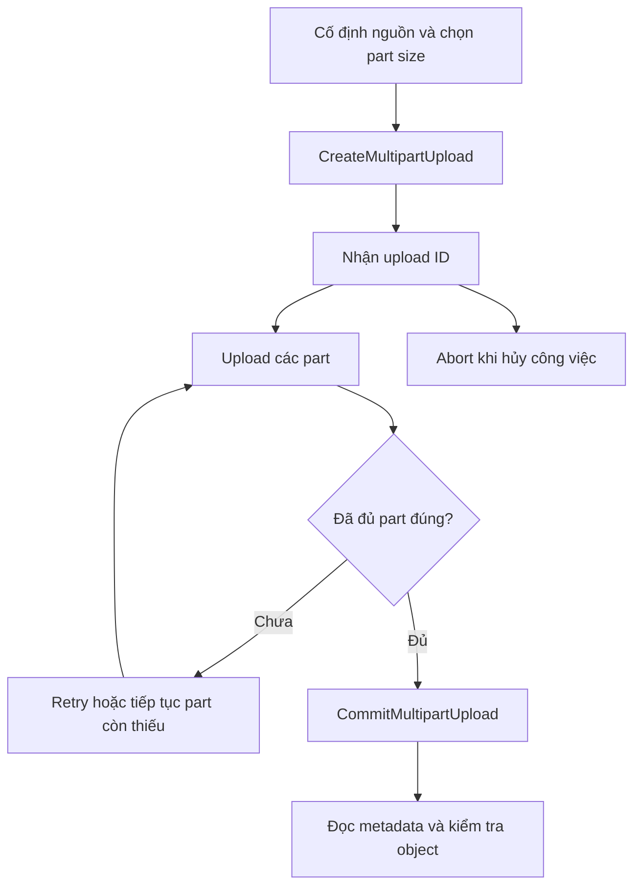

# Upload, download và multipart upload

Trong chương **Object Storage và Archive Storage** của module Oracle Cloud Infrastructure (OCI), bài này hướng dẫn truyền dữ liệu giữa máy làm việc và bucket: upload một file nhỏ, download để kiểm tra, rồi dùng multipart cho file lớn. Phần vận hành tập trung vào quyền truy cập, kiểm tra tính toàn vẹn, tiếp tục upload bị gián đoạn và thu hồi các part chưa hoàn tất.

Tình huống thực hành: nhóm ứng dụng đưa một file cấu hình mẫu và một artifact lớn vào bucket riêng tư. Người nhận phải tải được đúng nội dung đã công bố. Nếu đường truyền bị gián đoạn, nhóm muốn truyền tiếp phần còn thiếu thay vì bắt đầu lại toàn bộ. Nếu hủy công việc, dữ liệu tạm của multipart cũng phải được dọn.

Phần lab chính dùng object ở **Standard tier** để có thể tải xuống ngay. Với Archive tier, bài trình bày thêm bước restore và kiểm tra trạng thái trước download.

Sau bài học, người học có thể:

- Xác định đúng region, namespace, bucket và object name.
- Thực hiện upload/download bằng Console hoặc OCI CLI.
- Phân biệt truyền thành công, commit thành công và nội dung được kiểm chứng.
- Chọn kích thước part, số luồng song song và cách tiếp tục upload.
- Dọn multipart upload không còn dùng và tính đến chi phí dữ liệu tạm.

## 1. Xác định đúng đối tượng trước khi truyền

Object Storage lưu dữ liệu theo object trong bucket. Một file trên máy cá nhân và object trên OCI là hai bản dữ liệu riêng; chúng không tự đồng bộ sau khi một bên thay đổi.

| Giá trị | Vai trò | Ví dụ minh họa |
|---|---|---|
| Region | Nơi bucket và endpoint dịch vụ được sử dụng | Region được cấp cho lab |
| Namespace | Không gian tên Object Storage của tenancy | Giá trị lấy từ tài khoản |
| Bucket name | Tên container chứa object | Bucket lab đã có |
| Object name | Tên đầy đủ của object | `lab/transfers/run-01/hello.txt` |
| Local source | File đọc khi upload | `./source/hello.txt` |
| Local destination | File ghi khi download | `./download/hello.txt` |

Object Storage là dịch vụ theo region, độc lập với một Compute instance cụ thể. Với private subnet có thể dùng đường kết nối phù hợp như service gateway để tới Object Storage; vẫn phải đáp ứng các điều kiện quyền và mạng của môi trường. [Nguồn: OCI Object Storage overview](https://docs.oracle.com/en-us/iaas/Content/Object/Concepts/objectstorageoverview.htm).

Trong object name, dấu `/` thường tạo cách hiển thị giống thư mục bằng prefix. Khi gọi API/CLI, phải truyền **toàn bộ tên**, gồm cả prefix. Upload vào `lab/transfers/run-01/hello.txt` rồi download chỉ bằng `hello.txt` là yêu cầu tới một tên khác. [Nguồn: upload object và prefix](https://docs.oracle.com/en-us/iaas/Content/Object/Tasks/managingobjects_topic-To_upload_objects_to_a_bucket.htm).

Trong lab, dùng prefix riêng cho từng lần chạy để dễ nhận diện ownership, tránh trùng tên và thu hồi đúng dữ liệu. Prefix là một quy ước tên; nó không tự tạo ranh giới quyền nếu IAM policy chưa giới hạn tương ứng.

## 2. Chuẩn bị quyền, mạng và dữ liệu nguồn

### Điều kiện thực hành

Chuẩn bị một bucket riêng tư thuộc compartment được giao, region đã xác định, OCI CLI được cấu hình xác thực và một máy có đủ dung lượng đọc/ghi các file thử. Các lệnh trong bài dùng **Bash** trên Linux, WSL hoặc Cloud Shell; thay placeholder bằng thông tin tài khoản thực trước khi chạy.

Không cần đổi bucket sang public để kiểm tra download. Credential/API signing key của OCI CLI được quản lý ở môi trường xác thực; không upload các file đó như dữ liệu lab.

Kiểm tra các nhóm quyền theo thao tác:

| Công việc | Quyền cần được policy cho phép |
|---|---|
| Xem bucket/object | Những thao tác đọc thông tin hoặc list tương ứng |
| Upload mới | Tạo object |
| Upload multipart | Các thao tác tạo và ghi đè object cần cho luồng multipart |
| Download | Đọc object hoặc version cụ thể |
| Dọn upload dang dở | Các thao tác quản lý/abort multipart tương ứng |
| Restore Archive | Khôi phục object Archive |

OCI yêu cầu cả `OBJECT_CREATE` và `OBJECT_OVERWRITE` cho multipart upload. Vì vậy, một policy chỉ cho tạo object mới có thể chưa đủ cho luồng multipart, kể cả khi tên cuối cùng chưa tồn tại. [Nguồn: quyền multipart uploads](https://docs.oracle.com/en-us/iaas/Content/Object/Tasks/usingmultipartuploads.htm).

Người dùng tải được một object đã biết tên chưa chắc có quyền list mọi object trong bucket. Thiết kế quyền theo nhu cầu thực tế, không coi một lần list thất bại là bằng chứng mọi thao tác download đều bị từ chối.

### Cố định file nguồn

Trước một lần truyền quan trọng, xác định phiên bản dữ liệu nguồn, kích thước và hash. Với database hoặc log đang được ghi, tạo bản xuất hoặc snapshot phù hợp ở cấp ứng dụng trước khi truyền.

Đặc biệt với multipart, giữ nguyên nội dung nguồn trong suốt upload và resume. File có cùng tên nhưng đã bị ứng dụng thay đổi có thể không còn tương ứng với các part đã truyền.

## 3. Upload một file nhỏ

### Khởi tạo biến của lab

Thay hai placeholder đầu tiên, rồi thực hiện trong cùng phiên Bash:

```bash
LAB_REGION='<REGION_THUC_TE>'
LAB_BUCKET='<TEN_BUCKET_LAB>'
LAB_NAMESPACE="$(oci os ns get --region "$LAB_REGION" --query data --raw-output)"
LAB_RUN_ID="$(date -u +%Y%m%dT%H%M%SZ)"
LAB_PREFIX="lab/transfers/${LAB_RUN_ID}"
LAB_DIR="./oci-object-lab-${LAB_RUN_ID}"

mkdir -p "$LAB_DIR/source" "$LAB_DIR/download"
printf 'OCI upload and download lab\n' > "$LAB_DIR/source/hello.txt"
sha256sum "$LAB_DIR/source/hello.txt"
```

Giữ lại các giá trị của lần chạy nếu cần mở phiên mới. Nếu không được phép tự lấy namespace, dùng namespace chính xác do người quản trị cung cấp; đừng đoán từ tên hiển thị của tenancy.

### Upload bằng OCI CLI

```bash
oci os object put \
  --region "$LAB_REGION" \
  --namespace-name "$LAB_NAMESPACE" \
  --bucket-name "$LAB_BUCKET" \
  --name "$LAB_PREFIX/hello.txt" \
  --file "$LAB_DIR/source/hello.txt" \
  --content-type 'text/plain; charset=utf-8' \
  --no-overwrite \
  --verify-checksum
```

`--file` chọn file nguồn, còn `--name` chọn object name. `--no-overwrite` giúp tránh thay thế object đã có theo hành vi của CLI; prefix riêng vẫn là cách nhận diện lần chạy. `--verify-checksum` yêu cầu CLI kiểm tra checksum upload với file local. [Nguồn: OCI CLI object put](https://docs.oracle.com/en-us/iaas/tools/oci-cli/latest/oci_cli_docs/cmdref/os/object/put.html).

Lưu kết quả và thời điểm upload. ETag trong phản hồi là thông tin định danh/trạng thái object dùng cho các điều kiện truy cập; không mặc định đó là SHA-256 hoặc MD5 của toàn bộ file.

Đọc lại metadata:

```bash
oci os object head \
  --region "$LAB_REGION" \
  --namespace-name "$LAB_NAMESPACE" \
  --bucket-name "$LAB_BUCKET" \
  --name "$LAB_PREFIX/hello.txt"
```

Đối chiếu kích thước, content type, ETag và thông tin tier/metadata có liên quan được công cụ trả về. Có metadata chưa chứng minh nội dung đã tải xuống khớp; bước sau sẽ kiểm tra riêng việc đó.

### Thay thế bằng Console

Mở đúng bucket, vào **Objects → Upload**, chọn file, prefix và storage tier. Rà cảnh báo tên đã tồn tại trước khi upload. Sau khi hoàn tất, chọn object để xem thông tin.

Với Console, nhập prefix có dấu `/` nếu muốn quy ước như `lab/transfers/run-01/`; prefix không có dấu phân cách vẫn chỉ được ghép vào tên. Console có thể dùng multipart cho file lớn theo ngưỡng riêng, nên không suy cách truyền chỉ từ việc thao tác bằng giao diện. [Nguồn: OCI upload object](https://docs.oracle.com/en-us/iaas/Content/Object/Tasks/managingobjects_topic-To_upload_objects_to_a_bucket.htm).

## 4. Download và chứng minh nội dung khớp

Download vào file đích riêng, không dùng đường dẫn file nguồn:

```bash
oci os object get \
  --region "$LAB_REGION" \
  --namespace-name "$LAB_NAMESPACE" \
  --bucket-name "$LAB_BUCKET" \
  --name "$LAB_PREFIX/hello.txt" \
  --file "$LAB_DIR/download/hello.txt"
```

`--file` của `get` là đường dẫn nhận dữ liệu. Với Console, chọn đúng object rồi dùng **Download**; vị trí lưu còn phụ thuộc trình duyệt. [Nguồn: OCI download object](https://docs.oracle.com/en-us/iaas/Content/Object/Tasks/managingobjects_topic-To_download_an_object_from_a_bucket.htm).

So sánh hai bản:

```bash
sha256sum "$LAB_DIR/source/hello.txt" "$LAB_DIR/download/hello.txt"
cmp "$LAB_DIR/source/hello.txt" "$LAB_DIR/download/hello.txt"
```

Hai SHA-256 phải giống nhau. `cmp` trả mã thành công khi các byte giống nhau và thông thường không in thêm nội dung. Với dữ liệu quan trọng, giữ hash ban đầu ở nơi tin cậy và dùng đúng bản nguồn đã được cố định.

Có thể đối chiếu thêm kích thước theo byte:

```bash
wc -c "$LAB_DIR/source/hello.txt" "$LAB_DIR/download/hello.txt"
```

Cùng kích thước chưa đủ chứng minh cùng nội dung; hash và phép so sánh byte bổ sung bằng chứng cho điều đó.

### Khi object có thể bị cập nhật trong lúc nhận

Nếu cần đọc đúng trạng thái đã kiểm tra, dùng điều kiện ETag với `--if-match`, hoặc `--version-id` khi đang làm việc với một version cụ thể trong bucket có versioning. Download sẽ cần đúng giá trị đã ghi nhận, không phải placeholder giữ nguyên. [Nguồn: OCI CLI object get](https://docs.oracle.com/en-us/iaas/tools/oci-cli/latest/oci_cli_docs/cmdref/os/object/get.html).

Ví dụ bổ sung điều kiện cho một lần download riêng:

```text
--if-match '<ETAG_DA_DOC>'
```

Đừng ghi đè file local đang được ứng dụng sử dụng rồi mới bắt đầu kiểm tra. Một luồng nhận dữ liệu có thể tải vào file tạm, xác minh xong và chỉ sau đó công bố cho ứng dụng.

## 5. Multipart upload hoạt động như thế nào?

Một object lớn được chia thành nhiều phần để truyền. Multipart không phải là upload nhiều object độc lập rồi để người nhận tự nối bằng tên file.

Luồng dịch vụ:



Ở cấp API, client giữ upload ID và thông tin part. Các part có thể truyền song song và đến dịch vụ không theo thứ tự. Khi commit, dịch vụ sắp xếp theo part number; dữ liệu commit dùng part number cùng ETag tương ứng. [Nguồn: OCI multipart upload API](https://docs.oracle.com/en-us/iaas/Content/Object/Tasks/usingmultipartuploads_topic-Using_the_Multipart_Upload_API.htm).

Những điểm cần phân biệt:

- **Upload ID** nhận diện một phiên multipart, không phải tên object hoặc version ID.
- **Part number** xác định vị trí tương đối khi ghép object.
- **ETag của part** phải khớp part được chọn để commit.
- **Commit** hoàn tất object từ những part được chỉ định.
- **Abort** hủy upload chưa commit và giải phóng dữ liệu tạm của phiên đó.

Nếu truyền lại cùng part number trong cùng phiên, cần theo dõi đúng kết quả cuối để commit. Không ghép dữ liệu từ một file nguồn mới vào một phiên vốn đang chứa part của bản nguồn cũ.

Truyền đủ các part nhưng chưa commit không tương đương đã có một object hoàn tất mới để người nhận tải bình thường. Sau khi hoàn tất, không tiếp tục append vào object bằng upload ID cũ; thay nội dung cần một lần upload mới. [Nguồn: commit và vòng đời multipart API](https://docs.oracle.com/en-us/iaas/Content/Object/Tasks/usingmultipartuploads_topic-Using_the_Multipart_Upload_API.htm).

## 6. Chọn kích thước part và mức song song

### Giới hạn dịch vụ và mặc định công cụ

Theo tài liệu OCI được đối chiếu khi soạn bài:

| Thuộc tính | Giá trị |
|---|---:|
| Kích thước object tối đa | 10 TiB |
| Kích thước tối đa với một lần PutObject | 50 GiB |
| Kích thước một part tối đa | 50 GiB |
| Số part tối đa | 10.000 |

Các giới hạn này khác với giới hạn bucket/quota của tài khoản. [Nguồn: OCI Object Storage resource limits](https://docs.oracle.com/en-us/iaas/Content/Object/Concepts/objectstorageoverview.htm).

CLI `object put` mặc định dùng part size 128 MiB cho file thông thường; file lớn hơn part size có thể được upload multipart. Giá trị `--part-size` do người dùng chọn phải lớn hơn 10 MiB theo CLI hiện hành; phần cuối có thể nhỏ hơn. `--no-multipart` ép truyền đơn, nhưng không làm mất giới hạn PutObject của dịch vụ. [Nguồn: CLI put](https://docs.oracle.com/en-us/iaas/tools/oci-cli/latest/oci_cli_docs/cmdref/os/object/put.html), [chạy multipart với CLI](https://docs.oracle.com/en-us/iaas/Content/Object/Tasks/usingmultipartuploads_topic-To_perform_a_multipart_upload_using_the_CLI.htm).

Console dùng multipart khi file lớn hơn 64 MiB; đây là ngưỡng riêng của Console. Phân biệt ngưỡng công cụ với giới hạn object của dịch vụ khi giải thích một lần truyền. [Nguồn: OCI multipart uploads](https://docs.oracle.com/en-us/iaas/Content/Object/Tasks/usingmultipartuploads.htm).

### Tính số part

Với kích thước nguồn `S` và part size `P` cùng đơn vị:

```text
N = ceil(S / P)
```

Ví dụ file 300 MiB, part size 128 MiB:

```text
Part 1: 128 MiB
Part 2: 128 MiB
Part 3:  44 MiB
Tổng:   300 MiB
```

Không dùng cùng part size nhỏ cho mọi object rất lớn. Ví dụ lý thuyết:

| Object | Part size | Số part | Đánh giá theo giới hạn số part |
|---|---:|---:|---|
| 2 TiB | 128 MiB | 16.384 | Vượt 10.000 |
| 2 TiB | 256 MiB | 8.192 | Trong giới hạn |

Tính trước bằng byte hoặc đơn vị nhị phân nhất quán. MiB là `2^20` byte, GiB là `2^30` byte và TiB là `2^40` byte. Các ví dụ trên minh họa cách tính, không yêu cầu tạo file nhiều TiB để thực hành.

### Song song vừa đủ

Part nhỏ giảm lượng dữ liệu phải truyền lại khi một part lỗi, nhưng tăng số request và phần việc quản lý. Part lớn giảm số part, nhưng một lần retry có thể truyền lại nhiều dữ liệu hơn.

`--parallel-upload-count` cho phép cân đối số thao tác upload đồng thời. Tăng concurrency có thể tăng tốc nếu đường mạng, CPU và disk còn đủ khả năng; nó cũng làm tăng mức tài nguyên được sử dụng. [Nguồn: multipart CLI controls](https://docs.oracle.com/en-us/iaas/Content/Object/Tasks/usingmultipartuploads_topic-To_perform_a_multipart_upload_using_the_CLI.htm).

Đo thời gian, throughput và mức sử dụng thực tế trước khi tăng concurrency. Không mặc định số luồng lớn nhất sẽ nhanh nhất trên một máy hoặc một đường truyền cụ thể.

## 7. Thực hành multipart với file lớn vừa đủ

Trong môi trường lab được cấp đủ chỗ trống và ngân sách truyền dữ liệu, có thể tạo file 300 MiB chỉ chứa dữ liệu thử:

```bash
dd if=/dev/zero of="$LAB_DIR/source/large.bin" bs=1M count=300 status=progress
sha256sum "$LAB_DIR/source/large.bin"
```

Có thể thay bằng một file thử đã chuẩn bị với kích thước phù hợp. Giữ file bất biến trong lúc upload; file toàn byte 0 chỉ phục vụ bài tập truyền dữ liệu, không phải benchmark đại diện cho workload thật.

Upload với part size 128 MiB và tối đa ba thao tác đồng thời:

```bash
oci os object put \
  --region "$LAB_REGION" \
  --namespace-name "$LAB_NAMESPACE" \
  --bucket-name "$LAB_BUCKET" \
  --name "$LAB_PREFIX/large.bin" \
  --file "$LAB_DIR/source/large.bin" \
  --part-size 128 \
  --parallel-upload-count 3 \
  --no-overwrite \
  --verify-checksum
```

Ghi lại upload ID nếu công cụ hiển thị, object name, part size, file hash, thời điểm bắt đầu và kết quả hoàn tất. Khi CLI kết thúc thành công, đọc metadata object và kiểm tra kích thước theo byte thay vì chỉ nhìn thanh tiến độ.

Download bản lớn vào thư mục nhận:

```bash
oci os object get \
  --region "$LAB_REGION" \
  --namespace-name "$LAB_NAMESPACE" \
  --bucket-name "$LAB_BUCKET" \
  --name "$LAB_PREFIX/large.bin" \
  --file "$LAB_DIR/download/large.bin" \
  --multipart-download-threshold 128 \
  --part-size 128 \
  --parallel-download-count 3
```

Các tùy chọn download điều khiển cách client nhận nhiều phần và ghép thành file local. Đây không phải việc download từng part còn dang dở của một upload chưa commit. [Nguồn: OCI CLI object get và multipart download](https://docs.oracle.com/en-us/iaas/tools/oci-cli/latest/oci_cli_docs/cmdref/os/object/get.html).

Kiểm tra:

```bash
wc -c "$LAB_DIR/source/large.bin" "$LAB_DIR/download/large.bin"
sha256sum "$LAB_DIR/source/large.bin" "$LAB_DIR/download/large.bin"
cmp "$LAB_DIR/source/large.bin" "$LAB_DIR/download/large.bin"
```

Kết luận đạt chỉ khi đúng object đã được công bố và nội dung nhận khớp nguồn được giữ cố định.

## 8. Resume khi upload bị gián đoạn

Để thử tình huống gián đoạn, dùng một object name mới trong prefix lab, ghi lại upload ID của lần thử và chỉ tác động tiến trình upload của chính mình. Với file nhỏ hoặc đường truyền nhanh, upload có thể hoàn tất trước lúc ngắt; lúc đó kiểm tra trạng thái thay vì giả định phiên còn dang dở.

Liệt kê những phiên multipart đang hoạt động:

```bash
oci os multipart list \
  --region "$LAB_REGION" \
  --namespace-name "$LAB_NAMESPACE" \
  --bucket-name "$LAB_BUCKET" \
  --all
```

Danh sách này là multipart upload đang diễn ra, khác với danh sách object hoàn tất. `--all` lấy mọi trang kết quả mà lệnh có thể trả về. [Nguồn: OCI multipart list](https://docs.oracle.com/en-us/iaas/tools/oci-cli/latest/oci_cli_docs/cmdref/os/multipart/list.html).

Đối chiếu upload ID, object name và thời gian để chọn đúng phiên. Không resume một upload chỉ vì object name trông giống tên file đang có trên máy.

Nếu phiên chưa commit/abort và nguồn vẫn đúng, tiếp tục bằng:

```bash
oci os object resume-put \
  --region "$LAB_REGION" \
  --namespace-name "$LAB_NAMESPACE" \
  --bucket-name "$LAB_BUCKET" \
  --name '<OBJECT_NAME_CUA_PHIEN_BI_NGAT>' \
  --file "$LAB_DIR/source/large.bin" \
  --upload-id '<UPLOAD_ID_DA_XAC_MINH>' \
  --part-size 128 \
  --parallel-upload-count 3
```

Giữ part size như lần upload ban đầu và dùng đúng bản nguồn. `resume-put` là thao tác tiếp tục multipart put có trước, không phải một cờ thêm vào lệnh `put` để tự nhận diện mọi phiên cũ. [Nguồn: OCI CLI resume-put](https://docs.oracle.com/en-us/iaas/tools/oci-cli/latest/oci_cli_docs/cmdref/os/object/resume-put.html).

Sau khi resume kết thúc, kiểm tra metadata, download và đối chiếu hash như trước. Không coi sự biến mất của upload ID khỏi danh sách là bằng chứng duy nhất rằng object đã đúng nội dung.

Nếu không còn bản nguồn khớp hoặc không xác định được trạng thái, giữ bằng chứng và quyết định hủy phiên cũ/tạo lần truyền mới. Không chắp tiếp dữ liệu chỉ dựa vào tên file.

## 9. Abort và dọn các part chưa commit

Đóng terminal hoặc dừng một process không tự bảo đảm các part trên dịch vụ được thu hồi. Multipart chưa commit có thể tiếp tục chiếm storage và tính phí; có thể dùng lifecycle policy để dọn sau số ngày đã chọn. [Nguồn: quản lý multipart upload chưa hoàn tất](https://docs.oracle.com/en-us/iaas/Content/Object/Tasks/usingmultipartuploads.htm).

Khi quyết định không tiếp tục, dừng các tác vụ upload part thuộc phiên đó, xác minh ownership, rồi abort đúng object name và upload ID:

```bash
oci os multipart abort \
  --region "$LAB_REGION" \
  --namespace-name "$LAB_NAMESPACE" \
  --bucket-name "$LAB_BUCKET" \
  --object-name '<OBJECT_NAME_CUA_PHIEN_CAN_HUY>' \
  --upload-id '<UPLOAD_ID_CAN_HUY>'
```

Lưu ý `abort` dùng `--object-name`, còn `object put`/`resume-put` dùng `--name`. Abort áp dụng cho upload chưa commit; nó không thay thế thao tác xóa một object hoàn tất. [Nguồn: OCI multipart abort](https://docs.oracle.com/en-us/iaas/tools/oci-cli/latest/oci_cli_docs/cmdref/os/multipart/abort.html).

Sau đó list lại để đối chiếu phiên đã được thu hồi. Không abort hàng loạt mọi upload trong bucket dùng chung chỉ để dọn một bài lab.

Với lifecycle rule, đặt thời gian dọn phù hợp với những upload hợp lệ có thể kéo dài. Một rule dọn quá sớm có thể làm mất khả năng resume của tác vụ vẫn cần hoàn thành.

## 10. ETag, checksum và bằng chứng hoàn tất

Những giá trị thường được gặp có mục đích khác nhau:

| Bằng chứng | Chứng minh điều gì? | Giới hạn |
|---|---|---|
| Upload ID | Đang làm việc với đúng phiên multipart | Không chứng minh object đã commit |
| Part number và ETag part | Nhận diện part trong phiên | Không phải hash toàn file |
| Object ETag | Dùng nhận diện trạng thái và điều kiện yêu cầu | Không mặc định là MD5/SHA-256 nội dung |
| Content checksum của dịch vụ | Kiểm tra nội dung theo thuật toán/ngữ nghĩa được cung cấp | Phải đối chiếu đúng loại và cách mã hóa |
| Kích thước | Số byte mong đợi | Cùng số byte chưa đủ chứng minh dữ liệu giống |
| SHA-256 nguồn và bản tải | Đối chiếu nội dung hai bản đã chọn | Phụ thuộc bản nguồn/hash tham chiếu được giữ đúng |

Với multipart, `opc-multipart-md5` là giá trị kiểm tra liên quan đến các part, không phải kết quả MD5 trực tiếp của toàn file theo cách chỉ chạy `md5sum file` rồi so ngay. Không đổi nhãn ETag hoặc checksum multipart thành “SHA-256” trong biên bản. [Nguồn: kiểm tra checksum multipart của OCI](https://docs.oracle.com/en-us/iaas/Content/Object/Tasks/sync-object.htm).

Trong bài này, SHA-256 của file nguồn bất biến và file download là phép đối chiếu độc lập dễ thực hiện. Nếu chỉ lưu hash như user metadata do cùng một bên tự nhập, việc đọc lại metadata đó chưa thay thế kiểm tra nội dung thật.

Nếu request commit bị timeout sau khi gửi, kết quả có thể chưa rõ từ phía client. Kiểm tra object, metadata/version và danh sách upload trước khi quyết định retry hoặc tạo lần mới. Đừng công bố artifact là hoàn tất chỉ vì lần truyền dữ liệu đã đạt 100% trên màn hình.

Với pipeline ứng dụng, có thể theo dõi trạng thái:

```text
PREPARED -> UPLOADING -> COMMITTED -> VERIFIED -> PUBLISHED
                  \-> ABORTED
```

Đây là mô hình đề xuất của ứng dụng. Các trạng thái do pipeline quản lý, không phải một danh sách lifecycle state mặc định của mọi object OCI.

## 11. Download object ở Archive tier

Upload vào Archive vẫn dùng quy trình truyền object tương ứng, nhưng object đã archived không download trực tiếp như Standard. Phải yêu cầu restore rồi chờ dữ liệu sẵn sàng. [Nguồn: Archive Storage overview](https://docs.oracle.com/en-us/iaas/Content/Archive/Concepts/archivestorageoverview.htm).

Với một object Archive thực sự được giao để thử, yêu cầu restore:

```bash
oci os object restore \
  --region "$LAB_REGION" \
  --namespace-name "$LAB_NAMESPACE" \
  --bucket-name "$LAB_BUCKET" \
  --name '<OBJECT_ARCHIVE_DUOC_GIAO>' \
  --hours 24
```

Kiểm tra trạng thái:

```bash
oci os object restore-status \
  --region "$LAB_REGION" \
  --namespace-name "$LAB_NAMESPACE" \
  --bucket-name "$LAB_BUCKET" \
  --name '<OBJECT_ARCHIVE_DUOC_GIAO>'
```

Theo tài liệu OCI, restoration có thể mất tới một giờ; chỉ download khi trạng thái đã sẵn sàng. Cửa sổ download mặc định là 24 giờ và có thể yêu cầu từ 1 đến 240 giờ. Cần `OBJECT_RESTORE` cho thao tác restore. [Nguồn: restore object từ Archive](https://docs.oracle.com/en-us/iaas/Content/Object/Tasks/managingobjects_topic-To_restore_objects_from_Archive_Storage.htm).

Khi đã restored, dùng `object get` vào file local riêng và kiểm tra hash với bản tham chiếu. Ghi lại cửa sổ tải còn hiệu lực để tránh tác vụ download bắt đầu quá muộn.

Không hiểu restore là upload lại dữ liệu nguồn hoặc chuyển object sang một bucket mới. Việc một object ở trong bucket Standard cũng chưa đủ kết luận tier hiện tại của object là Standard, vì bucket này có thể chứa các object mang tier khác nhau. [Nguồn: storage tier của object khi upload](https://docs.oracle.com/en-us/iaas/Content/Object/Tasks/managingobjects_topic-To_upload_objects_to_a_bucket.htm).

Lab truyền dữ liệu cơ bản không cần tự chuyển artifact sang Archive nếu chưa có yêu cầu, bản hash tham chiếu và ngân sách cho chu kỳ lưu/khôi phục tương ứng.

## 12. Tối ưu vận hành và tìm lỗi

### Chọn đúng công cụ cho khối lượng dữ liệu

Một multipart upload xử lý **một object** theo nhiều part. Upload nhiều file có thể dùng các thao tác bulk hoặc một pipeline quản lý nhiều object; đó là bài toán song song ở mức khác.

Nếu vừa tăng số object truyền đồng thời vừa tăng số part song song trên mỗi object, tổng số request và tải tài nguyên có thể tăng nhanh. Đo disk, CPU, bộ nhớ và mạng của máy truyền, cùng thời gian hoàn thành và tỷ lệ retry.

Theo dõi tối thiểu: nguồn/hash, đích đầy đủ, upload ID nếu có, part size, số part, thời điểm bắt đầu/kết thúc, số lần thử, trạng thái commit và trạng thái xác minh. Không ghi signing key, token hoặc URL có quyền truy cập nhạy cảm vào log kết quả.

### Các lỗi thường gặp

| Hiện tượng | Điều cần kiểm tra |
|---|---|
| Không thấy bucket/object | Region, namespace, bucket name, toàn bộ object name và quyền |
| Upload file nhỏ được nhưng multipart lỗi quyền | Policy có đủ `OBJECT_CREATE` và `OBJECT_OVERWRITE`? |
| Hash tải xuống không khớp | Đúng object/version, nguồn có đổi, file local có bị ghi dở, quá trình nhận có hoàn tất? |
| Có part nhưng không có object hoàn tất mới | Phiên đã commit thành công chưa? |
| Resume không tìm thấy upload ID | Đúng bucket/namespace; phiên còn active hay đã commit/abort? |
| Resume xong nhưng kết quả sai | Có giữ đúng nguồn và cách chia part ban đầu? |
| Quá nhiều part | Tính lại `ceil(S/P)` và chọn part size phù hợp |
| Tăng concurrency nhưng chậm hơn | Có nghẽn mạng, disk, CPU hoặc tăng retry? |
| Tắt terminal nhưng storage vẫn bị dùng | Kiểm tra multipart chưa commit và lifecycle dọn |
| Object Archive không download được | Restore state, thời gian khả dụng và quyền restore/read |
| Request bị timeout khi gần hoàn tất | Đối chiếu trạng thái dịch vụ trước khi tạo upload mới |

Khi có lỗi, giữ response/request ID cần thiết, thời điểm và phạm vi tài nguyên để điều tra. Phân biệt lỗi xác thực/quyền, lỗi chọn nhầm đối tượng và lỗi đường truyền trước khi thay cấu hình.

## 13. Kết thúc lab và tiêu chí hoàn thành

Dữ liệu lưu, số request, truyền dữ liệu và các tính năng liên quan có thể tạo chi phí. Object versions cũ và các part chưa commit cũng cần được quản lý; không chỉ nhìn danh sách object hiện tại để kết luận lab đã sạch tài nguyên. [Nguồn: OCI Object Storage billing và resource overview](https://docs.oracle.com/en-us/iaas/Content/Object/Concepts/objectstorageoverview.htm).

Sau thực hành:

1. Lưu bằng chứng file nhỏ và file lớn đã được truyền, nhận lại và kiểm tra.
2. Kiểm tra những multipart upload thuộc lần chạy; resume hoặc abort theo quyết định đã ghi.
3. Thu hồi đúng object của prefix lab khi không còn dùng và được phép xóa.
4. Nếu bucket có versioning/retention, kiểm tra hệ quả trước khi kết luận dữ liệu đã được xóa hoàn toàn.
5. Giữ nguyên bucket, object và upload thuộc công việc khác.

Bài thực hành đạt mục tiêu khi có thể chỉ ra:

- Đích đầy đủ gồm region, namespace, bucket và object name.
- File nguồn được cố định, có kích thước và hash tham chiếu.
- Upload file nhỏ thành công và bản download khớp byte/hash.
- Multipart chọn part size hợp lệ, commit xong và object cuối được xác minh.
- Phép thử gián đoạn, nếu thực hiện, có upload ID và kết quả resume/abort rõ ràng.
- Không để lại multipart dang dở ngoài kế hoạch.
- Với Archive, phân biệt được restore request, trạng thái sẵn sàng và cửa sổ download.

Một lần truyền đáng tin cậy cần bằng chứng cho cả **đúng đích, đúng nội dung, đúng trạng thái hoàn tất và dữ liệu tạm được quản lý**. Đây là cơ sở để đưa thao tác Object Storage vào quy trình triển khai artifact, trao đổi dữ liệu hoặc sao lưu trên OCI.
