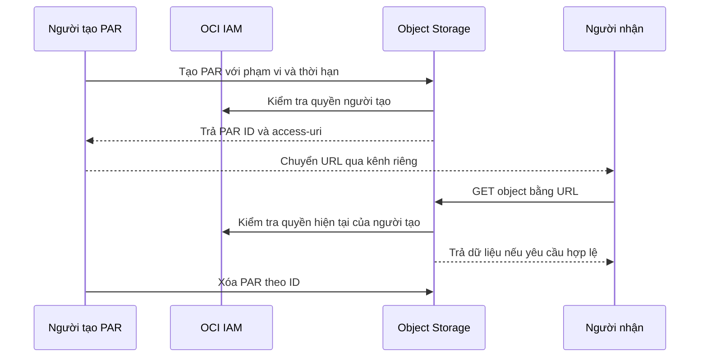

# Pre-Authenticated Requests và chia sẻ object có thời hạn

## Mục tiêu và tình huống sử dụng

Trong Oracle Cloud Infrastructure (OCI), nhu cầu chia sẻ dữ liệu thường nằm giữa hai nhóm công việc: nhóm quản trị kiểm soát tenancy, compartment và IAM; nhóm sử dụng chỉ cần tải một tệp hoặc gửi một tệp lên Object Storage. Bài này thuộc chương **Object Storage và Archive Storage**, tập trung vào Pre-Authenticated Request (PAR) để nối hai nhu cầu đó với phạm vi và thời hạn rõ ràng.

Sau bài học, bạn có thể lựa chọn phạm vi chia sẻ, tạo PAR cho một object, sử dụng URL bằng HTTP và thu hồi quyền truy cập. Bạn cũng biết lập kế hoạch theo dõi và chi phí cho luồng trao đổi dữ liệu giữa ứng dụng, Compute và đối tác.

Giả sử nhóm vận hành xuất báo cáo thử nghiệm vào object:

```text
Bucket: par-lab-private
Object: exports/partner-a/report-demo.txt
Người nhận: đối tác A
Nhu cầu: chỉ tải báo cáo trong 15 phút
```

Yêu cầu nghiệp vụ nên được diễn đạt thành bốn câu hỏi: chia sẻ dữ liệu nào, cho phép thao tác gì, đến thời điểm nào và ai chịu trách nhiệm thu hồi. Đây là thông tin cần chốt trước khi tạo liên kết.

## 1. PAR hoạt động như thế nào?

PAR tạo ra URL cho phép người giữ URL truy cập tài nguyên được chỉ định mà không cần cung cấp thông tin đăng nhập OCI của riêng họ. Vì thế, hãy coi URL là một bí mật mang quyền truy cập: người nhận có thể chuyển tiếp nó cho người khác. [Oracle: Object Storage Pre-Authenticated Requests](https://docs.oracle.com/en-us/iaas/Content/Object/Tasks/usingpreauthenticatedrequests.htm).



Khi sử dụng PAR, quyền của người tạo vẫn được kiểm tra. PAR có thể ngừng hoạt động nếu hết hạn, bị xóa hoặc người tạo mất quyền cần thiết. Việc đổi thông tin đăng nhập của người tạo không phải cách thu hồi PAR. Muốn đổi cấu hình PAR, cần tạo bản mới. [Oracle: phạm vi và điều kiện PAR](https://docs.oracle.com/en-us/iaas/Content/Object/Tasks/usingpreauthenticatedrequests.htm).

Hệ quả thiết kế: đừng để một quy trình giao nhận quan trọng chỉ phụ thuộc vào tài khoản cá nhân sắp bị thu hồi quyền. Hãy ghi lại người tạo, nhóm vận hành phụ trách và kế hoạch bàn giao trước khi thay đổi nhân sự hoặc chính sách IAM.

Một PAR còn hiệu lực cũng không khẳng định nội dung mà người nhận đã tải là bản mong muốn. Với báo cáo cần đối soát, nên công bố thêm mã phiên bản nghiệp vụ hoặc checksum qua một kênh tin cậy.

## 2. Chọn phạm vi và thao tác

Có thể nhắm PAR vào một object, một prefix hoặc toàn bộ object trong bucket. Prefix là chuỗi đầu tên object; dấu `/` giúp mô phỏng cấu trúc thư mục. Ví dụ, `partner-a` rộng hơn `partner-a/`. [Oracle: tạo PAR và lựa chọn target](https://docs.oracle.com/en-us/iaas/Content/Object/Tasks/usingpreauthenticatedrequests_topic-To_create_a_preauthenticated_request_for_all_objects_in_a_bucket.htm).

Các kiểu truy cập CLI được phối hợp như sau:

| Phạm vi | `--access-type` | `--object-name` |
| --- | --- | --- |
| Một object, chỉ đọc | `ObjectRead` | Tên object đầy đủ |
| Một object, chỉ ghi | `ObjectWrite` | Tên object đầy đủ |
| Một object, đọc và ghi | `ObjectReadWrite` | Tên object đầy đủ |
| Bucket, chỉ đọc | `AnyObjectRead` | Bỏ tham số |
| Bucket, chỉ ghi | `AnyObjectWrite` | Bỏ tham số |
| Bucket, đọc và ghi | `AnyObjectReadWrite` | Bỏ tham số |
| Prefix | Một kiểu `AnyObject...` phù hợp | Prefix cần giới hạn |

`--bucket-listing-action` kiểm soát listing đối với `AnyObjectRead` và `AnyObjectReadWrite`: `Deny` hoặc `ListObjects`. [Oracle CLI: preauth-request create](https://docs.oracle.com/en-us/iaas/tools/oci-cli/latest/oci_cli_docs/cmdref/os/preauth-request/create.html).

**Đề xuất cho tình huống báo cáo:** dùng `ObjectRead` với đúng `exports/partner-a/report-demo.txt`. Đối tác không có nhu cầu khám phá thư mục, tải nhiều báo cáo hay gửi nội dung lên cùng vị trí, nên không có lý do nghiệp vụ để chọn phạm vi rộng hơn.

Một số quy tắc lựa chọn hữu ích:

- Một lần giao nhận một báo cáo: một PAR riêng cho đúng object.
- Một đợt nhận nhiều tệp: prefix riêng theo đối tác và mã đợt nhận.
- Một tập dữ liệu cần tra cứu tên tệp: chỉ bật listing nếu luồng nghiệp vụ cần nó.
- Hai đối tác độc lập: hai PAR riêng để dễ thu hồi và đối soát.

Việc chia PAR theo đối tác chỉ hỗ trợ quản lý; nó không chứng minh người thực hiện HTTP là đúng đối tác đó. Nếu yêu cầu bắt buộc định danh từng người, hãy thiết kế thêm lớp ứng dụng xác thực người dùng.

## 3. Chuẩn bị IAM cho người tạo

Quyền quản lý PAR là `PAR_MANAGE` trên bucket. Để trao quyền đọc object, người tạo cần `OBJECT_READ`; luồng ghi cần `OBJECT_CREATE` và `OBJECT_OVERWRITE`. Nếu bật listing, cần xem thêm `OBJECT_INSPECT`. [Oracle: quyền cho PAR](https://docs.oracle.com/en-us/iaas/Content/Object/Tasks/usingpreauthenticatedrequests.htm), [Oracle: quyền Object Storage theo API](https://docs.oracle.com/en-us/iaas/Content/Identity/Reference/objectstoragepolicyreference.htm).

Ví dụ policy cho nhóm phát hành liên kết đọc trong compartment `TrainingStorage`:

```text
Allow group ParPublishers to manage buckets in compartment TrainingStorage where all {target.bucket.name='par-lab-private', request.permission='PAR_MANAGE'}

Allow group ParPublishers to read objects in compartment TrainingStorage where target.bucket.name='par-lab-private'
```

Điều kiện `request.permission` ở dòng đầu chỉ giữ quyền quản lý PAR trong tập quyền `manage buckets`. Dòng sau cấp đọc object; không bổ sung quyền ghi. Cú pháp tên nhóm cần được điều chỉnh theo identity domain thực tế của tenancy. Các quyền duyệt Console, nếu cần, phải được quản trị viên cấp riêng theo công việc. [Oracle: IAM policy reference cho buckets và objects](https://docs.oracle.com/en-us/iaas/Content/Identity/Reference/objectstoragepolicyreference.htm).

Đây là ví dụ cho **người tạo liên kết đọc**, không phải policy cho người nhận PAR. Người nhận dùng URL; không cần thêm họ vào `ParPublishers`.

Nếu thiết kế luồng upload, hãy tạo nhóm hoặc vai trò phát hành riêng và xác định quyền ghi cần thiết trước. Không nên giải quyết lỗi quyền bằng cách cấp `manage object-family in tenancy` cho toàn bộ nhóm.

## 4. Tạo PAR trên Console

Chuẩn bị một bucket private chứa dữ liệu giả lập, rồi thực hiện:

1. Mở Object Storage, chọn region, compartment và bucket.
2. Vào phần **Management → Pre-authenticated requests**.
3. Chọn **Create pre-authenticated request**.
4. Chọn target **Object**, nhập tên object đầy đủ.
5. Chọn quyền chỉ đọc và đặt expiration.
6. Tạo PAR, sao chép URL ngay vào nơi lưu bí mật được kiểm soát.

Thời gian expiration trên Console là UTC. URL chỉ có thể lấy khi tạo; thao tác xem lại metadata không khôi phục URL bí mật. [Oracle: tạo PAR bằng Console](https://docs.oracle.com/en-us/iaas/Content/Object/Tasks/usingpreauthenticatedrequests_topic-To_create_a_preauthenticated_request_for_all_objects_in_a_bucket.htm).

Ví dụ quy đổi để tránh nhầm múi giờ:

```text
09:00 tại Việt Nam (UTC+07:00)
= 02:00Z cùng ngày

Hạn 15 phút sau:
09:15 tại Việt Nam
= 02:15Z cùng ngày
```

Trong vận hành, hãy ghi cả thời điểm UTC và ý nghĩa nghiệp vụ, chẳng hạn “kết thúc đợt giao báo cáo”, thay vì chỉ lưu một con số thời gian không có ngữ cảnh.

## 5. Thực hành PowerShell: tạo liên kết đọc trong 15 phút

### Chuẩn bị môi trường lab

Các lệnh dưới đây là hướng dẫn để người học chạy trong môi trường OCI của mình. Cần có:

- OCI CLI đã cấu hình xác thực và được cấp quyền phù hợp.
- Bucket private `par-lab-private` tại region bạn chọn.
- Object `exports/partner-a/report-demo.txt` chứa dữ liệu giả lập trong tier Standard.
- `curl.exe` để thử truy cập HTTP độc lập với thông tin đăng nhập của OCI CLI.

Tạo bucket và upload tệp mẫu bằng tài khoản quản trị lab trước khi bắt đầu. Không dùng báo cáo thật hoặc dữ liệu cá nhân trong bài thực hành.

Các ví dụ hostname dưới đây dùng public commercial realm của OCI. Nếu môi trường có endpoint khác, sử dụng endpoint/URL do Console của môi trường đó cung cấp.

### Khai báo thông số và thời hạn

Thay namespace và region bằng giá trị thực tế:

```powershell
$region = 'ap-singapore-1'
$namespace = 'YOUR_OBJECT_STORAGE_NAMESPACE'
$bucketName = 'par-lab-private'
$objectName = 'exports/partner-a/report-demo.txt'
$expiresAt = [DateTimeOffset]::UtcNow.AddMinutes(15).ToString(
    "yyyy-MM-dd'T'HH:mm:ss'Z'"
)
$parName = 'partner-a-report-' + [DateTimeOffset]::UtcNow.ToString(
    'yyyyMMdd-HHmmss'
)
```

Tính thời hạn tại lúc chạy giúp bài lab không phụ thuộc một mốc ngày cố định. Đồng hồ của máy vận hành vẫn cần được đồng bộ để người quản trị hiểu đúng thời gian còn lại.

### Gọi OCI CLI và giữ kết quả trong bộ nhớ

```powershell
$createArgs = @(
    'os', 'preauth-request', 'create',
    '--region', $region,
    '--namespace-name', $namespace,
    '--bucket-name', $bucketName,
    '--name', $parName,
    '--object-name', $objectName,
    '--access-type', 'ObjectRead',
    '--time-expires', $expiresAt,
    '--output', 'json'
)

$rawPar = & oci @createArgs
if ($LASTEXITCODE -ne 0) {
    throw 'Tao PAR that bai; kiem tra quyen va tham so.'
}

$parResult = ($rawPar -join [Environment]::NewLine) | ConvertFrom-Json
$parId = $parResult.data.id
$accessUri = $parResult.data.'access-uri'

if ([string]::IsNullOrWhiteSpace($parId) -or
    [string]::IsNullOrWhiteSpace($accessUri)) {
    throw 'Phan hoi khong co PAR ID hoac access-uri.'
}

$parUrl = 'https://objectstorage.' + $region +
          '.oraclecloud.com' + $accessUri
```

`--time-expires` nhận thời gian RFC 3339; `--object-name` chọn object đích. `access-uri` trong kết quả tạo được ghép với hostname của region để thành URL. [Oracle CLI: tham số create](https://docs.oracle.com/en-us/iaas/tools/oci-cli/latest/oci_cli_docs/cmdref/os/preauth-request/create.html), [Oracle: cấu trúc URL PAR](https://docs.oracle.com/en-us/iaas/Content/Object/Tasks/usingpreauthenticatedrequests_topic-To_create_a_preauthenticated_request_for_all_objects_in_a_bucket.htm).

Trong ví dụ này, `$parId` là định danh để quản lý; `$parUrl` là bí mật để truy cập dữ liệu. Chỉ chuyển URL đến người nhận qua kênh đã thống nhất. Tránh in toàn bộ `$parResult` vào log CI hoặc ghi nó vào tài liệu hỗ trợ.

### Tải object bằng URL

```powershell
$downloadPath = Join-Path (Get-Location).Path 'report-demo-download.txt'

& curl.exe --fail --silent --show-error `
    --output $downloadPath `
    $parUrl

if ($LASTEXITCODE -ne 0) {
    throw 'Tai object bang PAR that bai.'
}
```

HTTP GET là cách đọc object qua PAR. Với PAR nhắm đúng một object, dùng nguyên URL được trả về; không nối tên object thêm lần nữa. Với PAR prefix, URL gốc có thể chưa chứa prefix: khi đọc hoặc ghi một object, nối **toàn bộ tên object** thích hợp sau phần `/o/`. [Oracle: làm việc với URL PAR](https://docs.oracle.com/en-us/iaas/Content/Object/Tasks/usingpreauthenticatedrequests_topic-Working_with_PreAuthenticated_Requests.htm).

Dùng `curl.exe` giúp tránh nhầm với alias PowerShell trong một số môi trường. Bản tải xuống phải được kiểm tra nội dung hoặc checksum bằng công cụ độc lập trước khi coi giao nhận thành công.

Không bật transcript hoặc chế độ debug khi thử URL bí mật. Cả lịch sử lệnh, công cụ hỗ trợ từ xa và hệ thống thu thập tiến trình trên máy cũng cần được tính đến khi lựa chọn nơi chạy.

### Xem metadata mà không in URL

```powershell
& oci os preauth-request list `
    --region $region `
    --namespace-name $namespace `
    --bucket-name $bucketName `
    --all `
    --query 'data[].{id:id,name:name,expires:"time-expires"}' `
    --output table
```

Lệnh list dùng để kiểm kê các PAR của bucket. Khi cần quản lý hoặc xóa, dùng ID đã tạo hoặc lấy từ danh sách. [Oracle: liệt kê PAR](https://docs.oracle.com/en-us/iaas/Content/Object/Tasks/usingpreauthenticatedrequests_topic-To_list_preauthenticated_requests.htm), [Oracle: lấy PAR ID](https://docs.oracle.com/en-us/iaas/Content/Object/Tasks/usingpreauthenticatedrequests_topic-To_copy_a_preauthenticated_request_ID.htm).

Nếu quên giữ URL sau bước tạo, hãy kiểm kê để nhận diện bản PAR đã tạo, thu hồi bản không còn dùng và tạo bản thay thế. Không chụp hoặc lưu phản hồi bí mật vào ticket chung chỉ để thuận tiện hỗ trợ.

## 6. Thu hồi và xác nhận kết thúc chia sẻ

Xóa đúng PAR bằng ID, không xóa object:

```powershell
& oci os preauth-request delete `
    --region $region `
    --namespace-name $namespace `
    --bucket-name $bucketName `
    --par-id $parId

if ($LASTEXITCODE -ne 0) {
    throw 'Chua xac nhan duoc viec xoa PAR.'
}
```

CLI có thể yêu cầu xác nhận xóa. Trước khi xác nhận, đối chiếu bucket và ID với bản ghi giao nhận. Xóa PAR thu hồi đường truy cập đó. [Oracle: xóa PAR](https://docs.oracle.com/en-us/iaas/Content/Object/Tasks/usingpreauthenticatedrequests_topic-To_delete_a_preauthenticated_request.htm).

Sau đó, tạo một HTTP GET mới đến URL cũ và chỉ hiển thị mã phản hồi:

```powershell
& curl.exe --silent --show-error `
    --output NUL `
    --write-out "%{http_code}" `
    $parUrl
```

Kỳ vọng: một yêu cầu GET mới trực tiếp đến Object Storage bằng PAR đã xóa không còn tải được object. Nếu vẫn thấy thành công, trước hết kiểm tra có dùng nhầm URL của PAR khác hay xem lại bản tệp đã tải trước đó. Không đặt tiêu chí kiểm tra chỉ dựa vào một mã lỗi cố định.

Thu hồi liên kết cũng cần được tách khỏi việc xử lý bản sao dữ liệu: người đã tải tệp có thể vẫn giữ nội dung. Quy trình giao nhận cần có thỏa thuận riêng về thời gian lưu bản sao.

Kết thúc lab, xóa bản tải thử trên máy nếu không cần giữ; dọn object/bucket bằng quyền quản trị lab sau khi kiểm kê mọi PAR liên quan. Chỉ ghi nhận hoàn thành thu hồi khi đã có bằng chứng kiểm tra.

## 7. Biến thể nhận tệp: prefix riêng cho một đợt upload

Giả sử đối tác A gửi log chẩn đoán cho đợt `batch-001`. Đề xuất phạm vi:

```text
inbox/partner-a/batch-001/
```

Tạo PAR target **Object with prefix**, chỉ cho ghi và hạn dùng phù hợp với đợt nhận. Nếu dùng CLI, phối hợp `AnyObjectWrite` với `--object-name 'inbox/partner-a/batch-001/'`. [Oracle CLI: access type và object-name](https://docs.oracle.com/en-us/iaas/tools/oci-cli/latest/oci_cli_docs/cmdref/os/preauth-request/create.html).

Đây là bản thiết kế tên object của bài lab:

| Tên object dự định gửi | Có khớp prefix đã chọn? |
| --- | --- |
| `inbox/partner-a/batch-001/node-01.log` | Có |
| `inbox/partner-a/batch-001/node-02.log` | Có |
| `inbox/partner-b/batch-001/node-01.log` | Không |
| `inbox/partner-a/batch-001-other/node-01.log` | Không |
| `node-01.log` | Không |

Cách gửi một tệp nhỏ, với `$uploadUrl` là URL đầy đủ cho object đích:

```powershell
& curl.exe --fail --silent --show-error `
    --request PUT `
    --data-binary '@.\node-01.log' `
    $uploadUrl
```

PAR hỗ trợ PUT dữ liệu qua URL. Chọn tên đơn giản trong lab; tên có ký tự đặc biệt cần được mã hóa URL đúng theo tên object thực tế. [Oracle: PUT object bằng PAR](https://docs.oracle.com/en-us/iaas/Content/Object/Tasks/usingpreauthenticatedrequests_topic-Working_with_PreAuthenticated_Requests.htm).

Các quyết định bổ sung nên được chốt ở lớp tiếp nhận của hệ thống:

- Mỗi đợt có prefix riêng, tránh ghi nhầm vào dữ liệu đã đối soát.
- Dịch vụ xử lý xác nhận kích thước, định dạng và checksum trước khi nhập dữ liệu.
- Ghi nhận trạng thái tiếp nhận theo mã đợt và tên tệp.
- Thu hồi PAR khi đợt nhận kết thúc, kể cả khi chưa đến expiration.
- Có quy trình xử lý khi cùng tên tệp được gửi lại.

Quyền ghi cần được đánh giá cả nguy cơ ghi đè; PAR không có khả năng xóa object hoặc bucket. [Oracle: giới hạn thao tác PAR](https://docs.oracle.com/en-us/iaas/Content/Object/Tasks/usingpreauthenticatedrequests.htm).

Nếu yêu cầu chỉ cho phép một lần gửi, một dung lượng tối đa hoặc một loại nội dung cụ thể, hãy đưa các yêu cầu đó thành logic kiểm tra của dịch vụ tiếp nhận thay vì suy ra từ tên “liên kết có thời hạn”.

## 8. Thời hạn, phiên bản dữ liệu và Archive Storage

“Đến hết 15 phút” là điều kiện thời gian cho truy cập. Quy trình nghiệp vụ vẫn cần mô tả việc gửi lại, tải lại, mất kết nối và xử lý bản sao. Ví dụ, người nhận bị gián đoạn ở phút cuối cần được cấp một đợt truy cập mới hay phải mở yêu cầu hỗ trợ? Quyết định này nên được viết rõ trong hướng dẫn giao nhận.

Với báo cáo định kỳ, đề xuất tên object có phiên bản nghiệp vụ:

```text
exports/partner-a/report-2026-11-v1.txt
exports/partner-a/report-2026-11-v2.txt
```

Không tái sử dụng tên `latest.txt` cho một bản giao cần đối soát mà chưa đánh giá ảnh hưởng của việc thay đổi nội dung. Cách đặt tên có phiên bản giúp nhóm phát hành và người nhận cùng xác định chính xác bản báo cáo được bàn giao.

Nếu dữ liệu nằm trong Archive Storage, phải phục hồi hoàn tất trước khi tải; thao tác restore cần `OBJECT_RESTORE`. [Oracle: phục hồi object từ Archive Storage](https://docs.oracle.com/en-us/iaas/Content/Object/Tasks/managingobjects_topic-To_restore_objects_from_Archive_Storage.htm).

Vì vậy, với dữ liệu lưu trữ dài hạn, nên tổ chức thứ tự:

1. Nhóm vận hành xác nhận đúng bản dữ liệu và thực hiện restore bằng quyền phù hợp.
2. Theo dõi đến khi object sẵn sàng tải.
3. Chốt thời gian giao nhận rồi tạo PAR đọc ngắn hạn.
4. Tải thử bằng cùng loại công cụ mà người nhận sẽ dùng.
5. Theo dõi hoàn tất, thu hồi liên kết và lưu bằng chứng giao nhận.

Đây là đề xuất quy trình để khoảng thời gian chờ phục hồi không tiêu hết thời hạn chia sẻ. PAR chỉ giải quyết một phần của việc giao dữ liệu; kế hoạch sẵn sàng phải tính cả khâu chuẩn bị object.

## 9. Quan sát, tự động hóa và chi phí

OCI phân biệt Audit với Object Storage service logs. Với truy cập object qua PAR, cần sử dụng service logs; đừng giả định lịch sử tạo PAR trong Audit là lịch sử tải dữ liệu đầy đủ. [Oracle: Securing Object Storage](https://docs.oracle.com/en-us/iaas/Content/Security/Reference/objectstorage_security.htm).

Đề xuất bản ghi quản lý cho mỗi đợt chia sẻ:

| Trường | Mục đích |
| --- | --- |
| Mã giao nhận | Liên kết với yêu cầu nghiệp vụ |
| PAR ID, bucket và region | Tìm đúng tài nguyên khi thu hồi |
| Object hoặc prefix | Đối soát phạm vi |
| Quyền đọc/ghi/listing | Đánh giá quyền đã trao |
| Người tạo và nhóm phụ trách | Xử lý khi có thay đổi IAM |
| Thời điểm tạo/hết hạn UTC | Theo dõi cửa sổ truy cập |
| Thời điểm thu hồi và kết quả thử lại | Chứng minh kết thúc chia sẻ |
| Vị trí lưu bí mật | Tra cứu qua hệ thống được phân quyền |

Không đưa URL hoặc token đầy đủ vào bảng kiểm kê chung. Khi trao đổi sự cố, dùng PAR ID và mã giao nhận. Log ứng dụng nên che đoạn bí mật trong đường dẫn trước khi gửi sang hệ thống thu thập tập trung.

Một quy trình tự động hóa có thể bắt đầu từ yêu cầu đã được duyệt về phạm vi, gọi OCI CLI hoặc SDK để tạo PAR, lưu URL vào kho bí mật và ghi metadata vào hệ thống quản lý. Khi có tín hiệu “đã nhận đủ”, tác vụ thu hồi xóa PAR rồi kiểm tra lại. Nếu một bước thất bại, giữ trạng thái “chưa xác nhận” để người vận hành xử lý; không tự kết luận đã thu hồi chỉ vì hết thời gian chờ của tác vụ.

Về chi phí, hãy lập dự toán từ hành vi truy cập thay vì số lượng URL. Ví dụ giả định một tệp 200 MiB được tải lại 50 lần:

```text
Tổng dữ liệu tải xấp xỉ:
200 MiB × 50 = 10.000 MiB ≈ 9,77 GiB
```

Đây là phép tính dung lượng minh họa, không phải báo giá OCI. Để dự toán thực tế, nhóm triển khai cần xét số lần đọc/ghi, dung lượng, đường truyền và các hoạt động phục hồi dữ liệu của chính môi trường.

Đối với bài lab, dùng tệp nhỏ, đặt hạn ngắn và thu hồi ngay sau thử nghiệm. Với hệ thống thật, đặt cảnh báo theo lượng truy cập và mức chi tiêu được nhóm vận hành chấp thuận.

## 10. Chẩn đoán theo chuỗi xử lý

Bảng dưới đây là trình tự điều tra đề xuất, không phải ánh xạ một-một giữa mã HTTP và nguyên nhân:

| Hiện tượng | Bước kiểm tra tiếp theo |
| --- | --- |
| Không tạo được PAR | Đối chiếu profile, region, namespace, bucket và quyền quản lý PAR |
| Tạo được nhưng GET thất bại | Kiểm tra quyền đọc hiện tại của người tạo, object đích và thời hạn UTC |
| URL có prefix nhưng không đọc được tệp | Kiểm tra tên object đầy đủ, prefix và mã hóa URL |
| Đọc tệp được nhưng listing thất bại | Xác định luồng có cần listing và PAR được tạo với lựa chọn nào |
| Upload bị từ chối | Đối chiếu kiểu quyền, prefix và quyền ghi của người tạo |
| PAR đọc chưa hết hạn nhưng dữ liệu Archive không tải được | Kiểm tra trạng thái phục hồi object |
| Không tìm lại URL bí mật | Dùng metadata/ID để xử lý bản cũ và cấp lại theo quy trình |
| Sau thu hồi vẫn thấy nội dung | Thực hiện HTTP GET mới; phân biệt URL khác và bản sao đã tải |

Khi ghi sự cố, giữ thời điểm UTC, thao tác, mã phản hồi và thông tin đối soát cần thiết. Trước khi đính kèm đầu ra CLI hoặc ảnh chụp, che URL PAR.

Một luồng chia sẻ có thể coi là vận hành được khi nhóm phụ trách chứng minh đủ ba điều: người nhận tải được đúng dữ liệu trong khoảng cho phép, phạm vi được cấp khớp yêu cầu và liên kết có thể được thu hồi có kiểm chứng. Ba bằng chứng này kết nối phân quyền IAM, tính sẵn sàng của Object Storage và trách nhiệm kiểm soát chi phí trong triển khai OCI.
